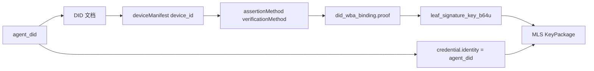
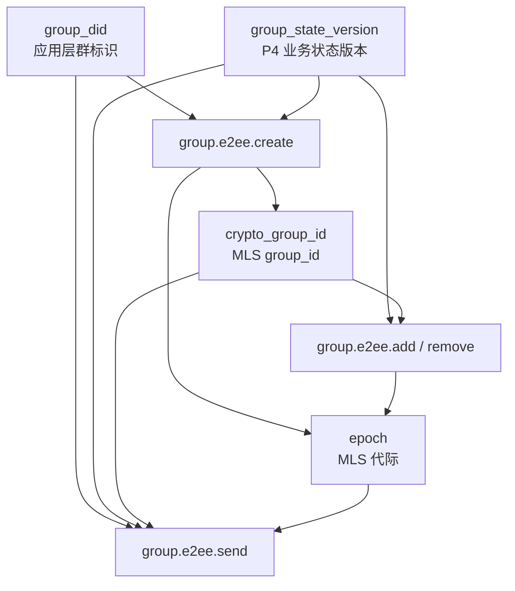
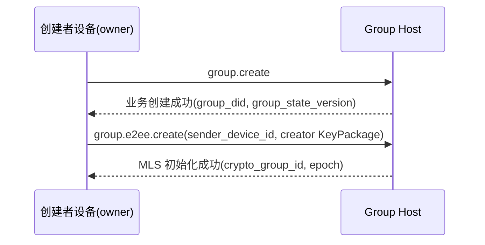
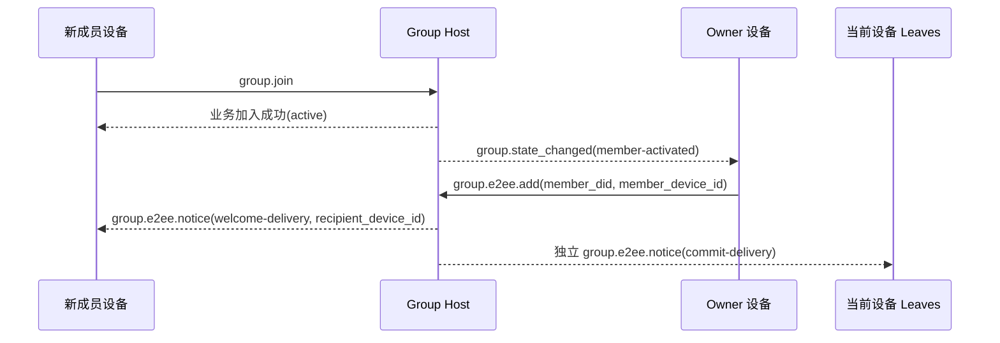
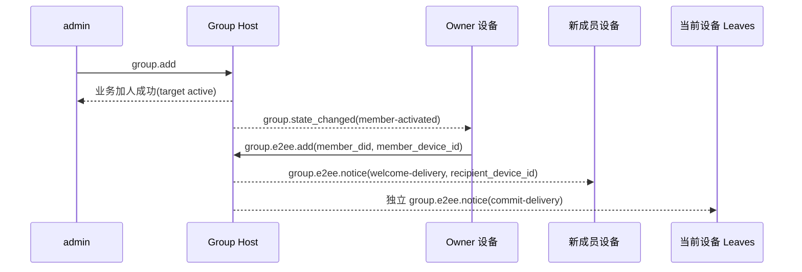
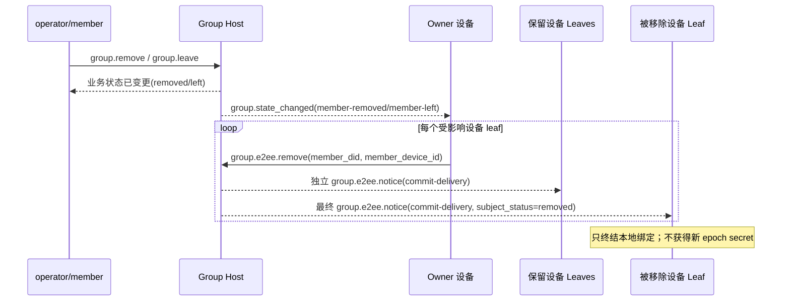
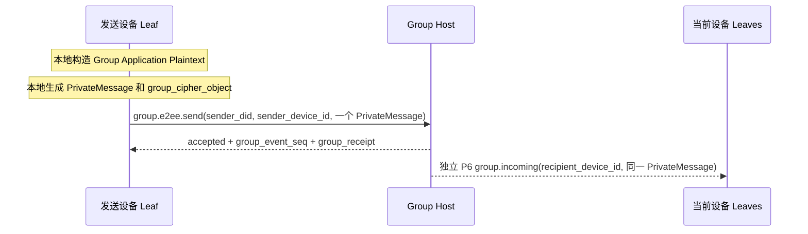
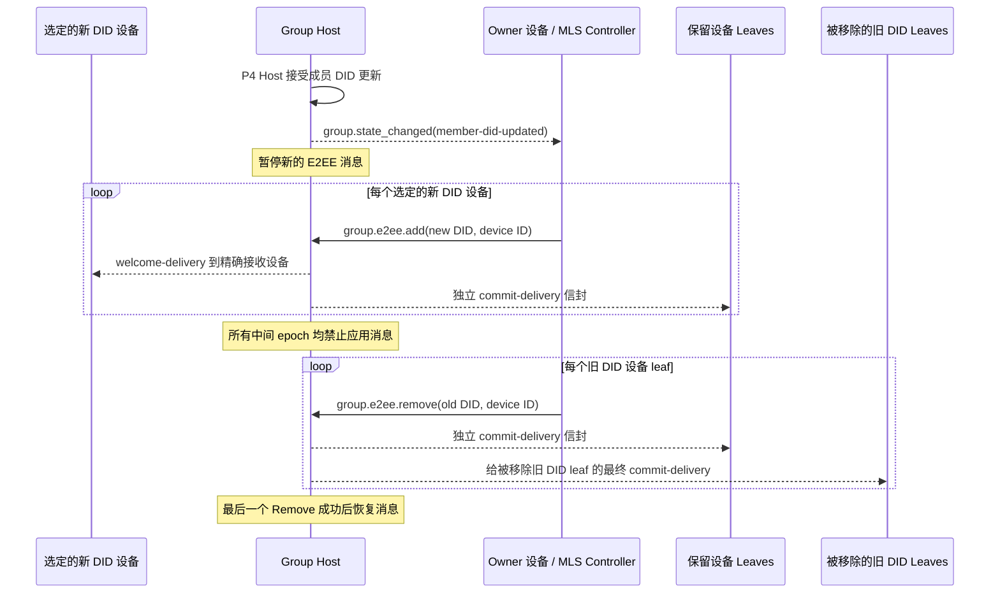

> 日本語参考訳（機械翻訳・未校閲）。規範となるのは原文です。コード例・識別子・規範キーワードは原文を保持しています。
> 原文: [chinese/message/06-群组端到端加密.md](../../../chinese/message/06-群组端到端加密.md) / 基準コミット: `0837cfdfaf4ddcf834f0890ddaf34fc4c824e066`

# ANPプロファイル6:グループ間対エンド暗号化

- 文書番号: ANP-P6
- タイトル:グループ・ツー・エンドの暗号化
- ステータス: 候補者; 統合1.2文書、安定したv2リリースはまだMLS ExpressionType登録を保留
- バージョン: 1.2
- コードブックバージョン: ANP のメッセージング 1.2
- 原文言語: 中文 / このページは日本語参考訳
- プロフィール:`anp.group.e2ee.v2`
- 依存症:`anp.core.binding.v1`、`anp.identity.discovery.v1`、`anp.group.base.v2`
- アプリケーションの範囲: このプロファイルは、グループDIDに基づいてグループ対エンドの暗号化制御レイヤーに適用され、密接に整列 `anp.group.base.v2` 利用する。

---

## 1. 目的:

このProfile は、AMP のグループ・ツー・エンドの暗号化制御レイヤーを定義します。

1. 入れる方法 `group_did`、`group_state_version`、`group_event_seq` (b) パスワードスタタスマシンのグループに結びます。
2. (a) MLS は、グループキーの作成、メンバー変更、メッセージ保護のアプリケーションのためのベースプロトコルとしてどのように使用されます。
3. 方法テスト済みエージェントの DID と資格を使用する方法 `device_id` MLS会員証、KeyPaackage、リーフ署名を結びます。
4. 別のセットを定義する方法 `group.e2ee.*` MLSパスワードアクションを運ぶJSON-RPCメソッド。
5. ???????????????????????????????????????????????????????????????????????????????????????????????????????????????????????????????????????????????????????????????????????????????????????????????????????????????????????????????????????????????????????????????????????????????????????????????????????????????????????????????????????????????????????????????????????????????????????????????????????????????????????????????????????????????????????????????????????????????????????????????????????????????????????????????**州のアライメント**代わりに "P4メソッドは、MLSハンドシェイクオブジェクトを組み込みました" `anp.group.base.v2` コラボレーションを閉じる
6. ??????????????????????????????????????????????????????????????????????????????????????????????????????????????????????????????????????????????????????????????????????????????????????????????????????????????????????????????????????????????????????????????????????????????????????????????????????????????????????????????????????????????????????????????????????????????????????????????????????????????????????????????????????????????????????????????????????????????????????????????????????????????????????????????? `epoch`、`Welcome`、`PrivateMessage`、`PublicMessage`、`epoch_authenticator`、フォークの検出および回復。
7. DIDの更新を受け入れるとP4を採用する方法 `group.e2ee.add` とりあえず `group.e2ee.remove` 対応するMLSリーフを置き換える。
8. P4メンバーのDIDを作成する方法は、DIDレベルのビジネスメンバーの構文を変更することなく複数の独立したMLS機器リーフを持っています。

ベンジャー **なし、いいえ。**定義:

- 歴史のアウトリーチ;
- オンラインで読むこと;
- (a)製品領域内の機器の登録、ネーミング、特徴付け、同期または内部コピー管理。
- KeyPacage のプライベート素材、リーフプライベートキー、epoch seccret または MLS のプライベートな状態をデバイス間で共有する。
- グループ外図同期の特定実現;
- グループ以外のシーンのエンドツーエンド暗号化;
- 外的なコミットの本管;
- `group_join_info` とりあえず `group.e2ee.get_join_info`；
- `accept_welcome` (a) 合意の方法;
- 会員モデルの第二弾。
- MLSのエポック・シークレットの歴史は、復元または再発行されます。

---

## 2. 用語と規範的な関与

### 2.1 仮鍵

このテキスト **MUST**、**MUST NOT**、**REQUIRED**、**SHALL**、**SHALL NOT**、**SHOULD**、**SHOULD NOT**、**RECOMMENDED**、**NOT RECOMMENDED**、**MAY**、**OPTIONAL** 資本金を基準とする規範的な要件として解釈される。

### 2.2 用語集

- **グループID**: グループの適用層のグローバルマーカー、すなわち `group_did`。
- **暗号グループID**: クラスターパスワード内部識別、MLS対応 `group_id`と、 `group_did` 違います。
- **グループホストサービス**: グループベースの状態シーケンシング、戦略的アプリケーションおよびグループメッセージポータルの責任を負うサービス。 MLSコントローラではなく。
- **MLSグループの状態**: MLSメンテナンスに基づくグループパスワード状態
- **エスポック**: MLSグループ状態のインタージェネラル・アドバンス。
- **キーパッケージ**: MLS は、マテリアルオブジェクトに追加します。Ben Profile は、認証されたデバイスリーフをグループに追加するために使用します。
- **おすすめ**: MLSは、新規メンバーがグループ化を開始できるようにオブジェクトを歓迎します。
- **プライベートメッセージ**: 会員認証でMLSメッセージを暗号化しました。
- **パブリックメッセージ**: 暗号化されたMLSメッセージなしでサインインするだけです。
- **ディーヴィスリーフ(Equipment Leaf)**: ワン `(agent_did, device_id)` MLSクリニック/リーフ。P4会員は、ビジネスの対象外です。
- **有資格機器(設備)**: P2に基づく `deviceManifest`引用されているキー, サービス機能とグループ戦略利用可能な `anp.group.e2ee.v2` 有資格機器。
- **DID 装置結合**(ワイヤの名前を保持) `did_wba_binding`: MLSリーフ署名キー、会員証明書またはKeyPacageを検証する `(agent_did, device_id)` オブジェクトを生成します。
- **MLS のコントローラー**: 一般的なMLSメンバーの「変更制御アクション」を実施する責任のある身体。 v2センターグループ `owner` それでも、コントローラー; セクション9.4, 13.4で定義されている同一のDIDデバイスの削除のための狭い例外は、ユニバーサルコントローラではありません。
- **州のカップリング**P4 と P6 はメソッド単位でマップしませんが、ビジネスステータスを変更することでパスワードのコーディングをトリガーします。
- **E2EE 通知**: 配達のためのP6自己定義された独立した暗号化された通知の目的 `commit`、`welcome` コードの結果が待ちます。
- **ターミナルリーフ(最終葉)**: MLSグループリーフから削除されたデバイス。 ローカルグループ結合はもはや不可能です `group_did` アプリケーション情報を送信、受信、または復号化しますが、デバイス自体は現在のP2マニフェストエントリ資格を持つ可能性があります。
- **装置配達キュー(機器配送キュー)**:グループホストはプレスでまだ確認されていないP6転送です `(recipient_did, recipient_device_id)` 永続的な配達状態を維持します。 これは、グループの歴史ではなく、オープンメタデータ、原発証拠(パスによって定義されている場合)および未読のテキストのみを運ぶだけです。
- **フォーク**: 同じのため `group_did`異なるメンバーは、不安定な観察をしました `epoch` / `epoch_authenticator` / ステータスブスターシーケンス。
- **MLSメンバーIDアップデート**: P4 が同じメンバーの DID 更新を受け入れた後、選択した新しい DID デバイスをシーケンスされた委員会リーフに追加することで、すべての古い DID デバイスリーフ パスワード組織を削除します。

---

## 3. デザイン原則

### 3.1 グループIDとパスワードステータスのストラテジー

このプロフィールは明確な区別を作ります:

- `group_did`: 応用層の全体的な同一証明;
- `crypto_group_id`(a)パスワードコミュニティの内部識別;
- `group_state_version`: グループホストが指定したアプリケーションレイヤーステータスバージョン。
- `epoch`: MLSステータスマシンが指定したパスワード生成

これら4つの **MUST NOT** メカニカルに等しい。しかし、それらの間で **MUST** 汎用的な結合関係があります。

### 3.2 1つのエージェントID = 1つの外部グループのメンバー;各デバイス= 1つのMLSの葉

P4の会員、役割、戦略、メンバーシップは現時点ではまだ存在しています。 `agent_did`. P4 v2は、現在のみ使用 `agent_did` サーバメンバーとして、名前、安定したパスフィールド、ローカルレコード識別子はMLSを置き換えることができます。 `credential.identity` . . .

プチ6 **MAY** スタンドアローンMLSクライアントとリーフと同じDIDの複数のデバイスを表示します。 各リーフは維持します `credential.identity = UTF8(agent_did)`セクション6による認証 `device_id` 区別を埋めます。同じDIDを持つ複数のリーフは、追加のP4メンバー、ロール、またはメンバーの番号を作成しません。

各デバイスは、KeyPaackageのプライベート素材、リーフプライベートキー、epoch seccret、MLSの状態を独自に生成し保存します。 これらの値 **MUST NOT** 兄弟のデバイス間でコピーまたは共有します。新しいデバイスは、そのデバイスに向けられている独自のAdd、Commit、歓迎を通じてグループを入力するだけです。

`anp.group.e2ee.v1` 独立系相互接続です。 **MUST NOT** 再説明v1メンバーまたはMLSリーフをv2デバイスリーフとして、V1 MLSグループステータスをV2に直接ロードしないようにします。 このRefileはV1からV2へのSitu状態を定義しません。 任意の移行には、このプロファイル定義以外のプロセスが必要です。 そうでなければ、それは満たされることができません。

### 3.3 P4はビジネスマスターの合意、P6はパスワード制御レベルです。

ベンプロファイルと `anp.group.base.v2` 関係は次のようにします。

- P4 業務の行動、運用状況、グループ化と返信の対称を定義する。
- P6 は、MLS パスワードのアクション、パスワードオブジェクト、バインディングルール、認証要件を定義します。
- P4は運用レベルでの権限を維持します。
- プチ6 **なし、いいえ。**再定義 `active / left / removed` (b) 運営メンバーのステータス
- P4ベースオペレーションと通知は、プロジェクトの新しい場所であるDIDがまだあります。**MUST NOT** P6装置を運ぶ自己portor;
- P6 装置リーフの追加または削除されるたびに、P4メンバーのステータスは独立して変更されません。
- プチ6 **なし、いいえ。**MLS の主物体が P4 メソッドで直接実行される必要があります。

### 3.4 ステートツーステートカップリング、メソッド別マップマッピングではなく

P4-P6 カップリング**ステータス**「P4メソッドは直接P6メソッドをマッピングする」ではなく、Achieved。

つまり、

- P4は、何かが動作しているかどうかを決定します。
- P6 運用状況の変化を観察し、MLSを事前に確認する。

たとえば:

- P4で作成した人のグループが成功し、創設者になった `owner` ??? 独自のオート実行 `group.e2ee.create`
- 会員はP4会員になります `active`、および修飾された装置はまだMLSのグループに入ったことがありませんか。 所有者の執行 `group.e2ee.add(成员 DID, 设备 ID)`
- フィードバック `active` 会員は、別の対象となるデバイスを追加しますか? 所有者はP4ステータスを変更することなく新しい機器レベルを実行できます。 `group.e2ee.add`
- P4 のメンバーが `left` または `removed` ??? 独自の削除、このDIDリーフからすべてのMLSデバイス
- デバイスはP2マニフェストから解散されますが、そのDIDは残っています `active` ??? 所有、または現在の MLS ステータスと DID デバイス管理の承認を兄弟姉妹化し、このデバイスリーフのみを削除
- P4 会員は P4 で作成されます `member-did-updated` ??? 独自の選択された新しい DID デバイスリーフを追加し、すべての古い DID デバイスリーフを削除します。

### 3.5 は MLS のコントローラーです; DID の取り外しと狭い例外です

v2 は、**オーナーのみ DID は、ジェネリック MLS コントローラーの役割を想定しています。**. 一般的な要求制御は、必要な現在のMLSステータスを保持する認定所有者によって提出されます。別の所有者は、個人所有として修飾しません。

オーナーは、以下の責任を負います。

- MLSグループを作成します。
- 導入事例 `add`；
- 導入事例 `remove`；
- オーダーリーの機器別設計による更新 エグゼクティブメンバーIDの追加と削除;
- 会員様の変更を発生させる `commit`；
- 新規メンバーの生成 `welcome`；
- 会員の変更に伴い、退会後 `epoch`。

リーフには、発信者自身が権威ある撤退をした例外だけしかありません。現在のリーフ、権限、DID管理の承認、および現在のMLS州の機器の保有などです。**MAY** キャンセルされたデバイスまたはP2の現在利用できない別のデバイスに提出 `group.e2ee.remove`.例外:

- **MUST NOT** 呼び出し側を「s 自身、まだアクティブな兄弟姉妹、他の DD リーフまたは P4 メンバーを削除します。
- **MUST NOT** P4ロール、ステータス、ジョブの変更_(a) 会員数または人数
- **MUST** コールデバイス独自の現在のMLSステータスを使用して、リーフを1つだけ削除する削除委員会を生成します。
- **MUST NOT** グループホストは、コミットを生成したり、MLS プライベートステータスを解放したりします。

機器管理の承認は、新しいP6要求フィールドではなく、信頼できる導入サイド認証事実です。**MUST** 例外を注入し、 **MUST NOT** 信頼の呼び出し主は自己報告または表示されたキャッシュを送信します。


P6のコアアイデアは、MLSオブジェクトをP4メソッドにプッシュするものではありませんが、パスワードがビジネスと並んで移動し続けることは不可能です。次の図は、この「ステートツーステート」を一般的な画像に凝縮し、読者はメソッド間の因果関係を理解し、セクションの制約を後ろに読み込むのを助けます。

```mermaid
flowchart TB
P4[P4 业务状态变化<br/>group.create / member active / member left or removed / member DID updated]
OBS[owner 观察业务状态]

CREATE[group.e2ee.create]
ADD[group.e2ee.add(DID + device)]
REMOVE[group.e2ee.remove(DID + device)]
DID_UPDATE_ADD[group.e2ee.add(new DID devices)]
DID_UPDATE_REMOVE[group.e2ee.remove(old DID devices)]

HOST[Group Host]
NOTICE[group.e2ee.notice]

P4 --> OBS
OBS -->|群已创建且尚无 crypto_group_id| CREATE
OBS -->|合格设备未进入 MLS| ADD
OBS -->|设备或 DID 必须离开 MLS| REMOVE
OBS -->|P4 成员已DID 更新且旧 Leaf 仍存在| DID_UPDATE_ADD

CREATE --> HOST
ADD --> HOST
REMOVE --> HOST
DID_UPDATE_ADD --> HOST
DID_UPDATE_ADD -->|DID 更新 Add 已接受后执行| DID_UPDATE_REMOVE
DID_UPDATE_REMOVE --> HOST

HOST --> NOTICE
```

*図P6-1: P4/P6 状態の収束(非調整)。*

数値は、新しい運用状況のマシンではなくトリガー関係を強調します。P4は、ビジネスレベルで権威を維持し、P6はこれらの結果だけを観察し、MLSのキュレート/追加/削除にそれらを置きます。
### 3.6 グループ ホストは、MLS 制御ではなくソートを担当しています

グループホストサービスの職務は次のとおりです。

- P4 の動作を受け取り、ソートします。
- 受入事件の配分 `group_event_seq`；
- プッシュ! `group_state_version`；
- 生成する `group_receipt`；
- ニュースレターのニュースグループとE2EE Noteが配布されました。
- 各ターゲットデバイスリーフ用のMLSオブジェクトの独立した暗号化された配信を作成します。ただし、復号化や再暗号化は行いません。
- 経営レベルでのMLS制御結果の低下を拭く。

デフォルトでは、グループホストサービス:

- **いったん。** MLS のコントローラーとして;
- **いったん。** MLSグループのメンバーとして
- **いったん。** 明示的に分類された機能のグループを保持します。
- **MUST NOT** デバイス間でMLSのプライベートステータスやEPOCが秘密にコピーします。

### 3.7 オーナーグループステータス、アクティブメンバーグループメッセージ

独自制御:

- (a) 会員の変更
- (a) グループパスワードのステータスの推移;
- `epoch` 更新情報

全部で `active` メンバー、MLS リーフで現在認定された機器:

- グループメッセージのメッセージをグループの状態で生成します。
- コールセンター `group.e2ee.send` 独自のメッセージのグループを送信します。
- 新着情報は受け付けていません。

ベンジャー **なし、いいえ。**ユーザーは、グループメッセージが全て所有者によって暗号化されるように要求します。

セクション 3.5 同じ DID 例外では、権限を付与して作成、追加、削除、更新、または第三者の制御を行うことはできません。

### 3.8 v2 対応していません

v2 で:

- 未対応
- 未定義 `group_join_info`；
- 未定義 `group.e2ee.get_join_info`；
- 未定義 `accept_welcome` (c) プロトコルメソッド。

エントリーパスは、最終的に所有者が開始したMLSのパスワードレベルに収斂 `add`。

### 3.9 情報のみがPrivateMessageに入力

v2 で:

- ちょうど... `group.e2ee.send` MLS にメッセージ内容を適用 `PrivateMessage` 暗号化されている。
- `group.e2ee.create`、`group.e2ee.add`、`group.e2ee.remove` 明示的なJSON-RPCリクエストを引き続き使用し、DID更新リセット `add` とりあえず `remove`, 要求の新しいメソッドを定義しません。
- `commit`、`welcome` 同等オブジェクトは、P4ビジネスメソッドを埋め込むのではなく、入る方法や通知負荷として表示されます。

---

## 4. 依存性、プロファイル識別およびターゲットモデリング

### 4.1 プロフィール名

このProfile の標準的な名前は、次のとおりです。

`anp.group.e2ee.v2`

### 4.2 依存症

ベンジャー **MUST** 次のデータに依存します。

- `anp.core.binding.v1`
- `anp.identity.discovery.v1`
- `anp.group.base.v2`

### 4.3 セキュリティモード

このファイルを使用する際:

- `meta.profile` **MUST** イーグル `anp.group.e2ee.v2`。
- P6 は、このProfile で定義する各デバイスに対して要求します。 **MUST** カリカリ `meta.sender_device_id`♪ と入れて `meta.sender_did` . 現在のP2マニフェストエントリがバインドします。
- 各オブジェクトのP6通知または暗号化された配信 **MUST** カリカリ `meta.recipient_device_id`とりあえず `meta.target.did` . . .
- これらの自己体はP6です。 P4ベース操作と通知 **MUST NOT** それらを継承する。

の の の の の の の の の の の の の の の の の の の の の の の の の の の の の の の の の の の の の の の の の の の の の の の の の の の の の の の の の の の の の の の の の の の の の の です:

- `group.e2ee.publish_key_package`、`group.e2ee.get_key_package`、`group.e2ee.notice` **MUST** 利用条件 `transport-protected`
- `group.e2ee.create`、`group.e2ee.add`、`group.e2ee.remove`、`group.e2ee.send` P6 を使って `group.incoming` **MUST** 利用条件 `group-e2ee`

えー。 `group.e2ee.send` blogger は次のように追加します。`group-e2ee` これは、それが運ぶメッセージがグループE2EEに意味することを意味します。これは、その外部層JSON-RPCリクエストボディがグループによって再び暗号化されるという意味ではありません。

### 4.4 方法論的目的モデリング

### 4.4.1 サービススコープ

次の取り組み **MUST** あり あり `service-scoped`：

- `group.e2ee.publish_key_package`
- `group.e2ee.get_key_package`
- `group.e2ee.create`

ルール:

- `meta.target.kind = "service"`
- `meta.target.did` **MUST** ターゲットが開いているようなもの。 `ANPMessageService.serviceDid`

のは、 `group.e2ee.create` サービススコープの採用理由は次のとおりです。
運用レベル `group.create` 成功の先、グループが設立されました。`group_did` 生成されたものの、作成アクション自体は、パスワードの初期化のためにホストサービスポータルをグループ化し、V2ではサービススコープが使用されます。

### 4.4.2 グループアドレス

次の取り組み **MUST** あり あり `group-addressed`：

- `group.e2ee.add`
- `group.e2ee.remove`
- `group.e2ee.send`

ルール:

- `meta.target.kind = "group"`
- `meta.target.did` **MUST** ターゲットです。 `group_did`

### 4.4.3 エージェントが通知をアドレス指定

新着情報 **MUST** あり あり `agent-addressed`：

- `group.e2ee.notice`
- 秘密の配達の適用のためのP6 `group.incoming`

ルール:

- `meta.target.kind = "agent"`
- `meta.target.did` **MUST** 通知の受信者に同等
- `meta.recipient_device_id` **MUST** 正確な受信機装置リーフを選択します。通知 **MUST NOT** デバイスを兄弟姉妹化するためにリダイレクトします。
- このプロファイルは定義しません `target.kind = "device"`。

---

## 5. パスワード 主要なラインおよびMTIのパッケージ

### 5.1 メインライン契約

このプロファイルグループキーメインライン **MUST** MLS 1.0 は、MLS 1.0 の構文を使って実現しますが、v2 は制限されたサブセットだけを固定します。

v2 主要なラインは少なくとも含んでいます:

- キーパッケージ
- アクセサリー
- 削除
- コンテンツ
- おすすめ
- プライベートメッセージ
- Epoch プッシュ

P4メンバーのDID更新は、新しいP6方法やMLSを導入していません。 最初に選択した各新しいDIDデバイス用に1つを生成します `group.e2ee.add` コミットし、古い DID デバイスリーフごとに 1 つ以上の時間を作成します。 `group.e2ee.remove` コミット。

の の の の の の の の の の の の の の の の の の の の の の の の の の の の の の の の の の の の の の の の の の の の の の の の の の の の の の の の の の の の の の の の の の の の の の です:

- `commit_b64u` **MUST** 完全なMLSによって `MLSMessage`（`mls-public-message`)は、TLSの元バイトによってシーケンスされる;
- `welcome_b64u` **MUST** によって MLS `Welcome` オブジェクトは TLS がシーケンスした後に元のバイトとして表現されます。
- `PrivateMessage` **MUST** グループアプリケーションに対するメッセージの唯一の受信者として。

MLSライブラリー **MAY** 追加のサポート `Update`標準機能、標準監視、PSK、ReInit; がこれらの機能 **なし** このProfile v2 の最小プロトコルメインラインも **会員でない** v2 は相互運用性を必要とします。

### 5.2 必須-対増幅パッケージ

最小相互接続性を確保するために、このファイルの達成と一致 **MUST** 以下のMTIパッケージをサポート:

`MLS_128_DHKEMX25519_AES128GCM_SHA256_Ed25519`

### 5.3 パッケージの余分

受賞作品 **MAY** MLSパッケージのサポート

- 同じグループのメンバー全員が参加する。 **MUST** (a) 使用するパッケージの同意
- グループポリシーが制限されている場合、MLS契約者はパッケージコレクションを許可します **MUST** 戦略を満足させないパッケージを注入します。

### 5.4 DIDアイデンティティとの関係

このProfile のメインラインは、次の DID アイデンティティに関連します。

- DID ドキュメント `assertionMethod` (b) アイデンティティの結合のため;
- DID ドキュメント `keyAgreement` **SHOULD** (a) は、エージェントが E2EE 機能を持っていることを示す少なくとも 1 つの X25519 エントリが含まれています。
- プチスイム `deviceManifest` 現行機器のエントリーの特定、 `signing_key_id`、`e2ee_key_id` とりあえず `anp.group.e2ee.v2` (a) 適格性;
- MLSグループメンバーのリーフ署名キー **いったん。** DID の長期署名キーと直接等しい;
- 葉署名キー **SHOULD** 別々に作成し、 `(agent_did, device_id)`。

---

## 6. DID は MLS メソッドにモデルを結合しません

### 6.1 ターゲティング

このプロファイルは、次のMLS要素を結合する必要があります。 `(agent_did, device_id)`：

1. KeyPacageの所有者;
2. 現在の葉の署名キー;
3. (a) グループメンバー証明書の ID 文字列;
4. 証拠を結合するのに使用されるP2マニフェストの署名のキーの参照。

### 6.2 犯罪者ID規則

このプロフィールのために、MLSのメンバーの証明書 `credential.identity` **MUST** 流れ葉を等しくします `agent_did` . 読みやすい名前、安定した主要な道かローカル同一 **MUST NOT** 執筆または置換 `credential.identity`。

受賞作品 **MUST NOT** ローカルアカウントID、デバイスID、値ユーザID、その他の非DID文字列で置換 `credential.identity`。

そのため、同じDIDの兄弟葉は同じです `credential.identity`別の証明としかし `device_id`. 認証パーティーは、完全なバイナリグループでP6リーフを識別し、単独で任意の値を使用しないでください。

### 6.3 `did_wba_binding` オブジェクト

このプロファイル定義 `did_wba_binding` オブジェクトは、MLSリーフ署名キーを結合する `agent_did` 以下は、認定されたデバイスです。 `anp_did_wba_device_binding` 延長無制限 `agent_did` DIDメソッド。

推奨構造は以下の通りです。

```json
{
  "agent_did": "did:wba:example.com:agents:alice:e1_<fingerprint>",
  "device_id": "dev-a-7N3KQ2",
  "verification_method": "did:wba:example.com:agents:alice:e1_<fingerprint>#dev-a-sign",
  "leaf_signature_key_b64u": "BASE64URL_ED25519_LEAF_PK",
  "issued_at": "2026-03-29T12:00:00Z",
  "expires_at": "2026-04-29T12:00:00Z",
  "proof": {
    "type": "DataIntegrityProof",
    "cryptosuite": "eddsa-jcs-2022",
    "created": "2026-03-29T12:00:00Z",
    "proofPurpose": "assertionMethod",
    "verificationMethod": "did:wba:example.com:agents:alice:e1_<fingerprint>#dev-a-sign",
    "proofValue": "z..."
  }
}
```

`did_wba_binding.proof` **MUST** P1付録B定義の共有を適用する **オブジェクトの証拠のプロフィール**。

えー。 `did_wba_binding` のために:

- 発行者 DID **MUST** あり あり `agent_did`
- 保護された文書 **MUST** 削除 `proof` あとで。 `did_wba_binding` オブジェクト
- `device_id` **MUST** 利用可能な現在のP2マニフェストを識別します `anp.group.e2ee.v2` 資格の記入
- `verification_method` とりあえず `proof.verificationMethod` **MUST** この記事の目的を等価する `signing_key_id`、そして保つこと **MUST** プール `agent_did` DID ドキュメント `assertionMethod` 権威の委任

#### 6.3.1 `anp_did_wba_device_binding` MLS拡張

現行の草案は以下の通りです。 `anp_did_wba_device_binding` MLS暫定プライベート `ExtensionType` `0xF0A1`. IANAが認める値ではなく、**MUST** 可視協議のみ `anp.group.e2ee.v2` . v2リリース前のAnP **MUST** 安定的な登録ポイントの発行、事業損失検討に原案値を変更。

`extension_data` バイト完了 `did_wba_binding` JSON オブジェクト (含む) `proof`. V2 KeyPacageはリーフノードを運びます **MUST** グループ内で保持されるタイプの拡張機能の補完 **MUST** 同じ結合を保ちましょう。リーフノード `capabilities.extensions` グループコンテキストで `required_capabilities` エクステンション **MUST** リスト `0xF0A1`。

v2 不足している、重複した、フォーマットエラー、非サポートまたは衝突による拡張または機能宣言の達成 **MUST** 取り除かれて下さい。それは制御表面を扱うこと容易です。 `group_key_package.did_wba_binding` 会員名簿 **MUST** 同JCSは、埋め込まれた拡張子と同じバイトで、拡張を交換することはできません。

### 6.4 `did_wba_binding` 認証ルール

受取人は新規ユーザーだけでなく、KeyPaackage、Fリーフノードの更新や新メンバーを受け入れる前に、ボードの新しいメンバーです。**MUST** 下記の検証が完了しました。

1. プレス [P2 方法検証](../../../chinese/message/02-身份与发现.md#method-validation)パーシングと検証 `agent_did` 、現在の DID 文書;
2. `device_id` 流れ P2 `deviceManifest` 一度起きて、宣言されたのは... `anp.group.e2ee.v2` 依存関係;
3. `verification_method` 現在のエントリを同等 `signing_key_id`と によって `assertionMethod` (a) 認可;
4. `proof` **MUST** 既存のAppendix BのP1に会い、
5. `proof` ユーザ名は、 `agent_did`、および証明は検証しました;
6. 保護された文書は少なくとも上書きします `agent_did`、`device_id`、`verification_method`、`leaf_signature_key_b64u`、`issued_at` とりあえず `expires_at`；
7. KeyPaackage/リーフノードは、セクション6.01の拡張機能と必要な機能宣言を運びます。
8. 組み込み拡張と兄弟 `did_wba_binding` 同じ JCS バイトを正確に持っている。
9. 実際の葉の印はとの公共のキーを署名します `leaf_signature_key_b64u` (a) 関係;
10. MLS証明書 `credential.identity` とりあえず `agent_did` (a) 関係;
11. #Sue、グループ戦略、 `issued_at` / `expires_at` タイムウィンドウが有効です。


P6 定義する理由 `did_wba_binding`、MLSの葉署名キーは、DID永続的なアイデンティティ署名鍵に直接等しくないべきではないので。次の図は `agent_did`、DID 文書、バインディングオブジェクト、KeyPaackage/credential.idity リンクは、リーダーが認証の順序を理解しているのを支援します。



*図P6-2: MLS(unnormative)にリンクされたDID/Equipment。*

実際の認証が行われる場合、受信者は内部のMLS署名が有効であるかどうかをチェックするだけでなく、このチェーンに沿って確認し続ける必要があります。 `credential.identity`、`device_id`、葉署名のキー、現在のマニフェストの記入項目および `agent_did` それら間の結合は完了します。
### 6.5 DID法とボンディングの証明書

- 対応するDIDメソッドの場合、`did_wba_binding.proof` **MUST** 再制定P1の付録BのshareObjectの証拠の教授;
- 互換性 `k1_` ドイド,`did_wba_binding.proof` **MAY** エンドの相談定義の交換を使用してください。 **なし、いいえ。**- それを置きます。 `k1_` デフォルトの相互運用パスとしてタイの証拠;
- ID のアイデンティティ・カーブが、MLS グループのための MTI の葉署名のキーに存在しているものは何でも **MAY** Ed25519 を使うと、結合証明書が確立されるのは十分です。

---

## 7. コアオブジェクト

### 7.1 `crypto_group_id`

`crypto_group_id` MLS用インナー `group_id`。

ルールは以下の通りです。

- `crypto_group_id` **MUST** (a) 不透明度バイトとして扱われます;
- ジェイソン **MUST** 採用情報 `base64url` フィールド名が推奨されることを示します。 `crypto_group_id_b64u`；
- `crypto_group_id` **MUST** とりあえず `group_did` 検証可能なバインディングを作成します。

### 7.2 `group_state_ref`

このプロファイルは、P4 を再使用 `group_state_ref` コンセプトは、E2EEグループで少なくとも必要です。

- `group_did`
- `group_state_version`
- `policy_hash`「戦術の馬車が橋渡しされると」


グループE2EEでは、リーダーは、識別/バージョンの4つの異なるレベルを持つ脳内のエラーに最も有利です。グループID、ビジネスステータスバージョン、パスワード内部グループ_idとMLSの画期的な図。次の図は、これらの4人のそれぞれのソースとプロモーションとの関係を示しています。



*図 P6-3:`group_did`、`crypto_group_id`、`group_state_version` とりあえず `epoch` 関係(非規範的)。*

その後のオブジェクトと認証ルールの構造は、座標の異なるレベルであると考えられているような方法で読み込まれるべきです。それらはバインドする必要がありますが、互いに交換したり、カイナーと機械的に同等のものとみなされることはありません。
### 7.3 `group_key_package`

このプロファイル定義グループは、材料包装オブジェクトを追加します。

```text
{
  "key_package_id": "kp-001",
  "owner_did": "did:wba:example.com:agents:bob:e1_<fingerprint>",
  "owner_device_id": "dev-b-4M8P1X",
  "suite": "MLS_128_DHKEMX25519_AES128GCM_SHA256_Ed25519",
  "mls_key_package_b64u": "BASE64URL_KEYPACKAGE",
  "did_wba_binding": { ... },
  "expires_at": "2026-04-30T00:00:00Z"
}
```

の の の の の の の の の の の の の の の の の の の の の の の の の の の の の の の の の の の の の の の の の の の の の の の の の の の の の の の の の の の の の の の の の の の の の の です:

- `key_package_id` **MUST** 存在;
- `owner_did` **MUST** 存在;
- `owner_device_id` **MUST** 存在;
- `suite` **MUST** 存在;
- `mls_key_package_b64u` **MUST** 存在;
- `did_wba_binding` **MUST** 存在;
- `expires_at` **SHOULD** 存在;
- `mls_key_package_b64u` **MUST** MLS への `KeyPackage` オブジェクトは、ベース64url を埋めずに MLS 1.0 TLS でシーケンスされます。
- `owner_did` とりあえず `owner_device_id` **MUST** エクワルズ `did_wba_binding.agent_did` とりあえず `did_wba_binding.device_id`；
- 1つのKeyPacageは1つの装置に属します、**MUST NOT** 別の機器用リーフ。その消費量と、可視ステートメントの展開のための最後のリゾートの再使用はセクション13.2を続行します。

`group_key_package` 主に所有者のフォローアップのために `group.e2ee.add`。

### 7.4 `group_cipher_object`

`group_cipher_object` あり。 `group.e2ee.send` . 行ベースのメッセージオブジェクト。

推奨構造は以下の通りです。

```json
{
  "crypto_group_id_b64u": "BASE64URL_GROUPID",
  "epoch": "7",
  "private_message_b64u": "BASE64URL_PRIVATEMESSAGE",
  "group_state_ref": {
    "group_did": "did:wba:groups.example:team:dev:e1_<fingerprint>",
    "group_state_version": "42",
    "policy_hash": "sha-256:..."
  },
  "epoch_authenticator": "BASE64URL_AUTH"
}
```

ルール:

- `crypto_group_id_b64u` **MUST** 存在;
- `epoch` **MUST** 存在;
- `private_message_b64u` **MUST** 存在;
- `private_message_b64u` **MUST** MLS への `PrivateMessage` (a) MLS 1.0 TLS で配列するオブジェクトの元のバイトアンフィリングベース64url;
- `group_state_ref.group_did` **MUST** 外部ターゲットと等しい。 `group_did`。

### 7.5 `Group Application Plaintext`

グループがメッセージをMLSに適用する `PrivateMessage` ブロガーは次のように述べています。**MUST** 次のオブジェクトは内部レイヤーで定義されます。

```json
{
  "application_content_type": "text/plain | application/json | application/anp-attachment-manifest+json | ...",
  "thread_id": "thr-001",
  "reply_to_message_id": "msg-0009",
  "annotations": {},
  "text": "...",
  "payload": {},
  "payload_b64u": "..."
}
```

ルール:

- `application_content_type` **MUST** 存在;
- `text` / `payload` / `payload_b64u` **MUST** 事件が起きた。
- P4 メッセージの同義語 フィールド `thread_id`、`reply_to_message_id`、`annotations` グループE2EEの下 **MUST** (a)はオブジェクトの内部層にあります。
- 暗号化前の送信者 **MUST** ♪ みんなで盛りだくさん♪ `Group Application Plaintext` UTF-8 + RFC 8785 JCS のシーケンスを使用してバイトを強制的に実行するオブジェクト。 受信者による復号化後 **MUST** オブジェクトは同じルールに従って解釈されます。

いつ? `application_content_type = "application/json"` できるかどうかはわかりません。`payload` **MUST**
JSON オブジェクトを直接読み込みます。このファイルは、そのオブジェクトの内フィールドのビジネスの意味を定義しません。

通常のJSONグループアプリケーションフィールド:

```json
{
  "application_content_type": "application/json",
  "thread_id": "thr-001",
  "payload": {
    "type": "example",
    "data": {
      "hello": "group"
    }
  }
}
```

### 7.6 `e2ee_notice_object`

P6 は、パスワード結果の配信のためにスタンドアローン暗号化された通知オブジェクトを定義します。

推奨構造は以下の通りです。

```text
{
  "notice_id": "en-001",
  "notice_type": "commit-delivery | welcome-delivery",
  "group_did": "did:wba:groups.example:team:dev:e1_<fingerprint>",
  "group_state_ref": {
    "group_did": "did:wba:groups.example:team:dev:e1_<fingerprint>",
    "group_state_version": "43",
    "policy_hash": "sha-256:..."
  },
  "crypto_group_id_b64u": "BASE64URL_GROUPID",
  "epoch": "8",
  "subject_did": "did:wba:b.example:agents:bob:e1_<fingerprint>",
  "subject_device_id": "dev-b-4M8P1X",
  "subject_status": "active | removed",
  "commit_b64u": "BASE64URL_MLSMESSAGE",
  "welcome_b64u": "BASE64URL_WELCOME",
  "ratchet_tree_b64u": "BASE64URL_RATCHET_TREE",
  "epoch_authenticator": "BASE64URL_AUTH",
  "group_receipt": { ... }
}
```

ルール:

- `notice_id` **MUST** あります。**MUST** (a) 同じ封筒に再投資間の安定性を維持し、 **MUST NOT** 同じ受信機に送信される別の論理通知のために再使用。同じパスワード結果の各葉のコピー **MAY** シェアする `notice_id`、各装置が重量によって自身の封筒にだけ与えられ、キーはありますので `(group_did, notice_id)`；
- `notice_type` **MUST** 存在;
- `group_did` **MUST** 存在;
- `group_state_ref` **MUST** 存在;
- `crypto_group_id_b64u` **MUST** 存在;
- `epoch` **MUST** 存在;
- `notice_type = "commit-delivery"` できるかどうかはわかりません。`commit_b64u` **MUST** 存在;
- `notice_type = "welcome-delivery"` できるかどうかはわかりません。`welcome_b64u` とりあえず `ratchet_tree_b64u` **MUST** (a)同時プレゼンス;
- 会員のDIDフォーマットは、良い考えです。`group_state_ref` **MUST** 各P6の受け入れられたP4を正確に引用して追加し、取除きます `member-did-updated` イベント. 受信者 **MUST** P4イベントと現在のDIDから古いDIDを取得, ないP6通知に依存して、再び継続的にフィールドを運ぶ;
- `subject_did`、`subject_device_id` とりあえず `subject_status` 1つのリーフだけ:加えられたDID/装置を使用してこのP6操作の影響をと記述するために `active`、削除されたDID/装置と取除かれる `removed`；
- 実際に通知を受け取る装置は外床だけです `meta.target.did` とりあえず `meta.recipient_device_id` 識別;で `commit-delivery` , それは影響を受ける主題と異なってもいいです。 削除のために `commit-delivery`受取人。 **MAY** (a) 削除された被写体リーフ自体は、セクション12.3の下に最終通知を受け取ります。
- `ratchet_tree_b64u` **MUST** トラッカーツリーのTLSの元のバイトをシリアライズするための未充填ケース64url。
- `group_receipt` **MAY** 業務ランキングでパスワード結果のリンクをすること。

---

## 8. KeyPacage の普及と発見方法

### 8.1 `group.e2ee.publish_key_package`

#### 8.1.1 統計学

エージェントが自ら公開した人 `ANPMessageService` グループが参加するKeyPaackageをグループで利用できるようになりました。

#### 8.1.2 リクエスト

- `method = "group.e2ee.publish_key_package"`
- `meta.profile = "anp.group.e2ee.v2"`
- `meta.security_profile = "transport-protected"`
- `meta.target.kind = "service"`
- `meta.target.did` **MUST** 出版社自身と同じです。 `ANPMessageService.serviceDid`
- `meta.sender_did` **MUST** プレゼンス
- `meta.sender_device_id` **MUST** プレゼンス
- `body.group_key_package` **MUST** プレゼンス
- `body.group_key_package.owner_did` **MUST** イーグル `meta.sender_did`
- `body.group_key_package.owner_device_id` とりあえず `body.group_key_package.did_wba_binding.device_id` **MUST** イーグル `meta.sender_device_id`
- KeyPackage の受入前にサービスをリリース **MUST** 現在のP2マニフェストエントリがセクション6にバインドされていることを確認し、確認します。

証明の制約:

- メソッドは、 **サービススコープ** フェイスメソッドの制御
- コールア **MUST** 認証されたローカルセッションまたは同等のホップ/サービス認証のコンテキストで実行します。
- .............................................................................................................. **リクエストなし** この方法論の新しいビジネスレイヤーの追加定義 `origin_proof`。

#### 8.1.3 成功の応答

成功の応答 **MUST** 少なくとも含まれます:

- `published = true`
- `owner_did`
- `owner_device_id`
- `key_package_id`
- `published_at`

### 8.2 `group.e2ee.get_key_package`

#### 8.2.1 科学

ターゲットエージェント `ANPMessageService` 利用可能なKeyPaackageを入手してください。

#### 8.2.2 リクエスト

- `meta.profile = "anp.group.e2ee.v2"`
- `meta.security_profile = "transport-protected"`
- `meta.target.kind = "service"`
- `meta.target.did` **MUST** ターゲット、エージェントです。 `ANPMessageService.serviceDid`
- `meta.sender_did` **MUST** プレゼンス
- `meta.sender_device_id` **MUST** 認証情報 `meta.sender_did` P6 の適性を持つ現在の装置

`body` **MUST** 含まれる:

- `target_did`
- `target_device_id`

`body` **MAY** 含まれる:

- `preferred_suite`
- `require_fresh`

証明の制約:

- メソッドは、 **サービススコープ** フェイスメソッドの制御
- 認証コンテキスト **MUST** 結合は精密です。 `(meta.sender_did, meta.sender_device_id)` 設備と機器 **MUST** 現在のP2マニフェストはまだ資格があります。
- v2 最低の相互運用の条件少なくともホップ/サービス レベル証明;
- **KeyPackage は v2 MTI に完全アクセスしません。**。

#### 8.2.3 応答の成功

成功の応答 **MUST** 少なくとも含まれます:

- `target_did`
- `target_device_id`
- `group_key_package`

#### 8.2.4 サービスの終了の発行規則

`ANPMessageService` バックリング `group_key_package` _その他組織

- **SHOULD** 未確認、解読、不燃のKeyPackageを返します。
- **MUST** バックナンバー `owner_did` とりあえず `owner_device_id` ターゲットバイナリを要求するのは、KeyPacage であり、 **MUST NOT** 兄弟の装置と取り替えて下さい;
- 帰国前 **MUST** 現在のP2マニフェストに基づくターゲット機器の無効化;
- **MAY** 返送後、これを「P」としてマークする `reserved` (b) 並列および重複発行を避けるための価格の同等性。
- 正しいものになると `group.e2ee.add`グループホストが正常に受け入れ、メンバーのパスワード変更を完了した後、新しいコードを取得することができませんでした。**MUST** マークとして `consumed` またはリリースプールから削除します。
- 対応するプロセスが失敗した場合、キャンセルまたは超過時間の場合、予約済みKeyPackageをデプロイ戦略で決定するか否か、 **SHOULD NOT** 両方を成功させるのと同じKeyPacageです。 `group.e2ee.add` 操作および再使用;
- コールワー教育、フロー制限、アンチアブラス戦略 **MUST** ホップ/サービスレベルの認証に基づく実行

---

## 9. MLS 制御フェイスメソッド

### 9.1 一般規定

この章はスタンドアローンJPON-RPCのアプローチに基づいています。 P4ビジネスメソッドには「追加フィールド」ではなく、独自のパスワード制御アクションです。

の の の の の の の の の の の の の の の の の の の の の の の の の の の の の の の の の の の の の の の の の の の の の の の の の の の の の の の の の の の の の の の の の の の の の の です:

- `group.e2ee.create`、`group.e2ee.add`、`group.e2ee.remove` あり。**メンバーのコントロール方法の変更**
- `group.e2ee.send` あり。**メッセージ送信方法**
- `group.e2ee.create/add/remove` 創業の事業状態にP4をつないで、**P4 新規会員登録が作成されない**
- `group.e2ee.send` オンラインで直接送る方法として、もはや渡しません `group.send` 二次包装

### 9.2 `group.e2ee.create`

#### 9.2.1 科学

新規のMLSグループ状態を作成し、所有者を初期メンバーとして参加します。

#### 9.2.2 コールワー

オーナーのみ。

#### 9.2.3 リクエスト

- `method = "group.e2ee.create"`
- `meta.profile = "anp.group.e2ee.v2"`
- `meta.security_profile = "group-e2ee"`
- `meta.target.kind = "service"`
- `meta.target.did` **MUST** 対象グループと同じ ホストが公開した `ANPMessageService.serviceDid`
- `meta.sender_did` **MUST** 現行グループへの同等 `owner`
- `meta.sender_device_id` **MUST** 必要な現在のMLSステータスで適切な所有者デバイスをマークする
- `auth.origin_proof` **MUST** プレゼンス

`body` **MUST** 少なくとも含まれます:

- `group_did`
- `group_state_ref`
- `suite`
- `creator_key_package`
- `crypto_group_id_b64u`
- `epoch`

ルール:

- `creator_key_package.owner_did` **MUST** イーグル `meta.sender_did`
- `creator_key_package.owner_device_id` **MUST** イーグル `meta.sender_device_id`
- `group_state_ref.group_did` **MUST** イーグル `body.group_did`
- `epoch` 初期グループステータスについて **SHOULD** あり あり `"0"` または、合意した初期値を達成するために

#### 9.2.4 応答の成功

成功の応答 **MUST** 少なくとも含まれます:

- `created = true`
- `group_did`
- `group_state_ref`
- `crypto_group_id_b64u`
- `epoch`
- `accepted_at`

注意:

- `group.e2ee.create` それだけで **MUST NOT** 別々に新しいP4ビジネスグループを作成します。
- ちょうど... `group.create` 運用レベルでの受入後実施
- 新たなものを一人で作らない。 `group_state_version` または `group_event_seq`。

### 9.3 `group.e2ee.add`

#### 9.3.1 統計

オーナーが実行するMLS `add`P4をオンにします。 `active` 会員資格のデバイスリーフがパスワードグループに参加します。同じアクティブIDの2番目のデバイスは別の追加を使用し、別のP4メンバーを作成していません。

#### 9.3.2 コールワー

オーナーのみ。

#### 9.3.3 情報へのリクエスト

- `method = "group.e2ee.add"`
- `meta.profile = "anp.group.e2ee.v2"`
- `meta.security_profile = "group-e2ee"`
- `meta.target.kind = "group"`
- `meta.target.did` **MUST** ターゲットです。 `group_did`
- `meta.sender_did` **MUST** 現行グループへの同等 `owner`
- `meta.sender_device_id` **MUST** 必要な現在のMLSステータスで適切な所有者デバイスをマークする
- `auth.origin_proof` **MUST** プレゼンス

`body` **MUST** 少なくとも含まれます:

- `member_did`
- `member_device_id`
- `group_state_ref`
- `group_key_package`
- `crypto_group_id_b64u`
- `epoch`
- `commit_b64u`
- `welcome_b64u`
- `ratchet_tree_b64u`

ルール:

- `group_state_ref.group_did` **MUST** 外部ターゲットと等しい。 `group_did`
- `group_key_package.owner_did` **MUST** イーグル `member_did`
- `group_key_package.owner_device_id` とりあえず `group_key_package.did_wba_binding.device_id` **MUST** イーグル `member_device_id`
- `commit_b64u` **MUST** 完全なMLSのため `MLSMessage` TLS で配列される未充填オブジェクト
- `welcome_b64u` **MUST** MLS への `Welcome` TLS で配列される未充填オブジェクト
- `ratchet_tree_b64u` **MUST** オリジナルバイトを埋め立てたトラックセットツリーのシリアル化 TLS
- `epoch` **MUST** 今回は、 `add` あとで新しい。 `epoch`
- 通常のパス,`member_did` **MUST** P4流れ `active` 会員・団体 `(member_did, member_device_id)` リーフレット **MUST NOT** 既存の; DID の別の葉は競合しません。
- DID はパスを更新します。`group_state_ref` **MUST** 正確に受け入れられるP4を引用 `member-did-updated` イベント`member_did` **MUST** イベントと同じです。 `subject_did`、および新しいKeyPackage **MUST** (a) 選択した新しい DID デバイスを結びます。
- DID デバイスの新しい DID デバイスのすべての DID 更新を選択します。 **MUST** 古いDIDデバイスリーフを外す前に成功しました。

#### 9.3.4 応答の成功

成功の応答 **MUST** 少なくとも含まれます:

- `accepted = true`
- `group_did`
- `member_did`
- `member_device_id`
- `group_state_ref`
- `crypto_group_id_b64u`
- `epoch`
- `accepted_at`

注意:

- `group.e2ee.add` それだけで **MUST NOT** 対象メンバーのP4ステータスを切り替える `active`；
- 運用状況はP4で決定しなければならない。
- このアプローチは、MLS への動作の結果の着陸にのみ責任を負います。

### 9.4 `group.e2ee.remove`

#### 9.4.1 統計

メルマガ `remove` トリガー条件は、デバイスを取り外し、アクティブである間、デバイスの解体、グループポリシーまたはメンバーのDID更新を受け入れるP4です。 一般的な削除は所有者によって制御されます。 DIDと次の例外は、1つの撤退装置に限定されます。

#### 9.4.2 コールワー

以下のいずれかの1つ:

- 現在のMLSの状態のための必須の修飾された所有者装置を握って下さい;
- 現在、資格を有しているリーフは、DID機器を管理する権限と権限を持ち、撤退または現在有利な装置から独自のDIDのみを削除することができます。

#### 9.4.3 リクエスト

- `method = "group.e2ee.remove"`
- `meta.profile = "anp.group.e2ee.v2"`
- `meta.security_profile = "group-e2ee"`
- `meta.target.kind = "group"`
- `meta.target.did` **MUST** ターゲットです。 `group_did`
- ホーマーブランチでは、`meta.sender_did` **MUST** 現行グループへの同等 `owner`，`meta.sender_device_id` **MUST** 必要な現在のMLSステータスを保持する認定所有者デバイスを特定します。
- DID ブランチでは、`meta.sender_did` **MUST** イーグル `member_did`カレンダー **MUST** 静止 P4 `active` ブロガーは、政府が法律に関係しないと述べています。`meta.sender_device_id` **MUST NOT** イーグル `member_device_id`グループホスト **MUST** 機器の認証は、現在の機器管理承認、対象機器撤退または現在P2が資格を発揮しない。
- `auth.origin_proof` **MUST** プレゼンス

`body` **MUST** 少なくとも含まれます:

- `member_did`
- `member_device_id`
- `group_state_ref`
- `crypto_group_id_b64u`
- `epoch`
- `commit_b64u`

ルール:

- `commit_b64u` **MUST** 完全なMLSのため `MLSMessage` TLS で配列される未充填オブジェクト
- `epoch` **MUST** 今回は、 `remove` あとで新しい。 `epoch`
- 確かに。 `(member_did, member_device_id)` リーフレット **MUST** 現在のMLSステータスを調べる。
- P4 が `member_did` マークとして `removed` または `left`,所有者 **MUST** DID リーフの各現在のデバイスごとに削除する順番に実装。
- P4 が DID を維持している場合 `active`, 現在のP2やグループ戦略の対象外である場合、名前デバイスを削除することができます。; 兄弟リーフはP4会員から変更されていないまま;
- 同じ DID ブランチ **MUST** 対象となるリーフを消去するだけ。 **MUST NOT** グループ戦略の削除、メンバーの削除/リーブ、IDの更新または他のIDのため;
- DID はパスを更新します。`member_did` **MUST** P4 参照イベントへの同等 `previous_subject_did`, 選択した新しい DID デバイスの追加が成功し、所有者は、アプリケーション メッセージを復元する前に、すべての古い DID デバイスリーフを削除する必要があります。.

#### 9.4.4 応答の成功

成功の応答 **MUST** 少なくとも含まれます:

- `accepted = true`
- `group_did`
- `member_did`
- `member_device_id`
- `group_state_ref`
- `crypto_group_id_b64u`
- `epoch`
- `accepted_at`

### 9.5 `group.e2ee.send`

#### 9.5.1 統計

直接MLS暗号化されたメッセージをグループに送信します。

#### 9.5.2 コールワー

任意の電流 `active` 会員資格の機器リーフ。

#### 9.5.3 情報リクエスト

普通のもの。 `group.e2ee.send` リクエスト **MUST** 土産:

1. `method = "group.e2ee.send"`
2. `meta.profile = "anp.group.e2ee.v2"`
3. `meta.security_profile = "group-e2ee"`
4. `meta.target.kind = "group"`
5. `meta.target.did` **MUST** ターゲットです。 `group_did`
6. `meta.sender_did` **MUST** 現在の送信者
7. `meta.sender_device_id` **MUST** このプライベートメッセージの対象となるMLSリーフを作成するために識別
8. `meta.message_id` **MUST** プレゼンス
9. `meta.operation_id` **MUST** プレゼンス
10. `meta.content_type` **MUST** 固定式 `application/anp-group-cipher+json`
11. `auth.origin_proof` **MUST** 選択したデバイスの現在のP2署名キーを主張し、使用
12. `body` **MUST** - すぐに。 `group_cipher_object`

注意:

- `group.e2ee.send` 直接オンライン伝送の方法です。
- P4をもう通過しない。 `group.send` レイヤーを1つずつパックします。

#### 9.5.4 応答の成功

成功の応答 **MUST** 少なくとも含まれます:

- `accepted = true`
- `group_did`
- `message_id`
- `operation_id`
- `group_event_seq`
- `group_state_version`
- `accepted_at`
- `epoch`
- `group_receipt`

成功状態の皮下:

- グループホストは、MLS シークレットオブジェクトを承諾し、ソートしました。
- ・・・ **なし、いいえ。**会員全員がメッセージを自動的に分類します。

---

## 10. 国家中心規則

### 10.1 一般規定

P4-P6 カップリング**運用状況の変化**ドネ。
ベンジャー **なし、いいえ。**リクエストをもっと。 `group.create -> create`、`group.add -> add` . . .

オーナー **MUST** 信頼できる状況から次の情報を入手しました。

- 当社グループは、事業レベルで作成しています。
- 会員は、会員になる。 `active`；
- 会員は、会員になる。 `left` または `removed`；
- (a) 認定機器は、リーフまたは現在のリーフ施設がP2から解体される必要があります。
- P4メンバーが作成されました `member-did-updated`。

状態の観察モード **MAY** あり:

- ローカルおよびグループホストの内部組織;
- えー。 `group.state_changed` サブスクリプション;
- または、他の同等の、信頼できる状態の観察機構。

### 10.2 クラスタ作成のカップリング規則

個々の場合、次の運用状態を監視します。

- かまさか `group_did` 作成;
- 創業者は自分自身です。
- 団体は、まだ何も添付されていない。 `crypto_group_id`

オーナー **MUST** トリガーを一度。 `group.e2ee.create`。

### 10.3 コンコルドルールの会員への参加

個々の場合、次の運用状態を監視します。

- かまさか `member_did` P4 に既にグループがあります。 `active` (b) 会員
- 選択された `member_device_id` 未使用のMLSリーフ;
- 装置は利用できます `group_key_package`

オーナー **MUST** デバイス用トリガー `group.e2ee.add`. 同じアクティブDIDの他の対象となるデバイスは、このP6ステップを繰り返し、別のP4メンバーイベントを作成しません。

以下に規定するルールは、次の規則が適用されます。

- `group.join`
- `group.add`
- 展開拡大のための招待状
- 導入承認の承認 承認される拡大

そのため、コードレベルに一度にP-4エントリーポイントを1つに閉じました。 `group.e2ee.add`。

以前はリーフから削除されたデバイス **MAY** 後も同じグループを追加します。トリガー条件は変更されず、十分です:P4のDIDは `active`精密機器は現在、リーフが利用できず、リリースされています。**新着情報** `group_key_package`. このRefileは、別のre-entryメソッドを定義しません。 **MUST NOT** 政府は既に計画の新版を提供できました。**MUST NOT** 葉の前に装置を、余りに再活性化して下さい。 **MUST NOT** 再入国前に、どのEPOCの秘密を解放するか。再確認は新しいウェルカム電流とその後の状態からのみ入手できます。

### 10.4 会員は、アライメントルールを解除/分離する

いつだったか... `member_did` P4 で `removed` または `left` ♪ タイム、オーナー **MUST** トリガーはこのDIDリーフの各現在のデバイスのための1つの注文 `group.e2ee.remove`。

デバイスが現在一回だけ失格化され、そのDIDはP4のまま `active` 、所有者または現在のMLSの状態およびDID管理の承認と兄弟を握って下さい **MAY** デバイスをだけ削除してみてください。グループ戦略は、所有者によって制御されます。各パスはP4メンバーまたは兄弟の葉を変更します。

P4会員全体がいつになるか `removed`/`left`、DIDの更新かホストにあるときホストは孤児/会員制の欠陥を検出しました **MUST** ポーズニュー `group.e2ee.send`、必要な MLS が閉じるまで。逆に、1 つのデバイスのみが正当に再発または不安定である場合、その DID は P4 を残します `active`、ホスト **MUST NOT** このデバイスリーフが削除されていないため、他の法的手段を悪用する `group.e2ee.send`.ホスト **MUST** 出金デバイスの認証を止め、新規サービスデータの配信を行なうとともに、現在のMLSヘッドでメッセージを検証し続ける。

デバイスの停止状態は、明確なユーザビリティ/セキュリティの妥協です。 委員会を正確に削除する前に、キャンセルされたリーフはまだ現在のエポックシークレットを保持し、外部サービスデリバリーパスから秘密を解読する可能性があります。 即時削除障害はパスワードの取消が完了していません。 このリファイルは追加のクレームタスクを必要としません。修理通知、永続的なクライアントキューまたはこの試みのための自動再試行。

装置葉を取除いて下さい はい**グループスコープ**とパスワードのmartial ♪**アイデンティティ分野**P2 デバイスは 2 つの異なるステータスマシンから削除されます。リーフを削除しても、その DID からデバイスを除去しません `deviceManifest` 削り込まれるつもりはない。 `device_id`. まだ現在のマニフェストの記入項目装置、それはリーフ除去の後で保たれます `device_id`とりあえず **MAY** その後、セクション10.3に従って新しいKeyPaackageでグループを再組み込んでください。 逆に、P2マニフェストから削除されたデバイス **MUST** 新規データIDを使用して、新しいデバイスキーで再登録し、 **MUST NOT** マークマークの無効化。達成 **MUST NOT** グループリーフ除去はグループベースでリバーシブルです。マニフェストデバイス除去はアイデンティティドメインとパーマチュアルです。

### 10.5 メンバーDIDがカップリングルールを更新

Add/Remove を始める前に、MLS のコントローラー **MUST** パッチと検証 P4 `member-did-updated` イベント・イベント `group_receipt`から `previous_subject_did` プレゼント `subject_did` P2マイグレーション認証を独立して実行し、実的な範囲を維持し、P4ホストが含まれていることを確認します。 `subject_did`, 新しい DID を現在修飾された装置および KeyPackage をパースします。.`provider_asserted` P6は、合意の強制的な失敗ではなく、受け入れられたり拒否された事業戦略を所有しています。 **MUST NOT** より高い注意として表現される。

都会者がP4を観察したとき `member-did-updated` 事件、事件。 `subject_did` 新規のDIDは新しいものです。`previous_subject_did` 古い DID です。 古い DID リーフがまだ MLS メンバーのコレクションに残っている場合は、所有者 **MUST** 現在の方法論は、次の順序で組織されます。

1. 選択した各新しいDIDデバイスとそのKeyPacageに一度電話する `group.e2ee.add`；
2. すべての追加が正常に選択された後、古いDIDデバイスリーフの1回呼び出します `group.e2ee.remove`；
3. それぞれパスワード DID の更新を正常に完了させます。

リクエスト **MUST** 同じP4の正確な引用 `member-did-updated` ・・・ `group_state_ref`. すべての追加を選択します。 **MUST** 最初に削除する前に成功する; 削除はイベントを削除できる `previous_subject_did` , DID 更新プロセスから他のメンバーを削除するためにデバイスリーフを使用することはできません。.

DID 更新中のグループホスト **MUST** P6メンバーのシリアル化は、コントロールアクションを変更します。 追加の成功の後、現在のステップとその後の一致の試行とは別に、グループホスト **MUST NOT** DIDの更新が完了する前に、関連する可能性を受け入れます `group.e2ee.add` または `group.e2ee.remove`。

過去のリムースまでP4 DID更新イベントが受け付けられた時点から、グループホスト **MUST** 新規グループをパユース `group.e2ee.send`削除によって生成されるミドルエポックに追加 **MUST NOT** アプリケーションメッセージを読み込む。ステップが失敗すると、 **MUST** 保湿・再試行を継続

P6 失敗した **MUST NOT** P4 DIDの更新をロールバックし、古いDID P4の特典を復元したり、新しいP6ビジネスメンバーシップを作成したりします。 P4会員、役割、ステータス、アクセス回数、メンバーは元のDID更新イベントによって常に決定されます。

P4 が受け入れる場合 `provider_asserted` P6 オペレーション戦略は拒否されました。P4 バラストはまだ権威を持ち、ロールバックできません。 P6 **MUST** 戦略的な要件を満たすまで、E2EEメッセージが中断されるようにします。

DID Update オブジェクトが所有者である場合、選択した新しいDID修飾デバイス **MUST** 自分のデバイスとタイ `origin_proof`. 移行委員会の追加 **MAY** 古い所有者デバイスで生成 リーフはMLSステータスを保持しました。 古いID削除に追加された少なくとも1つの新しい所有者デバイスリーフが追加されました **MUST** 現在、資格取得済みの新規オーナーデバイスで現在の状態を保持しています。認定所有者のデバイスが保持されず、必要な現在のステータスを取得できない場合は、新しいセルフデザインデバイスを作成するためにシステムが使用されます。 **MUST** 行くつもりはない。

### 10.6 メッセージの送信に関するルール

`group.e2ee.send` **ありません。**ステートカップリングのメソッドはトリガーします。
会員様が参加するオンライン起動方法です。

しかし、そのビジネスの一貫性の要件は、P4に密接に結び付けられています。

- カレンダー **MUST** 流れの `active` (b) 会員
- カレンダー **MUST** P4 の特長 `group_policy.permissions.send`
- 成功の応答 `group_event_seq`、`group_state_version`、`group_receipt` グループのメッセージのP4定義に従うSemantics。

---


## 11. MLS利用プロファイル(仮称)

### 11.1 一般規定および外部規範的参照

この章では、MLS に対するプロファイルのバージョンを定義します。**限られた使用法のサブセットおよび固定構成**。
この章の目的は、MLS規格を書き換えるものではありませんが、以下に示すようにします。

- MLS で許可される v2 オブジェクトとステートマノエーブル;
- これらのオブジェクトはオンラインプロトコルでコードされる方法
- 主催者、活動的なメンバー、グループホストのローカル状態と治療の義務は異なります。
- `group.e2ee.create`、`group.e2ee.add`、`group.e2ee.remove`、`group.e2ee.send` 背後にあるMLSの構文は何ですか?

受賞作品 **MUST NOT** MLSのコアをフランス語で変更する。ただし、MLS標準ライブラリがこのプロファイルv2制限規則と競合する際は、「混合」または「故障」という言葉を人権の保護のためのツールとして使用することはできません。**MUST** ベンプロファイルとして取る。

### 11.2 v2 許可 MLS サブセット

このプロファイルv2 MLSメインラインは、次のオブジェクトと操作可能な境界線を入力するアクションのみを使用できます。

- `KeyPackage`
- `Add`
- `Remove`
- `Commit`
- `Welcome`
- `PrivateMessage`
- `epoch` プッシュ!

このプロファイルv2:

- `commit_b64u` **MUST** 完全なMLSに相当 `MLSMessage`、ワイヤー フォーマット **MUST** あり あり `mls-public-message`
- `welcome_b64u` **MUST** メルマガ `Welcome`
- `private_message_b64u` **MUST** メルマガ `PrivateMessage`

ベンプロファイルv2 **なし、いいえ。**(a) 相互接続ラインに次の機能の統合:

- 外部コミット
- `GroupInfo` / `group_join_info`
- `group.e2ee.get_join_info`
- 独立性 `accept_welcome` 合意の方法
- 複数のコントローラーを提出し、
- 会員の非所有者が変更を開始
- プロトコルレベルのメインラインアクションとして `Update`
- 政府は、対面の要請として、当局との連絡をとっています。
- ReInit、PSK、SubgroupまたはカスタムMLSはv2 MTIの要件として6.3.1デバイス結合拡張以外の拡張子を拡張します

使用されるMLSライブラリの実現 **MAY** これらの機能のサポートでは、相談の大きな拡大がなければ、**MUST NOT** 相互運用可能な v2 ラインプロトコルにそれらを持込みます。

### 11.3 MTIパッケージと固定アルゴリズム

ベンプロファイルv2 **MUST** 以下のMTIパッケージを準備します。

`MLS_128_DHKEMX25519_AES128GCM_SHA256_Ed25519`

固定アルゴリズムの構成は次のとおりです。

- ケム/HPKE DH:`DHKEMX25519`
- エイエイド:`AES-128-GCM`
- ハッシュ/KDFの基礎:`SHA-256`
- 署名:`Ed25519`

また、このProfile のすべての IPON オブジェクトは、その証拠、AAD または内部層によって明示的にバインドされた **MUST** UTF-8 + RFC 8785 JCS を使用してください。以下に少なくとも適用されます。

- `did_wba_binding` 保護された目的
- `Group Application Plaintext`
- `group.e2ee.send` ・・・ `authenticated_data`
- 会員から提出された認定対象オブジェクトの変更

### 11.4 `group.e2ee.create` MLS の構文

`group.e2ee.create` おすすめ `group.create` 運用レベルでの受入後実施

導入事例 `group.e2ee.create` ローカル MLS のランタイムは、選択したホームナーデバイスに **MUST**：

1. 認証 `creator_key_package` 精密です。 `(owner DID, sender_device_id)` グループ化;
2. それらの中で検証する `did_wba_binding`セクション 6.3.1 延長および現在の P2 マニフェストの資格;
3. 新規 MLS グループの状態を作成し、新しい MLS グループ状態を生成 `crypto_group_id`；
4. 維持しながら、所有者デバイスを最初のMLSleafとして追加 `credential.identity` 所有者と同じ DID;
5. オリジナル `epoch`；
6. ローカルデバイスのみが完全にプライベートなMLSになります。

`group.e2ee.create` **MUST NOT** 新規 P4 のビジネスグループを作成します。既存の操作で対応する初期 MLS ステータスのみが作成されます。

### 11.5 `group.e2ee.add` MLS の構文

`group.e2ee.add` v2 の唯一の標準グループパスワードメインラインです。

導入事例 `group.e2ee.add` ローカル MLS のランタイム **MUST**：

1. 正確な対応 `(member_did, member_device_id)` ・・・ `group_key_package`；
2. KeyPaackage、デバイスバインディング、セクション6.01拡張および現在のP2マニフェストの資格の検証。
3. ターゲットを検証する DID は、通常のパスで P4 です `active` 会員、または引用したP4 `member-did-updated` 事件。 `subject_did`；
4. (b) この正確なDID/equipmentセットの検証はまだ葉ではありません。同じDID兄弟は競合を構成しません。
5. MLS を一度実行する `Add`, 新しい生成 `Commit`このデバイスリーフの1つだけ `Welcome`；
6. デバイスがボットストリームにできるように、トラッカーリソースをエクスポートまたは構築します。
7. プッシュ! `epoch` オーナーデバイスのローカルステータスを更新します。

そのため、v2の標準的なエンコードされたメインラインは次のとおりです。

```text
KeyPackage
→ Add
→ Commit
→ Welcome
→ ratchet_tree
→ 新 epoch
```

包囲の量を減らすために、v2は以下を提供します。

- `commit_b64u` **MUST** 完全なMLSのため `MLSMessage` 、TLSのシリアライズされた元のバイト;
- `welcome_b64u` **MUST** MLS への `Welcome` 、TLSのシリアライズされた元のバイト;
- `ratchet_tree_b64u` **MUST** (a) スタンドアローンフォームで新規会員登録をしていただく
- `welcome-delivery` **MUST NOT** 銀行レベルのオプションの動作として「Welcome」の可能な自動運転されたトラッカーに依存します。

メンバーのDID更新では、各メンバーがこのセクションに追加します。 **MUST** P4 DIDアップデートイベントを引用 `group_state_ref`, 新しい DID リーフを結合し、デバイスのパッケージにのみ配信するために選択したデバイスを追加します。. すべての選択された新しい DID デバイスを追加 古い DID 機器の葉が削除される前に削除されます。.

### 11.6 `group.e2ee.remove` MLS の構文

導入事例 `group.e2ee.remove` ローカル MLS のランタイム **MUST**：

1. 精度の検証 `(member_did, member_device_id)` グループは、現在のリーフです。
2. 許されないトリガー条件があることを検証します。: P4 の DID は `removed` または `left`、装置はもはや引用されたP4 DIDの更新からの現在のP2マニフェストかグループの方針の資格を満たしません、または組合せは古いDIDの葉です;
3. この葉で一度MLSを実行 `Remove`, 新しい生成 `Commit`移動! `epoch` オーナーデバイスのローカル状態を更新します。
4. 削除されたデバイスリーフがフォローアップメッセージを復号化できないことを確認してください。

P4 が DID または DID を分離した場合、所有者 **MUST** DID の各現在のリーフに対してこのシーケンスを繰り返します。DID が P4 にまだある場合 `active`, 必須または戦略的に削除された葉として名前付けられている機器だけ; P4 会員と兄弟の葉は変更されません。.

成功したRemoveは、リーフをターミナルリーフにします。削除されたデバイスは、これを知る権利を持っています:MLSはこの事実の内側の信号で削除されたメンバーを送信しません、従ってグループホスト **MUST** 承認されたコミットを最終通知として送信して、セクション12.3に従って葉を削除してください。 使用されていないデバイスを削除します `device_id`ノーは、セクション10.3の下の再認定からそれを防ぐ。

`group.e2ee.remove` ライン出力 **MUST** 少なくとも含まれます:

- `commit_b64u`
- `crypto_group_id_b64u`
- `epoch`
- `group_state_ref`
- `member_did`
- `member_device_id`

選択したすべての新しいDIDデバイスとAddsは、メンバーのDID更新でのみ使用されます。 `group_state_ref` 削除は、成功後だけ起動できます。各RemoveはP4イベント識別子の1つの古いDIDデバイスのみを削除できます。

### 11.7 `group.e2ee.send` 暗号化の構文

送信者コール `group.e2ee.send` ローカル MLS ランタイム **MUST**：

1. DID を検証します。 `active` (b) 会員
2. 検証 `meta.sender_device_id` 現行のMLSリーフとレスポンシブMLSリーフ
3. P4で満足度を検証 `permissions.send`；
4. コンサルティング `Group Application Plaintext` と 第13章 `authenticated_data`；
5. デバイスの状態を現行して、エクスプレスを一度だけ暗号化し、MLS を形成する `PrivateMessage`；
6. コンサルティング `group_cipher_object`と として `group.e2ee.send` ・・・ `body` 投稿済み。

グループホスト **MUST NOT** アプリケーションの復号化や再暗号化。セクション12.5に従って、各電流デバイスに独立したP6配信封筒を生成します。 `group_cipher_object`。

`group.e2ee.send` 成功は、次の手段を意味します。

- グループホストは、MLS シークレットオブジェクトを承諾し、ソートしました。
- ・・・ **なし、いいえ。**会員全員がメッセージを自動的に分類します。

### 11.8 情報分類義務のグループ

受入装置受領 `group.e2ee.send` テキストは秘密ではありません。**MUST**：

1. 外層を検証 `meta.target.did` とりあえず `meta.recipient_device_id` (a) 独自の DID/等混合を識別する。
2. 基本情報 `group_did` デバイスのローカルMLSグループの状態を調べる。 **MUST NOT** (b) 兄弟の機器から複製される私的所有権の使用
3. 検証 `crypto_group_id_b64u` 受け入れられる。 `epoch` (a) ウィンドウ;
4. デバイスのみのローカル状態の復号を使用する `private_message_b64u`；
5. 検証 `authenticated_data` メディス `sender_did` とりあえず `sender_device_id`, MLS の snderleaf のマップが同じグループにあることを確認します。
6. 内部の層を分けます `Group Application Plaintext`、すべてのチェックが渡され、上レベルに渡される後だけ。

どのステップでも失敗した場合は、受信者 **MUST NOT** メッセージを有用なグループメッセージ配信アプリケーションとして利用します。

### 11.9 `group.e2ee.notice` 現地治療の義務

#### 11.9.1 `commit-delivery`

コピーする。 `notice_type = "commit-delivery"` ローカルから受取人へ **MUST**：

1. 外層を検証 `meta.recipient_device_id` (b) 現地機器のマーキング
2. 解読・解 `commit_b64u`、および点検 `group_did`、`group_state_ref`、`crypto_group_id_b64u`、`epoch` 影響を受ける `subject_did` / `subject_device_id` グループ化;
3. デバイスのローカルMLSグループの状態に番号を適用します。
4. ローカルで現在の更新 `epoch`必要な記録 `epoch_authenticator` または一貫性の状態、もしあれば。

誰かが削除する `commit-delivery` 詳しくはこちら `subject_did` とりあえず `subject_device_id` 受取装置がそれ自体の組合せであるとき、それはそれが何のためです。**ふりがな**通知。そのような受信者:

- **MUST** 「グループのメンバーがなくなった」という地面に拒絶するのではなく、それを受け入れて対処します。
- **MUST** 現地のグループ化だけをプッシュし、終了します。
- **MUST NOT** 新たなエポックの秘密をエクスポートし、 **MUST** 復号化できない新しいEPOCおよびepochアプリケーションを保ちます。
- 結合が最終ままになる前に、セクション10.3の下の再アクセスの前に、**MUST NOT** そして、そこはそれです。 `group_did` あらゆるものを約束して下さい `group.e2ee.send`。

この通知のコミットはMLSです `PublicMessage`そのため、新しいエポック・シークレットは削除されたデバイスに渡されます。この装置は、リーフが既に保持していると同一の最終結論を得ることができるだけです。

セクション12.3によると、最終通知は拘束され、機器の配送を保証するものではありません。 **MUST NOT** 自分の最終的な決定または再入国能力を制限してください。同様に、P4セクション 8.11はグループホストが被験者から独自のフィールドを試してみる必要があります DID `member-removed` または `member-left` 最終的な配達は、しかし、試みは等しく結合され、不確実です。 **MUST** 同じ権威であると考えられている最終的な信号, そして、それらのいずれかが一人で現れます **MUST** 同じローカルの終端の状態に達するのに十分なP4:サービスの最終通知、独自のDIDの配信 `member-removed` または `member-left` 事件・フォローアップリクエストの受信 `group.not_member` 拒否、P-6へのフォローアップ。 リクエストが受信されました。 `group.e2ee.leaf_not_current` 拒絶反応、または11.9.2の古い状態規則。

did のためのまだ P4 `active` とリーフのみが削除され、P4イベントと `group.not_member` トリガーなし: DID はまだメンバーであり、このデバイスリーフのみが削除されました。 この時点で利用可能なプルシグナルはセクション 13.3 と 17 で定義されています `group.e2ee.leaf_not_current` 拒絶:次の正当なグループ施設の機器P6要求 - 練習、次の `group.e2ee.send`——**MUST** 戦略の前のエラーが拒否され、評価をロードします。一度受信すると、 **MUST** グループのローカル結合は最終通知を受信すると完全に等しいです。 **SHOULD NOT** 会員の特定目的にのみ製造された有用な情報、積極的な検査が必要な展開 **MAY** プロフィールの外部に読み取り専用のステータスメカニズムを提供

#### 11.9.2 `welcome-delivery`

コピーする。 `notice_type = "welcome-delivery"` ローカル MLS のランタイムを新しいデバイスに **MUST**：

1. 外層を検証 `meta.target.did` とりあえず `meta.recipient_device_id` イーグル `subject_did` とりあえず `subject_device_id`ローカル機器をマークする。
2. 解読・解 `welcome_b64u` とりあえず `ratchet_tree_b64u`；
3. 検証 `group_did`、`group_state_ref`、`crypto_group_id_b64u` とりあえず `epoch`；
4. ウェルカムは、元の非意識のキーを解除できるだけを、デバイスにのみ接続することができます。 ドロップされたトラックセットツリーには、KeyPackageリーフノードを運ぶ機器の一部が含まれており、消費されるようにこのKeyPackageをマークすることを確実にします。
5. デバイスのMLSグループの状態のヘルプとトラッカーツリーで初期化し、最後に;
6. ローカルにステータスを結びます。 `(group_did, device_id)` フォローアップコミットとアプリケーションメッセージを受信するためのグループ化および準備。

ウェルカムが到着したら、デバイス **MAY** ♪ 開催場所 `group_did` リーフがそれから削除され、セクション10.3に従って再組み込まれているので、最も頻繁にローカルMLSの状態。 **MUST** この紛争は、次の方法で対処されます。

- ローカル状態がまだグループで利用可能である場合、歓迎 `crypto_group_id_b64u` とりあえず `epoch` 納品されたとのマッチング `welcome_b64u` とりあえず `ratchet_tree_b64u` 以前このデバイスがバインドしてきたウェルカムバイトと完全に一致し、thieveryなどのレプリカとして扱います。 **MUST NOT** ローカルステータスをドロップする `crypto_group_id_b64u` とりあえず `epoch` 従来加工バイト、デバイスに従わない **MUST** フェアクローズ、ローカルのステータスを維持し、 **MUST NOT** (b) この矛盾した負荷と引き分け;
- それ以外の場合は、ウェルカムクォートが保存されたバインディングと同じである場合 `crypto_group_id_b64u` とりあえず `epoch` 厳密に更新され、保存された境界はターミナルリーフ、またはドロップトラックセットツリーがこのデバイスが含まれていません**ローカルストレージの状態に記録された正確なもの**、その歓迎からローカル州を取り替えて下さい、 **SHOULD** DID 用に更新された監査可能なレコードを保持します。リーフは、バインディングデバイスではなく、保存リーフノードと一致します `(agent_did, device_id)` 葉を分けること:再調節されるとき、渡された木は貯えられた1つではない新しいKeyPackageからこの装置を含んでいます;
- メンテナンス **MUST** 行くつもりはない。 **MUST NOT** 現地のステータスを破棄します。

上記ブランチのみが決定**既存のローカルステータスの置換を許可する**上記数字のどれも免除しません。そのため、ターミナルリーフは迂回しません `crypto_group_id_b64u` 連続検査とEPOC比較; 同じ `group_did` 次の引用は異なります。 `crypto_group_id_b64u` ようこそ、このバージョンは、グループ再構築やフォーク再開を定義しないため、任意のブランチで失敗しました。

任意のブランチの下に、ウェルカムは、それがそれ自体に適用されていないデバイスに新しいと無想定キーキーを使用して、この規則のリスクを解決するために、独自の新しく、非消費キーキーを使用することができるので、新しい歓迎を受け入れることはない**ローカル状態を破壊しても使用可能**、分類されない。従って装置 **MUST NOT** ローカル状態をまだ利用できる置換します。 **MUST NOT** 置換の前提条件を「セクション12.3の最終受領」として設定 `commit-delivery`「通知がサービスを保証するものではありませんので」

歓迎の処理はあります**現地の行動規範**, 新しい JSON-RPC プロトコルメソッドではなく.

### 11.10 ローカル持久力要件

再発と通知の間の時間ラインの下で実現を確保するための参加者 **SHOULD** 少なくとも最後の状態は、次の状態が配置されています。

#### 11.10.1 オーナー

MLSステータスを維持しているすべての所有者デバイス **SHOULD** 少なくとも最後の:

- `group_did`
- セルフ `device_id`
- `crypto_group_id`
- 流れの `epoch`
- 現状状況
- 現行のグループビュー
- 最後の成功のアプリケーション `add/remove` 会員ID更新の各操作を含む結果の参照

オーナーデバイス **MUST NOT** MLS の秘密鍵、epoch seccret またはプライベートティーの状態を兄弟デバイスにプロトコル状態として同期します。

#### 11.10.2 アクティブメンバー

通常のアクションメンバーデバイス **SHOULD** 少なくとも最後の:

- `group_did`
- セルフ `device_id`
- `crypto_group_id`
- 現在のユーザが利用できるMLSグループ州
- 流れの `epoch`
- 最後の成功のアプリケーション `commit/welcome` リファレンス

各デバイスは独立した葉を維持し、プライベートな状態を分離します。同じDIDから別のデバイスが、その状態をコピーするのではなく、独自のKeyPackageと歓迎を介して追加されます。

#### 11.10.3 グループホスト

グループホスト **SHOULD** 少なくとも最後の:

- `group_state_version`
- `group_event_seq`
- `group_receipt`
- とりあえず `crypto_group_id`、`epoch` をクリックし、
- 受付可 `create/add/remove` 現在のフォーム `(DID, device_id)`-to-leafパブリックプロジェクション;ショー **MUST NOT** MLS の秘密鍵かepoch の秘密を含んで下さい
- セクション12.6 デバイスデリバリーキュー州, まだ送信の確認を受けていない封筒のために, オープンメタデータを除き、, 原産証拠と未読の秘密
- 会員IDは、現在の実装の進捗をAddまたはRemoveに更新します。この進捗状況は新しいプロトコルレベルのメンバーシップステータスではありません

グループホスト デフォルト **リクエストなし** メッセージの永続的復号化のMLSプライベートステータスは、解読することができます。

### 11.11 v2 サポートされていないMLS機能

セクション11.2にリストされている除外に加えて、この記事はv2も利用可能です **未対応**：

- - それを置きます。 `Update` スタンドアローンプロトコルレベルのアクションとして露光
- 通知によるUnbound配達 `group_state_ref` コード研究の結果
- MLSライブラリに依存して、欠落したツリー素材を自動回復
- 会員以外のメンバーは変更を提出しましょう `Commit`
- グループホストは、メンバーの所定のMLSの有効性判断を完了させます

### 11.12 P4 メンバー DID が MLS 組織の構文を更新

オーナー向けローカルMLSランタイム **MUST**：

1. 検証 P4 `member-did-updated` ステータスイベントと古いIDや新しいID `group_state_ref`；
2. 現行の古いDIDデバイスを列挙し、新しい資格のあるDID機器を選択。
3. (a) 選択した新しい DID デバイスごとに独立した KeyPacage および機器の結合を検証し、完了します。
4. 選択した新しいDIDデバイスごとに1回 `group.e2ee.add` (a) ようこそ、ラチェットツリーにデバイスを同封して配送する。
5. 全てが正常に選択された後、古いDIDデバイスリーフごとに1回実行します `group.e2ee.remove` コミット;
6. (a)各コミットの個々の配信は、各保持デバイスリーフに、セクション12.3に従って、削除された古いDIDリーフへの手数料を最終的な通知として削除します。
7. 最後の削除の成功の後にアプリケーションメッセージを復元します。

各委員会の追加と削除 **MUST** 同じP4にタイ `group_state_ref`. 各媒体のepochはDIDの更新だけを完了するのに、使用されます**MUST NOT** アプリケーションの読み込み。新しいDIDデバイスは、独自のヘルプメを介して現在の状態とその後のステータスのみを取得する; ベネファクター **MUST NOT** 失われた歴史のエポック秘密を回復し、デバイス間でプライベートなMLSステータスを共有しない。

DIDの更新対象が所有者である場合、移行委員会を追加 **MAY** 修飾された古いホームナーデバイスの現在の状態を保持することによって発生します。 新しい独自のデバイスが追加され、 古いID削除 **MUST** 現況の新しく、修飾されたホウオナー装置によって発生します。承認された所有者装置が現在の状態に保たれないか、または得られなかったら達成して下さい **MUST** 失敗は閉まりました;ベンのプロフィールは自身のMLS、グループ ホストの自動回復を提供しません **MUST NOT** 現行または歴史上のエポックシークレットを送信します。

---

## 12. 独立通知モデル

### 12.1 一般規定

P6 は、2 つのデバイス指向通知のパスを定義します。

- `group.e2ee.notice` MLS委員会および歓迎の結果のため;
- プチ6 `group.incoming` 秘密のアプリケーションのため。

ネザーパスを再使用します。 `group.state_changed`.P4の特長 `group.state_changed` 続行する**運用状況の変化**。

### 12.2 `group.e2ee.notice`

#### 12.2.1 経済学

オブジェクトエージェントデバイスにグループパスワード関連の結果を直接配信します。

#### 12.2.2 通知制約

- `method = "group.e2ee.notice"`
- `meta.profile = "anp.group.e2ee.v2"`
- `meta.security_profile = "transport-protected"`
- `meta.target.kind = "agent"`
- `meta.target.did` **MUST** 現在の通知受信者を同等 DID
- `meta.recipient_device_id` **MUST** 現在の通知の正確な受信機に等価
- `meta.sender_did` **SHOULD** イーグル `group_did`
- `body` **MUST** 直接負荷 `e2ee_notice_object`

### 12.3 `notice_type = "commit-delivery"`

既存のMLS会員への配送について:

- `commit_b64u`
- 新着情報 `epoch`
- 新着情報 `epoch_authenticator`(利用可能な場合)

委員会、グループホストの追加 **MUST** 保持される各デバイスに対して独立した通知封筒を生成します。

コミット、グループホストを削除します **MUST** 各デバイス左に独立した通知封筒を生成し、**と...** 削除された正確なサブジェラーフの最終通知封筒を生成します。最終的な封筒:

- **MUST** 外部に。 `meta.target.did` とりあえず `meta.recipient_device_id` 正確で `(body.subject_did, body.subject_device_id)` ターゲティング
- **MUST** 左の残留封筒として受け入れられる運送状、`crypto_group_id_b64u`、`epoch` とりあえず `group_state_ref`とりあえず `body.subject_status = "removed"`；
- **MUST NOT** サブプロジェクトの兄弟機器、その他の削除された葉または任意のDIDクラスのファンアウトを削除するために反転しました。

MLSが削除されたメンバーが削除したことを知らせるインライン手段を提供していないため、最終的な封筒が必要です。それなしで、削除されたデバイスは、「送信失敗」から「削除」を分離することはできません。 `PublicMessage`そのため、この配送は、いかなるエポックの秘密を開示したり、機密性を低下させません。削除された機器を処理する義務は、11.9.1節で記述されています。

各封筒は、この葉のdIDとデバイスIDをターゲットとし、 `body.subject_did` とりあえず `body.subject_device_id` コミットが追加または削除する葉を特定します。デバイスは、セクション11.9.1のローカルMLSランタイムルールに従って処理されます。

葉から取り除かれるべき最後のP6封筒は、葉がグループで受け取ることができる最後のものです。 その配達は、したがって、無期限に縛られます:

- グループホスト **MUST** (b) 展開の宣言の重要な最大テストと保持のイポジショニング。
- 天井が届くと、グループホスト **MUST** 葉のデバイスデリバリーキュー州で捨てることが出来ます。 **MUST NOT** (a) ターミナルリーフの機器ベースの配信状況を無期限に保持するため。
- ドロップします。 **MUST NOT** グループのフォローアップのエポックをブロックし、葉の配達を保持するか、新しいものにします `group.e2ee.send` 受付完了

境界線があるため、受信者。 **MUST NOT** このエンベロープは、その後のローカルステータス変換に必要なプレフィックスとして考慮してください。セクション11.9.1と11.9.2を参照してください。

### 12.4 `notice_type = "welcome-delivery"`

新規会員への配送を対象とする:

- `welcome_b64u`
- `ratchet_tree_b64u`
- 新着情報 `epoch`
- `group_state_ref`

ルールは以下の通りです。

- `welcome_b64u` **MUST** MLS への `Welcome` 、TLSのシリアライズされた元のバイト;
- `ratchet_tree_b64u` **MUST** トラッカーの試用用にTLSのシリアライズのためのオリジナルのバイト。
- 新着情報 **MUST** 加えるべき正確な `(subject_did, subject_device_id)` グループをターゲットにし、**MUST NOT** 兄弟設備への送信
- 新規デバイス **MUST** 利用条件 `welcome_b64u + ratchet_tree_b64u` ローカルブートストリームを完成させます。
- 組織に追加で会員IDにアップデート, ターゲットID **MUST** イベントを盛り上げる `subject_did`;直接無し `previous_subject_did` または、新しい DID デバイスが選択されていないので、

### 12.5 P4通知との関係

- プチ4 `group.state_changed` DIDレベルのビジネスイベントのみが実施されます。
- P4ベース `group.incoming` グループの非E2EEグループメッセージをロードし、DID/Group DIDアドレスを維持します。デバイスなしでフィールドを選択していません。
- プチ6 `group.e2ee.notice` MLS委員会とウェルカム結果のみを特定のデバイスに運ばれます。

P6 は秘密配達を適用します **MUST** 利用条件 `group.incoming` JSON-RPC 通知。封筒は P6 に属し、 **MUST** 土産:

- `meta.profile = "anp.group.e2ee.v2"` とりあえず `meta.security_profile = "group-e2ee"`；
- `meta.target.kind = "agent"`，`meta.target.did` 現在の左に見えるエージェントの DID です。`meta.recipient_device_id` 葉のデバイスIDです。
- `meta.sender_did` とりあえず `meta.sender_device_id` 宿泊予約 `group.e2ee.send` (a) 受取人グループ;
- `meta.message_id`、`meta.operation_id` とりあえず `meta.content_type` 受付可 `group.e2ee.send` 値;
- `params.auth` オリジナル・ウンタマジド `scheme` とりあえず `origin_proof`デバイスデリバリーキューのリフターと追加セクション13.6定義と同じ `origin_context` 再構築入力; 受信者が保持された証拠をセクション13.6で検証する方法
- `body.group_did` 受付可能なエクアドル `group.e2ee.send.meta.target.did` とりあえず `body.group_cipher_object.group_state_ref.group_did`；
- `body.group_state_version`、`body.group_event_seq`、`body.accepted_at` とりあえず `body.group_receipt` グループホストの承認されたソート結果を保持します。
- `body.group_cipher_object` はい、はい。 `group.e2ee.send` ボディの不貞のコピー。

グループホスト スタンドアローンの封筒を各現在のデバイスリーフに生成します。すべてのエンベロップは、同じソートフィールド、応答およびMLSを運ぶ `PrivateMessage`;のみ `meta.target.did` とりあえず `meta.recipient_device_id` 葉でホストが変更されます。 **MUST NOT** 復号化または再暗号化。標準 P6 通知は P4 ベースではありません `group.incoming`;それは、既にグループメッセージを受信しているメソッド名だけを再現します。 `group_event_seq`、`group_state_version`、`group_receipt` . 上層 `body.group_did` P8グループは、連邦の要請にも提供されています。

### 12.6 装置配達キュー(機器配達キューパー)

P6 の通知パスはデバイスと位置付けられ、その封筒は兄弟デバイス間で交換することはできません。エンベロープの最初のリリース時にオフラインだった装置はまだ正確な封筒が必要です。グループホストが MLS のプライベート状態を保持せず、再暗号化または再作成できませんので、グループホストは完全に確認済みです。

そのため、グループホスト **MUST** ちょうど... `group.e2ee.notice` P6 を使って `group.incoming` どちらもグループ内で。 `(recipient_did, recipient_device_id)` エンドウイングデバイスデリバリーキュー状態を維持します。

1. **MUST** 伝送確認がまだ受けていない各封筒の耐久性 `meta`読みやすくはありません。 `body`そしてP6に `group.incoming` 彼らが保持されているために `auth`；
2. **MUST** 封筒は再入国時に復元されなかった。 `meta.message_id`、`meta.operation_id`、`meta.content_type`, ソートフィールド,`group_receipt`保持される `auth`(封筒が運ばれる場合) `body`;レンダリング **MUST NOT** (a) 十字装置かepochの荷を下す、マージし、変り、再番号を付けるか、または再ナンバーを交換して下さい;
3. **MUST** チームに入る前に、および配信する各試みの前に現在の資格を再読み込み、現在有効な葉がないターゲットの配送の停止を結果します。ただし、2:セクション12.3で定義された最終削除通知と、以下に許可されているように、リーフによって入力されている封筒。
4. **MUST NOT** 同じDID兄弟装置に、露出したか、またはファンアウト、また **MUST NOT** (b) 兄弟の「s envelope」と満足度を置き換える。
5. **MUST** メタデータ、原発証拠、未読の秘密を開くことを制限します。 グループホスト **MUST NOT** MLSのプライベートなステータス、エポックの秘密またはエクスプレスは、このセクションを満たすために維持されることです。

配達確認は転送段階です。 2つのP6配達パスはJSON-RPC通知で、P1セクション5.3の片道方向を維持します。 このプロファイルは、アプリケーション認識方法を定義しません。 ホストの送信レポートが完全にこの正確な封筒を承認されたセッションまたは受信デバイスの終了点に書かれていると、封筒はトランスミッションとして確認されます - 確認された伝送配送、アプリケーション処理ではありません。 **MAY** ラインから、 **MUST NOT** キューを掛けて、このファイルの未定義のアプリケーションレベル確認を待ちます。 **MUST** 転送封筒は、朱、P6などの場所で処理されます `group.incoming` 封筒による `(body.group_did, body.group_event_seq)` アクセサリー `meta.message_id` 識別,`group.e2ee.notice` セクションに従って 7.6 `notice_id` 単一受信機の自身の配達の流れ内の規則、 `(body.group_did, body.notice_id)` 識別。

個々のデバイスのためのキューでは、P6 `group.incoming` 封筒 **MUST** プレス `group_event_seq` そして配達およびリターンの順序で、`commit-delivery` 新着情報 **MUST** 組織図`welcome-delivery` **MAY** アプリケーションのエンベロープのペンディングを渡すと、古いものの拡張ではなく新しい結合を開くようにします。 最終的に通知を削除します **MUST NOT** セクション12.3の要件など、この葉によって受け取る最後のP6封筒であることを確認するためにまだ配信される意図されている任意のHSTアプリケーション封筒を渡します。 具体的には:リーフ削除が受け入れられた後、ホスト **MUST NOT** 葉のために、新しいアプリケーション封筒が適用され、2つまたは同じ予約期間に1つを選択されます。**SHOULD** (a) 以前に葉に入ったアプリケーション封筒 - 削除された葉はまだそれらの封筒の暗号化のためのエポックキーを保持し、セクション 12.3 の最終通知を順番に置く。または **MAY** 残りの左翼アプリケーションは、宣言されたデプロイメント戦略に従って展開し、直ちに最終通知を配信します。 **MUST NOT** リーフにP6封筒をもう一度送ってください。

保持期間 **MUST** 放棄の結果は、封筒の種類によって異なります。各回復パスには、セクション13.4の追加接尾辞も従わなければなりません - これは、現在のリーフのために設定された正確なID /機器を保持します - 繰り返すことはできません:

- 放棄されました。 `welcome-delivery` 受入された葉のダウンダを残して、その装置は初期化されていない。 **MUST** 葉を取り除きます。これはセクション13.4の下に許可され、DIDは保持します `active` 削除 - そして、新しいKeyPacageで追加を再実行, 新しい歓迎を作成します。;
- 葉を保ち続ける `commit-delivery` 廃棄時は、装置は残っている間、エポックを進展させることができません。予備期間内に封筒が再配達できない場合は、所有者も **MUST** セクション10.3の下に機器を組み換える前に、この古い葉を削除します。
- 放棄された最終的な削除通知は、ホスト側でさらに動きを必要としません。葉はグループではなくなり、デバイスはセクション11.9.1の他の信号によって最終条件に達し、セクション10.3の下で直接再認定することができます。
- 放棄されたP6 `group.incoming` 封筒のアプリケーションによって1つのメッセージだけが失われました - その後の封筒は、削除または再認定を必要としない、独立して分類することができます。

上記の回復パスは歴史ではありません。 **MUST NOT** 後者を送信します。

キューは、グループ履歴ではなく、デリバリー・メカニズムです。 P5 Mailboxと同様に、MLSの状態を保持しません。 このファイルはP6の歴史的なプル、読み戻り、デバイス同期方法を定義していません。

導入事例 **MAY** このProfile 以外のローカル履歴や API を再再生する。このタイプの API は属しません `anp.group.e2ee.v2`，**MUST NOT** P6 の機能を宣言しました。デバイスが配置されている P6 の封筒を返す場合、:

- **MUST** コールワーカーから**認証デバイス 対象**絶縁材の `meta.target.did` とりあえず `meta.recipient_device_id`；
- **MUST NOT** (a) 呼び出し側が「封筒を送る装置」の権限を基調とした、発信者によって記述するデバイス選択フィールドを利用し、 **MUST** 利用条件 `anp.device_binding_invalid` 認定科目と競合する選択フィールドを注入します。
- **MUST NOT** 「リコールアーの現在の葉」装置以外の機器をターゲットとする封筒を返します。
- 呼び出し者の認証が DID レベルの被写体のみを作成する場合、**MUST NOT** アドレス封筒を見つけるために任意のデバイスを合成します。.

---

## 13. タイ、ADおよび認証要件

### 13.1 最小結合コレクション

フィールド **MUST** 認定結合へのアクセス:

- `group_did`
- `crypto_group_id`
- `group_state_version`(または) `group_state_ref`）
- `policy_hash`(もしあれば)
- `meta.sender_did`
- `meta.sender_device_id`(機器の起動リクエストおよびP6アプリケーションへの応用)
- `meta.message_id` / `meta.operation_id`
- `meta.security_profile = group-e2ee`

各デバイスをターゲットとする `group.e2ee.notice` または P6 `group.incoming` 封筒。 外側の認証はまだ。 **MUST** テイ `meta.target.did` とりあえず `meta.recipient_device_id`. 受信デバイスIDがMLSに入らない `authenticated_data`同じMLSだから `PrivateMessage` それぞれの現在の葉に届けます。

### 13.1.1 `group.e2ee.send` ・・・ `authenticated_data`

`group.e2ee.send` MLS の使用 `PrivateMessage` タイム, `authenticated_data` **MUST** UTF-8+RFC 8785 JCS がコードする JSON オブジェクトの次のバイトです。

```json
{
  "content_type": "application/anp-group-cipher+json",
  "group_did": "<outer meta.target.did>",
  "crypto_group_id_b64u": "<body.crypto_group_id_b64u>",
  "group_state_ref": { "...": "..." },
  "security_profile": "group-e2ee",
  "sender_did": "<outer meta.sender_did>",
  "sender_device_id": "<outer meta.sender_device_id>",
  "message_id": "<outer meta.message_id>",
  "operation_id": "<outer meta.operation_id>"
}
```

ここに「グループDIDの原物です」、ターゲット `group.e2ee.send` リクエストは、エージェント DID がターゲットにしているデバイス・バイ・エンティティベースで封筒を渡すのではなく、リクエストします。受信機は封筒から配送されます `body.group_did` 交通アクセス `group_did`とりあえず **MUST** 等しいことを確認し `body.group_cipher_object.group_state_ref.group_did` 認定資格のある方 `group_did`;封筒は元の送り装置組合せ、メッセージIDおよび操作IDを保ちます。

### 13.1.2 `group.e2ee.add/remove` ..投稿に拘束される

♪ 地元でダウンローダー♪ `group.e2ee.add/remove` 生成する `commit_b64u` できるかどうかはわかりません。**SHOULD** 認定結合(MLSなど)に、少なくとも次のセマティックスが配置されます。 `authenticated_data` または同等のもの:

```json
{
  "group_did": "<outer meta.target.did>",
  "crypto_group_id_b64u": "<body.crypto_group_id_b64u>",
  "group_state_ref": { "...": "..." },
  "subject_method": "group.e2ee.add | group.e2ee.remove",
  "member_did": "<body.member_did>",
  "member_device_id": "<body.member_device_id>",
  "epoch": "<body.epoch>",
  "security_profile": "group-e2ee",
  "sender_did": "<outer meta.sender_did>",
  "sender_device_id": "<outer meta.sender_device_id>",
  "operation_id": "<outer meta.operation_id>"
}
```

デフォルトフィールド **MUST** ブロガーは次のように述べています。**MUST NOT** 利用条件 `null`省略されたフィールドの代わりに、空の文字列または他のプレースホルダー。`member_did` とりあえず `member_device_id` **MUST** 常にこの実際の追加または削除の葉の正確なターゲットをマークします。

会員IDの設定を更新し、それぞれ **MUST** 上記結合を使用して、同じP4を引用します `group_state_ref`: 各追加の場合 `member_did` **MUST** イベントを盛り上げる `subject_did`削除する `member_did` **MUST** イベントを盛り上げる `previous_subject_did`. P6 は、重複 DID の連続フィールドを要求しません。`previous_subject_did` とりあえず `subject_did` 引用されたP4イベントで。

### 13.2 KeyPackage 検証

受取人は、グループ内での使用にKeyPacageを承諾するまで、グループのメンバーではありません。**MUST**：

1. MLS のデコード `KeyPackage`
2. プログラムバージョンとスーツを検証して、このグループの要件を満たします
3. 消費されるように、反発されずマークされていない、それは未経験であることを確認して下さい
4. 検証 `leaf_node` えー。 `KeyPackage` 有効。
5. 利用条件 `leaf_node.credential` 公開鍵の検証 `KeyPackage` 会員規約
6. 検証 `credential.identity == owner_did`；
7. 検証 `owner_device_id == did_wba_binding.device_id`との組み合わせは、要求された葉に対応する。
8. 完全検証 `did_wba_binding` (a) 証拠およびセクション 6.3.1 の拡張を埋め込まれた;
9. デバイスが現在のP2マニフェストに一度表示されるように、このプロファイルの資格をフルフィルし、現在のマニフェスト署名キーを使用することを確認します。
10. サインの公開鍵と署名の公開鍵を検証する `did_wba_binding.leaf_signature_key_b64u` めちゃくちゃ。

KeyPackageが一度使用されていれば `group.e2ee.add`グループホストが認めたDIDアップデートの追加を含む **MUST NOT** 可視宣言の最後のリゾートの展開を除き、有効な再利用可能な入力と見なされます。

### 13.3 `group.e2ee.send` リクエスト認証

グループホストは1つを受け入れています `group.e2ee.send` 確かにそうではありません。**MUST** 少なくとも確認して下さい:

1. `auth.origin_proof` 法律上の注意
2. `group_did` 現在のホストによる既存および管理
3. `group_state_ref.group_did` 外部ターゲットに一貫性のある
4. `meta.sender_did` P4 です。 `active` (b) 会員
5. `meta.sender_device_id` (a) 現在のP2マニフェストで認識し、ホストパブリックプロジェクションの現在の葉にマップします。
6. `auth.origin_proof` このマニフェストのエントリの現在のシグネチャキーを生成し、送信者のDID/equipmentセットをバインドします。
7. `group_policy.permissions.send` 送信者を許可する。
8. `group_cipher_object` フィールドは完全で、正しく整形されます。

4～5の区別の3つの状態 **MUST** 地図を3つの異なる安定化エラーとグループホストに **MUST** 戦略的検査(セクション7)およびペイロード点検(項目8)の前に、次の順序で決定して下さい: `meta.sender_did` 現時点ではP4ではありません。 `active` 会員、P4適用 `group.not_member`;または、 `meta.sender_device_id` P1コアデバイスエラー(P1コア)は、現在の送信者's P2マニフェストで修飾されていません`anp.device_not_eligible` または `anp.device_state_changed`セクション17を参照してください。そうでなければ、この資格の組み合わせが現在の葉に表示されていない場合、グループホスト **MUST** セクション17で定義される安定したエラー `group.e2ee.leaf_not_current` 注入し、 **MUST NOT** この状況を崩壊させます。 `group.not_member`、機器のエラーや戦略エラー。拒否は、リーフだけでセクション11.9.1の権威的なエンド信号です。そうでなければ、または不安定なホストに戻り、削除されたデバイスを吸収する能力を損なうでしょう。

復号化結果MLSのランタイム最終検証 MLSの送信者葉と `authenticated_data` とりあえず。 `(sender_did, sender_device_id)` 同じ。 矛盾するとき **MUST** 注射器。

### 13.4 `group.e2ee.add/remove` リクエスト認証

グループホストは1つを受け入れています `group.e2ee.add` または `group.e2ee.remove` 確かにそうではありません。**MUST** 少なくとも確認して下さい:

1. `auth.origin_proof` 法律上の注意
2. コールアは、認証されたブランチを正確に満たします。`meta.sender_did` 現在のグループ `owner` とりあえず `meta.sender_device_id` 必要な状態を持つ現在の資格のある DID 精密機器です。または、これはすべての次の制限を満たす同じ DID デバイスです。
3. `group_state_ref.group_did` 外部ターゲットに一貫性のある
4. `crypto_group_id` グループのための現在のパスワード結合に一貫した
5. `(member_did, member_device_id)` (a) 要求の正確な言語と一貫した;
6. `commit_b64u`(と) `welcome_b64u`, 存在する場合)フィールド形式が有効

加えて:

- ノーマル追加 **MUST** 流れP4を使って `active` DID認定マニフェスト装置をターゲットにし、正確なDID /機器の組み合わせはまだ葉ではありません。 DID更新を追加 **MUST** 精密引用 P4 `member-did-updated`イベント `subject_did` ターゲットと、キーパージ結合用のネームケーリングデバイスを検証します。
- ノーマル **MUST** 既存の葉とその葉のdIDをP4にターゲット `removed` または `left`またはそのデバイスは、DID に依然として `active` グループ戦略によるマニフェストの適格性または除去の損失; DIDの更新 **MUST** 新規のDIDデバイス/Addsのすべての選択が成功を収めた後、同じイベントで、 `group_state_ref` 下記の古いDID装置をターゲティングする。
- DID が削除されるのと同じ **MUST** 佐藤 智 `meta.sender_did == member_did`, ターゲットは、現在、機器管理の認可を持ち、現在のMLSステータスを保持しているDIDを持つ別のデバイスです, 対象装置が撤退または現在のP2が資格がない, P4のメンバーは、すべての兄弟リーフから変更されず、ターゲットリーフよりも多くであるCommit deltaを削除することを拒否します;
- グループホスト **MUST** 拒否 DID 更新を追加する前に、 **MUST** DIDの更新を借りて他の例外を削除するために使用を拒否 `active` (b) 会員
- DIDアップデート中のグループホスト **MUST** 選択したすべての選択をシリアライズして、すべての古い葉に関連しない追加/削除または遅延を追加/削除します。
- 同じP4 DIDの更新イベントを再試行し、追加および削除 **MUST** ティオペのようなセマティクスがあります。

グループホストの上記チェック **MUST NOT** 会員のMLSランタイムの最終検証をCommitとウェルカムに置き換えます。メンバーランタイム **MUST** 正確にコミットの delta をバインドを追加または削除することを確認します。 `(member_did, member_device_id)` 葉。

### 13.5 `group.e2ee.create` リクエスト認証

グループホストは1つを受け入れています `group.e2ee.create` 確かにそうではありません。**MUST** 少なくとも確認して下さい:

1. `auth.origin_proof` 法律上の注意
2. `meta.sender_did` 現行のビジネスレベルであり、 `meta.sender_device_id` 現在、このプロファイル資格を満たしています。
3. `creator_key_package.owner_did` とりあえず `owner_device_id` エクワルズ `meta.sender_did` とりあえず `meta.sender_device_id`、および結合延長は現在のP2マニフェストに一致します;
4. `crypto_group_id_b64u`、`epoch`、`group_state_ref` フィールドコンプリート
5. 現在、グループではMLS初期状態が認められていない

### 13.6 配達および再送 `group.incoming` 封筒の有効化

このセクションはP6にのみ適用されます。 `group.incoming`スタンダード `group.e2ee.notice` 運が心配しないでください `params.auth`、原点の証拠:その信頼性は、グループホストからの送信認証チャネル、セクション12.2の封筒結合、および受信者の実行時間署名の認証によって達成されます。 **MUST NOT** 通知封筒に署名したように見える証拠を添付します。 **MUST NOT** 通知に次の規則を適用する必要があります。

セクション12.5、P6で要求される `group.incoming` 封筒未決 `group.e2ee.send` 同じファイルが送信リクエストに提示され、それぞれが、デバイスデリバリーキューからリーフとその後の再投資に応じて配布された封筒を配信します。 証拠「新鮮さと証拠」の両方のコンテキストで妥当性 **MUST** 決意は異なる方法で行われます。

`created`、`expires`、`nonce` 原産地証明の新鮮なパラメータを制限する待ち合わせ**投稿ナビゲーション**グループホストが受取 `group.e2ee.create`、`group.e2ee.add`、`group.e2ee.remove` とりあえず `group.e2ee.send` できるかどうかはわかりません。**MUST** 完全な新鮮なウィンドウとワンタイムのノンスバリデーションを適用します。

**再構築入力。**証拠の署名は、送信者の元のリクエストで、配信がそれ自体を囲むわけではなく、受信者はオーバーライドされたコンポーネントを再現できるようにします。 P1付録A.4のグローバルマップに基づいて、これらのコンポーネントはHTTP転送値ではなく論理的値です:`"@method"` 署名されたレビューオブジェクト `method`，`"@target-uri"` あり。 `anp://{meta.target.kind}/{pct-encoded meta.target.did}`そこで、再建結果から得られるものが十分に認識でき、その実現が期待できます。 **MUST NOT** 実際のHTTPメソッドやURLリクエストのURLで置き換えます。受信者が封筒から余計な投稿が、封筒の配送時間に延期されるまでのみ送信する値です。 `meta.created_at`, このエンベロープが保持する必要はありません他の元のメタフィールド. `auth` **MUST** 保護された証拠の外に運ぶこと `origin_context`：

```text
"auth": {
  "scheme": "anp-rfc9421-origin-proof-v1",
  "origin_proof": { "...": "无损保留" },
  "origin_context": {
    "created_at": "2026-03-29T16:30:00Z"
  }
}
```

`origin_context.created_at` 署名された要求オブジェクトへの投稿の記録 `meta.created_at`(もしそれが存在すれば)封筒自体が `meta.created_at` 配信のタイムスタンプです。 承認された署名付きレビューオブジェクトには、エンベロープが保持されなくても他のメタフィールドも含まれている場合、グループホスト **MUST** レコードに置く。 `origin_context.extra_meta`。`extra_meta` **MUST NOT** 組織図 `profile`、`security_profile`、`sender_did`、`sender_device_id`、`target`、`recipient_device_id`、`message_id`、`operation_id`、`content_type` または `created_at`;受取人が提示する場合 `extra_meta` , これらの予約を見つけた**MUST** (a) 封筒は未認証であり、 **MUST NOT** ジャン. `extra_meta` )は、再確立規則で定義された値をカバーする値です。`origin_context` 検証入力、信頼できるステートメントではなく:間違った値は、まとめを検証するだけ失敗し、したがって、追加の保護を必要としません。 リレー **MUST** 受け渡しする。

**再建。**署名された要求の目的:

- `method` = `"group.e2ee.send"`；
- `meta` = 投稿フィールドの保持 `profile`、`security_profile`、`sender_did`、`sender_device_id`、`message_id`、`operation_id`、`content_type`プレス・プレス `{"kind": "group", "did": <body.group_did>}` 再構築。 `target`、プラスから `origin_context.created_at` ・・・ `created_at`(もしあれば)、加えて下さい `origin_context.extra_meta` . メッセージが送信される値だけは除外されます:封筒プレスリーフ `meta.target`、`meta.recipient_device_id`封筒自体。 `meta.created_at`；
- `body` = `body.group_cipher_object`スタンドとして。

**確認する。**受信装置は、配信または再配達を検証しています `group.incoming` 封筒は良いものではありません。**MUST** 確認:

1. 再確立されたReQuestの目的のためのRecalculated RFC 8785 JCS `contentDigest` これは、証拠のカバレッジの要約です。
2. RFC 9421 は、カバーされたコンポーネントで承認され、どこにも `"@method"` 再建業者から `method`(例: `group.e2ee.send`ブロガーは次のように述べています。`"@target-uri"` P1 付録 A.4 `anp://group/<pct-encoded body.group_did>`認証方法は、この証拠です `keyid` 送信者の現在のメソッドによって現在検証されている DID ドキュメントから派生する認証方法への参照。
3. 証拠の結合。 `(meta.sender_did, meta.sender_device_id)` (a) は、封筒によって行われた組み合わせと一致しています。
4. フィールドをソートする,`group_receipt` とりあえず `group_cipher_object` 一貫して同じに縛られる。 `group_did`。

P2 文書は履歴キーログではなく、操作後の鍵の回転や削除が古い証拠を許さない場合があります。 `keyid` 参照認証方法は、現在の文書、受信者から解析できません。 **MUST NOT** (a) 封筒は偽造品です。 **MUST** それを無能に、そして... `auth` セクション11.8のMLS検証は、秘密テキスト自体の認証送信者認証ままです。

受取人 **MUST NOT** 証拠のちょうどため `expires` そこまで行くつもりはない。 **MUST NOT** 同じを置きます `(group_did, group_event_seq)` 初回納品と再配達を繰り返します `nonce` 再発を想定した。 `(group_did, group_event_seq)` とりあえず `meta.message_id`, セクション11.8のMLS検証の対象,**MUST NOT** オリジナルプルーフフレッシュネスをベースとした

ミス `auth` 標準 P6 `group.incoming` Envelope は、このプロファイルに一致しません。最初のものか、または2次のいずれかです。グループホストは投稿を受け付けており、そのセクション 12.5 には、証拠とコンテキストを保持する必要があります。 " `auth` 封筒を未認証の「セクション12.6でのみ使用可能です。このプロファイルの外側には、耐久性のある在庫レコードよりも早く交換することによって、例えば、そのオプションが利用可能です。 `auth` 封筒 **MUST NOT** 原点の証拠があると考えてください。達成が合成、再署名、証明書の記入、または修正することはできません。また、送信者の署名のために独自のグループホストを代入することもできます。

---

## 14. ソート, Epoch, 応答とフォーク

### 14.1 ランキングの責任

- P4 オペレーションと操作 `group.e2ee.send` グループホストによるイベントのソートリンク
- `group.e2ee.create/add/remove` 既存の事業状況を組み合わせた「シプートコントロールアクション」は、プロセスの鍵となります。**MUST NOT** 一人で新しいP4を作成 `group_state_version`；
- 渡されたコードワークの結果。 `group.e2ee.notice` 配達。

### 14.2 `epoch` プロセス

- `epoch` **MUST** (a) 外部レイヤーオブジェクトの小数文字列として表現。
- スタッフ **MUST** 公差の窓を超えて、明確に古い情報を使用し、行くことを拒否する。
- 受賞作品 **MAY** 遅延メッセージの限られた古いepochの復号化ウィンドウを保存しますが、 **MUST** 天井をセットします。

### 14.3 `epoch_authenticator`

パッケージのエクスポート可能 `epoch_authenticator` またはマッチの同等性、達成される **SHOULD** で:

- `group_cipher_object`
- `group.e2ee.notice`
- `group_receipt`(該当する場合)

これにより、会員が一貫したチェックを行えるようになります。

### 14.4 グループ応答

- `group_receipt` グループホストの世代を続けよう。
- えー。 `group.e2ee.send`，`group_receipt` (a) それでも標準的なリターン フィールド;
- えー。 `group.e2ee.add/remove/create`，`group_receipt` **MAY** として `group.e2ee.notice` パスワードの結果を対応するビジネスに固定するために追加情報を利用できます。
- 場合 `group_receipt` カリカリ `proof`、証拠の構文のために、保護された文書および認証手順 **MUST** 共有オブジェクトの証拠プロファイル用のP4セクション7.9とP1付録Bを再使用。

### 14.5 フォーク テスト

会員が観察する場合:

- まつげ `group_did` 大変なご迷惑をおかけします。 `crypto_group_id`
- 同じか隣接した状態の矛盾 `epoch_authenticator`
- 同じコンテキストで異なるバリデーション `Commit`

受賞作品 **SHOULD** グループをマークする `fork-suspected`, 新しいグループメッセージが更新されるまで中断します。

---

## 15. フローチャートの章

### 15.1 コンソーシアム・ビルディング・プロセス



### 15.2 セルフヘルプアクセスプロセス(オープンジョイント)



### 15.3 直接プラスプロセス(admin-add)



### 15.4 削除/グループプロセスをオフ



### 15.5 グループメッセージングプロセス



### 15.6 P4会員ID更新プロセス



---

## 16. セキュリティと戦略的要件

### 16.1 ホストは、会員の暗号化権限を置き換えません

グループホスト **MUST NOT** シーケンシングの責任があるので、クリアカットの分類機能を持つと考えられます。

### 16.2 `origin_proof` MLS会員の署名との関係

- `auth.origin_proof` (a) デバイスの現在のマニフェストの署名キーを使用して、DID/equipmentの組み合わせがアプリケーションレベルでアクションを要求したかを証明します。
- MLS の署名または送信データを、MLS の葉が秘密やコミットを生成するデバイスをバインドするかどうかを証明します。

通常の2つの境界線。 **MUST** 同じ DID/Equipment セットに、および解決して下さい **MUST NOT** 唯一の例外は、セクション10.5と11.12の所有者DID更新移行です。 オリジンプルーフは、現在認定された新しい所有者デバイスをバインドし、古い所有者機器リーフでステータスを維持することで生成できるようになり、同じ受け入れられたP4 DIDアップデートイベントに結び付けられます。

P6に保存 `group.incoming` 封筒 `origin_proof` 引用を提出した者だけを証明する。 `group.e2ee.send`. それは配達の時間の証拠ではなく、配達の順序または受諾装置を、また新しい変数は受取人の再送された封筒の受け入れを制限しません。この区別のためのセクション13.6を見て下さい。 `group.e2ee.notice` 保持された証拠を運ぶべきではありません。そのコミットとウェルカムペイロードは、それぞれMLS署名によって認証されます。

### 16.3 グループ戦略は、純粋な暗号能力を優先的に受け取る

会員が純粋にMLSの観点から「人・人・人文・私的精神を生む」と実行できる場合でも **MUST** によって P4 `group_policy` 審査委員

### 16.4 `group.e2ee.send` 許可を送信

送信者の場合のみ:

- DID は現在 P4 です。 `active` (b) 会員
- 詳しくはこちら `sender_device_id` 現在のManifestの適格性および活動的なMLSのsourceleafへのマッピング;
- 佐藤 智 `group_policy.permissions.send`；

とグループホストは、それを受け入れます。 `group.e2ee.send`。

### 16.5 所有者は一般的なコントローラーとして

v2 がマルチコントローラーモデルに拡張されていない限り、次のようになります。

- P4 独自の DID のみが許可できます `group.e2ee.create/add` ジェネリック `group.e2ee.remove`
- 必要な現在のMLS状態がある場合、この独自のDIDの対象となるデバイスはアクションのみを提出できます。デバイス IDは新しいP4ロールを作成しません
- 現在同じDIDデバイス管理権限を持つリーフは、セクションの正確な出金を直接呼び出しることができます 9.4, 13.4 `group.e2ee.remove` 組織図
- 管理者はこの例外を呼び出して、 Create/add を呼び出すことはできません。P4 メンバーを削除し、他の DID を削除したり、DID の更新を実行したりできます
- 管理者のビジネスレイヤーアクションはP4ステータスにのみ影響し、最終的に所有者からMLSに上陸します

### 16.6 DIDの未来の機密性および歴史的境界を更新

- デバイス受入後、デバイスの葉の委員会を解除 **MUST NOT** 新たなエポックを解読するか、またはエポックをフォローアップする。
- P4 グループのDIDやDIDを外すとき、**MUST** DIDの各葉を削除することで回復する。 1つのデバイスが不修飾されている場合、リーフのみを取り除きます。兄弟またはP4会員を変更せず、中断されていない他の正当なアプリケーションの永続的な除去。
- 多用DID更新中に中々のEmpoch **MUST NOT** (a) ローディングの塗布;
- 選択した各DIDデバイスは、独自のヘルプコム、ベンプロファイルを通じて新しいEPOCとそれ以降のステータスのみを取得します **MUST NOT** 失われた歴史をそのままに
- 歴史の秘密、歴史の送信者 DID、歴史 MLS の資格と歴史の修正 **MUST NOT** DID 更新の書き換え
- アプリケーションが明示的な履歴回復を必要とする場合、このファイル以外の可視された暗号化されたバックアップ機構を使用する必要があります。

---

## 17. プロファイル固有のエラー(推奨)

このページでは、AMP Core パブリックエラーモデルの次の操作を推奨しています。 `anp_code`：

| `code` | `anp_code` | 意味する |
|---|---|---|
| 5000 | `group.e2ee.key_package_not_found` | 利用可能なKeyPaackageが見つかりません |
| 5001 | `group.e2ee.invalid_key_package` | KeyPacage 無効 |
| 5002 | `group.e2ee.did_binding_invalid` | DID/デバイスとMLSのバインディング認証が失敗しました |
| 5003 | `group.e2ee.controller_required` | 現在の呼び出し主はMLSコントローラーではありません |
| 5004 | `group.e2ee.state_not_ready` | 未準備の運用状況を未然に整理 |
| 5005 | `group.e2ee.epoch_conflict` | epoch のコンフリクト |
| 5006 | `group.e2ee.crypto_group_mismatch` | `group_did` とりあえず `crypto_group_id` 結合は矛盾しています。 |
| 5007 | `group.e2ee.private_message_invalid` | グループメッセージが無効です。 |
| 5008 | `group.e2ee.commit_invalid` | Invalid Commオブジェクト |
| 5009 | `group.e2ee.welcome_invalid` | 歓迎された目的の無効 |
| 5010 | `group.e2ee.fork_suspected` | 潜在的なフォーク検出 |
| 5011 | `group.e2ee.notice_type_unsupported` | サポートされていないE2EEノートタイプ |
| 5012 | `group.e2ee.key_package_consumed` | KeyPacage は再使用可能なものではなく、消費されています |
| 5013 | `group.e2ee.leaf_not_current` | デバイスを送るのは現在のMLSリーフではなく、そのDIDはP4メンバーになる可能性があります。 |

会員IDの更新は、独自のエラーコードを未定義に更新します。ステータスが準備されていないため、無効な状態をコミットし、epochの競合や呼び出し元がコントローラではなく、別々にリコールされます `group.e2ee.state_not_ready`、`group.e2ee.commit_invalid`、`group.e2ee.epoch_conflict` とりあえず `group.e2ee.controller_required`。

デバイス結合が欠落しているとき、P1コアを再使用, 無効, 必須または期限切れ `anp.device_binding_required`、`anp.device_binding_invalid`、`anp.device_not_eligible` とりあえず `anp.device_state_changed`. このファイルは、第二の間違った封筒構造を定義せず、これらのコアエラーコードを繰り返さない。

---

## 18. 最小相互運用可能な要件

製品を少なくともマッチする製品 **MUST** サポート:

1. `MLS_128_DHKEMX25519_AES128GCM_SHA256_Ed25519`
2. MLS 使用法のプロフィール 限定 サブセットは第 11 章で定義されます
3. `group.e2ee.publish_key_package`
4. `group.e2ee.get_key_package`
5. `group.e2ee.create`
6. `group.e2ee.add`
7. `group.e2ee.remove`
8. `group.e2ee.send`
9. P2 マニフェストは、機器の検証とセクション 6.3.1 をサポートしました `anp_did_wba_device_binding` MLSエクステンション
10. `group.e2ee.create` サービススコープ対象モデル
11. `group.e2ee.add/remove/send` グループで展開するターゲットモデル
12. `group.e2ee.notice` P6 を使って `group.incoming` DIDとデバイスの位置通知モデル
13. 所有者は、一般的なMLSコントローラーとして、このプロファイル定義と同じDIDを維持します
14. P4ビジネスステートドライブ `create/add/remove`
15. によって P4 `member-did-updated` 選択されたドライブすべて `add(new DID, device)`, そして、すべての実行を実行します `remove(old DID, device)`それぞれのステップを同じに結合します `group_state_ref`
16. 最後の削除が完了するまでP4 DIDの更新が受け入れられる間、メッセージの適用を悪用し、メンバーの変更の制御操作をシリアライズ
17. `group.e2ee.send` 直接MLSテキストを送信し、渡らない `group.send` パッケージング
18. `group.e2ee.notice` のために `welcome-delivery` とりあえず `commit-delivery`
19. `welcome-delivery` 中小分け配送 `ratchet_tree_b64u`
20. P6 は配達標準を適用します `group.incoming` 通知、運送 `meta.profile = "anp.group.e2ee.v2"`、送信/受諾装置、P4の分類分野および応答を結合し、同じ受け入れられます `group_cipher_object`;それはP4の基盤ではないです `group.incoming`
21. 情報だけ。 `PrivateMessage`
22. `group_receipt`、`group_state_version`、`group_event_seq` 業務の構文はP4に対応
23. 各デバイスを消去すると、リーフのフォローアップメッセージを復号化してから成功が防ぎます。
24. P4 は、複数の別の MLSleaf を持つ DID を使用できるときに、運用メンバー、役割、ステータス、およびメンバーの DID レベルを維持します。
25. このプロファイルの宣言のポジション要件 `sender_device_id`、`member_device_id`、`owner_device_id` 装置は指示されます。 `recipient_device_id`
26. 各デバイスは独立したKeyPaackage、歓迎、MLSのプライベートステータスと暗号化された配信を維持します。プライベートな状態が兄弟デバイス間で共有されません
27. P4 DID または DID が分離されたときにリーフのすべてを削除します。影響を受けるリーフのみを削除し、 1 つのデバイスが不修飾/無効化されている場合は、他の有効なアプリケーションは中断されません
28. 各アプリケーションに1つのMLSのみ暗号化されます。 `PrivateMessage`、グループホストは各現在のデバイスに対してスタンドアローンP6封筒を暗号化し、生成しません
29. 各予約リーフ以外にも、境界線と保持キャップ内の削除された正確なオブジェクトラインに最終送信 `commit-delivery` 新規のエポック・ seccret をエクスポートすることなく、削除されたデバイスで最終封筒をエンベロープし、処理します。
30. 一日の終わりに `commit-delivery` サービスは到達しないとP4は引き続き表示されます。 `member-removed` または `member-left` 事件・フォローアップリクエストの受信 `group.not_member` デバイスリーフのみが削除されたときに、拒否 `group.e2ee.leaf_not_current` 拒否、またはセクション11.9.2古い状態の規則は同じローカルのファイナリティに達し、再アクセスのための事前条件はありません
31. パス P4 `active` 状態プラス新しいKeyPacageと歓迎は、消費されたKeyPackageを使用していない再入力方法を導入せずに、以前に削除されたデバイスリーフを再認定し、以前のEPOCCの秘密を修復する
32. P2マニフェスト装置からグループリーフを外し、グループリーフ除去と再アクセス後の前後と同じままに `device_id`
33. プレスメンテナンス `(recipient_did, recipient_device_id)` 長持ちするデバイスデリバリーキュー、未回収のエンベロップ、各配送前に葉認証の無効化、兄弟デバイス封筒に交換し、MLSプライベート状態または明示的に保存されていない
34. 配達または再配達されたP6を検証して下さい `group.incoming` 封筒に保存 `origin_proof` , セクション13.6に従って元の署名された要求オブジェクトを再作成し、P1付録A.4の論理的なマップを適用して、署名後にコンポーネントを上書きします。, 提出側のフラッシュウィンドウを非表示にすることなく, 重複証拠のノーズをリセットせず、欠落した証拠を合成しません
35. デバイスが現在の葉をなくなった場合、そのDIDは依然として `active` 時間、安定化の間違いを使用して下さい `group.e2ee.leaf_not_current` グループの位置 P6 を注入し、グループが結合する権限のある最終信号として装置側を使用して下さい。

ベンプロファイルv2 **リクエストなし**：

- 外部コミット
- `group_join_info`
- `group.e2ee.get_join_info`
- `accept_welcome`
- 独立系 `get_state` 方法論
- プロトコルレベルのメインラインアクションとして `Update`
- 複数のコントローラーを提出し、
- P6 の履歴プル、読み戻り、デバイス同期方法
- 特別な再入力方法

---

## 19. 事例:

### 19.1 `group.e2ee.publish_key_package` 事例:

```json
{
  "jsonrpc": "2.0",
  "id": "req-gk-001",
  "method": "group.e2ee.publish_key_package",
  "params": {
    "meta": {
      "profile": "anp.group.e2ee.v2",
      "security_profile": "transport-protected",
      "sender_did": "did:wba:a.example:agents:alice:e1_<fingerprint>",
      "sender_device_id": "dev-a-7N3KQ2",
      "target": {
        "kind": "service",
        "did": "did:wba:a.example"
      },
      "operation_id": "op-gk-001",
      "created_at": "2026-03-29T16:00:00Z"
    },
    "body": {
      "group_key_package": {
        "key_package_id": "kp-001",
        "owner_did": "did:wba:a.example:agents:alice:e1_<fingerprint>",
        "owner_device_id": "dev-a-7N3KQ2",
        "suite": "MLS_128_DHKEMX25519_AES128GCM_SHA256_Ed25519",
        "mls_key_package_b64u": "BASE64URL_KEYPACKAGE",
        "did_wba_binding": {
          "agent_did": "did:wba:a.example:agents:alice:e1_<fingerprint>",
          "device_id": "dev-a-7N3KQ2",
          "verification_method": "did:wba:a.example:agents:alice:e1_<fingerprint>#dev-a-sign",
          "leaf_signature_key_b64u": "BASE64URL_ED25519_LEAF_PK",
          "issued_at": "2026-03-29T16:00:00Z",
          "expires_at": "2026-04-29T16:00:00Z",
          "proof": {
            "type": "DataIntegrityProof",
            "cryptosuite": "eddsa-jcs-2022",
            "created": "2026-03-29T16:00:00Z",
            "proofPurpose": "assertionMethod",
            "verificationMethod": "did:wba:a.example:agents:alice:e1_<fingerprint>#dev-a-sign",
            "proofValue": "z..."
          }
        },
        "expires_at": "2026-04-30T00:00:00Z"
      }
    }
  }
}
```

### 19.2 `group.e2ee.create` 事例:

```json
{
  "jsonrpc": "2.0",
  "id": "req-gec-001",
  "method": "group.e2ee.create",
  "params": {
    "meta": {
      "profile": "anp.group.e2ee.v2",
      "security_profile": "group-e2ee",
      "sender_did": "did:wba:a.example:agents:alice:e1_<fingerprint>",
      "sender_device_id": "dev-a-7N3KQ2",
      "target": {
        "kind": "service",
        "did": "did:wba:groups.example"
      },
      "operation_id": "op-gec-001",
      "created_at": "2026-03-29T16:10:00Z"
    },
    "auth": {
      "scheme": "anp-rfc9421-origin-proof-v1",
      "origin_proof": {
        "contentDigest": "sha-256=:BASE64_DIGEST:",
        "signatureInput": "sig1=(\"@method\" \"@target-uri\" \"content-digest\");created=1774797000;expires=1774797060;nonce=\"n-create\";keyid=\"did:wba:a.example:agents:alice:e1_<fingerprint>#dev-a-sign\"",
        "signature": "sig1=:BASE64_SIGNATURE:"
      }
    },
    "body": {
      "group_did": "did:wba:groups.example:team:dev:e1_<fingerprint>",
      "group_state_ref": {
        "group_did": "did:wba:groups.example:team:dev:e1_<fingerprint>",
        "group_state_version": "1",
        "policy_hash": "sha-256:abcd"
      },
      "suite": "MLS_128_DHKEMX25519_AES128GCM_SHA256_Ed25519",
      "creator_key_package": {
        "key_package_id": "kp-owner-001",
        "owner_did": "did:wba:a.example:agents:alice:e1_<fingerprint>",
        "owner_device_id": "dev-a-7N3KQ2",
        "suite": "MLS_128_DHKEMX25519_AES128GCM_SHA256_Ed25519",
        "mls_key_package_b64u": "BASE64URL_KEYPACKAGE",
        "did_wba_binding": {
          "agent_did": "did:wba:a.example:agents:alice:e1_<fingerprint>",
          "device_id": "dev-a-7N3KQ2",
          "verification_method": "did:wba:a.example:agents:alice:e1_<fingerprint>#dev-a-sign"
        }
      },
      "crypto_group_id_b64u": "BASE64URL_GROUPID",
      "epoch": "0"
    }
  }
}
```

### 19.3 `group.e2ee.add` 事例:

```json
{
  "jsonrpc": "2.0",
  "id": "req-gea-001",
  "method": "group.e2ee.add",
  "params": {
    "meta": {
      "profile": "anp.group.e2ee.v2",
      "security_profile": "group-e2ee",
      "sender_did": "did:wba:a.example:agents:alice:e1_<fingerprint>",
      "sender_device_id": "dev-a-7N3KQ2",
      "target": {
        "kind": "group",
        "did": "did:wba:groups.example:team:dev:e1_<fingerprint>"
      },
      "operation_id": "op-gea-001",
      "created_at": "2026-03-29T16:20:00Z"
    },
    "auth": {
      "scheme": "anp-rfc9421-origin-proof-v1",
      "origin_proof": {
        "contentDigest": "sha-256=:BASE64_DIGEST:",
        "signatureInput": "sig1=(\"@method\" \"@target-uri\" \"content-digest\");created=1774797600;expires=1774797660;nonce=\"n-add\";keyid=\"did:wba:a.example:agents:alice:e1_<fingerprint>#dev-a-sign\"",
        "signature": "sig1=:BASE64_SIGNATURE:"
      }
    },
    "body": {
      "member_did": "did:wba:b.example:agents:bob:e1_<fingerprint>",
      "member_device_id": "dev-b-4M8P1X",
      "group_state_ref": {
        "group_did": "did:wba:groups.example:team:dev:e1_<fingerprint>",
        "group_state_version": "2",
        "policy_hash": "sha-256:efgh"
      },
      "group_key_package": {
        "key_package_id": "kp-bob-001",
        "owner_did": "did:wba:b.example:agents:bob:e1_<fingerprint>",
        "owner_device_id": "dev-b-4M8P1X",
        "suite": "MLS_128_DHKEMX25519_AES128GCM_SHA256_Ed25519",
        "mls_key_package_b64u": "BASE64URL_KEYPACKAGE",
        "did_wba_binding": {
          "agent_did": "did:wba:b.example:agents:bob:e1_<fingerprint>",
          "device_id": "dev-b-4M8P1X",
          "verification_method": "did:wba:b.example:agents:bob:e1_<fingerprint>#dev-b-sign"
        }
      },
      "crypto_group_id_b64u": "BASE64URL_GROUPID",
      "epoch": "1",
      "commit_b64u": "BASE64URL_MLSMESSAGE_COMMIT",
      "welcome_b64u": "BASE64URL_WELCOME",
      "ratchet_tree_b64u": "BASE64URL_RATCHET_TREE"
    }
  }
}
```

### 19.4 `group.e2ee.send` 事例:

```json
{
  "jsonrpc": "2.0",
  "id": "req-ges-001",
  "method": "group.e2ee.send",
  "params": {
    "meta": {
      "profile": "anp.group.e2ee.v2",
      "security_profile": "group-e2ee",
      "sender_did": "did:wba:a.example:agents:alice:e1_<fingerprint>",
      "sender_device_id": "dev-a-7N3KQ2",
      "target": {
        "kind": "group",
        "did": "did:wba:groups.example:team:dev:e1_<fingerprint>"
      },
      "operation_id": "msg-ges-001",
      "message_id": "msg-ges-001",
      "content_type": "application/anp-group-cipher+json",
      "created_at": "2026-03-29T16:30:00Z"
    },
    "auth": {
      "scheme": "anp-rfc9421-origin-proof-v1",
      "origin_proof": {
        "contentDigest": "sha-256=:BASE64_DIGEST:",
        "signatureInput": "sig1=(\"@method\" \"@target-uri\" \"content-digest\");created=1774798200;expires=1774798260;nonce=\"n-send\";keyid=\"did:wba:a.example:agents:alice:e1_<fingerprint>#dev-a-sign\"",
        "signature": "sig1=:BASE64_SIGNATURE:"
      }
    },
    "body": {
      "crypto_group_id_b64u": "BASE64URL_GROUPID",
      "epoch": "1",
      "private_message_b64u": "BASE64URL_PRIVATEMESSAGE",
      "group_state_ref": {
        "group_did": "did:wba:groups.example:team:dev:e1_<fingerprint>",
        "group_state_version": "2",
        "policy_hash": "sha-256:efgh"
      },
      "epoch_authenticator": "BASE64URL_AUTH"
    }
  }
}
```

### 19.5 `group.e2ee.notice` 例(welcome-delivery)

```json
{
  "jsonrpc": "2.0",
  "method": "group.e2ee.notice",
  "params": {
    "meta": {
      "profile": "anp.group.e2ee.v2",
      "security_profile": "transport-protected",
      "sender_did": "did:wba:groups.example:team:dev:e1_<fingerprint>",
      "target": {
        "kind": "agent",
        "did": "did:wba:b.example:agents:bob:e1_<fingerprint>"
      },
      "recipient_device_id": "dev-b-4M8P1X",
      "operation_id": "op-notice-001",
      "created_at": "2026-03-29T16:21:00Z"
    },
    "body": {
      "notice_id": "en-001",
      "notice_type": "welcome-delivery",
      "group_did": "did:wba:groups.example:team:dev:e1_<fingerprint>",
      "group_state_ref": {
        "group_did": "did:wba:groups.example:team:dev:e1_<fingerprint>",
        "group_state_version": "2",
        "policy_hash": "sha-256:efgh"
      },
      "crypto_group_id_b64u": "BASE64URL_GROUPID",
      "epoch": "1",
      "subject_did": "did:wba:b.example:agents:bob:e1_<fingerprint>",
      "subject_device_id": "dev-b-4M8P1X",
      "welcome_b64u": "BASE64URL_WELCOME",
      "ratchet_tree_b64u": "BASE64URL_RATCHET_TREE"
    }
  }
}
```

### 19.6 メンバーIDの更新例

プチ4 `member-did-updated` 受理およびメッセージが中断されると、所有者は、選択した新しいDIDデバイスに追加する(他の選択されたデバイスはこの操作を繰り返す):

```json
{
  "jsonrpc": "2.0",
  "id": "req-ger-add-001",
  "method": "group.e2ee.add",
  "params": {
    "meta": {
      "profile": "anp.group.e2ee.v2",
      "security_profile": "group-e2ee",
      "sender_did": "did:wba:a.example:agents:alice:e1_<fingerprint>",
      "sender_device_id": "dev-a-7N3KQ2",
      "target": {
        "kind": "group",
        "did": "did:wba:groups.example:team:dev:e1_<fingerprint>"
      },
      "operation_id": "op-ger-add-001",
      "created_at": "2026-03-29T16:25:00Z"
    },
    "auth": {
      "scheme": "anp-rfc9421-origin-proof-v1",
      "origin_proof": {
        "contentDigest": "sha-256=:BASE64_DIGEST:",
        "signatureInput": "sig1=(\"@method\" \"@target-uri\" \"content-digest\");created=1774797900;expires=1774797960;nonce=\"n-did-update-add\";keyid=\"did:wba:a.example:agents:alice:e1_<fingerprint>#dev-a-sign\"",
        "signature": "sig1=:BASE64_SIGNATURE:"
      }
    },
    "body": {
      "member_did": "did:wba:b.example:agents:bob:e1_<new-fingerprint>",
      "member_device_id": "dev-b-new-9R5TLM",
      "group_state_ref": {
        "group_did": "did:wba:groups.example:team:dev:e1_<fingerprint>",
        "group_state_version": "3",
        "policy_hash": "sha-256:efgh"
      },
      "group_key_package": {
        "key_package_id": "kp-bob-002",
        "owner_did": "did:wba:b.example:agents:bob:e1_<new-fingerprint>",
        "owner_device_id": "dev-b-new-9R5TLM",
        "suite": "MLS_128_DHKEMX25519_AES128GCM_SHA256_Ed25519",
        "mls_key_package_b64u": "BASE64URL_NEW_KEYPACKAGE",
        "did_wba_binding": {
          "agent_did": "did:wba:b.example:agents:bob:e1_<new-fingerprint>",
          "device_id": "dev-b-new-9R5TLM",
          "verification_method": "did:wba:b.example:agents:bob:e1_<new-fingerprint>#dev-b-new-sign"
        }
      },
      "crypto_group_id_b64u": "BASE64URL_GROUPID",
      "epoch": "2",
      "commit_b64u": "BASE64URL_ADD_NEW_DID_COMMIT",
      "welcome_b64u": "BASE64URL_NEW_DID_WELCOME",
      "ratchet_tree_b64u": "BASE64URL_RATCHET_TREE"
    }
  }
}
```

選択したすべての追加リクエストが受け入れられた後、グループホストはアプリケーションメッセージと所有者を中断し続け、古いDIDデバイスに対して以下の削除(各残りの古い葉のために承認)を提出します。 各々は同じです `group_state_ref`：

```json
{
  "jsonrpc": "2.0",
  "id": "req-ger-remove-001",
  "method": "group.e2ee.remove",
  "params": {
    "meta": {
      "profile": "anp.group.e2ee.v2",
      "security_profile": "group-e2ee",
      "sender_did": "did:wba:a.example:agents:alice:e1_<fingerprint>",
      "sender_device_id": "dev-a-7N3KQ2",
      "target": {
        "kind": "group",
        "did": "did:wba:groups.example:team:dev:e1_<fingerprint>"
      },
      "operation_id": "op-ger-remove-001",
      "created_at": "2026-03-29T16:26:00Z"
    },
    "auth": {
      "scheme": "anp-rfc9421-origin-proof-v1",
      "origin_proof": {
        "contentDigest": "sha-256=:BASE64_DIGEST:",
        "signatureInput": "sig1=(\"@method\" \"@target-uri\" \"content-digest\");created=1774797960;expires=1774798020;nonce=\"n-did-update-remove\";keyid=\"did:wba:a.example:agents:alice:e1_<fingerprint>#dev-a-sign\"",
        "signature": "sig1=:BASE64_SIGNATURE:"
      }
    },
    "body": {
      "member_did": "did:wba:b.example:agents:bob:e1_<old-fingerprint>",
      "member_device_id": "dev-b-old-2C6VQ8",
      "group_state_ref": {
        "group_did": "did:wba:groups.example:team:dev:e1_<fingerprint>",
        "group_state_version": "3",
        "policy_hash": "sha-256:efgh"
      },
      "crypto_group_id_b64u": "BASE64URL_GROUPID",
      "epoch": "3",
      "commit_b64u": "BASE64URL_REMOVE_OLD_DID_COMMIT"
    }
  }
}
```

### 19.7 P6の特長 `group.incoming` デバイスデリバリー事例

グループホストは、各現在のデバイスが残っている場所に独立して封筒を送信します。 各封筒には、同じ並べ替えフィールド、応答、 `group_cipher_object`;ターゲットDIDだけおよび `recipient_device_id` 葉で変更。`auth` 送金者、証拠およびインサートセクション13.6を予約する投稿への偏見はありません `origin_context`_: の `created_at` リクエストの修正 `meta.created_at`封筒自体。 `meta.created_at` 納期スタンプです。

```json
{
  "jsonrpc": "2.0",
  "method": "group.incoming",
  "params": {
    "meta": {
      "profile": "anp.group.e2ee.v2",
      "security_profile": "group-e2ee",
      "sender_did": "did:wba:a.example:agents:alice:e1_<fingerprint>",
      "sender_device_id": "dev-a-7N3KQ2",
      "target": {
        "kind": "agent",
        "did": "did:wba:b.example:agents:bob:e1_<fingerprint>"
      },
      "recipient_device_id": "dev-b-4M8P1X",
      "operation_id": "msg-ges-001",
      "message_id": "msg-ges-001",
      "content_type": "application/anp-group-cipher+json",
      "created_at": "2026-03-29T16:30:01Z"
    },
    "auth": {
      "scheme": "anp-rfc9421-origin-proof-v1",
      "origin_proof": {
        "contentDigest": "sha-256=:BASE64_DIGEST:",
        "signatureInput": "sig1=(\"@method\" \"@target-uri\" \"content-digest\");created=1774798200;expires=1774798260;nonce=\"n-send\";keyid=\"did:wba:a.example:agents:alice:e1_<fingerprint>#dev-a-sign\"",
        "signature": "sig1=:BASE64_SIGNATURE:"
      },
      "origin_context": {
        "created_at": "2026-03-29T16:30:00Z"
      }
    },
    "body": {
      "group_did": "did:wba:groups.example:team:dev:e1_<fingerprint>",
      "group_state_version": "2",
      "group_event_seq": "128",
      "accepted_at": "2026-03-29T16:30:01Z",
      "group_receipt": { "...": "..." },
      "group_cipher_object": {
        "crypto_group_id_b64u": "BASE64URL_GROUPID",
        "epoch": "1",
        "private_message_b64u": "BASE64URL_PRIVATEMESSAGE",
        "group_state_ref": {
          "group_did": "did:wba:groups.example:team:dev:e1_<fingerprint>",
          "group_state_version": "2",
          "policy_hash": "sha-256:efgh"
        },
        "epoch_authenticator": "BASE64URL_AUTH"
      }
    }
  }
}
```

### 19.8 葉の最終除去に `commit-delivery` 事例:

`group.e2ee.remove` 受付後、グループホストは各予約リーフに1つを送信します `commit-delivery` 封筒を送って、削除された葉自体のための最終的な封筒を送ってください。 次の最終封筒は、同じコミットと左の葉のコピーと同じエポックを運びます。 外ターゲット識別のみが除去され、 `subject_status` あり あり `removed`. 標準通知として、それは運びません `params.auth`: 内部コミットは、MLS署名で認証され、セクション13.6を参照してください。

```json
{
  "jsonrpc": "2.0",
  "method": "group.e2ee.notice",
  "params": {
    "meta": {
      "profile": "anp.group.e2ee.v2",
      "security_profile": "transport-protected",
      "sender_did": "did:wba:groups.example:team:dev:e1_<fingerprint>",
      "target": {
        "kind": "agent",
        "did": "did:wba:b.example:agents:bob:e1_<fingerprint>"
      },
      "recipient_device_id": "dev-b-4M8P1X",
      "operation_id": "op-notice-009",
      "created_at": "2026-03-29T16:45:00Z"
    },
    "body": {
      "notice_id": "en-009",
      "notice_type": "commit-delivery",
      "group_did": "did:wba:groups.example:team:dev:e1_<fingerprint>",
      "group_state_ref": {
        "group_did": "did:wba:groups.example:team:dev:e1_<fingerprint>",
        "group_state_version": "3",
        "policy_hash": "sha-256:efgh"
      },
      "crypto_group_id_b64u": "BASE64URL_GROUPID",
      "epoch": "2",
      "subject_did": "did:wba:b.example:agents:bob:e1_<fingerprint>",
      "subject_device_id": "dev-b-4M8P1X",
      "subject_status": "removed",
      "commit_b64u": "BASE64URL_MLSMESSAGE",
      "epoch_authenticator": "BASE64URL_AUTH"
    }
  }
}
```

削除されたデバイスは、このコミットを使用して独自のローカルバインディングを終了します。 **MUST NOT** 輸出エポック `2` 、そしてepochを暗号化しないようにして下さい `2` ホスト予約の天井内で封筒が配送されていない場合は、デバイスは観察されたP4などの別の権限信号から同じ端に到達します。 `member-removed` 事件・フォローアップリクエストの受信 `group.not_member` デバイスリーフのみが削除されたときに拒否または受信 `group.e2ee.leaf_not_current` 再注入され、その後の再アクセスはそれの受領に依存しなかった。

---

## 20. 参加登録フォームの設置場所

この標準のサブシーケントバージョン **SHOULD** 下記の登録フォームを作成します。

1. グループE2EEスイート登録フォーム;
2. DID 装置結合の証明書のタイプ登録形態;
3. `group.e2ee.notice.notice_type` (a) 参加登録フォーム
4. グループ E2EE エラー番号登録フォーム;
5. `anp_did_wba_device_binding` 安定性 MLS `ExtensionType` 割り当て、v2が公開される前に草案のプライベート値を置き換えます `0xF0A1`。

---

## 21. 業績の参考書(非定性)

プロフィールのサイトに着陸するとき、実現パーティーは、次のことを考慮するかもしれません。

- とりあえず `anp.group.base.v2` (a) 密接なコラボレーションのMLS制御層。
- オーナーグループ E2EE モデル メンバーの変更制御、一般的なメッセージ伝送のため。
- 状態の変化によって運転される `create/add/remove` - 再プレッシブプログラム;
- パス P4 `member-did-updated` デバイスの追加(新規ID)委員会をプレスする順番にプロセスを駆動し、削除(古いDID)委員会;
- 各デバイスは独立したMLSの葉とプライベートな状態を維持し、各現在の葉のために暗号化された配信封筒を生成します。
- 機器による独立性をダイレクト `group.e2ee.notice` 封筒完成 `commit` とりあえず `welcome` 配達;
- (a) 再配達された「ソフト」封筒の永続的な装置ベースのキュー、ではなく、封筒を再構築する歴史的サービス。
- 同じデバイスの2つのライフサイクル:グループのような葉、削除し、再補正することができ、永続的に無効なアイデンティティ領域の除去マニフェストエントリ。

今後、さらなる検討が期待できるバージョン:

- 代替MLSコントローラとして管理者;
- 多制御;
- 外部委員会を、再組み込むためのオプションの拡張として;
- (b)より詳細なフォーク回復メカニズム;
- 量子セットをポストして下さい。
