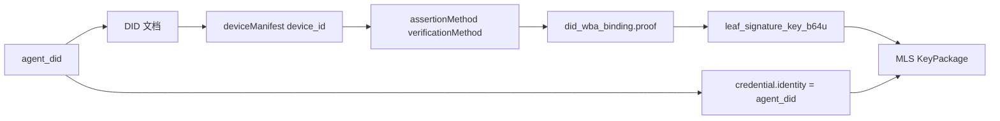
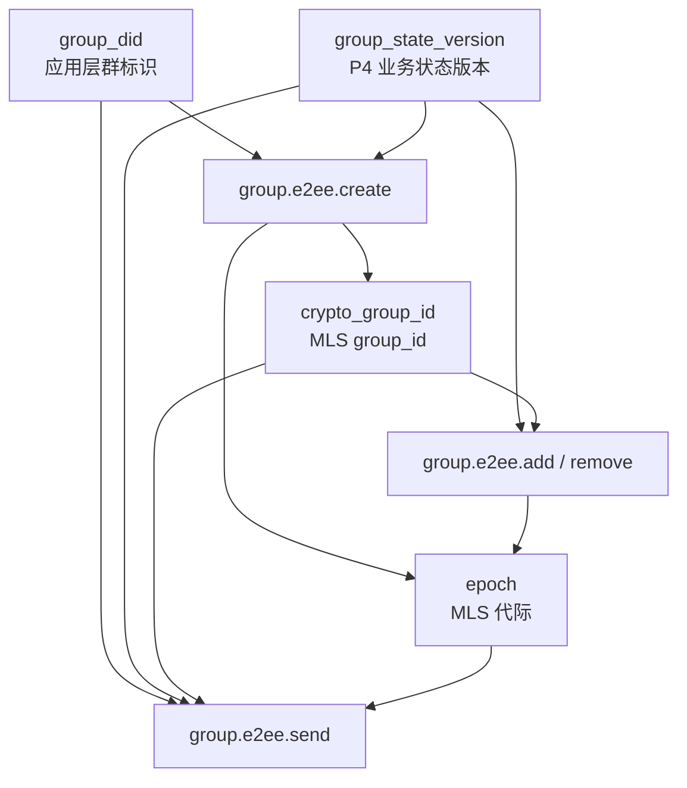
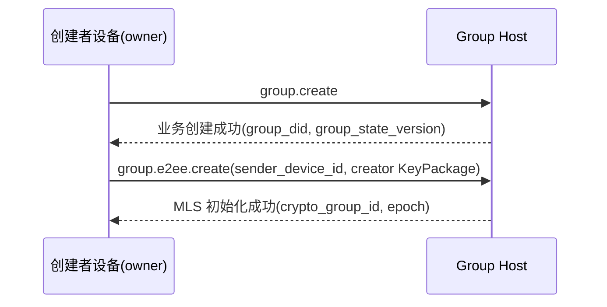
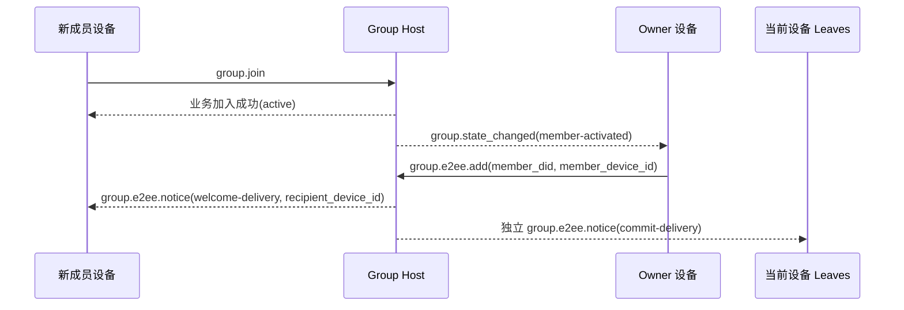
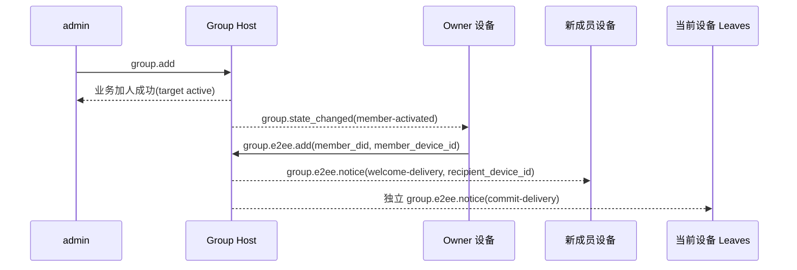
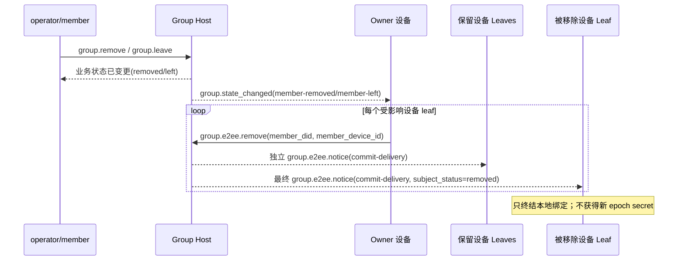
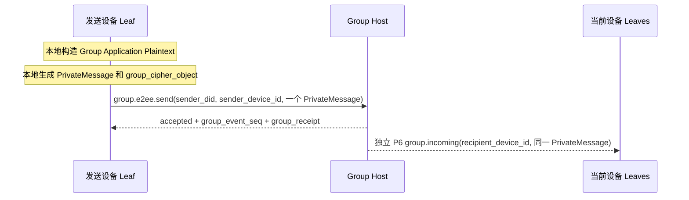
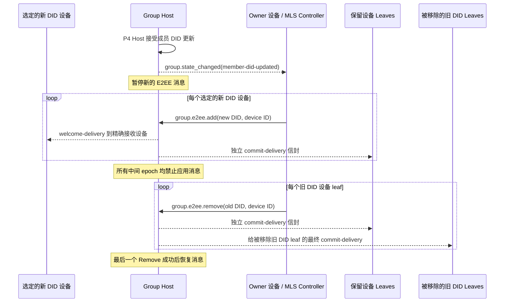

<!-- translation-review: full; source=chinese/message/06-群组端到端加密.md; basis=every Chinese source paragraph and all source code examples and diagrams read and compared -->
> 日本語参考訳（機械翻訳を基に原文全文を照合済み）。規範となるのは原文です。コード例・識別子・規範キーワードは原文を保持しています。
> 原文: [chinese/message/06-群组端到端加密.md](../../../chinese/message/06-群组端到端加密.md) / 基準コミット: `0837cfdfaf4ddcf834f0890ddaf34fc4c824e066`

# ANP Profile 6：グループのエンドツーエンド暗号化

- 文書番号：ANP-P6
- タイトル：グループのエンドツーエンド暗号化
- 状態：候補。1.2 の文書には統合済みですが、安定した v2 の公開は、なお MLS ExtensionType の登録待ちです。
- バージョン：1.2
- 仕様セットのバージョン：ANP Messaging 1.2
- 原文言語：中国語（このファイルは日本語参考訳）。
- Profile：`anp.group.e2ee.v2`
- 依存関係：`anp.core.binding.v1`、`anp.identity.discovery.v1`、`anp.group.base.v2`
- 適用範囲：本 Profile は、Group DID に基づくグループのエンドツーエンド暗号化制御層に適用し、`anp.group.base.v2` と緊密に組み合わせて使います。

---

## 1. 目的

本 Profile は、ANP のグループのエンドツーエンド暗号化制御層を定義し、以下を規定します。

1. `group_did`、`group_state_version`、`group_event_seq` を、グループの暗号学的状態機械に束縛する方法。
2. MLS を、グループ鍵の確立、メンバーの変更、およびアプリケーションメッセージの保護の基盤プロトコルとして使う方法。
3. メソッド検証済みの Agent DID と、適格な `device_id` を、MLS のメンバー資格情報、KeyPackage、および Leaf 署名鍵に束縛する方法。
4. MLS の暗号学的アクションを専用に格納する、独立した `group.e2ee.*` JSON-RPC メソッドの集合を定義する方法。
5. 「P4 メソッドに MLS ハンドシェイクオブジェクトを埋め込む」のではなく、**状態の結合**を通じて `anp.group.base.v2` と緊密に連携する方法。
6. `epoch`、`Welcome`、`PrivateMessage`、`PublicMessage`、`epoch_authenticator`、フォークの検出、および回復を処理する方法。
7. P4 がメンバーの DID 更新を受理した後、`group.e2ee.add`、`group.e2ee.remove` の順に実行して、対応する MLS Leaf を置換する方法。
8. DID 単位の業務上のメンバーの意味論を変更せずに、1 つの P4 メンバー DID に、複数の独立した MLS デバイス Leaf を持たせる方法。

本 Profile は、以下を定義**しません**。

- 過去のメッセージの取得。
- 既読状態とオンライン状態。
- 製品のドメイン内の、デバイスの登録、命名、役割、同期、または内部のレプリカ管理。
- デバイス間での、KeyPackage の非公開材料、Leaf 秘密鍵、epoch secret、または MLS の非公開状態の共有。
- グループ外のディレクトリ同期の具体的な実装。
- グループ以外の場面のエンドツーエンド暗号化。
- External Commit の主要経路。
- `group_join_info` と `group.e2ee.get_join_info`。
- `accept_welcome` プロトコルメソッド。
- 第 2 の業務上のメンバー状態モデル。
- 失われた過去の MLS epoch secret の回復や再配布。

---

## 2. 用語と規範的な取り決め

### 2.1 規範的キーワード

本文の **MUST**、**MUST NOT**、**REQUIRED**、**SHALL**、**SHALL NOT**、**SHOULD**、**SHOULD NOT**、**RECOMMENDED**、**NOT RECOMMENDED**、**MAY**、**OPTIONAL** は、大文字で記されている場合、規範的要件として解釈します。

### 2.2 用語

- **Group DID**：グループのアプリケーション層のグローバル識別子、つまり `group_did`。
- **Crypto Group ID**：グループの暗号学的な内部識別子。MLS の `group_id` に対応し、`group_did` と異なってもかまいません。
- **Group Host Service**：グループの基本状態の順序付け、ポリシーの適用、およびグループメッセージの入口を担当するサービス。MLS の制御者ではありません。
- **MLS Group State**：MLS に基づいて維持する、グループの暗号学的状態。
- **Epoch**：MLS のグループ状態における、1 世代分の前進。
- **KeyPackage**：MLS の参加材料オブジェクト。本 Profile は、これを使って、適格なデバイス Leaf を 1 つグループに追加します。
- **Welcome**：新メンバーがグループ状態を初期化するための、MLS の Welcome オブジェクト。
- **PrivateMessage**：暗号化され、メンバー認証を伴う MLS メッセージ。
- **PublicMessage**：署名だけを行い、暗号化しない MLS メッセージ。
- **Device Leaf（デバイス Leaf）**：`(agent_did, device_id)` で外部から識別される、1 つの MLS Client/Leaf。追加の P4 業務メンバーではありません。
- **Eligible Device（適格デバイス）**：P2 の `deviceManifest`、参照する鍵、サービス能力、およびグループポリシーに基づき、現在 `anp.group.e2ee.v2` の資格を満たすデバイス。
- **DID Device Binding**（wire 名称 `did_wba_binding` は保持）：MLS Leaf の署名鍵、メンバー資格情報、または KeyPackage を、検証可能な `(agent_did, device_id)` に束縛する証明オブジェクト。
- **MLS Controller**：汎用の MLS メンバー変更制御アクションを実行する主体。v2 では、引き続きグループの `owner` が制御者です。第 9.4、13.4 節で定義する、同じ DID のデバイス削除の限定的な例外は、汎用の制御者ではありません。
- **State Coupling**：P4 と P6 をメソッドごとに対応付けるのではなく、業務状態の変化で暗号学的状態の前進を引き起こす結合方式。
- **E2EE Notice**：`commit`、`welcome` などの暗号学的な結果を配信するため、P6 が独自に定義する、独立した暗号化通知オブジェクト。
- **Terminal Leaf（終端状態の Leaf）**：グループの MLS メンバー集合から削除されたデバイス Leaf。そのローカルのグループ束縛では、もはやその `group_did` のアプリケーションメッセージを送信、受信、または復号できません。ただし、デバイス自体は、現在も適格な P2 Manifest エントリである可能性があります。
- **Device Delivery Queue（デバイス配信キュー）**：Group Host が、まだトランスポート確認を得ていない P6 envelope に対し、`(recipient_did, recipient_device_id)` ごとに維持する永続的な配信状態。公開メタデータ、保持された公開 origin proof（その経路で定義される場合）、および読めない暗号文だけを格納し、グループ履歴ではありません。
- **Fork**：同じ `group_did` について、異なるメンバーが、整合させられない `epoch` / `epoch_authenticator` / 状態の前進シーケンスを観測すること。
- **MLS Member DID Update**：P4 が同じメンバーの DID 更新を受理した後、順序付けられた Commit を通じて、選択された新 DID のデバイス Leaf を追加し、その後、すべての旧 DID のデバイス Leaf を削除する、暗号学的なオーケストレーション。

---

## 3. 設計原則

### 3.1 グループのアイデンティティと暗号学的状態の階層分離

本 Profile は、以下を明確に区別します。

- `group_did`：アプリケーション層のグループのグローバル識別子。
- `crypto_group_id`：暗号学的グループの内部識別子。
- `group_state_version`：Group Host が割り当てる、アプリケーション層のグループ状態のバージョン。
- `epoch`：MLS 状態機械が割り当てる、暗号学的グループの世代。

この 4 つを機械的に同一視してはなりません（**MUST NOT**）。ただし、相互に検証可能な束縛関係がなければなりません（**MUST**）。

### 3.2 1 Agent DID = 1 外部グループメンバー、各デバイス = 1 MLS Leaf

P4 のメンバー、役割、ポリシー、およびメンバー数は、引き続き現在の `agent_did` に属します。P4 v2 は、現在の `agent_did` だけを wire 上のメンバーアイデンティティとして使います。名前、安定したパスのフィールド、またはローカル記録の識別子では、MLS の `credential.identity` にある現在の DID を置き換えられません。

P6 は、同じ DID の複数のデバイスを、独立した MLS Client と Leaf として表してもかまいません（**MAY**）。各 Leaf は `credential.identity = UTF8(agent_did)` を維持し、第 6 節で定義する、認証された `device_id` の束縛で区別します。同じ DID の複数の Leaf によって、追加の P4 メンバー、役割、またはメンバー数の項目は生じません。

各デバイスは、その KeyPackage の非公開材料、Leaf 秘密鍵、epoch secret、および MLS 状態を、独立して生成し保存します。これらの値は、同じ DID に属する sibling デバイス間で複製したり共有したりしてはなりません（**MUST NOT**）。新デバイスは、自身の Add、Commit、およびそのデバイス宛ての Welcome を通じてのみ、グループに参加できます。

`anp.group.e2ee.v1` は、引き続き独立した相互運用の契約です。実装は、v1 メンバーや MLS Leaf を v2 Device Leaf として再解釈してはならず（**MUST NOT**）、v1 の MLS グループ状態を v2 の複数デバイス状態として直接読み込んでもなりません。本 Profile は、v1 から v2 への状態のその場でのアップグレードを定義しません。いかなる移行にも、本 Profile の外で明示的に定義された手順が必要であり、それがなければ安全側に拒否しなければなりません。

### 3.3 P4 は業務上の主プロトコル、P6 は暗号学的制御層

本 Profile と `anp.group.base.v2` の関係は以下のとおりです。

- P4 は、グループの業務アクション、業務状態、順序付けの意味論、および受領証の意味論を定義します。
- P6 は、MLS の暗号学的アクション、暗号学的オブジェクト、束縛規則、および検証要件を定義します。
- P4 は、引き続き業務層の権威です。
- P6 は、`active / left / removed` などの業務上のメンバー状態を再定義**しません**。
- P4 Base の操作と通知は、引き続き DID を宛先とし、P6 のデバイス selector を含めてはなりません（**MUST NOT**）。
- P6 でデバイス Leaf を 1 つ追加または削除しても、それ単独で P4 のメンバー資格は変わりません。
- P6 は、P4 のメソッド本文に MLS ネイティブオブジェクトを直接含めることを要求**しません**。

### 3.4 メソッドごとの対応付けではなく、状態の結合

P4 と P6 の結合は、**状態**を通じて実現し、「ある P4 メソッドを、ある P6 メソッドへ直接対応付ける」ことでは実現しません。

つまり、以下のとおりです。

- P4 は、あることが業務上成立するかを決めます。
- P6 は、その業務状態の変化を観測し、MLS 状態を前進させます。

例：

- P4 でグループが作成され、作成者が `owner` になった → owner が `group.e2ee.create` を自動実行します。
- P4 でメンバーが `active` になり、ある適格デバイスがまだ MLS メンバー集合に入っていない → owner が `group.e2ee.add(成员 DID, 设备 ID)` を実行します。
- すでに `active` のメンバーに、別の適格デバイスが追加された → owner は、P4 のメンバー状態を変更せず、デバイス単位の `group.e2ee.add` をもう 1 回実行できます。
- P4 でメンバーが `left` または `removed` になった → owner は、その DID のすべての MLS デバイス Leaf を削除します。
- デバイスが P2 Manifest の適格性を失ったが、その DID はなお `active` である → owner、または現在の MLS 状態を保持し、同じ DID のデバイス管理の認可を持つ sibling が、そのデバイス Leaf だけを削除します。
- P4 メンバーについて P4 で `member-did-updated` が発生した → owner は、選択された新 DID のデバイス Leaf を追加した後、すべての旧 DID のデバイス Leaf を削除します。

### 3.5 owner が MLS 制御者、同じ DID のデバイス削除は限定的な例外

v2 では、**owner DID だけが汎用の MLS 制御者の役割を担います**。汎用の制御要求は、適格で、必要な現在の MLS 状態を持つ owner のデバイス 1 台が提出します。別の owner デバイスが資格を満たしていても、その非公開状態を持っていることにはなりません。

owner は、以下を担当します。

- MLS group を作成する。
- `add` を実行する。
- `remove` を実行する。
- 順序付けられたデバイスごとの Add と Remove によって、メンバーの DID 更新を行う。
- メンバー変更に対応する `commit` を生成する。
- 新メンバー用の `welcome` を生成する。
- メンバー変更後の `epoch` を前進させる。

呼出元自身の DID に属し、権威ある手段で撤回済みの正確なデバイス Leaf に限って、限定的な例外があります。現在も適格な Leaf であり、権威ある同 DID デバイス管理の認可を持ち、現在の MLS 状態を保持するデバイスは、同じ DID の別の撤回済みデバイス、または現在 P2 の資格を満たさないデバイスに対し、`group.e2ee.remove` を提出してもかまいません（**MAY**）。この例外には、以下を適用します。

- 呼出デバイス自身、なお active の sibling、他の DID の Leaf、または P4 の業務メンバーを削除してはなりません（**MUST NOT**）。
- P4 の role、status、joined_at、またはメンバー数を変更してはなりません（**MUST NOT**）。
- 呼出デバイス自身の現在の MLS 状態で、正確に 1 つの Leaf だけを削除する Remove Commit を生成しなければなりません（**MUST**）。
- Group Host に Commit を生成させたり、MLS の非公開状態を開示させたりしてはなりません（**MUST NOT**）。

デバイス管理の認可は、配置側の信頼できる認可の事実であり、新しい P6 要求フィールドではありません。Group Host が権威ある検証を行えない場合、この例外を拒否しなければならず（**MUST**）、呼出元の自己申告や表示用キャッシュを信頼してはなりません（**MUST NOT**）。


P6 の中心的な考え方は、MLS オブジェクトを P4 のメソッド本文に詰め込むことではなく、業務状態に追従して暗号学的状態を前進させることです。以下の図は、この「状態の結合」を全体図にまとめ、読者がメソッド間の因果関係を先に理解してから、後に続く節ごとの制約を読めるようにします。

```mermaid
flowchart TB
P4[P4 业务状态变化<br/>group.create / member active / member left or removed / member DID updated]
OBS[owner 观察业务状态]

CREATE[group.e2ee.create]
ADD[group.e2ee.add(DID + device)]
REMOVE[group.e2ee.remove(DID + device)]
DID_UPDATE_ADD[group.e2ee.add(new DID devices)]
DID_UPDATE_REMOVE[group.e2ee.remove(old DID devices)]

HOST[Group Host]
NOTICE[group.e2ee.notice]

P4 --> OBS
OBS -->|群已创建且尚无 crypto_group_id| CREATE
OBS -->|合格设备未进入 MLS| ADD
OBS -->|设备或 DID 必须离开 MLS| REMOVE
OBS -->|P4 成员已DID 更新且旧 Leaf 仍存在| DID_UPDATE_ADD

CREATE --> HOST
ADD --> HOST
REMOVE --> HOST
DID_UPDATE_ADD --> HOST
DID_UPDATE_ADD -->|DID 更新 Add 已接受后执行| DID_UPDATE_REMOVE
DID_UPDATE_REMOVE --> HOST

HOST --> NOTICE
```

*図 P6-1：P4 / P6 の状態の結合の全体像（非規範的）。*

この図が強調するのは、トリガーの関係であり、新たな業務状態機械ではありません。P4 は引き続き業務層の権威であり、P6 は、それらの業務結果を観測し、MLS の create / add / remove として実現するだけです。
### 3.6 Group Host は順序付けを担当し、MLS 制御は担当しない

Group Host Service の責務は以下のとおりです。

- P4 の業務操作を受信し、順序付ける。
- 受理済みイベントに `group_event_seq` を割り当てる。
- `group_state_version` を前進させる。
- `group_receipt` を生成する。
- グループメッセージと E2EE Notice を配信する。
- 宛先デバイス Leaf ごとに、独立した暗号化配信 envelope を作成する。ただし、MLS オブジェクトの復号や再暗号化は行わない。
- MLS 制御の結果が業務層に反映されたことの証人となる。

デフォルトでは、Group Host Service は、以下のとおりとします。

- MLS の制御者になる**べきではありません**。
- MLS のグループメンバーになる**べきではありません**。
- グループのアプリケーション平文を復号する能力を持つ**べきではありません**。
- MLS の非公開状態や epoch secret を、デバイス間で複製してはなりません（**MUST NOT**）。

### 3.7 owner はグループ状態を、active メンバーはグループメッセージを扱う

owner は、以下を制御します。

- メンバーの変更。
- グループの暗号学的状態の前進。
- `epoch` の更新。

`active` のメンバーに属し、現在適格で、MLS Leaf をすでに持つすべてのデバイスは、以下を行えます。

- 現在のグループ状態を使って、自身のグループメッセージ暗号文を生成する。
- `group.e2ee.send` を呼び出して、自身のグループメッセージを送信する。
- 他のメンバーのグループメッセージを復号する。

本 Profile は、すべてのグループメッセージを owner が代わりに暗号化することを要求**しません**。

第 3.5 節の同じ DID の例外は、create、add、メンバー単位の削除、DID 更新、または第三者の制御の権限を与えません。

### 3.8 v2 は External Commit をサポートしない

v2 では、以下のとおりとします。

- External Commit をサポートしません。
- `group_join_info` を定義しません。
- `group.e2ee.get_join_info` を定義しません。
- `accept_welcome` プロトコルメソッドを定義しません。

すべてのグループ参加経路は、暗号学的層では、最終的に owner が開始する MLS `add` に統一します。

### 3.9 メッセージ面だけが PrivateMessage に入る

v2 では、以下のとおりとします。

- `group.e2ee.send` のアプリケーションメッセージ内容だけが、MLS `PrivateMessage` に入り、暗号化されます。
- `group.e2ee.create`、`group.e2ee.add`、`group.e2ee.remove` は、引き続き平文の JSON-RPC 要求本文を使います。DID 更新のオーケストレーションは `add` と `remove` を再利用し、新たな要求メソッドは定義しません。
- `commit`、`welcome` などのオブジェクトは、メソッドの入力または Notice ペイロードとして現れ、P4 の業務メソッド本文に再び埋め込むことはしません。

---

## 4. 依存関係、Profile 識別子、および宛先モデル

### 4.1 Profile 名

本 Profile の標準名は以下のとおりです。

`anp.group.e2ee.v2`

### 4.2 依存関係

本 Profile は、以下の Profile に依存しなければなりません（**MUST**）。

- `anp.core.binding.v1`
- `anp.identity.discovery.v1`
- `anp.group.base.v2`

### 4.3 セキュリティモード

本 Profile を使う際は、以下のとおりとします。

- `meta.profile` は `anp.group.e2ee.v2` と等しくなければなりません（**MUST**）。
- 本 Profile が定義する、デバイスが開始する各 P6 要求は、`meta.sender_device_id` を含め、それを `meta.sender_did` の現在の P2 Manifest エントリに束縛しなければなりません（**MUST**）。
- デバイス宛ての各 P6 通知または暗号化配信は、`meta.recipient_device_id` を含め、`meta.target.did` に Agent DID を保持しなければなりません（**MUST**）。
- これらの selector は P6 だけに属します。P4 Base の操作と通知は、これらを継承してはなりません（**MUST NOT**）。

具体的には、以下のとおりです。

- `group.e2ee.publish_key_package`、`group.e2ee.get_key_package`、`group.e2ee.notice` は、`transport-protected` を使わなければなりません（**MUST**）。
- `group.e2ee.create`、`group.e2ee.add`、`group.e2ee.remove`、`group.e2ee.send`、および P6 の `group.incoming` は、`group-e2ee` を使わなければなりません（**MUST**）。

`group.e2ee.send` における `group-e2ee` は、それが運ぶメッセージの意味論がグループ E2EE 面に属することを表します。外側の JSON-RPC 要求本文を、グループで再び暗号化することを表すものではありません。

### 4.4 メソッドの宛先モデル

### 4.4.1 service-scoped

以下のメソッドは、`service-scoped` でなければなりません（**MUST**）。

- `group.e2ee.publish_key_package`
- `group.e2ee.get_key_package`
- `group.e2ee.create`

規則：

- `meta.target.kind = "service"`
- `meta.target.did` は、宛先が公開する `ANPMessageService.serviceDid` と等しくなければなりません（**MUST**）。

`group.e2ee.create` が service-scoped を採用する理由は、以下のとおりです。  
業務層の `group.create` の成功前に、グループの業務状態は確立されたばかりで、`group_did` はすでに生成されているものの、作成アクション自体はなお、グループ Host のサービス入口に対して暗号学的な初期化を行います。そのため、v2 では service-scoped に統一します。

### 4.4.2 group-addressed

以下のメソッドは、`group-addressed` でなければなりません（**MUST**）。

- `group.e2ee.add`
- `group.e2ee.remove`
- `group.e2ee.send`

規則：

- `meta.target.kind = "group"`
- `meta.target.did` は、宛先の `group_did` と等しくなければなりません（**MUST**）。

### 4.4.3 agent-addressed notifications

以下の通知は、`agent-addressed` でなければなりません（**MUST**）。

- `group.e2ee.notice`
- アプリケーション暗号文の配信に使う P6 の `group.incoming`。

規則：

- `meta.target.kind = "agent"`
- `meta.target.did` は、通知受信者の Agent DID と等しくなければなりません（**MUST**）。
- `meta.recipient_device_id` は、正確な受信デバイス Leaf を選択しなければなりません（**MUST**）。通知を sibling デバイスへリダイレクトしてはなりません（**MUST NOT**）。
- 本 Profile は、`target.kind = "device"` を定義しません。

---

## 5. 暗号学的な主要経路と MTI スイート

### 5.1 主要経路のプロトコル

本 Profile のグループ鍵の主要経路は、MLS 1.0 の意味論に基づいて実装しなければなりません（**MUST**）。ただし、v2 は、その制限された使用サブセットだけを固定します。

v2 の主要経路には、少なくとも以下を含めます。

- KeyPackage。
- Add。
- Remove。
- Commit。
- Welcome。
- PrivateMessage。
- Epoch の前進。

P4 メンバーのメンバー DID 更新では、新しい P6 メソッドや MLS プリミティブは導入しません。まず、選択された新 DID の各デバイスについて `group.e2ee.add` の Commit を 1 回生成し、その後、旧 DID の各デバイス leaf について `group.e2ee.remove` の Commit を 1 回生成します。

各オブジェクトは、以下のとおりとします。

- `commit_b64u` は、完全な MLS の `MLSMessage`（`mls-public-message`）を TLS シリアライズした、生のバイトで表さなければなりません（**MUST**）。
- `welcome_b64u` は、MLS の `Welcome` オブジェクトを TLS シリアライズした、生のバイトで表さなければなりません（**MUST**）。
- グループのアプリケーションメッセージの唯一の暗号文格納オブジェクトとして、`PrivateMessage` を使わなければなりません（**MUST**）。

MLS ライブラリは、追加で `Update`、proposal batching、PSK、ReInit などの標準能力をサポートしてもかまいません（**MAY**）。ただし、これらの能力は、本 Profile v2 の最小プロトコルの主要経路に**含まれず**、v2 の相互運用要件を**構成しません**。

### 5.2 Mandatory-to-Implement スイート

最小相互運用を保証するため、本 Profile に適合する実装は、以下の MTI スイートをサポートしなければなりません（**MUST**）。

`MLS_128_DHKEMX25519_AES128GCM_SHA256_Ed25519`

### 5.3 追加のスイート

実装は、より多くの MLS スイートをサポートしてもかまいません（**MAY**）。ただし、以下を適用します。

- 同じグループ内の全メンバーが、使用するスイートに合意しなければなりません（**MUST**）。
- グループポリシーが、許可するスイートの集合を制限する場合、MLS Controller は、ポリシーを満たさないスイートを拒否しなければなりません（**MUST**）。

### 5.4 DID アイデンティティとの関係

本 Profile の主要経路と DID アイデンティティの関係は、以下のとおりです。

- DID 文書の `assertionMethod` は、アイデンティティの束縛証明に使います。
- DID 文書の `keyAgreement` は、少なくとも X25519 エントリを 1 つ含み、その Agent が E2EE 能力を持つことを示すことが望まれます（**SHOULD**）。
- P2 の `deviceManifest` は、現在のデバイスエントリ、その `signing_key_id`、`e2ee_key_id`、および `anp.group.e2ee.v2` の適格性を識別します。
- MLS グループメンバーの Leaf 署名鍵を、DID の長期アイデンティティ署名鍵と直接同一視する**べきではありません**。
- Leaf 署名鍵は、独立して生成し、第 6 節の束縛オブジェクトを通じて `(agent_did, device_id)` に束縛することが望まれます（**SHOULD**）。

---

## 6. DID と MLS の、メソッドに依存しない束縛モデル

### 6.1 束縛の対象

本 Profile は、以下の MLS 要素を `(agent_did, device_id)` に束縛することを要求します。

1. KeyPackage の所有者。
2. 現在の Leaf 署名鍵。
3. グループメンバーの資格情報にあるアイデンティティ文字列。
4. 束縛の proof が使う、P2 Manifest の署名鍵参照。

### 6.2 Credential Identity の規則

本 Profile では、MLS のメンバー資格情報の `credential.identity` は、その leaf の現在の `agent_did` の UTF-8 バイト列と等しくなければなりません（**MUST**）。可読名、安定した主体のパス、またはローカルのアイデンティティを、`credential.identity` に書き込んだり、その代わりに使ったりしてはなりません（**MUST NOT**）。

実装は、ローカルのアカウント ID、デバイス ID、数値のユーザー ID、またはその他の DID でない文字列を、`credential.identity` の代わりに使ってはなりません（**MUST NOT**）。

したがって、同じ DID の sibling Leaf は、同じ `credential.identity` を持ちますが、認証された `device_id` は異なります。検証者は、完全な二つ組で P6 Leaf を識別しなければならず、片方の値だけを使うことはできません。

### 6.3 `did_wba_binding` オブジェクト

本 Profile は、MLS Leaf の署名鍵を、`agent_did` に属する適格なデバイスに束縛するため、`did_wba_binding` オブジェクトを定義します。オブジェクト名と `anp_did_wba_device_binding` 拡張名は、`agent_did` の DID メソッドを制限しません。

推奨する構造は以下のとおりです。

```json
{
  "agent_did": "did:wba:example.com:agents:alice:e1_<fingerprint>",
  "device_id": "dev-a-7N3KQ2",
  "verification_method": "did:wba:example.com:agents:alice:e1_<fingerprint>#dev-a-sign",
  "leaf_signature_key_b64u": "BASE64URL_ED25519_LEAF_PK",
  "issued_at": "2026-03-29T12:00:00Z",
  "expires_at": "2026-04-29T12:00:00Z",
  "proof": {
    "type": "DataIntegrityProof",
    "cryptosuite": "eddsa-jcs-2022",
    "created": "2026-03-29T12:00:00Z",
    "proofPurpose": "assertionMethod",
    "verificationMethod": "did:wba:example.com:agents:alice:e1_<fingerprint>#dev-a-sign",
    "proofValue": "z..."
  }
}
```

`did_wba_binding.proof` は、P1 付録 B が定義する共有 **Object Proof Profile** を再利用しなければなりません（**MUST**）。

`did_wba_binding` については、以下のとおりとします。

- issuer DID は、`agent_did` でなければなりません（**MUST**）。
- 被保護文書は、`proof` を除去した `did_wba_binding` オブジェクト全体でなければなりません（**MUST**）。
- `device_id` は、現在の P2 Manifest で、`anp.group.e2ee.v2` の資格を満たすエントリを識別しなければなりません（**MUST**）。
- `verification_method` と `proof.verificationMethod` は、そのエントリの `signing_key_id` と等しくなければならず（**MUST**）、その key は、`agent_did` の DID 文書の `assertionMethod` によって認可されていなければなりません（**MUST**）。

#### 6.3.1 `anp_did_wba_device_binding` MLS extension

本草案は、`anp_did_wba_device_binding` に対して、私用の MLS `ExtensionType` `0xF0A1` を暫定的に使用します。この値は IANA による割当ではなく、`anp.group.e2ee.v2` を明示的にネゴシエーションした後だけ使わなければなりません（**MUST**）。ANP は、v2 の公開前に、安定した登録済みコードポイントを公表しなければなりません（**MUST**）。この草案の値の変更は、互換性を破る草案改訂にあたります。

`extension_data` のバイトは、完全な `did_wba_binding` JSON オブジェクト（`proof` を含む）を UTF-8 RFC 8785 JCS でエンコードしたものです。v2 KeyPackage に含まれる LeafNode は、この型の extension をちょうど 1 つ含めなければならず（**MUST**）、グループ内で保持する認証済み LeafNode は、同じ束縛を保持しなければなりません（**MUST**）。LeafNode の `capabilities.extensions` と GroupContext の `required_capabilities` extension は、`0xF0A1` を列挙しなければなりません（**MUST**）。

v2 実装は、extension または capability 宣言が、欠落、重複、形式不正、未サポート、または衝突を起こしている場合、拒否しなければなりません（**MUST**）。制御プレーンでの処理を容易にする `group_key_package.did_wba_binding` メンバーは、埋込み extension と同じ JCS バイトを持たなければならず（**MUST**）、extension の代わりにはできません。

### 6.4 `did_wba_binding` の検証規則

受信者は、KeyPackage、LeafNode の更新、または新メンバーの参加を受理する前に、以下の検証を完了しなければなりません（**MUST**）。

1. [P2 のメソッド検証](../../../chinese/message/02-身份与发现.md#method-validation)に従って、`agent_did` の現在の DID 文書を解決して検証する。
2. `device_id` が、現在の P2 `deviceManifest` にちょうど 1 回現れ、`anp.group.e2ee.v2` とその依存関係を宣言すること。
3. `verification_method` が、そのエントリの現在の `signing_key_id` と等しく、`assertionMethod` によって認可されていること。
4. `proof` が存在し、P1 付録 B の共有 Object Proof Profile を満たさなければならない（**MUST**）。
5. `proof` の issuer DID が `agent_did` と等しく、proof の検証に成功すること。
6. 被保護文書が、少なくとも `agent_did`、`device_id`、`verification_method`、`leaf_signature_key_b64u`、`issued_at`、および `expires_at` を保護対象とすること。
7. KeyPackage / LeafNode が、第 6.3.1 節の extension と、必要な capability 宣言を含むこと。
8. 埋込み extension と、隣接する `did_wba_binding` が、完全に同じ JCS バイトを持つこと。
9. 実際の Leaf 署名公開鍵が、`leaf_signature_key_b64u` と一致すること。
10. MLS 資格情報の `credential.identity` が、`agent_did` と一致すること。
11. suite、グループポリシー、および `issued_at` / `expires_at` の時間範囲が有効であること。


P6 が `did_wba_binding` を定義するのは、MLS の Leaf 署名鍵を、DID の長期アイデンティティ署名鍵と直接同一視するべきではないためです。以下の図は、`agent_did`、DID 文書、束縛オブジェクト、および KeyPackage / credential.identity の経路をつなぎ、検証順序を理解しやすくしています。



*図 P6-2：DID/デバイスと MLS の束縛経路（非規範的）。*

実際の検証では、受信者は、MLS 内部の署名が成立するかだけを調べるべきではありません。この経路をたどり、`credential.identity`、`device_id`、Leaf 署名鍵、現在の Manifest エントリ、および `agent_did` の間の束縛が完全であることも確認するべきです。
### 6.5 DID メソッドと束縛証明

- サポートする DID メソッドについて、`did_wba_binding.proof` は、P1 付録 B の共有 Object Proof Profile を再利用しなければなりません（**MUST**）。
- 互換型の `k1_` DID について、`did_wba_binding.proof` は、明示的な拡張ネゴシエーションで定義した、代替の Object Proof Profile を使ってもかまいません（**MAY**）。ただし、明示的な拡張ネゴシエーションがない場合、v2 MTI は、`k1_` の束縛 proof を、デフォルトの相互運用経路として扱い**ません**。
- DID のアイデンティティの曲線が何であっても、束縛証明が成立する限り、MLS グループの MTI Leaf 署名鍵には、なお Ed25519 を使ってもかまいません（**MAY**）。

---

## 7. 中核オブジェクト

### 7.1 `crypto_group_id`

`crypto_group_id` は、MLS の内部の `group_id` を表します。

規則は以下のとおりです。

- `crypto_group_id` は、不透明なバイト列として扱わなければなりません（**MUST**）。
- JSON では `base64url` 表現を使わなければならず（**MUST**）、フィールド名は `crypto_group_id_b64u` を推奨します。
- `crypto_group_id` は、`group_did` との検証可能な束縛を確立しなければなりません（**MUST**）。

### 7.2 `group_state_ref`

本 Profile は、P4 の `group_state_ref` の概念を再利用し、E2EE グループでは、少なくとも以下を含めることを要求します。

- `group_did`
- `group_state_version`
- `policy_hash`（グループポリシーをハッシュ化している場合）。


グループ E2EE では、グループ DID、業務状態バージョン、暗号学的な内部 group_id、および MLS epoch という、4 つの異なる層の識別子/バージョンを混同しやすくなります。以下の図は、4 つの由来と、その前進の関係をまとめて示します。



*図 P6-3：`group_did`、`crypto_group_id`、`group_state_version`、および `epoch` の関係（非規範的）。*

後に続くオブジェクト構造と検証規則を読む際は、4 つを異なる層の座標として扱うべきです。束縛する必要はありますが、相互に代用したり、実装者が機械的に同じ値とみなしたりすることはできません。
### 7.3 `group_key_package`

本 Profile は、グループ参加材料のラッパーオブジェクトを定義します。

```text
{
  "key_package_id": "kp-001",
  "owner_did": "did:wba:example.com:agents:bob:e1_<fingerprint>",
  "owner_device_id": "dev-b-4M8P1X",
  "suite": "MLS_128_DHKEMX25519_AES128GCM_SHA256_Ed25519",
  "mls_key_package_b64u": "BASE64URL_KEYPACKAGE",
  "did_wba_binding": { ... },
  "expires_at": "2026-04-30T00:00:00Z"
}
```

各フィールドは、以下のとおりとします。

- `key_package_id` が存在しなければなりません（**MUST**）。
- `owner_did` が存在しなければなりません（**MUST**）。
- `owner_device_id` が存在しなければなりません（**MUST**）。
- `suite` が存在しなければなりません（**MUST**）。
- `mls_key_package_b64u` が存在しなければなりません（**MUST**）。
- `did_wba_binding` が存在しなければなりません（**MUST**）。
- `expires_at` が存在することが望まれます（**SHOULD**）。
- `mls_key_package_b64u` は、MLS の `KeyPackage` オブジェクトを MLS 1.0 TLS でシリアライズした生のバイトを、パディングなしの base64url で表したものでなければなりません（**MUST**）。
- `owner_did` と `owner_device_id` は、それぞれ `did_wba_binding.agent_did` と `did_wba_binding.device_id` に等しくなければなりません（**MUST**）。
- 1 つの KeyPackage は、1 台のデバイスだけに属し、他のデバイス Leaf に使ってはなりません（**MUST NOT**）。その消費、および配置が明示的に宣言する last-resort の再利用は、引き続き第 13.2 節に従います。

`group_key_package` は、主に owner が後で `group.e2ee.add` を実行するために使います。

### 7.4 `group_cipher_object`

`group_cipher_object` は、`group.e2ee.send` の wire プロトコルのメッセージ本文オブジェクトです。

推奨する構造は以下のとおりです。

```json
{
  "crypto_group_id_b64u": "BASE64URL_GROUPID",
  "epoch": "7",
  "private_message_b64u": "BASE64URL_PRIVATEMESSAGE",
  "group_state_ref": {
    "group_did": "did:wba:groups.example:team:dev:e1_<fingerprint>",
    "group_state_version": "42",
    "policy_hash": "sha-256:..."
  },
  "epoch_authenticator": "BASE64URL_AUTH"
}
```

規則：

- `crypto_group_id_b64u` が存在しなければなりません（**MUST**）。
- `epoch` が存在しなければなりません（**MUST**）。
- `private_message_b64u` が存在しなければなりません（**MUST**）。
- `private_message_b64u` は、MLS の `PrivateMessage` オブジェクトを MLS 1.0 TLS でシリアライズした生のバイトを、パディングなしの base64url で表したものでなければなりません（**MUST**）。
- `group_state_ref.group_did` は、外側の宛先の `group_did` と等しくなければなりません（**MUST**）。

### 7.5 `Group Application Plaintext`

グループのアプリケーションメッセージは、MLS の `PrivateMessage` に入れて暗号化する前に、以下の内側の平文オブジェクトに正規化しなければなりません（**MUST**）。

```json
{
  "application_content_type": "text/plain | application/json | application/anp-attachment-manifest+json | ...",
  "thread_id": "thr-001",
  "reply_to_message_id": "msg-0009",
  "annotations": {},
  "text": "...",
  "payload": {},
  "payload_b64u": "..."
}
```

規則：

- `application_content_type` が存在しなければなりません（**MUST**）。
- `text` / `payload` / `payload_b64u` は、ちょうど 1 つだけ現れなければなりません（**MUST**）。
- P4 のメッセージ意味論のフィールド `thread_id`、`reply_to_message_id`、および `annotations` は、グループ E2EE では、この内側のオブジェクトに置かなければなりません（**MUST**）。
- 送信者は、暗号化前に `Group Application Plaintext` オブジェクト全体を UTF-8 + RFC 8785 JCS でバイト列にシリアライズしなければなりません（**MUST**）。受信者は、復号後、同じ規則でそのオブジェクトを解釈しなければなりません（**MUST**）。

`application_content_type = "application/json"` の場合、`payload` は、JSON オブジェクトを直接格納しなければなりません（**MUST**）。
本 Profile は、そのオブジェクトの内部フィールドの業務上の意味を定義しません。

通常の JSON group application plaintext の例：

```json
{
  "application_content_type": "application/json",
  "thread_id": "thr-001",
  "payload": {
    "type": "example",
    "data": {
      "hello": "group"
    }
  }
}
```

### 7.6 `e2ee_notice_object`

P6 は、暗号学的な結果を配信するため、独立した暗号化通知オブジェクトを定義します。

推奨する構造は以下のとおりです。

```text
{
  "notice_id": "en-001",
  "notice_type": "commit-delivery | welcome-delivery",
  "group_did": "did:wba:groups.example:team:dev:e1_<fingerprint>",
  "group_state_ref": {
    "group_did": "did:wba:groups.example:team:dev:e1_<fingerprint>",
    "group_state_version": "43",
    "policy_hash": "sha-256:..."
  },
  "crypto_group_id_b64u": "BASE64URL_GROUPID",
  "epoch": "8",
  "subject_did": "did:wba:b.example:agents:bob:e1_<fingerprint>",
  "subject_device_id": "dev-b-4M8P1X",
  "subject_status": "active | removed",
  "commit_b64u": "BASE64URL_MLSMESSAGE",
  "welcome_b64u": "BASE64URL_WELCOME",
  "ratchet_tree_b64u": "BASE64URL_RATCHET_TREE",
  "epoch_authenticator": "BASE64URL_AUTH",
  "group_receipt": { ... }
}
```

規則：

- `notice_id` が存在しなければならず（**MUST**）、同じ envelope の再配信の間で安定していなければなりません（**MUST**）。同じ受信デバイスへの別の論理通知に再利用してはなりません（**MUST NOT**）。各デバイスは、自身宛ての envelope だけを `(group_did, notice_id)` のキーで重複排除するため、同じ暗号学的結果の各 leaf 向けコピーは、`notice_id` を共有してもかまいません（**MAY**）。
- `notice_type` が存在しなければなりません（**MUST**）。
- `group_did` が存在しなければなりません（**MUST**）。
- `group_state_ref` が存在しなければなりません（**MUST**）。
- `crypto_group_id_b64u` が存在しなければなりません（**MUST**）。
- `epoch` が存在しなければなりません（**MUST**）。
- `notice_type = "commit-delivery"` の場合、`commit_b64u` が存在しなければなりません（**MUST**）。
- `notice_type = "welcome-delivery"` の場合、`welcome_b64u` と `ratchet_tree_b64u` が同時に存在しなければなりません（**MUST**）。
- メンバー DID 更新のオーケストレーションによる notice では、`group_state_ref` は、各 P6 Add と Remove が共通して使う、受理済みの P4 `member-did-updated` イベントを正確に参照しなければなりません（**MUST**）。受信者は、その P4 イベントから旧 DID と現在の DID を取得しなければならず（**MUST**）、継続性のフィールドを P6 notice が重ねて含めることに依存してはなりません。
- `subject_did`、`subject_device_id`、および `subject_status` は、今回の P6 操作が影響を与える 1 つの Leaf だけを記述します。Add は、追加する DID/デバイスと `active` を使い、Remove は、削除する DID/デバイスと `removed` を使います。
- 実際に通知を受信するデバイスは、外側の `meta.target.did` と `meta.recipient_device_id` だけで識別します。`commit-delivery` では、影響を受ける subject と異なってもかまいません。Remove の `commit-delivery` では、受信者が削除対象の subject Leaf 自身でもかまわず（**MAY**）、第 12.3 節に従って、最終通知を 1 件受信します。
- `ratchet_tree_b64u` は、ratchet tree を TLS シリアライズした生のバイトを、パディングなしの base64url で表したものでなければなりません（**MUST**）。
- `group_receipt` が存在してもかまいません（**MAY**）。暗号学的結果と業務上の順序位置を関連付けるために使います。

---

## 8. KeyPackage の公開と発見のメソッド

### 8.1 `group.e2ee.publish_key_package`

#### 8.1.1 意味論

Agent が、自身で公開する `ANPMessageService` に、グループ参加に使える KeyPackage を 1 つ公開します。

#### 8.1.2 要求の要件

- `method = "group.e2ee.publish_key_package"`
- `meta.profile = "anp.group.e2ee.v2"`
- `meta.security_profile = "transport-protected"`
- `meta.target.kind = "service"`
- `meta.target.did` は、公開者自身が公開する `ANPMessageService.serviceDid` と等しくなければなりません（**MUST**）。
- `meta.sender_did` が存在しなければなりません（**MUST**）。
- `meta.sender_device_id` が存在しなければなりません（**MUST**）。
- `body.group_key_package` が存在しなければなりません（**MUST**）。
- `body.group_key_package.owner_did` は、`meta.sender_did` と等しくなければなりません（**MUST**）。
- `body.group_key_package.owner_device_id` と `body.group_key_package.did_wba_binding.device_id` は、`meta.sender_device_id` と等しくなければなりません（**MUST**）。
- 公開サービスは、KeyPackage を受理する前に、現在の P2 Manifest エントリと、第 6 節の束縛を検証しなければなりません（**MUST**）。

認証の制約：

- このメソッドは、**サービススコープ**の制御プレーンのメソッドです。
- 呼出元は、認証済みの自ドメインのセッション、または同等の hop / service 認証コンテキスト内で動作しなければなりません（**MUST**）。
- v2 は、このメソッドに追加の新しい業務層の `origin_proof` を定義することを**要求しません**。

#### 8.1.3 成功応答

成功応答は、少なくとも以下を含めなければなりません（**MUST**）。

- `published = true`
- `owner_did`
- `owner_device_id`
- `key_package_id`
- `published_at`

### 8.2 `group.e2ee.get_key_package`

#### 8.2.1 意味論

宛先 Agent の `ANPMessageService` を通じて、使用可能な KeyPackage を 1 つ取得します。

#### 8.2.2 要求の要件

- `meta.profile = "anp.group.e2ee.v2"`
- `meta.security_profile = "transport-protected"`
- `meta.target.kind = "service"`
- `meta.target.did` は、宛先 Agent が公開する `ANPMessageService.serviceDid` と等しくなければなりません（**MUST**）。
- `meta.sender_did` が存在しなければなりません（**MUST**）。
- `meta.sender_device_id` は、`meta.sender_did` に属する、現在 P6 の資格を満たすデバイスを識別しなければなりません（**MUST**）。

`body` は、以下を含めなければなりません（**MUST**）。

- `target_did`
- `target_device_id`

`body` は、以下を含めてもかまいません（**MAY**）。

- `preferred_suite`
- `require_fresh`

認証の制約：

- このメソッドは、**サービススコープ**の制御プレーンのメソッドです。
- 認証コンテキストは、正確な `(meta.sender_did, meta.sender_device_id)` の組合せを束縛しなければならず（**MUST**）、そのデバイスは、現在の P2 Manifest で、なお資格を満たしていなければなりません（**MUST**）。
- v2 の最小相互運用要件は、少なくとも hop / service レベルの認証です。
- **匿名での KeyPackage の取得は、v2 MTI に含まれません**。

#### 8.2.3 成功応答

成功応答は、少なくとも以下を含めなければなりません（**MUST**）。

- `target_did`
- `target_device_id`
- `group_key_package`

#### 8.2.4 サーバーの発行規則

`ANPMessageService` が `group_key_package` を返す際は、以下のとおりとします。

- 期限切れ、失効済み、または消費済みではない KeyPackage を返すことが望まれます（**SHOULD**）。
- `owner_did` と `owner_device_id` が、要求の宛先の二つ組と正確に等しい KeyPackage を返さなければならず（**MUST**）、sibling デバイスに置き換えてはなりません（**MUST NOT**）。
- 返す前に、現在の P2 Manifest に基づいて宛先デバイスを再検証しなければなりません（**MUST**）。
- 並行した重複発行を避けるため、返した後で、まず `reserved` または同等の状態として記録してもかまいません（**MAY**）。
- 対応する `group.e2ee.add`（DID 更新のオーケストレーションの Add 手順を含む）を Group Host が受理し、暗号学的なメンバー変更が完了した後、`consumed` として記録するか、公開集合から削除しなければなりません（**MUST**）。
- 対応する手順が失敗、取消し、またはタイムアウトとなった場合、予約状態の KeyPackage を解放するかは、配置ポリシーで決めます。ただし、同じ KeyPackage が、両方とも成功する 2 つの `group.e2ee.add` 操作によって並行して再利用されることにならないことが望まれます（**SHOULD NOT**）。
- caller identity、レート制限、および不正利用防止のポリシーは、hop / service レベルの認証に基づいて実施しなければなりません（**MUST**）。

---

## 9. MLS 制御プレーンのメソッド

### 9.1 基本規則

本章のメソッドは、独立した JSON-RPC メソッドです。P4 の業務メソッドの「追加フィールド」ではなく、P6 自身の暗号学的制御アクションです。

各メソッドは、以下のとおりとします。

- `group.e2ee.create`、`group.e2ee.add`、`group.e2ee.remove` は、**メンバー変更の制御メソッド**です。
- `group.e2ee.send` は、**メッセージ送信メソッド**です。
- `group.e2ee.create/add/remove` は、P4 の既存の業務状態に束縛されますが、**新たな P4 の業務上のメンバー状態は作成しません**。
- `group.e2ee.send` は、直接 wire 上の送信メソッドとなり、`group.send` でもう一度ラップしません。

### 9.2 `group.e2ee.create`

#### 9.2.1 意味論

新しい MLS グループ状態を作成し、owner を初期メンバーとして追加します。

#### 9.2.2 呼出者

owner だけです。

#### 9.2.3 要求の要件

- `method = "group.e2ee.create"`
- `meta.profile = "anp.group.e2ee.v2"`
- `meta.security_profile = "group-e2ee"`
- `meta.target.kind = "service"`
- `meta.target.did` は、宛先グループ Host が公開する `ANPMessageService.serviceDid` と等しくなければなりません（**MUST**）。
- `meta.sender_did` は、現在のグループの `owner` と等しくなければなりません（**MUST**）。
- `meta.sender_device_id` は、適格で、必要な現在の MLS 状態を持つ owner のデバイスを 1 台識別しなければなりません（**MUST**）。
- `auth.origin_proof` が存在しなければなりません（**MUST**）。

`body` は、少なくとも以下を含めなければなりません（**MUST**）。

- `group_did`
- `group_state_ref`
- `suite`
- `creator_key_package`
- `crypto_group_id_b64u`
- `epoch`

規則：

- `creator_key_package.owner_did` は、`meta.sender_did` と等しくなければなりません（**MUST**）。
- `creator_key_package.owner_device_id` は、`meta.sender_device_id` と等しくなければなりません（**MUST**）。
- `group_state_ref.group_did` は、`body.group_did` と等しくなければなりません（**MUST**）。
- 初期グループ状態の `epoch` は、`"0"` または実装が明示的に定める初期値であることが望まれます（**SHOULD**）。

#### 9.2.4 成功応答

成功応答は、少なくとも以下を含めなければなりません（**MUST**）。

- `created = true`
- `group_did`
- `group_state_ref`
- `crypto_group_id_b64u`
- `epoch`
- `accepted_at`

説明：

- `group.e2ee.create` 自体で、新しい P4 の業務グループを独立に作成してはなりません（**MUST NOT**）。
- 業務層が `group.create` を受理した後だけ実行します。
- 新たな `group_state_version` や `group_event_seq` を、独立に生成しません。

### 9.3 `group.e2ee.add`

#### 9.3.1 意味論

owner が MLS の `add` を実行し、P4 の `active` メンバーの、適格なデバイス Leaf を 1 つ、暗号学的グループに追加します。同じ active DID の 2 台目のデバイスには、別の Add を使い、別の P4 メンバーは作成しません。

#### 9.3.2 呼出者

owner だけです。

#### 9.3.3 要求の要件

- `method = "group.e2ee.add"`
- `meta.profile = "anp.group.e2ee.v2"`
- `meta.security_profile = "group-e2ee"`
- `meta.target.kind = "group"`
- `meta.target.did` は、宛先の `group_did` と等しくなければなりません（**MUST**）。
- `meta.sender_did` は、現在のグループの `owner` と等しくなければなりません（**MUST**）。
- `meta.sender_device_id` は、適格で、必要な現在の MLS 状態を持つ owner のデバイスを 1 台識別しなければなりません（**MUST**）。
- `auth.origin_proof` が存在しなければなりません（**MUST**）。

`body` は、少なくとも以下を含めなければなりません（**MUST**）。

- `member_did`
- `member_device_id`
- `group_state_ref`
- `group_key_package`
- `crypto_group_id_b64u`
- `epoch`
- `commit_b64u`
- `welcome_b64u`
- `ratchet_tree_b64u`

規則：

- `group_state_ref.group_did` は、外側の宛先の `group_did` と等しくなければなりません（**MUST**）。
- `group_key_package.owner_did` は、`member_did` と等しくなければなりません（**MUST**）。
- `group_key_package.owner_device_id` と `group_key_package.did_wba_binding.device_id` は、`member_device_id` と等しくなければなりません（**MUST**）。
- `commit_b64u` は、完全な MLS `MLSMessage` オブジェクトを TLS シリアライズした、パディングなしの base64url でなければなりません（**MUST**）。
- `welcome_b64u` は、MLS の `Welcome` オブジェクトを TLS シリアライズした、パディングなしの base64url でなければなりません（**MUST**）。
- `ratchet_tree_b64u` は、ratchet tree を TLS シリアライズした生のバイトを、パディングなしの base64url で表したものでなければなりません（**MUST**）。
- `epoch` は、今回の `add` 後の新しい `epoch` を表さなければなりません（**MUST**）。
- 通常の経路では、`member_did` は、P4 の現在の `active` メンバーでなければならず（**MUST**）、正確な `(member_did, member_device_id)` の Leaf は、まだ存在していてはなりません（**MUST NOT**）。同じ DID の別の Leaf は、競合ではありません。
- DID 更新経路では、`group_state_ref` は、受理済みの P4 `member-did-updated` イベントを正確に参照しなければならず（**MUST**）、`member_did` は、そのイベントの `subject_did` と等しくなければなりません（**MUST**）。また、新しい KeyPackage は、選択された新 DID のデバイスを束縛しなければなりません（**MUST**）。
- 選択された新 DID のデバイスに対する、すべての DID 更新 Add は、旧 DID のデバイス Leaf を削除する前に成功しなければなりません（**MUST**）。

#### 9.3.4 成功応答

成功応答は、少なくとも以下を含めなければなりません（**MUST**）。

- `accepted = true`
- `group_did`
- `member_did`
- `member_device_id`
- `group_state_ref`
- `crypto_group_id_b64u`
- `epoch`
- `accepted_at`

説明：

- `group.e2ee.add` 自体で、対象メンバーの P4 業務状態を `active` に変更してはなりません（**MUST NOT**）。
- その業務状態は、P4 がすでに決定していなければなりません。
- 本メソッドは、その業務結果を MLS に反映することだけを担当します。

### 9.4 `group.e2ee.remove`

#### 9.4.1 意味論

MLS の `remove` は、毎回、正確に 1 つのデバイス Leaf を削除します。トリガー条件には、P4 によるその DID の削除、その DID がなお active である場合のデバイスの資格喪失、グループポリシー、または受理済みのメンバー DID 更新のオーケストレーションがあります。汎用の削除は引き続き owner が制御します。以下の同じ DID の例外は、撤回済みの sibling デバイス 1 台に限ります。

#### 9.4.2 呼出者

以下のいずれかです。

- 必要な現在の MLS 状態を保持する、適格な owner のデバイス。
- 現在適格で、権威ある同 DID デバイス管理の認可を持つ Leaf。ただし、自身の DID に属する、別の撤回済みまたは現在不適格なデバイス Leaf だけを削除できます。

#### 9.4.3 要求の要件

- `method = "group.e2ee.remove"`
- `meta.profile = "anp.group.e2ee.v2"`
- `meta.security_profile = "group-e2ee"`
- `meta.target.kind = "group"`
- `meta.target.did` は、宛先の `group_did` と等しくなければなりません（**MUST**）。
- owner の分岐では、`meta.sender_did` は現在のグループの `owner` と等しくなければならず（**MUST**）、`meta.sender_device_id` は、適格で、必要な現在の MLS 状態を持つ owner のデバイスを 1 台識別しなければなりません（**MUST**）。
- 同じ DID の分岐では、`meta.sender_did` は `member_did` と等しくなければならず（**MUST**）、送信者はなお P4 の `active` メンバーかつ現在の MLS Leaf でなければなりません（**MUST**）。`meta.sender_device_id` は、`member_device_id` と等しくてはなりません（**MUST NOT**）。さらに、Group Host は、送信デバイスが現在のデバイス管理の認可を持ち、宛先デバイスが撤回済みまたは現在 P2 の資格を満たさないことを、権威ある手段で検証しなければなりません（**MUST**）。
- `auth.origin_proof` が存在しなければなりません（**MUST**）。

`body` は、少なくとも以下を含めなければなりません（**MUST**）。

- `member_did`
- `member_device_id`
- `group_state_ref`
- `crypto_group_id_b64u`
- `epoch`
- `commit_b64u`

規則：

- `commit_b64u` は、完全な MLS `MLSMessage` オブジェクトを TLS シリアライズした、パディングなしの base64url でなければなりません（**MUST**）。
- `epoch` は、今回の `remove` 後の新しい `epoch` を表さなければなりません（**MUST**）。
- 正確な `(member_did, member_device_id)` の Leaf が、現在の MLS 状態に存在しなければなりません（**MUST**）。
- P4 が `member_did` を `removed` または `left` と記録した場合、owner は、その DID の現在の各デバイス Leaf について、順序付けて Remove を実行しなければなりません（**MUST**）。
- P4 がその DID を `active` のまま維持する場合、指定デバイスが現在の P2 の資格を失ったか、グループポリシーがその Leaf を削除する場合に限って削除を許します。sibling Leaf と P4 のメンバー状態は変更しません。
- 同じ DID の分岐は、指定された宛先 Leaf だけを削除しなければならず（**MUST**）、グループポリシーによる削除、メンバーの remove/leave、DID 更新、または他の DID に使ってはなりません（**MUST NOT**）。
- DID 更新経路では、`member_did` は、参照する P4 イベントの `previous_subject_did` と等しくなければなりません（**MUST**）。選択された新 DID のデバイスの Add がすでに成功していなければならず、owner は、アプリケーションメッセージを再開する前に、すべての旧 DID のデバイス Leaf を削除しなければなりません。

#### 9.4.4 成功応答

成功応答は、少なくとも以下を含めなければなりません（**MUST**）。

- `accepted = true`
- `group_did`
- `member_did`
- `member_device_id`
- `group_state_ref`
- `crypto_group_id_b64u`
- `epoch`
- `accepted_at`

### 9.5 `group.e2ee.send`

#### 9.5.1 意味論

あるグループに、MLS で暗号化したグループメッセージを 1 件、直接送信します。

#### 9.5.2 呼出者

任意の、現在の `active` メンバーの、適格なデバイス Leaf。

#### 9.5.3 要求の要件

適合する `group.e2ee.send` 要求は、以下を満たさなければなりません（**MUST**）。

1. `method = "group.e2ee.send"`
2. `meta.profile = "anp.group.e2ee.v2"`
3. `meta.security_profile = "group-e2ee"`
4. `meta.target.kind = "group"`
5. `meta.target.did` は、宛先の `group_did` でなければならない（**MUST**）。
6. `meta.sender_did` は、現在の送信者の Agent DID でなければならない（**MUST**）。
7. `meta.sender_device_id` は、その PrivateMessage を生成した、現在適格な MLS Leaf を識別しなければならない（**MUST**）。
8. `meta.message_id` が存在しなければならない（**MUST**）。
9. `meta.operation_id` が存在しなければならない（**MUST**）。
10. `meta.content_type` は、`application/anp-group-cipher+json` に固定しなければならない（**MUST**）。
11. `auth.origin_proof` が存在し、選択されたデバイスの現在の P2 署名鍵を使わなければならない（**MUST**）。
12. `body` は、直接 `group_cipher_object` でなければならない（**MUST**）。

説明：

- `group.e2ee.send` は、直接 wire 上の送信メソッドです。
- P4 の `group.send` でもう一層ラップすることはしません。

#### 9.5.4 成功応答

成功応答は、少なくとも以下を含めなければなりません（**MUST**）。

- `accepted = true`
- `group_did`
- `message_id`
- `operation_id`
- `group_event_seq`
- `group_state_version`
- `accepted_at`
- `epoch`
- `group_receipt`

この成功が表す意味は、以下のとおりです。

- Group Host が、MLS 暗号文オブジェクトを 1 つ受理し、順序付けたこと。
- 全メンバーがそのメッセージの復号に成功したことを、自動的に表すものでは**ありません**。

---

## 10. 状態の結合規則

### 10.1 基本規則

P4 と P6 の結合は、**業務状態の変化**を通じて行います。  
本 Profile は、`group.create -> create`、`group.add -> add` といった、メソッドごとの対応表を維持することを、もはや要求**しません**。

owner は、信頼できる状態観測の手段を通じて、以下を把握しなければなりません（**MUST**）。

- あるグループが、業務層で作成済みであること。
- あるメンバーが、業務層で `active` になったこと。
- あるメンバーが、業務層で `left` または `removed` になったこと。
- ある適格デバイスに Leaf が必要であること、または現在の Leaf のデバイスが P2 の資格を失ったこと。
- ある P4 メンバーについて、`member-did-updated` が発生したこと。

状態観測の手段は、以下でもかまいません（**MAY**）。

- ローカルと Group Host の内部オーケストレーション。
- `group.state_changed` の購読。
- または、他の同等で信頼できる状態観測の仕組み。

### 10.2 グループ作成の結合規則

owner が、以下の業務状態が同時に成立したと観測した場合：

- ある `group_did` が作成済みである。
- 作成者が自分自身である。
- そのグループに、まだ `crypto_group_id` が付いていない。

owner は、`group.e2ee.create` を 1 回起動しなければなりません（**MUST**）。

### 10.3 メンバー参加の結合規則

owner が、以下の業務状態が同時に成立したと観測した場合：

- ある `member_did` が、P4 ですでに、そのグループの `active` メンバーである。
- 選択された適格な `member_device_id` に、まだ MLS Leaf がない。
- そのデバイスに、使用可能な `group_key_package` がある。

owner は、そのデバイスについて `group.e2ee.add` を 1 回起動しなければなりません（**MUST**）。同じ active DID の他の適格デバイスでは、この P6 の手順を繰り返し、別の P4 メンバーイベントは生成しません。

本規則は、以下のいずれにも適用します。

- `group.join`
- `group.add`
- 配置の拡張である、招待による参加。
- 配置の拡張である、承認の成立。

つまり、P4 のさまざまな業務上の参加入口は、暗号学的層では、最終的に 1 回の `group.e2ee.add` に収束します。

以前 Leaf を削除されたデバイスは、後で同じグループに再参加してもかまいません（**MAY**）。上記のトリガー条件は変わらず、それだけで十分です。その DID が P4 で `active`、正確なそのデバイスに現在 Leaf がなく、**新しい** `group_key_package` を公開していることが条件です。本 Profile は、独立した再参加メソッドを定義しません。owner は、第 13.2 節の消費済み KeyPackage を再利用してはならず（**MUST NOT**）、そのデバイスの以前の Leaf を復元してもならず（**MUST NOT**）、再参加前の epoch secret を開示してもなりません（**MUST NOT**）。再参加したデバイスは、新しい Welcome から、現在および後続の状態だけを取得できます。

### 10.4 メンバー削除 / 脱退の結合規則

P4 が、ある `member_did` を `removed` または `left` と記録した場合、owner は、その DID の現在の各デバイス Leaf について、順序付けて `group.e2ee.remove` を 1 回ずつ起動しなければなりません（**MUST**）。

1 台のデバイスだけが現在の Manifest の資格を失い、その DID がなお P4 の `active` である場合、owner、または現在の MLS 状態を保持し、同じ DID のデバイス管理の認可を持つ sibling は、そのデバイス Leaf だけの削除を、ただちに試みてもかまいません（**MAY**）。グループポリシーによる削除は、引き続き owner が制御します。いずれの経路も、P4 メンバーや sibling Leaf を変更しません。

P4 メンバー全体が `removed`/`left` になった場合、DID 更新中の場合、または Host が orphan/membership conflict を検出した場合、Host は、必要な MLS 変更が完了するまで、新しい `group.e2ee.send` を停止しなければなりません（**MUST**）。逆に、1 台のデバイスだけが権威ある手段で撤回されたか、P2 の資格を失い、その DID がなお P4 の `active` である場合、Host は、そのデバイス Leaf がまだ削除されていないことだけを理由に、他の正当な `group.e2ee.send` を停止してはなりません（**MUST NOT**）。Host は、その撤回済みデバイスの認証と、そのデバイスへの新しいサービスデータの配信を停止し、同時に現在の MLS head に従ってメッセージの検証を継続しなければなりません（**MUST**）。

この、デバイス単位では他を阻害しない状態は、可用性とセキュリティの明示的なトレードオフです。正確な Remove Commit が成功する前は、撤回された Leaf が現在の epoch secret をまだ保持し、サービス配信経路の外で取得した暗号文を復号できる可能性があります。即時の Remove が 1 回失敗したことは、暗号学的な撤回の完了を意味しません。本 Profile は、この試みに、claim-task、repair 通知、永続化したクライアントキュー、または自動再試行を追加することを要求しません。

デバイス Leaf の削除は、**グループスコープ**の暗号学的アクションであり、**アイデンティティスコープ**の P2 デバイス削除とは、異なる 2 つの状態機械です。Leaf の削除は、そのデバイスを DID の `deviceManifest` から削除せず、`device_id` を無効にすることもありません。現在も適格な Manifest エントリであるデバイスは、Leaf の削除後も同じ `device_id` を保持し、後で第 10.3 節に従い、新しい KeyPackage を使って、そのグループや他のグループに再参加してもかまいません（**MAY**）。逆に、P2 Manifest から削除されたデバイスは、新しい device ID と新しいデバイス鍵で再登録しなければならず（**MUST**）、無効になった識別子を再利用してはなりません（**MUST NOT**）。実装は、この両者を混同してはなりません（**MUST NOT**）。グループ Leaf の削除はグループ単位で可逆ですが、Manifest のデバイス削除はアイデンティティスコープで永続的です。

### 10.5 メンバー DID 更新の結合規則

Add/Remove のオーケストレーションを開始する前に、MLS Controller は、P4 の `member-did-updated` イベントと `group_receipt` を取得して検証し、`previous_subject_did` から `subject_did` への P2 移行検証を独立に実行して実際の assurance を保持し、P4 roster がすでに `subject_did` を含むことを確認し、新 DID の現在の適格デバイスと KeyPackage を解決しなければなりません（**MUST**）。`provider_asserted` を受け入れるか拒否するかは、P6 自身の業務ポリシーによって決まります。プロトコルが強制する失敗ではなく、より高い assurance として表してもなりません（**MUST NOT**）。

owner が P4 の `member-did-updated` イベントを観測した際、そのイベントの `subject_did` は新 DID、`previous_subject_did` は旧 DID を表します。旧 DID の Leaf がまだ MLS メンバー集合にある場合、owner は、以下の順序で既存メソッドを組み合わせなければなりません（**MUST**）。

1. 選択された新 DID のデバイスとその KeyPackage ごとに、`group.e2ee.add` を 1 回呼び出す。
2. 選択されたすべての Add が成功した後、旧 DID の各デバイス Leaf について、`group.e2ee.remove` を 1 回呼び出す。
3. すべての Remove が成功した後、暗号学的な DID 更新を完了する。

すべての要求は、同じ P4 `member-did-updated` の `group_state_ref` を正確に参照しなければなりません（**MUST**）。選択されたすべての Add は、最初の Remove の前に成功しなければなりません（**MUST**）。Remove は、そのイベントの `previous_subject_did` のデバイス Leaf だけを削除でき、DID 更新手順を利用して他のメンバーを削除してはなりません。

DID 更新のオーケストレーション中、Group Host は、P6 のメンバー変更制御アクションを直列化しなければなりません（**MUST**）。現在の手順の冪等な再試行と、Add 成功後の、それに直ちに続く対応する Remove を除き、Group Host は、DID 更新の完了前に、無関係な `group.e2ee.add` または `group.e2ee.remove` を受理してはなりません（**MUST NOT**）。

P4 の DID 更新イベントを受理した時点から、最後の Remove が成功するまで、Group Host は、そのグループの新たな `group.e2ee.send` の受理を停止しなければなりません（**MUST**）。Add と Remove が生成する中間 epoch で、アプリケーションメッセージを運んではなりません（**MUST NOT**）。ある手順が失敗した場合、実装は、停止を維持し、その手順を再試行しなければなりません（**MUST**）。

P6 の失敗によって、P4 の DID 更新をロールバックしたり、旧 DID の P4 権限を復元したり、新たな P6 の業務メンバー状態を作成したりしてはなりません（**MUST NOT**）。P4 のメンバー資格、役割、状態、参加時刻、およびメンバー数は、常に元の DID 更新イベントが決めます。

P4 が `provider_asserted` を受け入れ、P6 の業務ポリシーが拒否した場合、P4 roster は引き続き権威であり、ロールバックしてはなりません。P6 は、自身のポリシー要件を満たすまで、E2EE メッセージ面の停止を維持しなければなりません（**MUST**）。

DID 更新の対象自身が owner の場合、選択された、新 DID の適格デバイス 1 台は、自身のデバイスに束縛された `origin_proof` を使わなければなりません（**MUST**）。移行用の Add Commit は、旧 owner のデバイス Leaf 1 つが保持する MLS 状態を使って生成してもかまいません（**MAY**）。少なくとも 1 つの新 owner のデバイス Leaf が参加した後、後続の旧 DID の Remove は、現在適格で、現在の状態を持つ新 owner のデバイス Leaf 1 つが生成しなければなりません（**MUST**）。認可された owner デバイスのいずれも、必要な現在の状態を保持または取得できない場合、システムは安全側に拒否し、E2EE メッセージ面の停止を維持しなければなりません（**MUST**）。

### 10.6 メッセージ送信規則

`group.e2ee.send` は、状態の結合が起動するメソッドでは**ありません**。  
メンバーが明示的に開始する、wire 上の送信メソッドです。

ただし、その業務上の一貫性要件は、引き続き P4 に緊密に束縛されます。

- 送信者は、現在の `active` メンバーでなければなりません（**MUST**）。
- 送信者は、P4 の `group_policy.permissions.send` を満たさなければなりません（**MUST**）。
- 成功応答の `group_event_seq`、`group_state_version`、および `group_receipt` の意味論は、P4 のグループメッセージの定義を引き継ぎます。

---


## 11. MLS Usage Profile（規範的）

### 11.1 基本規則と外部仕様の参照

本章は、本 Profile が MLS を使う際の、**制限された使用サブセットと固定設定**を定義します。  
本章は、MLS 標準を書き直すためではなく、以下を規定するためのものです。

- v2 で使用を許す MLS オブジェクトと状態機械のアクション。
- これらのオブジェクトの、wire プロトコルでのエンコーディング。
- owner、active member、および Group Host がそれぞれ担う、ローカル状態と処理の義務。
- `group.e2ee.create`、`group.e2ee.add`、`group.e2ee.remove`、`group.e2ee.send` に対応する、背後の MLS の意味論。

実装は、MLS の中核アルゴリズムの意味論を変更してはなりません（**MUST NOT**）。ただし、MLS 標準ライブラリのデフォルトの自由度と、本 Profile の v2 の制限規則が競合する場合、本 Profile に従わなければなりません（**MUST**）。

### 11.2 v2 が許す MLS サブセット

本 Profile v2 の MLS の主要経路では、相互運用の境界に入るオブジェクトとアクションを、以下だけに限定します。

- `KeyPackage`
- `Add`
- `Remove`
- `Commit`
- `Welcome`
- `PrivateMessage`
- `epoch` の前進。

本 Profile v2 では、以下を適用します。

- `commit_b64u` は、完全な MLS `MLSMessage` に対応しなければならず（**MUST**）、その wire format は `mls-public-message` でなければなりません（**MUST**）。
- `welcome_b64u` は、MLS の `Welcome` に対応しなければなりません（**MUST**）。
- `private_message_b64u` は、MLS の `PrivateMessage` に対応しなければなりません（**MUST**）。

本 Profile v2 は、以下の能力を相互運用の主要経路に含め**ません**。

- External Commit。
- `GroupInfo` / `group_join_info`
- `group.e2ee.get_join_info`
- 独立した `accept_welcome` プロトコルメソッド。
- 複数の制御者による並行したコミット。
- owner 以外が開始するメンバー変更。
- プロトコルレベルの主要なアクションとしての `Update`。
- 相互運用要件としての proposal batching。
- v2 MTI 要件としての ReInit、PSK、Subgroup、または第 6.3.1 節のデバイス束縛 extension 以外の独自の MLS 拡張。

実装で使う MLS ライブラリは、上記の能力をサポートしてもかまいません（**MAY**）。ただし、明示的な拡張ネゴシエーションがない場合、v2 の wire プロトコルの相互運用に持ち込んではなりません（**MUST NOT**）。

### 11.3 MTI スイートと固定アルゴリズム

本 Profile v2 は、以下の MTI スイートを実装しなければなりません（**MUST**）。

`MLS_128_DHKEMX25519_AES128GCM_SHA256_Ed25519`

対応する固定アルゴリズム設定は、以下のとおりです。

- KEM / HPKE DH：`DHKEMX25519`。
- AEAD：`AES-128-GCM`。
- Hash / KDF の基盤：`SHA-256`。
- Leaf 署名：`Ed25519`。

さらに、本 Profile で proof、AAD、または内側の平文の束縛に入るすべての JSON オブジェクトは、UTF-8 + RFC 8785 JCS でエンコードしなければなりません（**MUST**）。この要件は、少なくとも以下に適用します。

- `did_wba_binding` の被保護オブジェクト。
- `Group Application Plaintext`
- `group.e2ee.send` の `authenticated_data`。
- メンバー変更のコミットの、認証された束縛オブジェクト。

### 11.4 `group.e2ee.create` の MLS の意味論

`group.e2ee.create` は、業務層が `group.create` を受理した後だけ実行します。

`group.e2ee.create` の実行時、選択された owner デバイスのローカル MLS runtime は、以下を行わなければなりません（**MUST**）。

1. `creator_key_package` が、正確な `(owner DID, sender_device_id)` の組合せに属することを検証する。
2. その中の `did_wba_binding`、第 6.3.1 節の拡張、および現在の P2 Manifest の適格性を検証する。
3. 新しい MLS group state を作成し、新しい `crypto_group_id` を生成する。
4. その owner デバイスを最初の MLS leaf として追加し、同時に `credential.identity` が owner DID と等しい状態を維持する。
5. 初期の `epoch` を形成する。
6. そのローカルデバイスについてだけ、非公開の MLS 状態を永続化する。

`group.e2ee.create` は、新しい P4 の業務グループを独立に作成してはなりません（**MUST NOT**）。既存の業務グループに対して、対応する初期 MLS 状態を作成するだけです。

### 11.5 `group.e2ee.add` の MLS の意味論

`group.e2ee.add` は、v2 における唯一の標準の、暗号学的なグループ参加の主要経路です。

`group.e2ee.add` の実行時、owner のローカル MLS runtime は、以下を行わなければなりません（**MUST**）。

1. `(member_did, member_device_id)` に正確に対応する `group_key_package` を取得する。
2. KeyPackage、デバイス束縛、第 6.3.1 節の拡張、および現在の P2 Manifest の適格性を検証する。
3. 対象 DID が、通常の経路では P4 の `active` メンバーであること、または参照する P4 `member-did-updated` イベントの `subject_did` であることを検証する。
4. その正確な DID/デバイスの組合せが、まだ leaf になっていないことを検証する。同じ DID の sibling デバイスは競合ではない。
5. MLS の `Add` を 1 回実行して、新しい `Commit` を生成し、そのデバイス leaf だけに `Welcome` を 1 つ生成する。
6. そのデバイスの bootstrap に十分な ratchet tree 材料を、エクスポートまたは構築する。
7. `epoch` を前進させ、owner デバイスのローカル状態を更新する。

したがって、v2 の標準の、暗号学的なグループ参加の主要経路は、以下のとおりです。

```text
KeyPackage
→ Add
→ Commit
→ Welcome
→ ratchet_tree
→ 新 epoch
```

実装上の曖昧さを減らすため、v2 は以下を規定します。

- `commit_b64u` は、完全な MLS `MLSMessage` の TLS シリアライズ後の生のバイトでなければなりません（**MUST**）。
- `welcome_b64u` は、MLS の `Welcome` の TLS シリアライズ後の生のバイトでなければなりません（**MUST**）。
- `ratchet_tree_b64u` は、新メンバーに独立して明示的に提供しなければなりません（**MUST**）。
- `welcome-delivery` は、「Welcome 内部に ratchet tree が含まれる場合がある」という、ライブラリレベルの任意の動作に依存してはなりません（**MUST NOT**）。

メンバー DID 更新のオーケストレーションでは、本節の各 Add は、P4 の DID 更新イベントの `group_state_ref` を参照し、新 DID に束縛された選択済みデバイス leaf を 1 つ追加し、その DID/デバイスの組合せだけに Welcome を配信しなければなりません（**MUST**）。選択された新 DID のデバイスの Add は、すべて、旧 DID のいずれのデバイス leaf の削除よりも先に行います。

### 11.6 `group.e2ee.remove` の MLS の意味論

`group.e2ee.remove` の実行時、owner のローカル MLS runtime は、以下を行わなければなりません（**MUST**）。

1. 正確な `(member_did, member_device_id)` の組合せが、現在の leaf であることを検証する。
2. 許可されたトリガー条件が存在することを検証する。条件は、その DID が P4 で `removed` または `left` であること、そのデバイスが現在の P2 Manifest またはグループポリシーの適格性を満たさなくなったこと、またはその組合せが、参照する P4 DID 更新イベントの旧 DID の leaf であること。
3. その leaf に対して MLS の `Remove` を 1 回実行し、新しい `Commit` を生成し、`epoch` を前進させ、owner デバイスのローカル状態を更新する。
4. 削除したデバイス leaf が、後続メッセージを復号できないことを保証する。

P4 がある DID を削除したか、その DID が脱退した場合、owner は、その DID の現在の各 leaf について、順番にこの操作を繰り返さなければなりません（**MUST**）。その DID が P4 でなお `active` の場合、指定された不適格なデバイス leaf、またはポリシーで削除されたデバイス leaf だけを削除します。P4 のメンバー資格と sibling leaf は、いずれも変更しません。

Remove が 1 回成功すると、その leaf は Terminal Leaf になります。削除されたデバイスには、これを知る権利があります。MLS には、削除されたメンバーにこの事実を伝える帯域内シグナルがないため、Group Host は、第 12.3 節に従い、受理済み Commit を最終通知として削除対象の leaf に配信しなければなりません（**MUST**）。削除は、そのデバイスの `device_id` を無効にせず、後で第 10.3 節に従って再参加することも妨げません。

`group.e2ee.remove` の wire プロトコルの出力は、少なくとも以下を含めなければなりません（**MUST**）。

- `commit_b64u`
- `crypto_group_id_b64u`
- `epoch`
- `group_state_ref`
- `member_did`
- `member_device_id`

メンバー DID 更新のオーケストレーションでは、選択された新 DID のデバイスの Add が、すべて同じ `group_state_ref` を使って成功した後だけ、Remove を開始できます。各 Remove は、その P4 イベントが識別する旧 DID のデバイス leaf を 1 つだけ削除できます。

### 11.7 `group.e2ee.send` の暗号化の意味論

送信者が `group.e2ee.send` を呼び出す際、そのローカル MLS runtime は、以下を行わなければなりません（**MUST**）。

1. 自身の DID が、現在 P4 の `active` メンバーであることを検証する。
2. `meta.sender_device_id` が、現在適格で、自身の active な MLS leaf に対応することを検証する。
3. 自身が P4 の `permissions.send` を満たすことを検証する。
4. `Group Application Plaintext` と、第 13 章が定義する `authenticated_data` を構築する。
5. そのデバイスの現在の MLS 状態を使い、平文を 1 回だけ暗号化して、1 つの MLS `PrivateMessage` を形成する。
6. `group_cipher_object` を構築し、`group.e2ee.send` の `body` として提出する。

Group Host は、そのアプリケーションメッセージを復号または再暗号化してはなりません（**MUST NOT**）。第 12.5 節に従い、現在の各デバイス leaf 向けに独立した P6 配信 envelope を 1 つ生成し、同じ受理済み `group_cipher_object` を、各 envelope に入れて配信します。

`group.e2ee.send` の成功は、以下だけを意味します。

- Group Host が、MLS 暗号文オブジェクトを 1 つ受理し、順序付けたこと。
- 全メンバーが、そのメッセージの復号に成功したことを、自動的に表すものでは**ありません**。

### 11.8 グループメッセージの復号義務

受信デバイスは、`group.e2ee.send` に対応する暗号文オブジェクトを受信した後、以下を行わなければなりません（**MUST**）。

1. 外側の `meta.target.did` と `meta.recipient_device_id` が、自身の DID/デバイスの組合せを識別することを検証する。
2. `group_did` に基づいて、そのデバイス自身のローカル MLS group state を見つける。sibling デバイスから複製した非公開状態を使ってはならない（**MUST NOT**）。
3. `crypto_group_id_b64u` と、許容可能な `epoch` の範囲を検証する。
4. そのデバイスのローカル状態だけを使い、`private_message_b64u` を復号する。
5. `authenticated_data` の `sender_did` と `sender_device_id` を検証し、MLS sender leaf が同じ組合せに対応することを検証する。
6. 内側の `Group Application Plaintext` を解析し、すべての検査に合格した後だけ、上位層に渡す。

いずれかの手順が失敗した場合、受信者は、そのメッセージを有効なグループメッセージとしてアプリケーション層に渡してはなりません（**MUST NOT**）。

### 11.9 `group.e2ee.notice` のローカル処理義務

#### 11.9.1 `commit-delivery`

`notice_type = "commit-delivery"` を受信した際、受信者のローカル MLS runtime は、以下を行わなければなりません（**MUST**）。

1. 外側の `meta.recipient_device_id` が、ローカルデバイスを識別することを検証する。
2. `commit_b64u` をデコードし、`group_did`、`group_state_ref`、`crypto_group_id_b64u`、`epoch`、および影響を受ける `subject_did` / `subject_device_id` の組合せを検証する。
3. その commit を、そのデバイスのローカル MLS group state に適用する。
4. ローカルの現在の `epoch` を更新し、必要な `epoch_authenticator` または整合性状態を記録する（存在する場合）。

ある Remove の `commit-delivery` で、`subject_did` と `subject_device_id` が、受信デバイス自身の組合せと等しい場合、それは、そのデバイスにとって、そのグループに関する**最終**通知です。このような受信者には、以下を適用します。

- 「自分はすでにそのグループのメンバーではない」という理由で拒否せず、受理して処理しなければなりません（**MUST**）。
- 自身のローカルグループ束縛を前進させ、終結させるためだけに使わなければなりません（**MUST**）。
- 新しい epoch secret を導出してはならず（**MUST NOT**）、新 epoch と、それ以降のすべての epoch のアプリケーションメッセージを復号できない状態を維持しなければなりません（**MUST**）。
- 第 10.3 節に従って再参加するまで、つまり束縛が終端状態である間は、その `group_did` に対して `group.e2ee.send` を提出してはなりません（**MUST NOT**）。

この通知の Commit は MLS の `PublicMessage` なので、削除されたデバイスに新しい epoch secret は渡しません。そのデバイスが、残存する Leaf がすでに持つのと同じ終端状態の結論を得られるようにするだけです。

第 12.3 節に従い、最終通知の配信は有界であり、到達は保証されません。デバイスは、自身の終端状態の判断や再参加能力を、その通知の受信だけに依存させてはなりません（**MUST NOT**）。同様に、P4 第 8.11 節は、Group Host が subject DID に対して、自身だけをスコープとする `member-removed` または `member-left` の最終配信を 1 回試みることを要求しますが、その試みも有界であり、到達は保証されません。以下のシグナルは、それぞれ同等に権威ある終端状態のシグナルとみなさなければならず（**MUST**）、いずれか 1 つだけでも、同じローカル終端状態に至るのに十分でなければなりません（**MUST**）。シグナルは、到達した最終通知、自身の DID に対して到達した P4 の `member-removed` または `member-left` イベント、自身の後続要求に対する `group.not_member` の拒否、自身の後続のグループ宛て P6 要求に対する `group.e2ee.leaf_not_current` の拒否、または第 11.9.2 節の古い状態の規則です。

DID がなお P4 の `active` で、Leaf だけを削除する場合、P4 イベントと `group.not_member` は発生しません。その DID はなおメンバーであり、削除されたのは、そのデバイス Leaf だけであるためです。この場合に使えるプル型のシグナルは、第 13.3 節と第 17 節が定義する `group.e2ee.leaf_not_current` の拒否です。そのデバイスの次の正当なグループ宛て P6 要求（実際には次の `group.e2ee.send`）は、ポリシーとペイロードの評価より前に、このエラーで拒否されなければなりません（**MUST**）。受信したら、デバイスは、そのグループのローカル束縛を終端状態にしなければならず（**MUST**）、最終通知の受信と完全に同等です。デバイスは、メンバー資格を探るためだけにアプリケーションメッセージを捏造するべきではありません（**SHOULD NOT**）。能動的な確認を必要とする配置は、本 Profile の外で読取り専用の状態確認機構を提供してもかまいません（**MAY**）。

#### 11.9.2 `welcome-delivery`

`notice_type = "welcome-delivery"` を受信した際、新デバイスのローカル MLS runtime は、以下を行わなければなりません（**MUST**）。

1. 外側の `meta.target.did` と `meta.recipient_device_id` が、`subject_did` と `subject_device_id` と等しく、そのローカルデバイスを識別することを検証する。
2. `welcome_b64u` と `ratchet_tree_b64u` をデコードする。
3. `group_did`、`group_state_ref`、`crypto_group_id_b64u`、および `epoch` を検証する。
4. その Welcome を、本デバイス自身が公開した、新しく未消費の KeyPackage の秘密鍵だけで開けること、配信された ratchet tree に、その KeyPackage の leaf node を持つ本デバイスの leaf がちょうど 1 つ含まれることを検証し、その KeyPackage を消費済みとして記録する。
5. Welcome と ratchet tree を使い、そのデバイス自身の MLS group state を初期化し、永続化する。
6. その状態をローカルの `(group_did, device_id)` の組合せに束縛し、後続の commit とアプリケーションメッセージの受信に備える。

Welcome が到達した際、デバイスは、その `group_did` のローカル MLS 状態をすでに保持していてもかまいません（**MAY**）。最も一般的な理由は、以前 Leaf を削除され、現在第 10.3 節に従って再参加していることです。デバイスは、この競合を以下のように処理しなければなりません（**MUST**）。

- ローカル状態がそのグループでなお使用可能で、Welcome の `crypto_group_id_b64u` と `epoch` がそれと一致し、配信された `welcome_b64u` と `ratchet_tree_b64u` が、この束縛について本デバイスが以前に処理した Welcome のバイトと完全に一致する場合、その Welcome を冪等な重複とみなし、ローカル状態を破棄してはなりません（**MUST NOT**）。`crypto_group_id_b64u` と `epoch` は一致するものの、配信バイトが以前処理したものと一致しない場合、デバイスは安全側に拒否し、ローカル状態を保持しなければならず（**MUST**）、その不整合なペイロードを処理してはなりません（**MUST NOT**）。
- それ以外で、その Welcome が、保存済み束縛と同じ `crypto_group_id_b64u` を参照し、`epoch` が厳密に新しく、さらに保存済み束縛が Terminal Leaf であるか、配信された ratchet tree が、**本デバイスのローカル保存状態に記録された、正確なその leaf node**をもはや含まない場合、その Welcome からローカル状態を置換します。また、置換対象の監査可能な記録を保持することが望まれます（**SHOULD**。原文の対象記述「被替DID 更新定」には文言の乱れがあります）。Leaf の比較対象は、その保存済み leaf node であり、本デバイスの `(agent_did, device_id)` の組合せに束縛された任意の leaf ではありません。再参加時、配信された tree には、新しい KeyPackage からの本デバイスの新しい leaf が含まれますが、それを保存済みの leaf と同一には扱いません。
- その他の場合は、安全側に拒否しなければならず（**MUST**）、ローカル状態を破棄してはなりません（**MUST NOT**）。

上記の分岐は、**既存のローカル状態を置換してよいか**だけを決め、前述の番号付き検査を免除しません。したがって、Terminal Leaf も、`crypto_group_id_b64u` の連続性の検査と epoch 比較を迂回しません。同じ `group_did` で、異なる `crypto_group_id_b64u` を参照する Welcome は、どの分岐でも安全側に拒否します。本バージョンでは、グループ再構築やフォーク回復の移行を定義していないためです。

新しい Welcome を受理しても、デバイスが自分で要求していない能力が与えられることはありません。どの分岐でも、その Welcome は、本デバイス自身が公開した、新しく未消費の KeyPackage の秘密鍵だけで開けるためです。本規則が管理するリスクは、機密性ではなく、**なお使用可能なローカル状態の破壊**です。したがって、デバイスは、なお使用可能なローカル状態を置換してはならず（**MUST NOT**）、置換の前提条件を「第 12.3 節の最終 Remove `commit-delivery` を以前に受信していること」にしてもなりません（**MUST NOT**）。その通知の到達は保証されないためです。

Welcome の処理は、**ローカルな動作の規則**であり、新しい JSON-RPC プロトコルメソッドではありません。

### 11.10 ローカル永続状態の要件

再起動をまたぐ場合や通知の到達順が異なる場合も実装可能にするため、各参加者は、少なくとも以下の状態を永続化することが望まれます（**SHOULD**）。

#### 11.10.1 owner

MLS 状態を維持する各 owner デバイスは、少なくとも以下を永続化することが望まれます（**SHOULD**）。

- `group_did`
- 自身の `device_id`。
- `crypto_group_id`
- 現在の `epoch`。
- 自身の現在の MLS group state。
- 現在、業務層と同期済みのメンバー集合のビュー。
- 直近で適用に成功した `add/remove` 結果の参照。メンバー DID 更新のオーケストレーションの各操作を含みます。

owner デバイスは、その MLS 秘密鍵、epoch secret、または非公開の tree state を、プロトコル状態として sibling デバイスに同期してはなりません（**MUST NOT**）。

#### 11.10.2 active member

各通常の active メンバーデバイスは、少なくとも以下を永続化することが望まれます（**SHOULD**）。

- `group_did`
- 自身の `device_id`。
- `crypto_group_id`
- 自身の、現在使用可能な MLS group state。
- 現在の `epoch`。
- 直近で適用に成功した `commit/welcome` の参照。

各デバイスは、独立した leaf と、独立した非公開状態を維持します。同じ DID の別のデバイスは、状態を複製するのではなく、自身の KeyPackage と Welcome を通じて参加します。

#### 11.10.3 Group Host

Group Host は、少なくとも以下を永続化することが望まれます（**SHOULD**）。

- `group_state_version`
- `group_event_seq`
- `group_receipt`
- `crypto_group_id`、`epoch` との外側の束縛の参照。
- 受理済みの `create/add/remove` が形成する、現在の `(DID, device_id)`-to-leaf の公開投影。この投影は、MLS の非公開鍵や epoch secret を含めてはなりません（**MUST NOT**）。
- 第 12.6 節の Device Delivery Queue の状態。まだトランスポート確認を得ていない envelope 用で、公開メタデータ、保持された公開 origin proof、および読めない暗号文だけに限ります。
- メンバー DID 更新のオーケストレーションが、現在 Add または Remove のどこまで進んだかを表す内部進捗。この進捗は、新しいプロトコルレベルのメンバー状態ではありません。

Group Host は、デフォルトでは、グループメッセージを復号できる MLS の非公開状態を永続化することを**要求されません**。

### 11.11 v2 がサポートしない MLS 能力

第 11.2 節に列挙した除外項目に加え、本 Profile v2 は、以下も**サポートしません**。

- `Update` を、独立したプロトコルレベルのアクションとして公開すること。
- `group_state_ref` に束縛していない暗号学的結果を、notice で配信すること。
- MLS ライブラリが、欠落した tree material を暗黙に自動回復することへの依存。
- owner 以外のメンバーに、メンバー集合を変える `Commit` を提出させること。
- Group Host に、メンバーに代わって最終的な MLS の有効性判断を行わせること。

### 11.12 P4 のメンバー DID 更新の、MLS オーケストレーションの意味論

owner のローカル MLS runtime は、以下を行わなければなりません（**MUST**）。

1. 対応する P4 の `member-did-updated` 状態イベントと、その中の新旧 DID と `group_state_ref` を検証する。
2. 現在の旧 DID の各デバイス leaf と、選択された適格な新 DID のデバイスを列挙する。
3. 選択された新 DID のデバイスごとに、独立した KeyPackage とデバイス束縛を取得し、完全に検証する。
4. 選択された新 DID のデバイスごとに、`group.e2ee.add` の Commit を 1 回実行し、そのデバイスだけに Welcome と ratchet tree を配信する。
5. 選択されたすべての Add が成功した後、旧 DID の各デバイス leaf について、`group.e2ee.remove` の Commit を 1 回実行する。
6. 各 Commit を、残存する各デバイス leaf に独立して配信する。さらに第 12.3 節に従い、旧 DID の各 Remove Commit を、削除対象の旧 DID の leaf にも、最終通知として追加で配信する。
7. 最後の Remove が成功した後だけ、アプリケーションメッセージを再開する。

各 Add と Remove の Commit は、同じ P4 の `group_state_ref` に束縛しなければなりません（**MUST**）。各中間 epoch は、DID 更新の完了だけに使い、アプリケーションメッセージを運んではなりません（**MUST NOT**）。新 DID のデバイスは、自身の Welcome から、現在および後続の状態だけを取得します。本 Profile は、失われた過去の epoch secret を回復してはならず（**MUST NOT**）、デバイス間で MLS の非公開状態を共有してもなりません。

DID 更新の対象が owner の場合、移行用の Add Commit は、現在の状態を保持する、適格な旧 owner デバイスが生成してもかまいません（**MAY**）。新 owner のデバイス leaf が参加した後、後続の旧 DID の Remove は、現在の状態を持つ、適格な新 owner デバイスが生成しなければなりません（**MUST**）。認可された owner デバイスのいずれも、現在の状態を保持または取得できない場合、実装は安全側に拒否しなければなりません（**MUST**）。本 Profile は、owner の MLS の自動回復を提供せず、Group Host も、現在または過去の epoch secret を配布してはなりません（**MUST NOT**）。

---

## 12. 独立した通知モデル

### 12.1 基本規則

P6 は、デバイス宛ての通知経路を 2 つ定義します。

- `group.e2ee.notice`：MLS Commit と Welcome の結果用。
- P6 の `group.incoming`：アプリケーション暗号文用。

どちらの経路も、P4 の `group.state_changed` を再利用しません。P4 の `group.state_changed` は、引き続き**業務状態の変化**だけを運びます。

### 12.2 `group.e2ee.notice`

#### 12.2.1 意味論

宛先 Agent のデバイス 1 台に、グループの暗号学的な結果オブジェクトを、宛先を指定して配信します。

#### 12.2.2 Notification envelope の制約

- `method = "group.e2ee.notice"`
- `meta.profile = "anp.group.e2ee.v2"`
- `meta.security_profile = "transport-protected"`
- `meta.target.kind = "agent"`
- `meta.target.did` は、現在の通知受信者の DID と等しくなければなりません（**MUST**）。
- `meta.recipient_device_id` は、現在の通知の正確な受信デバイスと等しくなければなりません（**MUST**）。
- `meta.sender_did` は、`group_did` と等しいことが望まれます（**SHOULD**）。
- `body` は、`e2ee_notice_object` を直接格納しなければなりません（**MUST**）。

### 12.3 `notice_type = "commit-delivery"`

現在の既存 MLS メンバーに、以下を配信するために使います。

- `commit_b64u`
- 新しい `epoch`。
- 新しい `epoch_authenticator`（取得できる場合）。

Add Commit では、Group Host は、残存する各デバイス leaf に、独立した通知 envelope を 1 つ生成しなければなりません（**MUST**）。

Remove Commit では、Group Host は、残存する各デバイス leaf に独立した通知 envelope を 1 つ生成し、**さらに**、削除対象の正確な subject leaf に最終通知 envelope を 1 つ生成しなければなりません（**MUST**）。その最終 envelope には、以下を適用します。

- 外側の `meta.target.did` と `meta.recipient_device_id` で、正確に `(body.subject_did, body.subject_device_id)` を宛先としなければなりません（**MUST**）。
- 残存 leaf の envelope と同じ受理済み Commit、`crypto_group_id_b64u`、`epoch`、および `group_state_ref` を含め、`body.subject_status = "removed"` としなければなりません（**MUST**）。
- 削除対象 subject の sibling デバイス、他の削除済み leaf、または DID 単位の fan-out へ、配信先を変更してはなりません（**MUST NOT**）。

この最終 envelope を要求するのは、MLS が、削除済みメンバーに自身の削除を知らせる帯域内の手段を提供しないためです。これがないと、削除されたデバイスは「削除された」ことと「転送に失敗した」ことを区別できず、有効に見えるローカルグループ束縛を無期限に保持する可能性があります。この Commit は MLS の `PublicMessage` なので、この配信は、epoch secret を漏らさず、前方秘匿性も損ないません。削除されたデバイスの処理義務は、第 11.9.1 節を参照してください。

各 envelope は、その leaf の DID とデバイス ID を宛先とし、`body.subject_did` と `body.subject_device_id` は、その Commit が追加または削除する leaf を 1 つ識別します。受信したデバイスは、第 11.9.1 節のローカル MLS runtime の規則に従って、その commit を処理します。

削除された leaf への最終 envelope は、その leaf がそのグループで受け取り得る最後の P6 envelope です。そのため、配信は無期限ではなく、有界です。

- Group Host は、配置が宣言する明示的な再試行と保持の上限を適用しなければなりません（**MUST**）。
- 上限に達したら、Group Host は、その leaf の Device Delivery Queue 状態とともに破棄できなければならず（**MUST**）、Terminal Leaf のデバイス単位の配信状態を無期限に保持してはなりません（**MUST NOT**）。
- 破棄によって、グループの後続 epoch、残存 leaf への配信、または新しい `group.e2ee.send` の受理を妨げてはなりません（**MUST NOT**）。

配信は有界であるため、受信者は、この envelope を、その後のローカル状態遷移に必要な前提条件としてはなりません（**MUST NOT**）。第 11.9.1、11.9.2 節を参照してください。

### 12.4 `notice_type = "welcome-delivery"`

新メンバーに、以下を、宛先を指定して配信するために使います。

- `welcome_b64u`
- `ratchet_tree_b64u`
- 新しい `epoch`。
- `group_state_ref`

規則は以下のとおりです。

- `welcome_b64u` は、MLS の `Welcome` の TLS シリアライズ後の生のバイトでなければなりません（**MUST**）。
- `ratchet_tree_b64u` は、ratchet tree の TLS シリアライズ後の生のバイトでなければなりません（**MUST**）。
- その notice は、追加される `(subject_did, subject_device_id)` の組合せを正確に宛先としなければならず（**MUST**）、sibling デバイスに送信してはなりません（**MUST NOT**）。
- 新デバイスは、`welcome_b64u + ratchet_tree_b64u` を使い、自身のローカル bootstrap を完了しなければなりません（**MUST**）。
- メンバー DID 更新のオーケストレーションの Add では、宛先 DID は、イベントの `subject_did` と等しくなければなりません（**MUST**）。`previous_subject_did` や、選択されていない新 DID のデバイスに Welcome を送信してはなりません。

### 12.5 P4 通知との関係

- P4 の `group.state_changed` は、DID 単位の業務イベントだけを運びます。
- P4 Base の `group.incoming` は、非 E2EE のグループメッセージを運び、DID/Group DID による宛先指定を維持します。デバイス選択フィールドは含めません。
- P6 の `group.e2ee.notice` は、特定のデバイスに MLS Commit と Welcome の結果だけを運びます。

P6 のアプリケーション暗号文の配信は、`group.incoming` JSON-RPC Notification を使わなければなりません（**MUST**）。その envelope は P6 に属し、以下を満たさなければなりません（**MUST**）。

- `meta.profile = "anp.group.e2ee.v2"` かつ `meta.security_profile = "group-e2ee"`。
- `meta.target.kind = "agent"` とし、`meta.target.did` は現在の leaf の Agent DID、`meta.recipient_device_id` はその leaf のデバイス ID である。
- `meta.sender_did` と `meta.sender_device_id` は、`group.e2ee.send` が受理した送信者の組合せを保持する。
- `meta.message_id`、`meta.operation_id`、および `meta.content_type` は、受理済みの `group.e2ee.send` の値を保持する。
- `params.auth` は、元の `scheme` と `origin_proof` を損失なく保持し、Device Delivery Queue からの再配信でも同様とする。さらに、第 13.6 節が定義する `origin_context` の再構築入力を含める。受信者による、保持された proof の検証方法は、第 13.6 節を参照。
- `body.group_did` は、受理済みの `group.e2ee.send.meta.target.did` および `body.group_cipher_object.group_state_ref.group_did` と等しい。
- `body.group_state_version`、`body.group_event_seq`、`body.accepted_at`、および `body.group_receipt` は、Group Host の受理済みの順序付け結果を保持する。
- `body.group_cipher_object` は、受理済みの `group.e2ee.send` の body の、損失のないコピーである。

Group Host は、現在の各デバイス leaf に、独立した envelope を 1 つ生成します。すべての envelope は、同じ順序フィールド、受領証、および MLS `PrivateMessage` を含み、leaf に応じて変わるのは `meta.target.did` と `meta.recipient_device_id` だけです。Host は、復号または再暗号化してはなりません（**MUST NOT**）。この標準 P6 通知は、P4 Base の `group.incoming` ではなく、メソッド名だけを再利用します。受理済みグループメッセージの `group_event_seq`、`group_state_version`、`group_receipt`、および順序付けの意味論は、引き続き P4 の定義を使います。トップレベルの `body.group_did` は、P8 連合が要求するグループ caller anchor も提供します。

### 12.6 Device Delivery Queue（デバイス配信キュー）

2 つの P6 通知経路は、どちらもデバイスを宛先とし、その envelope を sibling デバイス間で交換することはできません。envelope の初回送出時にオフラインだったデバイスは、後で、なおその正確な envelope を必要とします。Group Host は MLS の非公開状態を持たず、そのデバイス向けに再暗号化や再生成ができないためです。

したがって、Group Host は、`group.e2ee.notice` と P6 の `group.incoming` の両方について、グループ内の `(recipient_did, recipient_device_id)` ごとに、永続的な Device Delivery Queue 状態を維持しなければなりません（**MUST**）。この状態には、以下を適用します。

1. まだトランスポート確認を得ていない各 envelope の `meta`、読めない `body`、および P6 の `group.incoming` では保持した `auth` を、永続化しなければならない（**MUST**）。
2. 再配信では、`meta.message_id`、`meta.operation_id`、`meta.content_type`、順序フィールド、`group_receipt`、保持した `auth`（含まれる場合）、および `body` を含め、envelope を損失なく再現しなければならない（**MUST**）。再配信で、異なるデバイスや epoch への宛先変更、統合、分割、並べ替え、または再採番を行ってはならない（**MUST NOT**）。
3. エンキュー前と、各配信試行前に現在の適格性を再検証し、現在適格な leaf でなくなった宛先への配信を停止しなければならない（**MUST**）。例外は 2 つあり、第 12.3 節の最終 Remove 通知と、以下で許す、その leaf 向けにエンキュー済みの envelope である。
4. 同じ DID の sibling デバイスに配信、開示、または fan-out してはならず（**MUST NOT**）、sibling デバイスの envelope で代用してもならない（**MUST NOT**）。
5. 公開メタデータ、保持した公開 origin proof、および読めない暗号文に限定しなければならない（**MUST**）。Group Host は、本節を満たすために、MLS の非公開状態、epoch secret、または平文を永続化してはならない（**MUST NOT**）。

配信確認は、トランスポートレベルのものです。2 つの P6 配信経路は、どちらも JSON-RPC Notification で、P1 第 5.3 節に従って単方向を維持します。本 Profile は、アプリケーションレベルの確認メソッドを定義しません。Host のトランスポート層が、受信デバイスの認証済みセッションまたはエンドポイントに、その正確な envelope を完全に書き込んだと報告した時点で、envelope はトランスポート確認済みと数えます。確認するのは転送の到達であり、アプリケーションの処理ではありません。確認後、Host はキューから取り出してもかまいません（**MAY**）。本 Profile が定義しないアプリケーションレベルの確認を待つために、キューを停止してはなりません（**MUST NOT**）。トランスポート確認は処理済みを証明しないため、受信者は、再配信 envelope を冪等に処理しなければなりません（**MUST**）。P6 の `group.incoming` envelope は、`(body.group_did, body.group_event_seq)` と `meta.message_id` で識別します。`group.e2ee.notice` は、第 7.6 節の `notice_id` 規則に従い、個々の受信デバイス自身の配信ストリーム内で、`(body.group_did, body.notice_id)` によって識別します。

個々のデバイスのキュー内では、P6 の `group.incoming` envelope を、`group_event_seq` 順に配信・再配信しなければならず（**MUST**）、`commit-delivery` 通知を epoch 順に配信しなければなりません（**MUST**）。`welcome-delivery` は、旧束縛の継続ではなく新しい束縛を開始するため、配信待ちのアプリケーション envelope を追い越してもかまいません（**MAY**）。最終 Remove 通知は、その leaf が受け取る最後の P6 envelope であるという第 12.3 節の要件を満たすため、Host がなお配信するつもりのアプリケーション envelope を追い越してはなりません（**MUST NOT**）。具体的には、leaf の Remove の受理後、Host は、その leaf に新しいアプリケーション envelope をエンキューしてはなりません（**MUST NOT**）。その後、同じ有界の保持期間内に、次のいずれかを行います。以前エンキュー済みのアプリケーション envelope を、すべて順番に配信し（削除された leaf は、その暗号化に使った epoch の鍵をまだ持ちます）、第 12.3 節の最終通知をすべての後に置くことが望まれます（**SHOULD**）。または、宣言済みの配置ポリシーに従って、その leaf の残るすべてのエンキュー済みアプリケーション envelope を取り消し、最終通知をただちに配信してもかまいません（**MAY**）。最終通知のトランスポート確認を得た後、Host は、その leaf に P6 envelope を配信してはなりません（**MUST NOT**）。

保持期間は、配置が宣言する明示的な上限で制限しなければなりません（**MUST**）。破棄の影響は、envelope の型によって異なります。各回復経路も、第 13.4 節の Add の前提条件、つまり現在も leaf である正確な DID/デバイスの組合せを、再度 Add できないことに従わなければなりません。

- `welcome-delivery` を破棄すると、受理されたものの、デバイスで一度も初期化されていない leaf が残ります。owner は、まずその leaf を Remove しなければなりません（**MUST**）。これは、第 13.4 節が許す、DID が `active` のままのポリシー上の Remove です。その後、新しい KeyPackage で Add を再実行し、新しい Welcome を生成します。
- 残存 leaf 向けの `commit-delivery` を破棄すると、そのデバイスは、現在の leaf のまま、その epoch を越えて前進できなくなります。保持期間内に envelope を再配信できない場合も、owner は、まずその古い leaf を Remove しなければならず（**MUST**）、その後、デバイスは第 10.3 節に従って再参加します。
- 最終 Remove 通知の破棄は、Host 側の追加アクションを必要としません。その leaf はすでにグループに存在せず、デバイスは第 11.9.1 節の他のシグナルによって終端状態に至り、第 10.3 節に従って直接再参加できます。
- P6 の `group.incoming` アプリケーション envelope の破棄で失うのは、その 1 件のメッセージだけです。後続 envelope は独立に復号でき、Remove も再参加も必要ありません。

上記の回復経路は、いずれも過去の epoch secret を配布しません。本 Profile は、過去の epoch secret を配布してはなりません（**MUST NOT**）。

このキューは配信機構であり、グループ履歴ではありません。P5 の Mailbox と同様に、MLS 状態は保持しません。本 Profile は、P6 の履歴取得、既読受領通知、またはデバイス同期のメソッドを定義しません。

配置は、本 Profile の外で、ローカルの履歴やリプレイ API を提供してもかまいません（**MAY**）。その API は `anp.group.e2ee.v2` に属さず、P6 の能力と宣言してはなりません（**MUST NOT**）。デバイス宛ての P6 envelope を返す場合は、以下を適用します。

- 呼出元の**認証済みデバイス主体**から、`meta.target.did` と `meta.recipient_device_id` を導出しなければなりません（**MUST**）。
- 呼出元が自己申告したデバイス選択フィールドを、「どのデバイス宛ての envelope か」の権威ある根拠としてはならず（**MUST NOT**）、認証済み主体と矛盾する選択フィールドを `anp.device_binding_invalid` で拒否しなければなりません（**MUST**）。
- 「呼出元自身の現在の leaf」以外のデバイスを宛先とする envelope を返してはなりません（**MUST NOT**）。
- 呼出元の認証が、DID 単位の主体しか確立していない場合、デバイス宛て envelope を合成してはなりません（**MUST NOT**）。

---

## 13. 束縛、AAD、および検証の要件

### 13.1 最小の束縛集合

以下のフィールドは、認証された束縛の範囲に含めなければなりません（**MUST**）。

- `group_did`
- `crypto_group_id`
- `group_state_version`（または `group_state_ref`）。
- `policy_hash`（存在する場合）。
- `meta.sender_did`
- `meta.sender_device_id`（デバイスが開始する要求と、P6 アプリケーション配信に適用）。
- `meta.message_id` / `meta.operation_id`
- `meta.security_profile = group-e2ee`

デバイス宛ての各 `group.e2ee.notice` または P6 の `group.incoming` envelope では、外側の認証が、`meta.target.did` と `meta.recipient_device_id` も束縛しなければなりません（**MUST**）。同じ MLS `PrivateMessage` を現在の各 leaf に配信するため、受信デバイス ID は MLS の `authenticated_data` に入りません。

### 13.1.1 `group.e2ee.send` の `authenticated_data`

`group.e2ee.send` が MLS の `PrivateMessage` を使う際、その `authenticated_data` は、以下の JSON オブジェクトを UTF-8 + RFC 8785 JCS でエンコードしたバイト列でなければなりません（**MUST**）。

```json
{
  "content_type": "application/anp-group-cipher+json",
  "group_did": "<outer meta.target.did>",
  "crypto_group_id_b64u": "<body.crypto_group_id_b64u>",
  "group_state_ref": { "...": "..." },
  "security_profile": "group-e2ee",
  "sender_did": "<outer meta.sender_did>",
  "sender_device_id": "<outer meta.sender_device_id>",
  "message_id": "<outer meta.message_id>",
  "operation_id": "<outer meta.operation_id>"
}
```

ここで「outer」は、Group DID を宛先とする元の `group.e2ee.send` 要求を指し、その後の Agent DID 宛てのデバイスごとの配信 envelope ではありません。受信デバイスは、配信 envelope の `body.group_did` から `group_did` を取得し、それが `body.group_cipher_object.group_state_ref.group_did` と、認証された `group_did` に等しいことを検証しなければなりません（**MUST**）。その envelope は、元の送信者の組合せ、メッセージ ID、および操作 ID を保持します。

### 13.1.2 `group.e2ee.add/remove` のコミットの束縛

owner は、`group.e2ee.add/remove` 用の `commit_b64u` をローカルで生成する際、少なくとも以下の意味を、認証された束縛の範囲（MLS の `authenticated_data` または同等のコンテキストなど）に含めることが望まれます（**SHOULD**）。

```json
{
  "group_did": "<outer meta.target.did>",
  "crypto_group_id_b64u": "<body.crypto_group_id_b64u>",
  "group_state_ref": { "...": "..." },
  "subject_method": "group.e2ee.add | group.e2ee.remove",
  "member_did": "<body.member_did>",
  "member_device_id": "<body.member_device_id>",
  "epoch": "<body.epoch>",
  "security_profile": "group-e2ee",
  "sender_did": "<outer meta.sender_did>",
  "sender_device_id": "<outer meta.sender_device_id>",
  "operation_id": "<outer meta.operation_id>"
}
```

存在しない任意のフィールドは、すべてそのまま省略しなければならず（**MUST**）、`null`、空文字列、または他のプレースホルダーの値で代用してはなりません（**MUST NOT**）。`member_did` と `member_device_id` は、今回実際に Add または Remove する正確な宛先 leaf を、常に識別しなければなりません（**MUST**）。

メンバー DID 更新のオーケストレーションでは、各 Commit は、上記の束縛を使い、同じ P4 の `group_state_ref` を参照しなければなりません（**MUST**）。各 Add の `member_did` は、イベントの `subject_did` と等しくなければならず（**MUST**）、各 Remove の `member_did` は、イベントの `previous_subject_did` と等しくなければなりません（**MUST**）。P6 要求に、重複した DID 継続性のフィールドは追加しません。`previous_subject_did` と `subject_did` は、参照する P4 イベントが提供します。

### 13.2 KeyPackage の検証

受信者は、グループ参加用の KeyPackage を受理する前に、以下を行わなければなりません（**MUST**）。

1. MLS の `KeyPackage` をデコードする。
2. protocol version と suite が、グループの要件を満たすことを検証する。
3. 期限切れでも、失効済みでも、消費済みと記録されているものでもないことを検証する。
4. `leaf_node` が、`KeyPackage` に対して有効であることを検証する。
5. `leaf_node.credential` の公開鍵を使い、`KeyPackage` の署名を検証する。
6. `credential.identity == owner_did` を検証する。
7. `owner_device_id == did_wba_binding.device_id` と、その組合せが要求の leaf と一致することを検証する。
8. 完全な `did_wba_binding` proof と、第 6.3.1 節の埋込み拡張を検証する。
9. そのデバイスが現在の P2 Manifest にちょうど 1 回現れ、本 Profile の資格を満たし、現在の Manifest 署名鍵を使うことを検証する。
10. leaf 署名公開鍵が、`did_wba_binding.leaf_signature_key_b64u` と一致することを検証する。

ある KeyPackage が、`group.e2ee.add`（DID 更新のオーケストレーションの Add を含む）に正常に使用され、Group Host に受理済みである場合、実装は、配置が last-resort の例外を明示的に宣言する場合を除き、それを再利用可能な有効な参加材料として扱ってはなりません（**MUST NOT**）。

### 13.3 `group.e2ee.send` 要求の検証

Group Host は、`group.e2ee.send` を受理する前に、少なくとも以下を検証しなければなりません（**MUST**）。

1. `auth.origin_proof` が正当であること。
2. `group_did` が存在し、現在の Host が管理できること。
3. `group_state_ref.group_did` が、外側の宛先と一致すること。
4. `meta.sender_did` が、現在 P4 の `active` メンバーであること。
5. `meta.sender_device_id` が、送信者の現在の P2 Manifest で適格であり、Host の公開投影の現在の leaf に対応すること。
6. `auth.origin_proof` が、その Manifest エントリの現在の署名鍵で生成され、送信者の DID/デバイスの組合せに束縛されていること。
7. `group_policy.permissions.send` が、その送信者を許可すること。
8. `group_cipher_object` のフィールドが完全で、形式が正しいこと。

項目 4、5 が区別する 3 つの状態は、異なる 3 つの安定したエラーに対応付けなければならず（**MUST**）、Group Host は、ポリシー検査（項目 7）とペイロード検査（項目 8）より前に、以下の順序で判断しなければなりません（**MUST**）。`meta.sender_did` が現在 P4 の `active` メンバーでない場合、P4 の `group.not_member` を適用します。それ以外で、`meta.sender_device_id` が、送信者の現在の P2 Manifest で不適格な場合、P1 Core のデバイスエラー（`anp.device_not_eligible` または `anp.device_state_changed`、第 17 節参照）を適用します。それ以外で、その適格な組合せが現在の leaf に対応しない場合、Group Host は、第 17 節の安定したエラー `group.e2ee.leaf_not_current` で拒否しなければならず（**MUST**）、この場合を `group.not_member`、デバイスエラー、またはポリシーエラーにまとめてはなりません（**MUST NOT**）。この拒否は、第 11.9.1 節の、Leaf だけを削除した場合の権威ある終端状態シグナルです。他のエラーや不安定なエラーを返す Host は、削除されたデバイスが終端状態に収束する能力を損ないます。

Group Host は MLS の非公開状態を持つ必要がないため、受信者の MLS runtime が、復号で得た MLS sender leaf が、`authenticated_data` に束縛された `(sender_did, sender_device_id)` と同じであることを最終的に検証します。一致しない場合、拒否しなければなりません（**MUST**）。

### 13.4 `group.e2ee.add/remove` 要求の検証

Group Host は、`group.e2ee.add` または `group.e2ee.remove` を受理する前に、少なくとも以下を検証しなければなりません（**MUST**）。

1. `auth.origin_proof` が正当であること。
2. 呼出元が、認可の分岐のいずれかを正確に満たすこと。分岐は、`meta.sender_did` が現在のグループの `owner` で、`meta.sender_device_id` が、必要な状態を持つ、適格な現在の owner Leaf であること、または以下のすべての制限を満たす、同じ DID の正確なデバイスの Remove であること。
3. `group_state_ref.group_did` が、外側の宛先と一致すること。
4. `crypto_group_id` が、グループの現在の暗号学的束縛と一致すること。
5. `(member_did, member_device_id)` が、要求が影響する正確な leaf の意味と一致すること。
6. `commit_b64u`（および存在する場合は `welcome_b64u`）のフィールド形式が正当であること。

さらに、以下を適用します。

- 通常の Add は、現在 P4 の `active` DID の適格な Manifest デバイスを宛先とし、正確な DID/デバイスの組合せが、まだ leaf でない必要があります（**MUST**）。DID 更新の Add は、P4 の `member-did-updated` を正確に参照し、イベントの `subject_did` を宛先とし、KeyPackage がその DID の指定デバイスを束縛することを検証しなければなりません（**MUST**）。
- 通常の Remove は、既存の leaf を対象とし、その leaf の DID が P4 で `removed` または `left`、または DID がなお `active` のまま、デバイスが Manifest の資格を失ったか、グループポリシーで削除されたものでなければなりません（**MUST**）。DID 更新の Remove は、選択された新 DID のデバイスの Add がすべて成功した後、同じイベントと `group_state_ref` に属する旧 DID のデバイス leaf を対象としなければなりません（**MUST**）。
- 同じ DID の Remove は、`meta.sender_did == member_did` を満たし、宛先は同じ DID の別のデバイスであり、送信デバイスは、現在デバイス管理の認可を持ち、現在の MLS 状態を保持する Leaf であり、宛先デバイスは、撤回済みまたは現在 P2 で不適格であり、P4 メンバーとすべての sibling Leaf は不変であり、その宛先 Leaf 以外も削除する Commit delta を拒否しなければなりません（**MUST**）。
- Group Host は、対応する Add より先の DID 更新 Remove を拒否しなければならず（**MUST**）、DID 更新の例外を利用した、他の `active` メンバーの削除も拒否しなければなりません（**MUST**）。
- DID 更新中、Group Host は、選択されたすべての Add と、すべての旧 leaf の Remove を直列化し、無関係な Add/Remove を拒否または延期しなければなりません（**MUST**）。
- 同じ P4 DID 更新イベントに対する Add と Remove の再試行は、冪等な意味論を持たなければなりません（**MUST**）。

上記の Group Host の検査で、メンバーの MLS runtime による Commit と Welcome の最終検証を代替してはなりません（**MUST NOT**）。メンバー runtime は、Commit delta が、束縛された `(member_did, member_device_id)` の leaf を正確に追加または削除することを検証しなければなりません（**MUST**）。

### 13.5 `group.e2ee.create` 要求の検証

Group Host は、`group.e2ee.create` を受理する前に、少なくとも以下を検証しなければなりません（**MUST**）。

1. `auth.origin_proof` が正当であること。
2. `meta.sender_did` が現在の業務層の owner であり、`meta.sender_device_id` が現在、本 Profile の資格を満たすこと。
3. `creator_key_package.owner_did` と `owner_device_id` が、それぞれ `meta.sender_did` と `meta.sender_device_id` と等しく、その束縛拡張が現在の P2 Manifest と一致すること。
4. `crypto_group_id_b64u`、`epoch`、`group_state_ref` のフィールドが完全であること。
5. 現在、そのグループに、受理済みの MLS 初期状態がまだ存在しないこと。

### 13.6 配信済み・再配信の `group.incoming` envelope の検証

本節は、P6 の `group.incoming` だけに適用します。標準の `group.e2ee.notice` は `params.auth` を含めず、保持された origin proof も持ちません。その真正性は、Group Host からのトランスポート認証チャネル、第 12.2 節の envelope の束縛、および配信された Commit または Welcome の内部 MLS 署名に対する受信者 runtime の検証に依存します。実装は、通知 envelope 自体に署名しているように見える proof を追加してはならず（**MUST NOT**）、以下の規則を通知に適用してもなりません（**MUST NOT**）。

第 12.5 節に従い、P6 の `group.incoming` envelope は、`group.e2ee.send` の提出時に生成した origin proof を損失なく保持します。したがって、同じ proof が、提出要求、leaf ごとに配信する各 envelope、および後の Device Delivery Queue からのすべての再配信に現れます。proof の鮮度と有効性は、これら 2 つのコンテキストで、異なる方法で判断しなければなりません（**MUST**）。

`created`、`expires`、`nonce` などの origin proof の鮮度パラメーターは、**提出**だけを制約します。Group Host は、`group.e2ee.create`、`group.e2ee.add`、`group.e2ee.remove`、および `group.e2ee.send` を受理する際、完全な鮮度の範囲と、一度限りの nonce 検証を適用しなければなりません（**MUST**）。

**再構築の入力。**この proof が署名するのは、送信者の元の提出要求であり、配信 envelope 自体ではありません。そのため、受信者は、保護対象の構成要素を再現できなければなりません。P1 付録 A.4 の共通の対応付けでは、これらの構成要素は、HTTP 転送値ではなく論理値です。`"@method"` は Signed Request Object の `method` であり、`"@target-uri"` は `anp://{meta.target.kind}/{pct-encoded meta.target.did}` です。したがって、両方とも、以下の再構築結果から完全に導出できます。実装は、実際の HTTP メソッドや要求 URL で代用してはなりません（**MUST NOT**）。受信者が envelope から導出できない提出値は、envelope 自身の配信タイムスタンプで上書きされる、提出時の `meta.created_at` と、本 Profile が envelope に保持を要求しない、その他の元の meta フィールドだけです。そのため、envelope の `auth` は、保持された proof に加え、`origin_context` を含めなければなりません（**MUST**）。

```text
"auth": {
  "scheme": "anp-rfc9421-origin-proof-v1",
  "origin_proof": { "...": "无损保留" },
  "origin_context": {
    "created_at": "2026-03-29T16:30:00Z"
  }
}
```

`origin_context.created_at` は、提出要求の Signed Request Object にある `meta.created_at` を記録します（存在する場合）。envelope 自身の `meta.created_at` は、配信タイムスタンプであるためです。受理済み Signed Request Object が、本 Profile が envelope に保持を要求しない他の meta フィールドも含む場合、Group Host は、それを `origin_context.extra_meta` に損失なく記録しなければなりません（**MUST**）。`extra_meta` は、`profile`、`security_profile`、`sender_did`、`sender_device_id`、`target`、`recipient_device_id`、`message_id`、`operation_id`、`content_type`、または `created_at` を含めてはなりません（**MUST NOT**）。受信者が `extra_meta` にこれらの予約済みフィールドを見つけた場合、その envelope を未証明として処理しなければならず（**MUST**）、`extra_meta` の値に、再構築規則が定義済みの値を上書きさせてはなりません（**MUST NOT**）。`origin_context` は検証の入力であり、信頼済みの主張ではありません。誤った値はダイジェスト検証を失敗させるだけなので、追加の保護は不要です。中継は、そのまま転送しなければなりません（**MUST**）。

**再構築。**受信者は、提出要求の Signed Request Object を、以下のように再構築します。

- `method` = `"group.e2ee.send"`。
- `meta` = 保持された提出フィールド `profile`、`security_profile`、`sender_did`、`sender_device_id`、`message_id`、`operation_id`、`content_type` に、`{"kind": "group", "did": <body.group_did>}` で再構築した `target`、`origin_context.created_at` に由来する `created_at`（存在する場合）、および `origin_context.extra_meta` のすべてのフィールドを加えたもの。配信専用の値、つまり envelope の leaf ごとの `meta.target`、`meta.recipient_device_id`、および envelope 自身の `meta.created_at` は除外します。
- `body` = `body.group_cipher_object`。そのまま変更しません。

**検証。**受信デバイスは、配信済みまたは再配信の `group.incoming` envelope を検証する際、以下を検証しなければなりません（**MUST**）。

1. 再構築した Signed Request Object に対して再計算した RFC 8785 JCS の `contentDigest` が、その proof が保護するダイジェストと等しいこと。
2. 保護対象の構成要素に対して RFC 9421 署名の検証が成功すること。その際、`"@method"` は、再構築したオブジェクトの `method`（つまり `group.e2ee.send`）から導出し、`"@target-uri"` は、P1 付録 A.4 に従って `anp://group/<pct-encoded body.group_did>` とします。検証メソッドは、その proof の `keyid` が参照し、送信者の現在のメソッド検証済み DID Document から解決したものを使います。
3. その proof が束縛する `(meta.sender_did, meta.sender_device_id)` が、envelope に含まれる組合せと一致すること。
4. envelope の順序フィールド、`group_receipt`、および `group_cipher_object` が相互に整合し、同じ `group_did` に束縛されていること。

P2 文書は過去の鍵のログではないため、操作後にローテーションや削除が行われた鍵によって、古い proof を検証できなくなる場合があります。`keyid` が参照する検証メソッドを現在の文書から解決できない場合、受信者は、その envelope を偽造と判断してはならず（**MUST NOT**）、`auth` がない場合と完全に同じく、未証明として処理しなければなりません（**MUST**）。第 11.8 節の MLS 検証が、引き続き暗号文自体の権威ある送信者認証です。

受信者は、proof の `expires` が過ぎたことだけを理由に envelope を拒否してはならず（**MUST NOT**）、同じ `(group_did, group_event_seq)` の初回配信と再配信で proof の `nonce` が繰り返されることを、リプレイ攻撃と判断してもなりません（**MUST NOT**）。受信側のアプリケーションメッセージのリプレイ防止は、`(group_did, group_event_seq)` と `meta.message_id` を、第 11.8 節の MLS 検証と組み合わせて判断し、origin proof の鮮度を基準としてはなりません（**MUST NOT**）。

`auth` のない標準 P6 の `group.incoming` envelope は、初回配信でも再配信でも本 Profile に適合しません。Group Host は提出を受理したのであれば、第 12.5 節が保持を要求する proof とコンテキストを必ず持つためです。「`auth` を省略し、未証明として envelope を報告する」という選択肢は、第 12.6 節にある、本 Profile 外のローカル履歴またはリプレイ API だけに存在します。例として、proof の永続化以前の既存レコードのリプレイがあります。`auth` を含まない envelope を、origin proof があるものとみなしてはなりません（**MUST NOT**）。いかなる実装も、proof を合成、再署名、後付け、または修復してはならず、送信者の署名の代わりに Group Host 自身の署名を使ってもなりません。

---

## 14. 順序付け、Epoch、受領証、およびフォーク

### 14.1 順序付けの責務

- P4 の業務操作と `group.e2ee.send` は、Group Host によって、グループイベントの順序付け経路に入ります。
- `group.e2ee.create/add/remove` は、既存の業務状態に束縛された暗号学的制御アクションであり、新たな P4 の `group_state_version` を独立に作成してはなりません（**MUST NOT**）。
- 対応する暗号学的結果は、`group.e2ee.notice` で配信します。

### 14.2 `epoch` の処理

- `epoch` は、外側のオブジェクトで、十進文字列として表さなければなりません（**MUST**）。
- 受信者は、明らかに古く、許容範囲を越えたアプリケーションメッセージを拒否しなければなりません（**MUST**）。
- 実装は、遅延メッセージ用に、古い epoch の有限の復号範囲を保持してもかまいません（**MAY**）。ただし、上限を設定しなければなりません（**MUST**）。

### 14.3 `epoch_authenticator`

スイートから `epoch_authenticator` または同等の整合性トークンを導出できる場合、実装は、以下で公開することが望まれます（**SHOULD**）。

- `group_cipher_object`
- `group.e2ee.notice`
- `group_receipt`（適用可能な場合）。

これらで値を公開し、メンバーが整合性の抜取り確認をできるようにします。

### 14.4 グループ受領証

- `group_receipt` は、引き続き Group Host が生成します。
- `group.e2ee.send` では、`group_receipt` は、引き続き標準の応答フィールドです。
- `group.e2ee.add/remove/create` では、暗号学的結果を対応する業務状態に結び付けるため、`group_receipt` が `group.e2ee.notice` の追加情報として現れてもかまいません（**MAY**）。
- `group_receipt` が `proof` を含む場合、その proof の構文、被保護文書、および検証手順は、P4 第 7.9 節と P1 付録 B の共有 Object Proof Profile を再利用しなければなりません（**MUST**）。

### 14.5 フォークの検出

メンバーが、以下を観測した場合：

- 同じ `group_did` に、整合させられない複数の `crypto_group_id` が対応する。
- 同じ、または隣接する状態で、`epoch_authenticator` が一致しない。
- 同じコンテキストで、異なる有効な `Commit` が存在する。

実装は、そのグループを `fork-suspected` と記録し、状態を再確認するまで、新しいグループメッセージの送信を停止することが望まれます（**SHOULD**）。

---

## 15. フロー図

### 15.1 グループ作成の流れ



### 15.2 自主参加の流れ（open-join）



### 15.3 直接追加の流れ（admin-add）



### 15.4 削除 / 脱退の流れ



### 15.5 グループメッセージ送信の流れ



### 15.6 P4 のメンバー DID 更新の流れ



---

## 16. セキュリティとポリシーの要件

### 16.1 Host はメンバーの暗号権限に代わらない

Group Host は、順序付けを担当するという理由で、当然にグループ平文の復号能力を持つものとみなされてはなりません（**MUST NOT**）。

### 16.2 `origin_proof` と MLS メンバー署名の関係

- `auth.origin_proof` は、デバイスの現在の Manifest 署名鍵を使い、どの DID/デバイスの組合せが、アプリケーション層でそのアクションを要求したかを証明します。
- MLS の署名または sender data は、どのデバイスに束縛された MLS leaf が、暗号文または Commit を生成したかを証明します。

通常のアクションでは、2 つの束縛は、同じ DID/デバイスの組合せに解決されなければならず（**MUST**）、相互に代替してはなりません（**MUST NOT**）。唯一の例外は、第 10.5、11.12 節の、owner DID 更新の移行用 Add です。Origin Proof は、現在適格な新 owner デバイスを束縛し、Commit は、状態を保持する旧 owner のデバイス leaf が生成できます。両方とも、同じ受理済み P4 DID 更新イベントに束縛します。

P6 の `group.incoming` envelope に保持した `origin_proof` は、参照する `group.e2ee.send` を誰が提出したかだけを証明します。配信時刻、配信順序、または受信デバイスの証拠ではなく、その鮮度パラメーターも、受信者による再配信 envelope の受理を制約しません。この区別は第 13.6 節を参照してください。標準の `group.e2ee.notice` は、保持された proof を含めません。その Commit と Welcome ペイロードは、それぞれの MLS 署名で認証します。

### 16.3 純粋な暗号能力よりグループポリシーを優先

あるメンバーが、純粋な MLS の観点では「Proposal/Commit/PrivateMessage を生成できる」場合でも、アプリケーション層が実行を許すかは、なお P4 の `group_policy` で判断しなければなりません（**MUST**）。

### 16.4 `group.e2ee.send` の送信権限

送信者について、以下が成立する場合だけ、

- その DID が、現在 P4 の `active` メンバーである。
- `sender_device_id` が、現在 Manifest の資格を満たし、active な MLS sender leaf に対応する。
- `group_policy.permissions.send` を満たす。

Group Host は、`group.e2ee.send` を受理できます。

### 16.5 汎用の制御者としての owner

v2 が複数制御者モデルに拡張されていない限り、以下を適用します。

- P4 の owner DID だけが、`group.e2ee.create/add` と、汎用の `group.e2ee.remove` を認可できます。
- その owner DID の適格デバイスは、必要な現在の MLS 状態を持つ場合だけ、アクションを提出できます。デバイス ID は、新しい P4 の役割を作成しません。
- 現在、同じ DID のデバイス管理の認可を持つ Leaf が直接呼び出せるのは、第 9.4、13.4 節の、正確な撤回済み sibling に対する `group.e2ee.remove` の例外だけです。
- admin は、この例外を利用して create/add を直接呼び出したり、P4 メンバーを削除したり、他の DID を削除したり、DID 更新の制御を行ったりすることはできません。
- admin の業務層のアクションは、P4 状態だけに影響し、最終的に owner が MLS に反映します。

### 16.6 DID 更新後の将来の機密性と履歴の境界

- デバイス leaf の Remove Commit が受理された後、そのデバイス leaf は、新 epoch または後続 epoch のメッセージを復号してはなりません（**MUST NOT**）。
- P4 がある DID を削除したか、その DID が脱退した場合、その DID の各 leaf を削除して、収束を完了しなければなりません（**MUST**）。1 台のデバイスだけが資格を失った場合、その leaf の削除だけを許し、sibling leaf や P4 のメンバー資格は変更しません。また、削除待ちによって、他の正当なアプリケーションメッセージを停止しません。
- 複数デバイスの DID 更新中の各中間 epoch で、アプリケーションメッセージを運んではなりません（**MUST NOT**）。
- 選択された新 DID の各デバイスは、自身の Welcome から、新 epoch と後続の状態だけを取得します。本 Profile は、失われた過去の epoch secret を、そのデバイスに補充配布してはなりません（**MUST NOT**）。
- DID 更新を理由に、過去の暗号文、過去の送信者 DID、過去の MLS credential、および過去の受領証を書き換えてはなりません（**MUST NOT**）。
- アプリケーションが過去の平文の回復を必要とする場合、本 Profile の外の、明示的な暗号化バックアップ機構を使わなければなりません。

---

## 17. Profile 固有のエラー（推奨）

ANP Core の共通エラーモデルを引き継いだうえで、本 Profile は、以下の `anp_code` を推奨します。

| `code` | `anp_code` | 意味 |
|---|---|---|
| 5000 | `group.e2ee.key_package_not_found` | 使用可能な KeyPackage が見つからない。 |
| 5001 | `group.e2ee.invalid_key_package` | KeyPackage が無効である。 |
| 5002 | `group.e2ee.did_binding_invalid` | DID/デバイスと MLS の束縛の検証に失敗した。 |
| 5003 | `group.e2ee.controller_required` | 現在の呼出元が MLS 制御者ではない。 |
| 5004 | `group.e2ee.state_not_ready` | 対応する業務状態が、まだ準備できていない。 |
| 5005 | `group.e2ee.epoch_conflict` | epoch の競合。 |
| 5006 | `group.e2ee.crypto_group_mismatch` | `group_did` と `crypto_group_id` の束縛が一致しない。 |
| 5007 | `group.e2ee.private_message_invalid` | グループメッセージの暗号文オブジェクトが無効である。 |
| 5008 | `group.e2ee.commit_invalid` | Commit オブジェクトが無効である。 |
| 5009 | `group.e2ee.welcome_invalid` | Welcome オブジェクトが無効である。 |
| 5010 | `group.e2ee.fork_suspected` | フォークの可能性を検出した。 |
| 5011 | `group.e2ee.notice_type_unsupported` | サポートしていない E2EE Notice 型。 |
| 5012 | `group.e2ee.key_package_consumed` | KeyPackage が消費済みで、再利用できない。 |
| 5013 | `group.e2ee.leaf_not_current` | 送信デバイスが、そのグループの現在の MLS leaf ではない。DID は、なお P4 メンバーである可能性がある。 |

メンバー DID 更新のオーケストレーションは、専用のエラーコードを定義しません。状態の準備未完了、Commit の無効、epoch の競合、または呼出元が制御者でない場合は、それぞれ `group.e2ee.state_not_ready`、`group.e2ee.commit_invalid`、`group.e2ee.epoch_conflict`、および `group.e2ee.controller_required` を再利用します。

デバイス束縛の欠落、無効、不適格、または状態が古い場合、P1 Core の `anp.device_binding_required`、`anp.device_binding_invalid`、`anp.device_not_eligible`、および `anp.device_state_changed` を再利用します。本 Profile は、第 2 のエラー envelope 構造を定義せず、これらの Core エラーコードも再定義しません。

---

## 18. 最小相互運用要件

本 Profile に適合する実装は、少なくとも以下をサポートしなければなりません（**MUST**）。

1. `MLS_128_DHKEMX25519_AES128GCM_SHA256_Ed25519`
2. 第 11 章が定義する、MLS Usage Profile の制限された使用サブセット。
3. `group.e2ee.publish_key_package`
4. `group.e2ee.get_key_package`
5. `group.e2ee.create`
6. `group.e2ee.add`
7. `group.e2ee.remove`
8. `group.e2ee.send`
9. P2 Manifest に基づくデバイス検証と、第 6.3.1 節の `anp_did_wba_device_binding` MLS 拡張。
10. `group.e2ee.create` の service-scoped 宛先モデル。
11. `group.e2ee.add/remove/send` の group-addressed 宛先モデル。
12. `group.e2ee.notice` と P6 の `group.incoming` の、DID とデバイスを宛先とする通知モデル。
13. 汎用の MLS 制御者としての owner と、本 Profile が定義する、同じ DID の撤回済みデバイスの Remove を完了する限定的な例外だけを維持すること。
14. P4 の業務状態によって、`create/add/remove` を駆動すること。
15. P4 の `member-did-updated` によって、選択されたすべての `add(new DID, device)` を駆動し、その後すべての `remove(old DID, device)` を実行し、各手順を同じ `group_state_ref` に束縛すること。
16. P4 の DID 更新の受理から、最後の Remove の完了まで、アプリケーションメッセージを停止し、全過程でメンバー変更制御アクションを直列化すること。
17. `group.e2ee.send` が、`group.send` でラップせず、MLS 暗号文を直接送信すること。
18. `group.e2ee.notice` を、`welcome-delivery` と `commit-delivery` に使うこと。
19. `welcome-delivery` で、`ratchet_tree_b64u` を明示的に配信すること。
20. P6 のアプリケーション配信が、標準の `group.incoming` Notification を使い、`meta.profile = "anp.group.e2ee.v2"`、送受信デバイスの束縛、P4 の順序フィールドと受領証、および同じ受理済み `group_cipher_object` を含むこと。これは、P4 Base の `group.incoming` ではない。
21. メッセージ面だけが `PrivateMessage` に入ること。
22. `group_receipt`、`group_state_version`、`group_event_seq` の業務上の意味論が、P4 と一致すること。
23. 各デバイス leaf の Remove の成功後、その leaf が後続メッセージを復号できないようにすること。
24. P4 の業務メンバー、役割、状態、およびメンバー数を DID 単位に維持しつつ、1 つの DID に複数の独立した MLS leaf を許すこと。
25. 本 Profile が宣言する箇所で、`sender_device_id`、`member_device_id`、`owner_device_id`、およびデバイス宛ての `recipient_device_id` を要求すること。
26. 各デバイスが、独立した KeyPackage、Welcome、MLS の非公開状態、および暗号化配信を維持し、sibling デバイス間で非公開状態を共有しないこと。
27. P4 がある DID を削除したか、その DID が脱退した場合、すべての Leaf を削除すること。1 台のデバイスの撤回/資格喪失時は、影響を受ける Leaf の削除だけを許し、他の正当なアプリケーションメッセージを停止しないこと。
28. 各アプリケーション送信で、MLS の `PrivateMessage` を 1 つだけ暗号化し、Group Host は再暗号化せず、現在の各デバイス leaf に、独立した P6 envelope を 1 つ生成すること。
29. 残存する各 leaf に加え、削除対象の正確な subject leaf にも、有界の再試行・保持上限内で、最終 `commit-delivery` envelope を 1 つ送出すること。削除されたデバイスは、新しい epoch secret を導出せず、その最終 envelope を処理すること。
30. 最終 `commit-delivery` が一度も到達しない場合も、実際に観測した P4 の `member-removed` または `member-left` イベント、後続要求の `group.not_member` の拒否、デバイス leaf だけを削除した場合の `group.e2ee.leaf_not_current` の拒否、または第 11.9.2 節の古い状態の規則から、同じローカル終端状態に至れること。また、その envelope を再参加の前提条件に決してしないこと。
31. P4 の `active` 状態と、新しい KeyPackage と Welcome を通じて、以前削除されたデバイス leaf を再参加させること。再参加メソッドを追加せず、消費済み KeyPackage を再利用せず、それ以前の epoch secret も回復しないこと。
32. グループ leaf の削除と、P2 Manifest のデバイス削除を区別し、グループ leaf の削除と再参加の前後で、同じ `device_id` を維持すること。
33. `(recipient_did, recipient_device_id)` をキーとする永続的な Device Delivery Queue を維持すること。未確認 envelope を損失なく再現し、毎回の配信前に leaf の適格性を再検証し、sibling デバイスの envelope で代用せず、MLS の非公開状態や平文を保存しないこと。
34. 配信済みまたは再配信の P6 `group.incoming` envelope に保持された `origin_proof` を検証する際、第 13.6 節に従って元の Signed Request Object を再構築し、P1 付録 A.4 の論理的対応付けで保護対象の構成要素を導出した後、署名を検証すること。提出側の鮮度範囲を適用せず、繰り返された proof nonce をリプレイと判断せず、欠落した proof を決して合成しないこと。
35. デバイスが現在の leaf でなくなっていても、その DID がなお `active` の場合、安定したエラー `group.e2ee.leaf_not_current` で、そのデバイスのグループ宛て P6 要求を拒否すること。また、デバイス側は、その拒否を、そのグループの束縛の権威ある終端状態シグナルとすること。

本 Profile v2 は、以下を**要求しません**。

- External Commit。
- `group_join_info`
- `group.e2ee.get_join_info`
- `accept_welcome`
- 独立した `get_state` メソッド。
- プロトコルレベルの主要アクションとしての `Update`。
- 複数の制御者による並行したコミット。
- P6 の履歴取得、既読受領通知、またはデバイス同期のメソッド。
- 専用の再参加メソッド。

---

## 19. 例

### 19.1 `group.e2ee.publish_key_package` の例

```json
{
  "jsonrpc": "2.0",
  "id": "req-gk-001",
  "method": "group.e2ee.publish_key_package",
  "params": {
    "meta": {
      "profile": "anp.group.e2ee.v2",
      "security_profile": "transport-protected",
      "sender_did": "did:wba:a.example:agents:alice:e1_<fingerprint>",
      "sender_device_id": "dev-a-7N3KQ2",
      "target": {
        "kind": "service",
        "did": "did:wba:a.example"
      },
      "operation_id": "op-gk-001",
      "created_at": "2026-03-29T16:00:00Z"
    },
    "body": {
      "group_key_package": {
        "key_package_id": "kp-001",
        "owner_did": "did:wba:a.example:agents:alice:e1_<fingerprint>",
        "owner_device_id": "dev-a-7N3KQ2",
        "suite": "MLS_128_DHKEMX25519_AES128GCM_SHA256_Ed25519",
        "mls_key_package_b64u": "BASE64URL_KEYPACKAGE",
        "did_wba_binding": {
          "agent_did": "did:wba:a.example:agents:alice:e1_<fingerprint>",
          "device_id": "dev-a-7N3KQ2",
          "verification_method": "did:wba:a.example:agents:alice:e1_<fingerprint>#dev-a-sign",
          "leaf_signature_key_b64u": "BASE64URL_ED25519_LEAF_PK",
          "issued_at": "2026-03-29T16:00:00Z",
          "expires_at": "2026-04-29T16:00:00Z",
          "proof": {
            "type": "DataIntegrityProof",
            "cryptosuite": "eddsa-jcs-2022",
            "created": "2026-03-29T16:00:00Z",
            "proofPurpose": "assertionMethod",
            "verificationMethod": "did:wba:a.example:agents:alice:e1_<fingerprint>#dev-a-sign",
            "proofValue": "z..."
          }
        },
        "expires_at": "2026-04-30T00:00:00Z"
      }
    }
  }
}
```

### 19.2 `group.e2ee.create` の例

```json
{
  "jsonrpc": "2.0",
  "id": "req-gec-001",
  "method": "group.e2ee.create",
  "params": {
    "meta": {
      "profile": "anp.group.e2ee.v2",
      "security_profile": "group-e2ee",
      "sender_did": "did:wba:a.example:agents:alice:e1_<fingerprint>",
      "sender_device_id": "dev-a-7N3KQ2",
      "target": {
        "kind": "service",
        "did": "did:wba:groups.example"
      },
      "operation_id": "op-gec-001",
      "created_at": "2026-03-29T16:10:00Z"
    },
    "auth": {
      "scheme": "anp-rfc9421-origin-proof-v1",
      "origin_proof": {
        "contentDigest": "sha-256=:BASE64_DIGEST:",
        "signatureInput": "sig1=(\"@method\" \"@target-uri\" \"content-digest\");created=1774797000;expires=1774797060;nonce=\"n-create\";keyid=\"did:wba:a.example:agents:alice:e1_<fingerprint>#dev-a-sign\"",
        "signature": "sig1=:BASE64_SIGNATURE:"
      }
    },
    "body": {
      "group_did": "did:wba:groups.example:team:dev:e1_<fingerprint>",
      "group_state_ref": {
        "group_did": "did:wba:groups.example:team:dev:e1_<fingerprint>",
        "group_state_version": "1",
        "policy_hash": "sha-256:abcd"
      },
      "suite": "MLS_128_DHKEMX25519_AES128GCM_SHA256_Ed25519",
      "creator_key_package": {
        "key_package_id": "kp-owner-001",
        "owner_did": "did:wba:a.example:agents:alice:e1_<fingerprint>",
        "owner_device_id": "dev-a-7N3KQ2",
        "suite": "MLS_128_DHKEMX25519_AES128GCM_SHA256_Ed25519",
        "mls_key_package_b64u": "BASE64URL_KEYPACKAGE",
        "did_wba_binding": {
          "agent_did": "did:wba:a.example:agents:alice:e1_<fingerprint>",
          "device_id": "dev-a-7N3KQ2",
          "verification_method": "did:wba:a.example:agents:alice:e1_<fingerprint>#dev-a-sign"
        }
      },
      "crypto_group_id_b64u": "BASE64URL_GROUPID",
      "epoch": "0"
    }
  }
}
```

### 19.3 `group.e2ee.add` の例

```json
{
  "jsonrpc": "2.0",
  "id": "req-gea-001",
  "method": "group.e2ee.add",
  "params": {
    "meta": {
      "profile": "anp.group.e2ee.v2",
      "security_profile": "group-e2ee",
      "sender_did": "did:wba:a.example:agents:alice:e1_<fingerprint>",
      "sender_device_id": "dev-a-7N3KQ2",
      "target": {
        "kind": "group",
        "did": "did:wba:groups.example:team:dev:e1_<fingerprint>"
      },
      "operation_id": "op-gea-001",
      "created_at": "2026-03-29T16:20:00Z"
    },
    "auth": {
      "scheme": "anp-rfc9421-origin-proof-v1",
      "origin_proof": {
        "contentDigest": "sha-256=:BASE64_DIGEST:",
        "signatureInput": "sig1=(\"@method\" \"@target-uri\" \"content-digest\");created=1774797600;expires=1774797660;nonce=\"n-add\";keyid=\"did:wba:a.example:agents:alice:e1_<fingerprint>#dev-a-sign\"",
        "signature": "sig1=:BASE64_SIGNATURE:"
      }
    },
    "body": {
      "member_did": "did:wba:b.example:agents:bob:e1_<fingerprint>",
      "member_device_id": "dev-b-4M8P1X",
      "group_state_ref": {
        "group_did": "did:wba:groups.example:team:dev:e1_<fingerprint>",
        "group_state_version": "2",
        "policy_hash": "sha-256:efgh"
      },
      "group_key_package": {
        "key_package_id": "kp-bob-001",
        "owner_did": "did:wba:b.example:agents:bob:e1_<fingerprint>",
        "owner_device_id": "dev-b-4M8P1X",
        "suite": "MLS_128_DHKEMX25519_AES128GCM_SHA256_Ed25519",
        "mls_key_package_b64u": "BASE64URL_KEYPACKAGE",
        "did_wba_binding": {
          "agent_did": "did:wba:b.example:agents:bob:e1_<fingerprint>",
          "device_id": "dev-b-4M8P1X",
          "verification_method": "did:wba:b.example:agents:bob:e1_<fingerprint>#dev-b-sign"
        }
      },
      "crypto_group_id_b64u": "BASE64URL_GROUPID",
      "epoch": "1",
      "commit_b64u": "BASE64URL_MLSMESSAGE_COMMIT",
      "welcome_b64u": "BASE64URL_WELCOME",
      "ratchet_tree_b64u": "BASE64URL_RATCHET_TREE"
    }
  }
}
```

### 19.4 `group.e2ee.send` の例

```json
{
  "jsonrpc": "2.0",
  "id": "req-ges-001",
  "method": "group.e2ee.send",
  "params": {
    "meta": {
      "profile": "anp.group.e2ee.v2",
      "security_profile": "group-e2ee",
      "sender_did": "did:wba:a.example:agents:alice:e1_<fingerprint>",
      "sender_device_id": "dev-a-7N3KQ2",
      "target": {
        "kind": "group",
        "did": "did:wba:groups.example:team:dev:e1_<fingerprint>"
      },
      "operation_id": "msg-ges-001",
      "message_id": "msg-ges-001",
      "content_type": "application/anp-group-cipher+json",
      "created_at": "2026-03-29T16:30:00Z"
    },
    "auth": {
      "scheme": "anp-rfc9421-origin-proof-v1",
      "origin_proof": {
        "contentDigest": "sha-256=:BASE64_DIGEST:",
        "signatureInput": "sig1=(\"@method\" \"@target-uri\" \"content-digest\");created=1774798200;expires=1774798260;nonce=\"n-send\";keyid=\"did:wba:a.example:agents:alice:e1_<fingerprint>#dev-a-sign\"",
        "signature": "sig1=:BASE64_SIGNATURE:"
      }
    },
    "body": {
      "crypto_group_id_b64u": "BASE64URL_GROUPID",
      "epoch": "1",
      "private_message_b64u": "BASE64URL_PRIVATEMESSAGE",
      "group_state_ref": {
        "group_did": "did:wba:groups.example:team:dev:e1_<fingerprint>",
        "group_state_version": "2",
        "policy_hash": "sha-256:efgh"
      },
      "epoch_authenticator": "BASE64URL_AUTH"
    }
  }
}
```

### 19.5 `group.e2ee.notice` の例（welcome-delivery）

```json
{
  "jsonrpc": "2.0",
  "method": "group.e2ee.notice",
  "params": {
    "meta": {
      "profile": "anp.group.e2ee.v2",
      "security_profile": "transport-protected",
      "sender_did": "did:wba:groups.example:team:dev:e1_<fingerprint>",
      "target": {
        "kind": "agent",
        "did": "did:wba:b.example:agents:bob:e1_<fingerprint>"
      },
      "recipient_device_id": "dev-b-4M8P1X",
      "operation_id": "op-notice-001",
      "created_at": "2026-03-29T16:21:00Z"
    },
    "body": {
      "notice_id": "en-001",
      "notice_type": "welcome-delivery",
      "group_did": "did:wba:groups.example:team:dev:e1_<fingerprint>",
      "group_state_ref": {
        "group_did": "did:wba:groups.example:team:dev:e1_<fingerprint>",
        "group_state_version": "2",
        "policy_hash": "sha-256:efgh"
      },
      "crypto_group_id_b64u": "BASE64URL_GROUPID",
      "epoch": "1",
      "subject_did": "did:wba:b.example:agents:bob:e1_<fingerprint>",
      "subject_device_id": "dev-b-4M8P1X",
      "welcome_b64u": "BASE64URL_WELCOME",
      "ratchet_tree_b64u": "BASE64URL_RATCHET_TREE"
    }
  }
}
```

### 19.6 P4 のメンバー DID 更新オーケストレーションの例

P4 の `member-did-updated` が受理され、メッセージ面が停止した後、owner は、選択された新 DID のデバイス 1 台について、以下の Add を提出します（他の選択済みデバイスでは、この操作を繰り返します）。

```json
{
  "jsonrpc": "2.0",
  "id": "req-ger-add-001",
  "method": "group.e2ee.add",
  "params": {
    "meta": {
      "profile": "anp.group.e2ee.v2",
      "security_profile": "group-e2ee",
      "sender_did": "did:wba:a.example:agents:alice:e1_<fingerprint>",
      "sender_device_id": "dev-a-7N3KQ2",
      "target": {
        "kind": "group",
        "did": "did:wba:groups.example:team:dev:e1_<fingerprint>"
      },
      "operation_id": "op-ger-add-001",
      "created_at": "2026-03-29T16:25:00Z"
    },
    "auth": {
      "scheme": "anp-rfc9421-origin-proof-v1",
      "origin_proof": {
        "contentDigest": "sha-256=:BASE64_DIGEST:",
        "signatureInput": "sig1=(\"@method\" \"@target-uri\" \"content-digest\");created=1774797900;expires=1774797960;nonce=\"n-did-update-add\";keyid=\"did:wba:a.example:agents:alice:e1_<fingerprint>#dev-a-sign\"",
        "signature": "sig1=:BASE64_SIGNATURE:"
      }
    },
    "body": {
      "member_did": "did:wba:b.example:agents:bob:e1_<new-fingerprint>",
      "member_device_id": "dev-b-new-9R5TLM",
      "group_state_ref": {
        "group_did": "did:wba:groups.example:team:dev:e1_<fingerprint>",
        "group_state_version": "3",
        "policy_hash": "sha-256:efgh"
      },
      "group_key_package": {
        "key_package_id": "kp-bob-002",
        "owner_did": "did:wba:b.example:agents:bob:e1_<new-fingerprint>",
        "owner_device_id": "dev-b-new-9R5TLM",
        "suite": "MLS_128_DHKEMX25519_AES128GCM_SHA256_Ed25519",
        "mls_key_package_b64u": "BASE64URL_NEW_KEYPACKAGE",
        "did_wba_binding": {
          "agent_did": "did:wba:b.example:agents:bob:e1_<new-fingerprint>",
          "device_id": "dev-b-new-9R5TLM",
          "verification_method": "did:wba:b.example:agents:bob:e1_<new-fingerprint>#dev-b-new-sign"
        }
      },
      "crypto_group_id_b64u": "BASE64URL_GROUPID",
      "epoch": "2",
      "commit_b64u": "BASE64URL_ADD_NEW_DID_COMMIT",
      "welcome_b64u": "BASE64URL_NEW_DID_WELCOME",
      "ratchet_tree_b64u": "BASE64URL_RATCHET_TREE"
    }
  }
}
```

選択されたすべての Add が受理された後、Group Host は、アプリケーションメッセージの停止を維持します。owner は、旧 DID のデバイス leaf 1 つについて、以下の Remove を提出します（残る各旧 leaf で、この操作を繰り返します）。各要求は、完全に同じ `group_state_ref` を使います。

```json
{
  "jsonrpc": "2.0",
  "id": "req-ger-remove-001",
  "method": "group.e2ee.remove",
  "params": {
    "meta": {
      "profile": "anp.group.e2ee.v2",
      "security_profile": "group-e2ee",
      "sender_did": "did:wba:a.example:agents:alice:e1_<fingerprint>",
      "sender_device_id": "dev-a-7N3KQ2",
      "target": {
        "kind": "group",
        "did": "did:wba:groups.example:team:dev:e1_<fingerprint>"
      },
      "operation_id": "op-ger-remove-001",
      "created_at": "2026-03-29T16:26:00Z"
    },
    "auth": {
      "scheme": "anp-rfc9421-origin-proof-v1",
      "origin_proof": {
        "contentDigest": "sha-256=:BASE64_DIGEST:",
        "signatureInput": "sig1=(\"@method\" \"@target-uri\" \"content-digest\");created=1774797960;expires=1774798020;nonce=\"n-did-update-remove\";keyid=\"did:wba:a.example:agents:alice:e1_<fingerprint>#dev-a-sign\"",
        "signature": "sig1=:BASE64_SIGNATURE:"
      }
    },
    "body": {
      "member_did": "did:wba:b.example:agents:bob:e1_<old-fingerprint>",
      "member_device_id": "dev-b-old-2C6VQ8",
      "group_state_ref": {
        "group_did": "did:wba:groups.example:team:dev:e1_<fingerprint>",
        "group_state_version": "3",
        "policy_hash": "sha-256:efgh"
      },
      "crypto_group_id_b64u": "BASE64URL_GROUPID",
      "epoch": "3",
      "commit_b64u": "BASE64URL_REMOVE_OLD_DID_COMMIT"
    }
  }
}
```

### 19.7 P6 の `group.incoming` のデバイス配信の例

Group Host は、現在の各デバイス leaf に、この envelope を独立して送信します。各 envelope は、同じ順序フィールド、受領証、および `group_cipher_object` を含み、leaf に応じて変わるのは、宛先 DID と `recipient_device_id` だけです。`auth` は、送信者の提出 proof を損失なく保持し、第 13.6 節の `origin_context` を加えます。その `created_at` は、提出要求の `meta.created_at` を再掲し、envelope 自身の `meta.created_at` は、配信タイムスタンプです。

```json
{
  "jsonrpc": "2.0",
  "method": "group.incoming",
  "params": {
    "meta": {
      "profile": "anp.group.e2ee.v2",
      "security_profile": "group-e2ee",
      "sender_did": "did:wba:a.example:agents:alice:e1_<fingerprint>",
      "sender_device_id": "dev-a-7N3KQ2",
      "target": {
        "kind": "agent",
        "did": "did:wba:b.example:agents:bob:e1_<fingerprint>"
      },
      "recipient_device_id": "dev-b-4M8P1X",
      "operation_id": "msg-ges-001",
      "message_id": "msg-ges-001",
      "content_type": "application/anp-group-cipher+json",
      "created_at": "2026-03-29T16:30:01Z"
    },
    "auth": {
      "scheme": "anp-rfc9421-origin-proof-v1",
      "origin_proof": {
        "contentDigest": "sha-256=:BASE64_DIGEST:",
        "signatureInput": "sig1=(\"@method\" \"@target-uri\" \"content-digest\");created=1774798200;expires=1774798260;nonce=\"n-send\";keyid=\"did:wba:a.example:agents:alice:e1_<fingerprint>#dev-a-sign\"",
        "signature": "sig1=:BASE64_SIGNATURE:"
      },
      "origin_context": {
        "created_at": "2026-03-29T16:30:00Z"
      }
    },
    "body": {
      "group_did": "did:wba:groups.example:team:dev:e1_<fingerprint>",
      "group_state_version": "2",
      "group_event_seq": "128",
      "accepted_at": "2026-03-29T16:30:01Z",
      "group_receipt": { "...": "..." },
      "group_cipher_object": {
        "crypto_group_id_b64u": "BASE64URL_GROUPID",
        "epoch": "1",
        "private_message_b64u": "BASE64URL_PRIVATEMESSAGE",
        "group_state_ref": {
          "group_did": "did:wba:groups.example:team:dev:e1_<fingerprint>",
          "group_state_version": "2",
          "policy_hash": "sha-256:efgh"
        },
        "epoch_authenticator": "BASE64URL_AUTH"
      }
    }
  }
}
```

### 19.8 削除された Leaf への、最終 `commit-delivery` の例

`group.e2ee.remove` の受理後、Group Host は、残存する各 leaf に `commit-delivery` envelope を 1 つ送り、削除対象の leaf 自身にも、最終 envelope を 1 つ送ります。以下の最終 envelope は、残存 leaf のコピーと同じ Commit と epoch を含みます。外側の宛先だけが削除対象デバイスを識別し、`subject_status` は `removed` です。標準通知なので `params.auth` は含めません。内部の Commit は、その MLS 署名で認証します。第 13.6 節を参照してください。

```json
{
  "jsonrpc": "2.0",
  "method": "group.e2ee.notice",
  "params": {
    "meta": {
      "profile": "anp.group.e2ee.v2",
      "security_profile": "transport-protected",
      "sender_did": "did:wba:groups.example:team:dev:e1_<fingerprint>",
      "target": {
        "kind": "agent",
        "did": "did:wba:b.example:agents:bob:e1_<fingerprint>"
      },
      "recipient_device_id": "dev-b-4M8P1X",
      "operation_id": "op-notice-009",
      "created_at": "2026-03-29T16:45:00Z"
    },
    "body": {
      "notice_id": "en-009",
      "notice_type": "commit-delivery",
      "group_did": "did:wba:groups.example:team:dev:e1_<fingerprint>",
      "group_state_ref": {
        "group_did": "did:wba:groups.example:team:dev:e1_<fingerprint>",
        "group_state_version": "3",
        "policy_hash": "sha-256:efgh"
      },
      "crypto_group_id_b64u": "BASE64URL_GROUPID",
      "epoch": "2",
      "subject_did": "did:wba:b.example:agents:bob:e1_<fingerprint>",
      "subject_device_id": "dev-b-4M8P1X",
      "subject_status": "removed",
      "commit_b64u": "BASE64URL_MLSMESSAGE",
      "epoch_authenticator": "BASE64URL_AUTH"
    }
  }
}
```

削除されたデバイスは、この Commit を、自身のローカル束縛の終結にだけ使います。epoch `2` の secret を導出してはならず（**MUST NOT**）、epoch `2` と、それ以降のアプリケーションメッセージを復号できない状態を維持します。この envelope が Host の保持上限内に一度も到達しない場合、デバイスは、他の権威あるシグナルから同じ終端状態に至ります。例として、実際に観測した P4 の `member-removed` イベント、後続要求の `group.not_member` の拒否、または自身のデバイス leaf だけを削除した場合の `group.e2ee.leaf_not_current` の拒否があります。その後の再参加も、この envelope の受信の有無には依存しません。

---

## 20. レジストリの予定枠

本標準の後続バージョンでは、以下のレジストリを設けることが望まれます（**SHOULD**）。

1. Group E2EE スイートのレジストリ。
2. DID Device Binding 証明型のレジストリ。
3. `group.e2ee.notice.notice_type` のレジストリ。
4. Group E2EE エラーコードのレジストリ。
5. `anp_did_wba_device_binding` の、安定した MLS `ExtensionType` の割当。v2 公開前に、草案の私用値 `0xF0A1` を置き換えます。

---

## 21. 参考実装の説明（非規範的）

本 Profile を実装する際は、以下のように捉えることが適切です。

- `anp.group.base.v2` と緊密に連携する、MLS 制御層。
- owner がメンバー変更制御を担当し、メンバーが通常のメッセージ送信を担当する、グループ E2EE モデル。
- 状態の変化で `create/add/remove` を駆動する、状態を収束させる方式。
- P4 の `member-did-updated` によって、まずデバイスごとの add(new DID) Commit、その後デバイスごとの remove(old DID) Commit を駆動する、順序付けられた手順。
- 各デバイスが、独立した MLS leaf と非公開状態を維持し、現在の各 leaf に、暗号化配信 envelope を 1 つ生成すること。
- デバイス宛ての独立した `group.e2ee.notice` envelope により、`commit` と `welcome` を配信すること。
- envelope を再構築する履歴サービスではなく、「そのまま保存した envelope」を再配信する、デバイスごとの永続配信キュー。
- 同じデバイスの 2 つのライフサイクル。削除・再参加が可能な、グループごとの leaf と、削除後は永続的に無効になる、アイデンティティスコープの Manifest エントリ。

将来のバージョンでは、さらに以下を検討できます。

- 代替の MLS 制御者としての admin。
- 複数の制御者の協調。
- 任意の拡張としての、External Commit の再導入。
- より詳細なフォーク回復機構。
- 耐量子のグループスイート。
