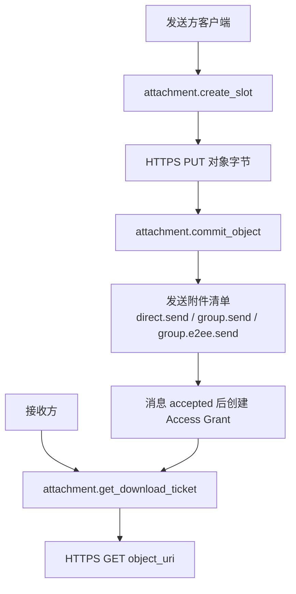
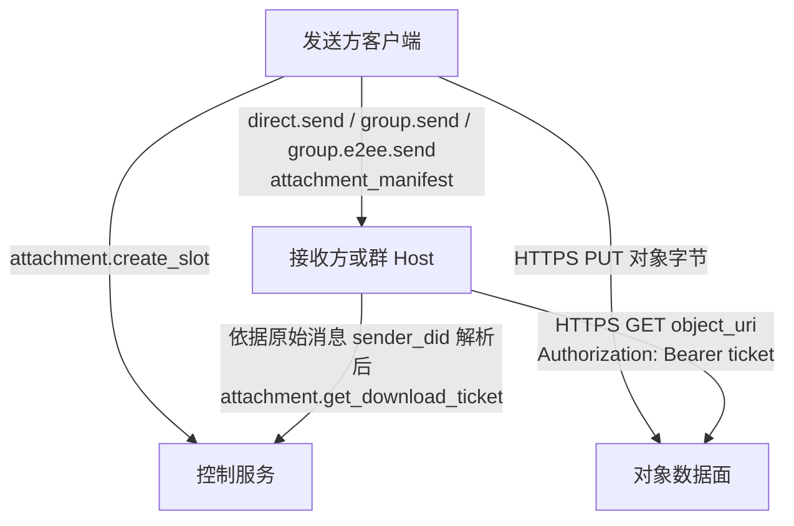
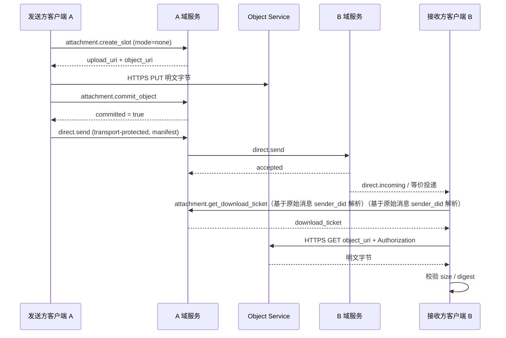
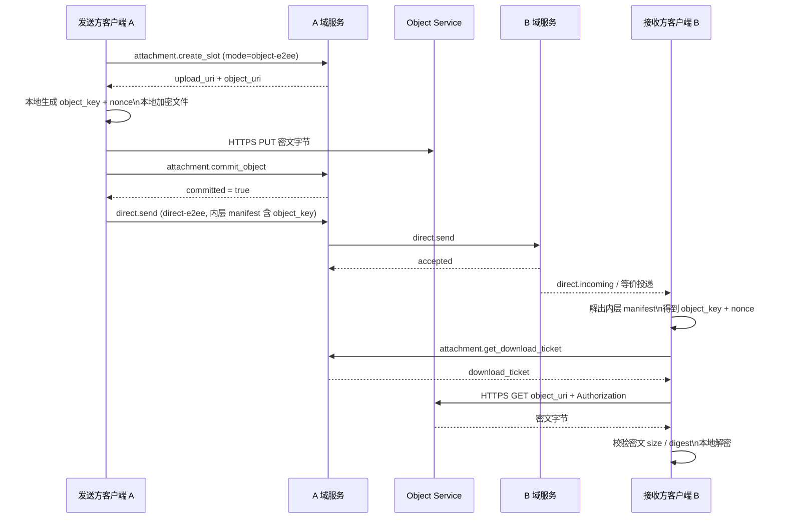
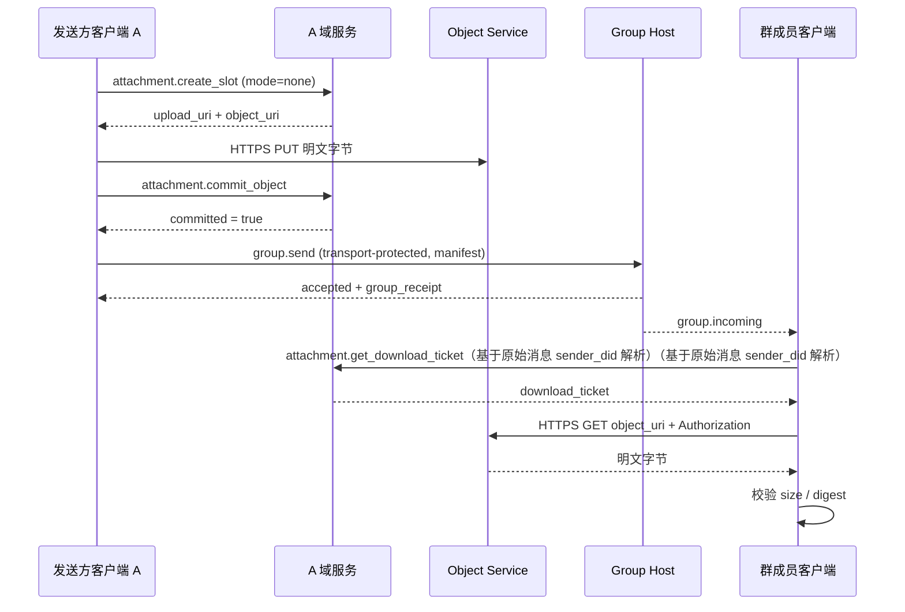
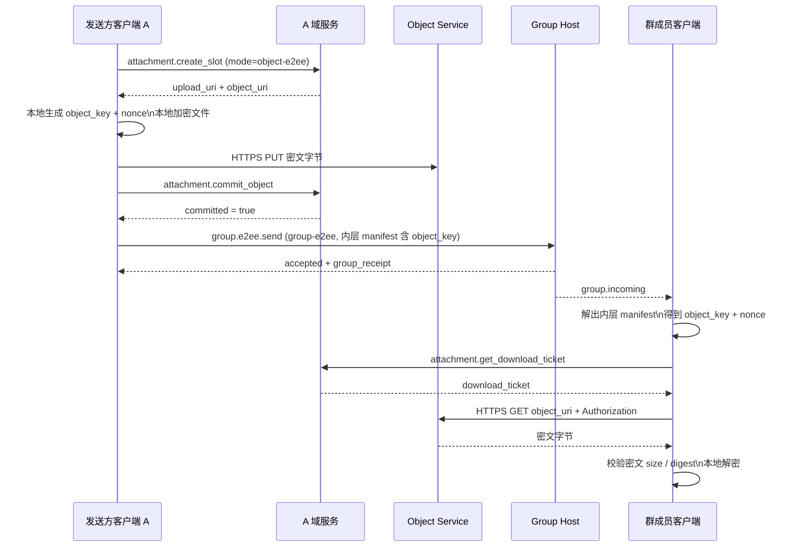
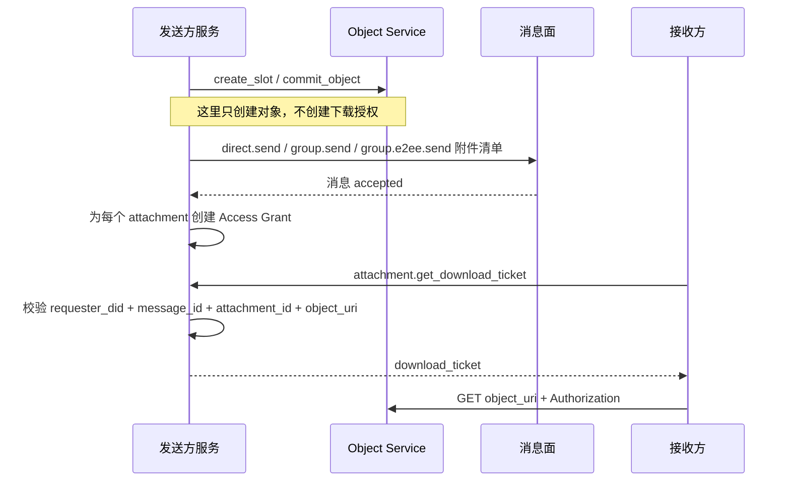
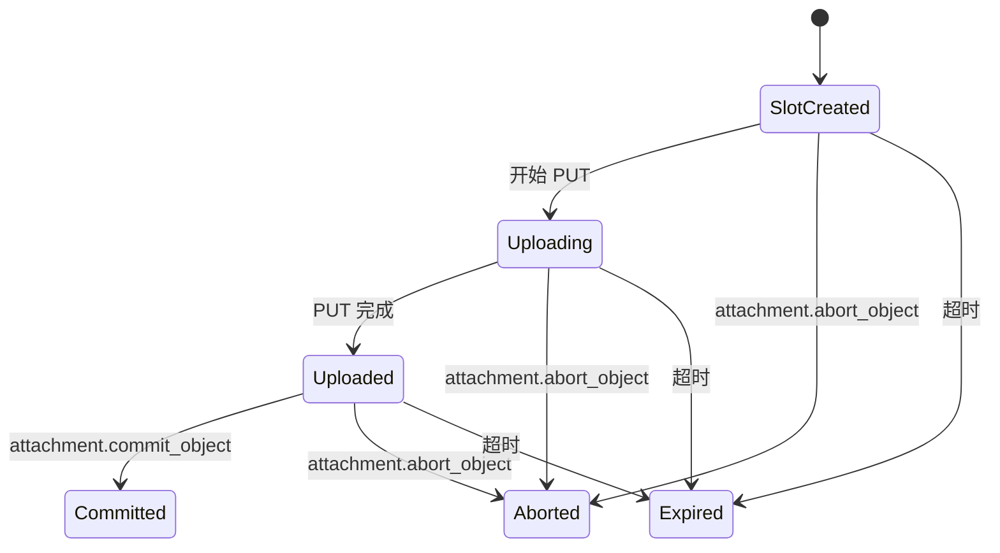

> 日本語参考訳（機械翻訳・未校閲）。規範となるのは原文です。コード例・識別子・規範キーワードは原文を保持しています。
> 原文: [chinese/message/07-附件与对象传输.md](../../../chinese/message/07-附件与对象传输.md) / 基準コミット: `0837cfdfaf4ddcf834f0890ddaf34fc4c824e066`

# ANP プロファイル 7: 添付ファイルとオブジェクト転送

- 文書番号: ANP-P7
- タイトル: 添付ファイルとオブジェクト転送
- ステータス:公開
- バージョン: 1.2
- コードブックバージョン: ANP のメッセージング 1.2
- 原文言語: 中文 / このページは日本語参考訳
- アプリケーションの範囲: この規範は、オブジェクトのv1.1とライフサイクルに別れを保持し、マルチイケメン境界を指定する間:通常の添付操作はDID内にあり、暗号化配信によって結合された機器はP5またはP6によって処理されます。

---

## 1. 目的:

このProfile は、添付ファイルとオブジェクトの構文を AMP に定義します。

1. プライベートとコミュニティの会話でアンexes を表現する方法。
2. 非E2EEとE2EEメッセージで同じものをロードする方法 `attachment_manifest`；
3. 添付ファイルをメッセージ、制御、データの3つのレイヤーに分割する方法
4. 独立した HTTPS チャネルを使用してオブジェクトをアップロードおよびダウンロードする方法。
5. URIをターゲティングし、短い通知で文書をダウンロードし、オブジェクトレベルの暗号化を使用してリンクを漏洩するリスクを減らす方法。
6. オブジェクトのコンテンツの検証、アクセス制御、およびオブジェクトレベルの暗号化を完了する方法。
7. 添付オブジェクトのDIDグレードの構文を維持し、チケットをダウンロードする方法, 機器境界の暗号化された配信を担当するP5 / P6;
8. 明確でシンプルで、ランタブルなv1スキームを維持する方法。

ベンジャー **なし、いいえ。**定義:

- オブジェクトストレージの内部実現;
- 戦略のターゲティングと制御
- (a) オブジェクトの 's ドキュメントのダウンロード用の特定のパスワード発行形式;
- オブジェクトはAMPクロス・トライアンラル・コールチェーンを介して転送します。
- `service-managed` オブジェクトの暗号化モード;
- `wrapped_object_key`、文書レベルのキーの交渉の議定書、まっすぐなチェーンのダウンロード、ミラーのURI、相互連結されたダウンロードの器械、等。
- 特別なサムネイルサブオブジェクトと特定のブレイクアウトリストオブジェクト。
- デバイス固有の添付フィールド、デバイス別デバイスダウンロードチケットまたはオブジェクトライフサイクル。

---

このプロファイルは適用されます `did:wba`、`did:web` ほかの DID メソッドをサポート。識別解像度と認証の遵守 [プチスイム](../../../chinese/message/02-身份与发现.md#method-validation)。

## 2. 用語と規範的なキーワード

このテキスト **MUST**、**MUST NOT**、**REQUIRED**、**SHALL**、**SHALL NOT**、**SHOULD**、**SHOULD NOT**、**RECOMMENDED**、**NOT RECOMMENDED**、**MAY**、**OPTIONAL** 資本金を基準とする規範的な要件として解釈される。

用語定義:

- **添付ファイル**: ANPメッセージで引用されている外部オブジェクト。ファイル、画像、音声、ビデオ、または任意のバイトストリームであることができます。
- **オブジェクト**: 実際のアンクのバイト。
- **添付メッセージ**: 複数個 `attachment_manifest` ANPメッセージの主負荷として。
- **添付ファイル マニフェスト**: オブジェクトの場所、要約、サイズ、メディアプロパティ、暗号化特性を記述する構造化されたオブジェクト。
- **オブジェクトサービス**: 別館制御とオブジェクトデータのためのサービス。
- **コントロールプラン**：`attachment.create_slot`、`attachment.commit_object`、`attachment.abort_object`、`attachment.get_download_ticket` など。
- **データプラン**: HTTPS PUT/GET を介して独立して送信されたオブジェクトのバイト。
- **ご挨拶**：`direct.send`、`group.send` または `group.e2ee.send` ロード `attachment_manifest` 平面。
- **アップロードスロット**: アップロードオブジェクトの送信者によって要求される一時的なアップロード機能およびメタデータ位置。
- **コミットされたオブジェクト**: アップロードされたオブジェクトを、メッセージに引用することができます。
- **オブジェクトのURI**: オブジェクトは URI を見つけます。 v1 には、オープンストレートチェーンの任意の価格で費用がかかりませんローカル HTTPS リソースアドレスが含まれています。
- **チケットダウンロード**: オブジェクトの ' s ダウンロードに一時的にアクセスノートを使用します。
- **アクセス助成**: 添付メッセージが正常に送信された後、送信者サービスによって確立された添付ファイルのダウンロード許可レコード。
- **オブジェクトレベルの暗号化**: 転送層の機密性にのみ、頼るよりも、ローカルで送信者によるオブジェクトコンテンツの暗号化。
- **オブジェクトキー**: 送信者はオブジェクトによって生成されたランダムな対称キーです。
- **ノイン**: オブジェクト暗号化で使用したランダム番号。V1 MTIの長さの12バイトに固定されます。

---

## 3. v1ポートによる一般設計決定

### 3.1 3階建ての分離

添付ファイル転送 **MUST** 3面として理解されています。

1. **新着情報**: ご利用の際にはのみ `attachment_manifest` 受取人へ
2. **コントロール**• スロットのアップロード、人に送信し、オブジェクトの放棄とダウンロード文書の発行のみ。
3. **データ面**: PUT/GET オブジェクトバイトのみ。

これら3つの責任の水準。 **MUST NOT** 注意する。特に:

- コントロール側の方法は、添付ファイルを受信者に送信する責任を負わない。
- (a) リレーオブジェクトのバイトは情報によって隠されていません。
- データの面は、ビジネスメッセージングに責任を負わない。

### 3.2 v1 メインラインパス

v1 の標準的なメインラインパス **MUST** は:

1. 送信者コール `attachment.create_slot`；
2. オブジェクトレベルの暗号化が有効になっている場合、送信者はローカルにファイルを暗号化します。
3. 独立した HTTPS による送信者 `PUT` オブジェクトバイトをアップロードする。
4. 送信者コール `attachment.commit_object`；
5. loadProfile の定義による Sender `direct.send`、`group.send` または `group.e2ee.send` annexes のリストを送信します。
6. 受信者は、リストのソースである元の送信者IDを運ぶことによって公開を解釈します `ANPMessageService`と を `attachment.get_download_ticket` (a) 資料のダウンロードを取得する
7. 独立した HTTPS による受精 `GET object_uri`とりあえず `Authorization` (a) 頭に文書を運ぶ者。
8. レジアーチェック抽象;オブジェクトが有効化した場合 `object-e2ee`、非分類され、解読される。


特定のコントロール面に入る前に、メッセージ、制御、データ面をプリセットの概観で紐付けることができます。これにより、読者が「既に存在するメッセージ」(メッセージが送信された)と「ダウン」の間で区別しやすくなります。(「ダウンロードは承認されます」)は、章5シナリオを読み込むときに段階的に設定します。



*図P7-1:附属書III面のまとめと、チェーン(非放射性)を有効にします。*

現行の数字は、そのことを強調しています。`create_slot` / `commit_object` オブジェクトだけを作成して、実際のダウンローダーは、添付メッセージがその後のダウンロードプロセスで受け入れられるときに作成されたアクセスグラントです。
### 3.3 2つのオブジェクトモデルのみを保持

v1 は、`encryption_info.mode` **MUST** 以下2つの値のみが許可されます。

- `none`
- `object-e2ee`

`service-managed` **MUST NOT** プロトコルフィールドに表示します。

オブジェクトストレージのサービスディスク暗号化、KMS、静的暗号化は、実現のすべての詳細です。**MUST NOT** 相互合意のためのモデルの考え方は、その上でモデル化されます。

### 3.4 被験者のセキュリティから情報を分離する

annexe には 2 つのレイヤーのセキュリティがあります。

1. **メッセージを安全に送信します。**: リストを運ぶ人によって `transport-protected`、`direct-e2ee`、`group-e2ee` 決定;
2. **オブジェクトはセキュアです。**: によって `encryption_info.mode` 決定。

v1 のルールは:

- あり。 `transport-protected` 負荷、添付オブジェクト **MUST** 利用条件 `mode = "none"`；
- あり。 `direct-e2ee` または `group-e2ee` 負荷、添付オブジェクト **MAY** 利用条件 `mode = "none"` または `mode = "object-e2ee"`。

### 3.5 オブジェクトキーは E2EE リストでのみ送信

いつ? `mode = "object-e2ee"` _その他組織

- `object_key_b64u` とりあえず `nonce_b64u` **MUST** 痛みのほんの少しだけ。 `direct-e2ee` または `group-e2ee` (a) 保護されるべきアンクンの一覧で;
- `object_key_b64u` とりあえず `nonce_b64u` **MUST NOT** プレゼン `attachment.create_slot` または `attachment.commit_object` (a) 制御要求の面;
- の1 **未定義** 別々のファイルレベルのキー交渉契約。

### 3.6 v1 削除されたフォークパスをクリア

v1 をクリア、シンプルでランド可能に保つための次のパス **なし、いいえ。**ファイルの入力:

- `service-managed`
- `wrapped_object_key_b64u`
- `key_wrap_alg`
- インラインダウンローダー
- カスタムトランスファーヘッダ相談
- 永久的な開いたまっすぐな鎖
- ミラーのURI
- 特化ブロックリスト構造
- 特殊サムネイルサブオブジェクト
- オブジェクトバイトをAMPビジネスメソッドで繰り返します

### 3.7 行列のグループ化を許可する

| ロード方法 | `meta.security_profile` | 許可される `encryption_info.mode` | リストに取得する方法はありますか? `object_key_b64u` |
|---|---|---|---|
| 直接基盤 | `transport-protected` | `none` | あり あり |
| グループベース | `transport-protected` | `none` | あり あり |
| 直接E2EE | `direct-e2ee` | `none` / `object-e2ee` | あり。 |
| グループE2EE | `group-e2ee` | `none` / `object-e2ee` | あり。 |

### 3.8 マルチ機器境界

P7 既存のオブジェクトとチケットステータスマシンをアドレスレイヤーにデバイスを追加せずに保持します。

1. 通常の添付メッセージ、コントロールフェイスリクエスト、アクセス付与およびダウンロードチケットは、送信者/リッカーDIDによる範囲を決定します。また、既存のメッセージ、アクセサリ、オブジェクト、ダイレクトまたはグループコンテキスト。 **MUST NOT** 組織図 `sender_device_id`、`recipient_device_id`、`requester_device_id` または他の装置。
2. 添付オブジェクトは一度だけアップロードされます。 **MUST NOT** 各デバイス用の標準P7オブジェクトまたはチケットを作成します。
3. P5 直接 E2EE デバイス選択とデバイス別指定; P6 排他的な定義 MLS デバイスリーフと暗号化された配信。 P7 は、内部の添付ファイルとオブジェクトキーフィールドのみを定義し、デバイス **MUST NOT** これらのフィールドを配信するためのラチェットまたはMLSプライベートステータスを共有します。
4. 機器が使用されるコンテキストで展開をすることができますが、どこにしか使用できない **MUST NOT** 配列はP7の火場に変換されます。

---

## 4. プロフィールの印および依存性

### 4.1 プロフィール名

このProfile の標準的な名前は、次のとおりです。

`anp.attachment.v1`

### 4.2 依存症

ベンジャー **MUST** 依存症:

- `anp.core.binding.v1`
- `anp.identity.discovery.v1`

ベンジャー **MAY** 下記のプロファイルと組み合わせる:

- `anp.direct.base.v1`
- `anp.group.base.v2`
- `anp.direct.e2ee.v1`
- `anp.direct.e2ee.v2`
- `anp.group.e2ee.v1`
- `anp.group.e2ee.v2`

### 4.3 セキュリティモード

このProfile は、 se の新しいセキュリティモードを定義しませんが、このサービスを使用して、BusinessProfile を実行します。

- `transport-protected`
- `direct-e2ee`
- `group-e2ee`

---

## 5. アタッチメント転送フローチャート

### 5.1 層のフローチャート全体



### 5.2 プライベート/非暗号化された添付ファイル



### 5.3 プライベート/E2EEアネックス



### 5.4 グループトーク/非暗号化添付ファイル



### 5.5パネル/E2EEアネックス



---

## 6. 運送規則: プライベート、グループチャット、暗号化、非暗号化

### 6.1 直接基盤の負荷

annexes の一覧が採用されるとき `direct.send` あり。 `anp.direct.base.v1` をクリックし、

- `meta.profile` **MUST** イーグル `anp.direct.base.v1`
- `meta.security_profile` **MUST** イーグル `transport-protected`
- `meta.content_type` **MUST** イーグル `application/anp-attachment-manifest+json`
- `body.payload` **MUST** 添付メッセージオブジェクトとして
- `auth.origin_proof` **MUST** 署名された直接ペイロード全体をP3で既存および結合
- それぞれ。 `attachment_manifest.encryption_info.mode` **MUST** イーグル `none`

### 6.2 グループベースにロード

annexes の一覧が採用されるとき `group.send` あり。 `anp.group.base.v2` をクリックし、

- `meta.profile` **MUST** イーグル `anp.group.base.v2`
- `meta.security_profile` **MUST** イーグル `transport-protected`
- `meta.content_type` **MUST** イーグル `application/anp-attachment-manifest+json`
- `body.payload` **MUST** 添付メッセージオブジェクトとして
- `auth.origin_proof` **MUST** P4 に従って署名されたグループペイロード全体に存在し、結合して下さい
- 成功の応答 **SHOULD** バックナンバー `group_receipt`
- それぞれ。 `attachment_manifest.encryption_info.mode` **MUST** イーグル `none`

### 6.3 直接E2EEの負荷

annexes の一覧が採用されるとき `anp.direct.e2ee.v1` または `anp.direct.e2ee.v2` 送信:

- チェーン後の通常のパスの下、外側の層 `meta.content_type` **MUST** あり あり `application/anp-direct-cipher+json`
- P5 で最初に許可された init がアプリケーション メッセージパスを運ぶ場合、外部 `meta.content_type` **MAY** あり あり `application/anp-direct-init+json`
- のnexesのリスト **MUST** プリ暗号化として `Application Plaintext` 業務オブジェクトの内部円が現れます。
- 内部の層 `application_content_type` **MUST** イーグル `application/anp-attachment-manifest+json`

### 6.4 グループE2EEにロード

annexes の一覧が採用されるとき `anp.group.e2ee.v1` または `anp.group.e2ee.v2` ダウンダウン `group.e2ee.send` 送信:

- アウター `meta.content_type` **MUST** 固定式 `application/anp-group-cipher+json`
- アウター `body` **MUST NOT** 明示的なannexesの直接表示のリスト
- のnexesのリスト **MUST** 暗号化される前として `Group Application Plaintext` 業務オブジェクトの内部円が現れます。
- 内部の層 `application_content_type` **MUST** イーグル `application/anp-attachment-manifest+json`

### 6.5 フィールド所有権

- ダイレクトベースとグループベースの添付メッセージは、プロファイルを含むDIDまたはグループDIDでのみ利用できます。 P7はデバイスをデバイスに自己に追加しません。
- `attachment_message` とりあえず `attachment_manifest` 機器識別子は含まないでください。
- P5 v2 直接 E2EE アウターレイヤーは、要求された送信と受信デバイスフィールドを運ぶ; P6 v2 MLS アウターレイヤーは、要求された機器を結合します。 これらのアウター層は、P5 または P6 のみで説明されます。 v1 E2EE アクセプトは、P7 用のデバイスセルフを取得していません。
- `object_key_b64u` とりあえず `nonce_b64u` 暗号化アタッチメントの秘密を保持します。 P7には、別のデバイス別キー配布リクエストは含まれていません。

---

## 7. `attachment_message` とりあえず `attachment_manifest` オブジェクト

### 7.1 添付メッセージ トップレベル構造

推奨事項の構造は次のとおりです。

```json
{
  "attachments": [
    {
      "attachment_id": "att-001",
      "filename": "report.pdf",
      "mime_type": "application/pdf",
      "size": "1048576",
      "digest": {
        "alg": "sha-256",
        "value_b64u": "BASE64URL_DIGEST"
      },
      "access_info": {
        "object_uri": "https://objects.example.com/objects/obj-001"
      },
      "encryption_info": {
        "mode": "none"
      }
    }
  ],
  "caption": "附件说明",
  "primary_attachment_id": "att-001"
}
```

ルール:

- `attachments` **MUST** 存在感と非空
- `caption` **MAY** プレゼンス
- `primary_attachment_id` **MAY** そこには、あると、**MUST** スポット `attachments` すでに存在しているもの。 `attachment_id`

### 7.2 `attachment_id` スコープ

- `attachment_id` **MUST** 添付ファイルメッセージの1つだけ
- `attachment_id` **保証無し。** クロスクローズオールシステム
- ドキュメントのバインド、認証、または監査記録をダウンロードし、**MUST** 利用条件 `(message_id, attachment_id)` または `(object_uri, message_id, attachment_id)`, だけでなく、単に使用 `attachment_id`

### 7.3 個人 `attachment_manifest`

みんなが、 `attachment_manifest` **MUST** 含まれる:

- `attachment_id`
- `mime_type`
- `size`
- `digest`
- `access_info`
- `encryption_info`

みんなが、 `attachment_manifest` **MAY** 含まれる:

- `filename`
- `media_info`

フィールドの状態:

- `filename`: デモファイル名;**MAY**
- `mime_type`: ミータイプ;**MUST**
- `size`: オブジェクトバイト、小数文字列をアップロードする。**MUST**
- `digest`: オブジェクトバイトをアップロードする。**MUST**
- `access_info`: 位置情報のオブジェクトのダウンロード**MUST**
- `encryption_info`: オブジェクトレベルの暗号化された情報。**MUST**
- `media_info`(a) 写真、オーディオ、ビデオなどのメディアオーディエンスの追加の説明。**MAY**

### 7.4 `digest`

`digest` **MUST** 含まれる:

- `alg`
- `value_b64u`

ルール:

- `digest.alg` v1 で **MUST** 固定式 `sha-256`
- `digest.value_b64u` **MUST** SHA-256 アップロードオブジェクトバイトのまとめ
- いつ? `encryption_info.mode = "none"` , 要約はテキストセクションに対応
- いつ? `encryption_info.mode = "object-e2ee"` , 要約は、秘密のセクションに対応

### 7.5 `access_info`

`access_info` 構造は次の通りです:

```json
{
  "object_uri": "https://objects.example.com/objects/obj-001"
}
```

ルール:

1. `object_uri` **MUST** あり あり `https://` ページの先頭へ
2. `object_uri` v1 では、loctor スタイルのオブジェクトアドレスを示します。 これは永久的なオープン ストレート チェーンではありません
3. ダウンロードを受諾する前に **MUST** まずは電話を `attachment.get_download_ticket`
4. スタッフ **MUST** 添付リストの元の送信者によって公開をパースする `ANPMessageService`
5. グループシーンでは、元のメッセージがDIDで送信されました **MUST** 添付リストを運ぶ送信者の元のグループから(例、 `group.incoming.meta.sender_did`）
6. `attachment.get_download_ticket` **MUST** 公共サービスのための送信者に送信 `serviceDid`
7. 受取人がダウンロードした時 **MUST** えー。 `object_uri` リリース `GET`とりあえず `Authorization` 頭にノートを運ぶ
8. コールア **MUST NOT** のみに基づく `object_uri` URL は制御サービスを推測します

### 7.6 `media_info`

`media_info` 映像、音声、ビデオなどのメディアオブジェクト。推奨分野:

- `width`
- `height`
- `duration_ms`
- `codec`

数値フィールドが現れた場合、**MUST** 小数の文字列を使用します。

### 7.7サムネイルとブレイクアップ

v1 未定義 `thumbnail` フィールド、特定の定義なし `chunking_info` フィールド。

サムネイル、送信者 **SHOULD** サムネイルを通常の添付ファイルとして送信します。

アップロードする大きなドキュメントが必要な場合は、アップロードしてもらうことができます。**SHOULD** HTTP アップロードの内部補完。このプロパティは、このプロファイルのリスト構造を変更しません。

---

## 8. オブジェクト暗号化

### 8.1 `encryption_info`

`encryption_info` **MUST** 二つの構造の1つです。

暗号化されていないオブジェクト:

```json
{
  "mode": "none"
}
```

オブジェクトレベルの暗号化オブジェクト:

```json
{
  "mode": "object-e2ee",
  "object_cipher": "chacha20-poly1305",
  "object_key_b64u": "BASE64URL_32_BYTES",
  "nonce_b64u": "BASE64URL_12_BYTES",
  "plaintext_size": "1048576"
}
```

ルール:

1. `mode` **MUST** 削除 `none` または `object-e2ee`
2. `mode = "none"` 送信者がオブジェクトコンテンツをローカルに暗号化しないことを意味します
3. `mode = "object-e2ee"` 送信者がテキストセクションをアップロードする前に、オブジェクトをローカルに暗号化することを意味します
4. あり。 `transport-protected` ブロガーは次のように述べています。`mode` **MUST** あり あり `none`
5. `object_key_b64u` とりあえず `nonce_b64u` **MUST NOT** プレゼン `transport-protected` 運ばれたアンexesのリスト
6. `service-managed`主要な包装アルゴリズム、文書レベルのキーの相談 **なし、いいえ。**コンテンツ

### 8.2 `object-e2ee` MTIアルゴリズム

電圧: V1 `object-e2ee` MTIアルゴリズム **MUST** は:

- `object_cipher = "chacha20-poly1305"`
- `object_key_b64u`:32バイトのランダムな対称キー
- `nonce_b64u`:12バイトランダム nonce
- `plaintext_size`: 元のファイルバイトの長さ、小数文字列

### 8.3 送信者の暗号化手順(仮)

いつ? `encryption_info.mode = "object-e2ee"` ,送り **MUST** 次のように実装します。

1. 元のファイルとマークのバイトをそのまま読み込む `P`
2. 新規ランダムな32バイトオブジェクトキーを生成する `K`
3. ランダム12バイトを生成 `N`
4. ここまで行くつもりだ。 `AAD = 空字节串`
5. 計算:

```text
C = ChaCha20-Poly1305-Encrypt(
      key = K,
      nonce = N,
      aad = "",
      plaintext = P
    )
```

6. Object サービスにアップロードされたオブジェクトバイト **MUST** あり。 `C`
7. `attachment_manifest.size` **MUST** イーグル `len(C)` 文字列の決定
8. `attachment_manifest.digest` **MUST** イーグル `sha-256(C)`
9. `encryption_info.plaintext_size` **MUST** イーグル `len(P)` 文字列の決定
10. `mime_type` **MUST** 秘密オブジェクトの代わりに元のファイルMimeタイプを表現し続ける MIMEタイプ

追加要件:

- 各定義オブジェクト **MUST** 新規ランダム使用 `K`
- カレンダー **MUST NOT** 再使用 `(K, N)` グループ会社
- 同じファイルの内容が何度も何度も送信されたとしても、送信者に **SHOULD** 新規作成 `K` とりあえず `N`
- `object_key_b64u` **MUST NOT** P5のトラックセットキーから直接、また **MUST NOT** MLS epoch シークレットまたは P6 から直接受け取られた他のセッションキー

### 8.4 `expected_size` とりあえず `plaintext_size`

で v1 MTI `chacha20-poly1305` 以下:

- オブジェクトサイズをアップロード = 元ファイルサイズ + 16バイト認証タグ
- 送信者がいる場合 `attachment.create_slot` エントリー `expected_size`, 値 **SHOULD** 元のファイルサイズではなくアップロードオブジェクトのサイズにポイント
- 場合 `mode = "object-e2ee"`カレンダー **SHOULD** 元のファイルサイズを後で書くためにローカルに保存します `encryption_info.plaintext_size`

### 8.5 パーティーの確認と復号化のステップを受け取る(仮)

受信者がオブジェクトバイトを持っているとき:

1. **MUST** ダウンロードのバイトの長さが等しいかどうかを確認してください `attachment_manifest.size`
2. **MUST** 計算する `sha-256(下载字节)`と と と と と と と と と と と と と と と と と と と と と と と と と と と と と と と と と と と と と と と と と と と と と と と と と と と と と と と と と と と と と と と と と と と と と と と と と と と と と と と と と と と と と と と と と と と と と と と と と と と と と と と と と と と と と と と と と と と と と と と と と と と と と と と と と と と と と と と と と と と と と と と と と と と と と と と と と と と と と と と と と と と と と と と と と と と と と と と と と と と と と と と と と と と と と と と と と と と と と と と と と と と と と と と と と と と と と と と と と と と と と と と と と と と と と と と と と と と と と と と と と と と と と と と と と と と と と と と と `attachment_manifest.digest` 比較比較
3. 場合 `encryption_info.mode = "none"`チェックが成功したら、トップに渡すことができます
4. 場合 `encryption_info.mode = "object-e2ee"`受取人。 **MUST** 使用:

```text
P = ChaCha20-Poly1305-Decrypt(
      key = object_key_b64u,
      nonce = nonce_b64u,
      aad = "",
      ciphertext = downloaded_bytes
    )
```

5. 復号が失敗した場合、受取人が **MUST** この添付ファイルを取り込む
6. 復号化が成功した場合、受取人 **MUST** 検証 `len(P)` 等しい `plaintext_size`
7. 確認が完了すると、受取人が業務の一番上にセクションを配信できます。

### 8.6 オブジェクトのキー配布ルール

v1 の標準的なオブジェクト分布パスは 1 つだけです。

- 添付メッセージ自体がからあるとき `direct-e2ee` または `group-e2ee` 送信者と保護 **MAY** ちょうどそれを右に置く。 `object_key_b64u` とりあえず `nonce_b64u` 内側の層に置く。 `attachment_manifest`
- 受信者がこのE2EEメッセージからオブジェクトキーを取った後、データを管理して秘密のオブジェクトをダウンロードすることでドキュメントを取り出すことができます

つまり、

- の1 **必要ありません。** それから私達は付属品のための複雑な主交渉の議定書を設計します。
- クラウドシーンでは、そのメッセージを解読できる人はこのキーを取得します。
- の1 **保証無し。** 再アクティブ除去の権利; 以前にオブジェクトキーとオブジェクトコンテンツを受信したメンバーを削除し、事実後に取得した情報を消去しません

---

## 9. ドキュメントへのアクセス許可とダウンロード

### 9.1 機器の目的

楽器をダウンロードすることの目的は、正当な受取人による送信を防止するものではありませんが、むしろ:

1. 第三者がリストから直接ダウンロードすることを防止する
2. 予防対策 `object_uri` 長期間の公共リンクに
3. 明確なリクエストとメッセージのコンテキストへのダウンロード権限を制限する
4. ターゲットオーディエンスのためのサービスの監査、停止および管理

### 9.2 アクセス助成制度

`attachment.create_slot` とりあえず `attachment.commit_object` **おすすめ**任意の受信者なしでオブジェクトを作成します。 's ダウンロード権限.

オブジェクトが受信者からメッセージをダウンロードできる時間**MUST** アクセス助成の決定書を採択

添付ファイルを含む場合 `direct.send`、`group.send` または `group.e2ee.send` 送り装置サービスかグループ ホストは首尾よく受け入れられ、送信者側システム **MUST** 各添付ファイルごとにアクセス付与を行います。

アクセス助成金、少なくとも。 **MUST** テイ:

- `message_id`
- `attachment_id`
- `object_uri`
- `message_security_profile`
- 個室で `message_target_did`;またはコンテキストでグループ化 `group_did`

アクセス助成金は、ローカルデバイスではなく、DIDまたはグループコンテキストをターゲットに認定されます。 現地機器の配送は、達成の詳細に残っています。

### 9.3 `intended_target` 境界の境界

`attachment.create_slot.body.intended_target` 戦略のヒントをアップロードするだけをアップロード.

`intended_target`：

- **MAY** 事前の規模、タイプまたは保持ポリシー決定への目的サービスのため
- **MUST NOT** ライセンスをダウンロードするための別のベースとして使用

実際のダウンロードの承認ベース **MUST** 配送の成功後からアクセス付与

### 9.4 器械の結合

v1 で、ドキュメントをダウンロード **MUST** 少なくとも次のコンテキストで区切る:

- `attachment_id`
- `object_uri`
- `requester_did`
- `message_id`
- `message_security_profile`
- 個室で `message_target_did`;またはコンテキストでグループ化 `group_did`
- `expires_at`

標準的な切符の結合 **MUST NOT** 組織図 `requester_device_id` またはその他のデバイスセルフセレクター。 展開は、チケットが発行される前にローカル機器の状態を使用できますが、この状態はP7wireやチケットバインディングフィールドになりません。

### 9.5 機器の妥当性および使用

- ノートをダウンロード **SHOULD** 短期的なメモ
- デフォルト有効期間 **SHOULD NOT** 5分以内
- 感度の高いオブジェクト **MAY** ワンタイム機器の使用
- ノートをダウンロード **MUST** HTTP による `Authorization` ヘッド転送
- ノートをダウンロード **MUST NOT** URLクエリパラメータで読み込み

v1 固定ダウンロードは:

```http
GET {object_uri}
Authorization: Bearer {download_ticket}
```

### 9.6 楽器の発行の検証

処理される主題制御サービス `attachment.get_download_ticket` できるかどうかはわかりません。**MUST** 確認:

1. `meta.target.kind = "service"`
2. `meta.target.did` **MUST** DID を解析する元の添付ファイルメッセージから公開リリースを同等 `ANPMessageService.serviceDid`
3. `requester_did = meta.sender_did`
4. `(message_id, attachment_id, object_uri)` アクセス助成対象者
5. `message_security_profile` アクセス助成金と同じ
6. ストーリーは、個人的にも少しのものです。`message_target_did` 既存戦略とマッチング戦略
7. 政府は、このプロジェクトにパーティーではないとブロガーは言います。`group_did` 存在と存在 `requester_did` 現在はグループアクセス戦略に沿っています

P7 要求者の装置は確認を完了するために必要ではないです。

### 9.7 クロスサービス同期

の1 **別々に標準化されない** 複数の内部サービス間でプロトコルを同期させるためのアクセス付与

v1 デフォルトパスでは、元の添付ファイル送信者によってダウンロードが公開されます。 `ANPMessageService` デプロイメントがオブジェクトコントロールコンポーネントを内部に分割している場合、サービスの利用可能な場合は終日確認できます。**MUST** 公共サービスがアクセス付与され、ローカルまたは内部同期で文書のダウンロードの発行のために必要であることを確認してください。

### 9.8 会員の変更後の境界線訪問

の1 **レトロアクティブ除去の保証なし**。

つまり、

- オブジェクトサービス **SHOULD** 現在のグループステータスに基づいて削除されたメンバーのための新しいダウンロードを発行する拒否
- しかし、この命令はオブジェクトバイト、オブジェクトキー、または以前に正当なメンバーに達したコンテンツに基づいている **約束なし。** 買収した訪問能力のExポストファクトオ撤退

---


P7は、オブジェクトの存在がダウンロードされる人には量を及ぼさない別の重要な境界です。次のチャートでは、オブジェクトの投稿をリンクし、情報を受信し、グラントの作成にアクセスし、実行者が正しく制御にアクセスできるように承認のチェーンに発行し、最終的なダウンロードを実行します。



*図P7-2:アクセス付与とダウンロードチケット承認チェーン(非放射性)。*

です。`attachment.get_download_ticket` マンデートは、メッセージのコンテキストに基づいていて、グラントにアクセスする必要があります。 `object_uri` アップロードからのみ。 `intended_target`。

### 9.9 エージェントのDID移行履歴

エージェント DID 変更時、履歴 `attachment_manifest` アクセス助成金 **MUST NOT** - 書き換えです。

Access Grant が古い受信者 DID を記録する場合、現在のリクエストは、承認 DID が認可された DID から認証される DID から認可された DID までであることを検証するためにのみ、その後の DID を使用します。 `requester_did` - 経営戦略は、バックのみ受け入れられます **MAY** 同一の内部認証記録にマップされたリクエストです。`provider_asserted` 歴史的アンexesへのアクセスを継承するのに十分かどうかは、ビジネスの決定です。P7は受諾や拒否を意味しません。

地図は内部にのみ存在します。 **MUST NOT** 安定したメインフィールド、名前、マイグレーションチェーン、デバイスを歴史的に尋ねる、アクセスグラント、チケットまたはコントロール。 グループアンヌクは、現在のP4 v2ホスト、クラスター戦略、元のメッセージのコンテキストでまだ許可されています。
## 10. フェイスメソッドの制御

### 10.1 一般規定

オブジェクトコントロール側でこのセクションが使用されます。 **なし、いいえ。**変更点 `direct.send`、`group.send` または `group.e2ee.send` . テキストは首尾よく意味を送られます。

これらのメソッドは、デフォルトで実行されます。

- `meta.profile = "anp.attachment.v1"`
- `meta.security_profile = "transport-protected"`

下記の認証モデルを利用します。

1. `attachment.create_slot`
2. `attachment.commit_object`
3. `attachment.abort_object`
4. `attachment.get_download_ticket`

全部で **サービススコープ** フェイスメソッドを制御します。

したがって:

- `meta.target.kind` **MUST** イーグル `service`
- `meta.target.did` **MUST** ターゲットが開いているようなもの。 `ANPMessageService.serviceDid`
- P8によるクロス・エクストラリア認証 `serviceDid + HTTP Message Signatures` 約束。
- の1 **リクエストなし** オブジェクトコントロールサービス終了時に、独立端末を直接確認 `origin_proof`

これらのメソッド **MUST NOT** P7 火に添加 `sender_device_id`、`recipient_device_id` または `requester_device_id`内部機器認証とルートされたコンテキストは、デプロイメントの個人情報を保持します。


コントロール フロントは、コントロールを持っている人によって最も簡単に無視されます。, 名前として、アップロードスロットは、委員会プロジェクトと同じ状態にあるわけではありません. 次の図では、作成されたいくつかのキーノードを配置します, アップロード, 提出, 放棄され、同じライフサイクルで期限が切れます.



*図 P7-3: スロット/オブジェクトのライフサイクル(unnormative)をアップロードします。*

実現の側面は「取るべき」 `object_uri`「情報のために既にオブジェクトが利用できる」と改善しました。 `Committed` 状態の後、被験者はそのリストに同梱されている合法的な参照のための前提条件です。
### 10.2 `attachment.create_slot`

#### 10.2.1 科学

アップロードスロットの申請は、送信されたアップロードに提出されます。

#### 10.2.2 リクエスト

方法論 **MUST** 使用:

- `meta.target.kind = "service"`
- `meta.target.did = 目标公开 ANPMessageService.serviceDid`

`body` **MUST** 含まれる:

- `attachment_id`
- `intended_message_security_profile`
- `object_encryption_mode`

`body` **SHOULD** 含まれる:

- `expected_size`
- `mime_type`

`body` **MAY** 含まれる:

- `filename`
- `expected_digest`
- `intended_target`

フィールドルール:

- `attachment_id`文字列:
- `intended_message_security_profile`：`transport-protected` / `direct-e2ee` / `group-e2ee`
- `object_encryption_mode`：`none` / `object-e2ee`
- `expected_size`:upload オブジェクトバイト、小数文字列
- `expected_digest`: アップロードオブジェクトバイトの要約
- `intended_target`: オブジェクト;次のように推奨構造:

```json
{
  "kind": "agent | group",
  "did": "did:example:..."
}
```

結合:

1. いつ? `intended_message_security_profile = "transport-protected"` できるかどうかはわかりません。`object_encryption_mode` **MUST** あり あり `none`
2. いつ? `object_encryption_mode = "object-e2ee"` できるかどうかはわかりません。`expected_size` **SHOULD** 対応テキストセクションサイズ
3. `intended_target` ヒントだけ、**MUST NOT** 分離的に構成された委任

#### 10.2.3 成功の応答

成功の応答 **MUST** 少なくとも含まれます:

- `attachment_id`
- `slot_id`
- `upload_uri`
- `object_uri`
- `commit_token`
- `expires_at`

成功の応答 **MAY** 含まれる:

- `upload_headers`

送信者のフォローアップ構造 `attachment_manifest.access_info` できるかどうかはわかりません。`object_uri` **SHOULD** から `attachment.create_slot` または `attachment.commit_object` ; 受信者は、ダウンロードする前にこのプロファイルで指定されたように、元の添付ファイルメッセージ送信者DIDに基づいてペーパーサービスを見つけます。

### 10.3 `attachment.commit_object`

#### 10.3.1 統計学

通知オブジェクトサービス:オブジェクトがアップロードされ、参照オブジェクトとして送信することができます。

#### 10.3.2 リクエスト

方法論 **MUST** 使用:

- `meta.target.kind = "service"`
- `meta.target.did = 目标公开 ANPMessageService.serviceDid`

`body` **MUST** 少なくとも含まれます:

- `attachment_id`
- `slot_id`
- `commit_token`
- `size`
- `digest`
- `object_encryption_mode`

`body` **MAY** 含まれる:

- `plaintext_size`
- `media_info`

ルール:

1. `digest.alg` **MUST** イーグル `sha-256`
2. いつ? `object_encryption_mode = "object-e2ee"` できるかどうかはわかりません。`plaintext_size` **MUST** プレゼンス
3. `attachment.commit_object` **MUST NOT** トランスファー `object_key_b64u`
4. `attachment.commit_object` **MUST NOT** トランスファー `nonce_b64u`
5. `attachment.commit_object` 成功事例 **等しくない** 受信者は、オブジェクトをダウンロードすることを許可されています。真のダウンロードは、その後のメッセージが正常に送信された後にアクセスグラントに依存しています

#### 10.3.3 成功の応答

成功の応答 **MUST** 少なくとも含まれます:

- `committed`
- `attachment_id`
- `object_uri`
- `committed_at`

の の の の の の の の の の の の の の の の の の の の の の の の の の の の の の の の の の の の の の の の の の の の の の の の の の の の の の の の の の の の の の の の の の の の の の です:

- `committed` **MUST** あり あり `true`

### 10.4 `attachment.abort_object`

#### 10.4.1 科学

未完成または不要のアップロードスロットの終了。

#### 10.4.2 リクエスト

方法論 **MUST** 使用:

- `meta.target.kind = "service"`
- `meta.target.did = 目标公开 ANPMessageService.serviceDid`

`body` **MUST** 少なくとも含まれます:

- `attachment_id`
- `slot_id`

#### 10.4.3 成功の応答

成功の応答 **MUST** 少なくとも含まれます:

- `aborted`
- `attachment_id`
- `aborted_at`

の の の の の の の の の の の の の の の の の の の の の の の の の の の の の の の の の の の の の の の の の の の の の の の の の の の の の の の の の の の の の の の の の の の の の の です:

- `aborted` **MUST** あり あり `true`

### 10.5 `attachment.get_download_ticket`

#### 10.5.1 統計学

ドキュメントにオブジェクトがアクセスされると、受信者はこのメソッドによって一時ダウンロード機器を取得します。

#### 10.5.2 リクエスト

方法論 **MUST** 使用:

- `meta.target.kind = "service"`
- `meta.target.did` **MUST** DID を解析する元の添付ファイルメッセージから公開リリースを同等 `ANPMessageService.serviceDid`

`body` **MUST** 少なくとも含まれます:

- `attachment_id`
- `object_uri`
- `requester_did`
- `message_security_profile`
- `message_id`

以下を追加してください。

- プライベートコンテキスト:`message_target_did`
- グループはコンテキストについて語っています。`group_did`

`body` **MAY** 含まれる:

- `one_time`

メソッドは定義されていません `requester_device_id` または同等の装置。

フィールドルール:

- `requester_did` **MUST** イーグル `meta.sender_did`
- `message_security_profile` つまり、現在の制御ではなくリストを運ぶために使用される情報セキュリティモードを意味します。 `meta.security_profile`
- `message_target_did` 元のプライベートチャット、エージェントIDのターゲット。
- `group_did` オリジナルグループからDIDのグループです。
- ドキュメントのリクエストを送信する前に、コールア **MUST** 最初に、元の添付ファイル送信機DIDを使用して公開を解析 `ANPMessageService`; グループシーンでは、DIDは元のグループメッセージ送信者からではなく取られます `group_did`

#### 10.5.3 応答の成功

成功の応答 **MUST** 少なくとも含まれます:

- `download_ticket_b64u`
- `expires_at`
- `ticket_binding`

`ticket_binding` **MUST** 少なくとも含まれます:

- `attachment_id`
- `object_uri`
- `requester_did`
- `message_id`
- `message_security_profile`

以下を追加してください。

- `message_target_did`
- `group_did`

`ticket_binding` **MUST NOT** 装置の印で増加して下さい。

---

## 11. データ面ルール

### 11.1 アップロード

カレンダー **MUST** 独立した HTTPS チャネルを使用する `upload_uri` リリース `PUT`。

ルール:

- いつ? `object_encryption_mode = "none"` テキストセクションをアップロードする
- いつ? `object_encryption_mode = "object-e2ee"` ,スクリーンブック
- アップロードリクエスト **MAY** カリブ `upload_headers`
- オブジェクトバイト **MUST NOT** JSON-RPC のビジネスメッセージが ANP に組み込まれた

### 11.2 ダウンロード

スタッフ **MUST** 独立した HTTPS チャネルを使用する `object_uri` リリース `GET`。

固定形式は以下の通りです。

```http
GET {object_uri}
Authorization: Bearer {download_ticket}
```

オブジェクトバイト **MUST NOT** AMP クロスダーリングサービス経由でNTLを通常の転送チャネルとして呼びます。

標準ベアラーのダウンロードリクエストには、P7 デバイスセルフポートまたはデバイスの証明書が含まれていません。 チケットをバインドする機器が必要な場合は、独立したプロファイルとして定義する必要があります。

### 11.3 郵便積み込み検証

スタッフ **MUST** ダウンロードが完了したら、少なくとも実行します。

1. 長期間の検証
2. 概要の検証
3. 場合 `mode = "object-e2ee"`、分類されるおよび `plaintext_size` 検証

重要な検証が失敗した場合は、受信者:

- **MUST NOT** オブジェクトのトップレベルの操作に有効な添付ファイルとして配信
- **SHOULD** 診断情報の記録

---

## 12. エラーの状態と提案されたエラーコード

このプロファイルは、添付ファイルとオブジェクトの転送エラーの固定割り当てです `6000-6013` . このセクションは、バグで返します。`error.data.anp_code` **MUST** そこ。

| `code` | `anp_code` | 意味する |
|---|---|---|
| 6000 | `anp.attachment.slot_not_found` | 利用可能な上屋スロットなし, または `slot_id` これは現在のコンテキストに一致しません |
| 6001 | `anp.attachment.slot_expired` | スロットの期限をアップロードし、アップロード、提出、または放棄を続行することはできません |
| 6002 | `anp.attachment.commit_token_invalid` | 一時的なフォルダを閉じることができません: %s |
| 6003 | `anp.attachment.object_too_large` | ターゲットサイズは、サービス制限、戦略制限を超えたり、許容範囲を超えても過小 |
| 6004 | `anp.attachment.unsupported_mime_type` | `mime_type` 現行サービスや戦略で認められない |
| 6005 | `anp.attachment.grant_not_found` | アクセス グラントが見つかりません。またはダウンロード用に作成されていないメッセージ |
| 6006 | `anp.attachment.unauthorized_requester` | 流れの `requester_did` 満足なダウンロード戦略、ターゲットまたはグループアクセス制約 |
| 6007 | `anp.attachment.download_ticket_invalid` | 文書の紛失、違法、署名、無効または無効化のダウンロード |
| 6008 | `anp.attachment.ticket_binding_mismatch` | リクエストのオブジェクト、メッセージ、コンテキストのダウンロードは実際のリクエストと矛盾しています。 |
| 6009 | `anp.attachment.ticket_expired` | 楽器のダウンロード期限切れ |
| 6010 | `anp.attachment.digest_mismatch` | アップロードまたはダウンロードしたオブジェクトの要約は、想定された要約に一致しません |
| 6011 | `anp.attachment.decrypt_failed` | `object-e2ee` 一時的なフォルダを閉じることができません: %s |
| 6012 | `anp.attachment.object_unavailable` | 応募作品の未完成、放棄、消去、または一時的に利用不能 |
| 6013 | `anp.attachment.encryption_policy_violation` | オブジェクトの暗号化とメッセージセキュリティモード、またはこのプロファイル制約の違反の無効な組み合わせ |

デバイス結合エラーはP5またはP6です。**MUST NOT** 機器の通常のP7リクエストの場合。

エラー応答 **SHOULD** あり。 `error.data` _その他組織

- `attachment_id`
- `slot_id`
- `object_uri`
- `message_id`
- `expected_digest`

## 13. 最小相互運用可能な要件

製品を少なくともマッチする製品 **MUST** サポート:

1. `attachment.create_slot`
2. `attachment.commit_object`
3. `attachment.abort_object`
4. `attachment.get_download_ticket`
5. `application/anp-attachment-manifest+json`
6. `attachment_message.attachments`
7. `attachment_manifest` ・・・ `attachment_id`、`mime_type`、`size`、`digest`、`access_info`、`encryption_info`
8. `access_info.object_uri`
9. ソース添付ファイル送信機DIDで発見 `attachment.get_download_ticket` ターゲットサービス
10. `digest.alg = sha-256`
11. 独立系 HTTPS `PUT upload_uri`
12. 独立系 HTTPS `GET object_uri`
13. `Authorization: Bearer {download_ticket}` ダウンロードモード
14. 全て すべて `attachment.*` 使用される制御の側面方法 `target.kind = "service"`
15. オブジェクトバイトは、AMPビジネスメッセージまたはクロスドライブサービスを介してリンクを呼び出すことはありません
16. `transport-protected` 積み込み `mode = "none"`
17. 通常のP7制御、リクエスト、アクセス付与およびダウンロードチケットは機器の要求や開示を必要としません
18. 履歴の付与は、P2マイグレーション検証完了後、その後のDIDにのみマップされ、ビジネス戦略による受諾を再開することなく、

E2EEの対応点に辿り着くと、 **MUST**：

19. 支援サービス `mode = "object-e2ee"`
20. プロフィールの規定をサポート `chacha20-poly1305` オブジェクト暗号化プロセス
21. P5またはP6保護下E2EEアネックスの配布 `object_key_b64u` とりあえず `nonce_b64u`;デバイスの選択は、対応するオーバーレイの責任を残します
22. オブジェクトのダウンロード後に安全なテキストセクションサマリーチェックとローカルの復号を実行します
23. 「v1のレトロな取り外しの保証無し」とexplicitの承諾を用いる境界へのアクセス

---

## 14. 事例:

### 14.1 `attachment.create_slot` 事例例リクエスト

```json
{
  "jsonrpc": "2.0",
  "id": "req-70001",
  "method": "attachment.create_slot",
  "params": {
    "meta": {
      "profile": "anp.attachment.v1",
      "security_profile": "transport-protected",
      "sender_did": "did:example:agent-a",
      "target": {
        "kind": "service",
        "did": "did:example:domain-a"
      },
      "operation_id": "op-70001",
      "created_at": "2026-03-29T14:00:00Z"
    },
    "body": {
      "attachment_id": "att-001",
      "expected_size": "1048592",
      "mime_type": "application/pdf",
      "filename": "report.pdf",
      "intended_message_security_profile": "direct-e2ee",
      "intended_target": {
        "kind": "agent",
        "did": "did:example:agent-b"
      },
      "object_encryption_mode": "object-e2ee"
    }
  }
}
```

### 14.2 `attachment.create_slot` 成功する応答の例

```json
{
  "jsonrpc": "2.0",
  "id": "req-70001",
  "result": {
    "attachment_id": "att-001",
    "slot_id": "slot-70001",
    "upload_uri": "https://objects.example.com/upload/slot-70001",
    "upload_headers": {
      "Content-Type": "application/octet-stream"
    },
    "object_uri": "https://objects.example.com/objects/obj-abc",
    "commit_token": "ct-abc-123",
    "expires_at": "2026-03-29T14:15:00Z"
  }
}
```

### 14.3 `attachment.commit_object` 事例例リクエスト

```json
{
  "jsonrpc": "2.0",
  "id": "req-70002",
  "method": "attachment.commit_object",
  "params": {
    "meta": {
      "profile": "anp.attachment.v1",
      "security_profile": "transport-protected",
      "sender_did": "did:example:agent-a",
      "target": {
        "kind": "service",
        "did": "did:example:domain-a"
      },
      "operation_id": "op-70002",
      "created_at": "2026-03-29T14:03:00Z"
    },
    "body": {
      "attachment_id": "att-001",
      "slot_id": "slot-70001",
      "commit_token": "ct-abc-123",
      "size": "1048592",
      "digest": {
        "alg": "sha-256",
        "value_b64u": "BASE64URL_SHA256_OF_CIPHERTEXT"
      },
      "object_encryption_mode": "object-e2ee",
      "plaintext_size": "1048576"
    }
  }
}
```

### 14.4 `attachment.commit_object` 成功する応答の例

```json
{
  "jsonrpc": "2.0",
  "id": "req-70002",
  "result": {
    "committed": true,
    "attachment_id": "att-001",
    "object_uri": "https://objects.example.com/objects/obj-abc",
    "committed_at": "2026-03-29T14:03:05Z"
  }
}
```

### 14.5 `attachment.abort_object` 事例例リクエスト

```json
{
  "jsonrpc": "2.0",
  "id": "req-70003",
  "method": "attachment.abort_object",
  "params": {
    "meta": {
      "profile": "anp.attachment.v1",
      "security_profile": "transport-protected",
      "sender_did": "did:example:agent-a",
      "target": {
        "kind": "service",
        "did": "did:example:domain-a"
      },
      "operation_id": "op-70003",
      "created_at": "2026-03-29T14:04:00Z"
    },
    "body": {
      "attachment_id": "att-abort-001",
      "slot_id": "slot-abort-001"
    }
  }
}
```

### 14.6 `attachment.abort_object` 成功する応答の例

```json
{
  "jsonrpc": "2.0",
  "id": "req-70003",
  "result": {
    "aborted": true,
    "attachment_id": "att-abort-001",
    "aborted_at": "2026-03-29T14:04:01Z"
  }
}
```

### 14.7 `attachment.get_download_ticket` リクエスト例(必須/E2EE)

```json
{
  "jsonrpc": "2.0",
  "id": "req-70004",
  "method": "attachment.get_download_ticket",
  "params": {
    "meta": {
      "profile": "anp.attachment.v1",
      "security_profile": "transport-protected",
      "sender_did": "did:example:agent-b",
      "target": {
        "kind": "service",
        "did": "did:example:domain-a"
      },
      "operation_id": "op-70004",
      "created_at": "2026-03-29T14:10:00Z"
    },
    "body": {
      "attachment_id": "att-001",
      "object_uri": "https://objects.example.com/objects/obj-abc",
      "requester_did": "did:example:agent-b",
      "message_security_profile": "direct-e2ee",
      "message_id": "msg-70008",
      "message_target_did": "did:example:agent-b",
      "one_time": true
    }
  }
}
```

### 14.8 `attachment.get_download_ticket` 成功する応答の例

```json
{
  "jsonrpc": "2.0",
  "id": "req-70004",
  "result": {
    "download_ticket_b64u": "BASE64URL_TICKET",
    "expires_at": "2026-03-29T14:15:00Z",
    "ticket_binding": {
      "attachment_id": "att-001",
      "object_uri": "https://objects.example.com/objects/obj-abc",
      "requester_did": "did:example:agent-b",
      "message_id": "msg-70008",
      "message_security_profile": "direct-e2ee",
      "message_target_did": "did:example:agent-b"
    }
  }
}
```

### 14.9 HTTPS アップロード例(データ面)

```http
PUT /upload/slot-70001 HTTP/1.1
Host: objects.example.com
Content-Type: application/octet-stream
Content-Length: 1048592

<encrypted object bytes>
```

### 14.10 `direct.send` 例:非暗号化された添付ファイルの読み込みリスト

```json
{
  "jsonrpc": "2.0",
  "id": "req-70005",
  "method": "direct.send",
  "params": {
    "meta": {
      "profile": "anp.direct.base.v1",
      "security_profile": "transport-protected",
      "sender_did": "did:example:agent-a",
      "target": {
        "kind": "agent",
        "did": "did:example:agent-b"
      },
      "operation_id": "msg-70005",
      "message_id": "msg-70005",
      "created_at": "2026-03-29T14:20:00Z",
      "content_type": "application/anp-attachment-manifest+json"
    },
    "auth": {
      "scheme": "anp-rfc9421-origin-proof-v1",
      "origin_proof": {
        "contentDigest": "sha-256=:BASE64_SHA256_OF_SIGNED_DIRECT_PAYLOAD:",
        "signatureInput": "sig1=(\"@method\" \"@target-uri\" \"content-digest\");created=1774794000;expires=1774794060;nonce=\"n-70005\";keyid=\"did:example:agent-a#key-1\"",
        "signature": "sig1=:BASE64_SIGNATURE:"
      }
    },
    "body": {
      "payload": {
        "attachments": [
          {
            "attachment_id": "att-plain-001",
            "filename": "report.pdf",
            "mime_type": "application/pdf",
            "size": "1048576",
            "digest": {
              "alg": "sha-256",
              "value_b64u": "BASE64URL_SHA256_OF_PLAINTEXT"
            },
            "access_info": {
              "object_uri": "https://objects.example.com/objects/obj-plain-001"
            },
            "encryption_info": {
              "mode": "none"
            }
          }
        ],
        "caption": "请查收附件",
        "primary_attachment_id": "att-plain-001"
      }
    }
  }
}
```

### 14.11 `group.send` 暗号化されていない添付ファイルリスト(グループベース)の読み込み例

```json
{
  "jsonrpc": "2.0",
  "id": "req-70006",
  "method": "group.send",
  "params": {
    "meta": {
      "profile": "anp.group.base.v2",
      "security_profile": "transport-protected",
      "sender_did": "did:example:agent-a",
      "target": {
        "kind": "group",
        "did": "did:example:group-123"
      },
      "operation_id": "msg-70006",
      "message_id": "msg-70006",
      "created_at": "2026-03-29T14:25:00Z",
      "content_type": "application/anp-attachment-manifest+json"
    },
    "auth": {
      "scheme": "anp-rfc9421-origin-proof-v1",
      "origin_proof": {
        "contentDigest": "sha-256=:BASE64_SHA256_OF_SIGNED_GROUP_PAYLOAD:",
        "signatureInput": "sig1=(\"@method\" \"@target-uri\" \"content-digest\");created=1774794300;expires=1774794360;nonce=\"n-70006\";keyid=\"did:example:agent-a#key-1\"",
        "signature": "sig1=:BASE64_SIGNATURE:"
      }
    },
    "body": {
      "payload": {
        "attachments": [
          {
            "attachment_id": "att-group-plain-001",
            "filename": "team-plan.pdf",
            "mime_type": "application/pdf",
            "size": "204800",
            "digest": {
              "alg": "sha-256",
              "value_b64u": "BASE64URL_SHA256_OF_PLAINTEXT"
            },
            "access_info": {
              "object_uri": "https://objects.example.com/objects/obj-group-plain-001"
            },
            "encryption_info": {
              "mode": "none"
            }
          }
        ],
        "caption": "群文件",
        "primary_attachment_id": "att-group-plain-001"
      }
    }
  }
}
```

### 14.12 `direct.send` 直接E2EE

```json
{
  "jsonrpc": "2.0",
  "id": "req-70008",
  "method": "direct.send",
  "params": {
    "meta": {
      "profile": "anp.direct.e2ee.v2",
      "security_profile": "direct-e2ee",
      "sender_did": "did:example:agent-a",
      "sender_device_id": "dev-a-7N3KQ2",
      "recipient_device_id": "dev-b-4M8P1X",
      "target": {
        "kind": "agent",
        "did": "did:example:agent-b"
      },
      "operation_id": "msg-70008",
      "message_id": "msg-70008",
      "created_at": "2026-03-29T14:30:00Z",
      "content_type": "application/anp-direct-cipher+json"
    },
    "body": {
      "session_id": "BASE64URL_16_BYTES",
      "ratchet_header": {
        "dh_pub_b64u": "BASE64URL_DH_PUB",
        "pn": "12",
        "n": "3"
      },
      "ciphertext_b64u": "BASE64URL_DIRECT_CIPHERTEXT"
    }
  }
}
```

### 14.13 直接 E2EE 内部の層 `Application Plaintext` 例(附属物が暗号化)

```json
{
  "application_content_type": "application/anp-attachment-manifest+json",
  "payload": {
    "attachments": [
      {
        "attachment_id": "att-001",
        "filename": "report.pdf",
        "mime_type": "application/pdf",
        "size": "1048592",
        "digest": {
          "alg": "sha-256",
          "value_b64u": "BASE64URL_SHA256_OF_CIPHERTEXT"
        },
        "access_info": {
          "object_uri": "https://objects.example.com/objects/obj-abc"
        },
        "encryption_info": {
          "mode": "object-e2ee",
          "object_cipher": "chacha20-poly1305",
          "object_key_b64u": "BASE64URL_32_BYTES_OBJECT_KEY",
          "nonce_b64u": "BASE64URL_12_BYTES_NONCE",
          "plaintext_size": "1048576"
        }
      }
    ],
    "caption": "请查收附件",
    "primary_attachment_id": "att-001"
  }
}
```

### 14.14 `group.e2ee.send` 外部シークレット例(グループE2EE)

```json
{
  "jsonrpc": "2.0",
  "id": "req-70009",
  "method": "group.e2ee.send",
  "params": {
    "meta": {
      "profile": "anp.group.e2ee.v2",
      "security_profile": "group-e2ee",
      "sender_did": "did:example:agent-a",
      "sender_device_id": "dev-a-7N3KQ2",
      "target": {
        "kind": "group",
        "did": "did:example:group-123"
      },
      "operation_id": "msg-70009",
      "message_id": "msg-70009",
      "created_at": "2026-03-29T14:35:00Z",
      "content_type": "application/anp-group-cipher+json"
    },
    "auth": {
      "scheme": "anp-rfc9421-origin-proof-v1",
      "origin_proof": {
        "contentDigest": "sha-256=:BASE64_SHA256_OF_SIGNED_GROUP_PAYLOAD:",
        "signatureInput": "sig1=(\"@method\" \"@target-uri\" \"content-digest\");created=1774794900;expires=1774794960;nonce=\"n-70009\";keyid=\"did:example:agent-a#dev-a-sign\"",
        "signature": "sig1=:BASE64_SIGNATURE:"
      }
    },
    "body": {
      "crypto_group_id_b64u": "BASE64URL_GROUPID",
      "epoch": "8",
      "private_message_b64u": "BASE64URL_PRIVATE_MESSAGE",
      "group_state_ref": {
        "group_did": "did:example:group-123",
        "group_state_version": "43",
        "policy_hash": "sha-256:BASE64URL_POLICY_HASH"
      },
      "epoch_authenticator": "BASE64URL_EPOCH_AUTH"
    }
  }
}
```

### 14.15 グループ E2EE 内部層 `Group Application Plaintext` 例(附属物が暗号化)

```json
{
  "application_content_type": "application/anp-attachment-manifest+json",
  "payload": {
    "attachments": [
      {
        "attachment_id": "att-group-e2ee-001",
        "filename": "design.png",
        "mime_type": "image/png",
        "size": "524304",
        "digest": {
          "alg": "sha-256",
          "value_b64u": "BASE64URL_SHA256_OF_CIPHERTEXT"
        },
        "access_info": {
          "object_uri": "https://objects.example.com/objects/obj-group-e2ee-001"
        },
        "encryption_info": {
          "mode": "object-e2ee",
          "object_cipher": "chacha20-poly1305",
          "object_key_b64u": "BASE64URL_32_BYTES_OBJECT_KEY",
          "nonce_b64u": "BASE64URL_12_BYTES_NONCE",
          "plaintext_size": "524288"
        },
        "media_info": {
          "width": "1920",
          "height": "1080"
        }
      }
    ],
    "caption": "设计稿",
    "primary_attachment_id": "att-group-e2ee-001"
  }
}
```

### 14.16 HTTPS(データ面)からダウンロードした例

```http
GET /objects/obj-abc HTTP/1.1
Host: objects.example.com
Authorization: Bearer BASE64URL_TICKET
```

---

## 付録A(情報):提言の実現

1. デフォルトレポート `operation_id = message_id`
2. 添付ファイルごとにデフォルトで移動 `attachment.get_download_ticket`
3. 各オブジェクトが新しいランダムオブジェクトキーを使用するデフォルト
4. デフォルトでは、新しいサブオブジェクトを発明するのではなく、サムネイルを別々の添付ファイルとして使用
5. 複雑なオブジェクトの能力が本当に必要であれば、メインV1パスを再構築するよりも将来のバージョンでは別に定義する必要があります
