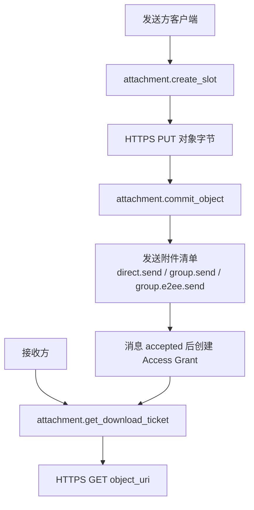
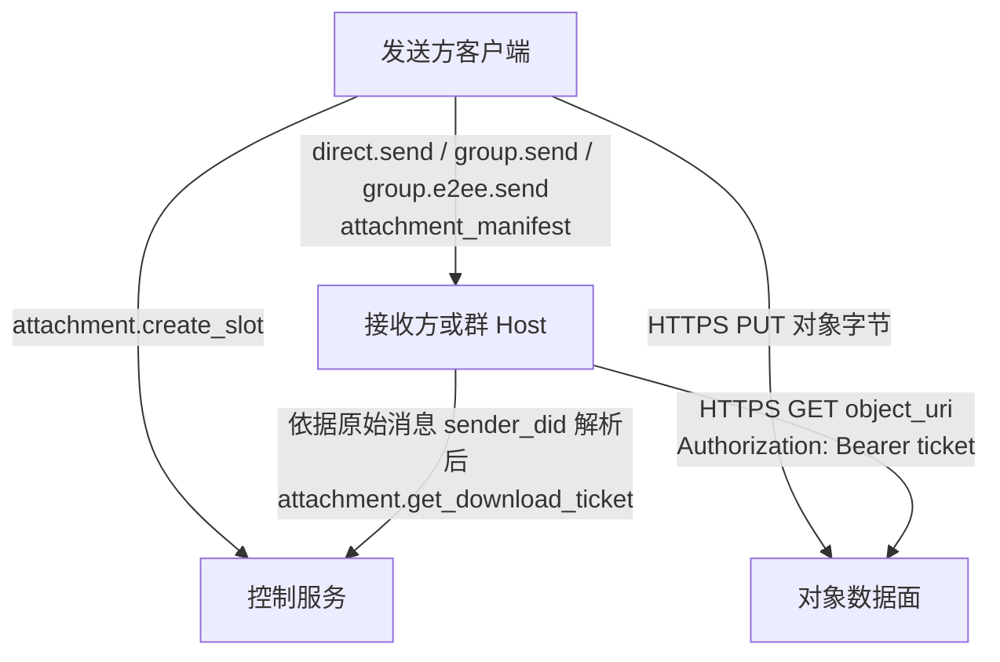
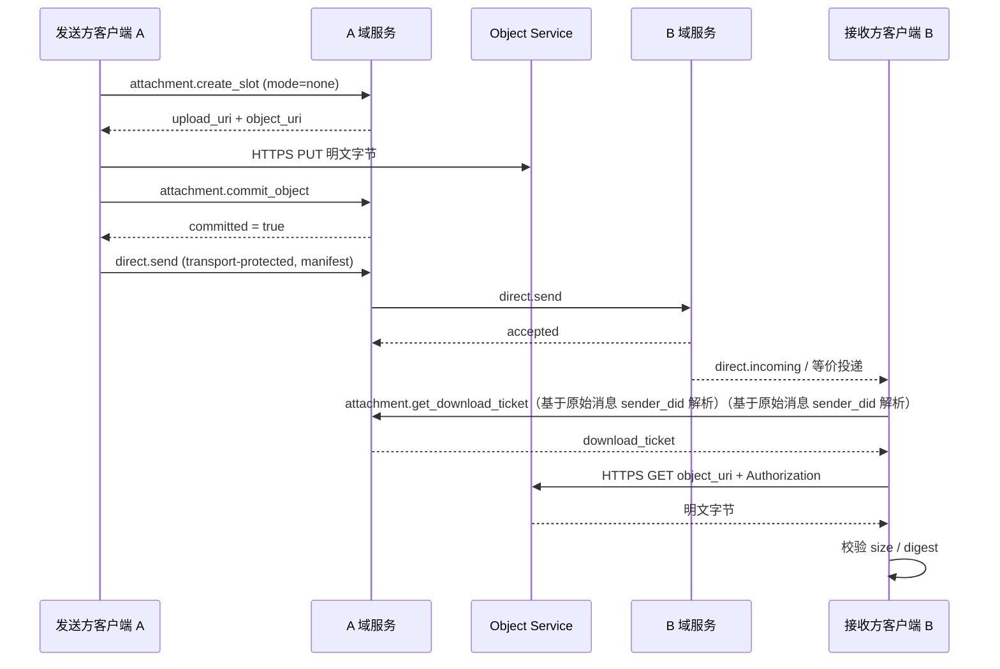
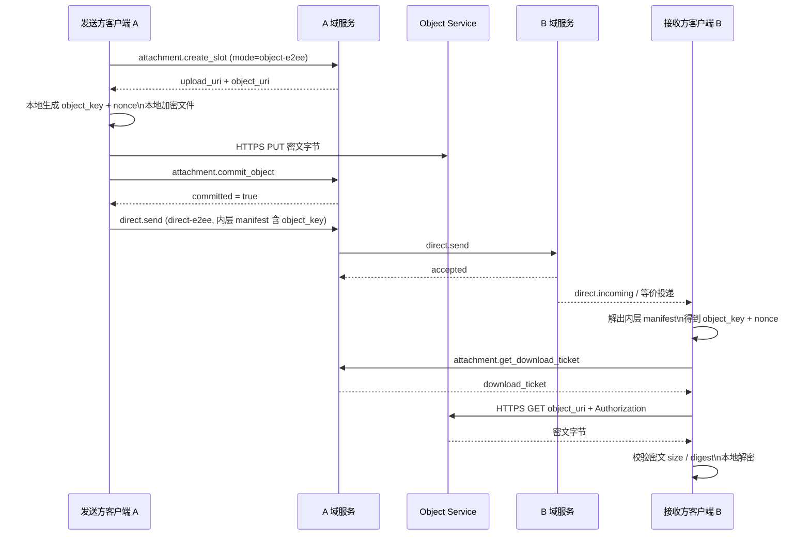
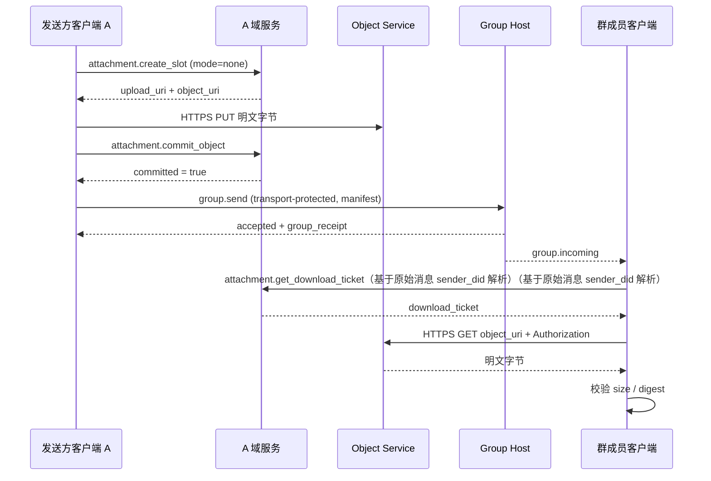
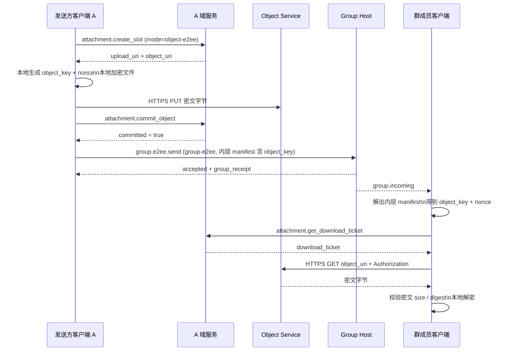
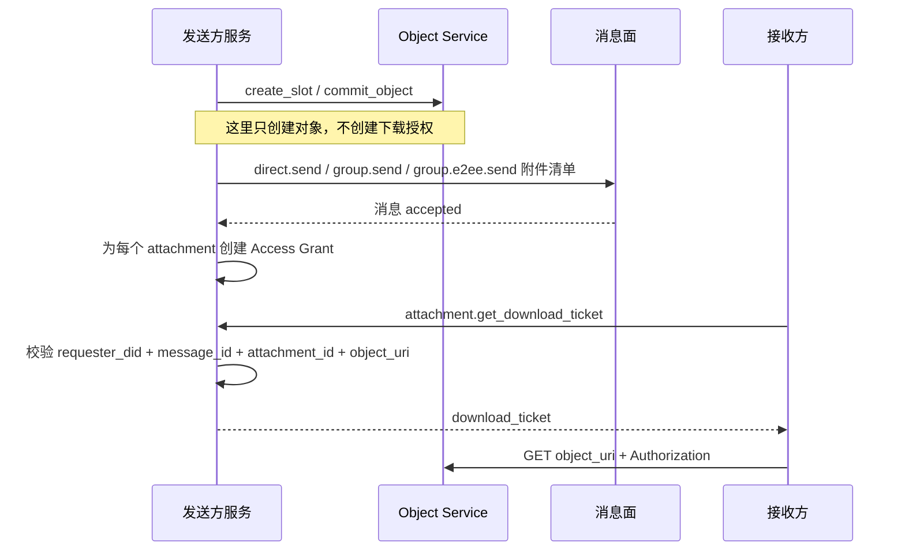
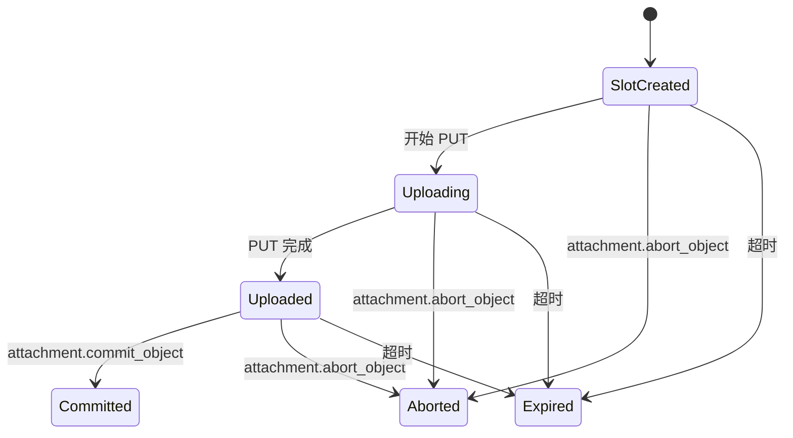

<!-- translation-review: full; source=chinese/message/07-附件与对象传输.md; basis=complete source-based manual retranslation of every Chinese prose line and reading of all source examples, not terminology replacement -->
> 日本語参考訳（機械翻訳を基に原文全文を照合済み）。規範となるのは原文です。コード例・識別子・規範キーワードは原文を保持しています。
> 原文: [chinese/message/07-附件与对象传输.md](../../../chinese/message/07-附件与对象传输.md) / 基準コミット: `0837cfdfaf4ddcf834f0890ddaf34fc4c824e066`

# ANP Profile 7：添付ファイルとオブジェクト転送

- 文書番号：ANP-P7
- タイトル：添付ファイルとオブジェクト転送
- 状態：公開済み
- バージョン：1.2
- 仕様セットのバージョン：ANP Messaging 1.2
- 原文言語：中国語（このファイルは日本語参考訳）。
- 適用範囲：本仕様は、v1.1 の添付ファイルとオブジェクトのライフサイクルを維持しつつ、複数デバイスの境界を規定します。通常の添付操作は、引き続き DID をスコープとし、デバイスに束縛された暗号化配信は、P5 または P6 が担当します。

---

## 1. 目的

本 Profile は、ANP の添付ファイルとオブジェクト転送の意味論を定義し、以下を規定します。

1. 私聊とグループ会話で、添付ファイルを表す方法。
2. 非 E2EE と E2EE のメッセージで、統一された `attachment_manifest` を運ぶ方法。
3. 添付転送を、メッセージ面、制御面、データ面の 3 層に分ける方法。
4. 独立した HTTPS チャネルで、オブジェクト内容をアップロード・ダウンロードする方法。
5. オブジェクトの所在を示す URI、短期間のダウンロードチケット、およびオブジェクト単位の暗号化で、リンクの漏洩リスクを下げる方法。
6. オブジェクト内容の完全性検証、アクセス制御、およびオブジェクト単位の暗号化を行う方法。
7. 添付オブジェクトと Download Ticket の DID 単位の意味論を維持し、デバイスに束縛された暗号化配信を P5/P6 に担当させる方法。
8. v1 の方式を、明確で単純かつ実装可能に保つ方法。

本 Profile は、以下を定義**しません**。

- オブジェクトストレージの内部実装。
- オブジェクトの審査とリスク管理のポリシー。
- オブジェクトのダウンロードチケットの、具体的な暗号学的発行形式。
- ANP のドメイン間呼出し経路での、オブジェクトのバイトストリームの転送。
- `service-managed` オブジェクト暗号化モード。
- `wrapped_object_key`、ファイル単位の鍵共有プロトコル、直接リンクのダウンロード、ミラー URI、インラインのダウンロードチケットなどの分岐経路。
- 専用のサムネイル子オブジェクトと、専用のチャンクマニフェストオブジェクト。
- デバイス専用の添付フィールド、デバイスごとの Download Ticket、またはデバイスごとのオブジェクトライフサイクル。

---

本 Profile は、`did:wba`、`did:web`、およびその他のサポートする DID メソッドに適用します。アイデンティティの解決と検証は、[P2](../../../chinese/message/02-身份与发现.md#method-validation) に従います。

## 2. 用語と規範的キーワード

本文の **MUST**、**MUST NOT**、**REQUIRED**、**SHALL**、**SHALL NOT**、**SHOULD**、**SHOULD NOT**、**RECOMMENDED**、**NOT RECOMMENDED**、**MAY**、**OPTIONAL** は、大文字で記されている場合、規範的要件として解釈します。

用語の定義：

- **Attachment**：ANP メッセージが参照する外部オブジェクト。内容は、ファイル、画像、音声、動画、または任意のバイトストリームです。
- **Object**：添付ファイルに対応する、実際のバイト内容。
- **Attachment Message**：1 つ以上の `attachment_manifest` を主要ペイロードとする ANP メッセージ。
- **Attachment Manifest**：オブジェクトの所在、ダイジェスト、サイズ、メディア属性、および暗号化属性を記述する構造化オブジェクト。
- **Object Service**：添付の制御面と、オブジェクトのデータ面を担当するサービス。
- **Control Plane**：`attachment.create_slot`、`attachment.commit_object`、`attachment.abort_object`、`attachment.get_download_ticket` などのプロトコルメソッドが属する制御面。
- **Data Plane**：独立した HTTPS PUT/GET で、オブジェクトのバイトを転送するデータ面。
- **Message Plane**：`direct.send`、`group.send`、または `group.e2ee.send` が `attachment_manifest` を運ぶメッセージ面。
- **Upload Slot**：送信者がオブジェクトのアップロード用に申請する、一時的なアップロード能力とメタデータの予約枠。
- **Committed Object**：アップロードを完了し、メッセージから参照可能なオブジェクト。
- **Object URI**：オブジェクトの所在を示す URI。v1 では locator 型の HTTPS リソースアドレスであり、公開の直接リンクと同じではありません。
- **Download Ticket**：オブジェクトのダウンロード時に使う、一時的なアクセスチケット。
- **Access Grant**：添付メッセージの送信成功後に、送信者サービスが、添付ごとに作成するダウンロード認可記録。
- **Object-Level Encryption**：トランスポート層の機密性だけに依存せず、送信者がローカルでオブジェクト内容を暗号化すること。
- **Object Key**：送信者が各オブジェクト用に独立して生成する、ランダムな対称鍵。
- **Nonce**：オブジェクトの暗号化に使う乱数。v1 MTI の長さは、12 バイトに固定します。

---

## 3. 設計の基本原則と、v1 の範囲を絞る決定

### 3.1 3 層の分離

添付転送は、以下の 3 つの面として理解しなければなりません（**MUST**）。

1. **メッセージ面**：`attachment_manifest` を受信者に届けることだけを担当します。
2. **制御面**：アップロード枠の申請、オブジェクトのコミット、オブジェクトの破棄、およびダウンロードチケットの発行だけを担当します。
3. **データ面**：オブジェクトのバイトの PUT/GET だけを担当します。

この 3 層の責務を混同してはなりません（**MUST NOT**）。特に、以下を適用します。

- 制御面のメソッドは、添付を受信者に届ける責務を持ちません。
- メッセージ面は、オブジェクトのバイトを中継する責務を持ちません。
- データ面は、業務メッセージを配信する責務を持ちません。

### 3.2 v1 の標準経路

v1 の標準経路は、以下でなければなりません（**MUST**）。

1. 送信者が `attachment.create_slot` を呼び出す。
2. オブジェクト単位の暗号化を有効にする場合、送信者は先にローカルでファイルを暗号化する。
3. 送信者が、独立した HTTPS の `PUT` でオブジェクトのバイトをアップロードする。
4. 送信者が `attachment.commit_object` を呼び出す。
5. 送信者が、運搬する Profile の定義に従い、`direct.send`、`group.send`、または `group.e2ee.send` で、添付マニフェストを送信する。
6. 受信者が、そのマニフェストを運んだ元のメッセージの送信者 DID に基づき、その公開 `ANPMessageService` を解決し、`attachment.get_download_ticket` でダウンロードチケットを取得する。
7. 受信者が、独立した HTTPS の `GET object_uri` を使い、`Authorization` ヘッダーにチケットを含めて、オブジェクトをダウンロードする。
8. 受信者がダイジェストを検証する。オブジェクトで `object-e2ee` を有効にした場合、さらに復号と、復号後の検証を行う。


具体的な制御面メソッドに進む前に、メッセージ面、制御面、およびデータ面を、全体図で結び付けます。これにより、第 5 章の各場面を読む際に、「オブジェクトが存在する」「メッセージが送信された」「ダウンロードが認可された」という、3 つの段階を区別しやすくなります。



*図 P7-1：添付の 3 つの面と認可の連鎖の全体像（非規範的）。*

この図が強調するのは、`create_slot` / `commit_object` はオブジェクトを作成するだけで、受信者を実際にダウンロード可能にするのは、添付メッセージの受理後に作成する Access Grant と、後続のダウンロードチケットの手順であることです。
### 3.3 オブジェクトモードは 2 種類だけ

v1 では、`encryption_info.mode` は、以下の 2 つの値だけを許さなければなりません（**MUST**）。

- `none`
- `object-e2ee`

`service-managed` をプロトコルフィールドに含めてはなりません（**MUST NOT**）。

サーバーのディスク暗号化、KMS、オブジェクトストアの保存時暗号化などは、すべて実装詳細であり、プロトコルの相互運用モードとしてモデル化してはなりません（**MUST NOT**）。

### 3.4 メッセージのセキュリティと、オブジェクトのセキュリティの分離

添付のセキュリティには、2 つの層があります。

1. **メッセージのセキュリティ**：マニフェストを運ぶ `transport-protected`、`direct-e2ee`、`group-e2ee` によって決まります。
2. **オブジェクトのセキュリティ**：`encryption_info.mode` によって決まります。

v1 の規則は、以下のとおりです。

- `transport-protected` で運ぶ場合、添付オブジェクトは `mode = "none"` を使わなければなりません（**MUST**）。
- `direct-e2ee` または `group-e2ee` で運ぶ場合、添付オブジェクトは、`mode = "none"` または `mode = "object-e2ee"` を使ってもかまいません（**MAY**）。

### 3.5 オブジェクト鍵は、E2EE マニフェストでだけ配布

`mode = "object-e2ee"` の場合、以下を適用します。

- `object_key_b64u` と `nonce_b64u` は、`direct-e2ee` または `group-e2ee` で保護する添付マニフェストだけに含めなければなりません（**MUST**）。
- `object_key_b64u` と `nonce_b64u` を、`attachment.create_slot` または `attachment.commit_object` の制御面要求に含めてはなりません（**MUST NOT**）。
- v1 は、独立したファイル単位の鍵共有プロトコルを**定義しません**。

### 3.6 v1 が明示的に除外する分岐経路

v1 を明確で単純かつ実装可能に保つため、以下の経路は、本 Profile に入り**ません**。

- `service-managed`
- `wrapped_object_key_b64u`
- `key_wrap_alg`
- インラインのダウンロードチケット。
- 独自のチケット転送ヘッダーのネゴシエーション。
- 恒久的な公開直接リンク。
- ミラー URI。
- 専用のチャンクマニフェスト構造。
- 専用のサムネイル子オブジェクト。
- ANP の業務メソッドによる、オブジェクトのバイトの中継。

### 3.7 許可する組合せの表

| 運搬方法 | `meta.security_profile` | 許可する `encryption_info.mode` | マニフェストに `object_key_b64u` を含められるか |
|---|---|---|---|
| Direct Base | `transport-protected` | `none` | いいえ |
| Group Base | `transport-protected` | `none` | いいえ |
| Direct E2EE | `direct-e2ee` | `none` / `object-e2ee` | はい |
| Group E2EE | `group-e2ee` | `none` / `object-e2ee` | はい |

### 3.8 複数デバイスの境界

P7 は、既存のオブジェクトと Ticket の状態機械を維持し、デバイス宛先指定の層は追加しません。

1. 通常の添付メッセージ、制御面要求、Access Grant、および Download Ticket のスコープは、送信者/要求者の DID と、既存のメッセージ、添付、オブジェクト、および Direct または Group のコンテキストで決まります。`sender_device_id`、`recipient_device_id`、`requester_device_id`、または他のデバイス selector を含めてはなりません（**MUST NOT**）。
2. 添付オブジェクトは 1 回だけアップロードします。自ドメイン内の複数デバイス fan-out で、デバイスごとに標準 P7 オブジェクトや Ticket を作成してはなりません（**MUST NOT**）。
3. Direct E2EE のデバイス選択とデバイスごとの暗号文配信は、P5 だけが定義します。MLS デバイス Leaf と暗号化配信は、P6 だけが定義します。P7 は、内側の添付 manifest とオブジェクト鍵のフィールドだけを定義します。各デバイスは、これらのフィールドを配信するために、Ratchet や MLS の非公開状態を共有してはなりません（**MUST NOT**）。
4. 配置は、内部でデバイスコンテキストを使って、認証、ルーティング、または認可を行えます。ただし、そのコンテキストを、P7 の wire フィールドにシリアライズしてはなりません（**MUST NOT**）。

---

## 4. Profile 識別子と依存関係

### 4.1 Profile 名

本 Profile の標準名は、以下のとおりです。

`anp.attachment.v1`

### 4.2 依存関係

本 Profile は、以下に依存しなければなりません（**MUST**）。

- `anp.core.binding.v1`
- `anp.identity.discovery.v1`

本 Profile は、以下の Profile と組み合わせて使ってもかまいません（**MAY**）。

- `anp.direct.base.v1`
- `anp.group.base.v2`
- `anp.direct.e2ee.v1`
- `anp.direct.e2ee.v2`
- `anp.group.e2ee.v1`
- `anp.group.e2ee.v2`

### 4.3 セキュリティモード

本 Profile 自体は、新しいセキュリティモードを定義せず、それを運ぶ業務 Profile のモードを再利用します。

- `transport-protected`
- `direct-e2ee`
- `group-e2ee`

---

## 5. 添付転送のフロー図

### 5.1 全体の階層別フロー図



### 5.2 私聊 / 暗号化しない添付



### 5.3 私聊 / E2EE の添付



### 5.4 グループ会話 / 暗号化しない添付



### 5.5 グループ会話 / E2EE の添付



---

## 6. 運搬規則：私聊、グループ会話、暗号化、非暗号化

### 6.1 Direct Base での運搬

添付マニフェストを、`anp.direct.base.v1` の `direct.send` で送信する場合、以下を適用します。

- `meta.profile` は、`anp.direct.base.v1` と等しくなければなりません（**MUST**）。
- `meta.security_profile` は、`transport-protected` と等しくなければなりません（**MUST**）。
- `meta.content_type` は、`application/anp-attachment-manifest+json` と等しくなければなりません（**MUST**）。
- `body.payload` は、Attachment Message オブジェクトでなければなりません（**MUST**）。
- `auth.origin_proof` は、P3 の要件に従って存在し、Signed Direct Payload 全体を束縛しなければなりません（**MUST**）。
- 各 `attachment_manifest.encryption_info.mode` は、`none` と等しくなければなりません（**MUST**）。

### 6.2 Group Base での運搬

添付マニフェストを、`anp.group.base.v2` の `group.send` で送信する場合、以下を適用します。

- `meta.profile` は、`anp.group.base.v2` と等しくなければなりません（**MUST**）。
- `meta.security_profile` は、`transport-protected` と等しくなければなりません（**MUST**）。
- `meta.content_type` は、`application/anp-attachment-manifest+json` と等しくなければなりません（**MUST**）。
- `body.payload` は、Attachment Message オブジェクトでなければなりません（**MUST**）。
- `auth.origin_proof` は、P4 の要件に従って存在し、Signed Group Payload 全体を束縛しなければなりません（**MUST**）。
- 成功応答は、`group_receipt` を返すことが望まれます（**SHOULD**）。
- 各 `attachment_manifest.encryption_info.mode` は、`none` と等しくなければなりません（**MUST**）。

### 6.3 Direct E2EE での運搬

添付マニフェストを、`anp.direct.e2ee.v1` または `anp.direct.e2ee.v2` で送信する場合、以下を適用します。

- セッション確立後の通常経路では、外側の `meta.content_type` は、`application/anp-direct-cipher+json` でなければなりません（**MUST**）。
- P5 が許す、最初の init がアプリケーションメッセージを運ぶ経路では、外側の `meta.content_type` は、`application/anp-direct-init+json` でもかまいません（**MAY**）。
- 添付マニフェストは、暗号化前の `Application Plaintext` の内側の業務オブジェクトとして現れなければなりません（**MUST**）。
- 内側の `application_content_type` は、`application/anp-attachment-manifest+json` と等しくなければなりません（**MUST**）。

### 6.4 Group E2EE での運搬

添付マニフェストを、`anp.group.e2ee.v1` または `anp.group.e2ee.v2` の `group.e2ee.send` で送信する場合、以下を適用します。

- 外側の `meta.content_type` は、`application/anp-group-cipher+json` に固定しなければなりません（**MUST**）。
- 外側の `body` に、平文の添付マニフェストを直接含めてはなりません（**MUST NOT**）。
- 添付マニフェストは、暗号化前の `Group Application Plaintext` の内側の業務オブジェクトとして現れなければなりません（**MUST**）。
- 内側の `application_content_type` は、`application/anp-attachment-manifest+json` と等しくなければなりません（**MUST**）。

### 6.5 フィールドの所有権

- Direct Base と Group Base の添付メッセージは、運搬する Profile の DID または Group DID による宛先指定だけを使います。P7 は、デバイス selector を追加しません。
- `attachment_message` と `attachment_manifest` は、デバイス識別子を含めません。
- P5 v2 Direct E2EE の外側は、その必須の送受信デバイスフィールドを含めます。P6 v2 MLS の外側は、その必須のデバイス束縛を含めます。これらの外側のフィールドは、P5 または P6 だけが解釈します。v1 E2EE envelope に、P7 を理由としてデバイス selector が加わることはありません。
- `object_key_b64u` と `nonce_b64u` は、暗号化された添付 manifest 内に維持します。P7 は、独立したデバイスごとの鍵配布要求を追加しません。

---

## 7. `attachment_message` と `attachment_manifest` オブジェクト

### 7.1 Attachment Message のトップレベル構造

Attachment Message の推奨構造は、以下のとおりです。

```json
{
  "attachments": [
    {
      "attachment_id": "att-001",
      "filename": "report.pdf",
      "mime_type": "application/pdf",
      "size": "1048576",
      "digest": {
        "alg": "sha-256",
        "value_b64u": "BASE64URL_DIGEST"
      },
      "access_info": {
        "object_uri": "https://objects.example.com/objects/obj-001"
      },
      "encryption_info": {
        "mode": "none"
      }
    }
  ],
  "caption": "附件说明",
  "primary_attachment_id": "att-001"
}
```

規則：

- `attachments` が存在し、空であってはなりません（**MUST**）。
- `caption` が存在してもかまいません（**MAY**）。
- `primary_attachment_id` が存在してもかまいません（**MAY**）。存在する場合、`attachments` 内の既存の `attachment_id` を指さなければなりません（**MUST**）。

### 7.2 `attachment_id` のスコープ

- `attachment_id` は、単一の Attachment Message 内で一意でなければなりません（**MUST**）。
- `attachment_id` は、メッセージをまたぐグローバルな一意性を**保証しません**。
- ダウンロードチケットの束縛、認可記録、および監査記録は、`attachment_id` だけではなく、`(message_id, attachment_id)` または `(object_uri, message_id, attachment_id)` を使わなければなりません（**MUST**）。

### 7.3 個々の `attachment_manifest`

各 `attachment_manifest` は、以下を含めなければなりません（**MUST**）。

- `attachment_id`
- `mime_type`
- `size`
- `digest`
- `access_info`
- `encryption_info`

各 `attachment_manifest` は、以下を含めてもかまいません（**MAY**）。

- `filename`
- `media_info`

フィールドの説明：

- `filename`：表示用のファイル名。**MAY**。
- `mime_type`：元のファイルの MIME type。**MUST**。
- `size`：アップロードするオブジェクトのバイトサイズ。十進文字列。**MUST**。
- `digest`：アップロードするオブジェクトのバイトのダイジェスト。**MUST**。
- `access_info`：オブジェクトをダウンロードするための所在情報。**MUST**。
- `encryption_info`：オブジェクト単位の暗号化情報。**MUST**。
- `media_info`：画像、音声、動画などのメディアオブジェクトの補足説明。**MAY**。

### 7.4 `digest`

`digest` は、以下を含めなければなりません（**MUST**）。

- `alg`
- `value_b64u`

規則：

- v1 の `digest.alg` は、`sha-256` に固定しなければなりません（**MUST**）。
- `digest.value_b64u` は、アップロードするオブジェクトのバイトの SHA-256 ダイジェストでなければなりません（**MUST**）。
- `encryption_info.mode = "none"` の場合、ダイジェストは平文バイトに対応します。
- `encryption_info.mode = "object-e2ee"` の場合、ダイジェストは暗号文バイトに対応します。

### 7.5 `access_info`

`access_info` の構造は、以下のとおりです。

```json
{
  "object_uri": "https://objects.example.com/objects/obj-001"
}
```

規則：

1. `object_uri` は、`https://` URL でなければならない（**MUST**）。
2. v1 の `object_uri` は、locator 型のオブジェクトアドレスを表し、恒久的な公開直接リンクではない。
3. 受信者は、ダウンロード前に、まず `attachment.get_download_ticket` を呼び出さなければならない（**MUST**）。
4. 受信者は、その添付マニフェストを運んだ、元のメッセージの送信者 DID に基づき、公開 `ANPMessageService` を解決しなければならない（**MUST**）。
5. グループの場面では、この元の送信者 DID を、添付マニフェストを運んだ元のグループメッセージの送信者（たとえば `group.incoming.meta.sender_did`）から取得しなければならない（**MUST**）。
6. `attachment.get_download_ticket` は、その送信者の公開サービスに対応する `serviceDid` に送信しなければならない（**MUST**）。
7. 受信者は、ダウンロード時に `object_uri` に `GET` を行い、`Authorization` ヘッダーにチケットを含めなければならない（**MUST**）。
8. 呼出元は、`object_uri` の URL ドメイン名だけから、制御面のサービスを推測してはならない（**MUST NOT**）。

### 7.6 `media_info`

`media_info` は、画像、音声、動画などのメディアオブジェクトに適用します。推奨フィールドは、以下のとおりです。

- `width`
- `height`
- `duration_ms`
- `codec`

数値フィールドがある場合、十進文字列を使わなければなりません（**MUST**）。

### 7.7 サムネイルとチャンク化

v1 は、専用の `thumbnail` フィールドも、専用の `chunking_info` フィールドも定義しません。

サムネイルが必要な場合、送信者は、通常の添付として送信することが望まれます（**SHOULD**）。

大きなファイルのチャンクアップロードが必要な場合、HTTP アップロード実装の内部で行うことが望まれます（**SHOULD**）。これによって、本 Profile のマニフェスト構造は変わりません。

---

## 8. オブジェクト単位の暗号化

### 8.1 `encryption_info`

`encryption_info` は、以下の 2 種類の構造のいずれかでなければなりません（**MUST**）。

暗号化しないオブジェクト：

```json
{
  "mode": "none"
}
```

オブジェクト単位で暗号化するオブジェクト：

```json
{
  "mode": "object-e2ee",
  "object_cipher": "chacha20-poly1305",
  "object_key_b64u": "BASE64URL_32_BYTES",
  "nonce_b64u": "BASE64URL_12_BYTES",
  "plaintext_size": "1048576"
}
```

規則：

1. `mode` は、`none` または `object-e2ee` でなければならない（**MUST**）。
2. `mode = "none"` は、送信者がオブジェクト内容をローカルで暗号化していないことを表す。
3. `mode = "object-e2ee"` は、送信者が先にローカルでオブジェクトを暗号化し、その暗号文のバイトをアップロードすることを表す。
4. `transport-protected` で運ぶ場合、`mode` は、`none` でなければならない（**MUST**）。
5. `object_key_b64u` と `nonce_b64u` は、`transport-protected` で運ぶ添付マニフェストに含めてはならない（**MUST NOT**）。
6. `service-managed`、鍵ラッピングアルゴリズム、およびファイル単位の鍵共有は、本 Profile に属さ**ない**。

### 8.2 `object-e2ee` の MTI アルゴリズム

v1 の `object-e2ee` の MTI アルゴリズムは、以下でなければなりません（**MUST**）。

- `object_cipher = "chacha20-poly1305"`
- `object_key_b64u`：32 バイトのランダムな対称鍵。
- `nonce_b64u`：12 バイトのランダムな nonce。
- `plaintext_size`：元のファイルのバイト長。十進文字列。

### 8.3 送信者の暗号化手順（規範的）

`encryption_info.mode = "object-e2ee"` の場合、送信者は、以下の手順で実行しなければなりません（**MUST**）。

1. 元のファイルのバイトを読み、`P` と記す。
2. 新しいランダムな 32 バイトのオブジェクト鍵 `K` を生成する。
3. 新しいランダムな 12 バイトの nonce `N` を生成する。
4. `AAD = 空字节串`、つまり空バイト列とする。
5. 以下を計算する。

```text
C = ChaCha20-Poly1305-Encrypt(
      key = K,
      nonce = N,
      aad = "",
      plaintext = P
    )
```

6. Object Service にアップロードするオブジェクトのバイトは、`C` でなければならない（**MUST**）。
7. `attachment_manifest.size` は、`len(C)` の十進文字列と等しくなければならない（**MUST**）。
8. `attachment_manifest.digest` は、`sha-256(C)` と等しくなければならない（**MUST**）。
9. `encryption_info.plaintext_size` は、`len(P)` の十進文字列と等しくなければならない（**MUST**）。
10. `mime_type` は、暗号文オブジェクトではなく、引き続き元のファイルの MIME type を表さなければならない（**MUST**）。

補足要件：

- 各 committed object は、新しいランダムな `K` を使わなければなりません（**MUST**）。
- 送信者は、同じ `(K, N)` の組合せを再利用してはなりません（**MUST NOT**）。
- 同じファイル内容を繰り返し送信する場合でも、送信者は、新しい `K` と `N` を再生成することが望まれます（**SHOULD**）。
- `object_key_b64u` は、P5 の ratchet key から直接取得してはならず（**MUST NOT**）、P6 の MLS epoch secret や、その他のセッション鍵から直接取得してもなりません（**MUST NOT**）。

### 8.4 `expected_size` と `plaintext_size`

v1 MTI の `chacha20-poly1305` では、以下を適用します。

- アップロードするオブジェクトのサイズ = 元のファイルのサイズ + 16 バイトの認証タグ。
- 送信者が `attachment.create_slot` に `expected_size` を記入する場合、その値は、元のファイルではなく、アップロードするオブジェクトのサイズを示すことが望まれます（**SHOULD**）。
- `mode = "object-e2ee"` の場合、送信者は、後で `encryption_info.plaintext_size` に書き込むため、元のファイルのサイズもローカルに保存することが望まれます（**SHOULD**）。

### 8.5 受信者の検証・復号手順（規範的）

受信者がオブジェクトのバイトを取得した後は、以下のとおりとします。

1. まず、ダウンロードしたバイト長が、`attachment_manifest.size` と等しいことを検証しなければならない（**MUST**）。
2. `sha-256(下载字节)`、つまりダウンロードしたバイトの SHA-256 を計算し、`attachment_manifest.digest` と比較しなければならない（**MUST**）。
3. `encryption_info.mode = "none"` の場合、検証に成功すれば上位層に渡せる。
4. `encryption_info.mode = "object-e2ee"` の場合、受信者は、以下を使わなければならない（**MUST**）。

```text
P = ChaCha20-Poly1305-Decrypt(
      key = object_key_b64u,
      nonce = nonce_b64u,
      aad = "",
      ciphertext = downloaded_bytes
    )
```

5. 復号に失敗した場合、受信者は、その添付を拒否しなければならない（**MUST**）。
6. 復号に成功した場合、受信者は、`len(P)` が `plaintext_size` と等しいことを検証しなければならない（**MUST**）。
7. 検証に合格した後だけ、受信者は、平文バイトを上位の業務層に渡せる。

### 8.6 オブジェクト鍵の配布規則

v1 の標準のオブジェクト鍵配布経路は、以下の 1 つだけです。

- 添付メッセージ自体を `direct-e2ee` または `group-e2ee` で保護する場合、送信者は、`object_key_b64u` と `nonce_b64u` を内側の `attachment_manifest` に直接入れてもかまいません（**MAY**）。
- 受信者は、その E2EE メッセージからオブジェクト鍵を取得した後、制御面でチケットを取得し、データ面で暗号文オブジェクトをダウンロードします。

これは、以下を意味します。

- v1 は、添付用に複雑な鍵共有プロトコルを別途設計することを**必要としません**。
- グループでは、そのグループメッセージを復号できる人は、全員がそのオブジェクト鍵を取得できます。
- v1 は、遡及的な権限取消しを**保証しません**。グループから削除されたメンバーが、以前にオブジェクト鍵と内容を取得済みである場合、本仕様は、取得済み情報の事後的な消去を約束しません。

---

## 9. アクセス認可とダウンロードチケット

### 9.1 チケットの目的

ダウンロードチケットの目的は、正当な受信者による転送を絶対に防ぐことではなく、以下です。

1. 第三者がマニフェストだけでオブジェクトを直接ダウンロードすることを防ぐ。
2. `object_uri` が長期の公開リンクになることを防ぐ。
3. 明確な要求者とメッセージのコンテキストに、ダウンロード認可を制限する。
4. オブジェクトサービスが、監査、レート制限、および失効を行う手段を提供する。

### 9.2 Access Grant の意味論

`attachment.create_slot` と `attachment.commit_object` は、オブジェクトの作成**だけ**を担当し、どの受信者にもダウンロード権限を与えません。

あるメッセージの受信者が、いつオブジェクトをダウンロード可能になるかは、Access Grant で決めなければなりません（**MUST**）。

その添付を含む `direct.send`、`group.send`、または `group.e2ee.send` が、送信者サービスまたは Group Host に正常に受理された後、送信者側システムは、各添付について Access Grant を 1 つ作成しなければなりません（**MUST**）。

Access Grant は、少なくとも以下を束縛しなければなりません（**MUST**）。

- `message_id`
- `attachment_id`
- `object_uri`
- `message_security_profile`
- 私聊コンテキストの `message_target_did`、またはグループ会話コンテキストの `group_did`。

Access Grant は、ローカルデバイスではなく、宛先 DID またはグループコンテキストを認可します。自ドメイン内のデバイス配信は、引き続き実装詳細です。

### 9.3 `intended_target` の境界

`attachment.create_slot.body.intended_target` は、送信者のアップロード段階のポリシー hint にすぎません。

`intended_target` には、以下を適用します。

- Object Service が、サイズ、型、または保持ポリシーを先行して判断するために使ってもかまいません（**MAY**）。
- 単独で、ダウンロード認可の根拠としてはなりません（**MUST NOT**）。

実際のダウンロード認可の根拠は、送信成功後の Access Grant に由来しなければなりません（**MUST**）。

### 9.4 チケットの束縛

v1 のダウンロードチケットは、少なくとも以下のコンテキストを束縛しなければなりません（**MUST**）。

- `attachment_id`
- `object_uri`
- `requester_did`
- `message_id`
- `message_security_profile`
- 私聊コンテキストの `message_target_did`、またはグループ会話コンテキストの `group_did`。
- `expires_at`

標準の Ticket binding は、`requester_device_id` または他のデバイス selector を含めてはなりません（**MUST NOT**）。配置は、Ticket の発行前に、ローカルデバイス状態を使えます。ただし、その状態が、P7 の wire フィールドや Ticket binding のフィールドになることはありません。

### 9.5 チケットの有効期間と使用方法

- ダウンロードチケットは、短期間のチケットであることが望まれます（**SHOULD**）。
- デフォルトの有効期間は、5 分を超えないことが望まれます（**SHOULD NOT**）。
- 機密性の高いオブジェクトには、一度限りのチケットを使ってもかまいません（**MAY**）。
- ダウンロードチケットは、HTTP の `Authorization` ヘッダーで転送しなければなりません（**MUST**）。
- ダウンロードチケットを、URL クエリパラメーターに含めてはなりません（**MUST NOT**）。

v1 のダウンロード方法は、以下に固定します。

```http
GET {object_uri}
Authorization: Bearer {download_ticket}
```

### 9.6 チケット発行時の検証

Object 制御サービスは、`attachment.get_download_ticket` の処理時に、以下を検証しなければなりません（**MUST**）。

1. `meta.target.kind = "service"`
2. `meta.target.did` は、元の添付メッセージの送信者 DID から解決した公開 `ANPMessageService.serviceDid` と等しくなければならない（**MUST**）。
3. `requester_did = meta.sender_did`
4. `(message_id, attachment_id, object_uri)` に対応する Access Grant が存在すること。
5. `message_security_profile` が Access Grant と一致すること。
6. 私聊コンテキストでは、`message_target_did` が存在し、ポリシーに適合すること。
7. グループ会話コンテキストでは、`group_did` が存在し、`requester_did` が現在もグループのアクセスポリシーを満たすこと。

P7 は、これらの検証に、要求者デバイス selector を使うことを要求しません。ローカルのデバイス認証は、すべて相互運用要求の外に置きます。

### 9.7 サービス間の同期

v1 は、複数の内部サービス間で Access Grant を同期するプロトコルを、**独立には標準化しません**。

v1 のデフォルト経路では、元の添付メッセージの送信者が公開する `ANPMessageService` が、ダウンロードチケットの発行を担当します。その公開サービス入口が、内部で別の Object Service に再ルーティングするかは、実装詳細です。配置がオブジェクト制御コンポーネントを内部で分離する場合、公開サービスが、ローカル状態または内部同期によって、チケット発行に必要な Access Grant を取得できることを保証しなければなりません（**MUST**）。

### 9.8 メンバー変更後のアクセスの境界

v1 は、**遡及的な権限取消しを保証しません**。

これは、以下を意味します。

- Object Service は、現在のグループ状態に基づき、削除済みメンバーへの新しいダウンロードチケットの発行を拒否することが望まれます（**SHOULD**）。
- ただし、オブジェクトのバイト、オブジェクト鍵、またはダウンロード済み内容が、以前に正当なメンバーに届いている場合、本仕様は、取得済みアクセス能力の事後的な回収を**約束しません**。

---


P7 のもう 1 つの重要な境界は、オブジェクトが存在することと、ダウンロード可能であることは同じではないという点です。以下の図は、オブジェクトのコミット、メッセージの受理、Access Grant の作成、チケットの発行、および最終的なダウンロードを、認可の連鎖としてつなぎ、アクセス制御を正しく実装しやすくしています。



*図 P7-2：Access Grant と Download Ticket の認可の連鎖（非規範的）。*

したがって、`attachment.get_download_ticket` の認可判断は、`object_uri` だけや、アップロード段階の `intended_target` だけを見るのではなく、メッセージのコンテキストと Access Grant に依存するべきです。

### 9.9 Agent DID 移行後の過去の Access Grant

Agent DID が変わる場合、過去の `attachment_manifest` と Access Grant を書き換えてはなりません（**MUST NOT**）。

私聊の Access Grant が旧受信者 DID を記録し、現在の要求者が後継 DID を使う場合、Object Service は、認可先 DID から `requester_did` への移行を P2 に従って検証し、所属する業務ポリシーが返された assurance を受け入れた後だけ、要求を同じ内部認可記録に対応付けてもかまいません（**MAY**）。`provider_asserted` が、過去の添付へのアクセス権の継承に十分かは、業務側が決めます。P7 は、受入れも拒否も強制しません。

この対応付けは、内部だけに存在します。P7 は、過去の manifest、Access Grant、Ticket、または制御面要求に、安定した主体のフィールド、名前、移行チェーン、またはデバイス selector を追加してはなりません（**MUST NOT**）。グループ添付は、引き続き、現在の P4 v2 roster、グループポリシー、および元のメッセージのコンテキストに基づいて認可します。
## 10. 制御面のメソッド

### 10.1 基本規則

本節のメソッドは、オブジェクトの制御面に使います。`direct.send`、`group.send`、または `group.e2ee.send` の送信成功の意味論は変更**しません**。

これらのメソッドは、デフォルトでは、以下で動作します。

- `meta.profile = "anp.attachment.v1"`
- `meta.security_profile = "transport-protected"`

認証モデルは、以下を採用します。

1. `attachment.create_slot`
2. `attachment.commit_object`
3. `attachment.abort_object`
4. `attachment.get_download_ticket`

これらは、すべて**サービススコープ**の制御面メソッドです。

したがって、以下を適用します。

- `meta.target.kind` は、`service` と等しくなければなりません（**MUST**）。
- `meta.target.did` は、宛先が公開する `ANPMessageService.serviceDid` と等しくなければなりません（**MUST**）。
- ドメイン間の外側の認証は、P8 の `serviceDid + HTTP Message Signatures` で保証します。
- v1 は、Object 制御サービス側が、独立した端末の `origin_proof` を、再度直接検証することを**要求しません**。

これらのメソッドは、P7 の wire モデルに `sender_device_id`、`recipient_device_id`、または `requester_device_id` を追加してはなりません（**MUST NOT**）。内部のデバイス認証とルーティングのコンテキストは、引き続き配置固有の非公開情報です。


制御面で見落としやすいのは、Upload Slot と Committed Object は、同じ状態ではないという点です。以下の図は、作成、アップロード、コミット、破棄、および期限切れという主な節目を、同じライフサイクルにまとめます。



*図 P7-3：Upload Slot / Object のライフサイクル（非規範的）。*

実装では、「`object_uri` を取得した」ことを、「オブジェクトがメッセージから参照可能になった」ことと誤解するべきではありません。`Committed` 状態に入った後だけ、添付マニフェストから正当に参照する前提条件を満たします。
### 10.2 `attachment.create_slot`

#### 10.2.1 意味論

アップロード予定のオブジェクト用に、Upload Slot を 1 つ申請します。

#### 10.2.2 要求の要件

このメソッドは、以下を使わなければなりません（**MUST**）。

- `meta.target.kind = "service"`
- `meta.target.did = 目标公开 ANPMessageService.serviceDid`（宛先が公開するサービスの DID）。

`body` は、以下を含めなければなりません（**MUST**）。

- `attachment_id`
- `intended_message_security_profile`
- `object_encryption_mode`

`body` は、以下を含めることが望まれます（**SHOULD**）。

- `expected_size`
- `mime_type`

`body` は、以下を含めてもかまいません（**MAY**）。

- `filename`
- `expected_digest`
- `intended_target`

フィールドの規則：

- `attachment_id`：文字列。
- `intended_message_security_profile`：`transport-protected` / `direct-e2ee` / `group-e2ee`。
- `object_encryption_mode`：`none` / `object-e2ee`。
- `expected_size`：アップロードするオブジェクトのバイトサイズ。十進文字列。
- `expected_digest`：アップロードするオブジェクトのバイトのダイジェスト。
- `intended_target`：オブジェクト。推奨構造は、以下のとおりです。

```json
{
  "kind": "agent | group",
  "did": "did:example:..."
}
```

制約：

1. `intended_message_security_profile = "transport-protected"` の場合、`object_encryption_mode` は `none` でなければならない（**MUST**）。
2. `object_encryption_mode = "object-e2ee"` の場合、`expected_size` は、暗号文のバイトサイズに対応することが望まれる（**SHOULD**）。
3. `intended_target` は hint にすぎず、単独で認可を構成してはならない（**MUST NOT**）。

#### 10.2.3 成功応答

成功応答は、少なくとも以下を含めなければなりません（**MUST**）。

- `attachment_id`
- `slot_id`
- `upload_uri`
- `object_uri`
- `commit_token`
- `expires_at`

成功応答は、以下を含めてもかまいません（**MAY**）。

- `upload_headers`

送信者が、後で `attachment_manifest.access_info` を構築する際、`object_uri` は、`attachment.create_slot` または `attachment.commit_object` の成功応答から直接取得することが望まれます（**SHOULD**）。受信者は、ダウンロード前に、本 Profile に従い、元の添付メッセージの送信者 DID に基づいて、チケットサービスを発見します。

### 10.3 `attachment.commit_object`

#### 10.3.1 意味論

Object Service に対し、オブジェクトのアップロードが完了し、参照可能なオブジェクトとしてコミットできることを通知します。

#### 10.3.2 要求の要件

このメソッドは、以下を使わなければなりません（**MUST**）。

- `meta.target.kind = "service"`
- `meta.target.did = 目标公开 ANPMessageService.serviceDid`（宛先が公開するサービスの DID）。

`body` は、少なくとも以下を含めなければなりません（**MUST**）。

- `attachment_id`
- `slot_id`
- `commit_token`
- `size`
- `digest`
- `object_encryption_mode`

`body` は、以下を含めてもかまいません（**MAY**）。

- `plaintext_size`
- `media_info`

規則：

1. `digest.alg` は、`sha-256` と等しくなければならない（**MUST**）。
2. `object_encryption_mode = "object-e2ee"` の場合、`plaintext_size` が存在しなければならない（**MUST**）。
3. `attachment.commit_object` は、`object_key_b64u` を転送してはならない（**MUST NOT**）。
4. `attachment.commit_object` は、`nonce_b64u` を転送してはならない（**MUST NOT**）。
5. `attachment.commit_object` の成功は、受信者に、そのオブジェクトのダウンロードを認可したことと**同じではない**。実際のダウンロード認可は、後のメッセージ送信成功後の Access Grant に依存する。

#### 10.3.3 成功応答

成功応答は、少なくとも以下を含めなければなりません（**MUST**）。

- `committed`
- `attachment_id`
- `object_uri`
- `committed_at`

ここで、以下を適用します。

- `committed` は、`true` でなければなりません（**MUST**）。

### 10.4 `attachment.abort_object`

#### 10.4.1 意味論

未完了または不要になったアップロード枠を終了します。

#### 10.4.2 要求の要件

このメソッドは、以下を使わなければなりません（**MUST**）。

- `meta.target.kind = "service"`
- `meta.target.did = 目标公开 ANPMessageService.serviceDid`（宛先が公開するサービスの DID）。

`body` は、少なくとも以下を含めなければなりません（**MUST**）。

- `attachment_id`
- `slot_id`

#### 10.4.3 成功応答

成功応答は、少なくとも以下を含めなければなりません（**MUST**）。

- `aborted`
- `attachment_id`
- `aborted_at`

ここで、以下を適用します。

- `aborted` は、`true` でなければなりません（**MUST**）。

### 10.5 `attachment.get_download_ticket`

#### 10.5.1 意味論

オブジェクトへのアクセスにチケットが必要な場合、受信者は、本メソッドで一時的なダウンロードチケットを取得します。

#### 10.5.2 要求の要件

このメソッドは、以下を使わなければなりません（**MUST**）。

- `meta.target.kind = "service"`
- `meta.target.did` は、元の添付メッセージの送信者 DID から解決した、公開 `ANPMessageService.serviceDid` と等しくなければなりません（**MUST**）。

`body` は、少なくとも以下を含めなければなりません（**MUST**）。

- `attachment_id`
- `object_uri`
- `requester_did`
- `message_security_profile`
- `message_id`

さらに、コンテキストに応じて、以下の一方を補います。

- 私聊コンテキスト：`message_target_did`。
- グループ会話コンテキスト：`group_did`。

`body` は、以下を含めてもかまいません（**MAY**）。

- `one_time`

本メソッドは、`requester_device_id` または同等のデバイス selector を定義しません。

フィールドの規則：

- `requester_did` は、`meta.sender_did` と等しくなければなりません（**MUST**）。
- `message_security_profile` は、その添付マニフェストを運んだメッセージのセキュリティモードを指し、今回の制御面呼出しの `meta.security_profile` ではありません。
- `message_target_did` は、元の私聊メッセージの宛先 Agent DID を指します。
- `group_did` は、元のグループメッセージが属する、グループ DID を指します。
- チケット要求を送信する前に、呼出元は、まず元の添付メッセージの送信者 DID に基づき、その公開 `ANPMessageService` を解決しなければなりません（**MUST**）。グループの場面では、`group_did` ではなく、元のグループメッセージの送信者から、その DID を取得します。

#### 10.5.3 成功応答

成功応答は、少なくとも以下を含めなければなりません（**MUST**）。

- `download_ticket_b64u`
- `expires_at`
- `ticket_binding`

`ticket_binding` は、少なくとも以下を含めなければなりません（**MUST**）。

- `attachment_id`
- `object_uri`
- `requester_did`
- `message_id`
- `message_security_profile`

さらに、コンテキストに応じて、以下の一方を補います。

- `message_target_did`
- `group_did`

`ticket_binding` に、デバイス識別子を追加してはなりません（**MUST NOT**）。

---

## 11. データ面の規則

### 11.1 アップロード

送信者は、独立した HTTPS チャネルで、`upload_uri` に `PUT` を行わなければなりません（**MUST**）。

規則：

- `object_encryption_mode = "none"` の場合、平文のバイトをアップロードします。
- `object_encryption_mode = "object-e2ee"` の場合、暗号文のバイトをアップロードします。
- アップロード要求は、`upload_headers` を含めてもかまいません（**MAY**）。
- オブジェクトのバイトを、ANP の JSON-RPC 業務メッセージに埋め込んではなりません（**MUST NOT**）。

### 11.2 ダウンロード

受信者は、独立した HTTPS チャネルで、`object_uri` に `GET` を行わなければなりません（**MUST**）。

固定形式は、以下のとおりです。

```http
GET {object_uri}
Authorization: Bearer {download_ticket}
```

オブジェクトのバイトを、通常の転送経路として、ANP のドメイン間サービス呼出し経路で転送してはなりません（**MUST NOT**）。

標準の Bearer ダウンロード要求は、P7 のデバイス selector や、デバイス proof を含めません。デバイス制約付き Ticket が必要な場合、独立した Profile で定義しなければなりません。

### 11.3 ダウンロード後の検証

受信者は、ダウンロード完了後、少なくとも以下を行わなければなりません（**MUST**）。

1. 長さの検証。
2. ダイジェストの検証。
3. `mode = "object-e2ee"` の場合、復号と `plaintext_size` の検証。

重要な検証のいずれかが失敗した場合、受信者には、以下を適用します。

- 有効な添付として、オブジェクトを上位の業務層に渡してはなりません（**MUST NOT**）。
- 診断情報を記録することが望まれます（**SHOULD**）。

---

## 12. エラー条件と推奨エラーコード

本 Profile は、添付とオブジェクト転送のエラーに、`6000-6013` のコード範囲を固定で割り当てます。サーバーが本節のエラーを返す場合、`error.data.anp_code` が存在しなければなりません（**MUST**）。

| `code` | `anp_code` | 意味 |
|---|---|---|
| 6000 | `anp.attachment.slot_not_found` | 使用可能な Upload Slot が見つからない、または `slot_id` が現在のコンテキストと一致しない。 |
| 6001 | `anp.attachment.slot_expired` | Upload Slot が期限切れで、アップロード、コミット、または破棄を継続できない。 |
| 6002 | `anp.attachment.commit_token_invalid` | コミットトークンが欠落、不正、検証失敗、または現在のオブジェクトコンテキストと不一致。 |
| 6003 | `anp.attachment.object_too_large` | オブジェクトサイズがサービス制限、ポリシー制限、または許容範囲を超える。 |
| 6004 | `anp.attachment.unsupported_mime_type` | 現在のサービスまたはポリシーが、`mime_type` を受け入れない。 |
| 6005 | `anp.attachment.grant_not_found` | 対応する Access Grant が見つからない、またはメッセージのダウンロード認可がまだ成立していない。 |
| 6006 | `anp.attachment.unauthorized_requester` | 現在の `requester_did` が、ダウンロードポリシー、宛先制約、またはグループアクセス制約を満たさない。 |
| 6007 | `anp.attachment.download_ticket_invalid` | ダウンロードチケットが欠落、不正、署名検証失敗、解析不能、または無効化済み。 |
| 6008 | `anp.attachment.ticket_binding_mismatch` | チケットが束縛するオブジェクト、メッセージ、または要求者のコンテキストが、実際の要求と一致しない。 |
| 6009 | `anp.attachment.ticket_expired` | ダウンロードチケットが期限切れである。 |
| 6010 | `anp.attachment.digest_mismatch` | アップロード後またはダウンロード後のオブジェクトのダイジェストが、期待値と一致しない。 |
| 6011 | `anp.attachment.decrypt_failed` | `object-e2ee` オブジェクトの復号に失敗した。 |
| 6012 | `anp.attachment.object_unavailable` | オブジェクトが未コミット、破棄済み、清掃済み、または一時的に使用不可である。 |
| 6013 | `anp.attachment.encryption_policy_violation` | オブジェクト暗号化モードとメッセージセキュリティモードの組合せが不正、または本 Profile の制約に違反する。 |

デバイス束縛のエラーは、P5 または P6 に属し、通常の P7 要求に、デバイス selector の提供を求めるために使ってはなりません（**MUST NOT**）。

エラー応答は、`error.data` に、以下を含めることが望まれます（**SHOULD**）。

- `attachment_id`
- `slot_id`
- `object_uri`
- `message_id`
- `expected_digest`

## 13. 最小相互運用要件

本 Profile に適合する実装は、少なくとも以下をサポートしなければなりません（**MUST**）。

1. `attachment.create_slot`
2. `attachment.commit_object`
3. `attachment.abort_object`
4. `attachment.get_download_ticket`
5. `application/anp-attachment-manifest+json`
6. `attachment_message.attachments`
7. `attachment_manifest` の `attachment_id`、`mime_type`、`size`、`digest`、`access_info`、`encryption_info`。
8. `access_info.object_uri`
9. 元の添付メッセージの送信者 DID に基づく、`attachment.get_download_ticket` の宛先サービスの発見。
10. `digest.alg = sha-256`
11. 独立した HTTPS の `PUT upload_uri`。
12. 独立した HTTPS の `GET object_uri`。
13. `Authorization: Bearer {download_ticket}` によるダウンロード方式。
14. すべての `attachment.*` 制御面メソッドが、`target.kind = "service"` を使うこと。
15. オブジェクトのバイトを、ANP の業務メッセージやドメイン間サービス呼出し経路で転送しないこと。
16. `transport-protected` で運ぶ場合の `mode = "none"`。
17. 通常の P7 manifest、制御面要求、Access Grant、および Download Ticket で、デバイス selector を要求または公開しないこと。
18. 過去の Access Grant は、P2 移行検証を完了し、業務ポリシーに受け入れられた後だけ、後継 DID に対応付けられること。また、過去の wire object を書き換えないこと。

E2EE 添付のサポートを表明する実装は、さらに以下を満たさなければなりません（**MUST**）。

19. `mode = "object-e2ee"` をサポートすること。
20. 本 Profile が規定する `chacha20-poly1305` のオブジェクト暗号化手順をサポートすること。
21. P5 または P6 で保護する E2EE 添付 manifest 内で、`object_key_b64u` と `nonce_b64u` を配布すること。デバイス選択は、引き続き対応する overlay が担当する。
22. オブジェクトのダウンロード後に、暗号文バイトのダイジェスト検証と、ローカル復号を行うこと。
23. 「v1 は遡及的な権限取消しを保証しない」というアクセス境界に、明示的に従うこと。

---

## 14. 例

### 14.1 `attachment.create_slot` 要求の例

```json
{
  "jsonrpc": "2.0",
  "id": "req-70001",
  "method": "attachment.create_slot",
  "params": {
    "meta": {
      "profile": "anp.attachment.v1",
      "security_profile": "transport-protected",
      "sender_did": "did:example:agent-a",
      "target": {
        "kind": "service",
        "did": "did:example:domain-a"
      },
      "operation_id": "op-70001",
      "created_at": "2026-03-29T14:00:00Z"
    },
    "body": {
      "attachment_id": "att-001",
      "expected_size": "1048592",
      "mime_type": "application/pdf",
      "filename": "report.pdf",
      "intended_message_security_profile": "direct-e2ee",
      "intended_target": {
        "kind": "agent",
        "did": "did:example:agent-b"
      },
      "object_encryption_mode": "object-e2ee"
    }
  }
}
```

### 14.2 `attachment.create_slot` 成功応答の例

```json
{
  "jsonrpc": "2.0",
  "id": "req-70001",
  "result": {
    "attachment_id": "att-001",
    "slot_id": "slot-70001",
    "upload_uri": "https://objects.example.com/upload/slot-70001",
    "upload_headers": {
      "Content-Type": "application/octet-stream"
    },
    "object_uri": "https://objects.example.com/objects/obj-abc",
    "commit_token": "ct-abc-123",
    "expires_at": "2026-03-29T14:15:00Z"
  }
}
```

### 14.3 `attachment.commit_object` 要求の例

```json
{
  "jsonrpc": "2.0",
  "id": "req-70002",
  "method": "attachment.commit_object",
  "params": {
    "meta": {
      "profile": "anp.attachment.v1",
      "security_profile": "transport-protected",
      "sender_did": "did:example:agent-a",
      "target": {
        "kind": "service",
        "did": "did:example:domain-a"
      },
      "operation_id": "op-70002",
      "created_at": "2026-03-29T14:03:00Z"
    },
    "body": {
      "attachment_id": "att-001",
      "slot_id": "slot-70001",
      "commit_token": "ct-abc-123",
      "size": "1048592",
      "digest": {
        "alg": "sha-256",
        "value_b64u": "BASE64URL_SHA256_OF_CIPHERTEXT"
      },
      "object_encryption_mode": "object-e2ee",
      "plaintext_size": "1048576"
    }
  }
}
```

### 14.4 `attachment.commit_object` 成功応答の例

```json
{
  "jsonrpc": "2.0",
  "id": "req-70002",
  "result": {
    "committed": true,
    "attachment_id": "att-001",
    "object_uri": "https://objects.example.com/objects/obj-abc",
    "committed_at": "2026-03-29T14:03:05Z"
  }
}
```

### 14.5 `attachment.abort_object` 要求の例

```json
{
  "jsonrpc": "2.0",
  "id": "req-70003",
  "method": "attachment.abort_object",
  "params": {
    "meta": {
      "profile": "anp.attachment.v1",
      "security_profile": "transport-protected",
      "sender_did": "did:example:agent-a",
      "target": {
        "kind": "service",
        "did": "did:example:domain-a"
      },
      "operation_id": "op-70003",
      "created_at": "2026-03-29T14:04:00Z"
    },
    "body": {
      "attachment_id": "att-abort-001",
      "slot_id": "slot-abort-001"
    }
  }
}
```

### 14.6 `attachment.abort_object` 成功応答の例

```json
{
  "jsonrpc": "2.0",
  "id": "req-70003",
  "result": {
    "aborted": true,
    "attachment_id": "att-abort-001",
    "aborted_at": "2026-03-29T14:04:01Z"
  }
}
```

### 14.7 `attachment.get_download_ticket` 要求の例（私聊 / E2EE）

```json
{
  "jsonrpc": "2.0",
  "id": "req-70004",
  "method": "attachment.get_download_ticket",
  "params": {
    "meta": {
      "profile": "anp.attachment.v1",
      "security_profile": "transport-protected",
      "sender_did": "did:example:agent-b",
      "target": {
        "kind": "service",
        "did": "did:example:domain-a"
      },
      "operation_id": "op-70004",
      "created_at": "2026-03-29T14:10:00Z"
    },
    "body": {
      "attachment_id": "att-001",
      "object_uri": "https://objects.example.com/objects/obj-abc",
      "requester_did": "did:example:agent-b",
      "message_security_profile": "direct-e2ee",
      "message_id": "msg-70008",
      "message_target_did": "did:example:agent-b",
      "one_time": true
    }
  }
}
```

### 14.8 `attachment.get_download_ticket` 成功応答の例

```json
{
  "jsonrpc": "2.0",
  "id": "req-70004",
  "result": {
    "download_ticket_b64u": "BASE64URL_TICKET",
    "expires_at": "2026-03-29T14:15:00Z",
    "ticket_binding": {
      "attachment_id": "att-001",
      "object_uri": "https://objects.example.com/objects/obj-abc",
      "requester_did": "did:example:agent-b",
      "message_id": "msg-70008",
      "message_security_profile": "direct-e2ee",
      "message_target_did": "did:example:agent-b"
    }
  }
}
```

### 14.9 HTTPS アップロードの例（データ面）

```http
PUT /upload/slot-70001 HTTP/1.1
Host: objects.example.com
Content-Type: application/octet-stream
Content-Length: 1048592

<encrypted object bytes>
```

### 14.10 `direct.send` で、暗号化しない添付マニフェストを運ぶ例（Direct Base）

```json
{
  "jsonrpc": "2.0",
  "id": "req-70005",
  "method": "direct.send",
  "params": {
    "meta": {
      "profile": "anp.direct.base.v1",
      "security_profile": "transport-protected",
      "sender_did": "did:example:agent-a",
      "target": {
        "kind": "agent",
        "did": "did:example:agent-b"
      },
      "operation_id": "msg-70005",
      "message_id": "msg-70005",
      "created_at": "2026-03-29T14:20:00Z",
      "content_type": "application/anp-attachment-manifest+json"
    },
    "auth": {
      "scheme": "anp-rfc9421-origin-proof-v1",
      "origin_proof": {
        "contentDigest": "sha-256=:BASE64_SHA256_OF_SIGNED_DIRECT_PAYLOAD:",
        "signatureInput": "sig1=(\"@method\" \"@target-uri\" \"content-digest\");created=1774794000;expires=1774794060;nonce=\"n-70005\";keyid=\"did:example:agent-a#key-1\"",
        "signature": "sig1=:BASE64_SIGNATURE:"
      }
    },
    "body": {
      "payload": {
        "attachments": [
          {
            "attachment_id": "att-plain-001",
            "filename": "report.pdf",
            "mime_type": "application/pdf",
            "size": "1048576",
            "digest": {
              "alg": "sha-256",
              "value_b64u": "BASE64URL_SHA256_OF_PLAINTEXT"
            },
            "access_info": {
              "object_uri": "https://objects.example.com/objects/obj-plain-001"
            },
            "encryption_info": {
              "mode": "none"
            }
          }
        ],
        "caption": "请查收附件",
        "primary_attachment_id": "att-plain-001"
      }
    }
  }
}
```

### 14.11 `group.send` で、暗号化しない添付マニフェストを運ぶ例（Group Base）

```json
{
  "jsonrpc": "2.0",
  "id": "req-70006",
  "method": "group.send",
  "params": {
    "meta": {
      "profile": "anp.group.base.v2",
      "security_profile": "transport-protected",
      "sender_did": "did:example:agent-a",
      "target": {
        "kind": "group",
        "did": "did:example:group-123"
      },
      "operation_id": "msg-70006",
      "message_id": "msg-70006",
      "created_at": "2026-03-29T14:25:00Z",
      "content_type": "application/anp-attachment-manifest+json"
    },
    "auth": {
      "scheme": "anp-rfc9421-origin-proof-v1",
      "origin_proof": {
        "contentDigest": "sha-256=:BASE64_SHA256_OF_SIGNED_GROUP_PAYLOAD:",
        "signatureInput": "sig1=(\"@method\" \"@target-uri\" \"content-digest\");created=1774794300;expires=1774794360;nonce=\"n-70006\";keyid=\"did:example:agent-a#key-1\"",
        "signature": "sig1=:BASE64_SIGNATURE:"
      }
    },
    "body": {
      "payload": {
        "attachments": [
          {
            "attachment_id": "att-group-plain-001",
            "filename": "team-plan.pdf",
            "mime_type": "application/pdf",
            "size": "204800",
            "digest": {
              "alg": "sha-256",
              "value_b64u": "BASE64URL_SHA256_OF_PLAINTEXT"
            },
            "access_info": {
              "object_uri": "https://objects.example.com/objects/obj-group-plain-001"
            },
            "encryption_info": {
              "mode": "none"
            }
          }
        ],
        "caption": "群文件",
        "primary_attachment_id": "att-group-plain-001"
      }
    }
  }
}
```

### 14.12 `direct.send` の外側の暗号文の例（Direct E2EE）

```json
{
  "jsonrpc": "2.0",
  "id": "req-70008",
  "method": "direct.send",
  "params": {
    "meta": {
      "profile": "anp.direct.e2ee.v2",
      "security_profile": "direct-e2ee",
      "sender_did": "did:example:agent-a",
      "sender_device_id": "dev-a-7N3KQ2",
      "recipient_device_id": "dev-b-4M8P1X",
      "target": {
        "kind": "agent",
        "did": "did:example:agent-b"
      },
      "operation_id": "msg-70008",
      "message_id": "msg-70008",
      "created_at": "2026-03-29T14:30:00Z",
      "content_type": "application/anp-direct-cipher+json"
    },
    "body": {
      "session_id": "BASE64URL_16_BYTES",
      "ratchet_header": {
        "dh_pub_b64u": "BASE64URL_DH_PUB",
        "pn": "12",
        "n": "3"
      },
      "ciphertext_b64u": "BASE64URL_DIRECT_CIPHERTEXT"
    }
  }
}
```

### 14.13 Direct E2EE の内側の `Application Plaintext` の例（添付オブジェクトは暗号化済み）

```json
{
  "application_content_type": "application/anp-attachment-manifest+json",
  "payload": {
    "attachments": [
      {
        "attachment_id": "att-001",
        "filename": "report.pdf",
        "mime_type": "application/pdf",
        "size": "1048592",
        "digest": {
          "alg": "sha-256",
          "value_b64u": "BASE64URL_SHA256_OF_CIPHERTEXT"
        },
        "access_info": {
          "object_uri": "https://objects.example.com/objects/obj-abc"
        },
        "encryption_info": {
          "mode": "object-e2ee",
          "object_cipher": "chacha20-poly1305",
          "object_key_b64u": "BASE64URL_32_BYTES_OBJECT_KEY",
          "nonce_b64u": "BASE64URL_12_BYTES_NONCE",
          "plaintext_size": "1048576"
        }
      }
    ],
    "caption": "请查收附件",
    "primary_attachment_id": "att-001"
  }
}
```

### 14.14 `group.e2ee.send` の外側の暗号文の例（Group E2EE）

```json
{
  "jsonrpc": "2.0",
  "id": "req-70009",
  "method": "group.e2ee.send",
  "params": {
    "meta": {
      "profile": "anp.group.e2ee.v2",
      "security_profile": "group-e2ee",
      "sender_did": "did:example:agent-a",
      "sender_device_id": "dev-a-7N3KQ2",
      "target": {
        "kind": "group",
        "did": "did:example:group-123"
      },
      "operation_id": "msg-70009",
      "message_id": "msg-70009",
      "created_at": "2026-03-29T14:35:00Z",
      "content_type": "application/anp-group-cipher+json"
    },
    "auth": {
      "scheme": "anp-rfc9421-origin-proof-v1",
      "origin_proof": {
        "contentDigest": "sha-256=:BASE64_SHA256_OF_SIGNED_GROUP_PAYLOAD:",
        "signatureInput": "sig1=(\"@method\" \"@target-uri\" \"content-digest\");created=1774794900;expires=1774794960;nonce=\"n-70009\";keyid=\"did:example:agent-a#dev-a-sign\"",
        "signature": "sig1=:BASE64_SIGNATURE:"
      }
    },
    "body": {
      "crypto_group_id_b64u": "BASE64URL_GROUPID",
      "epoch": "8",
      "private_message_b64u": "BASE64URL_PRIVATE_MESSAGE",
      "group_state_ref": {
        "group_did": "did:example:group-123",
        "group_state_version": "43",
        "policy_hash": "sha-256:BASE64URL_POLICY_HASH"
      },
      "epoch_authenticator": "BASE64URL_EPOCH_AUTH"
    }
  }
}
```

### 14.15 Group E2EE の内側の `Group Application Plaintext` の例（添付オブジェクトは暗号化済み）

```json
{
  "application_content_type": "application/anp-attachment-manifest+json",
  "payload": {
    "attachments": [
      {
        "attachment_id": "att-group-e2ee-001",
        "filename": "design.png",
        "mime_type": "image/png",
        "size": "524304",
        "digest": {
          "alg": "sha-256",
          "value_b64u": "BASE64URL_SHA256_OF_CIPHERTEXT"
        },
        "access_info": {
          "object_uri": "https://objects.example.com/objects/obj-group-e2ee-001"
        },
        "encryption_info": {
          "mode": "object-e2ee",
          "object_cipher": "chacha20-poly1305",
          "object_key_b64u": "BASE64URL_32_BYTES_OBJECT_KEY",
          "nonce_b64u": "BASE64URL_12_BYTES_NONCE",
          "plaintext_size": "524288"
        },
        "media_info": {
          "width": "1920",
          "height": "1080"
        }
      }
    ],
    "caption": "设计稿",
    "primary_attachment_id": "att-group-e2ee-001"
  }
}
```

### 14.16 HTTPS ダウンロードの例（データ面）

```http
GET /objects/obj-abc HTTP/1.1
Host: objects.example.com
Authorization: Bearer BASE64URL_TICKET
```

---

## 付録 A（参考情報）：実装の提案

1. デフォルトで `operation_id = message_id` とする。
2. デフォルトで、各添付に `attachment.get_download_ticket` を使う。
3. デフォルトで、各オブジェクトに、新しいランダムなオブジェクト鍵を使う。
4. デフォルトで、サムネイルを独立した添付とし、新しい子オブジェクトを考案しない。
5. より複雑なオブジェクト能力が本当に必要な場合、v1 の標準経路を再び分岐させるのではなく、将来の新バージョンで、独立して定義するべきである。
