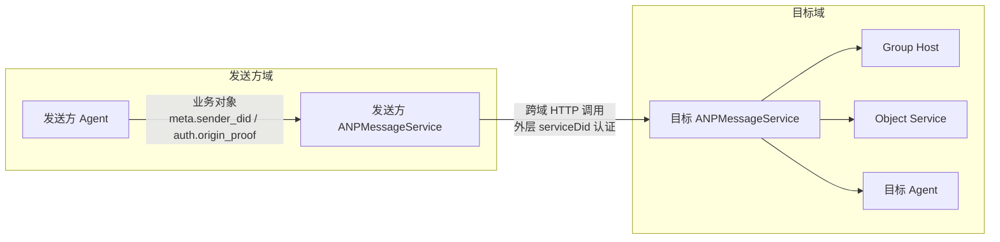
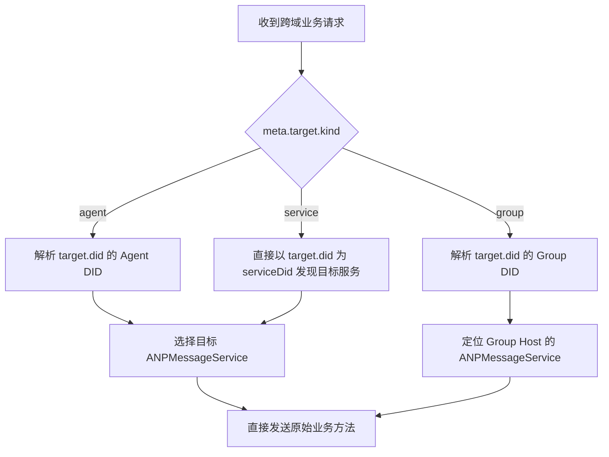
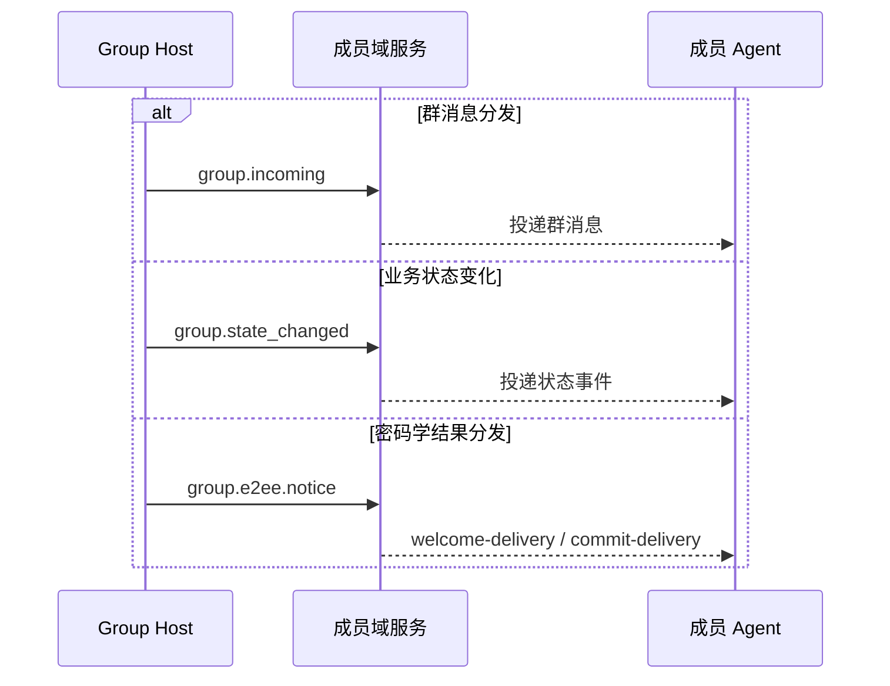
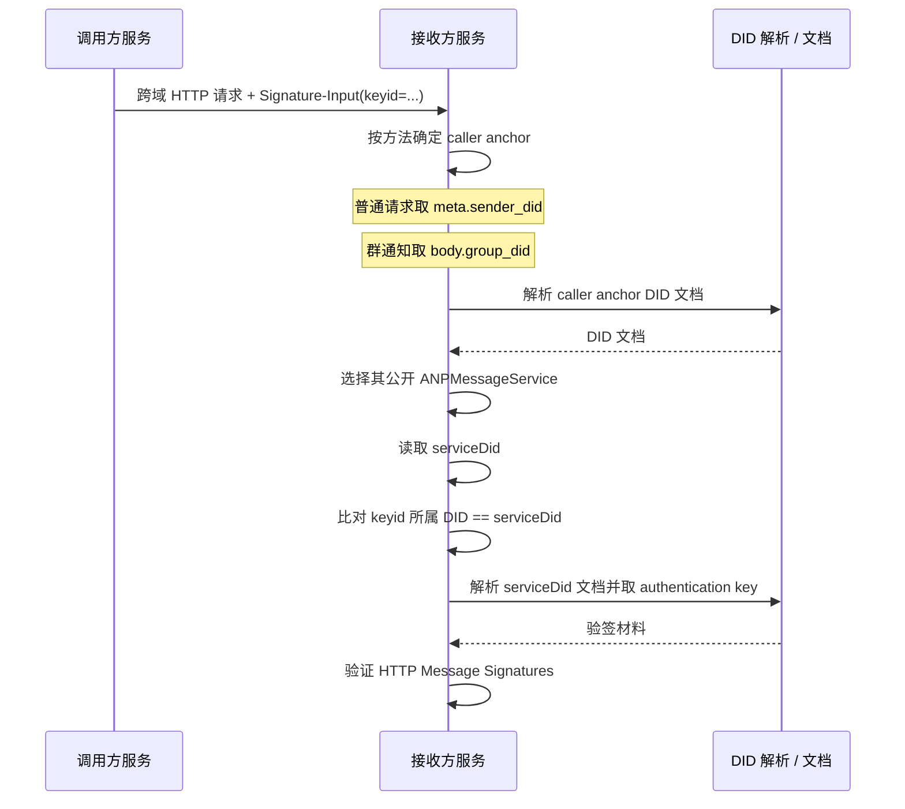
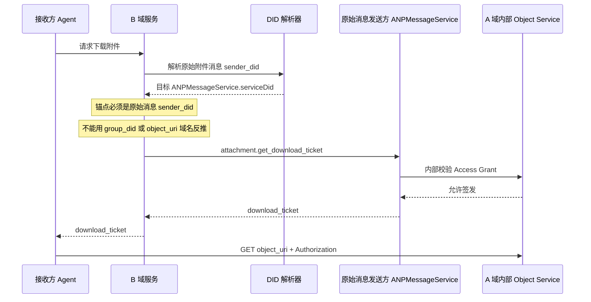

> 日本語参考訳（機械翻訳・未校閲）。規範となるのは原文です。コード例・識別子・規範キーワードは原文を保持しています。
> 原文: [chinese/message/08-联邦与跨域.md](../../../chinese/message/08-联邦与跨域.md) / 基準コミット: `0837cfdfaf4ddcf834f0890ddaf34fc4c824e066`

# ANP プロフィール 8: 連邦およびクロスボーダー

- 文書番号: ANP-P8
- タイトル:連邦とクロスボーダー
- ステータス:公開
- バージョン: 1.2
- コードブックバージョン: ANP のメッセージング 1.2
- 原文言語: 中文 / このページは日本語参考訳
- プロフィール:`anp.federation.relay.v1`
- 依存症:`anp.core.binding.v1`、`anp.identity.discovery.v1`、`anp.direct.base.v1`、`anp.group.base.v2`
- アプリケーションの範囲: このプロファイルは、クロスドメインサービス検出、サービスツーサービスコール、グループイベントの配布、オブジェクトコントロールのためのクロスドメイン呼び出しに適用されます。

---

## 1. 目的:

ベンプロファイルのみが示されている **さまざまなサービス間でクロスドメインのシナリオでリンクを確立する方法、それらにアクセスする方法とどのような原則に従うべきか**。

このページは、以下の項目に焦点を合わせています。

1. ドメインがリモートエージェントに他のドメインのパブリックAMPサービス入り口へのリクエストを送信する方法
2. フィールドがホストのグループに操作を送信する方法
3. グループ ホスト 会員エリアにスケジュールされたグループ イベントを配布する方法;
4. オブジェクトコントロール表面(オブジェクトバイトよりもむしろ)がフィールド全体で呼び出される方法。
5. `attachment.get_download_ticket` (b) 横断面呼び出しを上陸させる方法
6. 外部HTTP識別を呼ぶために、DIDがクロスドメインサービスに使用するべきもの
7. セキュリティ、sauerkraut のクロスドメイン サービスコール, 再テストと成功の構文.

ベンジャー **なし、いいえ。**他のプロファイルに基づいている次の定義を繰り返します。

- `direct.send`、`group.send`、`group.add`、`group.remove` - 事業のアプローチ自体;
- E2EE 構造とパスワードの構文をロードします。
- 附属書オブジェクト構造、機器の形式およびオブジェクト検証規則;
- (a) DID 文書内のサービスの種類と、発見のための基本ルール。
- 地域横断ルーティング、歴史の同期、読み戻り、プレゼンス;
- オブジェクトの保存のトランク、CDNまたは内部実現をバイトします。

---

## 2. 用語と規範的な関与

### 2.1 仮鍵

このテキスト **MUST**、**MUST NOT**、**REQUIRED**、**SHALL**、**SHALL NOT**、**SHOULD**、**SHOULD NOT**、**RECOMMENDED**、**NOT RECOMMENDED**、**MAY**、**OPTIONAL** 資本金を基準とする規範的な要件として解釈される。

### 2.2 用語集

- **フィールドサービス送信**: 送信者 ' s ドメイン内のサービスで、ローカルリクエストを受信し、クロスドメイン サービスコールを開始したり、通常はエリア外で `ANPMessageService`。
- **ターゲットエリアサービス**: 対象のDIDがドメイン間でリクエストを受信する際、そのサービスのエンドポイント。
- **連邦サービスDID**: フィールドで利用するDIDはHTTP認証に役立ちます。 通常、送信者から送信されます `ANPMessageService` 目的: `serviceDid` フィールドは、元のビジネス送信者ではなく、クロスドメイン呼び出しを開始したサービス ID であることを識別が述べています。 `did:web` とりあえず `did:wba`、nudity DID を使用することを推薦して下さい。
- **グループホストサービス**: 特定の人のために `group_did` シーケンシングおよびグループステータスの進捗管理責任のあるサービス。
- **オブジェクトサービス**: アップロード、ダウンロード、紙の発行、添付オブジェクトのアクセス管理を担当するサービス。
- **オーダーグループイベント**: グループホストによる受入・配布 `group_event_seq` グループインシデント
- **最終受入**: 横断操作は、最終的な合意された責任のエンドポイントに達し、受け入れられます。

---

## 3. デザイン原則

### 3.1 ドメイン間で元のメソッドを直接使用

トランスドメインのシーン、フィールドサービスを送信する **SHOULD** 古いビジネスや制御方法を使用して、独立したRelayer JSON-RPCのレイヤーではなく、ターゲットドメインサービスと直接やり取りします。 つまり:

- プライベート・インタードメインの直接使用 `direct.send`；
- グループベースダイレクトクロス境界利用 `group.create`、`group.get_info`、`group.join`、`group.add`、`group.remove`、`group.leave`、`group.update_profile`、`group.update_policy`、`group.send`；
- グループ E2EE 直接クロスドメイン使用 `group.e2ee.publish_key_package`、`group.e2ee.get_key_package`、`group.e2ee.create`、`group.e2ee.add`、`group.e2ee.remove`、`group.e2ee.send`；
- オブジェクトコントロールはフィールド間で直接使用されます `attachment.create_slot`、`attachment.commit_object`、`attachment.abort_object`、`attachment.get_download_ticket`。

### 3.2 最初に特定されたターゲットサービスおよび作成されるクロスドメインの呼び出し

クロスドライブ前のフィールドサービス送信 **MUST** 特定の DID ドキュメントは、P2 によってルールを定義し、この Refile が定義されていないことを説明し、見つけます。

### 3.3 グループホスト

まつげ `group_did` グループの状態やイベントのシーケンスを変更するアクションは、懸念の問題です。**MUST** 対応するグループホストサービスによる最終線形ソート。クロスドメインの呼び出しは、グループホストへのリクエストのみを送信できます。グループホストを迂回し、自身で決定することはできません `group_event_seq` または `group_state_version`。

### 3.4 オブジェクトバイトは、クロスドメインサービスコールリンクをフォローしません

オブジェクトコンテンツ自体 **MUST NOT** AMP のクロスエリアサービスを通じて、通常のリレーチャンネルで NTS を呼び出す。つまり、

- サービスコールサービス **いえ、** (a) バイト、写真バイト、文書の音声ビジュアルバイトを送信します。
- オブジェクトボディ **MUST** オブジェクトサービスから独立したHTTP(S)チャネルで直接ダウンロードする。
- クロスドメインサービスコールレイヤーは、オブジェクトの「オブジェクト自体をディスパッチ」のデータ面ではなく、「取得方法」の制御側で最も関与しています。

### 3.5 E2EEは、中級サービスに透明に負荷をかけます

クロスドメインコールロード時 `direct-e2ee` または `group-e2ee` 業務用メッセージ、中間サービス、ドメインゲートウェイ **MUST** 透明でないバイトや非トランザクションオブジェクトとしてペイロードを表示します。このプロファイルが明示的にルート、thiopeeなど、またはターゲット検証のために要求する外部メタデータに加えて、**MUST NOT** 変更する。

### 3.6 事業体から外部サービスの状態の分離

サービスの呼び出しのためのHTTP IDの外部レベルへのクロスドメイン サービス,**MUST** 元のビジネスメッセージではなく、独自の連邦サービスDIDをサービスするために送信フィールドを使用する `meta.sender_did`、`group_did` または他のアプリケーション本体 DID.

つまり、

- 外部のHTTP認証応答は「**どのエリアサービスが私を呼び出しているか?**”；
- `meta.sender_did` とりあえず `auth.origin_proof` 答えは「**どの事業体が行動を始めたのか?**”；
- アイデンティティの2つの層は関連性があるが、皮下にある。 **MUST NOT** 混乱。

### 3.7 プロファイル宣言のみ保持されるデバイス

連邦フォワードは、元のビジネスプロファイルのアドレスモデルを変更しません。 P5またはP6可視宣言デバイスがセクターである場合、各連邦ホップは **MUST** そのままに、最終サービスルール **MUST** P2を押してセキュリティのオーバーレイを確認します。 **MUST NOT** 削除、置換、またはセクターを余分化します。

P3、P4、ノーマルP7ベースはDIDまたはグループDIDアドレスを持っています。 **MUST NOT** DID文書、ローカル機器の状態または受信フィールドに応じて複合装置として。

---

P8のタスクは、ビジネス契約を赤くしないが、これらの確立された事業オブジェクトがドメイン間でサービス間でどのように動くかを説明するためです。次の図では、事業体、外部サービスステータス、グループホスト、およびオブジェクトサービスが同じビューに置くことの概要を示します。

*図 P8-1: 連邦およびクロスボーダーの概要(非規制)。*

その後の章を読むと、この図はP8の一般的な前提として理解できます。ビジネスオブジェクトは確立されたメソッドに沿って横断的であり、外部HTTP認証では、現在1つのジャンプによって呼び出されるパブリックサービスエントリのみが示されます。
## 4. プロフィールの印および依存性

### 4.1 プロフィール名

このProfile の標準的な名前は、次のとおりです。

`anp.federation.relay.v1`

> 注意: メッセージを送信する 1.2 公開し続ける `anp.federation.relay.v1` 識別; この命令は、v1 リレーが E2EE v2 と組み合わせる方法だけを明らかにします。

### 4.2 依存症

ベンジャー **MUST** 次のデータに依存します。

- `anp.core.binding.v1`
- `anp.identity.discovery.v1`
- `anp.direct.base.v1`
- `anp.group.base.v2`

ベンジャー **MAY** 下記のオーバーレイ/エクステンションで使用してください。

- `anp.direct.e2ee.v1`
- `anp.direct.e2ee.v2`
- `anp.group.e2ee.v1`
- `anp.group.e2ee.v2`
- `anp.attachment.v1`

### 4.3 セキュリティモード

サービスコールへのクロスドメインサービス **MUST** で実行 `transport-protected` モード。

直接ビジネスリクエストを送信 `meta.security_profile` **MAY** は:

- `transport-protected`
- `direct-e2ee`
- `group-e2ee`

クロスドメインの呼び出し **MUST NOT** 許可なく、元の業務依頼を変更 `meta.security_profile`。

---

## 5. 十字ドメイン コネクター

最初に行うことは署名ではなく、要求が要求されるターゲットサービスの種類を決める。 `agent`、`group` とりあえず `service` 3つのターゲットモデルのモデルを軸とした経路決定は、単一のプロセスに凝縮されます。

*図P8-2: 十字ドメインルータの決定(非暫定的)。*

数値の焦点は「元業務方法を事前に送信する」ということです。P8は、追加のリレーアプローチを含めることを奨励しませんが、元の要求が正しい運用責任エンドポイントに配信される前に最終公開サービスが発見される必要があります。
### 5.1 エージェントからエージェントへ

いつ? `meta.target.kind = "agent"` 、フィールド サービスを送って下さい **MUST**：

1. パーシングターゲット `agent_did`；
2. DID の文書や機能相談に応じてターゲットを選択します。 `ANPMessageService`；
3. オリジナルをつけて。 `direct.send` 対象サービスへ送信

つまり、クロスボーダーのプライベートなコンテキストで話するときは、送信フィールドサービスは「サイト外の呼び出し者」として機能します。

### 5.2 グループ DID

いつ? `meta.target.kind = "group"` 、フィールド サービスを送って下さい **MUST**：

1. パーシングターゲット `group_did`；
2. グループID 文書やキャッシュされたグループステータス参照に対応するグループホストサービスを決定します。 `ANPMessageService`；
3. グループホストサービスに直接グループ操作リクエストを送信します。

適用されるメソッドは、以下に限定されません。

- `group.get_info`
- `group.join`
- `group.add`
- `group.remove`
- `group.leave`
- `group.update_profile`
- `group.update_policy`
- `group.send`
- `group.e2ee.add`
- `group.e2ee.remove`
- `group.e2ee.send`

現在のP4 v2コアの場合 `group.join` とりあえず `group.add`, グループのホストの運用結果に基づいてクロスドメイン成功したセマティクスは、; 成功とは、対応するビジネスメンバーが配置されていることを意味します。 展開が追加の外部証明書を導入する場合, 承認ストリームまたは他のガバナンスの中間体, 彼らは拡張パスであり、P4 v2コアの成功した構文に属していません.

### 5.3 オブジェクトサービスで目的

横断オブジェクト制御のための呼び出し **MUST** 直接、元のオブジェクト制御面から対面までのアプローチを使用します。該当するメソッドには、以下が含まれます。

- `attachment.create_slot`
- `attachment.commit_object`
- `attachment.abort_object`
- `attachment.get_download_ticket`

あり。 `attachment.get_download_ticket`, コール **MUST** 最初に元の添付ファイルソースDIDで公開を見つけます `ANPMessageService`, そして、サービスへのクロスフィールド呼び出しを起動します。; 元のグループメッセージ送信者 DID はまだグループのシーンで使用されます `group_did`。

### 5.3.1 E2EE材料方法のためのクロスドメインルータ

P5/P6 の組み合わせが達成されると、次のサービススコープドゲッター/物理的方法が使用されます。 **MUST** 最終開示までの直通経路 `ANPMessageService`新しいプライベートトランク契約の代わりに:

- `direct.e2ee.get_prekey_bundle`
  1. パーシング `body.target_did`
  2. P5で要求されるように保ち、確認して下さい `body.target_device_id`
  3. ターゲット、エージェントの設立 `ANPMessageService`
  4. 他装置と取り替えるべきではないサービスへの直接呼出し

- `group.e2ee.get_key_package`
  1. パーシング `body.target_did`
  2. P6で要求されるように保ち、確認して下さい `body.target_device_id`
  3. ターゲット、エージェントの設立 `ANPMessageService`
  4. 他装置と取り替えるべきではないサービスへの直接呼出し

これらの方法は、最低限の相互運用可能なV1です。 **なし、いいえ。**匿名アクセスを想定し、発信者識別、制限されたフローおよびアンチアブラス制御 **MUST** 一時的なフォルダを閉じることができません: %s

グループ E2EE オンボーディング `welcome` / `ratchet_tree` パスワード取得の完了をお待ちしています。 `group.e2ee.notice` 配達;v1は独立したとして定義されません `group.e2ee.get_join_info` 標準的な横断道のルート。

### 5.4 事件の配分

グループホストが、グループイベントをメンバーフィールドに積極的に配布する必要がある場合は、グループホストがグループのメンバーと共有できるようにすることが重要である。**SHOULD** 既存の通知方法や、独立したリレーパッキング方法を追加するのではなく、意味のある配置メカニズムを直接使用:

- クラウドにニュースを配布しています。**SHOULD** 利用条件 `group.incoming`；
- グループステータスの変更と配布**SHOULD** 利用条件 `group.state_changed`；
- グループE2EEのパスワードの結果を配布しました。**SHOULD** 利用条件 `group.e2ee.notice`；
- デプロイパーティが同等価格メカニズムを使用している場合、 **MUST** 元のグループ構文を保ち、少なくとも少なくとも `group_did`、`group_event_seq`、`group_state_version` 公益事業ではありません。

`group.e2ee.notice` まだMLS Bootstreamを完成していないターゲットに直接配信できます `welcome-delivery`または既存のメンバーに配信される場合があります `commit-delivery`; これは、P4メンバーによる放送ではなくP6によって配布されたパスワード結果です。 追加の招待状またはその他の非会員のガバナンスメッセージは、利用可能な場合は、展開拡張であり、v1標準のクロスドメインパスを構成するものではありません。

プチ4 `group.incoming` とりあえず `group.state_changed` 会員IDを探し、連盟に転送 **MUST NOT** デバイスを自分で追加します。 P6 配信を暗号化する `group.e2ee.notice` 正確な受信機装置のためのP6の条件を、および保持して下さい **MUST NOT** デバイスを兄弟するコードされたデバイスの結果をブロードキャストします。

---

P8 グループイベントの新しいプロトコルをリデザインするためにグループホストを必要としませんが、既存の通知メソッドに直接再エントリーを促すようにします。次の図は、読者が自分の意味の境界線を区別するのに役立ちます、ビジネスステータスとパスワード結果の配布、変更への3つのパスを与えます。

*図P8-3:クラスターイベント(非放射性)のクロスドメイン分布。*

側面にパシティ機構が適用される場合、これらの3つのパスの分離を保存し、ビジネスイベント、グループメッセージ、パスワードを1つの通知オブジェクトと組み合わせるべきではありません。
## 6. サービス・ツー・サービスセキュリティ要件

### 6.1 安全なチャネル

サービスの呼び出しのすべてのサービス **MUST** 両方向または同等の認証されたセキュアなチャネルで実行します。

### 6.2 ソースは識別可能

あらゆるサービスが電話をかける **MUST** 受信者は、ソースサービスを特定することができます。 DID ベースのデプロイメントでは、ソースサービスステータス **MUST** HTTPメッセージ署名の外側レイヤーを通して `Signature-Input` / `keyid` パラメータ式、および `keyid` のIDの **MUST** 送信者と `ANPMessageService.serviceDid` めちゃくちゃ。

HTTPメッセージ 署名 続いて認証 [アクア・アミューズメント・アミューズメント・アミューズメント・アミューズメント・アミューズメント・アミューズメント・アミューズメント・アミューズメント・アミューズメント・アミューズメント・アミューズメント・アミューズメント・アミューズメント・アミューズメント・アミューズメント・アミューズメント・アミューズメント・アミューズメント・アミューズメント・アミューズメント・アミューズメント・アミューズメント・アレイ・アワーズメント・アミューズメント・アミューズメント・アミューズメント・アミューズメント・アミューズメント・アベイ](../../../chinese/02-ANP-基于DID的身份认证协议.md#http-binding)。

#### 6.2.1 連邦サービス DID 選択規則

リクエストでは、HTTP へのクロスドメインサービス:

1. 横断通話のための送信者 `ANPMessageService` エントリーフォーム **MUST** 新着情報 `serviceDid`；
2. 送信フィールドが使用される場合 `did:web`と、そしてそれから `serviceDid` **SHOULD** nudity DID を使う `did:web:alice.com`；
3. 送信フィールドが使用される場合 `did:wba`と、そしてそれから `serviceDid` **SHOULD** nudity DID を使う `did:wba:alice.com`；
4. `Signature-Input` メディス `keyid` **MUST** DID URL とポイントを全て完了 `serviceDid` 一部 - `authentication` (a) 関係の承認の確認方法
5. スタッフ **MUST** ドキュメント認証、使用検査の正確な認証、実際のHTTPリクエスト認証はAMP-02と適用方法のバインディングにより完了します。

例えば、はい。 `alice.com` 例えば、次のDIDはローカルレベルの連邦サービスとして使用できます。

- `did:web:alice.com`
- `did:wba:alice.com`

話している内容がわからない。`did:wba:alice.com:agents:relay:e1_<fingerprint-a>` パス型 DID です。正規のエージェントやサブ ID はできますが、**なし(なし)SHOULD NOT）**連邦サービス DID は、このプロファイルのデフォルトとして.

ケーラーアンカーDIDと宣言 `serviceDid` 異なるサポートされている DID メソッドが使用できます。その相関は、セクション 6.2.2 に従って検証されます。

#### 6.2.2 ベーシス `serviceDid` プロセスをチェックする

BサービスがBサービスを行なう際のBサイドサービスでは、Bサービスのクロスドメインリクエストを送出します **MUST** まず、メソッドタイプで「補間」を決定 `serviceDid` 業務用アンカー(ハッカーアンカー)にてサービス識別を行います。

ケーラーアンカールールは、次の通りです。

- 一般的なクロスドメインリクエストには、以下が含まれます。
  - `direct.send`
  - `group.create`
  - `group.get_info`
  - `group.join`
  - `group.add`
  - `group.remove`
  - `group.leave`
  - `group.update_profile`
  - `group.update_policy`
  - `group.send`
  - `direct.e2ee.*`
  - `group.e2ee.publish_key_package`
  - `group.e2ee.get_key_package`
  - `group.e2ee.create`
  - `group.e2ee.add`
  - `group.e2ee.remove`
  - `group.e2ee.send`
  - `attachment.*`

  呼び出し主アンカー **MUST** 削除 `meta.sender_did`

- えー。 `group.incoming`、`group.state_changed` とりあえず `group.e2ee.notice`：

  呼び出し主アンカー **MUST** 削除 `body.group_did`

それから、受取人 **MUST** 送信者の s サービス ID は、次の順序で確認されます。

1. (a) 上記規則で定めるため、呼び出し主アンカー。
2. P2 メソッドルールで呼び出しアンカーの現在の文書をパースし、検証します。
3. P2 サービス選択規則に従ってこのDIDのパブリックを選択します `ANPMessageService`；
4. サービスエントリーを読む `serviceDid`；
5. 外部HTTPから `Signature-Input` & チェック `keyid`所属するDIDを取得
6. 認証 `keyid` ドッドとステップ4 `serviceDid` (a) 完全な一貫性;
7. ANP-02 による結合と校正とその方法 `serviceDid` 現在の文書;
8. これを利用する `serviceDid` ドキュメント `authentication` 認証の公開鍵は、外部HTTPが認証のための署名を要求します。

ステップ3が選択されている場合 `ANPMessageService` 未定 `serviceDid`またはステップ6は、受取人より矛盾しています **MUST** 横断サービス識別は、障害と見なされました。

スタッフ **MUST NOT** 全てから `meta.sender_did` インサート・コール `serviceDid`; グループ通知の場合、これは「現在のクロスドメイン発信者」として「元のビジネス送信者」のエラーを処理します。

P8の最も簡単に誤って達成されたステップであるメソッドタイプで、呼び出し主アンカーを決定します。次の時間系列チャートは、呼び出し主アンカー、または新しいものを与えます。`ANPMessageService.serviceDid` 外部レイヤーで HTTP `keyid` 確認の順番が見える。

*図 P8-4: ケーラーアンカーと `serviceDid` バリデーション(非正規)。*

受取人が常に許可されていない `meta.sender_did` インサート・コール `serviceDid`;のために `group.incoming`、`group.state_changed` とりあえず `group.e2ee.notice` このグループは、運用アンカーが置換されるべきであることを通知しました `body.group_did`。
#### 6.2.3 nudドメイン名のDIDに対するエンゲージメント

ローカルの1つなら、 `did:wba` クロスドメインサービス識別、展開 **SHOULD** ローカルレベルの連邦サービスDIDとしてそのnudity DIDを使用して、 **SHOULD NOT** 通常のエージェントID、グループID、またはその他のパスタイプDIDでこのドメインのアイデンティティを置き換えます。

アクコンプリシャ **MAY** 同じnudity DID文書の複数のドキュメントを維持 `authentication` 異なるサービス例、異なるキー生成またはスムーズな回転をサポートする認定方法。特定のサービスからサービスまでの認証に関与する認証方法の選択は、展開戦略によって決定されます。

### 6.3 原発のビジネスオーディエンスの維持

サービスの呼び出されるとき、元のビジネス要求 `method`、`params.meta` とりあえず `params.body` **SHOULD** 地理的な領域で受けたビジネスリクエストの同等性を維持します。 **MUST** 同じことが真です。

装置を楽器として宣言する元のP5/P6方法だけを含みます。ベース操作の場合、同等とはユニットの増大を意味しません。

### 6.4 原発者の s 証明書の保持

原発の業務依頼の場合 `auth.origin_proof`、十字ドメイン送信機 **MUST** 証明書は、要求に維持され、送信されます。 ターゲットドメインサービス **MUST** 各事業内容の証明書の独立検証

外部連邦サービスDIDのHTTP認証 **MUST NOT** 元の発行者 ' s の証明書を取り替えて下さい; ドメイン サービスを送って下さい **MUST NOT** - それを置きます。 `auth.origin_proof` 自分の連邦サービスDIDの書き換え。

現在のP7 v1のメイン ラインのため `attachment.*` 表面方法、通常ターミナル操作を制御して下さい `auth.origin_proof`;外 `serviceDid` ホップ認証 **MUST NOT** 商取引の原発者から証明されるべきミスデント。

### 6.5 外層の最小視認性

ドメイン間で送信されたビジネスリクエストは、中間サービスが表示され、ルート/渦などのフィールドに許可されます。

- `meta.profile`
- `meta.security_profile`
- `meta.sender_did`
- `meta.target`
- `meta.operation_id`
- `meta.message_id`(もしあれば)
- `meta.content_type`
- P5/P6 プロフィール宣言を運ぶときだけ可視 `meta.sender_device_id` とりあえず `meta.recipient_device_id`

特にE2EEは、ビジネスコンテンツ、中間サービスを保護する他の分野 **MUST NOT** 不正な依存、変更または書き換え。

### 6.6 無声劣化の禁止

横断ドメインの呼び出しのリンクの任意の **MUST NOT** 可視協議がなければ、要求元の高セキュリティモデルから低セキュリティモデルにサイレントダウングレードされた。

### 6.7 DIDマイグレーションエラーと禁止書き換え

JSON-RPC アプリケーション処理の前に DID が無効化されている場合、 ANP-02 結合は指定された HTTP レスポンス (WBA の WTTP など) を返すことができます。 `409`. AMPメソッドは、アプリケーション処理とルート、リクエストボディ、またはDIDを保存している場合は、最終業務サービスがP1を返す `anp.did_superseded`. 同じ要求 **MUST NOT** 同時に2つのレイヤーのエラーを返します。

連邦サービス **MUST** 最終的なサービスの DID のリターンをそのまま保ち、許可しない `currentDid` または `current_did` 信頼できる再方向として使用して下さい。元の発信者はすべての影響を受けた分野を再構成し、コンテキストを、再署名し、再試行するマイグレーションの有効化に責任があります。

中間サービス **MUST NOT** 再書き込み `meta.sender_did`、`meta.target.did`、P4 `body.member_did`、P5/P6 DIDか装置結合、鉱山のペイロード、暗号化ADまたは原物 `auth.origin_proof`. P4はメンバーIDの更新を受け入れます、グループホストは現在のDIDから新しい生成できます `group.incoming` または `group.state_changed`; これは再書き込みではありません。

DID の受信は、応答、署名が失敗し、エンドポイントが失敗しました。DID 無効化またはポストコンプリート機能、連邦サービス **SHOULD** DID ドキュメントとサービス選択キャッシュをリフレッシュします。

---

## 7. ♪ と、そうで、上りに♪

### 7.1 運用優先事項

クロスドメインサービスコール **MUST** 元のビジネス方法の皮下定義を再使用して下さい。

- `direct.send` オリジナルをお使いください。 `sender_did + target.did + method + operation_id` ルール;
- `group.*` (a) グループアプローチ ' s のそれぞれの定義を重ねる規則を使用するため;
- `attachment.*` 各オブジェクト制御方式で定義されているギルとノーグラビティルールを引き続き使用。

### 7.2 再試金の条件

ネットワーク障害、時間過不足または不確実性が発生したときにローカルエリアサービスを送信する **MAY** 再試行; しかし、再試行するとき:

- **MUST** オリジナルをキープ `operation_id` 変更なし;
- メッセージの代名詞がある場合、**MUST** オリジナルをキープ `message_id` 変更なし;
- オブジェクト制御で呼び出される場合、**SHOULD** オリジナルをキープ `attachment_id` (a) 関連するコンテキストは変更されずままになります。
- **MUST** 業務負荷の構文を同等に維持します。
- P5/P6 操作の場合、宣言されたすべてのデバイス **MUST** 変更なし。 DID 内のベースリトリートは残っています。

受諾された DID が送信者またはターゲット DID を変更する場合は、中間サービスではなく、呼び出し側から新しい認証リクエストを作成します。呼び出し元は、独自のプロファイルによってロジックを維持します `message_id` / `operation_id`, しかし、署名, 抽象的な, 秘密またはDIDの境界線は再確立されなければならない.

### 7.3 内部追跡フィールド達成

導入事例 **MAY** フィールドは、このプロファイルで定義されている標準のクロスドメインリクエストではありませんが、内部では意図されていません。**MUST NOT** オリジナルビジネスプロファイルキーをスワイプで置き換えます。

### 7.4. Zenによる応答

受取人が処理が成功した元のビジネスリクエストを識別する場合、ジョブを持つことをお勧めします。**SHOULD** 業務依頼を複製するのではなく、同等価格の最初の処理に対する応答を返します。

---

## 8. クロスドメイン成功したセマティクス

### 8.1 `direct.send`

クロスドライブ用 `direct.send`：

- 最終ターゲットドメインサービスがメッセージを受信したときにローカルエリアサービスを送信します **MAY** ローカルの呼び出し者への正常に戻ります。
- 成功目標、エージェントドメインで処理する方法、キューをキューに入れ、このプロファイルの成功した意味では落ちないルートをルーティングします。

### 8.2 P4グループ制御操作

あり。 `group.join`、`group.add`、`group.remove`、`group.update_profile`、`group.update_policy` P4制御操作:

- グループホストサービスが受け入れ、ソートする際のローカルエリアサービスを送信します **MAY** ローカルの呼び出し者への正常に戻ります。
- 現在のP4 v2コアの場合、`group.join` / `group.add` 成功とは、対向の運用メンバーが配置されていることを意味しています。
- P6 で会員とパスワードダウンの同期は、その後の散歩です。

### 8.3 P6 パスワード制御操作

あり。 `group.e2ee.create`、`group.e2ee.add`、`group.e2ee.remove`：

- グループホストサービスがパスワード制御のアクションを受け入れ、成功した結果を返すときにローカルエリアサービスを送信します **MAY** ローカルの呼び出し者への正常に戻ります。
- この成功した指標は、MLS 制御結果がターゲットホストによって受け入れられ、運用状況を確立するために固定されていること。
- ・・・ **MUST NOT** 新規P4運用会員の制作に精通しました。

### 8.4 `group.send`

クロスドライブ用 `group.send`：

- グループホストサービスが承諾し、割り当てるとき `group_event_seq` 十字架の成功と見なすことができます。
- 会員コミュニティが受けた事件は、その配布の仕組みで決定されます。

### 8.5 `group.e2ee.send`

クロスドライブ用 `group.e2ee.send`：

- グループホストサービスがMLSの秘密オブジェクトを受け入れ、ソートする時に、対応する1つを返します。 `group_event_seq`、`group_state_version`、`group_receipt` 十字架の成功と見なすことができます。
- この成功は、ホストがE2EEの秘密テキストのグループを受け入れ、ソートしたことを意味します。
- 会員が受け取ると、その成功の復号化は、その後の配布やローカルのMLSステータスに依存します。これは、成功のトランスドメイン対称ではありません。

### 8.6 `attachment.get_download_ticket`

クロスドライブ用 `attachment.get_download_ticket`：

- オブジェクトサービスが成功した機器を返すか、明示的に拒否したときにクロスドメインの成功は考慮されます。
- 返品・交換 **等しくない** 成功するダウンロード;
- オブジェクトのダウンロードとサマリー検証は、フォローアップ独立したHTTPSデータファセットステップです。

## 9. 添付ファイルとダウンロード機器のクロスドメイン要素

### 9.1最終処理エンドポイント

`attachment.get_download_ticket` 合意の水準で最終目標 **MUST** 元の添付ファイルメッセージ送信者DIDで公開されます `ANPMessageService`. オープンサービスポータルは、オブジェクト制御ロジックを実際に処理するオブジェクトサービスに内部的に再ルートすることができますが、これは実現の詳細の問題です。

したがって、標準の構文の意味で「最終処理エンドポイント」は以下です。

- プロトコルレベル: 元の添付ファイル送信者 DID は、公開に対応 `ANPMessageService`
- 達成レベル:内部被験者サービス(任意)

群衆の場面では、発信者 **MUST** ソースグループメッセージ送信機DIDを、発見のためのアンカーとして使用して下さい、 `group_did`. コールアー **MUST NOT** のみどころ `object_uri` . コントロールフェイスサービスが疑うURLドメイン名。

### 9.2 論文のリクエストを始めたら誰ですか?

v1 標準相互運用可能なパス **MUST** 主に「ダイバインサービスエージェントモデル」:

#### モードA:フィールドサービスエージェントモデル(v1標準パス)

パーティエージェントのリクエスト、 `attachment.get_download_ticket` 現地での活動 `ANPMessageService` または同等、サービスが、アウトステーションエージェントとしてクロスドメインリクエストを開始した場合。

このモデルは以下に適用される:

- (b) 均一レベルの監査の必要性;
- (b) サービスの均一なサービスおよび同一証明の必要性;
- エージェントは、直接、すべてのクロスドメインサービスコールの詳細を処理しません。

このモデルでは、地理的サービス **MUST** 元の添付ファイルメッセージ送信者IDから公開をパースする `ANPMessageService`と入れる `attachment.get_download_ticket` 送信する

#### モードB:急なストレートツーサイズ(採用延長)

リクエストエージェントは、元の添付ファイルメッセージ送信者IDを直接解析し、パブリックに呼び出す `ANPMessageService`。

モード **V1 MTI ではない**; 展開が有効になっている場合、それは自己解決されなければなりません:

- 元の添付ファイル送信機DIDに基づいて、エージェントがターゲットを取得し検証する方法 `serviceDid`
- クライアントが外部サービス認証を実行する方法
- クライアントが、現在の制限、再テストおよび監査戦略を調和させる方法

添付ダウンローダーのクロスドメインドロップポイントは、達成した人物に誤認するのは非常に簡単です。 `object_uri` 法定、または誤算 `group_did`. 次の図は、制御覆われたアンカーが元の添付ファイルメッセージ送信者DIDである必要があることを強調する標準的なパスを示します。

*図 P8-5: 十字ドメイン `attachment.get_download_ticket` プロセス(非放射性)。*

このチャートは、合意レベルと達成度の間の境界を示しています。外部基準のエンドポイントが開いている `ANPMessageService`、それは独立した主題サービスに内部的に再ルーティングされているかどうか、その実現の詳細です。
### 9.3 ダウンロードアクション

紙を手に入れたら、リクエストパーティー。 **MUST** 独立した HTTPS チャネルを使用して Object サービスからダウンロードを開始:

- ソリューション **SHOULD** それを置きます。 `Authorization` ヘッドまたはカスタムヘッダーを指定します。
- ソリューション **SHOULD NOT** URL クエリパラメータで
- 正常にダウンロードした後、パーティーをリクエスト **MUST** P7 でオブジェクトの要約を確認します。
- オブジェクトが使用する場合 `object-e2ee`と... **MUST** オブジェクトレベルの復号化と復号化の検証を実行します。

問題の時に標準パスに基づく主題制御サービス **MUST** 認定審査は、コンテキストの2つの層に基づいています。

1. アウター `serviceDid` HTTPメッセージ署名による検証
2. リクエスト `requester_did`、`security_profile`、`target_did` / `group_did`、`message_id` コンテキストはクライアントサービス戦略を満たしています。

オブジェクトコントロールサービス デフォルト **リクエストなし** 証拠。

## 10. 最小相互運用可能な要件

製品を少なくともマッチする製品 **MUST** サポート:

1. えー。 `agent_did` とりあえず `group_did` (b) サービス発見を実施する。
2. ドメイン間でターゲットサービスとやり取りする元のビジネス方法の直接使用。
3. オリジナルをキープ `security_profile`、`operation_id` (a) 関連する発信者証明書は変更されません。
4. グループイベントのグループの状態やシーケンスを変更した操作をグループホストサービス終了に送る。
5. ゼロに対応 `group.join`、`group.add`、`group.remove`、`group.leave`、`group.update_profile`、`group.update_policy` とりあえず `group.send` グループホストサービス;
6. P6 結合された使用時のサポート `group.e2ee.create`、`group.e2ee.add`、`group.e2ee.remove`、`group.e2ee.send` (a)正しい十字ドメインの着陸ポイント;
7. P5/P6 の組み合わせを使用した場合のサポート `direct.e2ee.get_prekey_bundle` とりあえず `group.e2ee.get_key_package` クロスボーダールータ;
8. - それを置きます。 `attachment.get_download_ticket` DIDによる公開開示のためのオリジナル添付ファイル送信機を送付 `ANPMessageService`；
9. (a) オブジェクトバイトは、クロスドメインサービスを通じて定期的にリンクを呼び出しることを明示的に禁止されています。
10. 会員エリアへの予定グループイベントの配布のための少なくとも1つのメカニズムがサポートされています。 P6-P6-Studyと組み合わせて使用した場合、P-6-studentシステムはSQDのすべての活動の分布をサポートするために使用されます。**MUST** 支援サービス `group.e2ee.notice` 地域を横断してプロジェクトを配布します。
11. 横断通話に参加する `ANPMessageService` 新着情報 `serviceDid`メソッドレベルのHTTPメッセージ署名による外部レイヤーを検証します。
12. えー。 `did:wba` 導入、ローカルレベルの連邦サービスDIDとしてnudity DIDの使用のためのサポート。
13. デバイスを宣言するP5/P6のみが保持され検証され、P3/P4/P7ベースでは合成されることはありません。
14. HTTP を保ち続ける `409` JSON-RPC で `anp.did_superseded` 階層の階層は、最終的なサービスエラーをそのまま転送します。
15. 署名または暗号化されたビジネスフィールドを DID にバインドすることは決して書き換えることはしません;
16. 移動、署名、エンドポイントの終了、無効化または機能障害が発生したときに DID およびサービスキャッシュをリフレッシュします。

## 11. 業績の参考書(非定性)

プロフィールのサイトに着陸するとき、実現パーティーは、次のことを考慮するかもしれません。

- 1-12. 業務プロファイルは、クロスドメインのシナリオで接続原則を補完します。
- (a) サービスが直接呼び出される結合レベルへのサービス;
- DID 識別のための選択的なルールは、外部レベルのサービスを提供します。
- グループホストのシーケンシングとグループイベントの消滅のための原則の声明;
- オブジェクトの制御ポイントとダウンロードデューティ間の境界の表示。

つまり、このプロファイルは問題の解決をします。**どうやって入手できますか?**別の一連の業務契約を再定義する代わりに。
