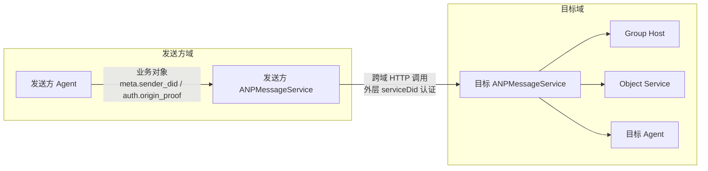
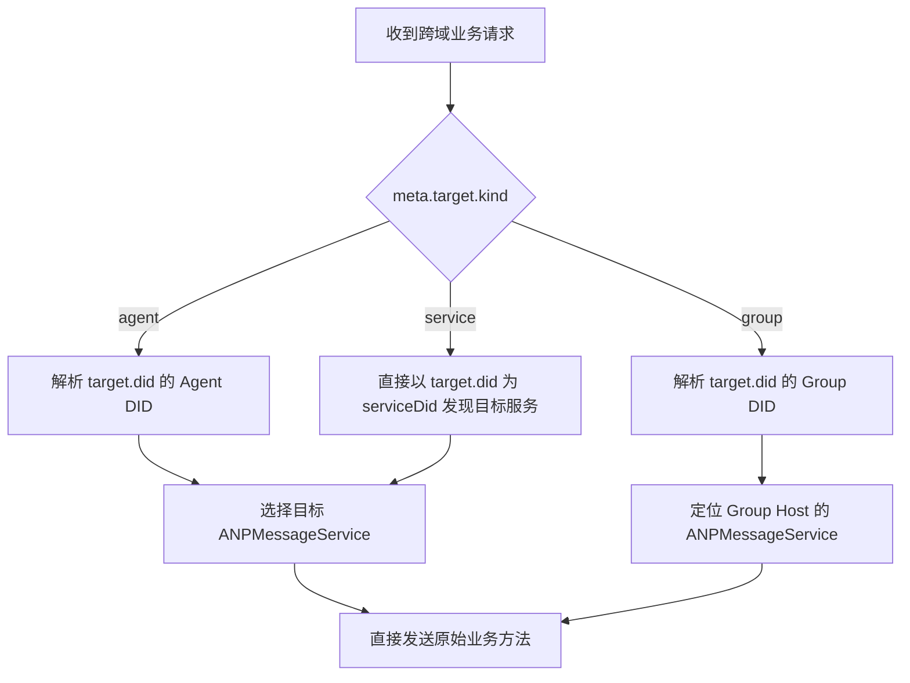
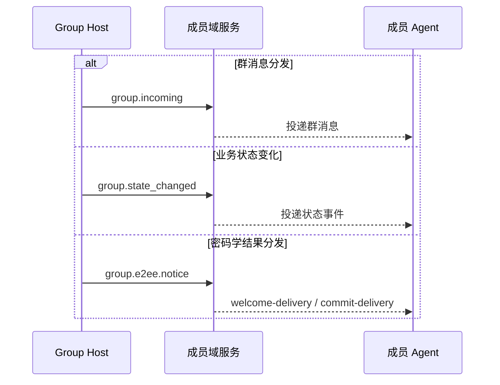
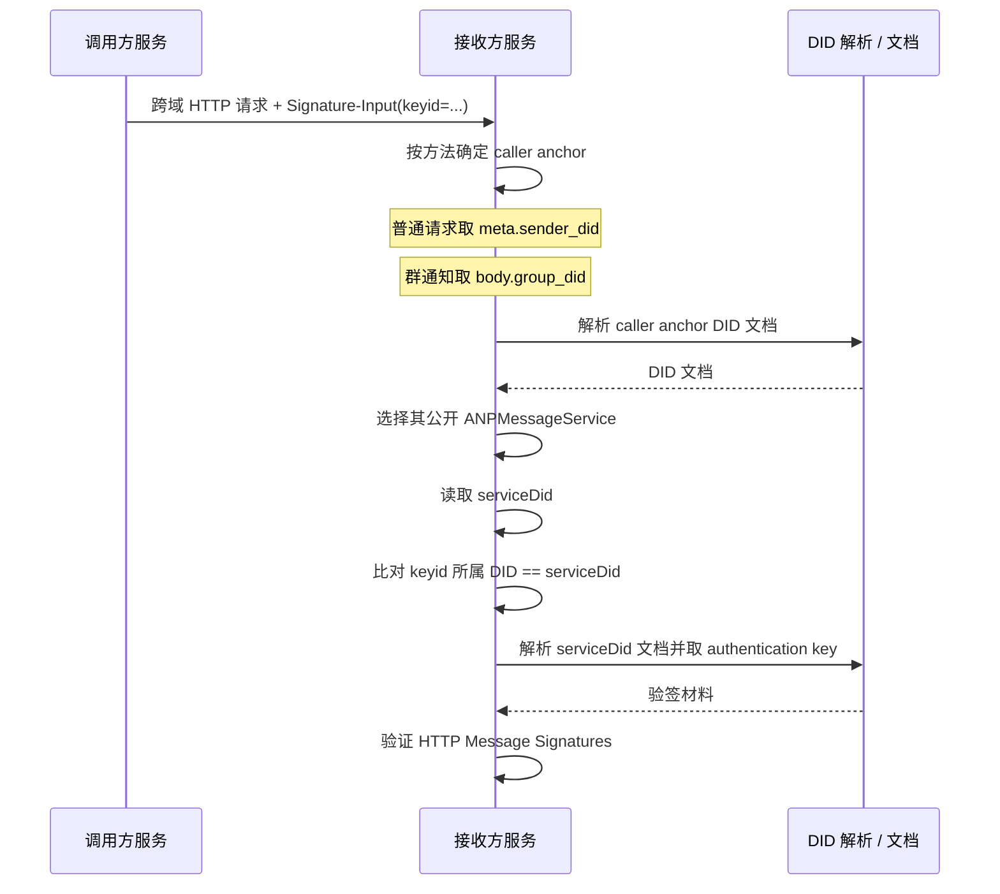
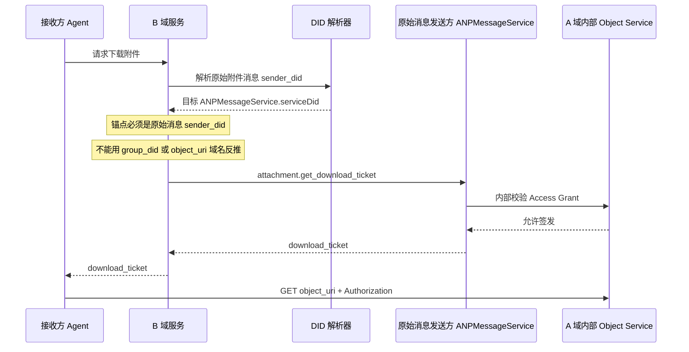

<!-- translation-review: full; source=chinese/message/08-联邦与跨域.md; basis=complete source-based manual translation of every Chinese prose line and reading of all diagrams -->
> 日本語参考訳（機械翻訳を基に原文全文を照合済み）。規範となるのは原文です。コード例・識別子・規範キーワードは原文を保持しています。
> 原文: [chinese/message/08-联邦与跨域.md](../../../chinese/message/08-联邦与跨域.md) / 基準コミット: `0837cfdfaf4ddcf834f0890ddaf34fc4c824e066`

# ANP Profile 8：連合とドメイン間通信

- 文書番号：ANP-P8
- タイトル：連合とドメイン間通信
- 状態：公開済み
- バージョン：1.2
- 仕様セットのバージョン：ANP Messaging 1.2
- 原文言語：中国語（このファイルは日本語参考訳）。
- Profile：`anp.federation.relay.v1`
- 依存関係：`anp.core.binding.v1`、`anp.identity.discovery.v1`、`anp.direct.base.v1`、`anp.group.base.v2`
- 適用範囲：本 Profile は、ANP のドメイン間サービス発見、サービス間呼出し、グループイベント配信、およびオブジェクト制御面のドメイン間呼出しに適用します。

---

## 1. 目的

本 Profile は、**ドメイン間の場面で、異なるサービスがどのように接続し、呼び出し、どの原則に従うべきか**だけを説明します。

本 Profile が扱う主な点は、以下のとおりです。

1. あるドメインが、遠隔 Agent 宛ての要求を、相手ドメインが公開する ANP サービス入口に送信する方法。
2. あるドメインが、遠隔グループ宛ての操作を、Group Host のドメインに送信する方法。
3. Group Host が、順序付け済みグループイベントを、メンバーのドメインに配信する方法。
4. オブジェクトのバイトストリームではなく、オブジェクトの制御面をドメイン間で呼び出す方法。
5. `attachment.get_download_ticket` のドメイン間呼出しを実装する方法。
6. ドメイン間サービス呼出しの外側の HTTP 認証に使う DID。
7. ドメイン間サービス呼出しのセキュリティ、冪等性、再試行、および成功の意味論。

本 Profile は、以下を重ねて定義**しません**。これらは、他の Profile に従います。

- `direct.send`、`group.send`、`group.add`、`group.remove` などの業務メソッド自体。
- E2EE のペイロード構造と、暗号学的な意味論。
- 添付オブジェクトの構造、チケットの形式、およびオブジェクトの検証規則。
- DID 文書のサービス型と、発見の基本規則。
- ドメイン内のルーティング実装、履歴同期、既読受領通知、および Presence。
- オブジェクトのバイトストリームの中継、CDN、またはオブジェクトストレージの内部実装。

---

## 2. 用語と規範的な取り決め

### 2.1 規範的キーワード

本文の **MUST**、**MUST NOT**、**REQUIRED**、**SHALL**、**SHALL NOT**、**SHOULD**、**SHOULD NOT**、**RECOMMENDED**、**NOT RECOMMENDED**、**MAY**、**OPTIONAL** は、大文字で記されている場合、規範的要件として解釈します。

### 2.2 用語

- **送信者ドメインのサービス**：送信者のドメイン内でローカル要求を受理し、ドメイン間サービス呼出しの開始を担当するサービス。通常は、そのドメインの外部向け `ANPMessageService` です。
- **宛先ドメインのサービス**：宛先 DID が公開し、そのドメイン間要求の受信を担当するサービスエンドポイント。
- **連合サービス DID**：あるドメインが、ドメイン間のサービス間 HTTP 認証で使う DID。通常、送信者の `ANPMessageService` エントリの `serviceDid` フィールドで宣言し、元の業務送信者ではなく、ドメイン間呼出しを開始するサービスのアイデンティティを識別します。`did:web` と `did:wba` では、裸のドメイン名の DID を推奨します。
- **Group Host Service**：ある `group_did` の順序付け権限と、グループ状態の前進の責務を持つサービス。
- **Object Service**：添付オブジェクトのアップロード、ダウンロード、チケット発行、およびアクセス制御を担当するサービス。
- **Ordered Group Event**：Group Host が受理し、`group_event_seq` を割り当てたグループイベント。
- **Final Acceptance**：ドメイン間操作が、最終的なプロトコル責任エンドポイントに到達して受理されること。

---

## 3. 設計原則

### 3.1 既存のメソッドを直接ドメイン間で使う

ドメイン間の場面では、送信者ドメインのサービスは、独立した Relay JSON-RPC メソッドでさらにラップせず、既存の業務メソッドまたは制御メソッドで、宛先ドメインのサービスと直接やり取りすることが望まれます（**SHOULD**）。つまり、以下のとおりです。

- 私聊のドメイン間通信では、`direct.send` を直接使います。
- Group Base のドメイン間通信では、`group.create`、`group.get_info`、`group.join`、`group.add`、`group.remove`、`group.leave`、`group.update_profile`、`group.update_policy`、`group.send` を直接使います。
- Group E2EE のドメイン間通信では、`group.e2ee.publish_key_package`、`group.e2ee.get_key_package`、`group.e2ee.create`、`group.e2ee.add`、`group.e2ee.remove`、`group.e2ee.send` を直接使います。
- オブジェクト制御面のドメイン間通信では、`attachment.create_slot`、`attachment.commit_object`、`attachment.abort_object`、`attachment.get_download_ticket` を直接使います。

### 3.2 宛先サービスの発見後に、ドメイン間呼出しを確立

ドメイン間呼出しの前に、送信者ドメインのサービスは、まず DID 文書または同等のキャッシュ結果から、宛先サービスの所在を決定し、その後サービス間呼出しを開始しなければなりません（**MUST**）。DID 文書の具体的な解釈とサービス発見規則は、P2 が定義し、本 Profile は重ねて定義しません。

### 3.3 グループの順序付けは Group Host に従う

同じ `group_did` の、グループ状態またはグループイベント順序を変える操作は、対応する Group Host Service が、最終的な線形順序を付けなければなりません（**MUST**）。ドメイン間呼出しは、要求を Group Host に送ることだけができ、Group Host を迂回して、`group_event_seq` や `group_state_version` を独自に決めることはできません。

### 3.4 オブジェクトのバイトストリームは、ドメイン間サービス呼出し経路を使わない

オブジェクト内容自体を、通常の転送経路として、ANP のドメイン間サービス呼出し経路で転送してはなりません（**MUST NOT**）。つまり、以下のとおりです。

- サービス間呼出しは、ファイル、画像、音声、動画のバイトを転送しては**なりません**。
- オブジェクト本体は、独立した HTTP(S) チャネルを使い、Object Service から直接ダウンロードしなければなりません（**MUST**）。
- ドメイン間サービス呼出し層が参加できるのは、「オブジェクトの取得方法」という制御面までであり、「オブジェクト自体を運ぶ」というデータ面には参加しません。

### 3.5 中間サービスでの E2EE ペイロードの透過的な取扱い

ドメイン間呼出しが `direct-e2ee` または `group-e2ee` の業務メッセージを運ぶ際、中間サービスやドメインゲートウェイは、そのペイロードを不透明なバイトまたは不透明なオブジェクトとして扱わなければなりません（**MUST**）。本 Profile がルーティング、冪等性、または宛先検証に明示的に要求する外側のメタデータを除き、変更してはなりません（**MUST NOT**）。

### 3.6 外側のサービスアイデンティティと、業務主体のアイデンティティの分離

ドメイン間サービス呼出しの外側の HTTP 認証は、元の業務メッセージの `meta.sender_did`、`group_did`、または他のアプリケーション主体の DID ではなく、送信者ドメインのサービス自身の連合サービス DID を使わなければなりません（**MUST**）。

言い換えると、以下のとおりです。

- 外側の HTTP 認証が答えるのは、「**どのドメインサービスが、いま自分を呼び出しているか**」です。
- `meta.sender_did` と `auth.origin_proof` が答えるのは、「**どの業務主体が、そのアクションを開始したか**」です。
- 2 層のアイデンティティは関連する場合がありますが、意味を混同してはなりません（**MUST NOT**）。

### 3.7 Profile が宣言したデバイス selector だけを保持

連合での転送は、元の業務 Profile の宛先モデルを変更しません。P5 または P6 がデバイス selector を明示的に宣言する場合、連合の各 hop は、そのまま保持しなければならず（**MUST**）、最終サービスは、P2 と所属するセキュリティ Overlay に従って検証しなければなりません（**MUST**）。ゲートウェイは、その selector を削除、置換、または推定してはなりません（**MUST NOT**）。

P3、P4、および通常の P7 Base 操作は、引き続き DID または Group DID を宛先とします。P8 は、DID 文書、ローカルデバイス状態、または受信ドメイン内の fan-out から、デバイス selector を合成してはなりません（**MUST NOT**）。

---

P8 の役割は、業務プロトコルを再定義することではなく、既存の業務オブジェクトが、ドメイン間で、サービス間をどう流れるかを説明することです。以下の全体図では、業務主体、外側のサービスアイデンティティ、Group Host、および Object Service を、同じ図にまとめます。

*図 P8-1：連合とドメイン間通信の全体像（非規範的）。*

後続の章を読む際は、この図を P8 の全体的な前提と捉えられます。業務オブジェクトは、既存のメソッドに沿ってドメイン間を渡り、外側の HTTP 認証は、現在どの公開サービス入口が、1 hop の呼出しを実行しているかだけを証明します。
## 4. Profile 識別子と依存関係

### 4.1 Profile 名

本 Profile の標準名は、以下のとおりです。

`anp.federation.relay.v1`

> 説明：Messaging 1.2 は、公開済みの `anp.federation.relay.v1` 識別子を維持します。本仕様は、v1 Relay と、デバイス宛て E2EE v2 の組合せを明確化するだけです。

### 4.2 依存関係

本 Profile は、以下の Profile に依存しなければなりません（**MUST**）。

- `anp.core.binding.v1`
- `anp.identity.discovery.v1`
- `anp.direct.base.v1`
- `anp.group.base.v2`

本 Profile は、以下の Overlay / 拡張と組み合わせて使ってもかまいません（**MAY**）。

- `anp.direct.e2ee.v1`
- `anp.direct.e2ee.v2`
- `anp.group.e2ee.v1`
- `anp.group.e2ee.v2`
- `anp.attachment.v1`

### 4.3 セキュリティモード

ドメイン間のサービス間呼出しは、`transport-protected` モードで動作しなければなりません（**MUST**）。

直接送信する業務要求の `meta.security_profile` は、以下でもかまいません（**MAY**）。

- `transport-protected`
- `direct-e2ee`
- `group-e2ee`

ドメイン間の呼出元は、元の業務要求の `meta.security_profile` を、独断で変更してはなりません（**MUST NOT**）。

---

## 5. ドメイン間の接続方法

ドメイン間実装が最初に行うべきことは、署名ではなく、要求をどの種類の宛先サービスに送るかの決定です。以下の図は、`agent`、`group`、`service` の 3 種類の宛先モデルのルーティング判断を、1 つの手順にまとめます。

*図 P8-2：ドメイン間ルーティングの判断（非規範的）。*

この図の要点は、「元の業務メソッドを直接送信する」ことです。P8 は、追加の Relay メソッドでさらにラップすることを推奨せず、まず最終の公開サービスを発見し、元の要求を正しい業務責任エンドポイントに送ることを要求します。
### 5.1 Agent から Agent

`meta.target.kind = "agent"` の場合、送信者ドメインのサービスは、以下を行わなければなりません（**MUST**）。

1. 宛先の `agent_did` を解決する。
2. DID 文書または能力ネゴシエーションに基づき、宛先の `ANPMessageService` を選択する。
3. 元の `direct.send` を、その宛先サービスに直接送信する。

つまり、ドメイン間の私聊では、送信者ドメインのサービスは「送信側のサービス呼出元」として働き、新しい中継プロトコルの層を追加しません。

### 5.2 Group DID 宛て

`meta.target.kind = "group"` の場合、送信者ドメインのサービスは、以下を行わなければなりません（**MUST**）。

1. 宛先の `group_did` を解決する。
2. Group DID 文書またはキャッシュ済みのグループ状態参照から、Group Host Service に対応する `ANPMessageService` を決定する。
3. 元のグループ操作要求を、その Group Host Service に直接送信する。

適用するメソッドには、以下を含みますが、これらに限りません。

- `group.get_info`
- `group.join`
- `group.add`
- `group.remove`
- `group.leave`
- `group.update_profile`
- `group.update_policy`
- `group.send`
- `group.e2ee.add`
- `group.e2ee.remove`
- `group.e2ee.send`

現在の P4 v2 core の `group.join` と `group.add` では、ドメイン間の成功の意味論は、Group Host が返す業務結果に従います。成功は、対応する業務上のメンバー状態が成立済みであることを表します。配置が、帯域外の資格情報、承認フロー、または他の管理上の中間状態を追加する場合、それは拡張経路であり、P4 v2 core の成功の意味論には属しません。

### 5.3 Object Service 宛て

オブジェクト制御面のドメイン間呼出しでは、呼出元は、元のオブジェクト制御面メソッドで、宛先 Object Service と直接やり取りしなければなりません（**MUST**）。適用するメソッドには、以下を含みます。

- `attachment.create_slot`
- `attachment.commit_object`
- `attachment.abort_object`
- `attachment.get_download_ticket`

`attachment.get_download_ticket` では、呼出元は、まず元の添付メッセージの送信者 DID に基づき、公開 `ANPMessageService` を発見し、そのサービスをドメイン間で呼び出さなければなりません（**MUST**）。グループでも、`group_did` ではなく、元のグループメッセージの送信者 DID を使います。

### 5.3.1 E2EE 材料メソッドのドメイン間ルーティング

P5 / P6 と組み合わせて使う場合、以下の service-scoped getter / material メソッドは、ドメイン間で、私用の中継による新しいプロトコルでラップせず、最終の公開 `ANPMessageService` に直接ルーティングしなければなりません（**MUST**）。

- `direct.e2ee.get_prekey_bundle`
  1. `body.target_did` を解決する。
  2. P5 に従い、`body.target_device_id` を保持して検証する。
  3. 宛先 Agent が公開する `ANPMessageService` を見つける。
  4. そのサービスを直接呼び出す。他のデバイスに置換してはならない。

- `group.e2ee.get_key_package`
  1. `body.target_did` を解決する。
  2. P6 に従い、`body.target_device_id` を保持して検証する。
  3. 宛先 Agent が公開する `ANPMessageService` を見つける。
  4. そのサービスを直接呼び出す。他のデバイスに置換してはならない。

これらのメソッドは、v1 の最小相互運用で、匿名アクセスを仮定**しません**。呼出元のアイデンティティ、レート制限、および不正利用防止の制御は、hop / service レベルの認証で保証しなければなりません（**MUST**）。

Group E2EE の参加処理で必要な `welcome` / `ratchet_tree` などの暗号学的結果は、`group.e2ee.notice` で配信します。v1 は、独立した `group.e2ee.get_join_info` の標準のドメイン間ルーティングを定義しません。

### 5.4 グループイベントの配信

Group Host が、順序付け済みグループイベントをメンバーのドメインに能動的に配信する場合、新しい独立した Relay ラッパーメソッドを追加せず、既存のグループ Notification メソッドを直接使うか、意味的に同等の配置機構を採用することが望まれます（**SHOULD**）。

- グループメッセージの配信には、`group.incoming` を使うことが望まれます（**SHOULD**）。
- グループ状態の変化の配信には、`group.state_changed` を使うことが望まれます（**SHOULD**）。
- Group E2EE の暗号学的結果の配信には、`group.e2ee.notice` を使うことが望まれます（**SHOULD**）。
- 配置が同等の機構を採用する場合、その機構は、元のグループの意味論を保持し、少なくとも `group_did`、`group_event_seq`、`group_state_version`、および対応するイベントペイロードを含めなければなりません（**MUST**）。

`group.e2ee.notice` は、MLS bootstrap をまだ完了していない宛先 Agent に `welcome-delivery` を配信でき、既存メンバーに `commit-delivery` を配信することもできます。これは、P6 の暗号学的結果の配信であり、P4 のグループメンバーへのブロードキャストではありません。帯域外の招待資格情報や、その他の非メンバー管理メッセージがある場合、それらは配置拡張であり、v1 の標準ドメイン間経路ではありません。

P4 の `group.incoming` と `group.state_changed` は、引き続きメンバー DID を宛先とし、連合での転送時にデバイス selector を追加してはなりません（**MUST NOT**）。P6 の暗号化配信と `group.e2ee.notice` は、P6 が要求する正確な受信デバイス selector を保持し、あるデバイスに束縛された暗号学的結果を、sibling デバイスにブロードキャストしてはなりません（**MUST NOT**）。

---

P8 は、Group Host にグループイベント用の新しいプロトコルの設計を要求せず、既存の通知メソッドの直接再利用を推奨します。以下の図では、メッセージ配信、業務状態の変化、および暗号学的結果の配信という 3 経路を並べ、それぞれの意味の境界を区別しやすくしています。

*図 P8-3：グループイベントのドメイン間配信（非規範的）。*

実装が同等の機構を採用する場合も、3 経路の意味の分離を保持するべきであり、業務イベント、グループメッセージ、および暗号学的 notice を、同じ通知オブジェクトに混在させるべきではありません。
## 6. サービス間のセキュリティ要件

### 6.1 安全なチャネル

すべてのサービス間呼出しは、相互認証または同等の相手認証を行った、安全なチャネルで動作しなければなりません（**MUST**）。

### 6.2 送信元を識別可能にする

各サービス間呼出しは、受信者が送信元サービスのアイデンティティを識別できなければなりません（**MUST**）。DID に基づく配置では、この送信元サービスのアイデンティティを、外側の HTTP Message Signatures の `Signature-Input` / `keyid` パラメーターで表さなければならず（**MUST**）、その `keyid` が属する DID は、送信者の `ANPMessageService.serviceDid` と一致しなければなりません（**MUST**）。

HTTP Message Signatures の認証は、[ANP-02](../../../chinese/02-ANP-基于DID的身份认证协议.md#http-binding) に従います。

#### 6.2.1 連合サービス DID の選択規則

ドメイン間のサービス間 HTTP 要求では、以下を適用します。

1. 送信者がドメイン間呼出しに使う `ANPMessageService` エントリは、`serviceDid` を宣言しなければならない（**MUST**）。
2. 送信者ドメインが `did:web` を使う場合、その `serviceDid` は、たとえば `did:web:alice.com` のような、裸のドメイン名 DID を使うことが望まれる（**SHOULD**）。
3. 送信者ドメインが `did:wba` を使う場合、その `serviceDid` は、たとえば `did:wba:alice.com` のような、裸のドメイン名 DID を使うことが望まれる（**SHOULD**）。
4. `Signature-Input` の `keyid` は、完全な DID URL であり、その `serviceDid` の文書で `authentication` 関係によって認可された検証メソッドを指さなければならない（**MUST**）。
5. 受信者は、ANP-02 と適用されるメソッドバインディングに従い、Document の検証、正確な認証用途の検査、および実際の HTTP 要求の認証を完了しなければならない（**MUST**）。

たとえば、`alice.com` では、以下の DID を、ドメイン単位の連合サービス DID として使えます。

- `did:web:alice.com`
- `did:wba:alice.com`

ここで、`did:wba:alice.com:agents:relay:e1_<fingerprint-a>` は、パス付き DID です。通常の Agent やサブアイデンティティの DID にはできますが、本 Profile がデフォルトで規定する、ドメイン単位の連合サービス DID としては、使う**べきではありません（SHOULD NOT）**。

caller anchor DID と、それが宣言する `serviceDid` は、異なるサポート済み DID メソッドでもかまいません。両者の関連は、引き続き第 6.2.2 節に従って検証します。

#### 6.2.2 `serviceDid` に基づく検証手順

did A のサービスが、did B のサービスにドメイン間要求を送る際、B 側のサービスは、まずメソッド型に応じて、「caller の `serviceDid` を導出する業務上の基点（caller anchor）」を決定し、その後サービスアイデンティティを検証しなければなりません（**MUST**）。

caller anchor の規則は、以下のとおりです。

- 通常のドメイン間要求。以下を含みます。
  - `direct.send`
  - `group.create`
  - `group.get_info`
  - `group.join`
  - `group.add`
  - `group.remove`
  - `group.leave`
  - `group.update_profile`
  - `group.update_policy`
  - `group.send`
  - `direct.e2ee.*`
  - `group.e2ee.publish_key_package`
  - `group.e2ee.get_key_package`
  - `group.e2ee.create`
  - `group.e2ee.add`
  - `group.e2ee.remove`
  - `group.e2ee.send`
  - `attachment.*`

  caller anchor は、`meta.sender_did` から取得しなければなりません（**MUST**）。

- `group.incoming`、`group.state_changed`、および `group.e2ee.notice` の場合：

  caller anchor は、`body.group_did` から取得しなければなりません（**MUST**）。

続いて、受信者は、以下の順序で送信者サービスのアイデンティティを検証しなければなりません（**MUST**）。

1. 上記の規則で caller anchor を決定する。
2. P2 のメソッド規則で、caller anchor の現在の Document を解決して検証する。
3. P2 のサービス選択規則で、その DID に対応する公開 `ANPMessageService` を選択する。
4. そのサービスエントリの `serviceDid` を読む。
5. 外側の HTTP `Signature-Input` から `keyid` を抽出し、それが属する DID を取得する。
6. `keyid` が属する DID が、手順 4 の `serviceDid` と完全に一致することを検証する。
7. ANP-02 とそのメソッドバインディングで、`serviceDid` の現在の Document を解決して検証する。
8. その `serviceDid` の文書で `authentication` 関係によって認可された公開鍵を使い、外側の HTTP 要求の署名を検証する。

手順 3 で選択した `ANPMessageService` に `serviceDid` の宣言がない場合、または手順 6 で一致しない場合、受信者は、そのドメイン間サービスの認証を失敗とみなさなければなりません（**MUST**）。

受信者は、一律に `meta.sender_did` から caller の `serviceDid` を導出してはなりません（**MUST NOT**）。グループ通知では、「元の業務送信者」を「現在のドメイン間呼出元」と誤認することになるためです。

メソッド型に応じた caller anchor の決定は、P8 の中でも、特に実装を誤りやすい手順です。以下のシーケンス図では、caller anchor、`ANPMessageService.serviceDid`、および外側の HTTP の `keyid` の検証順序を明示します。

*図 P8-4：caller anchor と `serviceDid` の検証（非規範的）。*

受信者は、一律に `meta.sender_did` から caller の `serviceDid` を導出するべきではありません。`group.incoming`、`group.state_changed`、`group.e2ee.notice` などのグループ通知では、業務上の基点を `body.group_did` に切り替えるべきです。
#### 6.2.3 裸のドメイン名 DID の使用規則

あるドメインが、ドメイン間のサービスアイデンティティ認証に `did:wba` を使う場合、配置は、裸のドメイン名 DID を、ドメイン単位の連合サービス DID として使うことが望まれます（**SHOULD**）。通常の Agent DID、Group DID、または他のパス付き DID で、そのドメイン単位のアイデンティティを代用するべきではありません（**SHOULD NOT**）。

実装は、同じ裸のドメイン名 DID 文書に、`authentication` に使える検証メソッドを複数維持してもかまいません（**MAY**）。これにより、異なるサービスインスタンス、異なる世代の鍵、または円滑なローテーションをサポートできます。各サービス間認証でどの検証メソッドを使うかは、配置ポリシーが決めます。

### 6.3 元の業務オブジェクトの保持

サービス間呼出しでは、元の業務要求の `method`、`params.meta`、および `params.body` は、自ドメインで受信した業務要求と同等に保つことが望まれます（**SHOULD**）。シリアライズやゲートウェイ変換のため、JSON の再エンコードが必要な場合も、オブジェクトの意味は不変に保たなければなりません（**MUST**）。

これには、元の P5/P6 メソッドが宣言する場合にだけ、デバイス selector を保持することも含みます。Base 操作の同等性は、selector を追加しないことを意味します。

### 6.4 原発信者証明の保持

元の業務要求が `auth.origin_proof` を含む場合、ドメイン間の送信者は、その証明オブジェクトを変更せず、要求とともに送信しなければなりません（**MUST**）。宛先ドメインのサービスは、各業務 Profile の要件に従い、その証明を独立に検証しなければなりません（**MUST**）。

外側の連合サービス DID の HTTP 認証で、原発信者証明を代替してはなりません（**MUST NOT**）。送信者ドメインのサービスも、`auth.origin_proof` を、自身の連合サービス DID に書き換えてはなりません（**MUST NOT**）。

現在の P7 v1 の標準経路の `attachment.*` 制御面メソッドでは、通常、端末の業務上の `auth.origin_proof` は存在しません。外側の `serviceDid` hop 認証を、業務の原発信者証明と誤認してはなりません（**MUST NOT**）。

### 6.5 外側で見える情報の最小化

ドメイン間で送信する業務要求について、中間サービスが見えて、ルーティング / 冪等性に使うことが許されるフィールドは、以下に限ります。

- `meta.profile`
- `meta.security_profile`
- `meta.sender_did`
- `meta.target`
- `meta.operation_id`
- `meta.message_id`（存在する場合）。
- `meta.content_type`
- 運搬する P5/P6 Profile が宣言する場合だけ見える、`meta.sender_device_id` と `meta.recipient_device_id`。

その他のフィールド、特に E2EE で保護された業務内容を、中間サービスが独断で依存対象にしたり、変更または書換えを行ったりしてはなりません（**MUST NOT**）。

### 6.6 暗黙のダウングレードの禁止

ドメイン間呼出し経路のどの当事者も、明示的なネゴシエーションなしに、元の要求を高いセキュリティモードから低いモードへ、暗黙にダウングレードしてはなりません（**MUST NOT**）。

### 6.7 DID 移行のエラーと書換えの禁止

JSON-RPC のアプリケーション処理前に DID の無効化が分かった場合、ANP-02 のメソッドバインディングは、規定された HTTP 応答（WBA の HTTP `409` など）を返せます。ANP メソッドがアプリケーション処理に入った後、ルーティング、要求本文、または保存済み状態の DID が置き換えられている場合、最終の業務サービスは、P1 の `anp.did_superseded` を返します。同じ要求で、両層のエラーを同時に返してはなりません（**MUST NOT**）。

連合サービスは、最終サービスが返す DID 移行エラーをそのまま保持しなければならず（**MUST**）、`currentDid` や `current_did` を、信頼済みリダイレクトとして扱ってはなりません。元の呼出元が、移行の検証、影響するすべての要求フィールドと認証コンテキストの再構築、再署名、および再試行を担当します。

中間サービスは、`meta.sender_did`、`meta.target.did`、P4 の `body.member_did`、P5/P6 の DID やデバイス束縛、Mention payload、暗号化 AAD、または元の `auth.origin_proof` を書き換えてはなりません（**MUST NOT**）。P4 がメンバー DID 更新を受理した後、Group Host は、現在の DID 宛てに新しい `group.incoming` または `group.state_changed` を生成できます。Host 自身がその通知の生成者であり、中継による書換えにはあたりません。

DID が置換済みという応答、署名失敗、エンドポイント失敗、DID 無効化、または capability の競合を受信した後、連合サービスは、DID Document とサービス選択のキャッシュを更新することが望まれます（**SHOULD**）。

---

## 7. 冪等性と再試行

### 7.1 業務の冪等性を優先

ドメイン間サービス呼出しは、元の業務メソッドが定義する冪等性の意味論を再利用しなければなりません（**MUST**）。つまり、以下のとおりです。

- `direct.send` は、引き続き既存の `sender_did + target.did + method + operation_id` 規則を使います。
- `group.*` は、引き続き各グループメソッドの冪等性と重複排除の規則を使います。
- `attachment.*` は、引き続き各オブジェクト制御面メソッドの冪等性と重複排除の規則を使います。

### 7.2 再試行の要件

ネットワーク障害、タイムアウト、または結果が不確かな場合、送信者ドメインのサービスは再試行してもかまいません（**MAY**）。ただし、再試行には、以下を適用します。

- 元の `operation_id` を変更せずに保持しなければなりません（**MUST**）。
- メッセージの意味論が存在する場合、元の `message_id` を変更せずに保持しなければなりません（**MUST**）。
- オブジェクト制御呼出しの場合、元の `attachment_id` と関連コンテキストを変更せずに保持することが望まれます（**SHOULD**）。
- 業務ペイロードの意味的な同等性を維持しなければなりません（**MUST**）。
- P5/P6 操作では、宣言済みのすべてのデバイス selector を変更せずに保持しなければなりません（**MUST**）。Base の再試行は、引き続き DID をスコープとします。

受理した DID 移行によって送信者または宛先 DID が変わる場合、新しい認証済み要求は、中間サービスではなく呼出元が作成します。呼出元は、所属する Profile に従って論理的な `message_id` / `operation_id` を維持しますが、DID に束縛された署名、ダイジェスト、暗号文、または AAD を再構築しなければなりません。

### 7.3 実装内部の追跡フィールド

配置は、trace id、attempt number、route hint などを、実装内部で維持してもかまいません（**MAY**）。ただし、これらは本 Profile が定義する標準のドメイン間要求オブジェクトに属さず、既存の業務 Profile の冪等性キーに代わってはなりません（**MUST NOT**）。

### 7.4 冪等な応答

受信者が、すでに正常に処理した元の業務要求を識別した場合、業務要求を再実行せず、初回の成功処理と同等の応答を返すことが望まれます（**SHOULD**）。

---

## 8. ドメイン間の成功の意味論

### 8.1 `direct.send`

ドメイン間の `direct.send` には、以下を適用します。

- 最終の宛先ドメインのサービスがメッセージを受理した後、送信者ドメインのサービスは、ローカルの呼出元に成功を返してもかまいません（**MAY**）。
- その後、宛先 Agent のドメイン内でどう処理、エンキュー、ルーティングするかは、本 Profile の成功の意味論の範囲外です。

### 8.2 P4 のグループ制御操作

`group.join`、`group.add`、`group.remove`、`group.update_profile`、`group.update_policy` などの P4 制御操作には、以下を適用します。

- 最終の Group Host Service が受理して順序付けた後、送信者ドメインのサービスは、ローカルの呼出元に成功を返してもかまいません（**MAY**）。
- 現在の P4 v2 core では、`group.join` / `group.add` の成功は、対応する業務上のメンバー状態が成立済みであることを表します。
- メンバードメインの同期と、P6 による暗号学的な反映は、後続の非同期段階です。

### 8.3 P6 の暗号学的制御操作

`group.e2ee.create`、`group.e2ee.add`、`group.e2ee.remove` には、以下を適用します。

- 最終の Group Host Service が、その暗号学的制御アクションを受理し、成功結果を返した後、送信者ドメインのサービスは、ローカルの呼出元に成功を返してもかまいません（**MAY**）。
- この成功は、関連する MLS 制御結果が宛先 Host に受理され、既存の業務状態への結び付けが完了したことを表します。
- 新しい P4 の業務メンバー状態を、独立に作成したと解釈してはなりません（**MUST NOT**）。

### 8.4 `group.send`

ドメイン間の `group.send` には、以下を適用します。

- Group Host Service が受理し、`group_event_seq` を割り当てた後、ドメイン間の成功とみなせます。
- メンバードメインがいつイベントを受信するかは、後続のイベント配信機構が決めます。

### 8.5 `group.e2ee.send`

ドメイン間の `group.e2ee.send` には、以下を適用します。

- Group Host Service が、MLS 暗号文オブジェクトを受理して順序付け、対応する `group_event_seq`、`group_state_version`、`group_receipt` を返した後、ドメイン間の成功とみなせます。
- この成功は、Host がグループ E2EE 暗号文を 1 件受理し、順序付けたことを表します。
- 各メンバーがいつ受信し、復号に成功するかは、後続の配信とローカル MLS 状態に依存し、ドメイン間の成功の意味論には属しません。

### 8.6 `attachment.get_download_ticket`

ドメイン間の `attachment.get_download_ticket` には、以下を適用します。

- 最終の Object Service が、有効なチケットまたは明示的な拒否を返した後、ドメイン間の成功とみなせます。
- チケットが返ることは、ダウンロード成功と**同じではありません**。
- オブジェクトのダウンロードとダイジェスト検証は、引き続き、後続の独立した HTTPS データ面の手順です。

## 9. 添付とダウンロードチケットの、ドメイン間通信の要点

### 9.1 最終処理エンドポイント

`attachment.get_download_ticket` のプロトコルレベルの最終宛先は、元の添付メッセージの送信者 DID が公開する `ANPMessageService` でなければなりません（**MUST**）。その公開サービス入口は、内部で、実際にオブジェクト制御を処理する Object Service に再ルーティングできますが、それは実装詳細です。

したがって、標準の相互運用の意味論での「最終処理エンドポイント」は、以下のとおりです。

- プロトコルレベル：元の添付メッセージの送信者 DID に対応する公開 `ANPMessageService`。
- 実装レベル：そのサービスの背後にある内部 Object Service（任意）。

グループの場面では、呼出元は、`group_did` ではなく、元のグループメッセージの送信者 DID を、発見の基点として使わなければなりません（**MUST**）。`object_uri` の URL ドメイン名だけから、制御面サービスを推測してはなりません（**MUST NOT**）。

### 9.2 チケット要求を開始する主体

v1 の標準相互運用経路は、「ドメインサービス代理モード」を標準経路としなければなりません（**MUST**）。

#### モード A：ドメインサービス代理モード（v1 の標準経路）

要求者 Agent は、`attachment.get_download_ticket` を、ローカルの `ANPMessageService` または同等のドメインサービスに提出します。そのサービスが送信側プロキシとなり、ドメイン間要求を開始します。

このモードは、以下に適しています。

- ドメイン単位で、統一した監査が必要な場合。
- 統一したサービス間認証が必要な場合。
- Agent 自身が、すべてのドメイン間サービス呼出しの詳細を直接処理しない場合。

このモードでは、ローカルドメインのサービスは、元の添付メッセージの送信者 DID に基づき、公開 `ANPMessageService` を解決し、そのサービスに `attachment.get_download_ticket` を送信しなければなりません（**MUST**）。

#### モード B：Agent の直接アクセスモード（配置拡張）

要求者 Agent が、元の添付メッセージの送信者 DID を直接解決し、公開 `ANPMessageService` を呼び出します。

このモードは、**v1 MTI に属しません**。配置で有効にする場合、以下を自ら解決しなければなりません。

- Agent が、元の添付メッセージの送信者 DID に基づいて、宛先の `serviceDid` を取得・検証する方法。
- クライアントが、外側のサービス認証を実行する方法。
- クライアントが、レート制限、再試行、および監査ポリシーを統一して処理する方法。

添付ダウンロードチケットのドメイン間の宛先は、`object_uri` のドメインや `group_did` と誤認されやすい箇所です。以下の図は、標準経路を示し、制御面の発見の基点が、必ず元の添付メッセージの送信者 DID であることを強調します。

*図 P8-5：ドメイン間の `attachment.get_download_ticket` の流れ（非規範的）。*

この図は、プロトコルレベルと実装レベルの境界も示します。外部向けの標準相互運用の終点は、公開 `ANPMessageService` です。その内部で、独立した Object Service に再ルーティングするかは、実装詳細です。
### 9.3 ダウンロード操作

チケット取得後、要求者は、独立した HTTPS チャネルを使い、Object Service にダウンロードを要求しなければなりません（**MUST**）。

- チケットは、`Authorization` ヘッダーまたは指定した独自ヘッダーに入れることが望まれます（**SHOULD**）。
- チケットは、URL クエリパラメーターに入れないことが望まれます（**SHOULD NOT**）。
- ダウンロード成功後、要求者は、P7 に従って、オブジェクトのダイジェストを検証しなければなりません（**MUST**）。
- オブジェクトが `object-e2ee` を使う場合、オブジェクト単位の復号と、復号後の検証も行わなければなりません（**MUST**）。

Object 制御サービスは、チケットの発行時、標準経路では、以下の 2 層のコンテキストに基づいて認可を判断しなければなりません（**MUST**）。

1. 外側の caller の `serviceDid` が、HTTP Message Signatures で検証済みであること。
2. 要求本文の `requester_did`、`security_profile`、`target_did` / `group_did`、`message_id` などのコンテキストが、オブジェクトサービスのポリシーを満たすこと。

Object 制御サービスは、デフォルトでは、端末ユーザーの独立した業務 proof を、再び直接検証することを**要求されません**。

## 10. 最小相互運用要件

本 Profile に適合する実装は、少なくとも以下をサポートしなければなりません（**MUST**）。

1. `agent_did` と `group_did` のサービス発見。
2. ドメイン間で、元の業務メソッドを直接使い、宛先サービスとやり取りすること。
3. 元の `security_profile`、`operation_id`、および関連する原発信者証明を、不変に保持すること。
4. グループ状態やグループイベント順序を変える操作を、最終の Group Host Service に送ること。
5. `group.join`、`group.add`、`group.remove`、`group.leave`、`group.update_profile`、`group.update_policy`、および `group.send` を、最終の Group Host Service に直接ルーティングすること。
6. P6 と組み合わせる場合、`group.e2ee.create`、`group.e2ee.add`、`group.e2ee.remove`、`group.e2ee.send` の正しいドメイン間の宛先をサポートすること。
7. P5 / P6 と組み合わせる場合、`direct.e2ee.get_prekey_bundle` と `group.e2ee.get_key_package` の、ドメイン間ルーティングをサポートすること。
8. `attachment.get_download_ticket` を、元の添付メッセージの送信者 DID が公開する `ANPMessageService` に送ること。
9. ドメイン間サービス呼出し経路での、オブジェクトのバイトの通常の転送を、明示的に禁止すること。
10. 順序付け済みグループイベントを、メンバードメインに配信する機構を、少なくとも 1 つサポートすること。P6 と組み合わせる場合、`group.e2ee.notice` のドメイン間配信をサポートしなければならない（**MUST**）。
11. ドメイン間呼出しに参加する `ANPMessageService` に `serviceDid` を宣言し、メソッドごとの caller anchor に基づき、外側の HTTP Message Signatures を検証すること。
12. `did:wba` 配置では、裸のドメイン名 DID を、ドメイン単位の連合サービス DID として使えること。
13. デバイス selector を宣言する P5/P6 操作だけで、selector を保持・検証し、P3/P4/P7 Base 操作に selector を決して合成しないこと。
14. HTTP の `409` と JSON-RPC の `anp.did_superseded` の層を維持し、最終サービスのエラーをそのまま転送すること。
15. 中継で、DID に束縛された署名や、暗号化された業務フィールドを決して書き換えないこと。
16. 移行、署名、エンドポイント、無効化、または capability の競合時に、DID とサービスのキャッシュを更新すること。

## 11. 参考実装の説明（非規範的）

本 Profile を実装する際は、以下のように捉えることが適切です。

- 01～07 の各業務 Profile に対し、ドメイン間の場面での接続原則を補足するもの。
- サービス間の直接呼出しに対する制約層。
- サービス間の外側の DID 認証の選択規則。
- Group Host の順序付けと、グループイベントの非同期配信の原則の説明。
- オブジェクト制御面のドメイン間の宛先と、ダウンロード責務の境界の説明。

言い換えると、本 Profile が解決するのは、「**ドメイン間で、どう接続し、送信し、成功を判定するか**」であり、独立した業務プロトコルの再定義ではありません。
