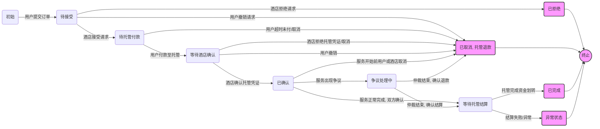

<!-- translation-review: full; scope: entire original source; method: manual-source-comparison -->
> 日本語参考訳（原文全文照合・校閲済み）。規範となるのは原文です。コード例・識別子・規範キーワードは原文を保持しています。
> 原文: [chinese/过程文档/智能体点对点交易方案设计/OpenAI-智能体点对点交易流程&协议设计 copy.md](../../../../chinese/过程文档/智能体点对点交易方案设计/OpenAI-智能体点对点交易流程&协议设计 copy.md) / 基準コミット: `0837cfdfaf4ddcf834f0890ddaf34fc4c824e066`

提示された ANP ベースのエージェント取引案を、開発向けの Markdown 文書にまとめる。要件、フロー、技術案、特にクレデンシャルと安全性を構造化し、製品と技術の両面から、チームの開発協働に使えるものにする。
完成したら、すぐに確認用に送る。

# ANP に基づくエージェント取引方式の開発文書

## 背景と目標

AI エージェントと分散型アイデンティティの発展により、異なる主体間のオンライン取引に新しい形が生まれている。この案は**信頼と統合の問題**を解き、異なるプラットフォームの利用者と提供者が、中央の仲介なしに直接、安全に取引することを目指す。

- **課題**：ホテル予約などは、認証、注文、決済を中央プラットフォームに依存する。形式が異なりデータの孤島があるため、AI は人の操作を模倣しがちで、標準インターフェイスがない。利用者がデータと信頼を預けることにも、プライバシー・安全性の問題がある。
- **構想**：公開の *Agent Network Protocol（ANP）* と DID で、「エージェント時代の HTTP」に相当する汎用取引網を作る。ANP は接続方法を定義し、開かれ、安全で効率的な協働網を目指す。異なる組織・個人のエージェントが**安全かつ自律的に相手を発見・接続し、取引する**。孤島をなくし、Web 操作をまねずに、ネイティブな API で通信する。
- **採用理由**：ANP の分散型 P2P で暗号化通信し、**DID の交換と検証で信頼を確立**してから交換方式を交渉する。個人とホテルのエージェントが第三者なしに直接認証・通信し、利用者の認可だけで予約・支払いを自動実行できる。**W3C DID** の自己主権型の身元と**検証可能クレデンシャル（VC）**を使えば、中央機関なしでも証明に基づく信頼を作り、安全性とプライバシーを改善できる。

**目標**は、安全と信頼を確保した汎用フローである。ホテルなら、詳細を交渉し、クレデンシャルを交換し、決済する。標準化によってチケットやレンタカーにも拡張し、プラットフォームに依存しない自律的な協働網にする。

## 中核概念と構成要素

次の概念を理解する必要がある。

- **Agent**：参加者を代表する自律的なソフトウェア。旅行助手などの個人用や、予約担当などの企業用があり、方針や AI の判断によって他者と通信して仕事を行う。
- **ANP**：エージェントのインターネット時代の HTTP を目指す公開プロトコル。発見、接続、メッセージ交換の標準によって、任意のエージェントを暗号化した P2P でつなぐ。認証・暗号化層、メタプロトコル交渉層などを含み、異なる実装を相互認識・対話させ、安全な取引交渉を可能にする。
- **DID**：W3C のグローバルに一意な分散型識別子。人、組織、機器などを中央登録機関なしで表す。解決可能な文書に公開鍵などを含む。本案では各参加者とエージェントが DID で認証・署名し、中央 IdP なしに相手を検証する。
- **VC**：主体についての一連の主張を表し、証明する W3C 標準のデジタル形式。紙や電子証明書の**暗号学的に安全なデジタル版**で、必要な相手へ提示する。発行者の署名を DID の公開鍵で検証し、改変がなく正しい発行元か確認できる。身分証、学位、**予約確認クレデンシャル**などが例である。
- **Data Integrity Proof**：VC の真正性を保証する署名形式。W3C の仕様は署名や関連する数学的証明で真正性と完全性を保つ。本案では署名値、検証方法、公開鍵への参照などを含む `proof` をデータ内に埋め込む。検証者が DID 文書から鍵を得て、未改変で信頼する発行者のものか確かめる。
- **状態機械**：注文・取引の有限状態モデル。作成から完了まで、「受付待ち→確認済み→完了」などをたどる。各状態と許されるイベントを定め、処理を起動し、重要な確認をクレデンシャルで記録する。

これらを組み合わせ、ANP で通信し、DID で認証し、VC と署名で信頼できる情報を交換し、状態機械で進行を管理する。

## 役割と責任

各当事者のエージェントが対話する。主な役割は次のとおり。

- **利用者（買い手）と利用者エージェント**：ホテルを探し、注文し、応答を扱い、支払い、予約クレデンシャルを保管する。利用者 DID による認証、必要な身元証明の提示、支払いなどの重要操作に対する利用者の認可要求も担う。
- **ホテル（売り手）とホテルエージェント**：部屋・料金を公開し、空室に応じて注文を受諾・拒否する。受諾時は部屋を確保し、支払要求や予約確認を送り、支払証明を受けて**予約確認 VC**を発行し、サービスを提供する。ホテル DID で署名・認証し、必要なら身元・保証クレデンシャルや担当者の審査を求める。
- **第三者サービス**：実装により、次を使う。
  - **DID 提供・解決**：DNS/Web などの基盤で登録・解決し、公開鍵とエンドポイントを取得する。did\:wba などの Web 型メソッドなら既存基盤を使える。
  - **Escrow Service**：中立的な第三者が一時的に資金を預かる。利用者はホテルへ直接払わず、利用確認後にホテルへ移す。問題があれば仲裁結果に従って処理し、入金後に**資金預託 VC**を発行する。独立した Agent として両者と対話できる。
  - **Arbitrator**：違反などの紛争時、プラットフォームや共同体が定めたエージェント・サービスが証拠に基づき判断する。平常時は参加せず、異常時の備えとする。

中心は利用者とホテルであり、大半を直接対話で実行する。決済ゲートウェイや仲裁は必要なときだけ補助として加える。

## 業務フロー：ホテル予約

直接対話し、重要な段階でクレデンシャルと状態を更新する、**理想的な全体フロー**を示す。

1. **発見と見積り（任意）**：目的地による探索や既知の DID・住所から、ANP でホテルを探して部屋と料金を得る。接続時には相互 DID 検証と安全な通信路を確立する。
2. **予約要求**：利用者の選択後、部屋、日付、DID などを送る。秘密鍵の署名か合意済みセッショントークンで発信元と未改変を示す。**Pending（受付待ち）**になる。
3. **ホテルの受諾と確保**：空室と、任意で会員・信用証明などを確認する。仮に確保し、詳細、総額、支払期限を含む**予約の申出**を署名または DID 認証付きで返す。高額な長期宿泊などでは `humanAuthorization` により**人の認可**を求め、担当者の承認後に送る。拒否なら異常フローへ進む。受諾後は**支払待ち**になる。
4. **預託サービスへの支払い**：申出を読み、利用者に指定先への支払いを確認する。同意後、銀行 API などで支払う。預託サービスが**資金預託 VC**を発行し、利用者エージェントが**預託証明メッセージ**に添えてホテルへ送る。**ホテル確認待ち**になる。
5. **ホテルの予約確認**：署名、発行者、金額などを検証し、正しければ予約を確定して**予約確認 VC**を発行する。詳細を署名し、ANP で送り、**Confirmed（確認済み）**へ更新する。
6. **サービス提供と確認**：利用者側が署名と内容を検証し、**デジタル証明保管庫**へ保存する。チェックイン時に提示し、ホテルが検証して提供する。チェックアウトなどの完了時、双方、または合意に従いホテル単独で、**サービス完了確認メッセージ・VC**を預託先へ送る。
7. **決済**：預託先が確認を検証し、ホテルへ資金を解放する。双方へ**取引完了 VC**を発行して送金を記録してもよい。**Completed（完了）**となる。

利用者の注文→ホテルの受諾→預託入金→予約確認→サービス提供→完了確認→資金解放、という流れだ。申出、預託、予約確認、サービス完了、取引完了の各クレデンシャルが、段階ごとの信頼と資金の安全を支える。

その後にホテルが**請求書 VC**を発行するなどの拡張もできるが、今回は中核の対象外である。

## 異常フロー

現実の例外に対応し、堅牢性を保つ。

- **利用者の取消**：受付待ちでホテルが未確認なら、取消通知を送り、ホテルが処理を止めて部屋を解放し、**取消済み**にする。ホテル確認前には支払うべきでないが、誤入金したなら元の経路で返金する。
- **ホテルの拒否**：満室などの理由を返し、**拒否済み**にする。利用者へ失敗と理由・別案を知らせ、仮の証明を無効にする。取引は終わり、決済はない。
- **支払期限切れ**：受諾後に期限を超えたらタイマーで注文を閉じ、通知し、未払いによる**取消済み**にする。部屋を解放し、遅れた支払いは拒否して再注文を求めてもよい。
- **ホテルの確認の時間切れ・無応答**：入金後の無応答には再通信し、失敗なら仲裁か自動返金を求める。オンチェーン支払いでホテルが証明を発行しないなら、スマートコントラクトで期限後に戻せる。自動機構がなければ支払証明でプラットフォームや仲裁へ依頼する。
- **支払失敗・誤り**：残高不足やネットワーク障害なら通知し、**支払待ち**を保つ。再試行か取消を選ぶ。金額が違えば検証で未完了と判定し、不足分か取消・返金を求める。
- **ホテルの一方的取消**：故障などで提供不能なら直ちに通知し、**取消済み**にする。理由と返金・補償条件を含む**取消声明 VC**などを出す。利用者側が署名を確かめ、返金を実行し、将来の請求に備えて結果を保存する。
- **検証失敗**：署名無効・内容不一致なら異常として停止する。支払 VC の署名が無効ならホテルは確認を拒否し、再送か人の確認を求める。ホテル DID と予約 VC の署名が合わなければ、利用者は拒否し再発行を求める。厳密な検証で中間者改変を防ぐ。
- **通信断**：停止・障害時は一定時間後に再試行か終了する。ANP 層に再試行・切替を実装できる。支払い後などの重要段階では、復旧後まず注文状態を同期する。復旧しなければ時間切れとして扱う。
- **紛争**：入金や宿泊の事実に争いがあれば、保存した**証拠クレデンシャル**を出す。利用者は支払証明と予約 VC、ホテルはログやチェーン記録を示す。仲裁が署名、時刻、改変できない記録を確認し、業界団体やコントラクトなどの事前規則で帰責を判断する。

異常分岐で**整合性と資金の安全**を確保する。多くは取消・拒否という終了状態へ進み、必要に応じ返金・通知などで補償する。重要操作は証明かログを保存し、追跡と仲裁に備える。人の介入がなくても規則で大半を扱い、信頼性を高められる。

## クレデンシャルと安全設計

**クレデンシャル体系**を中核に、**W3C VC** と**データ完全性署名**を採用する。構造、検証、理由を示す。

- **標準**：VC データモデルと **Data Integrity Proof** を使う。発行者・保有者・検証者の 3 者と拡張可能な形式によって、**改変に強く異なる主体でも検証可能**にする。独自方式より相互運用しやすく、共同体で検証された安全策を使える。
- **種類**：
  - **BookingConfirmationCredential**：ホテルが、特定利用者の予約を示す。予約 ID、ホテル、部屋、日付、利用者 DID などを含み、型を `["VerifiableCredential", "BookingConfirmation"]` とできる。
  - **PaymentReceiptCredential（任意）**：決済サービスや利用者が、金額、時刻、受取人などを証明し、ホテルへ渡す。
  - 取消や宿泊完了も定義できる。`@context` に意味の拡張を宣言し、正しく解釈できるようにする。
- **予約確認の JSON 例**：

```json
{
  "@context": [
    "https://www.w3.org/ns/credentials/v2",
    "https://example.com/booking-context-v1.json"
  ],
  "id": "urn:uuid:123e4567-e89b-12d3-a456-426614174001",
  "type": ["VerifiableCredential", "BookingConfirmation"],
  "issuer": "did:wba:hotel.com:abc123",        // 酒店代理的DID
  "issuanceDate": "2025-05-02T16:45:00Z",
  "credentialSubject": {
    "id": "did:wba:user.com:xyz789",          // 用户的DID
    "reservation": {
      "hotelName": "示例酒店",
      "roomType": "豪华大床房",
      "checkIn": "2025-06-01",
      "checkOut": "2025-06-05",
      "reservationId": "ABC-20250601-0001"
    }
  },
  "proof": {
    "type": "DataIntegrityProof",
    "proofPurpose": "assertionMethod",
    "verificationMethod": "did:wba:hotel.com:abc123#key1",
    "created": "2025-05-02T16:45:00Z",
    "proofValue": "zK3F...Mg=="  // 酒店使用私钥对前面数据签名得到的值（经BASE64等编码）
  }
}
```

コード内の中国語の補足：ホテル代理の DID、利用者の DID、例示ホテル、豪華なダブルルーム。proofValue のコメントは「ホテルが上のデータへ秘密鍵で署名して得た値（BASE64 などで符号化）」を意味する。これらは原例の表示値・コメントであり、コードは変更していない。

`proof` は、種類、用途（assertionMethod は主張の表明）、公開鍵への参照（通常は DID 文書内の `#key1` など）、時刻、署名値を含む。`proof` 以外を所定の方法で直列化・ハッシュ化し、秘密鍵で署名して `proofValue` を得る。

- **署名検証**：
  1. `issuer` の DID（`did:wba:hotel.com:abc123` など）を解決し、公開鍵を含む文書を得る。
  2. `proof.verificationMethod` の識別子（`...#key1` など）で該当する鍵を探す。
  3. `proof` 以外の本文を JSON Canonicalization などで正規化し、順序・形式をそろえてハッシュ化する。
  4. 鍵で `proof.proofValue` を検証し、`proof.proofPurpose` が期待する `assertionMethod` か、`proof.created` が信頼できる範囲かも確認する。
  5. 成功なら発行後未改変で、主張する発行者の署名だと分かる。失敗なら受け付けない。

発行者が今オンラインかどうかにかかわらず、DID 文書があれば検証できる。中央 CA やオンライン照会を避け、信頼性を高める。

- **Data Integrity Proof を選ぶ理由**：VC には埋込型（Linked Data Proof ともいう）と JWT による簡潔な証明という主要な選択肢があり、前者を選ぶ。
  - **分散型の信頼**：DID の鍵で直接検証し、JWT 発行機関の中央検証に依存しない。DID と鍵の結び付きだけを信頼する**主体間の自律的な信頼**に向く。
  - **意味の拡張**：JSON-LD で独自フィールドを明確に定義できる。固定クレーム中心の JWT より、複雑な構造を柔軟に表せる。
  - **安全と完全性**：原データを正規化して署名範囲を明確にし、文脈を含む欠落を防ぐ。BBS+ など特定の暗号スイートによる選択的開示でプライバシーも高められる。
  - **共同体の支援**：W3C が VC Data Integrity 1.0 を進め、Ed25519、ECDSA などの成熟したスイートと、道具・更新の支援がある。

**標準化、安全性、検証可能性**を原則とし、注文確認・支払いなどの重要データを証明し、紛争解決と監査を支える。

## 状態機械とフロー図

預託を含む注文の有限状態機械を示す。



図の日本語対応（ノード ID と原図は保持）：

- A：初期。B：受付待ち。C：預託支払待ち。D：ホテル確認待ち。E：確認済み。
- F：預託決済待ち。G：拒否済み。H：取消済み、必要なら預託先に返金を通知。I：紛争処理中。J：完了。K：異常。Z：終了。
- A→B：利用者が注文。B→C：ホテルが受諾。B→G：ホテルが拒否。B→H：利用者が撤回。
- C→D：利用者が預託入金。C→H：支払期限切れ・取消。
- D→E：ホテルが預託証明を確認。D→H：ホテルが証明を拒否・取消、または利用者が撤回。
- E→F：サービスが正常終了し双方が確認。E→H：開始前に利用者・ホテルが取消。E→I：紛争。
- F→J：預託先が送金を完了。F→K：決済失敗・異常。
- I→F：仲裁で決済を認める。I→H：仲裁で返金を認める。
- G、H、J、K→Z：終了。

**状態の説明**：

- **初期**：注文は未作成。
- **Pending**：要求を受けたが未回答。
- **AwaitingEscrowPayment**：受諾し、預託先への入金待ち。
- **AwaitingHotelConfirmation**：入金済みで、証明検証とホテル確認待ち。
- **Confirmed**：確認済み、資金は預託中でサービス待ち。
- **AwaitingEscrowSettlement**：提供と確認が済み、ホテルへの送金待ち。
- **DisputeInProgress**：提供に争いがあり、決済停止を通知し仲裁待ち。
- **Rejected**：ホテルが拒否し、終了。
- **Cancelled**：各段階で取り消し、必要なら預託先で返金して終了。
- **Completed**：サービスと決済が完了し、正常終了。
- **ErrorState**：決済失敗など自動処理できない問題で、人の介入が必要。

重要な変化ごとに証明を生成・交換し、明確で制御できる業務、例外処理、資金の安全を支える。

## 技術選定の提案

署名、形式、チェーン記録などを選ぶ際の指針を示す。

- **署名アルゴリズム**：**Ed25519** を推奨する。高速で安全な EdDSA で、W3C の候補にも含まれる。*Data Integrity EdDSA Cryptosuite v1.0* を使い、短い鍵と低い検証負荷で携帯・高負荷に適する。互換性のため ECDSA（secp256k1、P-256）も考えられるが、正しく実装する。全参加者で統一する。
- **文脈管理**：`booking-context-v1.json` のように**版を固定**し、reservation などを信頼できる URL で定義する。ハッシュ検査やローカルキャッシュで動的取得の不確実性を防ぐ。VC の JSON Schema で構造を制約し、JSON-LD 解析なしで正しさを保つ案もある。意味の一致と改変・版差による混乱の防止が目的だ。
- **交換形式**：**JSON** に統一し、意味が必要な VC 部分には JSON-LD を埋める。多くの言語で処理しやすい。呼出には JSON-RPC 2.0 を使える。高効率の部分では CBOR（バイナリ JSON）や Protobuf も考えるが、互換性と比べる。安全を保ち、慣れた成熟形式で複雑さを減らす。
- **信頼できる時刻・証拠保全（任意）**：重要 VC のハッシュを TSA に送り時刻を証明するか、安全な追記専用ログに置く。特定時点の存在と完全性を、特定の分散台帳に依存せず示せる。
- **暗号方式の変更容易性**：既存 VC・取引を壊さず、ハッシュや署名を更新できるようにする。VC のアルゴリズム宣言で新スイートを追加し、固定実装を避ける。
- **疎結合**：認証、VC、業務、決済・預託を独立した部品に分け、標準メッセージや証明で接続する。DID や預託先の交換で全体の業務を変えず、保守・更新しやすくする。
- **DID メソッド**：例は `did\:wba`（Web Based Agent）で、DNS などの既存基盤を使う。`did\:web` や、Ethereum に文書ハッシュを保存する `did\:ethr` も候補だ。双方が対応し性能を満たす必要がある。企業ホテルには公式ドメインに結び付く did\:web/did\:wba、個人には所属プラットフォームや公開網が実用的だ。
- **証拠とログ**：チェーン以外に原本と対話も保存する。双方の**監査ログ**へ送受信の要約、重要な状態変更時刻、VC ID を記し、調査や紛争に備える。追記専用にし、安全な保管先へ定期保存して改変を防げる。
- **性能と拡張**：監査・最適化済みの暗号ライブラリ、特によく使う DID のキャッシュ、軽い並行処理やキューによる状態管理を使う。高精細画像など不要な大きい項目を VC に入れず、転送を速くする。

**標準への適合と実用性**の均衡を取る。成熟した暗号・形式、チェーン上の信頼機構、性能、実装の簡素さで、安全で信頼できる開発を支える。

## セキュリティ上の考慮

分散取引では特に重要である。

- **鍵管理**：秘密鍵を漏らさず、**安全なハードウェアや暗号モジュール**（携帯の安全素子、HSM）へ保管し、平文でメモリへ出さない。定期更新し、新公開鍵を DID 文書へ出して旧鍵を無効にする。個人にはニーモニックや複数機器の同期で紛失を防ぎ、ホテルでは安全領域に置いて署名操作だけに使わせる。原則は**露出の最小化と秘密保持**で、エクスポートやログ出力をしない。
- **認証と認可**：初回に相互確認する。利用者は公式ドメインと DID、SSL 証明書などでホテルのなりすましを防ぎ、ホテルは DID 署名のチャレンジで利用者を確かめる。後続は一時トークンで署名の反復負荷を避ける。認証に加えて**操作の認可**も必要で、機微情報や高額支払いには人の明示的な同意を得る。引落し前に生体認証・手動確認で humanAuthorization の認可署名を得るなどして、不正侵入や誤動作でも勝手に不可逆の操作をさせない。
- **通信**：すべて暗号化する。**TLS 1.3+** の HTTPS と証明書チェーンの厳密な検証を推奨し、HTTP の ANP なら再利用できる。中継・P2P では公開鍵・秘密鍵による**エンドツーエンド暗号化**をアプリ層で行う。DID の鍵で対称セッション鍵を合意する。**時刻と Nonce** を必ず確認し、一定期間の既知 Nonce を保存して重複を拒否し、大きく古い時刻も拒む。**機密性、完全性、リプレイ耐性**を確保する。
- **時間切れと再試行**：支払確認や応答待ちに**期限**を置き、資源の占有や引延ばしを防ぐ。時間切れなら取消・返金・通知を自動起動する。タイマーやスケジューラーで状態の滞在を監視し、一時障害には**有限回**再試行する。無応答へ無限に繰り返さず、時間切れの結果を相手にも伝えて遅れた操作による不整合を防ぐ。
- **紛争解決**：入金を預かり、完了後に解放し、争いは指定仲裁者が配分を決める**仲裁スマートコントラクト**を導入できる。チェーンを使わないなら少なくとも証拠を仲裁先へ出す手順を定める。相手を知らなくても検証可能な連鎖で判断できることが大切だ。**評判**に履行記録を残し、繰り返し敗訴する者の点数を下げれば、悪意ある紛争を抑えられる。
- **最小権限**：予約と支払いに必要な情報だけを提供し、不要な私生活の情報を漏らさない。場面ごとに複数 DID を使える。ホテルは予約用だけを公開し、機微な管理 API を開かない。部品ごとに権限を分け、侵害の波及を防ぐ。
- **ログと監視**：認証・署名失敗や重複を記録し、重大事象を運用へ知らせる。入口の IDS/IPS で異常な通信を検出し、検証失敗の統計で偽造の試みを見つける。関連取引の停止、影響者への通知と証明の更新など、緊急措置で損失を抑える。

認証、通信、フロー、監査まで一貫して安全を設計する。DID/VC の暗号学的保証に方針と実装対策を重ね、事前の信頼なしでも連鎖を作る**ゼロトラスト構成**で取引を可能にする。

## 設計原則と拡張性

堅牢性と長期の進化を支える原則を採り、部品化で用途を広げる。

**設計原則**：

- **分散**：単一の中央主体に依存せず DID/VC で認証・検証する。単一障害や独占を避け、自律性と SSI を実現する。
- **標準的な相互運用**：W3C の DID、VC、JSON-LD、OAuth2 などで、異なる実装・機関を接続する。同じ仕様なら Java の利用者と Python のホテルも通信でき、統合費用が減る。
- **安全優先**：成熟した暗号と、厳密な検証・認可で MITM やリプレイを防ぐ。重要データに署名・ハッシュを付け、**未改変、検証、追跡**を確保し、余分な個人情報を集めない。
- **利用者の制御と体験**：自動取引でも最終決定権は人にある。知る権利と consent を尊重し、透明な記録と監査可能な VC を示す。重要時に参加するか方針を事前設定し、ブラックボックス化を避ける。面倒な手順を自動化し、会話のような取引にする。
- **疎結合**：認証、VC、業務、決済などを分け、明確な標準接続で独立に進化させる。DID メソッドやチェーンを交換しても業務へ影響させず、保守と更新を柔軟にする。
- **弾力性と障害耐性**：状態、期限、再試行で異常へ滑らかに移り、停止や行き詰まりを防ぐ。複数のログやチェーン記録で復旧し、エージェントの水平配置と疎な接続で規模を拡大する。

**拡張性**：

VC の柔軟性と原則により、次の場面へ広げられる。

- **チケット**：観客と主催者のエージェントで、注文→座席確認・支払待ち→支払い→**電子チケット VC**の発行と進める。公演、座席、QR を署名し、入場時に署名と未使用状態を検証する。「使用済み」を加えればよく、ホテルとの違いは項目と役割である。
- **レンタカー**：車種と期間の注文→空車確認と契約・支払待ち→保証金・料金→**レンタカー確認 VC**（電子契約）となる。車、期間、責任条項を会社が署名する。受取時には免許 VC、返却後には点検、**返却証明 VC**、保証金返還を追加できる。使用中・返却済みという状態と契約・返却の種類を増やす。
- **商取引**：商品を直接売買し、VC を**電子請求書や保証書**にできる。物流エージェントが加わり、受取証明を含めても同じ構成を使える。
- **多者協働**：旅行セットでは航空、ホテル、観光チケットへ並行して見積りを取り、利用者へまとめる。同意後に各々を確保・支払い、確認をまとめた**旅程組合せ VC**を保存する。各取引は固有の状態機械を保ち、利用者エージェントが orchestrator として調整する。
- **他の身元体系**：政府の身分証や信用評価も VC で導入できる。ホテルが年齢・氏名を示す政府の**身元 VC**を求め、予約時に添付し、署名と真正性を確認して信頼する例がある。

新需要の大半は、**VC の種類と状態機械を追加・調整**して扱え、全構成を作り直さずに済む。分散性と標準化により、多様化する業界のエージェントも**同じ方法**で協働できる。**開いた設計と段階的な拡張**を原則に、安全・安定した中核を守りながら新技術と需要へ適応する。一度の設計を長く進化させ、幅広い場面で使う。

**結び**：ANP の取引案は、自律的な協働の 1 つの設計図である。背景、概念、フロー、安全性を通じ、標準と実践の両方を重視して実装を案内した。理論と実用の提案を基に、次世代の安全で効率的な取引アプリを構築してほしい。
