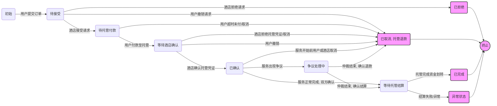

> 日本語参考訳（機械翻訳・未校閲）。規範となるのは原文です。コード例・識別子・規範キーワードは原文を保持しています。
> 原文: [chinese/过程文档/智能体点对点交易方案设计/OpenAI-智能体点对点交易流程&协议设计 copy.md](../../../../chinese/过程文档/智能体点对点交易方案设计/OpenAI-智能体点对点交易流程&协议设计 copy.md) / 基準コミット: `0837cfdfaf4ddcf834f0890ddaf34fc4c824e066`

つまり、AMP に基づいて提供したスマートボディトレードプログラムを、ニーズステートメント、プロセスの説明、技術的なオプション(特にバウチャー、セキュリティコンポーネント)の面で構成されている開発指向のMarkdownフォーマット文書に整理し、アカウント製品や技術に関する観点からチーム開発コラボレーションに適用します。
準備完了したらすぐにあなたに送ってください。

# AMPプロトコルに基づくスマートボディ取引スキームのドキュメント開発

## プロジェクトの背景と目的

人工知能エージェント(知能、エージェント)と非集中型アイデンティティ技術の開発に伴い、新たなパラダイムはクロスサブジェクトオンライン取引のために誕生しています。**信頼と統合の問題**これにより、さまざまなプラットフォームのユーザーとサービスプロバイダが、集中的な仲介を必要としずに直接かつ安全に取引を完了することができます。

* **問題です。**従来のホテル予約などの取引は通常、識別、注文処理および決済のための集中プラットフォームに依存しています。異なるプラットフォームインターフェイスは、データが多岐に渡り分離され、AI自動エージェントは、多くの場合、人間の操作をシミュレートし、標準化されたインタフェースを欠く必要があります。さらに、ユーザーは、プライバシーとセキュリティ上のリスクを持つ、プラットフォームにデータを送信し、信頼しなければなりません。
* **計画ビジョン**: オープンソース *エージェントネットワークプロトコル(ANP)* ANPのビジョンは、スマートがオープンで安全で効率的なコラボレーションネットワークをやりとりし構築する方法を定義することです。このプログラムを通して、さまざまな組織/個人が自分のインテリジェンスシステムを使うことができます。**相互に見つけ、安全に取引をし、自律的に入力する**. これは、プラットフォームの島を破壊し、AIインテリジェンスがマニュアルウェブページ操作をシミュレートするのではなく、生APIと通信できるようにします。
* **なぜ ANP とスマートを使用するのか**AMPは、インテリジェントな身体と直接暗号化された通信を作成する、集中型P2P構造を使用しています。**DID ID の交換と検証による自信構築**これは、ユーザーの個人エージェントとホテルサービス担当者が第三者に依存するのではなく、お互いのアイデンティティを直接通信し、検証することができることを意味します。スマートユーザーは、権限で取引を完了することができ、自動化と効率性を高めるために、独立して予約、支払いなどを実行できます。**W3C のディッド**自己の無関係なアイデンティティおよび*\*検証可能な証明書(VC)\*\*提供される証拠は、当事者が中央機関なしでセキュリティとプライバシーを信頼し、促進することができることを示しています。

**プログラムの目的**プロジェクトの標準化されたプロトコルやバウチャーデザインによってスケーラブルで、チケット、レンタカーなど複数のシナリオに拡張でき、非関連性、自律的およびコラボレーションプラットフォームのネットワークを実現します。

## コアコンセプトとコンポーネント

プログラムを理解するためには、以下のコアコンセプトとコンポーネントは理解する必要があります。

* **スマート(エージェント)**スマートボディは、個人ユーザー(例:トラベルアシスタントAI)またはビジネスサービス(ホテル予約エージェントなど)のエージェントにアシスタントとして使用できます。 プリセット戦略やAI意思決定に応じて、自動的に他のインテリジェントなボディと通信し、タスクを実行できます。
* **ANPプロトコル**：*エージェントネットワークプロトコル*ANPには、アイデンティティと暗号化レイヤー、メタ合意協議レベルなどが含まれています。AMPはエージェントが各々に識別し、やり取りし、安全に取引を交渉することができます。
* **DID(Drivalization ID)**W3C が定義する新しいグローバル・ユニークな識別子は、中央レジストリに依存することなく、任意の主題(個人、組織、機器など)を識別するために使用されます。各 DID は、DID を制御するための公開鍵などのメタデータを含む非対称の DID ファイルに対応します。このプログラムでは、各スマート・ボディおよび参加者は、本人確認と署名目的のために独自の DID を持っています。DID を通じて、インテリジェンス・ボディは、集中認証プロバイダを使用していない他の人の ID を検証し、真偽りの認証を達成することができます。
* **検証可能な証明書(VC)**: W3C規格で定義されたデジタルバウチャーフォーマット。対象のステートメントのグループを表現し、プロファイリングします。VCは紙または電子です。**暗号化セキュリティデジタル版**VCには、発行者の署名が含まれているため、発行者のDID公開鍵を通した認証役員に署名して、証明書が変更されず発行されるようにすることができます。**確認書の発行**待たせます。
* **データ整合性証拠**: VC内のデジタル署名証明書の形式は、データの信頼性を保証します。 W3C*認証された証明書データの完全性*式は、暗号化技術(デジタル署名と関連する数学証明書)が文書の信頼性と完全性を確保するために使用されるメカニズムを記述します。このプログラムは、データ情報プルーフを使用して証明書に署名する、すなわちバウチャーデータ内の署名値、認証方法、公開鍵参照などを含む `proof` オブジェクト。認証者は、署名が変更されていないことを確認し、発行者は本当に信頼できることを確認するためにDID文書を通して公開鍵を取得します。
* **ステータスマシン**プロジェクトの実行は、ステータスマシンを経由して注文プロセスに従い、異なる状態の処理ロジックをトリガーし、重要な状態の確認を記録するためにバウチャーを使用します。

共に、これらの概念はプログラムの技術的基盤を形成します。インテリジェントな通信は、ANPプロトコルを介して互いに通信し、IDDによって取得され、信頼性のある文書はVCとデータ整合署名によって交換され、トランザクションプロセスはステータスマシンで管理されます。

## ロールと責任の定義

主要なプレーヤーとその職務は次のとおりです。

* **ユーザ(バイヤー)およびそのクライアントエージェント**ユーザーは、スマートボディが予約プロセスの実装を担当する注文書店です。例えば:ホテル情報を検索;注文のリクエストを開始;ホテルの応答を処理する;支払いを完了し、予約完了時に予約券を維持します。
* **ホテル商人(販売店)とそのホテル代理店**機能は次のとおりです。ホテルの種類と価格情報を公開し、クライアントの要求を受注し、予約を受け付けたり拒否したりします。そうなら、ホームをロックして支払いリクエストを発行したり、予約の確認をしたりできます。ユーザーの支払い証明書の受領時にコピーを発行したりします。**VC予約確認済み**ホテルのエージェントは、ホテルのIDを使用して証明書を署名し、ユーザー識別を確認するために、必要に応じてID/保証文書を提供し、手動で鍵ポイントで予約をチェックする必要があります(エージェントを通じてホテルのスタッフによって確認する必要がある場合)。
* **サードパーティサービス**: 実現に基づき、以下のような役割を担っている。

  * **DIDプロバイダ/サービス**: DID(DNS、その他のWebメカニズム)の登録および解像度インフラストラクチャは、パブリックキーとサービスのエンドポイントでDIDファイルを検索するためのインテリジェンスを提供します。 このプログラムは、既存のWebインフラストラクチャを使用してDID文書を公開するために、d\:wbaのようなWebベースのDIDメソッドを使用します。
  * **サードパーティの資金ホスティングサービス(Escrow Service)**消費に問題がある場合、ホスティングサービスは、仲裁に基づいて資金を処理する場合があります。 支払いが行われた後、ホスティングサービスは証明書を発行します。**VCファンドのカストディアン**. サービスは、スタンドアローンのエージェントとみなされ、ユーザーやホテルのエージェントと相互作用することができます。
  * **仲裁人**紛争における介入の役割。プラットフォームまたはコミュニティが指定した仲裁スマートボディまたはサービスであり、当事者間の紛争が生じた場合には(例えば、当事者のデフォルト)、仲裁人は、両方の関係者によって提出された文書と記録に基づいて賞をします。

プロセスの大部分は、二人の相手のスマートボディ間の直接通信によって完了することができます。

## 業務プロセス(サンプルホテル予約)

利用者から決済までのホテル予約の例をご紹介します。**完全な理想的なプロセス**. プロセスは、ユーザーがスマートボディを介してホテルの「知能」と直接やり取りし、クーポンを交換し、注文状況をキーステップで変更することを想定しています。

1. **発見し、要求して下さい。**(オプション): ユーザーは、AMP ネットワーク(目的地に基づくホテルエージェントを検索するか、エージェントにDID/アドレスを持つなど)を介してターゲットホテルのエージェントを見つけます。*(接続が確立されると、締約国は、DID 認証および安全なチャネルの確立を実施し、その後の通信が暗号化され、そのアイデンティティが信頼性が高いことを確認します。*
2. **予約リクエストの開始**: 利用者の代理人は選択のユーザー確認の後でホテルの代理店に送ります**予約リクエスト**ユーザーのエージェントは、ユーザーが要求したことを証明するために、自身のプライベートキー(または以前に交渉されたメッセージボード)を使用してリクエストを署名し、改ざんされていない。 **「受諾する」**。
3. **ホテルの受け入れとロック.**: 宿泊者様が客室の空室状況や利用者の信頼性(会員様、クレジットカード証明書等、利用者から提供された関連文書へのアクセス)を確認するために、ホテルエージェントがリクエストを受け取ります。ご予約が認められた場合は、ホテル担当者は一時部屋をロックし、生成します**宿泊予約**応答には予約の詳細、合計価格、支払い期間などが含まれます。ホテルの秘密鍵またはDID証明書を使用してホテルのエージェントによって署名されます。**マニュアルの承認**: 宿泊予約が主要なリクエスト(長期超過料金のスイートなど)の場合、ホテルに印を付けることができます。`humanAuthorization`マニュアル確認が必要です。*(当館が、家を含まない理由やその他に拒絶した場合、異常に飛び込む)*. 予約完了後の注文状況 **「支払われる性能」**(ホテルの受付、ご利用者様によるお支払い)
4. **ホストサービスへのユーザー決済**ユーザーは、ホテルおよびアラートユーザーから提供された情報を理解し、指定されたサードパーティの資金ホスティングサービスに支払うことができます。 ユーザー確認後、クライアントエージェントは支払いチャネル(銀行APIなど)を介してホスティングサービスにお金を支払う。**VCファンドのカストディアン**ユーザエージェントは、ホテルのエージェントに送金します。**証明書メッセージのホスティングファンド**VC を添付します。入力された注文 **「ホテルのチェックイン待ち」**。
5. **ホテルの確認。**: 利用者の代理人から受け取られるホテルの代理店**VCファンドのカストディアン**確認後、VCは認証(署名、発行者、金額など)されます。**VC 発行済予約確認**VCには予約内容が含まれており、ホテルの代理店に署名されています。 **「統合」**(信託・予約確認済み)
6. **サービスのパフォーマンスと認識**: 利用者の代理人はホテルの発注書のコピーを受け取りました**VC予約確認済み**、署名および内容を確認します。認証後、ユーザエージェントはVCをユーザーに格納します**デジタル文書ストレージ**. 本サービスが終了した(例、利用者のチェックアウト)、両当事者(または合意通りにホテルを一元的に)完了後、第三者基金ホスティングサービスに送信する。**サービス 完了 メッセージ/VC の確認**。
7. **資金の決済**第三者の資金提供サービスは、サービスが確認された後に認証されます。**取引完了のためのVC**両者に対して、資金の送金を記録します。 **完了した**。

主要な文書には、ホスティングサービス、ホテル予約確認VC、サービス確認VC、および受託サービスの完了券の支払いのためのホテルの予約、ファンド・ホスト証明書が含まれます。 これらの証明書は、チェーンと金融セキュリティの信頼性を保証します。

取引が完了すると、ホテルの代理店発行などのその後の手順が拡張できます。**請求書証明書 VC**しかし、これらはサービス実装またはフォローアップフェーズにあり、このトランザクションのコアプロセスの焦点内では存在しません。

## 異常処理プロセスの処理

練習では、目的のパスから逸脱する様々な異常があるかもしれません。

* **ユーザのキャンセルリクエスト**利用者の代理人は、キャンセル通知を送って、ホテルのエージェントは注文処理を停止し、家を解放します。 **クレジット**(利用者) ユーザーが支払った場合(ホテルの不確認の場合に支払うことができませんが、エラーが発生した場合も返金されます。
* **ホテルでは予約を拒否しました。**当館の取扱店は、客室内その他の理由により、ご要望に応じられない場合がございます。 **「注射」**. ユーザエージェントは、予約が失敗したユーザーに通知し、理由を提示したり、別のオプションを選択するためにユーザーを誘導することができます。任意の交換された一時的なバウチャーは無効です。このような場合、トランザクションは、その後の決済なしで終了します。
* **ユーザの過剰支払い**お客様が所定の期間内にお支払いを済ませなかった場合、ホテルでは、ご利用者の代理人にキャンセル通知を送信し、お客様ご自身が所定の期間内に決済を完了しなかった場合にお客様にお申し出ください。 **クレジット**ユーザーがその後に支払うことを試みた場合、ホテルは拒否し、新しい注文を要求するかもしれません。
* **ホテルの確定タイムアウト/応答なし**特定の時間後にホテルの確認(おそらくホテルのエージェントの崩壊またはネットワークの問題)を受信しない場合、ユーザエージェントは救済を開始する必要があります。 まず、あなたがホテルとの通信を再試行する必要がある場合、応答がない場合、仲裁または自動払い戻しを求めることができます:例えば、支払いがチェーンされ、ホテルは証明書を発行していない場合は、スマートコントラクトは、追加の期間後にユーザーに返されることがあります。
* **支払失敗または間違った**ユーザーが支払ステージ(例えば、不十分な残高、ネットワークエラーにつながる不必要な支払い)で失敗した場合、ユーザーは支払が失敗し、注文は「支払い」ままであることを通知します。 ユーザーは、注文を支払いまたはキャンセルする再試行することができます。 ユーザーがキャンセルすることを選択した場合、プロセスはユーザーによってキャンセルされます。 支払いが一致しない場合(ユーザーは誤った支払いを行います)、ホテルのエージェントは、証明書がユーザーに確認され、払い戻しが解除されるかどうかを確認し、返金する必要があります。
* **当館の片側は、一斉にキャンセルを致します。**少数の場合、当館は確認後(客室の不在等)の実行ができない場合がございます。 **クレジット**(ホテル)。コピーを発行することにより、利用者の補償措置を提供する必要があります。**VCをキャンセルする**手紙のコピーを受け取ると、ホテルの署名を確認し、返金プロセスを実行し、その後の回復のために取引結果を提出することができます。
* **証明書の検証失敗**当事者の1つが有効な(無効または矛盾しない)されていない他のパーティーから証明書を受け取る場合、それは異常な考慮され、プロセスを中断する必要があります。例えば、ホテルがユーザーから支払い証明書VCを受信した場合が、署名確認が失敗した場合は、ホテルは再発行または手動チェックを確認および要求することを拒否する必要があります。
* **中断されたコミュニケーション**通信がプロセス(知性障害、ネットワーク異常)に中断された場合、他の当事者のインテリジェンスボディは一定期間後にトランザクションを再試行または終了する必要があります。 APPレベルは、再テストとダウンタイム転送のためのいくつかのメカニズムを達成することができます。重要な段階(例えば、支払い後の確認を待っています)のために、両方のパーティーが一貫していることを確認するために、諜報機関は、最初の現在の注文ステータスを同期する必要があります。
* **紛争管理**: 取引中または取引後に起因する紛争(ユーザーが支払ったと主張するが、ホテルは拒否し、サービス提供を要求するが、利用者の居住を拒否する)場合には、当事者はそれぞれの預金を提出することができます**証拠の証拠**仲裁当事者は、事実に対する責任を属性するために、これらの証明書(チェーン上で変更することはできません)の署名と時刻スタンプを確認します。紛争は、取引協会やスマートコントラクトのための事前定義された賞論理などの事前承認仲裁規則に従って処理される場合があります。

上記異常分別により、様々な有害条件下で処理することができるシステムです。**取引と金融セキュリティの一貫性を確保**. 異常のほとんどは緊急(キャンセル/拒否)の状態にあり、補償行動(例えば払い戻し、通知)をトリガーします。すべての重要なアクションは、遡及的および仲裁目的のために文書化またはログアウトされるべきです。したがって、1つの介入がない場合であっても、スマートは自動的に取引の信頼性を高めるために規則の下でほとんどの異常を処理することができます。

## 証明書およびセキュリティ設計

**認証システム**このプログラムのセキュリティの核です。 それを使用します。 **W3C 検証可能な証明書(VC)** 規格と組み合わせ**データ整合性署名**証明書の背後にある設計、構造、認証方法およびセキュリティ検討の詳細説明は次のとおりです。

* **規格の使用**: プログラムのデジタルバウチャーは、W3CのVCデータモデル規格に従い、使用 **データ整合性証拠** VC規格は、発行者、ホルダー、認証者、バウチャーのフリーデータ形式を一元化し、**体全体に偏見と検証**民間フォーマットと比較して、この国際規格は、異なるシステム間の相互運用性を促進し、コミュニティテストの安全プログラムを使用します。
* **証明書のタイプ設計**: VC の種類と、ビジネスニーズに基づいてデータ構造を定義します。例えば:

  * *確認書の発行*Booking CorporationCredential:特定のユーザーが特定のホテルの部屋を予約したことを確認する、ホテルのエージェントによって発行されます。 これにより、単語IDの予約、ホテル情報、部屋および日付、ユーザーIDの段落が含まれており、`["VerifiableCredential", "BookingConfirmation"]`。
  * *支払証明書*(支払いレシートCredential):(オプション) 支払サービスまたはユーザーエージェントによって発行され、金額、時間、ペイなどの証明として使用するために。 支払いの証拠としてホテルへの送金のために。
  * その他の事業展開 *キャンセル証明書*、*チェイン認証証明書の完成証明書* . すべての文書は、`@context`, これは、認証者がフィールドの意味を正しく理解できるようにするために、文のセマティクスを拡大するために使用される.
* **バウチャー構造例**: 以下は、JSON構造の「確認書」の例です。

```json
{
  "@context": [
    "https://www.w3.org/ns/credentials/v2",
    "https://example.com/booking-context-v1.json"
  ],
  "id": "urn:uuid:123e4567-e89b-12d3-a456-426614174001",
  "type": ["VerifiableCredential", "BookingConfirmation"],
  "issuer": "did:wba:hotel.com:abc123",        // 酒店代理的DID
  "issuanceDate": "2025-05-02T16:45:00Z",
  "credentialSubject": {
    "id": "did:wba:user.com:xyz789",          // 用户的DID
    "reservation": {
      "hotelName": "示例酒店",
      "roomType": "豪华大床房",
      "checkIn": "2025-06-01",
      "checkOut": "2025-06-05",
      "reservationId": "ABC-20250601-0001"
    }
  },
  "proof": {
    "type": "DataIntegrityProof",
    "proofPurpose": "assertionMethod",
    "verificationMethod": "did:wba:hotel.com:abc123#key1",
    "created": "2025-05-02T16:45:00Z",
    "proofValue": "zK3F...Mg=="  // 酒店使用私钥对前面数据签名得到的值（经BASE64等编码）
  }
}
```

上記構造では、`proof`フィールド、すなわち、署名の種類を含むデータの整合性シグネチャ、使用(assertionメソッドは、これは宣言を確認するシグネチャであることを示します)、認証方法(署名のための公開鍵の場所を参照する、通常発行者のs DID文書の公開キー識別子、例えば。`#key1`署名の時と署名の価値。`proof`外部) 正規シーケンシングと橋の後、発行者の秘密鍵の署名が取得される`proofValue`。

* **認証方法の署名**: 認証役員による認証のプロセス(例えば、利用者はホテル予約VCまたはホテルが支払いVCをユーザから受け取る)は、一般的に以下のようにします。

  1. 証明書です。`issuer`発行者の DID を取得するフィールド`did:wba:hotel.com:abc123`.発行者の公開鍵を含むDIDファイルは、DID解像度機構により取得されます。
  2. 証明書から。`proof.verificationMethod`署名を取得するために使用される公開鍵(例:`...#key1`) 発行者の DID 文書に該当の公開鍵を探し、
  3. ルールにより、証明書を分割`proof`外部の主題は、(例えばJSONキャニケーション、フィールドの順序とフォーマットを保証する)および橋の計算を調節されます。
  4. 抽出された公開鍵ペアを使用する`proof.proofValue`デジタル署名検証を実行します。`proof.proofPurpose`意図した使用(例えば、読みるべき)に順守している`assertionMethod`(a) 発行者は、そのような宣言を発行する権利を有します。`proof.created`信頼できる範囲内の時間かどうか。
  5. 証明書は、発行と確かに割り当てられた発行者によって署名されたので文書の内容が変更されていないという声明です。 そうでなければ、証明書は拒否されます。

上記のメカニズムを通して、VCの認証は、発行者のDIDファイルを保持する限り、発行者がリアルタイムでオンラインであるか否かを独立して検証することができます。この分散された信頼機構により、従来の集中型CAやオンラインクエリを回避し、信頼性が向上します。

* **データの入力証拠を選択するための理由**W3C VC は、JWT に基づくコンパクトな認証である、上記に示すように、埋め込まれたデータ整合署名(リンクされたデータの証拠とも呼ばれる)の2つの主要なシグニチャプログラムを実際にサポートしています。このプログラムは、主に以下の考慮事項で使用されます。

  * *信頼を集中化するため。*データの証拠は、JWTの発行権を集中的に検証することなく、署名検証のためにDIDパブリックおよびプライベートキーシステムを使用します。 それは適切です。**インターサブジェクトの自律性と信頼**モデルは、参加者は他のサイドの「s DID」と公正なキー結合関係を信頼する必要があります。
  * *豊富なセマンティックエクステンション*: JSON-LD コンテキストを使用して、バウチャーは、よりシーンの拡大を容易にするために、セマントリズフィールドを含むことができます。 通常、JWT は固定文フィールドに基づいており、複雑な構造データを表現した JSON-LD よりも少ない柔軟性があります。
  * *セキュリティと完全性*: データの整合性は、署名がカバーするデータの範囲が明確で欠落しない(コンテキスト構文を含む)を確保するために、文書の元のデータを標準化し、再署名します。 また、選択的な開示などの高レベルの機能をサポートしています(BBS +シグネチャなど特定の暗号化パッケージを介して、VCの一部だけを開示すること)、およびプライバシー保護を強化します。
  * *コミュニティサポート*W3Cは、VC Data 1.0を新しい標準に移行し、Ed25519やEDDCSAなどの成熟したシグネチャパッケージです。このオプションは、幅広いツールと標準の更新によってサポートされています。

全体的に、バウチャーシステムがラインアップされています。**標準化、セキュリティ、検証可能**原則は、取引の過程で重要なデータ(注文確認、支払いなど)が信頼できる証拠によってサポートされています。これは、その後の紛争解決とコンプライアンス監査のための技術的な保護を提供します。

## ステータスマシンとフローチャート

第三者の資金導入後の注文ライフサイクルを可視化するために、当社は予約取引状況の変化を示すために限定統計機を使用します。



**ステータスステートメント**：

*   **初期化**: 注文は作成されていません。
*   **受付まで**: 宿泊から受けたリクエストは、まだ回答していません。
*   **エスクロー決済をお待ちしています**ホテルでは予約を受け付け、ホスティングサービスに支払うためにユーザーを待つ。
*   **ホテルにて確認待ち(AwaitingHotel Corporation)**ユーザーは、カストディアンの証明書の受託者、保留中のホテル認定および予約の確認に支払われます。
*   **確認済み**ホテルでは予約確認や資金が施設の待望のサービスに含まれています。
*   **ホスティング決済の待ち合わせ(待望のEscrowSettlement)**: サービスの完成と確認、ホスティングからホテルへの送金。
*   **紛争インプログレッシブ**: サービスのパフォーマンスに関する紛争において、ホスティングサービスは、決済が停止した仲裁を通知しました。
*   **注射液**宿泊予約のリクエストをお断りし、注文が終了いたしました。
*   **キャンセル**: 注文は異なる段階でキャンセルされ、払い戻しのコレクションには、ホスティングサービスへの通知が必要です。
*   **完了しました**: サービスの完了、資金の決済および注文は首尾よく閉まりました。
*   **エラーステート**: 自動的にアドレスが届かない異常(例:決済の失敗)は、手動介入が必要です。

上記のステータスは、取引プロセスの明確な定義と資金が保持された後に導入されたステータスの変更を設定します。各主要な変更には、バウチャーの生産または交換を伴う。この設計により、ビジネスプロセスのクリアな制御が可能になり、異常な処理と財務セキュリティを提供します。

## 技術的な選択の推奨事項

本プログラムを達成するために、技術的な詳細の選択が必要になります。以下の事項は、バウチャー、データフォーマット、チェーンレコードなどの署名の推奨事項です。

* **一時的なフォルダを閉じることができません: %s**: 採用におすすめ**でぶっかけ25519**楕円曲線のシグネチャアルゴリズム。 Ed25519 は EdDSA ファミリーに属し、W3C データ整合性候補の基準の一つにリストされている高速で安全な特性を持っています。具体的には、利用可能です。 *データ整合性 EdDSA Cryptosuite v1.0*, 署名し、Ed25519キーで証明書を検証. Ed25519鍵長が短く、シグネチャ認証コストは低く、モバイルデバイスや高いコンポーズシーンに適しています。必要に応じて、ECDSA(例えばsecp256k1またはP-256)、パッケージも考慮されるかもしれませんが、正しいことを確認するために注意が必要です。すべての参加者は、相互検証を促進するために一貫したシグネチャアルゴリズムを使用する必要があります。
* **コンテキスト管理**: VC は JSON-LD 文脈の構文を定義するので、ドキュメントが開発されることを推奨します。**コンテキストファイルのバージョンの修正**. 定義、例えば予約券 `booking-context-v1.json`、含まれている *宿泊予約* フレーズのイメージは、信頼できるURLに表示されます。 コンテキストが動的に読み込むという不確実性を避けるために、ハッシュ検証は、認証終了時に使用した文書またはローカルキャッシュ設定に追加することができます。 もう1つのアイデアは、W3C VC JSONモデルを採用して、特定のJSON Schemaにドキュメントをバインドすることであり、したがって、データ構造がJSON-LD解像度なしで正しいことを保証します。 どちらの方法でも、すべての重要なフィールドが一貫して解釈され、コンテキストが悪意のあるバージョンに変化するかどうかを確実にするために、その目的は、認証バージョンを変更します。
* **データ交換形式**: ANPプロトコル自体は、JSONなどの形式のメッセージの送信をサポートしています。 このオプションは、均一な採用をお勧めします**JSON フォーマット**インテリジェントなデータ交換のカバー形式として、JPON-LDセグメント(例:バウチャーセクション)に組み込まれています。対称的な説明が必要なのは簡単です。JSONは、ほとんどのプログラミング言語の元のソースによって解釈され、サポートされています。エージェントのインターフェイスでは、JSON-RPC 2.0は相互運用性を向上させるために使用できます。高効率サブシステムの中で、CBOR(ビルアルJSON)またはProtobufは、シーケンスされたデータに対して考慮されるかもしれませんが、互換性は私たちが重要視するでしょう。
* **残留時間スタンプと証明書(オプション)**重要な文書である、橋、(例:予約確認書、取引完了証明書)の不必要な文字を、独立した信頼できるタイムスタンプサービス(TSA)に提出することにより、安全かつ追加のログシステムに押印し、記録することができます。これは、特定の分散アカウント技術に依存することなく、紛争が生じた場合、所定の点で文書の存在と完全性を証明するのに役立ちます。
* **パスワードの敏捷性**: 既存の文書や取引に影響を与えずに、システム設計は、将来的にパスワードアルゴリズムの置き換え(例えば、橋関数、シグネチャアルゴリズムなど)を許すべきである。例えば、VCフォーマット自体は宣言で使用されるアルゴリズムをサポートし、将来の新しいアルゴリズムパッケージを追加することができる。ハードコーディング固有のアルゴリズムを避けなさい。
* **モジュラー式ラキシー**: トランザクションプロセス全体を自己進化するモジュール(識別、バウチャーサービス、ビジネスプロセス、決済/ホストインターフェイスなど)に分解します。 モジュールは、標準のニュースやバウチャーブリッジを使用して、モジュールを交換するなどの明確なインタフェースを介して相互作用し、全体的な画像には影響を与えません。 例えば、DIDメソッドは、コアビジネスロジックに影響を与えることなく、サービスプロバイダを交換またはホスティングすることができます。
* **DID メソッドを選択**: 適切な DID メソッドを選択して、集中された ID を取得します。例えば、このオプションは、たとえば `did\:wba`(WebベースのAgen) メソッドは、既存の DNS システムを使用して DID ファイルを公開します。 **投稿ナビゲーション**(DID ドキュメントをホスティングするドメイン名に基づく) **ド\:エサー**キーは、メソッドがパーティーでサポートし、パフォーマンス要件を満たしているべきであるということです。 企業ホテルでは、d\:web または do\:wba が実用的(公式のドメイン名を結合する)であり、個々のユーザーに対して、DID またはパブリック DID ネットワークはユーザベースのプラットフォーム上で提供することができます。
* **入金とログ**: チェーンレコード以外は、インタラクティブなログやオリジナルバウチャーをローカルに保持する必要があります。**監査ログ**, 各ステップで受信/リリースされた情報の要約を記録します。, 重要なステータスと関連するサポートIDの変更の時間. これは、デバッグや紛争解決に役立ちます.
* **性能と拡張**テクノロジーの選択は、アカウントのパフォーマンス拡張にもかかります。例えば、パスワードライブラリは監査最適化を選ぶべきです。DID解像度プロセスはキャッシュ(特に頻繁にインタラクティブオブジェクト)を作るために使用できます。また、高コンポジションリクエストの場合、ステート管理は軽量な並列構造による混雑を防ぐことができます。データフォーマットは不要な大きなフィールド伝送を最小限に抑えます(例:文書に高解像度画像を埋め込むことはありません)、インタラクションが迅速であることを確認します。

一般的には、技術選択のニーズ**標準的な承諾**とりあえず**工学実用的**この提案は、高度な暗号化アルゴリズムと標準フォーマットから移動する方法を提供し、チェーンの信頼性のあるメカニズムを完全に使用し、パフォーマンスとシンプルさに注意します。 安全で信頼性の高いスマートボディ取引システムを構築するためのチームを開発するのに役立ちます。

## セキュリティの考慮事項

安全は、集中型の取引プログラムにとって不可欠です。このプログラムは、以下のセキュリティ要素を念頭に置いて設計および実装する必要があります。

* **鍵管理**参加するパーティ(ユーザー、ホテル)のDIDキーは、漏れから保護されなければなりません。**セキュリティハードウェアまたは暗号化モジュール**メモリ内で明示的に利用できないことのないプライベートキー(例えば、携帯電話セキュリティコンポーネント、HSMモジュール)を保存します。長時間にわたって使用した定期的なキーの回転をサポートし、鍵の更新をサポートしたり、新しいパブリックキーをID文書にリリースしたり、古い公開鍵を廃止したり、長期開示の危険性を減らすことができます。ユーザーレベルでは、ハンドリテンバックアップまたは複数のデバイス同期DIDを使用して、非損失を確保することができます。 重要なサーバーにアクセスするには、鍵が格納されているか、一般的なサーバーの管理者が、鍵を制限する必要があります。**最小限の露出**とりあえず**機密性**、秘密鍵はいつでも輸出されず、記録される。
* **認証と認可**ユーザエージェントは、ターゲットホテルに接続されていることを確認する必要があります(例えば、他の人のDIDが公式ドメインにマッチするか、SSL証明書が信頼できるかをチェックして、フィッシングエージェントへの接続を防止するなど)。一方、ホテルエージェントは、ID署名によるクライアントのエージェントを認証するという課題で、その後のリクエスト認証のための会話の後、一時的なトークンを発行し、各回に署名料を繰り返すのを回避します。**オペレーション認証**スマート デフォルトは、部分的な操作を自分で実行できますが、機密情報や大きな支払いを伴う行為のために、明示的な認可は所有者から取得する必要があります。例えば、ユーザーエージェントが控除を実行し、ユーザーの生体認証または手動確認を注入し、権限のある署名(humanAuthorization)を取得して動作を続ける必要があります。このデュアル コントロールは、ユーザーが負っているか間違いを犯すことなく、回復不能な行動を行わないことを保証します。
* **通信セキュリティ**エージェント間の通信は暗号化されたチャネルによって送信され、ワイヤタッピングやミドルメンが攻撃から防ぎます。**テュルス 1.3+**AMPプロトコルはHTTPに基づいており、HTTPSセキュリティレイヤーを再確立するために直接使用できます。 AgentがメッセージやP2Pネットワークを介して通信する場合、アプリケーションレベルでそれぞれの公開鍵と秘密鍵を使用する必要があります **エンドツーエンド暗号化**. IDは、同等セッションを交渉し、その後の接続を暗号化するために使用できる、識別レベルのための公開鍵を提供します。再発攻撃のために、サービスは、添付されたすべてのリクエストをチェックする必要があります**タイムスタンプとランダム番号(以降)**サーバは、特定の期間内に見てきたノnceのリストを維持し、要求を繰り返すために受け入れるべきではありません。同時に、リクエストは、受信が遅れることを防ぐため、現在の時間枠から逸脱しないタイムスタンプのために作られる必要があります。**機密性、完全性および再発行**。
* **タイムアウトとリトリー**: 分散環境では、攻撃者による処理のリソースや遅延を継続的に使用するためにタイムアウト機構が必要である。設計は重要な待機リンクのためにあるべき**タイムアウト**処理を自動トリガーし、処理の実行(注文、払い戻しなど)を解除してユーザ/マネージャーに通知します。これは、ステータスマシンの長期滞在を監視するためにタイマーまたはタスクスケジュールを使用して行うことができます。可能な瞬時のネットワークエラーの場合、許可されます**限定リトリート**しかし、相手が長時間反応しなくなった場合、リソースの無駄を避けるために不明確な試みをしないでください。また、他の当事者が後で動作し続けているときに矛盾を引き起こすことではないため、タイムアウトの結果は、他のパーティーに通信する必要があります。
* **紛争解決メカニズム**: 上記のプロセスと文書は紛争の可能性を低下させるが、紛争解決手段を開発する必要があります。**仲裁スマート契約**紛争が生じた場合は、事前に選ばれた仲裁人は、お金が与えられたかを決定します。このメカニズムは、財政上の利益が確保されることを保証します。もし、不正行為のチェーンが使用されていない場合、少なくとも紛争の提出のためのプロセスは合意のレベルに確立されるべきです - 両当事者は仲裁代理人または仲裁人および判断で1人の介入を提出する。すべての文書は、仲裁人が他の仲裁人が、仲裁人によって断固有であることを知っている場合でも、その欠陥が、それらが各決定されたことを知っていることが重要である。**クレジットシステム**参加者の「S」のパフォーマンスの記録は、当事者が紛争で繰り返し、責任あると見なされた場合、信用格付けを削減し、信頼を促進し、悪意のある紛争を減らすことができます。
* **最小限の許可原則**Smarts は、トランザクションを完了するために必要な情報にアクセスし、承認を回避するだけです。たとえば、予約中に必要な文書(関連文書および支払い証明書)のみを提供し、ユーザーの他のプライバシーデータを開示しないでください。**多次元政策**ホテルのエージェントは、予約インターフェイスを露出し、それを開かないでください。 コードはレイヤーを達成し、モジュール特権を可能な限り分離し、コンポーネントが妥協され、全体像に影響を与えることを防ぐことができます。
* **ログと監視**IDS/IPSは、スマートWebポータルで異常なトラフィックパターンを検出するためにデプロイすることができます。また、証明書の故障の統計解析を提供し、誤った攻撃の試みがあるかどうかを判断することもできます。セキュリティインシデントが監視されると、対応する緊急手順(トランザクションの中断、交換券の患部ユーザーに通知など)が損失を最小限に抑えるために適用されます。

全体的に、セキュリティ設計は、同一の識別、通信、プロセス制御およびフォローアップ監査から、プログラムのすべてのレベルで実装されています。このプログラムは、DIDとVCが提供するパスワード保証の助けを借りて、十分に確立された戦略とエンジニアリング対策と共に達成することができます。**ゼロトラスト・アーキテクチャ**当事者の制御下にある信頼できる取引:事前の信頼なしに、彼らは安全に自信のチェーンを構築するために技術的な手段を介して締結することができます。

## 設計原則とスケーラビリティ

プログラムの設計では、システムが堅牢で進化することを確認する重要な原則をいくつか追っていました。同時に、プログラムのモジュール設計は、よりビジネスシナリオに拡大しやすくなっています。

**デザイン原則**：

* **中央へ。**システムは、その操作のために単一の中央のエンティティティティティティティティに依存せず、IDとデータの認証は分散機構(DDID+VC)によって行われます。これにより、単一ポイントの障害や単価を回避し、参加者により大きな自律性を与え、自己優先状態(SSI)の概念に沿っています。
* **標準化された相互運用性**: W3C(DD、VC、JSON-LD、OAuth2など)などの国際規格を用いて、異なる実現、異なるエージェンシーインテリジェンスが互いに理解されていることを確認します。標準化は統合コストを削減し、システムが利用できるようにします**クロスプラットフォームの接続**機能。例えば、Agent は Java を使用してユーザで、同じプロトコルに従う限り、Python によって開発された Agent と対話できます。
* **セキュリティ優先**: アーキテクチャと実績でセキュリティを第一に保つため、成熟した暗号化アルゴリズムとプロトコルを使用して、厳格な検証と認可プロセスの設計、既知の攻撃技術(MITM、再生など)に対する保護。すべての重要なデータは署名/橋保護され、達成される**偽物、検証可能およびレトロアクティブ**. ユーザーのプライバシーを重視し、冗長情報を収集または公開することも必要です。
* **ユーザー制御と経験**システムは、ユーザーの知識と理解を尊重し、透明なプロセスレコードと監査可能な文書を提供するように設計されています。重要な決定点は、ユーザーがまたは事前構成の戦略を含み、ブラックボクシングを回避します。一方、エージェントは、ユーザーエクスペリエンスを大幅に向上させ、取引が対話として自然に流れ込むことを可能にする面倒な手順を自動的に処理します。
* **モジュラー式ラキシー**: トランザクションプロセス全体を自己進化するモジュール(識別、バウチャーサービス、ビジネスプロセス、決済インターフェースなど)に分解します。モジュールは、標準メッセージやバウチャーブリッジなどの明確なインターフェイスでやり取りし、モジュールを交換すると全体的な画像には影響しません。例えば、DIDメソッドまたはブロックチェーンの種類は、ビジネスロジックに影響を与えずに置き換えることができます。
* **エスカレーションと許容。**冗長ログとチェーンレコードは、イベント後に回復するための基礎も提供します。拡張の観点では、エージェントはネットワークノードの緩い接続機能を使用して、参加ノードの数を拡大することができます。

**エクステンション**：

上記原則とVCの柔軟なデータモデルから恩恵を受ける、他の取引シナリオに簡単に拡張できます。

* **チケット会場**コンサートのチケットの予約は、スマートボディで行うことができます。**聴衆の代理店**とりあえず**ホストエージェント**プロセス:エージェントはチケットを購入します - > Hoster Agentは、支払いを受けるためにシートを確認 - >Audience Pay - >ホストによって発行**電子チケットVC**VCには、パフォーマンス情報、座席番号、2次元コードなどがあり、ホストパーティーによって署名することができます。Agentが署名または未使用の状態の認証を認定している場合は、ビューアは入口でVCを表示します。ステータスマシンは、「使用」を追加して、チケットがチェックされていることを示すことができます。バウチャーとプロセスのフレームワークは、特定のフィールドとロール名だけを使用して、ホテルプログラムに似ています。
* **レンタカーシーン**: 文字は**テナントエージェント**とりあえず**レンタカー代理店**. ユーザーエージェントはモデルとリース期間を選択 - 会社エージェントは、車両が利用可能なことを確認し、リースのために支払うように送る - >ユーザーは預金/家賃を支払う - 企業エージェントの問題**車を借りてVCを確認します。**お客様が車に乗るとき、ユーザーエージェントまたはユーザ自身が、ドライバーのライセンスVCを提示して、適格性を確認し、車両を受け取る必要があります。**VC証明書の返送**プロセスは比較的複雑です。VC型(リース契約VC、リターンVCなど)を拡張し、ステータスを増加させることで実現できます(使用中、返済)。
* **電動ショッピングシーン**: ユーザエージェントと商取引代理店は直接取引された製品が似ています。**電子インボイス**または**保証。**物流を導入すると、マルチステークホルダーの方法で作業ができます。例えば、物流の登録情報などは、全体的に構造が関連しています。
* **参加人数が増える**: プログラムもサポート**複数人取引**たとえば、観光のホリデーパッケージには、ユーザー、航空会社エージェント、ホテルエージェント、ビューアチケットが含まれます。 ユーザーは、複数のエージェントと同時にやり取りし、ユーザーに提示されるサービスの各部分の引用を得ることができます。 確認後、エージェントはチケット、ホテル、アトラクション、支払いにロックし、すべての当事者の確認証明書をまとめて1つを生成します**プロセスVC**ユーザーが保存する。サブディールは、エージェントがオーチェストリアンとして複数のサブエージェントを割り当てられている場合を除き、自分の状態でマシン上で実行されます。標準プロトコルとバウチャーが使用されるため、パーティーのコラボレーションは順調に残っています。
* **より多くのアイデンティティ システムのサポート**政府発行のデジタル識別証明書、クレジット評価など、ID/trustのソースへのアクセスが必要な場合は、VCを通じて導入することもできます。**VC のアイデンティティ**ユーザエージェントは、このVCを予約に添付しました。ホテルエージェントは、署名と認証を認証したら、ユーザーの身元を信頼できます。これにより、プログラムは、自信を高めるための拡張機能が反映されます。

上記の例から見ることができるように、このプログラムには**相互運用性・拡張の柔軟性**. ほとんどの新しいビジネス必要性は会うことができます**VC 型を追加**とりあえず**ステータスプロセスの調整**サポートは、既存のアーキテクチャを上回ることなく。設計の蒸発と標準化は、将来的にはるかに多くのアメリカのエコロジーに統合しやすくなります。例えば、AIが技術開発するにつれて、さまざまな業界でエージェントが増えるようになり、このプログラムがレイアウトしたコミュニケーションと信頼の基礎は、次の取り組みでそれらをサポートします。**一貫したアプローチ**共に働くため。一般的に、次の原則にコミットしています。**設計、増分拡張を開けて下さい**コアセキュリティと安定性を確保する手段として、常に新しいニーズや技術のトレンドに適応し、「設計、長期進化、幅広いシナリオ」を真摯に受け止めます。

**注意点の決定**プロジェクトコンテキスト、コンセプト、プロセスからセキュリティディテールまで、私たちは2つの強力なアプローチを強調しています。 開発に関わるエンジニアにとって、このパッケージは理論的および地下の推奨事項に基づいており、新しい世代の安全かつ効率的なスマート取引アプリケーションを作成することが期待されています。
