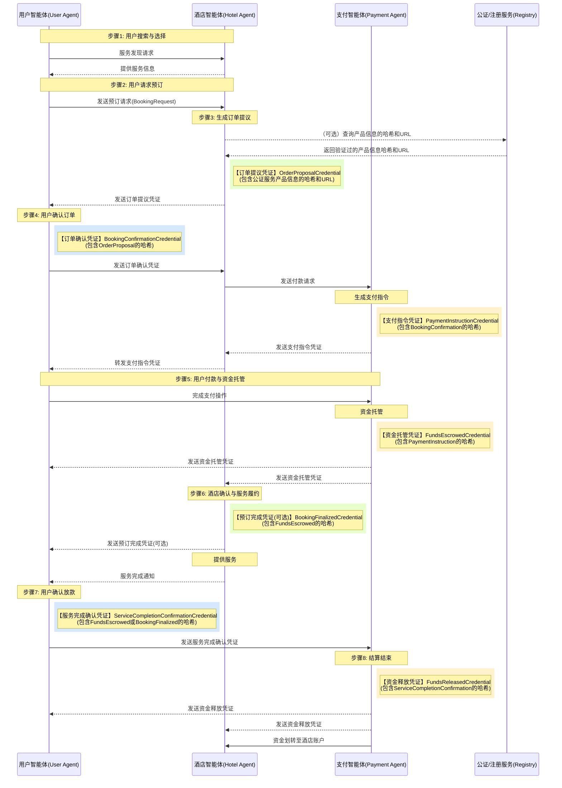

<!-- translation-review: full; scope: entire original source; paragraph-by-paragraph agent review; source code unchanged -->
> 日本語参考訳（原文全文をエージェントが照合）。歴史的な検討案です。安全性や実装済み能力に関する記述も当時の主張として保持し、現行仕様への適合や実取引での保証を意味しません。コード例・識別子は原文を保持しています。
> 原文: [chinese/过程文档/智能体点对点交易方案设计/智能体点对点交易流程&协议设计-通俗版.md](../../../../chinese/过程文档/智能体点对点交易方案设计/智能体点对点交易流程&协议设计-通俗版.md) / 基準コミット: `0837cfdfaf4ddcf834f0890ddaf34fc4c824e066`

# エージェント間P2P取引の流れとプロトコル設計：わかりやすい説明

## この案が解決する問題

AI技術の急速な発展に伴い、AIエージェントが普及し、人間に代わってインターネットへアクセスし、情報を処理し、タスクを実行する機会が増えていきます。エージェントが急増する時代に、新たなやり取りの形が生まれつつあります。

将来のインターネットでは、人と人、人とWebサイトのやり取りに代わり、エージェント同士が直接つながって通信するかもしれません。このP2Pの方式は従来の仲介モデルより効率的で、中間段階を減らし、情報伝達と意思決定を速められます。

しかしインターネットは本質的に信頼できない環境です。エージェントがユーザーの代理で取引する際には、次の課題があります。

- **アイデンティティ認証**：やり取りするエージェントの身元の真正性と信頼性をどう確保するか。
- **情報の真正性**：交換する情報が改ざんされていないことをどう検証するか。
- **取引の安全性**：中央プラットフォームなしに取引過程をどう安全にするか。
- **紛争解決**：取引に問題が生じたとき、どう効果的に解決するか。

安全で効率的、かつ直感的なエージェント間P2P取引の設計は、エージェント経済の基盤として重要になります。

## 解決案の概要

Agent Network Protocol（ANP）を基盤として、分散した安全な取引エコシステムを構築する、エージェント技術に基づく取引フレームワークを提案します。

### 中心技術

1. **Agent Network Protocol（ANP）**：エージェント間通信の基本プロトコル。AI時代の「HTTP」に相当します。
2. **分散型識別子（DIDs）**：参加者ごとに固有のデジタルアイデンティティを提供します。
3. **検証可能なクレデンシャル（VCs）**：検証可能なデータの主張を交換し、情報の真正性と完全性を確保します。
4. **VCハッシュチェーン**：ハッシュ値で各クレデンシャルをつなぎ、改ざんできない取引記録を構成します。

### システム構成


*図1：ANPエージェント間P2P取引システムの構成。ユーザー、ホテル、決済システム、任意の仲裁・公証サービスの関係を示します。エージェント間通信はすべてANPに基づき、VCで情報を伝達・検証します。*

この構成では、各当事者を専用エージェントが代表します。

- **ユーザーエージェント**：消費者を代表し、ユーザーの身元と取引フローを管理します。
- **ホテルエージェント**：サービス提供者を代表し、サービス情報の提供と予約処理を行います。
- **決済エージェント**：資金のエスクロー保管と取引決済を管理します。
- **仲裁エージェント**（任意）：紛争時に中立な調停・裁定を提供します。
- **認証／登録サービス**（任意）：ホテル／商品情報のハッシュ値や重要属性を保存・証明し、VCから参照できる信頼された第三者サービスです。

### 取引フロー：エージェントによる予約の完了

ホテル予約の身近な例で説明します。張さんがホテルを予約したいとします。従来は予約サイトへログインし、検索し、情報を入力して支払います。エージェントネットワークでは、個人エージェントがホテル・決済エージェントと直接やり取りし、全体を自動処理します。

#### 1. 検索と見積り

張さんが「来週金曜日に市中心部のホテルを予約して」と頼みます。

- ユーザーエージェントがネットワークで適切なホテルエージェントを探します。
- 日付、場所、部屋の種類などの要望を送ります。
- ホテルエージェントが空室と価格を確認します。
- ホテルエージェントが、部屋の種類、価格、取消し条件などを含む「注文提案クレデンシャル」（電子契約に相当）を生成します。
- ホテルエージェントが自身の秘密鍵でクレデンシャルへ電子署名し、内容の改ざんを防ぎます。
- ANPでユーザーエージェントへ送信します。

この段階でホテルは部屋を一時的に確保し、ユーザーの確認を待ちます。

#### 2. 予約の確認

ユーザーエージェントが見積りを受け取り張さんに提示し、張さんが予約条件に同意します。

- ユーザーエージェントが条件の受諾を示す「予約確認クレデンシャル」を作成します。
- 元の注文提案への参照をハッシュ値で結び、双方が同じ契約を見ていることを確保します。
- ユーザーエージェントが張さんの秘密鍵で署名します。
- 署名済み確認クレデンシャルをホテルエージェントへ送ります。
- ホテルエージェントが有効性を検証し、注文状態を「支払待ち」に更新します。

#### 3. 支払フローの開始

次は支払ですが、安全のためホテルへ直接は支払いません。

- ホテルエージェントが「支払要求クレデンシャル」を作り、決済エージェント（決済プラットフォームなど）へ送ります。
- 金額、通貨、受取先IDなど必要な決済情報だけを含め、詳しいホテル情報を含めず、ユーザーのプライバシーを保護します。
- 予約確認クレデンシャルへのハッシュ参照も含め、完全な証拠の連鎖を構成します。

#### 4. 支払指示の生成

決済エージェントは要求を受け取ると、次を行います。

- 支払リンクやQRコードなど、実際の支払方法を含む「支払指示クレデンシャル」を生成します。
- まずホテルエージェントへ送り、そこからユーザーエージェントへ転送します。
- ユーザーはリンクやQRコードで支払を完了できます。

#### 5. 資金のエスクロー保管

張さんはエージェント経由で支払情報を受け取り、支払を完了します。

- 資金はホテルの口座へ直接入らず、まず決済プラットフォームの「エスクロー口座」に入ります。
- 決済エージェントは入金を確認し、「資金保管クレデンシャル」を生成します。
- ユーザーとホテルへ送り、「資金は安全に保管され、サービス完了後にのみ払い出される」と双方へ伝えます。

#### 6. サービスの履行

ホテルは資金の保管を確認し、正式に予約成立とします。

- ホテルが部屋を確保し、ユーザーへ「予約成立クレデンシャル」を送る場合があります。
- 張さんが予定時刻にチェックインし、サービスを受けます。
- 終了後、ホテルはユーザーエージェントへ「サービス完了通知」を送る場合があります。

#### 7. 確認と決済

張さんのチェックアウト後は、次のようになります。

- ユーザーエージェントが、サービスに満足したか確認します。
- 満足した場合、「サービス完了確認クレデンシャル」を生成し、決済エージェントへ送ります。
- 所定時間内にユーザーが確認も異議申立ても行わなければ、システムが自動で完了確認する場合があります。

#### 8. 最終決済

決済エージェントが確認を受け取ると、次を行います。

- 保管資金をホテルの口座へ送金します。
- 「資金払出しクレデンシャル」を生成して各当事者へ通知します。
- 取引が完了します。

サービス品質への不満など、取引中の問題に対しては紛争解決の仕組みも設計しており、仲裁エージェントによる調停を導入できます。

**理想的な状態のフロー図：**



*図2：ANPエージェントの理想的な取引フロー。ユーザーの検索から決済完了まで、クレデンシャル生成の段階（VCの印）と、ユーザー・ホテル・決済エージェント間のやり取りを示します。*

**中心となる状態遷移図（概念）：**
```stateDiagram-v2
    [*] --> 新建(New)
    新建(New) --> 待付款(Pending_Payment): 用户确认 (凭证包含订单提议哈希)
    待付款(Pending_Payment) --> 已托管(Escrowed): 资金托管 (凭证包含支付指令哈希)
    待付款(Pending_Payment) --> 已取消(Cancelled): 支付超时 / 用户取消
    已托管(Escrowed) --> 履约中(In_Service): 酒店确认预订 (可选凭证包含托管凭证哈希)
    已托管(Escrowed) --> 已取消(Cancelled): 用户取消 (符合政策)
    已托管(Escrowed) --> 争议中(In_Dispute): 发起争议 (凭证包含托管凭证哈希)
    履约中(In_Service) --> 待结算(Pending_Settlement): 用户确认服务 (凭证包含托管/预订完成凭证哈希) / 自动确认超时
    履约中(In_Service) --> 争议中(In_Dispute): 发起争议 (凭证包含履约中状态哈希)
    待结算(Pending_Settlement) --> 已结算(Settled): 资金释放 (凭证包含服务完成确认哈希)
    待结算(Pending_Settlement) --> 争议中(In_Dispute): 发起争议 (凭证包含待结算状态哈希)
    争议中(In_Dispute) --> 已结算(Settled): 仲裁决定 (凭证) -> 释放资金
    争议中(In_Dispute) --> 已取消(Cancelled): 仲裁决定 (凭证) -> 退款
    已取消(Cancelled) --> [*]
    已结算(Settled) --> [*]
```

### 重要技術：VCハッシュチェーン

エージェントネットワークの取引では、**取引履歴が真正・完全で改ざんされていないことをどう確保するか**が課題です。従来は銀行や予約サイトなどの中央プラットフォームが記録を保存しますが、分散したエージェント環境には、そのような「信頼された第三者」がいません。

VCハッシュチェーンはこの問題を解決します。仕組みは「デジタルのパズル」に似ています。

- 注文、確認書、支払など各クレデンシャルが、直前のクレデンシャルの「デジタル指紋」（ハッシュ値）を含みます。
- 壊せない証拠の連鎖を作り、誰かが履歴を変更すると、それ以後の全クレデンシャルの検証が失敗します。
- 中央プラットフォームがなくても、各参加者が取引履歴全体の完全性・真正性を検証し、自分で保存して必要時に提示できます。

この技術により、エージェント同士が中央プラットフォームなしに信頼を構築し、取引の透明性と安全性を確保し、エージェント経済の基盤を提供します。


*図4：ANPのVCハッシュチェーン。注文提案から最終決済まで、各クレデンシャルが直前のハッシュ値を含むことで改ざんできない連鎖を作り、取引の完全性と検証可能性を確保します。*

クレデンシャルの連鎖の主な特徴：
1. **全工程の追跡**：最後の資金払出しクレデンシャルから、最初の注文提案までハッシュチェーンをたどれます。
2. **改ざん防止**：どの段階のクレデンシャルを変えても、後続のハッシュ値の検証が失敗します。
3. **発行者の責任の明確化**：色で各エージェントが発行するクレデンシャルを区別し、責任の境界を明示します。
4. **ブロックチェーン不要**：複雑なブロックチェーン技術を必要とせず、単純なハッシュと電子署名だけを使います。
5. **軽量な実装**：どのデバイスにも実装でき、エージェントネットワークに適します。
6. **各当事者による共同の立会い**：参加者が受信・発行したクレデンシャルをそれぞれ保持し、取引全体の分散した証拠を構成します。

## 中心的な特徴

### 1. プラットフォームに依存しない信頼モデル

中央プラットフォームに頼らず、暗号技術で各当事者の真正性とデータ完全性を確保します。各エージェントはDID（分散型識別子）と鍵ペアを持ち、署名と検証に使います。

### 2. 取引過程の透明性と耐改ざん性

VCハッシュチェーンによって、全段階を相互につながる検証可能なクレデンシャル群に記録します。新しいクレデンシャルは直前のハッシュ値を含み、完全で改ざんできない取引履歴を構成します。

注：ハッシュチェーンは必ずしもブロックチェーンに依存しません。クラウド基盤を使い、参加者が個別にクレデンシャルを保存して後の紛争解決に利用できます。

### 3. 取引ライフサイクル全体への対応

システムはサービス発見から紛争解決までの取引フロー全体に対応します。

### 4. 充実した例外処理

次のような例外を処理する仕組みを設計しています。

- クレデンシャルの検証失敗
- 支払のタイムアウト
- 在庫を超える販売
- ユーザーによる取消し
- サービスをめぐる紛争
- 鍵の漏えい

### 5. オープン性と相互運用性

ANP、W3C DID、W3C VCというオープン標準に基づき、異なる業者のエージェントが円滑にやり取りし、単一プラットフォームへの囲い込みを避けられるようにします。

## まとめ

ANPによるエージェント間P2P取引案は、分散アイデンティティと暗号学的証明により、人間の代理で取引する将来のエージェントに、安全・透明・効率的な枠組みを提供します。中央プラットフォームで信頼を作るのではなく、暗号技術と検証可能なクレデンシャルの連鎖で信頼を確立し、フローを実行します。

単純な消費者の予約から複雑な企業間協働まで適用でき、エージェント経済の発展の基盤になります。
