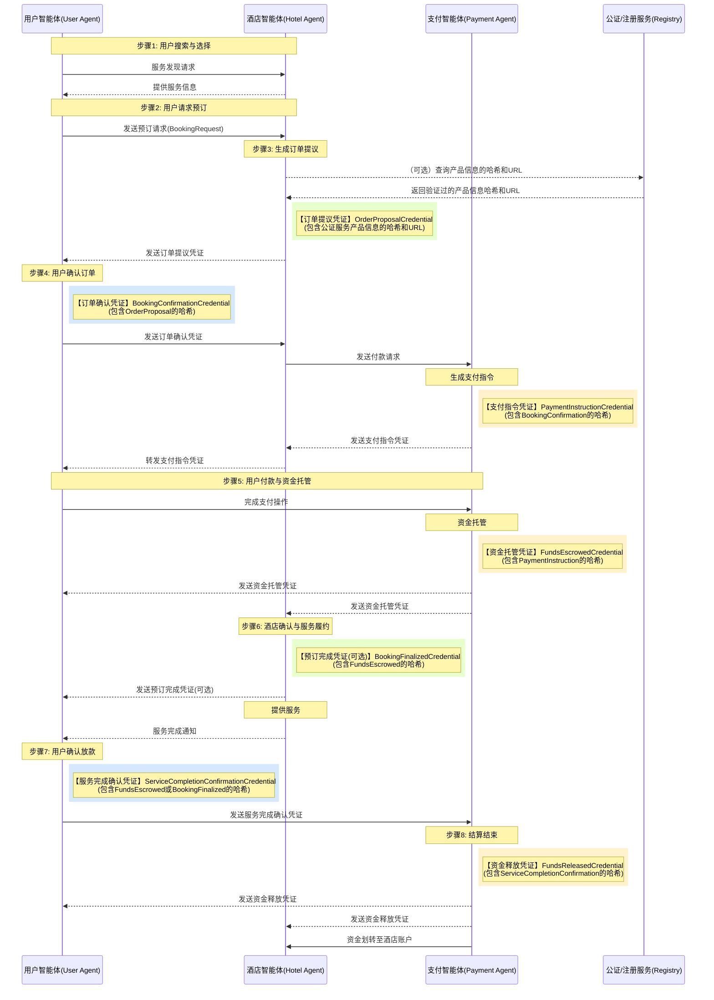

> 日本語参考訳（機械翻訳・未校閲）。規範となるのは原文です。コード例・識別子・規範キーワードは原文を保持しています。
> 原文: [chinese/过程文档/智能体点对点交易方案设计/智能体点对点交易流程&协议设计-通俗版.md](../../../../chinese/过程文档/智能体点对点交易方案设计/智能体点对点交易流程&协议设计-通俗版.md) / 基準コミット: `0837cfdfaf4ddcf834f0890ddaf34fc4c824e066`

# スマートポイントツーポイントトランザクションプロセスとプロトコル設計: 共通で、バージョンを理解しやすい

## プログラムが取り組むべき課題

人工知能技術の急速な発展に伴い、AIエージェントは急速に普及し、ますますますますインターネットにアクセスして人件数を交換し、情報処理を行い、タスクを実行します。この時代では、インテリジェントな身体の増殖が進んでおり、新しい相互作用のパラダイムが現れています。

未来のインターネットは、人から人まで、ウェブサイト間のやり取りではなく、インテリジェントな身体とスマート間で直接接続や通信を行うことはできません。このような点を観た知的相互作用は、従来のインターメディアモデルよりも効率的になり、中リンクを減らし、情報伝達と意思決定プロセスをスピードアップします。

しかし、インターネットは基本的に信頼性の低い環境であり、ユーザーの代わりにスマート取引を行うときに次のコア課題に直面しています。

- **組織図**: インタラクティブな知能のアイデンティティが現実的で信頼性があることを、どうすればよいですか?
- **情報認証**: インテリジェントな身体が改ざんされていない情報を確認するにはどうすればよいですか?
- **貿易セキュリティ**: 中央のプラットフォームなしでプロセスを保護する方法は?
- **紛争解決**: 取引中に発生した問題が生じたときに、紛争は効果的に対処できるのは?

安全で効率的で直感的なスマートスポットツーポイント取引プログラムの設計は、インテリジェントな身体の経済発展のためのインフラとして特に重要です。

## ソリューションの概要

エージェントネットワーク制作(AMP)をベースとしたスマートテクノロジーに基づく取引枠組みを提案し、流通・安全な取引エコシステムを構築しています。

### コア技術

1. **エージェントネットワークプロトコル(ANP)**: インテリジェント間の通信のためのベースプロトコル、人工知能時代の「HTTP」に似ています
2. **センター識別子(ID)に移動**: 参加者一人ひとりに、ユニークなデジタルアイデンティティを提示
3. **検証可能な証明書(VC)**: 情報の信頼性と完全性を確保するために、検証可能なデータステートメントを交換
4. **VCハッシュチェーン。**: ハッシュ値に文書をリンクすることで変更できない取引の記録

### システムアーキテクチャ


*図1:取引システムのANPスマートポイントツーポイント(AMP)スキーマ - ユーザーの、ホテル、決済システム、およびオプションの仲裁が公正なサービスとどのように相互作用するかを示しています。*

この構造では、各当事者は、以下の情報を含む独自の知能体によって表されます。

- **ユーザー スマート ボディ**: 消費者を表す、ユーザー ID とトランザクションプロセスの管理
- **ホテル インテリジェンス**: サービスプロバイダの代理、サービス情報の提供、予約処理
- **スマート決済**: 資金のホスティングと取引決済の管理
- **仲裁スマート ボディ**(オプション):紛争の場合には、中立的な仲介および適応を提供します
- **認定/登録サービス**(オプション): VC によって引用されるべきホテル/プロダクト情報、ハッシュまたは他のキー属性を貯え、軽減するための信頼できる第三者サービスを提供します

### トランザクションプロセス:予約取引を完了する方法

スマートな人々がホテルの予約をするためにどのようにコラボレーションするかの人生例を見てみましょう。想像してみてください。チャン氏は、ホテルを予約することを望んでいます。伝統的な方法で、彼はログインし、ホテルを検索し、情報を入力して支払いする必要があります。そしてスマートボディネットワークでは、全プロセスは、ホテルと直接やり取りし、スマートな人々を支払います、彼の個人的なスマートな人によって自動的に処理されます。

#### 1. 探すと引用

チャン氏は、自分のスマートボディについて彼に言いました。「金曜日にホテルのダウンタウンを呼び出します」。

- ユーザーの知能は、ネットワークで正しいホテルのインテリジェンスを探しています
- 特定のニーズ(日付、場所、家の種類など)を送信
- ホテルのインテリジェンスチェック在庫と価格
- ホテルのスマートスは、ハウスの種類、価格、キャンセルポリシーなどに関する情報を「注文提案券」(電子契約に相当する)を生成します。
- ホテルのスマートは、デジタルにそれで改ざんされていないことを確認するために、自分の秘密鍵で証明書を署名します
- このバウチャーは、AMPプロトコルを介してユーザーのスマートボディに送信されます

こちらのステップでは、お部屋を一時的にロックダウンし、ご利用者からの確認をお待ちしています。

#### 2. ご予約の確認

見積書を受領したら、長さんに表示します。

- ユーザは、受諾条項であるブックの確認書を作成します。
- 証明書には、同一の契約を閲覧する(ハッシュリンクによる)オリジナルオーダーへの提案された参照が含まれています。
- チャンの秘密鍵で署名したユーザー スマートボディ
- ホテルのスマートボディに署名された確認を送って下さい
- ホテルのスマートスは、証明書の有効性を検証し、注文状況を「支払い可能」に更新します。

#### 3. 決済プロセス開始

お支払いは、セキュリティ上の理由からホテルに直接必要が、今必要です。

- ホテルのスマートスは、支払いプラットフォームで、スマートに送金された決済リクエストバウチャーを作成します。
- 証明書には、必要な支払い情報(値、通貨、ペイ IDなど)のみが含まれているため、ホテルの詳細情報は含まれておりず、ユーザーのプライバシーを保護します。
- 支払い文書のリクエストには、予約確認書へのハシの参照のための証拠の完全なチェーンも含まれています。

#### 4. コマンド生成を支払います

リクエストを受け取った後、スマートな人々を支払います。

- 支払いや2Dコードへのリンクなど、実際の決済方法を含む「支払い注文券」を生成
- 証明書をホテルのスマートに送信し、ユーザーのスマートに転送します。
- ユーザーは、このリンクまたは2Dコードを経由して支払うことができます

#### 5. ファンドのホスティング

チャン氏は、支払い情報を知能を通じて受け取り、支払いを完了しました。

- 送金口座に直接送金するのではなく、決済プラットフォーム上で「ホストアカウント」に最初に入金されます。
- 決済スマートは、資金の受領確認と「返金カストディアン」のバウチャーを生成します。
- 証明書は、ユーザーが「お金が安全であり、完了するまでサービスがリリースされない」というパーティーを言うと同等であるユーザやホテルに送られました。

#### 6. サービスデリバリー

当館は、予約が成功したことを確認した資金を保有し正式に確認しました。

- ルームリソースにホテルロックを施し、利用者に「予約完了証明書」を送付する場合があります。
- チャン氏は、ホテルに予約を予定してサービスを受けている。
- サービスの終了後、サービス完了通知をユーザインテリジェンスに送信することができます。

#### 7. 確認・決済

店を左に張氏の後に:

- ユーザーのスマートでサービス満足度を確認
- 満足すれば、スマートはスマートな支払に送るためにサービスの完了の確認を発生させます
- ユーザーが指定した時間内に確認またはオブジェクトがない場合、システムは自動的に完了を確認することができます。

#### 8. 最終決算

決済インテリジェンスが確認された後:

- 信託をホテル口座へ譲渡
- リリース証明書の発行は、関係者全員に伝えられます。
- 取引全体が正常に完了しました。

サービスの不満足な品質やシステムなどの取引の過程で発生する問題が、紛争解決メカニズムを設計している場合、仲介のための仲裁インテリジェンスを導入することができます。

**理想的な状態の下のフローチャート:**



*図2:AMP Smart Ideallyトランザクションフローチャート - ユーザー検索から決済までのプロセスが完全に表示され、バウチャー生成リンク(VCタグ)を明確にマークし、ユーザーインテリジェンス、ホテルの知能と支払いインテリジェンス間の相互作用を明確に表示します。*

**中心の状態の転換(受け入れて下さい):**
```stateDiagram-v2
    [*] --> 新建(New)
    新建(New) --> 待付款(Pending_Payment): 用户确认 (凭证包含订单提议哈希)
    待付款(Pending_Payment) --> 已托管(Escrowed): 资金托管 (凭证包含支付指令哈希)
    待付款(Pending_Payment) --> 已取消(Cancelled): 支付超时 / 用户取消
    已托管(Escrowed) --> 履约中(In_Service): 酒店确认预订 (可选凭证包含托管凭证哈希)
    已托管(Escrowed) --> 已取消(Cancelled): 用户取消 (符合政策)
    已托管(Escrowed) --> 争议中(In_Dispute): 发起争议 (凭证包含托管凭证哈希)
    履约中(In_Service) --> 待结算(Pending_Settlement): 用户确认服务 (凭证包含托管/预订完成凭证哈希) / 自动确认超时
    履约中(In_Service) --> 争议中(In_Dispute): 发起争议 (凭证包含履约中状态哈希)
    待结算(Pending_Settlement) --> 已结算(Settled): 资金释放 (凭证包含服务完成确认哈希)
    待结算(Pending_Settlement) --> 争议中(In_Dispute): 发起争议 (凭证包含待结算状态哈希)
    争议中(In_Dispute) --> 已结算(Settled): 仲裁决定 (凭证) -> 释放资金
    争议中(In_Dispute) --> 已取消(Cancelled): 仲裁决定 (凭证) -> 退款
    已取消(Cancelled) --> [*]
    已结算(Settled) --> [*]
```

### 主技術:VCハッシュチェーン

スマートネットワークでの取引の場合、中央の問題に直面しています。**取引履歴が真で完了していることを、改ざんされずにどうすればよいですか?**従来のシステムは、取引の記録を保持するために集中化されたプラットフォーム(銀行や予約プラットフォームなど)に依存していますが、分散したスマート環境では「信頼できる第三者」はありません。

VC 橋渡し技術は、この問題が巧妙な方法で解決しました。それは「デジタルパズル」のように動作します:

- 各取引証明書(注文、確認、支払い証明書など)には、前の文書の「デジタル指紋」が含まれています。
- 証拠の不備なチェーンを作成し、履歴レコードの変更は、すべての認証のその後の失敗になります。
- 中央のプラットフォームなしでも、トランザクション全体が完全で真正であり、必要に応じてそれを維持し、提示するかどうかを参加者は確認することができます。

中央のプラットフォームなしでインテリジェントなボディを安心して構築できる技術で、取引の透明性とセキュリティを確保し、スマートエコノミーのための確かな基盤を提供します。


*図4: VC 橋チェーンは、AMP 協定で - 提案された順序から最終決済までの文書の完全なチェーンを示しています。各々は、以前の文書の橋値を組み込むことで、不動的なチェーン構造を形成し、トランザクションの完全性と検証性を保証します。*

証明書チェーンの主な機能:
1. **完全なプロセス レトロアクティブ**: 資金の最終リリースから、ハッシュチェーンを元注文提案に戻すことができます
2. **偽造防止機構**: リンク文書の変更は、その後のバウチャーの橋渡し確認になります
3. **発行者 's の責任は明確です**:異なる色は、異なるインテリジェントな体によって発行された証明書を識別し、責任の限界を定義します
4. **ブロックチェーンなし。**: 複雑なブロックチェーン技術、簡単なハッシュアルゴリズムとデジタル署名なし
5. **軽量達成**: それはスマートなボディ ネットワークに適しているあらゆる装置で、十分達成することができます
6. **パーティは、すべての証人です。**• 各参加者は、彼または彼女が受け取られた証明書を保持し、発行された。これは、トランザクションの完全な分散証拠を構成する

## コア特性

### 1. プラットフォームの信頼に行きます。

中央プラットフォームに依存して信頼を築く代わりに、組み合わせ技術は各当事者が識別され、完了することを保証します。 各スマートボディには独自のDID(集中識別子)と署名および認証のためのキーペアがあります。

### 2. トランザクションプロセスの透明性と非汚染

VC橋チェーンでは、すべての取引は一連の相互連結可能な証明書に記録されます。各新しい証明書には、前の文書のHashi値が含まれており、トランザクションの完全なおよび不動的な履歴を形成します。

注意:ハッシュチェーンは必ずしもブロックチェーンに依存しません。クラウドインフラストラクチャは、参加する当事者が、その後の紛争解決のために別々に保存された文書をサポートすることで使用できます。

### 3. 取引ライフサイクルのトータルサポート

システムは、サービス検出から紛争解決までの完全なトランザクションプロセスをサポートしています。

### 4. 異常処理のための改善されたメカニズム

システムは、次のようなさまざまな異常に対処するためのメカニズムを設計しました。

- 一時的なフォルダを閉じることができません: %s
- タイムアウトを支払います
- 在庫のオーバーセール
- ユーザのキャンセル
- サービス紛争
- 主要ディスクロージャー

### 5. 開閉機能

プログラム全体は、オープン規格(AMP、W3C DID、W3C VC)に基づいており、異なるメーカーが開発するスマートがシームレスにやり取りし、単一のプラットフォームにロックされることを回避できることを確認します。

## インフォメーション

AMP ベースのスマートポイント・ツー・ポイント取引プログラムでは、分散型アイデンティティ技術とパスワードを使用して人道の代わりに取引を行うための将来の知能のためのセキュアで透明性のある効率的なフレームワークを提供します。 中央化されたプラットフォームに依存して信頼を築くよりもむしろ、それは暗号と検証可能な文書チェーンの使用による自信とプロセスを構築します。

プログラムは、簡単な消費者予約から複雑なビジネスコラボレーションまで、スマート経済の発展の基盤を築く様々な取引シナリオに適用することができます。
