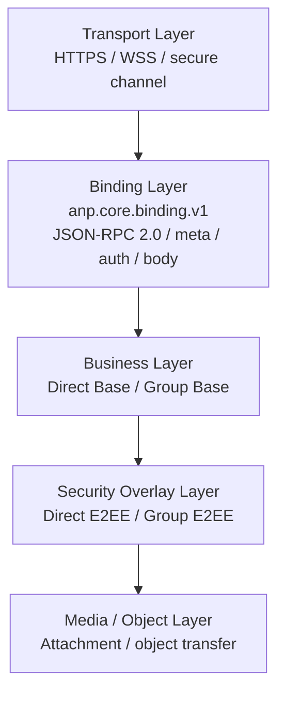
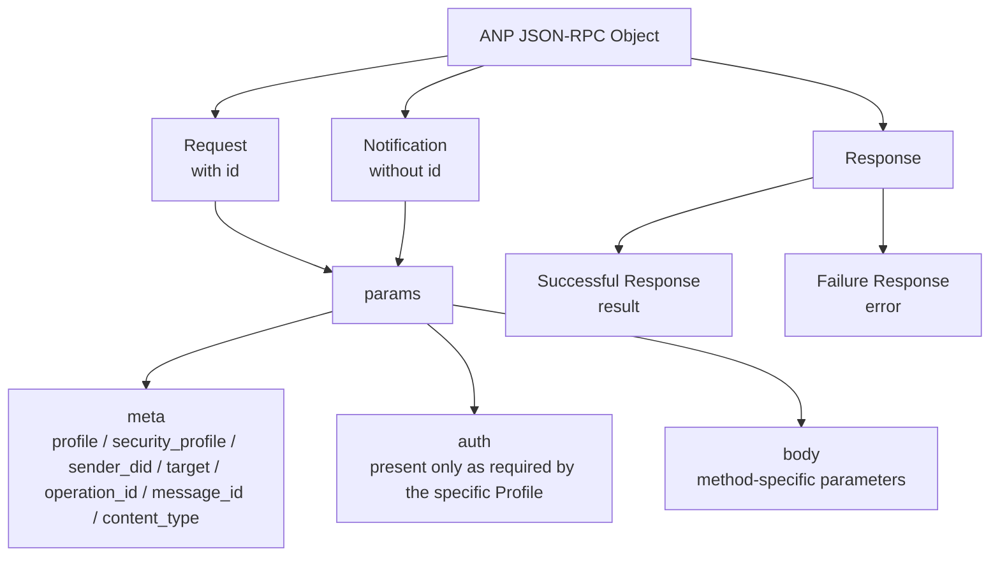
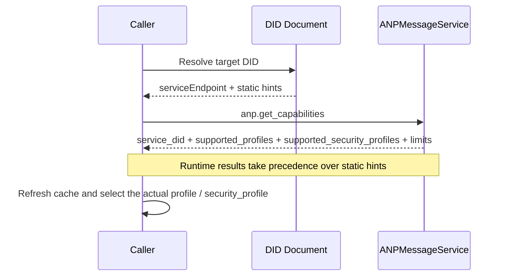

> 日本語参考訳（機械翻訳・未校閲）。規範となるのは原文です。コード例・識別子・規範キーワードは原文を保持しています。
> 原文: [deprecated/01-core-binding.md](../../deprecated/01-core-binding.md) / 基準コミット: `0837cfdfaf4ddcf834f0890ddaf34fc4c824e066`

# ANP プロフィール 1: コア結合

- 文書ID: ANP-P1
- タイトル:コア・ビンディング
- ステータス: リリース
- バージョン: 1.1
- 原文言語: English / このページは日本語参考訳
- 応用性: このプロファイルは、すべての ANP 基本プロファイルとセキュリティ上敷プロファイルに適用されます。

---

## 1. 目的:

このプロファイルは、ANPの統一された外部メッセージ結合、共通フィールド、機能交渉、エラーモデル、および相互運用性制約を定義します。

このプロフィールの目的は次のとおりです:

1. ANP のすべてのメソッドに統一されたメッセージの封筒を提供。
2. 異なるアプリケーションプロファイルの要求、応答、通知、およびエラーフォーマットを繰り返し再発明しないでください。
3. ダイレクトベース、グループベース、ダイレクトE2EE、グループE2EE、添付ファイル、フェデレーションなど、プロフィールの共通基盤を提供。
4. JSON-RPC 2.0 の基本的な互換性を保持している間、オプションの自由度を締め、交差実装の曖昧さを軽減します。

---

## 2. 用語集と定款

### 2.1 仮説キーワード

この記事では、 **MUST**, **MUST NOT**, **REQUIRED**, **SHALL**, **SHALL NOT**, **SHOULD**, **SHOULD NOT**, **RECOMMENDED**, **NOT RECOMMENDED**, **MAY**, **OPTIONAL** 資本金を基準とした規範的な要件として解釈されます。

### 2.2 用語集

- **ANPエンドポイント**: ANP を実装するプロトコルエンドポイント、通常、エージェントが配置されているドメインの入り口サービス、グループホストサービス、またはその他の宣言されたサービスのエンドポイント。
- **リクエスト**: JSON-RPC 呼び出しオブジェクトと `id`.
- **インフォメーション**: JSON-RPC 呼び出しオブジェクトなし `id`.
- **結果発表**: `result` 成功した応答オブジェクトのメンバー。
- **エラー**: `error` 障害応答オブジェクトのメンバー。
- **プロフィール**: ANPのプロトコル機能ユニット、など `anp.direct.base.v1`.
- **セキュリティプロファイル**: 安全管理ユニット(ANP) `transport-protected`, `direct-e2ee`, `group-e2ee`.
- **運営会社**: メッセージの送信、グループの作成、メンバーの追加、またはグループの状態の変更の送信など、不当に認識できるプロトコルアクション。
- **メッセージの保有操作**: 適用層メッセージのペイロードを運ぶ操作、のような `direct.send`, `group.send`, `group.e2ee.send`.
- **メッセージの受信通知**: アプリケーションレイヤーメッセージのペイロードを運ぶための通知 `direct.incoming`, `group.incoming`, または `group.e2ee.notice`.
- **制御操作**: アプリケーションレイヤービジネスメッセージは持ちませんが、プロトコルやビジネスの状態を変更する操作など `group.create`, `group.add`と `group.remove`.
- **起源の証拠**: 業務主の秘密鍵で生成されたアプリケーション層原点証拠と、 `auth.origin_proof`.
- **オブジェクトの証拠**: オブジェクト埋め込みで作られた検証可能なオブジェクトレベルのアサーション `proof` "entire オブジェクトと `proof` 削除する。
- **署名された要求の目的**: 共有正規化事業オブジェクトで構成される `method`, `meta`と `body` 計算するために使用される `contentDigest`.

---

## 3. デザイン原則

### 3.1 レイヤー原理

ANP は、次のレイヤーを使用する:

1. **輸送層**: HTTP(S)、WebSocket のセキュアな通信
2. **結合層**: JSON-RPC 2.0 の結合は、このプロファイルで定義します。
3. **営業層**: ダイレクトベースやグループベースなどのビジネスセマティクス
4. **セキュリティーの積み重層**: 直接E2EE、グループE2EEおよび他の安全管理;
5. **メディア/オブジェクトレイヤー**: 添付ファイルなどの大物オブジェクト拡張

読者がANPレイヤー境界の全体的な精神モデルを素早く構築するのに役立つためには、次の図はトランスポート層からメディア/オブジェクト層までの概要を提供します。 従属プロファイルは、このレイヤーフレームワークの上に独自のオブジェクト、フロー、および要件をさらに制約します。



*図P1-1: ANPレイヤーアウトの概要(非放射性)。*

この図は、デプロイメントトポロジーではなく、責任の境界を強調します。実装は複数のレイヤーを同じサービスにマージするかもしれませんが、実装はクロス導入相互運用性のためにこれらの層の分離を維持する必要があります。

### 3.2 最小相互運用性原則

異なる実装は、このプロファイルの制約を満たしている限り同じを共有できます。

- リクエスト/応答形式;
- 通知形式;
- 共通の分野の皮下主義;
- 容量の交渉方法;
- エラーモデル;
- 断定処理の原則。

### 3.3 非目標

このプロファイルは、次の機能を定義しません。

- 歴史の引き;
- ステータスを読んで下さい;
- 装置同期;
- オンラインステータス;
- 内部コピーの一貫性;
- 特定の E2EE アルゴリズム。

これらの機能は、ANP規格の範囲外にあると明示的に述べた他のプロファイルによって定義する必要があります。

### 3.4 プロフィールの同一証明

このプロファイルの標準的な名前は、次のとおりです。

`anp.core.binding.v1`

従属プロファイル **MUST** 依存関係を宣言するときにこのプロファイルを参照するために、この名前を使用します。

---

## 4. 基礎を結合する

### 4.1 JSON-RPC版

ANPコア結合 **MUST** JSON-RPC 2.0 を使用する。

とりあえず `jsonrpc` 会員名 **MUST** オブジェクトのリクエストとレスポンスオブジェクトは文字列に正確に等しい `"2.0"`.

### 4.2 安全な伝送要件

ANP の全てのバインディング **MUST** 認証された安全な輸送層を、以下のような方法で実行します。

- HTTPS の
- WSS;
- 機密性、完全性、ピア認証を提供するその他のセキュアなチャネル。

このプロファイルは、未認証の暗号化されていない生転送上の動作を許可しません。

### 4.3 輸送独立性

このプロファイルは、論理的に輸送アグノスティックです。 HTTP(S)とWSSは推奨結合ですが、許可された結合のみです。
このプロファイルのメッセージオブジェクトのセマティクスを変更しない新しいバインディングは、補足的なバインディング文書として定義されます。

---

## 5. JSON-RPC 相互運用性制約

### 5.1 `params` フォーム

元のJSON-RPCの指定は許可しました `params` パーポジション配列またはパーネームオブジェクトのいずれかを取る。
で ANP, `params` **MUST** オブジェクトである。 **MUST NOT** array フォームを使用します。
配列フォームの場合 `params` 受け取られた、受信機 **MUST** 戻り値 `anp.invalid_params_shape` エラー。

### 5.2 `id` 型 号

元のJSON-RPCの指定は許可しました `id` 文字列、数字、または `null`.
で ANP, `id` **MUST** リクエストは非空文字列です。
ANPリクエスト **MUST NOT** 番号を使う `id`.
ANPリクエスト **MUST NOT** 利用条件 `null` として `id`.
場合の `id` 要件が受け取れない、受信機 **MUST** 返品 `anp.invalid_request_id`.

### 5.3 通知利用範囲

ANPでは、通知が **のみ** 次のシナリオで使用されます。

1. 同行者が積極的に押し上げられた非同期イベント。
2. 確認を必要としないワンウェイプロンプトでエラーの詳細を返さないでください。

下記業務 **MUST NOT** 通知を使用する:

- 永続状態を変える操作を制御;
- 不当な確認を必要とするメッセージの送信
- 成功や失敗を知るために、発信者を必要とする操作。

### 5.4 禁止されているバッチ

JSON-RPC バッチコール MUST NOT ANP で使用して下さい。
クライアント **MUST NOT** バッチを送信します。
サーバがバッチを受信したときに、 **MUST** 拒否して返し `anp.batch_not_supported`.

### 5.5 メソッド名制約

メソッド名 **MUST** 文字列で、次の命名規則に従う。

- 論理名前空間を使用する;
- より低い文字で始めて下さい;
- 利用条件 `.` セクションを分ける
- メソッド名 **MUST NOT** スタート `rpc.`;
- 業務方法 **SHOULD** 利用条件 `<domain>.<action>` スタイル。

推奨例:

- `anp.get_capabilities`
- `direct.send`
- `group.create`
- `group.add`
- `group.send`

### 5.6 応答制約

通知、サーバを除きます。 **MUST** リクエストごとに応答を返します。
成功の応答 **MUST** 含まれるもの `result`と **MUST NOT** 含まれるもの `error`.
故障応答 **MUST** 含まれるもの `error`と **MUST NOT** 含まれるもの `result`.
応答の `id` **MUST** 対応するリクエストと同じです。 `id`.

---

## 6. ジェネリック `params` 構造体

### 6.1トップレベルのオブジェクト

特定の例外で、ANPの `params` **MUST** 次の構造を持っています:

```json
{
  "meta": { "...": "..." },
  "auth": { "...": "..." },
  "body": { "...": "..." }
}
```

それらの中で:

- `meta`: 一般的なメタデータ、通訳プロファイル、ターゲット、暗示、セキュリティプロファイルなどを運ぶ。
- `auth`: 任意認証および認定オブジェクト;特定のプロファイルで明示的に要求された場合のみ表示されます。
- `body`: メソッド固有のパラメータ。

場合 `auth` 特定のプロファイルでは定義されていない、呼び出し側 **MAY** それを省略して下さい。
特定のプロファイルが明示的に要求する場合 `auth`, 呼び出し **MUST** 提供し、受取人 **MUST** それを検証します。
トップレベル `params` 会員以外の方 `meta`, `auth`と `body` 対応するプロファイルが明示的に定義されている場合は、のみ表示できます。

以下は、このプロファイルで繰り返し表示された外側の封筒を単一のビューに統合します。 要求、通知、応答によって共有される構造と、どのような責任が行われるかを読者に理解するのに役立ちます `meta`, `auth`と `body`.



*図P1-2: ANP JSON-RPCの封筒構造(非放射性)。*

従属するビジネスプロファイルとセキュリティオーバーレイは、唯一の拡張する必要があります `body` 必要とされている `auth` この図と競合する別のトップレベルの結合構造を発明するのではなく、制約。

### 6.2 `meta` オブジェクト

とりあえず `meta` オブジェクトフィールドは、次の通り定義されます。

#### 6.2.1 `anp_version`

- タイプ: 文字列
- 条件: **MAY**
- 管理: ANPメジャーバージョンのプロンプト
- デフォルト:省略された場合、受信機 **MUST** それを解釈するように `"1.0"`
- 説明:
  - このフィールドは、明示的なデバッグまたはクロスバージョンゲートウェイのために予約されます。
  - v1 では、 `profile` 通訳ルールを決定するために最初に使用されます。
  - 新規導入事例 **SHOULD** 第一次交渉分野ではなく、互換性のフィールドとしてこれを扱う。

#### 6.2.2 `profile`

- タイプ: 文字列
- 条件: **MUST**
- 著書:このプロフィール要求の唯一の解釈
- 説明:
  - `profile` プロファイルが解釈する宣言に使用されます `body`, `result`、現在の要求の間違いの制約そして方法の皮下主義」;
  - `profile` **MUST NOT** 複数のプロファイルのユニオンのセマティクスを同時に表現する。
  - `security_profile` セキュリティプロファイルを明示し、交換しない `profile`.
- 事例:
  - `"anp.direct.base.v1"`
  - `"anp.group.base.v1"`
  - `"anp.direct.e2ee.v1"`
  - `"anp.group.e2ee.v1"`

#### 6.2.3 `security_profile`

- タイプ: 文字列
- 条件: **MUST**
- セマンティックス:このコールのセキュリティプロファイル
- 許可された値:
  - `"transport-protected"`
  - `"direct-e2ee"`
  - `"group-e2ee"`
- 説明:
  - `security_profile` 要求の要件によって現在使用されているセキュリティプロファイルを示します。
  - セキュリティレベルやセキュリティのセマンティックス、解釈の構文ではなく記述します。 `body`;
  - 場合の `profile` 特定のだけを可能にする `security_profile` 組み合わせは、対応するプロファイルで明示的に指定する必要があります。

#### 6.2.4 `sender_did`

- タイプ: ひも(DID)
- 要件:匿名の公開発見機能に加えて、 **MUST**
- 事務:事業のセマンティックス(ビジネス・オリジン・ディド/論理送信者DID)の面でこの要求の送信主題DID
- 説明:
  - 普通の要求のため、 `sender_did` **SHOULD** 現行の事業主を示す。
  - サーバが生成した通知の場合、サーバーが生成する通知 `sender_did` 省略または他のフィールドが、論理発行者を特定のプロファイルで定義する表現に使用されます。
  - `sender_did` **MUST NOT** 外部の輸送接続のワンホップ・コールワーダーの身元に自動的に装備されます。

#### 6.2.5 `target`

- タイプ: オブジェクト
- 条件: **MUST** メソッドがプロトコルレベルのターゲットを持っているとき
- 構造:

```json
{
  "kind": "agent | group | service",
  "did": "did:example:..."
}
```

- 説明:
  - `kind = "agent"` ターゲットが単一のエージェントであることを示します。
  - `kind = "group"` ターゲットが単一のグループであることを示します。
  - `kind = "service"` ターゲットが公開されていることを示します `ANPMessageService.serviceDid`;
  - `target.did` **MUST NOT** 輸送層のURLを直接運ぶ;
  - 任意の方法プロファイル **MUST** 明示的に宣言するかどうか `agent-addressed`, `group-addressed`, `service-scoped`, または `endpoint-local`;
  - かわい `target` 許可されると、 **MUST** 特定のプロファイルによって明示的に宣言され、発信者と受信機 **MUST NOT** 自分で推測できる。
  - メソッドが要求される場合 `auth.origin_proof`, それから `meta.target` **MUST** プレゼントする `meta.target.kind` **MUST** の 1 つ `agent`, `group`と `service`.

#### 6.2.5.1 パターン宣言規則のモデル化を目標とする

解釈の美化を解消するために `target` 別のプロフィールによって、特定のプロフィール **MUST** 明示的に、次のターゲットモデリングモードのどのメソッドが属しているかを宣言します。

1. **エージェントアドレス**
   - `meta.target.kind = "agent"`
   - `meta.target.did` ターゲットエージェントのDIDへのポイント

2. **グループアドレス**
   - `meta.target.kind = "group"`
   - `meta.target.did` 対象グループDIDへのポイント

3. **サービススコープ**
   - `meta.target.kind = "service"`
   - `meta.target.did` ターゲット公開ポイント `ANPMessageService.serviceDid`

4. **エンドポイントローカル**
   - `meta.target` 対応するプロファイルが明示的に宣言した場合のみ省略できます

メソッドがそのプロファイルでエンドポイントローカルを明示的に宣言されていない場合、受信機 **MUST** "explicit" として扱います `target` 必須項目

場合の `meta.target.kind` の要求は、このメソッドで宣言されたターゲットモデリングモードと矛盾している、受信機 **MUST** 返品 `anp.invalid_target_binding`.


#### 6.2.6 `operation_id`

- タイプ: 文字列
- 要件:状態を変えるすべての操作 **MUST**
- 管理:この操作の断定識別子
- ルール:
  - `operation_id` **MUST** 同じイニシアムが同じ意味で再会するときは変更されずに残します。
  - 会員の対象範囲 **MUST** 特定のプロファイルで明確に定義される。
  - サーバ **MUST** 最初にチェックする、意図しないヒットを実行し、最適化された通貨またはバージョンの事前条件をチェックします。
  - メッセージ型操作の場合、送信者 **SHOULD** 直接セット `operation_id = message_id`, 「メッセージ識別」と「操作再試行識別」の区別が本当に必要としている場合を除きます。

#### 6.2.7 `message_id`

- タイプ: 文字列
- 要件:メッセージベアリング操作 **MUST**
- 分野: アプリケーションレイヤー メッセージ識別
- 説明:
  - `message_id` メッセージレベルの一意の同一の識別または重複の同一証明のために使用される;
  - `message_id` とりあえず `operation_id` 同じか別の場合もあります;
  - 実装が独立した運用ライフサイクルを持たない場合、 **SHOULD** 直接再利用 `message_id` として `operation_id`;
  - `message_id` **MUST NOT** 暗黙的に一般的な不法の皮下主義を取り替えます `operation_id`, 対応するプロファイルが明示的に同じを許可しない限り;
  - 特定のメソッドがメッセージ・ベアリング・通知のときにもこの制約が適用されます。

#### 6.2.8 `created_at`

- type: string (RFC 3339 回)
- 条件: **SHOULD**
- 管理:イニシエターが操作を作成した時タイムスタンプ
- Note: それ以外の場合は、その後のプロファイルで指定されていない `created_at` 反再生のための唯一の基礎として使用されない。

#### 6.2.9 `trace_id`

- タイプ: 文字列
- 条件: **標準の相互運用可能な分野としてもはや**
- 管理:内部追跡識別子を実行します
- 説明:
  - 展開がクロスサービストラッキングを必要とする場合、 **SHOULD** トランスポート層メタデータやプライベートエクステンションフィールド(例えば `x_trace_id`);
  - 受取人 **MUST NOT** これをセキュリティのセマンティック、承認判断、または不当な判断に組み込む。

#### 6.2.10 `content_type`

- タイプ: 文字列
- 要件:メッセージベアリング操作 **MUST**
- 管理: 現在のメッセージ操作の主要なビジネスペイロードのタイプ;現在のプロフィール/オーバーレイが独立した外封筒を使用している場合、それは外側の封筒の種類を示します。

ルールは以下の通りです。

1. ベースプロファイルでは、 `body` 構造化されたキャリアだけ(例えば、相互に排他的な `text` / `payload` / `payload_b64u` 構造)、 `meta.content_type` **MUST** JSON キャリアオブジェクト自体の型ではなく、その構造で運ばれる第一次事業ペイロードタイプを記述します。
2. セキュリティオーバーレイでは、 `body` 独立した暗号文封筒を運ぶ、そして `meta.content_type` **MUST** 外側の封筒のワイヤオブジェクトタイプを表します。
3. 元のアプリケーションコンテンツタイプが外部封筒タイプと異なる場合、 **MUST** 対応する内部フィールドにオーバーレイ(例えば `application_content_type`);
4. 特定の方法がメッセージの永続的な通知である場合、この規則も適用されます。
5. 基礎解釈の定義 `meta.content_type` このプロファイルによってのみ定義されます。他のアプリケーションプロファイルとセキュリティオーバーレイ **MUST NOT** ベースセマティクスを赤化。

事例:

- ベーステキストメッセージの直接: `text/plain`
- グループベースJSONメッセージ: `application/json`
- E2EE テキスト メッセージの指示: 外 `meta.content_type = "application/anp-direct-cipher+json"`、内部 `application_content_type = "text/plain"`
- グループ E2EE 添付メッセージ: 外 `meta.content_type = "application/anp-group-cipher+json"`

業務のペイロードが普通に構造化されたJSONの場合、コンテンツタイプ **MUST** は、
`application/json` JSONオブジェクトとJSONオブジェクト **MUST** 直接に運ばれて下さい `body.payload`
またはセキュリティ上敷の内部 `payload`. . . プロフィールおよび適用 **MUST NOT**
以下のようなビジネスの意味を区別するために、追加のコンテンツタイプを定義します。
コマンド、ステータスの更新、タスク、結果。 これらはアプリケーションレベルの意味
JSON オブジェクト内のセマティクスは、このコア結合層の外側にあります。

それらの中、グループE2EEの内部元のビジネスタイプが添付リストである場合は、内部のプレーンテキストに書かれるべきです。

```json
{
  "application_content_type": "application/anp-attachment-manifest+json"
}
```

とりあえず **なし** 外部に添付リストタイプを書いてい続けます `meta.content_type`.

### 6.3 `body` オブジェクト

とりあえず `body` オブジェクトはメソッド固有のパラメーターコレクションです。

- 業務内容 **MUST** フィールドを定義する。
- セキュリティオーバーレイプロファイル **MUST** 暗号化フィールドを定義します。
- 認識されていないフィールドが認められているかどうか `body` 無視することができます。 **MUST** 対応するプロフィールで明確に述べられます。
- 受信機 **MUST** 安全、ルーティング、許可、出没、または状態の機械のセマンティックに影響を与える未知のフィールドを拒否します。

---

## 7. ペイロードの代理規則

### 7.1 JSONオブジェクトの先頭

JSONオブジェクトとして自然に表現できるビジネスオブジェクトは、JSONオブジェクトとして直接表現されます。
アクセシビリティ **MUST NOT** デフォルト練習として「JSON 文字列内での JSON」のダブルシリアライズを使用します。

### 7.2 バイナリ表現

バイナリペイロードが送信する必要がある場合は、フィールド **MUST** 未パッドベース64urlテキストで表されます。
関連フィールド名 **SHOULD** エンドと `_b64u`, 例えば:

- `ciphertext_b64u`
- `key_package_b64u`
- `welcome_b64u`

### 7.3 数値表現

異なる言語の大規模な整数、カウンター、シリアル番号の表現の違いを避けるため、次のフィールド **MUST** は小数の文字列で表されます。

- カウンター;
- シリアル番号;
- 論理時計;
- プチ;
- 生成;
- 大きい整数の長さ;
- IEEE 754のダブルセーフトチェストの範囲を超える可能性のある値。

その後のプロファイルがJSON上で標準化された署名を実行する必要がある場合、シグネチャ入力のシリアライズルールは明確に定義する必要があります。
プロファイルが署名されたペイロードまたは同等の暗号結合オブジェクトを定義したら、プロファイル **MUST** 独自の正規化アルゴリズムを指定する。異なる実装 **MUST NOT** 異なる「安定的なシリアライズ」戦略を選択します。

---

## 8. 機能障害の交渉

### 8.1 全般

ANPエンドポイント **MUST** 機能交渉インターフェイスを公開します。
機能交渉の結果 **MUST** 少なくとも:

- 対応する ANP プロファイルのリスト。
- サポートされているセキュリティプロファイルリスト;
- ランタイムサービスID;
- 制約(最大ペイロード、最大オブジェクトサイズ、回転ポリシーなど)を実装します。

実装者 **MAY** より細かい拡張フィールド(サポートされているコンテンツタイプ、メソッドレベルの機能、通知機能、認証スキームなど)を返すが、このセクションで定義されている最低標準の応答構造には影響しません。

### 8.2 標準方法: `anp.get_capabilities`

#### 8.2.1 リクエスト

```json
{
  "jsonrpc": "2.0",
  "id": "req-001",
  "method": "anp.get_capabilities",
  "params": {
    "meta": {
      "profile": "anp.core.binding.v1",
      "security_profile": "transport-protected",
      "operation_id": "op-cap-001",
      "created_at": "2026-03-29T12:00:00Z"
    },
    "body": {}
  }
}
```

注意:

- `anp.get_capabilities` **MAY** 匿名の公開発見機能として呼び出される。
- 匿名で呼び出すとき、 `meta.sender_did` **MAY** 必須項目
- サーバが ID に基づいて異なる機能サブセットを返す場合、呼び出し側 **MAY** 認証されたコンテキストで再び呼び出します。

#### 8.2.2 応答の成功

```json
{
  "jsonrpc": "2.0",
  "id": "req-001",
  "result": {
    "service_did": "did:example:service",
    "supported_profiles": [
      "anp.core.binding.v1",
      "anp.direct.base.v1",
      "anp.group.base.v1",
      "anp.direct.e2ee.v1"
    ],
    "supported_security_profiles": [
      "transport-protected",
      "direct-e2ee"
    ],
    "limits": {
      "max_request_bytes": "1048576",
      "max_message_bytes": "262144"
    },
    "supported_content_types": [
      "text/plain",
      "application/json",
      "application/anp-attachment-manifest+json"
    ]
  }
}
```

注意:

- `result.service_did` 現在のランタイム機能の結果に対応するサービス ID DID を示します。
- 静的 DID 文書はヒントのみを提供し、ランタイム機能はこの結果の対象となります。
- `supported_content_types` 推奨延長です。 実用的なサーバー **SHOULD** 返します。

### 8.3 交渉規則

- DID 文書の静的拡張フィールドは、キャッシュ可能な静的なヒントのみを表します。
- 返しの結果 `anp.get_capabilities` 実行時間権限を示します。
- 静的ヒントがランタイム機能と競合する場合、呼び出し側 **MUST** 実行時間機能の結果を基準として取り、キャッシュをリフレッシュします。
- 呼び出し者 **SHOULD** 最初にやり取りされるか、キャッシュが切れる前にターゲット サービス機能を取得します。
- 場合 `profile` または `security_profile` リクエストがサポートされていない場合、サーバー **MUST** 明示的なエラーを返す。
- 呼び出し者 **MUST NOT** ベースプロファイルのサポートは、E2EEオーバーレイのサポートを意味します。

DID 文書やランタイム機能の静的ヒントは、インストーラが混乱するのを簡単にします。 以下の図は、推奨交渉順を修正し、静的情報が発見に用いられる原則を強調します。ただし、ランタイム結果は最終決定に使用されます。



*図 P1-3: 機能交渉とランタイムの権限(非規範的)。*

静的ヒントがランタイム機能と衝突するとき、この図に示されているランタイム結果に従うべき実装は、ローカルキャッシュをリフレッシュするための信号として競合を扱うべきです。

---

## 9. 免責と再試行

### 9.1 免責条項

状態変更の操作をすべて **MUST** 支援する際の優位性
同一の要求に対して重複する `(sender_did, target_scope, method, operation_id)`:

- 等価な場合、サーバ **MUST** 同じ結果か同等の結果を返す。
- 対人的争いがある場合、サーバ **MUST** 返品 `anp.idempotency_conflict`.

それらの中で:

- 特定の値の `target_scope` **MUST** 対応するプロファイルで定義します。
- ダイレクトクラスのメソッドの場合、 `target_scope` 普通は `target.did`;
- グループクラスのメソッドの場合、 `target_scope` 普通は `group_did`.

### 9.2 メッセージのリトライ

業務の送信をメッセージとして:

- `message_id` **MUST** 再試行するときは変更されずに残します。
- `operation_id` **MUST** 再試行するときは変更されずに残します。
- 実装が独立した操作のセマティクスがない場合、送信者 **SHOULD** 同じように2つを直接作って下さい;
- サーバ **MUST** 操作レベルの重要レコードを最初にチェックします。
- メッセージレベルの繰り返し識別に使用されるキー(含まれているかどうかなど) `message_id`) は、対応するメッセージプロファイルによって明示的に定義する必要があります。

### 9.3 非利用目的

操作が意図的に不意でない場合、対応するプロファイル **MUST** 明確にマークされ、代替是正メカニズムが提供されます。
明示的にマークされていないものは、常に不意であると見なされます。

---

## 10. エラーモデル

### 10.1 全般

ANPはJSON-RPCの使い方 `error` ホストエラーにオブジェクトをオブジェクトします。
アクセシビリティ **保持者** ANPの独自のアプリケーションエラーコードを定義しながら、JSON-RPC標準エラーコードの元のセマティクス。

次のような状況では、サーバ **SHOULD** 優先的にJSON-RPC標準エラーコードを使用します。

| シナリオ | 推奨JSON-RPCエラーコード |
|---|---|
| JSON を解析できない | `-32700 Parse error` |
| 違法JSON-RPCオブジェクト | `-32600 Invalid Request` |
| 方法が存在しません | `-32601 Method not found` |
| 違法パラメータ形状 | `-32602 Invalid params` |
| サーバ内部例外 | `-32603 Internal error` |

ANPビジネスレイヤーエラーの場合、サーバー **SHOULD** この文書で定義された1000以上のエラーコードを使用し、機械読み取り可能なセマティクスも提供します。 `error.data.anp_code`.

### 10.2 ANPエラーオブジェクトの拡張子

`error` 目的の提案の構造:

```json
{
  "code": 1001,
  "message": "Unsupported profile",
  "data": {
    "anp_code": "anp.unsupported_profile",
    "retryable": false,
    "details": {}
  }
}
```

`error.data.anp_code` **MUST** いつか存在している `code` ANP のカスタムエラースコープに属します。

### 10.3 ANP 公開エラーコード

| `code` | `anp_code` | 意味する |
|---|---|---|
| 1000 | `anp.invalid_request_id` | `id` イルガル |
| 1001 | `anp.unsupported_profile` | リクエストされたプロファイルはサポートされていません |
| 1002 | `anp.unsupported_security_profile` | 要求されたセキュリティプロファイルはサポートされていません |
| 1003 | `anp.invalid_params_shape` | `params` 構造は条件を満たしません |
| 1004 | `anp.batch_not_supported` | バッチはサポートされていません |
| 1005 | `anp.unauthorized` | 認証を通過できなかった |
| 1006 | `anp.forbidden` | 認証されたが、権限がない |
| 1007 | `anp.target_not_found` | DID の宛先は存在しませんか、または到達不能です |
| 1008 | `anp.idempotency_conflict` | 秘密鍵の衝突 |
| 1009 | `anp.unsupported_content_type` | コンテンツタイプがサポートされていない |
| 1010 | `anp.delivery_rejected` | 対象サービスが受け取れない |
| 1011 | `anp.rate_limited` | トリガー電流制限 |
| 1012 | `anp.temporarily_unavailable` | 一時的に利用できないサービス |
| 1013 | `anp.invalid_security_binding` | セキュリティプロファイルとペイロード構造は一致しません |
| 1014 | `anp.invalid_target_binding` | メソッドで必要なターゲットモデリングモードは実際のところ一致しません `meta.target` |

### 10.4 エラーのリターン要件

- ANP のカスタムエラーの場合、サーバー **MUST** リターン機械決定装置 `anp_code`;
- `message` **SHOULD** 短く、読みやすくなります。
- `data.retryable` **SHOULD** 呼び出し側が再試行するかどうかを示します。
- エラー **MUST NOT** 過度に敏感な内部状態を漏らして下さい。
- **SHOULD** 返品 `anp.invalid_target_binding` ターゲット結合エラー、サービススコープ/エンドポイントローカルの誤用など

---

## 11. 方法登録と名前空間

### 11.1 名前空間

下記の1階名空間を使用することをお勧めします。

- `anp.*`
- `direct.*`
- `group.*`
- `attachment.*`
- `federation.*`

### 11.2 バージョン管理

プロフィール名 **MUST** たとえば、バージョンで明示してください。

- `anp.core.binding.v1`
- `anp.identity.discovery.v1`
- `anp.direct.base.v1`

### 11.3 延長方法

実装者 **MAY** 特別な拡張メソッドを定義します。

- **MUST NOT** 標準方式と同じ名前を持ちます。
- 導入事例 **SHOULD** プライベートプレフィックスを使用する。
- 導入事例 **MUST NOT** 他の実装はこれらのメソッドを理解していると仮定します。

---

## 12. 互換性とバージョン進化

### 12.1 フォワード・コンパシビリティ

未知の拡張フィールドのレシーバーの処理ルールは以下の通りです。

- 受信機 **MUST** 未知のコアを拒絶する `meta` フィールド;
- 拡張する `meta` 実装のフィールドは、 `x_`、受信機によって無視される **MAY**;
- 不明な点 `auth` フィールド、受信機 **MUST** 対応するプロファイルが明示的に拡張できる状態を除外しない限り、それらを拒否します。
- 不明な点 `body` フィールド、受信機は **MAY** 対応するプロファイルが明示的に無視できる状態をしている場合だけ無視します。
- 未知のフィールドがセキュリティ、ルーティング、パーミッション、暗証番号、または状態のマシンのセマンティックに影響を及ぼす場合、受信機 **MUST** 拒否します。

### 12.2 破壊的な変化

変更を破棄し、プロファイルメジャーバージョンがアップグレードされると、次の変更が考慮されます。

- の意味は、 `meta` フィールドの変更;
- エラーコードのセマティクスの変更;
- メソッド名でセマンティックな変更。
- セキュリティプロファイルのセマンティック変更;
- ペイロード構造は対応しておりません。

---

## 13. セキュリティの考慮事項

### 13.1 安全プロファイルの修正

呼び出し者とサーバー **MUST NOT** 明示的な交渉なしで高いセキュリティプロファイルから低セキュリティプロファイルにサイレントダウングレード。
ターゲットが要求されたサポートをしていない場合 `security_profile`サーバ MUST 明示的に返す `anp.unsupported_security_profile`.

### 13.2 タイムスタンプは、メインのアンチリプレイ機構ではありません

`created_at` **MUST NOT** 唯一の反再生のメカニズムとして使用される。
反再生は、セッションの状態、メッセージ状態、グループ状態の後に続くプロファイルで定義する必要があります。

### 13.3 追跡フィールド分離

`trace_id`、ログのラベル、監視分野 **MUST NOT** あらゆる暗号結合またはビジネス承認の判断に参加してください。

### 13.4ペイロード相互除外

プロファイルを定義する場合 `body.payload` とりあえず `body.payload_b64u` 相互に排他的な分野として、送信者 **MUST NOT** 同時に提供して下さい;受信機 **MUST** 競合入力を受信する際に拒否します。

いつか `meta.content_type` は、 `application/json`、対応するペイロードのキャリア
**MUST** JSON オブジェクトになります。 送信者 **MUST NOT** シリアル化された JSON 文字列を入力
`body.text`と **MUST NOT** オブジェクトを内部のJSON文字列としてシリアライズする
`body.payload`.

---

## 14. プライバシーに関する考慮事項

### 14.1 最小メタデータ原則

送信者 **SHOULD** 実装の相互運用性に必要な最小メタデータのみを配置します。 `meta`.

### 14.2 導入される装置の皮無し

このプロファイルは、エージェントとグループを識別し、デバイス、端末、レプリカ、または内部の操作ユニットを定義しません。
これらのコンセプトは内部で実装されており、コア・ビンディングの標準的なフィールドとして強制的にはいけません。

### 14.3 機能キャッシュ

呼び出し者 **SHOULD** キャッシュ機能交渉結果が、 **MUST** 機能変更、認証障害、サービスエンドポイントの切り替え、またはキャッシュ無効に再交渉します。

---

## 15. 最小相互運用性要件

ANPコア結合対応の実装 MUST 少なくともサポート:

1. JSON-RPC 2.0 の仕様
2. オブジェクトフォーム `params`;
3. ストリング `id`;
4. `anp.get_capabilities`;
5. パブリックエラーコード;
6. 会員資格 `operation_id`;
7. `meta` / `body` 最上位レベルの構造;
8. 安全な伝達;
9. 匿名または認証の処理 `anp.get_capabilities`;
10. ユニファイド `content_type` 皮下層:外層は現在のワイヤー オブジェクトのタイプを常に表します;
11. 各メソッドの対象モデリングモードを明示的に宣言します。 `agent-addressed`, `group-addressed`, `service-scoped`, または `endpoint-local`;
12. 力の検証 `meta.target.kind = "service"` とりあえず `target.did = serviceDid` とりあえず `service-scoped` メソッド;
13. 明示的な宣言 `endpoint-local` メソッドは省略を許します `target`宣言されていない場合、あいまいな省略を拒否します。

## 16. 事例紹介

次の例では、コア結合の外側の封筒だけを実証します。オーバーレイメソッド(例えば `group.e2ee.send`, `group.e2ee.notice`) は、リクエスト/通知の対象となります。 `meta`, このプロファイルのモデル化とエラーモデルをターゲット.

### 16.1 `direct.send` リクエスト例

```json
{
  "jsonrpc": "2.0",
  "id": "req-10001",
  "method": "direct.send",
  "params": {
    "meta": {
      "profile": "anp.direct.base.v1",
      "security_profile": "transport-protected",
      "sender_did": "did:example:agent-a",
      "target": {
        "kind": "agent",
        "did": "did:example:agent-b"
      },
      "operation_id": "msg-10001",
      "message_id": "msg-10001",
      "created_at": "2026-03-29T12:00:00Z",
      "content_type": "text/plain"
    },
    "auth": {
      "scheme": "anp-rfc9421-origin-proof-v1",
      "origin_proof": {
        "contentDigest": "sha-256=:BASE64_SHA256_OF_SIGNED_DIRECT_PAYLOAD:",
        "signatureInput": "sig1=(\"@method\" \"@target-uri\" \"content-digest\");created=1774785600;expires=1774785660;nonce=\"n-10001\";keyid=\"did:example:agent-a#key-1\"",
        "signature": "sig1=:BASE64_SIGNATURE:"
      }
    },
    "body": {
      "text": "hello"
    }
  }
}
```

### 16.2 応答例

```json
{
  "jsonrpc": "2.0",
  "id": "req-10001",
  "result": {
    "accepted": true,
    "message_id": "msg-10001",
    "operation_id": "msg-10001",
    "target_did": "did:example:agent-b",
    "accepted_at": "2026-03-29T12:00:01Z"
  }
}
```

---

## 17. IANA/レジストリプレースホルダー

この標準のサブシーケントバージョン **SHOULD** 下記のレジストリの登録簿を定める:

1. ANP プロフィール名簿;
2. セキュリティプロファイルレジストリ;
3. コンテンツタイプレジストリ;
4. ANP エラーコードレジストリ。

---

## 18. 参照実装ノート(非定常)

実装者は、このプロファイルを実装する際に次の原則を採用する必要があります。

- Core Binding は、実装全体で一貫したフィールドを保持するだけ。
- DID 文書の静的ヒントは、発見のみを実行し、ランタイム判定を実行しません。
- 営業層はビジネスのセマティクスだけを扱い、セキュリティの詳細がオーバーレイに配置されます。
- 追跡、ルーティングおよび内部ゲートウェイフィールドは、プライベートエクステンションまたはトランスポートレイヤーに可能な限り配置され、標準の相互運用性境界線を入力しないでください。

---
# 付録A(Normative):共有された起源の証拠軸受け大会

この付録は、P3、P4、P6、および将来のアプリケーションプロファイルによって共有されるアプリケーションレイヤーのオリジン防止ベア条約を定義します。

このページの先頭へ **定義を繰り返さない** 一般的なシグネチャアルゴリズム、構造化されたフィールドのシリアライズ、またはJSON正規化アルゴリズム。これらは、次の基準によって直接提供されます。

* **RFC 8785の特長**: JSON キヤノン化化学(JCS)
* **RFC 9530の特長**: `Content-Digest` フィールド値の形式
* **RFC 9421の特長**: 建設・モデル検証 `Signature-Input`, `Signature`、署名された基盤
* **RFC 3986の特長**: URIパーセントエンコーディングルール
* のために `did:wba`'DID 解析、検証方法の認可関係およびパス指紋の結合の証明は、対応する続きます **wba メソッドの仕様**

ANP は、この付録に次のカスタム部品を定義します。

1. ベアフィールドの `auth.origin_proof`;
2. ユニファイド **署名された要求の目的**;
3. アプリケーションレイヤー `@method` / `@target-uri` / `content-digest` コンポーネントマッピング;
4. ホップ/サービス認証とクロスドメイン転送による責任境界。

## A.1 統一 `auth.scheme` とりあえず `auth.origin_proof`

アプリケーションプロファイルがアプリケーション層の起源の証拠を使用するとき:

* `auth.scheme` **MUST** 等しく `anp-rfc9421-origin-proof-v1`
* `auth.origin_proof` **MUST** 存在している
* `auth` まあ、 **MUST NOT** 消化器入力を入力してください

推奨構造は以下の通りです。

```json
{
  "auth": {
    "scheme": "anp-rfc9421-origin-proof-v1",
    "origin_proof": {
      "contentDigest": "sha-256=:BASE64_SHA256_DIGEST:",
      "signatureInput": "sig1=(\"@method\" \"@target-uri\" \"content-digest\");created=1733402096;expires=1733402156;nonce=\"abc123\";keyid=\"did:wba:example.com:user:alice:e1_<fingerprint>#key-1\"",
      "signature": "sig1=:BASE64_SIGNATURE:"
    }
  }
}
```

注意:

* `contentDigest` RFC 9530のフィールド値を保存します `Content-Digest`
* `signatureInput` RFC 9421のフィールド値を保存します `Signature-Input`
* `signature` RFC 9421のフィールド値を保存します `Signature`

## A.2 株式 `origin_proof` オブジェクト構造

`origin_proof` **MUST** 少なくとも次のフィールドを含む:

* `contentDigest`
* `signatureInput`
* `signature`

将来バージョンで指定されていない限り、v1契約は以下のとおりです。

* `contentDigest` **MUST** 利用条件 `sha-256`
* `signatureInput` **MUST** タグを使う `sig1`
* `signature` **MUST** タグを使う `sig1`
* オーバーライドコンポーネントコレクション **MUST** 固定される:

```text
("@method" "@target-uri" "content-digest")
```

これらのフィールド値、送信者および検証の特定の構文、シリアライズ、検証について **MUST** RFC 9530およびRFC 9421を、間直接フォローして下さい **MUST NOT** 代替フォーマットを発明する。

## A.3 共有署名リクエストオブジェクト

`contentDigest` **MUST** 含まない標準のビジネスオブジェクトをバインド `auth`, 呼ばれる **署名された要求の目的**.

一般的な構造は以下の通りです。

```json
{
  "method": "<jsonrpc method>",
  "meta": {
    "...": "..."
  },
  "body": {
    "...": "..."
  }
}
```

ルールは以下の通りです。

* 署名された要求オブジェクト **MUST** のみ `method`, `meta`と `body`
* でん **MUST NOT** 含まれるもの `jsonrpc`, `id`, `auth`
* 送信者 **MUST** RFC 8785 JCS を使用して、計算する前に正規化し、シリアライズします `contentDigest`
* デフォルトオプションフィールド **MUST** 必須 必須 必須
* 情報、ローカルキャッシュフィールド、運用および保守追跡フィールドをルーティングするサービス **MUST NOT** 署名された要求オブジェクトに含まれている

注意:

* 業務内容 **MAY** 必須フィールドを引き続き制約 `meta` / `body`
* しかし、メソッドが要求される限り `auth.origin_proof`, その要約オブジェクトは、常にこの付録で定義された署名リクエストオブジェクトになります, 代わりに、各プロファイルの新しい普遍的なシグネチャシェルを定義します.

## A.4 グローバルコンポーネントマッピング

認証情報が ANP JSON-RPC リクエストで行われる場合、署名がクロスサービス転送の安定状態にあることを確認するため、キーコンポーネント **MUST** でん `Signature-Input` 下記のグローバルアプリケーションレイヤーマッピングを使用します。

* `@method`: 地図に `Signed Request Object.method`
* `@target-uri`: 地図に `anp://{meta.target.kind}/{pct-encoded meta.target.did}`
* `content-digest`: `contentDigest` 署名された要求オブジェクトにマッピングされる値

それらの中で:

* `pct-encoded` **MUST** UTF-8バイトのシーケンスから派生する `meta.target.did` そしてRFC 3986に従ってパーセント符号化されて
* `meta.target` **MUST** メソッドが要求する時に存在します。 `auth.origin_proof`
* `meta.target.kind` **MUST** いずれかの `agent`, `group`, または `service`
* endpoint-localメソッドが導入される場合 `auth.origin_proof` 将来、対応するプロファイル **MUST** ターゲット・モデリングと再構築ルールを明示的に定義する

ライエーター:

`meta.target.kind` ご入力いただいたメールアドレス `contentDigest` 署名された要求オブジェクトを介して。 `@target-uri` 運ばれる未来を `kind` ターゲットカテゴリが、ターゲットタイプを知る前に、まず、まとめオブジェクト全体を拡大するために、署名ベースで読みやすく、監査可能で独立してチェックできる安定したセマティックを維持できるようにするため。

付録Aは、複数の事業プロファイルによって共有された原点防止基盤です。 次の図は、関係を圧縮する `Signed Request Object`, `contentDigest`と、 `@method` / `@target-uri` / `content-digest` コンポーネントは、その後の文書で再利用するための1ビューに。

```mermaid
flowchart LR
M1[method]
M2[meta]
M3[body]

M1 --> SRO[Signed Request Object]
M2 --> SRO
M3 --> SRO

SRO --> JCS[RFC 8785 JCS]
JCS --> CD[contentDigest]

M1 --> HM[@method]
M2 --> TU[@target-uri<br/>anp://kind/pct-encoded-did]

HM --> SB[Signature Base]
TU --> SB
CD --> SB

SB --> SI[signatureInput]
SB --> SG[signature]

CD --> OP[auth.origin_proof]
SI --> OP
SG --> OP
```

*図 P1-4: 署名された要求オブジェクトと原点証拠(非暫定的)の結合。*

必要な後続のビジネス方法のために `auth.origin_proof`, この共有結合図は、各文書で新しい汎用的なエンベロープを定義する代わりに、消化入と署名成分のソースを理解するために使用されるべきです。

## A.5 標準署名モデルとの関連

この付録で定義されたアプリケーションレイヤーコンポーネントマッピングに加えて、送信者と検証 MUST RFC 9421の署名モデルを直接再使用して下さい:

* フィールド価値構築 `signatureInput`
* フィールド価値構築 `signature`
* 署名ベースの生成
* カバーコンポーネントの注文説明
* 建設・検証 `@signature-params`

具体的に:

* 送信者 **MUST** RFC 9421の皮下で署名された基盤に署名して下さい
* 送信者 **MUST NOT** 生の JSON 要求テキストを直接署名して下さい
* 送信者 **MUST NOT** サインイン `signatureInput` JSON 文字列フィールドは直接

この付録は、コンポーネントの値がから来る場所のみを置き換えます。
標準的な HTTP メッセージ署名では、通常は HTTP メッセージから来ます。 ANP では、この付録で定義されたアプリケーション層マッピングからなります。

## A.6 最小認証要件

検証者 **MUST** 少なくとも次のステップを実行します。

1. フィードバック `auth.origin_proof`
2. エキストラ `contentDigest`, `signatureInput`, `signature`
3. 署名されたリクエストオブジェクトを再構築する `method`, `params.meta`と `params.body` 現在の要求の
4. RFC 8785 JCS を使用して正規化およびシリアライズします
5. 再計算 `contentDigest`
6. 再構築 `@method` から `method`
7. 再構築 `@target-uri` から `meta.target.kind` とりあえず `meta.target.did`
8. RFC 9421モデルに応じてシグネチャベースを再構築し検証
9. DID ドキュメントを指す `keyid` 認証方法が存在し、認証されたかを確認します。 `authentication` 関係会社
10. 対応するDID方法規則に従って、署名、タイムウィンドウ、反再生戦略を検証

どのステップでも失敗した場合、検証者 **MUST** リクエストを拒否する

## A.7 DIDと検証関係

* `keyid` **MUST** パース可能な DID URL のポイント
* 検証者 **MUST** DID ドキュメントをパースする `keyid` 認証方法が承認されるかを、属し、確認する `authentication` 関係会社
* どのDIDにするか `keyid` 所属部署 **MUST** 該当するプロファイルで必要なビジネス対象のDIDと一致します
* ド:wbaパスタイプの場合 `e1_` DID、ベリファイバ **MUST** パス指紋結合検証をさらに実行

注意:

* P3、P4、およびP6の現在の要求の皮下で、ビジネス主題DIDは通常あります `meta.sender_did`
* 通知または宣言的なプロファイルが将来の異なるビジネスエンティティティDIDを使用している場合、そのDID **MUST** プロフィールによって明示的に指定される

## A.8 ホップ認証と関係

`anp-rfc9421-origin-proof-v1` サービスの発信者本人を証明する。現在のネットワークのワンホップ呼び出し者のアイデンティティではなく、そのサービス発信者を識別することができる。

したがって:

* ホップ/サービス認証 **MAY** 変更点
* 中間サービス **MUST NOT** サービスのレベルのアイデンティティを新しいビジネスに書き換える オリジン・プルーフ
* ターゲット受取人 **MUST** 独立して、事業の起源の証拠を、間確認して下さい **MUST NOT** 稼働中のサービスのアイデンティティに基づいて、その確立を正式に説く

## A.9 クロスドメイン転送

オリジナルサービスリクエストが受ける場合 `auth.origin_proof`の十字ドメイン送信機:

* **MUST** 変更を解除し、リクエストで転送します
* **MUST NOT** 新規事業の原点証拠を作成する
* **MUST NOT** 交換する `auth.origin_proof` 外部 HTTP で `serviceDid` サイン

注意:

* 外部のクロスドメイン HTTP 認証は「現在次のホップを呼び出しているサービス」を証明するために使用されます。
* `auth.origin_proof` 「この行動を始めた事業体」を証明するために使用されます。
* 二つの責任は異なる。 **MUST NOT** 互いを交換して下さい

---
# 付録B(非定性):共有オブジェクトの証拠プロファイル

この付録は、P4、P5、P6、将来のオブジェクトベースのプロファイルで共有される「オブジェクトプルーフ」構成を定義します。 オブジェクトのチャプターが宣言するたびに、その `proof` この付録を使用する `proof` **MUST** この付録に従ってください。

## B.0 定款・位置情報

この付録は再使用します **W3Cデータ整合性** 認定フレームワークと関連する暗号スイートではなく、 **なし** 検証可能な認証データモデルを全体として採用。

具体的に:

- `DataIntegrityProof`'一般的な証拠フレームワーク、次の **[W3C 検証可能な認証データ整合性 1.0](https://www.w3.org/TR/vc-data-integrity/)**;
- 世代別確認ルールと検証 `eddsa-jcs-2022` 暗号スイートフォロー **[W3Cデータ整合性 EdDSA Cryptosuites v1.0](https://www.w3.org/TR/vc-di-eddsa/)**;
- JSON の正規化アルゴリズム、次 **[RFC 8785: JSON のキャニシリゼーション・スキーム(JCS)](https://www.rfc-editor.org/rfc/rfc8785)**;
- バイトシーケンスエンコーディング、以下 **[RFC 3629:ISO 10646の変形フォーマットのUTF-8](https://www.rfc-editor.org/rfc/rfc3629)**;
- DID ドキュメントモデル、検証関係、DID URL の基本的なセマティクス、フォロー **[W3C DIDの中心1.0](https://www.w3.org/TR/did-core/)**;
- デプロイメントが使用している場合 `did:wba`、方法特定のparsing、パス指紋の結合および他の付加的な確認は対応するDID方法指定に続きます、のような **[d:wbaメソッド仕様](https://agentnetworkprotocol.com/en/specs/03-did-wba-method-specification/)**.

このページの先頭へ **定義を繰り返さない** データ整合性、 `eddsa-jcs-2022`, JCS, UTF-8, DIDコア, DIDメソッド自体.
ANPは、この付録に次のものだけを調和させます。

1. オブジェクトレベルの固定ロードベアリング形状 `proof`;
2. 保護された文書の決定規則;
3. UTF-8 + RFC 8785 JCS標準化されたシリアライズの要求;
4. デフォルトは統一されたセマティクスの `proofPurpose = "assertionMethod"`;
5. 検証手順とオブジェクト固有の制約間の労働境界の共有部。

## B.1 適応性

現在、v1 では、次のオブジェクト **MUST** この付録を使用する:

- `group_receipt.proof` P4用
- `prekey_bundle.proof` P5 用
- `did_wba_binding.proof` P6 用

将来的には、他のプロファイルが類似のオブジェクトレベルを導入する場合 `proof` 異なるプロファイルを明示的に定義しない **SHOULD** この付録を再利用します。

## B.2 統一 `proof` 構造体

この付録を使用するオブジェクトは、 `proof` **MUST** 少なくとも:

- `type`
- `cryptosuite`
- `verificationMethod`
- `proofPurpose`
- `created`
- `proofValue`

推奨構造は以下の通りです。

```json
{
  "proof": {
    "type": "DataIntegrityProof",
    "cryptosuite": "eddsa-jcs-2022",
    "verificationMethod": "did:example:issuer#key-1",
    "proofPurpose": "assertionMethod",
    "created": "2026-03-29T12:00:00Z",
    "proofValue": "z..."
  }
}
````

v1 の統一された要件は以下の通りです。

* `proof.type` **MUST** 等しく `DataIntegrityProof`
* `proof.cryptosuite` **MUST** 等しく `eddsa-jcs-2022`
* `proof.proofPurpose` **MUST** 等しく `assertionMethod`
* `proof.verificationMethod` **MUST** 完全な DID URL である
* `proof.created` **MUST** RFC 3339 のタイム文字列
*`proof.proofValue` **MUST** base58-btc のマルチベースを使用する (`z...`)

対応するオブジェクトプロファイル、実装で明示的に許可されていない MUST NOT 共有プロファイルのこれらのパブリックフィールドのセマティクスを再解釈します。

## B.3 保護された文書

この付録を使用して任意のオブジェクトのために、保護された文書 **MUST** 生成と検証するとき `proof` は:

> **上位レベルを外した後のオブジェクト全体 `proof` オブジェクトのメンバー**

つまり、

* 保護範囲 **MUST NOT** 現地のフィールドを複数回削減
* でん **MUST NOT** 外部JSON-RPCエンベロープ、HTTPヘッダー、トランスポートレイヤーメタデータ、またはローカルキャッシュフィールドに展開
* デフォルトオプションフィールド **MUST** 必須 必須 必須
* 導入事例 **MUST NOT** 利用条件 `null`、空の文字列、空のオブジェクトプレースホルダー、または省略されたフィールドを表すその他のダミー値

オブジェクトがネストされた証拠、サブオブジェクトの証拠を分離するか、将来的に他の特別なカバレッジモデルが必要な場合は、対応するプロファイル **MUST** 明示的にモデルを定義する。そうしないと、このセクションは適用されます。

## B.4 正規化とシリアライズ

この付録を使用するときは、保護された文書 **MUST** 最初:

1. RFC 8785 JSON のキャニシリゼーションの化学(JCS)標準化
2. UTF-8 エンコーディング

`proof` 必要に応じて生成または検証します `eddsa-jcs-2022`.

それ以外の場合は、対応するオブジェクトプロファイル、バリデータおよびジェネレーターに明示的に記載されていない **MUST NOT** ほかの「安定的なシリアライゼーション」、 "implement custom ordering"、 "pretty-print JSON" またはローカル固有のエンコーディングを使用して、このセクションの要件を置き換えます。

## B.5 発行対象 DID および検証方法の承認

この付録を使用して各オブジェクト **MUST** 対応するオブジェクトプロファイルで発行者 DID を宣言します。

あらゆるオブジェクトの証拠のため:

* どのDIDにするか `proof.verificationMethod` 所属部署 **MUST** オブジェクトのプロファイルで指定された発行者 DID に等しい
* `proof.verificationMethod` **MUST** 発行者 DID 文書に存在します。
* `proof.verificationMethod` **MUST** 認定される `assertionMethod` 発行者 DID 文書の関係
* `proofPurpose` 固定される `assertionMethod`, そのデフォルトのセマティクスは: **発行者 DID は、オブジェクト全体にアサーションを**

対応する DID メソッドは、追加の検証 (例えば、do:wba パス タイプの指紋結合をパスします) 必要です。 `e1_` DID)、 整流器 **MUST** また、DIDメソッドで指定した追加のチェックを実行します。

## B.6 異物特異的業務制約による労働の課

この付録が統一されているのは **証拠フレームワーク**、異物性は意味しません。

したがって:

* 共有プロファイルは、一般的な構文、保護された文書、正規化規則、およびデフォルト認可関係を定義します。 `proof`
* 各オブジェクトプロファイル **MUST** 最小限に指定します。

  * DID はオブジェクトの発行体 DID です。
  * オブジェクトが含まれているために必要最低のセキュリティクリティカルなフィールド
  * 業務の一貫性チェックが必要なもの `proof` 確認済み

つまり、 `proof` 検証済み、検証済み、認証 **MUST** フィールドの整合性、オブジェクトのセマティクス、および対応するオブジェクトプロファイルで指定された状態の制約を検証し続けます。 **MUST NOT** 単なるビジネスレイヤー検証をスキップする `proof` 渡された。

## B.7 最小認証要件

検証器 **MUST** この付録を使用してオブジェクトの少なくとも次のステップを実行します。

1. オブジェクトを読み込む `proof`
2. チェックかどうか `type`, `cryptosuite`, `verificationMethod`, `proofPurpose`, `created`, `proofValue` この付録の要件が存在し、満たします
3. 対応するオブジェクトプロファイルに従って発行者 DID を決定します
4. 「トップレベルを外した後のオブジェクト全体を再構築する」 `proof`「保護された文書として」
5. UTF-8 + RFC 8785 JCSを使用して、保護された文書を正規化およびシリアライズします
6. パース発行者 DID 文書
7. チェックする `proof.verificationMethod` 存在し、承認される `assertionMethod` 発行者の DID 文書の
8. プレス `DataIntegrityProof + eddsa-jcs-2022` 証拠を確かめるために
9. フィールドの整合性、タイムウィンドウ、ステータス参照などのビジネスチェックをオブジェクトプロファイルで実行します。

どのステップでも失敗した場合、検証者 **MUST** オブジェクトを拒絶する。
