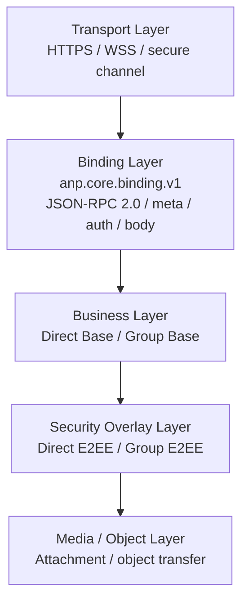
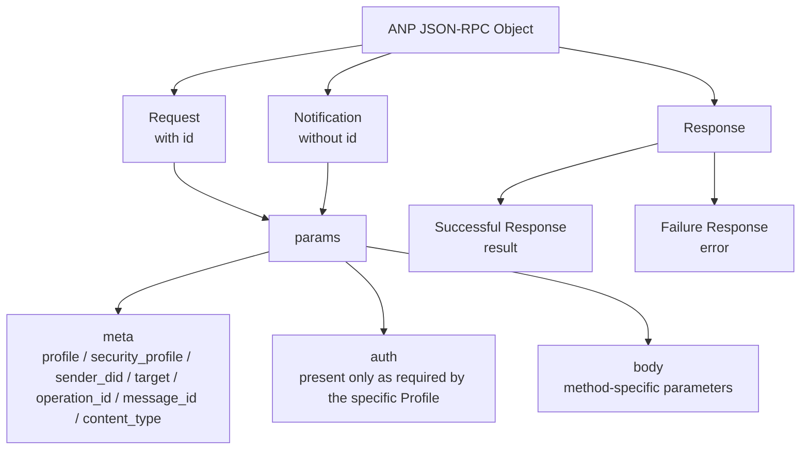
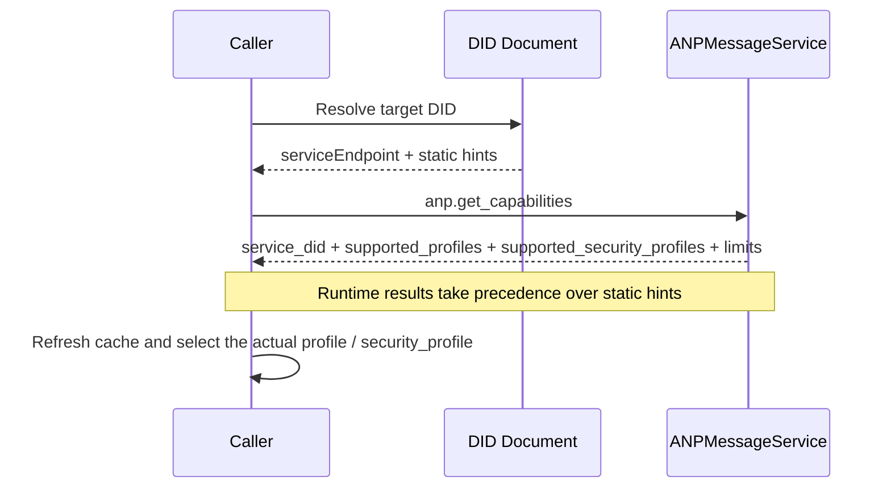

<!-- translation-review: full; source=deprecated/01-core-binding.md; method=full-original-to-translation-semantic-comparison -->
> 日本語参考訳（原文全体を段落ごとに意味照合済み）。deprecated配下に保存された旧版です。Released・1.1・v1は当時の状態を示し、現行版への適合を示しません。付録A・Bも規範的部分として照合し、コードと識別子を保持しています。規範となるのは原文です。
> 原文: [deprecated/01-core-binding.md](../../deprecated/01-core-binding.md) / 基準コミット: `0837cfdfaf4ddcf834f0890ddaf34fc4c824e066`

# ANPプロファイル1：コアバインディング

- 文書ID：ANP-P1
- タイトル：コアバインディング
- 状態：公開済み（Released）
- バージョン：1.1
- 原文言語：英語／本ページは日本語参考訳
- 適用範囲：すべてのANP基本プロファイルとセキュリティオーバーレイに適用します。

---

## 1. 目的

本プロファイルは、ANP共通の外側のメッセージバインディング、共通フィールド、能力交渉、エラーモデル、相互運用の制約を定義します。

目的は次のとおりです。

1. すべてのANPメソッドに統一されたメッセージエンベロープを提供。
2. プロファイルごとに要求・応答・通知・エラー形式を作り直すことを回避。
3. Direct Base、Group Base、Direct E2EE、Group E2EE、Attachment、Federationなどへ共通の基礎を提供。
4. JSON-RPC 2.0との基本的な互換性を保ちつつ、任意性を狭め、実装間の曖昧さを減らす。

---

## 2. 用語と規範上の慣例

### 2.1 規範キーワード

本書の**MUST**、**MUST NOT**、**REQUIRED**、**SHALL**、**SHALL NOT**、**SHOULD**、**SHOULD NOT**、**RECOMMENDED**、**NOT RECOMMENDED**、**MAY**、**OPTIONAL**は、大文字の場合に規範的な要求として解釈します。

### 2.2 用語

- **ANP Endpoint**：ANPを実装するプロトコル終端。通常はAgentの所属ドメインの入口サービス、Group Host、その他の宣言済みエンドポイントです。
- **Request**：`id`を持つJSON-RPC呼び出しオブジェクト。
- **Notification**：`id`を持たないJSON-RPC呼び出しオブジェクト。
- **Result**：成功応答の`result`メンバー。
- **Error**：失敗応答の`error`メンバー。
- **Profile**：`anp.direct.base.v1`など、ANPのプロトコル能力の単位。
- **Security Profile**：`transport-protected`、`direct-e2ee`、`group-e2ee`など、安全性の意味の単位。
- **Operation**：メッセージ送信、グループ作成、メンバー追加、グループ状態変更の提出など、冪等に識別できるプロトコル操作。
- **Message-bearing Operation**：`direct.send`、`group.send`、`group.e2ee.send`など、アプリケーション層のメッセージペイロードを運ぶ操作。
- **Message-bearing Notification**：`direct.incoming`、`group.incoming`、`group.e2ee.notice`など、アプリケーション層のメッセージペイロードを運ぶ通知。
- **Control Operation**：`group.create`、`group.add`、`group.remove`など、業務メッセージを運ばずにプロトコルまたは業務状態を変更する操作。
- **Origin Proof**：業務主体の秘密鍵で生成し、`auth.origin_proof`で運ぶアプリケーション層の送信元証明。
- **Object Proof**：オブジェクト内の`proof`によって、「`proof`を除くオブジェクト全体」に対して行う、検証可能なオブジェクト単位の主張。
- **Signed Request Object**：`method`、`meta`、`body`からなる正規化された共有業務オブジェクト。`contentDigest`の計算に使います。

---

## 3. 設計原則

### 3.1 階層化の原則

ANPは次の階層を用います。

1. **伝送層**：HTTP(S)、WebSocket Secureなどの安全な伝送。
2. **バインディング層**：本書が定義するJSON-RPC 2.0バインディング。
3. **業務層**：Direct Base、Group Baseなどの業務の意味。
4. **セキュリティオーバーレイ層**：Direct E2EE、Group E2EEなどの安全性の意味。
5. **メディア／オブジェクト層**：Attachmentなどの大容量オブジェクト拡張。

全体の階層境界を理解できるよう、次の図に伝送層からメディア／オブジェクト層までを示します。後続のプロファイルは、この枠組みの上で自分のオブジェクト、フロー、要件をさらに制約します。



*図P1-1：ANPの階層の概要（非規範的）。*

図が示すのは配置トポロジーではなく責任の境界です。同じサービス内に複数層をまとめてもかまいませんが、実装間の相互運用のため、意味の分離は保つことが望まれます。

### 3.2 最低相互運用の原則

本プロファイルの制約を満たす実装は、次を共有できます。

- 要求・応答形式。
- 通知形式。
- 共通フィールドの意味。
- 能力交渉の方法。
- エラーモデル。
- 冪等処理の原則。

### 3.3 対象外の機能

本プロファイルでは、次を定義しません。

- 履歴の取得。
- 既読状態。
- 端末同期。
- オンライン状態。
- 内部複製の一貫性。
- 具体的なE2EEアルゴリズム。

これらは他のプロファイルで定義するか、ANP標準の範囲外と明示する必要があります。

### 3.4 プロファイル識別子

本プロファイルの標準名は次のとおりです。

`anp.core.binding.v1`

後続のプロファイルは、依存関係の宣言でこの名前を使って参照しなければなりません（**MUST**）。

---

## 4. バインディングの基礎

### 4.1 JSON-RPCの版

ANP Core Bindingは、JSON-RPC 2.0を使わなければなりません（**MUST**）。

すべての要求・応答オブジェクトで、`jsonrpc`は文字列`"2.0"`と厳密に一致しなければなりません（**MUST**）。

### 4.2 安全な伝送の要件

すべてのANPバインディングは、次のような認証された安全な伝送層上で動作しなければなりません（**MUST**）。

- HTTPS。
- WSS。
- 機密性、完全性、相手認証を提供するその他の安全なチャネル。

未認証・未暗号化の生の伝送上での動作は認めません。

### 4.3 伝送方式からの独立

論理的には伝送方式に依存しません。HTTP(S)とWSSは推奨する方式ですが、それだけに限定しません。
メッセージオブジェクトの意味を変えない新しいバインディングは、補足文書として定義します。

---

## 5. JSON-RPCの相互運用制約

### 5.1 `params`の形式

元のJSON-RPC仕様では、`params`に位置指定の配列または名前指定のオブジェクトを認めていました。
ANPでは`params`をオブジェクトにしなければならず（**MUST**）、配列形式を使ってはなりません（**MUST NOT**）。
配列形式の`params`を受けたら、`anp.invalid_params_shape`エラーを返さなければなりません（**MUST**）。

### 5.2 `id`の型

元のJSON-RPC仕様は、`id`に文字列、数値、`null`を認めていました。
ANP Requestの`id`は、空でない文字列でなければなりません（**MUST**）。
Requestの`id`に数値を使ってはなりません（**MUST NOT**）。
Requestの`id`に`null`を使ってはなりません（**MUST NOT**）。
要件に合わない`id`には、`anp.invalid_request_id`を返さなければなりません（**MUST**）。

### 5.3 Notificationの使用範囲

ANPでNotificationを使うのは、次の場面**だけ**です。

1. 相手が能動的にプッシュする非同期イベント。
2. 確認を要さず、エラー詳細を返すべきでない一方向の通知。

次の操作にNotificationを使ってはなりません（**MUST NOT**）。

- 永続状態を変更する制御操作。
- 冪等な確認を必要とするメッセージ送信。
- 呼び出し元が成否を知る必要のある操作。

### 5.4 バッチの禁止

ANPではJSON-RPCのバッチ呼び出しを使ってはなりません（MUST NOT）。
クライアントはバッチを送ってはなりません（**MUST NOT**）。
サーバーはバッチを受けたら拒否し、`anp.batch_not_supported`を返さなければなりません（**MUST**）。

### 5.5 メソッド名の制約

メソッド名は文字列とし、次の命名規則に従わなければなりません（**MUST**）。

- 論理的な名前空間を使う。
- 小文字の英字で始める。
- `.`で部分を区切る。
- `rpc.`で始めてはならない（**MUST NOT**）。
- 業務メソッドは`<domain>.<action>`形式が望ましい（**SHOULD**）。

推奨例：

- `anp.get_capabilities`
- `direct.send`
- `group.create`
- `group.add`
- `group.send`

### 5.6 応答の制約

Notificationを除き、サーバーは各RequestにResponseを返さなければなりません（**MUST**）。
成功応答は`result`を含め（**MUST**）、`error`を含めてはなりません（**MUST NOT**）。
失敗応答は`error`を含め（**MUST**）、`result`を含めてはなりません（**MUST NOT**）。
Responseの`id`は、対応するRequestの`id`と厳密に一致しなければなりません（**MUST**）。

---

## 6. 共通の`params`構造

### 6.1 最上位オブジェクト

特定の例外を除き、ANPの`params`は次の構造でなければなりません（**MUST**）。

```json
{
  "meta": { "...": "..." },
  "auth": { "...": "..." },
  "body": { "...": "..." }
}
```

内訳は次のとおりです。

- `meta`：解釈に用いるProfile、宛先、冪等性、セキュリティプロファイルなどの共通メタデータ。
- `auth`：任意の認証・証明オブジェクト。個別Profileが明示的に要求するときだけ現れます。
- `body`：メソッド固有のパラメーター。

個別Profileが`auth`を定義しなければ、省略してもかまいません（**MAY**）。
明示的に`auth`を要求するProfileでは、呼び出し元が提供し（**MUST**）、受信者が検証しなければなりません（**MUST**）。
`meta`、`auth`、`body`以外の最上位`params`メンバーは、対応Profileが明示的に定義する場合だけ認めます。

次の図は、繰り返し使う外側のエンベロープをまとめます。Request、Notification、Responseが共有する構造と、`meta`、`auth`、`body`の責任を示します。



*図P1-2：ANP JSON-RPCエンベロープの構造（非規範的）。*

後続の業務Profileやオーバーレイは、図と競合する最上位構造を作らず、`body`と必要な`auth`の制約だけを拡張することが望まれます。

### 6.2 `meta`オブジェクト

`meta`のフィールドを次のように定義します。

#### 6.2.1 `anp_version`

- 型：文字列
- 要件：任意（**MAY**）。
- 意味：ANPのメジャーバージョンのヒント。
- 既定値：省略時は`"1.0"`と解釈しなければなりません（**MUST**）。
- 説明：
  - 明示的なデバッグや、版をまたぐゲートウェイのための予約フィールド。
  - v1では、解釈規則を決める際に`profile`を優先。
  - 新実装では、主要な交渉フィールドではなく互換性用として扱うことが望まれます（**SHOULD**）。

#### 6.2.2 `profile`

- 型：文字列
- 要件：必須（**MUST**）。
- 意味：この要求を解釈する唯一のProfile。
- 説明：
  - `profile`は、現在の要求の`body`、`result`、エラー制約、メソッドの意味をどのProfileで解釈するかを宣言します。
  - `profile`で複数Profileの和集合としての意味を同時に表してはなりません（**MUST NOT**）。
  - `security_profile`は安全性のモードだけを表し、`profile`を置き換えません。
- 例：
  - `"anp.direct.base.v1"`
  - `"anp.group.base.v1"`
  - `"anp.direct.e2ee.v1"`
  - `"anp.group.e2ee.v1"`

#### 6.2.3 `security_profile`

- 型：文字列
- 要件：必須（**MUST**）。
- 意味：この呼び出しのセキュリティプロファイル。
- 許される値：
  - `"transport-protected"`
  - `"direct-e2ee"`
  - `"group-e2ee"`
- 説明：
  - `security_profile`は、現在の要求で使用する安全性のモードを示します。
  - 安全性の水準や意味を表し、`body`の解釈構文は表しません。
  - `profile`が特定の`security_profile`の組み合わせだけを認める場合、そのProfileが明示する必要があります。

#### 6.2.4 `sender_did`

- 型：文字列（DID）
- 要件：匿名の公開発見能力を除き必須（**MUST**）。
- 意味：業務上の意味での送信主体DID（業務送信元DID・論理送信者DID）。
- 説明：
  - 通常のRequestでは、`sender_did`が現在の業務開始者を示すことが望まれます（**SHOULD**）。
  - サーバー生成のNotificationで`sender_did`を省略できるか、論理発行者を他のフィールドで表すかは、個別Profileが定義します。
  - `sender_did`を、外側の伝送接続の1ホップの呼び出し元IDと自動的に同一視してはなりません（**MUST NOT**）。

#### 6.2.5 `target`

- 型：オブジェクト
- 要件：プロトコル上の宛先があるメソッドでは必須（**MUST**）。
- 構造：

```json
{
  "kind": "agent | group | service",
  "did": "did:example:..."
}
```

- 説明：
  - `kind = "agent"`は単一のAgentを対象とします。
  - `kind = "group"`は単一のGroupを対象とします。
  - `kind = "service"`は公開`ANPMessageService.serviceDid`を対象とします。
  - `target.did`へ伝送層のURLを直接入れてはなりません（**MUST NOT**）。
  - 各メソッドのProfileは、`agent-addressed`、`group-addressed`、`service-scoped`、`endpoint-local`のどれかを明示しなければなりません（**MUST**）。
  - `target`を省略できるかはProfileが明示しなければならず（**MUST**）、送受信者が独自に推測してはなりません（**MUST NOT**）。
  - `auth.origin_proof`が必要なメソッドでは、`meta.target`が存在し（**MUST**）、`meta.target.kind`が`agent`、`group`、`service`のいずれかでなければなりません（**MUST**）。

#### 6.2.5.1 宛先モデルの宣言規則

Profile間の`target`解釈の分岐をなくすため、各メソッドが次のどの宛先モデルに属するかを明示しなければなりません（**MUST**）。

1. **agent-addressed**
   - `meta.target.kind = "agent"`
   - `meta.target.did`が宛先Agent DIDを指します。

2. **group-addressed**
   - `meta.target.kind = "group"`
   - `meta.target.did`が宛先Group DIDを指します。

3. **service-scoped**
   - `meta.target.kind = "service"`
   - `meta.target.did`が宛先の公開`ANPMessageService.serviceDid`を指します。

4. **endpoint-local**
   - Profileが明示する場合だけ、`meta.target`を省略できます。

endpoint-localと明示されないメソッドは、明示的な`target`が必要として扱わなければなりません（**MUST**）。

要求の`meta.target.kind`が宣言された宛先モデルと一致しなければ、`anp.invalid_target_binding`を返さなければなりません（**MUST**）。


#### 6.2.6 `operation_id`

- 型：文字列
- 要件：状態を変えるすべての操作で必須（**MUST**）。
- 意味：操作の冪等識別子。
- 規則：
  - 同じ開始者が同じ意味のコンテキストで再試行する場合、`operation_id`を変更せず保持しなければなりません（**MUST**）。
  - 冪等性の適用範囲は個別Profileが明示しなければなりません（**MUST**）。
  - サーバーは、楽観的同時実行制御や版の前提条件より先に、冪等性の一致確認を行わなければなりません（**MUST**）。
  - メッセージ識別と操作再試行識別を区別する必要がない限り、`operation_id = message_id`とすることが望まれます（**SHOULD**）。

#### 6.2.7 `message_id`

- 型：文字列
- 要件：メッセージを運ぶOperationでは必須（**MUST**）。
- 意味：アプリケーション層のメッセージ識別子。
- 説明：
  - `message_id`は、メッセージ単位の一意性や重複の識別に使います。
  - `message_id`と`operation_id`は同じでも異なってもかまいません。
  - 独立した操作のライフサイクルがなければ、`message_id`を`operation_id`に再利用することが望まれます（**SHOULD**）。
  - Profileが同一扱いを明示的に認めない限り、`message_id`で`operation_id`の一般的な冪等性の意味を暗黙に置き換えてはなりません（**MUST NOT**）。
  - メソッドがメッセージを運ぶNotificationであっても適用します。

#### 6.2.8 `created_at`

- 型：文字列（RFC 3339の時刻）
- 要件：推奨（**SHOULD**）。
- 意味：開始者が操作を作成した時刻。
- 注：後続のProfileが別途定めない限り、`created_at`をリプレイ防止の唯一の根拠には使いません。

#### 6.2.9 `trace_id`

- 型：文字列
- 要件：**もはや標準相互運用フィールドではありません**。
- 意味：実装内部の追跡識別子。
- 説明：
  - サービスをまたぐ追跡には、伝送層メタデータか、`x_trace_id`などの独自拡張を使うことが望まれます（**SHOULD**）。
  - 受信者は、安全性、認可、冪等性の判断へ組み込んではなりません（**MUST NOT**）。

#### 6.2.10 `content_type`

- 型：文字列
- 要件：メッセージを運ぶOperationでは必須（**MUST**）。
- 意味：現在のメッセージ操作の主な業務ペイロード種別。独立した外側のエンベロープを使うProfile/Overlayでは、そのエンベロープの型。

規則は次のとおりです。

1. 基本Profileで`body`が格納用構造にすぎない場合（`text` / `payload` / `payload_b64u`の排他構造など）、`meta.content_type`はJSONコンテナー自体の型ではなく、主要な業務ペイロードの型を表さなければなりません（**MUST**）。
2. オーバーレイで`body`が独立した暗号文エンベロープを持つ場合、`meta.content_type`はその外側のワイヤー型を表さなければなりません（**MUST**）。
3. 元のアプリケーション内容種別が外側と異なる場合、オーバーレイ内部の`application_content_type`などで表さなければなりません（**MUST**）。
4. メッセージを運ぶNotificationにも適用します。
5. `meta.content_type`の基本解釈は本Profileだけが定義します。他のProfile/Overlayが再定義してはなりません（**MUST NOT**）。

例：

- Direct Baseのテキスト：`text/plain`
- Group BaseのJSON：`application/json`
- Direct E2EEのテキスト：外側`meta.content_type = "application/anp-direct-cipher+json"`、内側`application_content_type = "text/plain"`
- Group E2EEの添付：外側`meta.content_type = "application/anp-group-cipher+json"`

業務ペイロードが通常の構造化JSONなら、内容種別は
`application/json`でなければならず（**MUST**）、JSONオブジェクトは`body.payload`へ直接格納する必要があります（**MUST**）。
または、セキュリティオーバーレイ内側の`payload`へ格納します。Profileとアプリケーションは、
コマンド、状態更新、タスク、結果などの業務の意味を区別するだけのために、
追加の内容種別を定義してはなりません（**MUST NOT**）。それらはJSONオブジェクト内部の
アプリケーション層の意味であり、コアバインディング層の範囲外です。

Group E2EEの内側の元の業務種別が添付マニフェストなら、内側の平文へ次のように記します。

```json
{
  "application_content_type": "application/anp-attachment-manifest+json"
}
```

外側の`meta.content_type`へ添付マニフェストの型を記し続けるのでは**ありません**。

### 6.3 `body`オブジェクト

`body`はメソッド固有のパラメーター集合です。

- 業務Profileがフィールドを定義しなければなりません（**MUST**）。
- オーバーレイProfileが暗号フィールドを定義しなければなりません（**MUST**）。
- `body`の未知フィールドを無視できるか、Profileが明示しなければなりません（**MUST**）。
- 安全性、ルーティング、権限、冪等性、状態機械の意味に影響する未知フィールドは拒否しなければなりません（**MUST**）。

---

## 7. ペイロードの表現規則

### 7.1 JSONオブジェクトを優先

自然にJSONオブジェクトとして表せる業務オブジェクトは、そのままJSONオブジェクトで表します。
ANPは、JSON文字列の中にJSONを入れる二重シリアライズを標準的な手法として使ってはなりません（**MUST NOT**）。

### 7.2 バイナリ表現

バイナリを運ぶ場合、フィールドをパディングなしbase64urlテキストで表さなければなりません（**MUST**）。
関連フィールド名は`_b64u`で終えることが望まれます（**SHOULD**）。例：

- `ciphertext_b64u`
- `key_package_b64u`
- `welcome_b64u`

### 7.3 数値表現

大きな整数、カウンター、連番の言語間の表現差を避けるため、次は10進数の文字列で表さなければなりません（**MUST**）。

- カウンター。
- 連番。
- 論理時計。
- epoch。
- generation。
- 大きな整数で表す長さ。
- IEEE 754倍精度の安全な整数範囲を超え得る値。

後続のProfileがJSONに標準化された署名を行う場合、入力のシリアライズ規則を明示する必要があります。
Signed Payloadなどの暗号バインドを定義するProfileは、一意に定まる正規化アルゴリズムを指定しなければなりません（**MUST**）。実装ごとに異なる安定シリアライズ方式を選んではなりません（**MUST NOT**）。

---

## 8. 能力交渉

### 8.1 一般事項

ANP Endpointは、能力交渉インターフェースを公開しなければなりません（**MUST**）。
その結果には、少なくとも次を含めなければなりません（**MUST**）。

- 対応するANP Profileの一覧。
- 対応するSecurity Profileの一覧。
- 実行時のサービスID。
- 最大ペイロード、最大オブジェクトサイズ、レート制限など、実装上の制約。

内容種別、メソッド単位の能力、Notification能力、認証方式などの細かな拡張を返してもかまいません（**MAY**）。ただし、本節の最低限の標準応答構造は変わりません。

### 8.2 標準メソッド：`anp.get_capabilities`

#### 8.2.1 要求

```json
{
  "jsonrpc": "2.0",
  "id": "req-001",
  "method": "anp.get_capabilities",
  "params": {
    "meta": {
      "profile": "anp.core.binding.v1",
      "security_profile": "transport-protected",
      "operation_id": "op-cap-001",
      "created_at": "2026-03-29T12:00:00Z"
    },
    "body": {}
  }
}
```

注：

- `anp.get_capabilities`は、匿名の公開発見能力として呼び出してもかまいません（**MAY**）。
- 匿名呼び出しでは、`meta.sender_did`を省略してもかまいません（**MAY**）。
- IDに応じて異なる能力の部分集合を返す場合、認証済みコンテキストで再度呼んでもかまいません（**MAY**）。

#### 8.2.2 成功応答

```json
{
  "jsonrpc": "2.0",
  "id": "req-001",
  "result": {
    "service_did": "did:example:service",
    "supported_profiles": [
      "anp.core.binding.v1",
      "anp.direct.base.v1",
      "anp.group.base.v1",
      "anp.direct.e2ee.v1"
    ],
    "supported_security_profiles": [
      "transport-protected",
      "direct-e2ee"
    ],
    "limits": {
      "max_request_bytes": "1048576",
      "max_message_bytes": "262144"
    },
    "supported_content_types": [
      "text/plain",
      "application/json",
      "application/anp-attachment-manifest+json"
    ]
  }
}
```

注：

- `result.service_did`は、その実行時能力結果に対応するサービスIDのDIDを示します。
- 静的DID文書はヒントだけを提供し、実行時能力はこの結果を基準とします。
- `supported_content_types`は推奨拡張です。実用上可能なら返すことが望まれます（**SHOULD**）。

### 8.3 交渉規則

- DID文書の静的拡張フィールドは、キャッシュ可能な静的ヒントです。
- `anp.get_capabilities`の結果は、実行時の権威ある情報です。
- 静的ヒントと矛盾する場合、実行時結果を基準にし、キャッシュを更新しなければなりません（**MUST**）。
- 最初のやり取りの前、またはキャッシュ失効後に、宛先の能力を取得することが望まれます（**SHOULD**）。
- 要求の`profile`や`security_profile`に非対応なら、明示的なエラーを返さなければなりません（**MUST**）。
- 基本Profileへの対応が、E2EE Overlayへの対応も意味すると仮定してはなりません（**MUST NOT**）。

静的ヒントと実行時能力結果は混同されやすい情報です。次の図は推奨する交渉順を示し、静的情報を発見に使い、実行時結果を最終判断に使う原則を強調します。



*図P1-3：能力交渉と実行時の権威ある情報（非規範的）。*

静的ヒントと実行時能力が競合する場合、図の実行時結果に従い、競合をキャッシュ更新の合図として扱うことが望まれます。

---

## 9. 冪等性と再試行

### 9.1 冪等性の原則

状態を変えるすべての操作は、冪等性に対応しなければなりません（**MUST**）。
同じ`(sender_did, target_scope, method, operation_id)`の重複要求では、

- 意味が同等なら、同じ結果または同等の結果を返さなければなりません（**MUST**）。
- 意味が競合するなら、`anp.idempotency_conflict`を返さなければなりません（**MUST**）。

ここで、

- `target_scope`の具体的な値は、対応Profileが定義しなければなりません（**MUST**）。
- Direct系では通常、`target_scope`は`target.did`です。
- Group系では通常、`target_scope`は`group_did`です。

### 9.2 メッセージの再試行

メッセージ送信操作では、

- 再試行時に`message_id`を変えてはなりません（**MUST**）。
- 再試行時に`operation_id`を変えてはなりません（**MUST**）。
- 独立した操作の意味がなければ、両者を同じにすることが望まれます（**SHOULD**）。
- サーバーは、まず操作単位の冪等性記録を確認しなければなりません（**MUST**）。
- `message_id`を含めるかなど、メッセージ重複識別キーは各メッセージProfileが明示する必要があります。

### 9.3 冪等でない操作

本質的に冪等でない操作は、対応Profileが明示し、代わりの回復手段を設けなければなりません（**MUST**）。
明示されないものは、すべて冪等と見なします。

---

## 10. エラーモデル

### 10.1 一般事項

ANPはJSON-RPCの`error`オブジェクトでエラーを表します。
JSON-RPC標準エラーコードの元の意味を**維持**しつつ、ANP独自のアプリケーションエラーコードを定義します。

次の場合はJSON-RPC標準コードを優先することが望まれます（**SHOULD**）。

| 場面 | 推奨JSON-RPCコード |
|---|---|
| JSONの解析不能 | `-32700 Parse error` |
| 不正なJSON-RPCオブジェクト | `-32600 Invalid Request` |
| メソッドが存在しない | `-32601 Method not found` |
| 不正なパラメーター構造 | `-32602 Invalid params` |
| サーバー内部の例外 | `-32603 Internal error` |

ANPの業務層エラーには、本書の1000以上のコードを使い、`error.data.anp_code`にも機械可読な意味を提供することが望まれます（**SHOULD**）。

### 10.2 ANPエラーオブジェクトの拡張

`error`の推奨構造：

```json
{
  "code": 1001,
  "message": "Unsupported profile",
  "data": {
    "anp_code": "anp.unsupported_profile",
    "retryable": false,
    "details": {}
  }
}
```

`code`がANP独自の範囲に属する場合、`error.data.anp_code`が存在しなければなりません（**MUST**）。

### 10.3 ANP共通エラーコード

| `code` | `anp_code` | 意味 |
|---|---|---|
| 1000 | `anp.invalid_request_id` | 不正な`id` |
| 1001 | `anp.unsupported_profile` | 要求Profileに非対応 |
| 1002 | `anp.unsupported_security_profile` | 要求Security Profileに非対応 |
| 1003 | `anp.invalid_params_shape` | `params`構造が要件を満たさない |
| 1004 | `anp.batch_not_supported` | バッチに非対応 |
| 1005 | `anp.unauthorized` | 認証に失敗 |
| 1006 | `anp.forbidden` | 認証済みだが権限なし |
| 1007 | `anp.target_not_found` | 宛先DIDがないか到達不能 |
| 1008 | `anp.idempotency_conflict` | 冪等キーの競合 |
| 1009 | `anp.unsupported_content_type` | 内容種別に非対応 |
| 1010 | `anp.delivery_rejected` | 宛先サービスが受信を拒否 |
| 1011 | `anp.rate_limited` | レート制限に到達 |
| 1012 | `anp.temporarily_unavailable` | 一時的に利用不能 |
| 1013 | `anp.invalid_security_binding` | 安全性のモードとペイロード構造が不一致 |
| 1014 | `anp.invalid_target_binding` | 要求の宛先モデルと実際の`meta.target`が不一致 |

### 10.4 エラー応答の要件

- ANP独自エラーでは、機械判定できる`anp_code`を返さなければなりません（**MUST**）。
- `message`は短く読みやすいことが望まれます（**SHOULD**）。
- `data.retryable`で再試行の可否を示すことが望まれます（**SHOULD**）。
- 不必要に機微な内部状態を漏らしてはなりません（**MUST NOT**）。
- 宛先バインドの誤りやservice-scoped/endpoint-localの誤用には、`anp.invalid_target_binding`を返すことが望まれます（**SHOULD**）。

---

## 11. メソッド登録と名前空間

### 11.1 名前空間

次の最上位名前空間を推奨します。

- `anp.*`
- `direct.*`
- `group.*`
- `attachment.*`
- `federation.*`

### 11.2 バージョン管理

Profile名には版を明示しなければなりません（**MUST**）。例：

- `anp.core.binding.v1`
- `anp.identity.discovery.v1`
- `anp.direct.base.v1`

### 11.3 拡張メソッド

実装者は独自拡張メソッドを定義してもかまいません（**MAY**）。ただし、

- 標準メソッドと同じ名前にしてはなりません（**MUST NOT**）。
- 独自プレフィックスを使うことが望まれます（**SHOULD**）。
- 他の実装も理解すると仮定してはなりません（**MUST NOT**）。

---

## 12. 互換性と版の発展

### 12.1 前方互換性

未知の拡張フィールドは、次のように処理します。

- 未知の中核`meta`フィールドは拒否しなければなりません（**MUST**）。
- `x_`で始まる実装拡張の`meta`フィールドは、無視してもかまいません（**MAY**）。
- 未知の`auth`フィールドは、Profileが拡張を明示的に認めない限り拒否しなければなりません（**MUST**）。
- 未知の`body`フィールドは、Profileが無視可能と明示する場合だけ無視してもかまいません（**MAY**）。
- 安全性、経路、権限、冪等性、状態機械の意味に影響する未知フィールドは、拒否しなければなりません（**MUST**）。

### 12.2 破壊的変更

次は破壊的変更であり、Profileのメジャーバージョンを上げる必要があります。

- `meta`フィールドの意味の変更。
- エラーコードの意味の変更。
- メソッド名の意味の変更。
- Security Profileの意味の変更。
- ペイロード構造の互換性が失われる変更。

---

## 13. セキュリティ上の考慮事項

### 13.1 セキュリティプロファイルを固定

呼び出し元とサーバーは、明示的な交渉なしに高い安全性のモードから低いものへ暗黙に下げてはなりません（**MUST NOT**）。
要求された`security_profile`に宛先が非対応なら、`anp.unsupported_security_profile`を明示的に返さなければなりません（MUST）。

### 13.2 タイムスタンプを主要なリプレイ防止手段にしない

`created_at`だけをリプレイ防止手段に使ってはなりません（**MUST NOT**）。
セッション、メッセージ、グループの状態に基づく防止方式は、後続Profileで定めることが望まれます。

### 13.3 追跡フィールドを分離

`trace_id`、ログラベル、監視フィールドを、暗号バインドや業務認可判断に含めてはなりません（**MUST NOT**）。

### 13.4 ペイロードの排他

Profileが`body.payload`と`body.payload_b64u`を排他的とする場合、同時に提供してはならず（**MUST NOT**）、競合する入力は拒否しなければなりません（**MUST**）。

`meta.content_type`が`application/json`の場合、対応する格納先は
JSONオブジェクトでなければなりません（**MUST**）。送信者は、シリアライズしたJSON文字列を
`body.text`へ入れてはならず（**MUST NOT**）、JSONオブジェクトをさらにJSON文字列化して
`body.payload`へ二重に格納してもなりません（**MUST NOT**）。

---

## 14. プライバシー上の考慮事項

### 14.1 メタデータ最小化の原則

送信者は`meta`に、実装間の相互運用に必要な最小メタデータだけを入れることが望まれます（**SHOULD**）。

### 14.2 端末の意味を導入しない

本書はAgentとGroupだけを識別し、デバイス、端末、複製、内部動作単位を定義しません。
それらは内部実装であり、Core Bindingの標準フィールドとして強制してはなりません。

### 14.3 能力キャッシュ

能力交渉の結果はキャッシュすることが望まれます（**SHOULD**）。ただし能力変更、認証失敗、エンドポイントの切り替え、キャッシュ無効化時には、再交渉しなければなりません（**MUST**）。

---

## 15. 最低相互運用要件

適合する実装は、少なくとも次に対応しなければなりません（MUST）。

1. JSON-RPC 2.0。
2. オブジェクト形式の`params`。
3. 文字列の`id`。
4. `anp.get_capabilities`。
5. 共通エラーコード。
6. 冪等な`operation_id`。
7. `meta` / `body`の最上位構造。
8. 安全な伝送。
9. 匿名または認証済みの`anp.get_capabilities`の処理。
10. 統一された`content_type`の意味。外側は現在のワイヤーオブジェクト型を表す。
11. メソッドごとに`agent-addressed`、`group-addressed`、`service-scoped`、`endpoint-local`の宛先モデルを明示。
12. `service-scoped`のメソッドで、`meta.target.kind = "service"`と`target.did = serviceDid`の検証を強制。
13. `endpoint-local`を明示した場合だけ`target`の省略を認め、宣言のない曖昧な省略を拒否。

## 16. 例

例はCore Bindingの外側のエンベロープだけを示します。`group.e2ee.send`、`group.e2ee.notice`などのOverlayメソッドも、本書のRequest/Notification、`meta`、宛先モデル、エラーモデルに従います。

### 16.1 `direct.send`要求の例

```json
{
  "jsonrpc": "2.0",
  "id": "req-10001",
  "method": "direct.send",
  "params": {
    "meta": {
      "profile": "anp.direct.base.v1",
      "security_profile": "transport-protected",
      "sender_did": "did:example:agent-a",
      "target": {
        "kind": "agent",
        "did": "did:example:agent-b"
      },
      "operation_id": "msg-10001",
      "message_id": "msg-10001",
      "created_at": "2026-03-29T12:00:00Z",
      "content_type": "text/plain"
    },
    "auth": {
      "scheme": "anp-rfc9421-origin-proof-v1",
      "origin_proof": {
        "contentDigest": "sha-256=:BASE64_SHA256_OF_SIGNED_DIRECT_PAYLOAD:",
        "signatureInput": "sig1=(\"@method\" \"@target-uri\" \"content-digest\");created=1774785600;expires=1774785660;nonce=\"n-10001\";keyid=\"did:example:agent-a#key-1\"",
        "signature": "sig1=:BASE64_SIGNATURE:"
      }
    },
    "body": {
      "text": "hello"
    }
  }
}
```

### 16.2 成功応答の例

```json
{
  "jsonrpc": "2.0",
  "id": "req-10001",
  "result": {
    "accepted": true,
    "message_id": "msg-10001",
    "operation_id": "msg-10001",
    "target_did": "did:example:agent-b",
    "accepted_at": "2026-03-29T12:00:01Z"
  }
}
```

---

## 17. IANA／レジストリーのプレースホルダー

後続版では、次のレジストリーを設けることが望まれます（**SHOULD**）。

1. ANP Profile名。
2. Security Profile。
3. Content-Type。
4. ANPエラーコード。

---

## 18. 参考実装上の注意（非規範的）

実装者は、次の原則に従うことが望まれます。

- Core Bindingは、実装間で一致が必要なフィールドだけを保持します。
- DID文書の静的ヒントは発見用であり、実行時の判断はしません。
- 業務層は業務の意味を扱い、安全性の詳細はOverlayへ置きます。
- 追跡、ルーティング、内部ゲートウェイのフィールドは、可能な限り独自拡張か伝送層に置き、標準相互運用の境界へ含めません。

---
# 付録A（規範的）：共有Origin Proofの保持規約

本付録は、P3、P4、P6と将来の業務Profileで共有する、アプリケーション層のOrigin Proofの保持規約を定義します。

一般的な署名方式、Structured Fieldのシリアライズ、JSON正規化を**再定義しません**。次の標準を直接使用します。

* **RFC 8785**：JSON Canonicalization Scheme（JCS）。
* **RFC 9530**：`Content-Digest`のフィールド値形式。
* **RFC 9421**：`Signature-Input`、`Signature`、signature baseの構築・検証モデル。
* **RFC 3986**：URIのパーセント符号化。
* `did:wba`のDID解決、検証メソッドの認可関係、パスのフィンガープリント検証は、**did:wbaメソッド仕様**に従います。

ANP独自の定義は、次に限ります。

1. `auth.origin_proof`の格納フィールド。
2. 統一**Signed Request Object**。
3. `@method` / `@target-uri` / `content-digest`のアプリケーション層の対応付け。
4. ホップ・サービス認証、ドメイン間転送との責任の境界。

## A.1 `auth.scheme`と`auth.origin_proof`を統一

アプリケーション層のOrigin Proofを使うProfileでは、

* `auth.scheme`は`anp-rfc9421-origin-proof-v1`でなければなりません（**MUST**）。
* `auth.origin_proof`が必要です（**MUST**）。
* `auth`自体をダイジェストの入力に含めてはなりません（**MUST NOT**）。

推奨構造は次のとおりです。

```json
{
  "auth": {
    "scheme": "anp-rfc9421-origin-proof-v1",
    "origin_proof": {
      "contentDigest": "sha-256=:BASE64_SHA256_DIGEST:",
      "signatureInput": "sig1=(\"@method\" \"@target-uri\" \"content-digest\");created=1733402096;expires=1733402156;nonce=\"abc123\";keyid=\"did:wba:example.com:user:alice:e1_<fingerprint>#key-1\"",
      "signature": "sig1=:BASE64_SIGNATURE:"
    }
  }
}
```

注：

* `contentDigest`はRFC 9530の`Content-Digest`のフィールド値。
* `signatureInput`はRFC 9421の`Signature-Input`のフィールド値。
* `signature`はRFC 9421の`Signature`のフィールド値。

## A.2 共有`origin_proof`の構造

`origin_proof`には少なくとも次を含めなければなりません（**MUST**）。

* `contentDigest`
* `signatureInput`
* `signature`

将来版に別の指定がない限り、v1の規約は次のとおりです。

* `contentDigest`は`sha-256`を使う（**MUST**）。
* `signatureInput`はラベル`sig1`を使う（**MUST**）。
* `signature`はラベル`sig1`を使う（**MUST**）。
* 署名で覆う要素の集合は、次に固定する（**MUST**）。

```text
("@method" "@target-uri" "content-digest")
```

構文、シリアライズ、検証はRFC 9530とRFC 9421へ直接従わなければならず（**MUST**）、代替形式を作ってはなりません（**MUST NOT**）。

## A.3 共有Signed Request Object

`contentDigest`は、`auth`を含まない標準業務オブジェクト、**Signed Request Object**へバインドしなければなりません（**MUST**）。

一般的な構造は次のとおりです。

```json
{
  "method": "<jsonrpc method>",
  "meta": {
    "...": "..."
  },
  "body": {
    "...": "..."
  }
}
```

規則は次のとおりです。

* Signed Request Objectに含めるのは`method`、`meta`、`body`だけとしなければなりません（**MUST**）。
* `jsonrpc`、`id`、`auth`を含めてはなりません（**MUST NOT**）。
* `contentDigest`の計算前にRFC 8785 JCSで正規化・シリアライズしなければなりません（**MUST**）。
* 既定の任意フィールドは省略しなければなりません（**MUST**）。
* 上流サービスの経路情報、ローカルキャッシュ、運用追跡フィールドを含めてはなりません（**MUST NOT**）。

注：

* 業務Profileは、`meta` / `body`の必須フィールドを追加で制約してもかまいません（**MAY**）。
* ただし`auth.origin_proof`が必要なメソッドのダイジェスト対象は、常に本付録のSigned Request Objectです。Profileごとに汎用署名用の外枠を作り直しません。

## A.4 全体に共通する署名要素の対応付け

ANP JSON-RPC要求にdid:wba認証情報を運ぶ際、中継を通じた署名の安定性のため、`Signature-Input`の主要素は次の共通対応付けを使わなければなりません（**MUST**）。

* `@method`：`Signed Request Object.method`へ対応付け。
* `@target-uri`：`anp://{meta.target.kind}/{pct-encoded meta.target.did}`へ対応付け。
* `content-digest`：Signed Request Objectの`contentDigest`値へ対応付け。

ここで、

* `pct-encoded`は`meta.target.did`のUTF-8バイト列から、RFC 3986に従いパーセント符号化しなければなりません（**MUST**）。
* `auth.origin_proof`が必要なメソッドは、`meta.target`を持たなければなりません（**MUST**）。
* `meta.target.kind`は`agent`、`group`、`service`のいずれかとします（**MUST**）。
* 将来endpoint-localメソッドが`auth.origin_proof`を導入する場合、宛先モデルと再構築規則をProfileが明示しなければなりません（**MUST**）。

理由：

`meta.target.kind`はSigned Request Objectを通じて`contentDigest`に含まれます。それでも`@target-uri`へ`kind`を明示するのは、ダイジェスト対象全体を展開する前に、署名ベースだけで宛先種別を読み、監査し、独立に確認できる安定した意味を保つためです。

P1付録Aは複数の業務Profileで共有するOrigin Proofの基礎です。次の図は`Signed Request Object`、`contentDigest`、`@method` / `@target-uri` / `content-digest`の関係をまとめます。

```mermaid
flowchart LR
M1[method]
M2[meta]
M3[body]

M1 --> SRO[Signed Request Object]
M2 --> SRO
M3 --> SRO

SRO --> JCS[RFC 8785 JCS]
JCS --> CD[contentDigest]

M1 --> HM[@method]
M2 --> TU[@target-uri<br/>anp://kind/pct-encoded-did]

HM --> SB[Signature Base]
TU --> SB
CD --> SB

SB --> SI[signatureInput]
SB --> SG[signature]

CD --> OP[auth.origin_proof]
SI --> OP
SG --> OP
```

*図P1-4：Signed Request ObjectとOrigin Proofのバインド（非規範的）。*

`auth.origin_proof`が必要な後続メソッドでは、文書ごとに汎用署名用エンベロープを作らず、この図で入力と署名要素の由来を理解することが望まれます。

## A.5 標準署名モデルとの関係

本付録のアプリケーション層の対応付け以外では、送信者と検証者はRFC 9421の署名モデルを直接再利用しなければなりません（MUST）。

* `signatureInput`のフィールド値の構築。
* `signature`のフィールド値の構築。
* 署名ベースの生成。
* 署名対象の要素の順序の解釈。
* `@signature-params`の構築と検証。

具体的には、

* RFC 9421の意味に従う署名ベースへ署名しなければなりません（**MUST**）。
* 生のJSON要求テキストへ直接署名してはなりません（**MUST NOT**）。
* `signatureInput`のJSON文字列フィールドへ直接署名してはなりません（**MUST NOT**）。

本付録が置き換えるのは、要素の値がどこから来るかという層だけです。
標準HTTP Message Signaturesでは通常HTTPメッセージから取得し、ANPでは本付録のアプリケーション層の対応付けから取得します。

## A.6 最低限の検証要件

検証者は、少なくとも次を行わなければなりません（**MUST**）。

1. `auth.origin_proof`を読む。
2. `contentDigest`、`signatureInput`、`signature`を取り出す。
3. 現在の`method`、`params.meta`、`params.body`からSigned Request Objectを再構築。
4. RFC 8785 JCSで正規化・シリアライズ。
5. `contentDigest`を再計算。
6. `method`から`@method`を再構築。
7. `meta.target.kind`と`meta.target.did`から`@target-uri`を再構築。
8. RFC 9421で署名ベースを再構築・検証。
9. `keyid`が指すDID文書を解決し、認証メソッドの存在と`authentication`関係での認可を確認。
10. DIDメソッドの規則に従い、署名、時刻の許容範囲、リプレイ防止方針を検証。

どの手順でも失敗したら、要求を拒否しなければなりません（**MUST**）。

## A.7 DIDと検証関係

* `keyid`は解決可能なDID URLを指さなければなりません（**MUST**）。
* `keyid`の所属DID文書を解決し、`authentication`関係で認められた検証メソッドか確認しなければなりません（**MUST**）。
* `keyid`の所属DIDは、適用Profileが求める業務主体DIDと一致しなければなりません（**MUST**）。
* did:wbaのパス型`e1_` DIDでは、パスのフィンガープリントのバインドも検証しなければなりません（**MUST**）。

注：

* 現在のP3、P4、P6の要求では、業務主体DIDは通常`meta.sender_did`です。
* 将来、通知や宣言用Profileが別の業務主体DIDを使うなら、Profileが明示しなければなりません（**MUST**）。

## A.8 ホップ認証との関係

`anp-rfc9421-origin-proof-v1`が証明するのは業務上の送信元のIDであり、現在のネットワーク1ホップの呼び出し元IDではありません。

したがって、

* ホップ・サービス認証は、ホップごとに変わってもかまいません（**MAY**）。
* 中間サービスは、自分のサービスIDで新しい業務Origin Proofへ書き換えてはなりません（**MUST NOT**）。
* 宛先は業務Origin Proofを独立に検証し（**MUST**）、上流サービスのIDだけから有効と推定してはなりません（**MUST NOT**）。

## A.9 ドメイン間転送

元のサービス要求が`auth.origin_proof`を持つ場合、送信元は、

* 変更せず要求とともに転送する（**MUST**）。
* 新しい業務Origin Proofを作らない（**MUST NOT**）。
* 外側HTTPの`serviceDid`の署名で`auth.origin_proof`を置き換えない（**MUST NOT**）。

注：

* 外側のHTTP認証は、現在どのサービスが次のホップを呼んでいるかを証明します。
* `auth.origin_proof`は、どの業務主体が操作を開始したかを証明します。
* 責任が異なるため、互いに代用してはなりません（**MUST NOT**）。

---
# 付録B（規範的）：共有Object Proofプロファイル

本付録はP4、P5、P6と将来のオブジェクトベースProfileで共有するObject Proofの構成を定義します。オブジェクトの節がこの付録の`proof`を使用すると宣言した場合、その`proof`は本付録に従わなければなりません（**MUST**）。

## B.0 規範参照と位置付け

本付録は**W3C Data Integrity**の証明フレームワークと関連する暗号スイートを再利用するものであり、Verifiable Credentialsデータモデル全体を採用するものでは**ありません**。

具体的には、

- `DataIntegrityProof`の共通フレームワークは、**[W3C Verifiable Credential Data Integrity 1.0](https://www.w3.org/TR/vc-data-integrity/)**に従います。
- `eddsa-jcs-2022`の生成・検証は、**[W3C Data Integrity EdDSA Cryptosuites v1.0](https://www.w3.org/TR/vc-di-eddsa/)**に従います。
- JSON正規化は、**[RFC 8785：JSON Canonicalization Scheme（JCS）](https://www.rfc-editor.org/rfc/rfc8785)**に従います。
- バイト列の符号化は、**[RFC 3629：UTF-8、ISO 10646の変換形式](https://www.rfc-editor.org/rfc/rfc3629)**に従います。
- DID文書、検証関係、DID URLの基本的な意味は、**[W3C DID Core 1.0](https://www.w3.org/TR/did-core/)**に従います。
- `did:wba`を使う配置では、解決、パスのフィンガープリントのバインドなどを、**[did:wbaメソッド仕様](https://agentnetworkprotocol.com/en/specs/03-did-wba-method-specification/)**などの該当メソッド仕様に従って追加で検証します。

Data Integrity、`eddsa-jcs-2022`、JCS、UTF-8、DID Core、DIDメソッド自体を**再定義しません**。
ANPが統一するのは次だけです。

1. オブジェクト単位の`proof`の固定形式。
2. 保護対象文書の決定規則。
3. UTF-8とRFC 8785 JCSによる正規化・シリアライズ要件。
4. `proofPurpose = "assertionMethod"`の既定の共通の意味。
5. 共通の検証手順と、オブジェクト固有制約との責任分担。

## B.1 適用範囲

現在のv1では、次のオブジェクトは本付録を使わなければなりません（**MUST**）。

- P4の`group_receipt.proof`
- P5の`prekey_bundle.proof`
- P6の`did_wba_binding.proof`

将来、類似のオブジェクト単位`proof`を導入し、異なる方式を明示しないProfileは、本付録を再利用することが望まれます（**SHOULD**）。

## B.2 統一`proof`構造

本付録を使うオブジェクトの`proof`には、少なくとも次が必要です（**MUST**）。

- `type`
- `cryptosuite`
- `verificationMethod`
- `proofPurpose`
- `created`
- `proofValue`

推奨構造は次のとおりです。

```json
{
  "proof": {
    "type": "DataIntegrityProof",
    "cryptosuite": "eddsa-jcs-2022",
    "verificationMethod": "did:example:issuer#key-1",
    "proofPurpose": "assertionMethod",
    "created": "2026-03-29T12:00:00Z",
    "proofValue": "z..."
  }
}
````

v1の統一要件は次のとおりです。

* `proof.type`は`DataIntegrityProof`（**MUST**）。
* `proof.cryptosuite`は`eddsa-jcs-2022`（**MUST**）。
* `proof.proofPurpose`は`assertionMethod`（**MUST**）。
* `proof.verificationMethod`は完全なDID URL（**MUST**）。
* `proof.created`はRFC 3339時刻文字列（**MUST**）。
* `proof.proofValue`はbase58-btc multibase（`z...`）を使用（**MUST**）。

オブジェクトProfileが明示的に認めない限り、共通フィールドの意味を独自に解釈し直してはなりません（MUST NOT）。

## B.3 保護対象文書

`proof`の生成・検証で保護対象となる文書は、次でなければなりません（**MUST**）。

> **オブジェクト最上位の`proof`メンバーを除いた、オブジェクト全体**

したがって、

* 一部のフィールドだけへ保護範囲を縮小してはなりません（**MUST NOT**）。
* 外側のJSON-RPCエンベロープ、HTTPヘッダー、伝送メタデータ、ローカルキャッシュへ範囲を拡大してはなりません（**MUST NOT**）。
* 既定の任意フィールドは省略しなければなりません（**MUST**）。
* 省略を表すために`null`、空文字列、空オブジェクトなどのダミー値を使ってはなりません（**MUST NOT**）。

将来、入れ子やサブオブジェクトのproofなど特別な保護範囲が必要なら、Profileが明示しなければなりません（**MUST**）。それ以外は本節を適用します。

## B.4 正規化とシリアライズ

保護対象文書は、まず次の順に処理しなければなりません（**MUST**）。

1. RFC 8785 JCSによる正規化。
2. UTF-8符号化。

その後、`eddsa-jcs-2022`に従い`proof`を生成・検証します。

オブジェクトProfileが明示しない限り、別の安定シリアライズ、独自のソート、整形済みJSON、ローカル固有の符号化で代用してはなりません（**MUST NOT**）。

## B.5 発行主体DIDと検証メソッドの認可

本付録を使う各オブジェクトのProfileは、発行者DIDを宣言しなければなりません（**MUST**）。

Object Proofでは、

* `proof.verificationMethod`の所属DIDと、Profileが指定する発行者DIDが一致しなければなりません（**MUST**）。
* `proof.verificationMethod`が発行者DID文書に存在しなければなりません（**MUST**）。
* `proof.verificationMethod`が発行者DID文書の`assertionMethod`関係で認められていなければなりません（**MUST**）。
* `proofPurpose`は`assertionMethod`に固定し、**発行者DIDがオブジェクト全体について主張する**ことを既定の意味とします。

did:wbaのパス型`e1_` DIDのフィンガープリント結合など、DIDメソッドが追加検証を求める場合、それも実行しなければなりません（**MUST**）。

## B.6 オブジェクト固有の業務制約との分担

本付録が統一するのは**proofの枠組み**であり、オブジェクトの意味ではありません。

したがって、

* 共通Profileは`proof`の構文、保護対象文書、正規化、既定の認可関係を定義します。
* 各オブジェクトProfileは、少なくとも次を明示しなければなりません（**MUST**）。

  * どのDIDが発行者か。
  * 必要最小限の、安全性に重要なフィールド。
  * `proof`の検証後に必要な、業務上一貫性の確認。

`proof`の検証成功後も、Profileに従いフィールドの完全性、オブジェクトの意味、状態制約を検証し続けなければなりません（**MUST**）。`proof`に成功しただけで業務層の検証を飛ばしてはなりません（**MUST NOT**）。

## B.7 最低限の検証要件

本付録のオブジェクトには、少なくとも次を行わなければなりません（**MUST**）。

1. オブジェクトの`proof`を読む。
2. `type`、`cryptosuite`、`verificationMethod`、`proofPurpose`、`created`、`proofValue`の存在と適合を確認。
3. Profileに従い発行者DIDを特定。
4. 最上位の`proof`を除いたオブジェクト全体を保護対象文書として再構築。
5. UTF-8とRFC 8785 JCSで正規化・シリアライズ。
6. 発行者DID文書を解決。
7. `proof.verificationMethod`の存在と、発行者の`assertionMethod`での認可を確認。
8. `DataIntegrityProof + eddsa-jcs-2022`でproofを検証。
9. フィールドの完全性、時刻の許容範囲、状態参照など、Profile固有の業務検証を実施。

どれかが失敗した場合、オブジェクトを拒否しなければなりません（**MUST**）。
