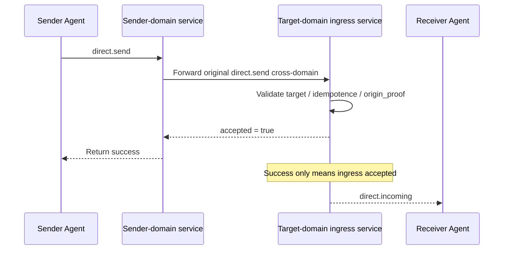

> 日本語参考訳（機械翻訳・未校閲）。規範となるのは原文です。コード例・識別子・規範キーワードは原文を保持しています。
> 原文: [deprecated/03-direct-messaging-base-semantics.md](../../deprecated/03-direct-messaging-base-semantics.md) / 基準コミット: `0837cfdfaf4ddcf834f0890ddaf34fc4c824e066`

# ANP のプロフィール 3: 直接メッセージングの基盤のセマティクス

- 文書ID: ANP-P3
- タイトル:直接メッセージングベースセマティクス
- ステータス: リリース
- バージョン: 1.1
- 原文言語: English / このページは日本語参考訳
- 応用性: このプロファイルは、エージェント間の直接メッセージングのセマティクスに適用され、エンドツーエンド暗号化アルゴリズム自体は含まれていません。

---

## 1. 目的:

このプロファイルは、ANPの直接メッセージングベースセマティクスレイヤーを定義します。, stipulating:

1. エージェントツーエージェントのダイレクトメッセージを表現する方法
2. 直接メッセージングメッセージの最小相互運用可能なフィールドとコンテンツモデル。
3. 成功のセマンティクス、不当なセマンティックスと直接メッセージのセマンティクスを注文する;
4. 直接メッセージングメッセージを非E2EEモードで独立して実行する方法。
5. 送信者本人認証を、wbaとクロスドメインの証拠に基づいて表現する方法
6. プロフィールのビジネスのセマンティックスにダイレクトE2EEプロファイルが優先される方法。

このプロファイルは定義しません。

- 特定のE2EEアルゴリズム;
- デバイスまたは内部のコピーコンセプト;
- 歴史の引き;
- ステータスを読んで下さい;
- プレゼンス;
- エージェント内部同期;
- 大きいオブジェクトのciphertext形式。

---

## 2. 用語集と定款

### 2.1 仮説キーワード

この記事では、 **MUST**, **MUST NOT**, **REQUIRED**, **SHALL**, **SHALL NOT**, **SHOULD**, **SHOULD NOT**, **RECOMMENDED**, **NOT RECOMMENDED**, **MAY**, **OPTIONAL** 資本金を基準とした規範的な要件として解釈されます。

### 2.2 用語集

- **ダイレクトメッセージ**: 1つのエージェントから別のエージェントに送信されたアプリケーションレイヤーメッセージ。
- **ベンダーエージェント**: 開始したエージェント `direct.send`、外で識別される `params.meta.sender_did`.
- **受精剤**: 対象エージェントの `direct.send`、外で識別される `params.meta.target.did`.
- **侵入サービス**: 対象エージェントが外部の世界へ露出したメインエントランスサービスで、ダイレクトメッセージを受信します。
- **会話**: 送信者と受信者の間のアプリケーションレイヤーの会話コンテキスト; 安定的 `conversation_id` 営業層によって決定される存在です。
- **受付中**: 対象となるエージェントのエントリーサービスでメッセージが受け付けられ、処理境界を入力する。
- **注射液**: プロトコルレイヤーでメッセージが拒否され、対象エージェントの処理境界は入力されていない。
- **起源の証拠**: 送信元エージェントが生成するアプリケーションレイヤーの原点認証は、d:wba JSON ベアラー認証に基づいて行われます。
- **ホップ認証**: 特定のホップサービスとエージェント間でのトランスポートレイヤー/要求層認証をサービスに転送します。
- **論理的ターゲット URI**: アプリケーションレイヤーのシグネチャがリレー全体で安定状態を維持できるようにするには、P1 Appendix A によってグローバルに定義された論理的ターゲット URI。

---

## 3. デザイン原則

### 3.1 Agent はプロトコルの終点です。

ANPダイレクトメッセージングのプロトコルエンドポイントは、デバイス、端末、セッションのレプリカ、または内部実行ユニットではなく、エージェントです。

対象となるエージェントのポータルサービスがメッセージを受信する限り、このプロファイルの配送ミッションが完了します。 ターゲットエージェントは、内部でどのように多くのレプリカ、何の実行者、または何のデバイスを同期するか、このプロファイルの相互運用性範囲内で落ちません。

### 3.2 基礎セマンティックスとセキュリティオーバーレイの分離

このプロファイルは、ビジネスのセマティクスとメッセージのセマティックのみを定義します。 直接E2EEプロファイルがその後追加されている場合、次のようになります。

- それでもビジネスの行動は `direct.send`;
- 直接メッセージングオブジェクトは、まだ `sender_did -> recipient_did`;
- コンテンツの種類とアプリケーションセマティクスは、このプロファイルによって定義されています。
- 追加の暗号オブジェクト、セッションの状態とセキュリティのバインディングは、E2EEプロファイルによって定義されます。

### 3.3 最小成功のセマティクス

このプロフィールで、成功 `direct.send` つまり、

- 対象となるエージェントのポータルサービスは、メッセージが受け入れられています。
- 対象となるエージェントのプロトコル処理境界を入力するメッセージです。

ターゲットエージェントがアプリケーションペイロードを処理しているか、ユーザーに提示されているか、内部の永続性を完了したことを意味するものではありません。

P3の「最小成功のセマティクス」は、「ピアが既にメッセージを読んでいる」と簡単に誤解することができます。 次のシーケンス図は、送信者、アウトバウンドドメインサービス、ターゲットイングレッションサービス、およびターゲットエージェントを同じパスに配置し、成功境界明示します。



*図 P3-1: エンドツーエンドのシーケンス `direct.send` (非放射性)。*

そのため、このプロフィールで成功を収めるのは、ターゲットエージェントのイングレッションサービスがメッセージを受け入れているかどうかだけに答えます。 ユーザーが表示されているかどうか、またはピア内で永続が完了しているかどうかを、読み取るかどうかは答えません。

### 3.4 非目標

このプロファイルは提供しようとしません。

- エンドツーエンドの機密性;
- 複数のデバイス一貫性;
- グローバル厳格な注文;
- 歴史再生可能なセマティクス;
- 配達の装置レベルの証拠。

### 3.5 原点証拠とホップ認証の分離

横断的なシナリオで, `direct.send` 認証の2種類以上を少なくとも2種類に含める場合があります。

1. **起源の証拠(Originの証拠)**: に対応するプライベートキーで生成される `sender_did`「送信者エージェントがこのビジネスメッセージを送る」という点を挙げる。
2. **ホップ認証(ホップ認証)**: 現在の接続のワンホップ呼び出し元によって生成され、「このネットワークリクエストを次のホップに送信するサービスまたはエージェント」が提供されます。

このページのコンテンツには、次のページが必要です。

- `direct.send`'ビジネス起源の証拠 **MUST** 転送チェーン全体で安定状態を維持します。
- サービスレベルの認証 **MAY** ホップの変更
- 受取人 **MUST NOT** 業務の原発者の身元を推定する `meta.sender_did` 流上サービスのアイデンティティに基づいてのみ。

---

## 4. プロフィールの同一証明および依存関係

### 4.1 プロフィール名

このプロファイルの標準的な名前は、次のとおりです。

`anp.direct.base.v1`

### 4.2 依存関係

プロフィール **MUST** 下記のプロフィールによります。

- `anp.core.binding.v1`
- `anp.identity.discovery.v1`

### 4.3 セキュリティプロファイル

このプロファイルは、独立して実行する基本的な直接メッセージングプロファイルとして使用されます。

- `meta.profile` **MUST** 等しく `anp.direct.base.v1`
- `meta.security_profile` **MUST** 等しく `transport-protected`

後続のE2EEオーバーレイがこのプロファイルのビジネスアクションとアプリケーションセマティクスを再使用している場合、次の手順を実行します。

- 対応するオーバーレイ **MUST** セキュリティオブジェクトを上に配置する方法を明確に説明 `direct.send` 美容師;
- 受信機 **MUST NOT** 高いセキュリティプロファイルからサイレントダウングレード `transport-protected` 明示的な交渉なし;
- いつか `meta.profile = "anp.direct.e2ee.v1"`の必須条件のための `auth.origin_proof` このプロフィールは、直接E2EEプロファイルによってオーバーライドされます。
- この適用範囲は意図的に設計されます: `direct-e2ee` 強固な耐久性を維持するために優先順位をあげます。 送信者本人認証は、主にE2EEセッションの構成材料、セッション結合、メッセージAADによって行われており、P3のアプリケーションレイヤーを使用する必要がなくなりました。 `origin_proof` デフォルトでは。

---

## 5. ダイレクトアドレスとセッションモデル

### 5.1 ターゲットタイプ

のために `direct.send`, `meta.target.kind` **MUST** は、 `"agent"`.
`meta.target.did` **MUST** パーサブル `agent_did`.

場合 `target.kind` は、 `"agent"`、受信機 **MUST** 返品 `anp.invalid_target_binding`.

### 5.2 送り主および受信機

あとは `direct.send`:

- そこまで **MUST** 唯一の1つの送信者代理店である;
- そこまで **MUST** 1 つの受信機の代理店だけである;
- **MUST NOT** 複数のターゲットエージェントに直接放送します。

### 5.3 `conversation_id`

プロフィール **MAY** 利用条件 `conversation_id` 送信者と受信者の間のアプリケーションレイヤーコンテキストを表すため。

場合 `conversation_id` 存在:

- とりあえず **MUST** 文字列になります。
- とりあえず **MUST NOT** デバイス、セッションのレプリカ、または内部の執行者 ID として解釈される。
- でん **MAY** 送信者によって生成されるか、または双方のビジネス・ロジック・ネゴシエーションによって決定される;
- でん **MUST NOT** 独自のセキュリティコンテキストや反再生識別子として機能します。

### 5.4 エージェント内部実装は見えない

受信機の次の内部詳細 **MUST NOT** ワイヤー プロトコルの相互運用性の皮薬として露出される:

- 内部キューの数;
- 内部コピーの数;
- 内部ワークフローノード数;
- 内部装置の数;
- 内部転送パス。

---

## 6. コンテンツモデル

### 6.1 コンテンツタイプ

`meta.content_type` **MUST** のり `direct.send` 存在します。

直接基盤で、 `body` 構造化されたホスティングコンテナです。 `meta.content_type` JSONコンテナオブジェクト自体の型ではなく、コンテナ内の主要なビジネスペイロードのコンテンツタイプを表します。 このセクションでは、P1 の統一された定義を次のようになります。 `meta.content_type`.

このページでは、最低限の相互運用性について紹介しています。 **MUST** 以下に示すコンテンツタイプをサポートしています。

- `text/plain`
- `application/json`
- `application/anp-attachment-manifest+json`

導入事例 **MAY** コンテンツの種類をもっとサポートする **MUST** 返品 `anp.unsupported_content_type` 未サポートのコンテンツタイプ

### 6.2 `body` 構造体

`direct.send` のり `body` **MUST** オブジェクトで、次のフィールドを含むことができます。

#### 6.2.1 `conversation_id`

- タイプ: 文字列
- 条件: **MAY**
- 分野:応用層セッションのコンテキスト識別
- 注意: これは、表示およびマージプロンプトフィールドであり、最小の相互運用性強い制約に属していません。

#### 6.2.2 `reply_to_message_id`

- タイプ: 文字列
- 条件: **MAY**
- 著名なメッセージ:このメッセージが返信する前のメッセージを示します

#### 6.2.3 `annotations`

- タイプ: オブジェクト
- 条件: **MAY**
- 分離: 送信者によってカスタマイズされる適用層の付加的なメタデータ
- ルール:
  - リレーサービス **MUST NOT** 不正な変更;
  - 認識されていない分野 **MAY** 受信機で無視される;
  - 許可、セキュリティ決定、または決定をルーティングする隠された制御のセマンティックスを慎重に運ぶために使用しないでください。

#### 6.2.4 `text`

- タイプ: 文字列
- 条件: **MUST** いつか `content_type = "text/plain"`
- ルール: 使用するとき `text`, `payload` とりあえず `payload_b64u` **MUST NOT** 同時に発生します。

#### 6.2.5 `payload`

- タイプ: JSON の目的
- 条件: **MUST** いつか `content_type = "application/json"`
- ルール: `payload` **MUST** アプリケーションオブジェクトを直接表現します。 **MUST NOT** JSON に埋め込まれたJSON文字列のデュアルシリアライズを使用します。 このプロファイルは、JSONオブジェクト内のフィールドのビジネスの意味を定義しません。

#### 6.2.6 `payload_b64u`

- タイプ: 文字列
- 要件:コンテンツがバイナリ拡張またはプライベートエクステンションオブジェクトの場合 **MAY**
- ルール:
  - パッドベース64urlはなくてはならない。
  - ご利用にあたって `payload_b64u`, `text` とりあえず `payload` **MUST NOT** 同時に表示されます。

### 6.3ペイロードフィールド相互除外規則

にほんご `direct.send`, `text`, `payload` とりあえず `payload_b64u`:

- これら1つの分野を正確に **MUST** プレゼント
- 複数の人が現れた場合、受取人 **MUST** リクエストを拒否する
- いずれの3つが存在しない場合、受取人 **MUST** リクエストを拒否する


### 6.4 `auth` オブジェクト

いつか `meta.profile = "anp.direct.base.v1"` とりあえず `meta.security_profile = "transport-protected"`, `direct.send`??????????????????????????????????????????????????????????????????????????????????????????????????????????????????????????????????????????????????????????????????????????????????????????????????????????????????????????????????????????????????????????????????????????????????????????????????????????????????????????????????????????????????????????????????????????????????????????????????????????????????????????????????????????????????????????????????????????????????????????????????????????????????????????????? `params` **MUST** 含まれるもの `auth` オブジェクト。

証拠のベアラールール、署名されたリクエストオブジェクトとこのセクションで署名されたコンポーネントマッピング **MUST** P1 付録 A で統一された定義を再使用して下さい; P3 **もはや** 独立した証拠のフィールド名、独立した署名されたペイロード構造またはローカルを定義します `@target-uri` マッピング。

推奨構造は以下の通りです。

```json
{
  "auth": {
    "scheme": "anp-rfc9421-origin-proof-v1",
    "origin_proof": {
      "contentDigest": "sha-256=:BASE64_SHA256_DIGEST:",
      "signatureInput": "sig1=(\"@method\" \"@target-uri\" \"content-digest\");created=1733402096;expires=1733402156;nonce=\"abc123\";keyid=\"did:wba:example.com:user:alice:e1_<fingerprint>#key-1\"",
      "signature": "sig1=:BASE64_SIGNATURE:"
    }
  }
}
```

ルール:

- `auth.scheme` **MUST** 等しく `anp-rfc9421-origin-proof-v1`
- `auth.origin_proof` **MUST** 存在している
- `auth` まあ、 **MUST NOT** 計算に参加 `contentDigest`

### 6.5 共有署名されたリクエストオブジェクトへの結合

`auth.origin_proof.contentDigest` **MUST** 共有されたバインド **署名された要求の目的** P1 付録 A で定義される。

のために `direct.send`:

- `method` **MUST** 等しく `direct.send`
- `meta.target.kind` **MUST** 等しく `agent`
- `meta.target.did` **MUST** ターゲット・エージェントの DID を等しい
- `meta.message_id` とりあえず `meta.content_type` **MUST** 存在している

### 6.6 グローバルコンポーネントマッピングへの参照

`direct.send` **MUST** P1 Appendix A で定義されているグローバルシグネチャコンポーネントのマッピングを使用します。

したがって:

- 検証者 **MUST** 再構築 `@method` から `method = "direct.send"`
- 検証者 **MUST** 再構築 `@target-uri = anp://agent/<pct-encoded meta.target.did>` から `meta.target.kind = "agent"` とりあえず `meta.target.did`
- 上記結果は、P1のグローバルルールから来ており、 **なし** P3 によって独自に定義されるローカルマッピングのセット

---

## 7. 標準方式

### 7.1 `direct.send`

#### 7.1.1 統計学

`direct.send` 送信者エージェントが、ターゲットエージェントにダイレクトメッセージを送ることを示します。

#### 7.1.2 要求の要件

コンプライアンス `direct.send` リクエスト **MUST** 満足する:

1. `method = "direct.send"`
2. `meta.profile = "anp.direct.base.v1"`
3. `meta.security_profile = "transport-protected"`
4. `meta.sender_did` **MUST** 存在している
5. `meta.target.kind = "agent"`
6. `meta.target.did` **MUST** 存在している
7. `meta.operation_id` **MUST** 存在している
8. `meta.message_id` **MUST** 存在している
9. `meta.content_type` **MUST** 存在している
10. `body` **MUST** このページのコンテンツに関する相互排除規則を満たします
11. `auth.scheme` **MUST** 等しく `anp-rfc9421-origin-proof-v1`
12. `auth.origin_proof` **MUST** 署名された要求オブジェクトが存在し、バインド

#### 7.1.3 成功的な応答

`result` **MUST** 成功の応答には、少なくとも次のものが含まれています。

- `accepted`: ボオラン、 **MUST** は、 `true`
- `message_id`: 一貫した `meta.message_id` リクエストの
- `operation_id`: 一貫した `meta.operation_id` リクエストの
- `target_did`: ターゲットエージェントID
- `accepted_at`: RFC 3339 時間の文字列

成功する応答 **MAY** 含まれるもの:

- `conversation_id`

#### 7.1.4 故障条件

受信機 **MUST** 拒否 `direct.send` 下記の状況下で:

- ターゲット DID が存在していないか、到達不能である。
- 現在の接続の 1 つのホップの呼び出し元は、このホップの呼び出し元認証を通過していません。
- コンテンツタイプがサポートされていない。
- 身体は、相互のコンテンツ除外規則に従わないよう要求します。
- 対象となるポリシーは、このメッセージを禁止します。
- セキュリティプロファイルの要求に違反します。
- `auth.origin_proof` 再生されるために欠落、無効、期限切れまたは疑わしいです。
- どのDIDにするか `keyid` 所属する `auth.origin_proof` と矛盾している `meta.sender_did`.

### 7.2 `direct.incoming` (必須通知)

#### 7.2.1 科学

`direct.incoming` 対象のイングレッシブで受け入れられているターゲットエージェントにダイレクトメッセージをプッシュするために、ANPエンドポイントが使用するこのプロファイルの標準的なプッシュ通知です。 P3の最小相互運用能力に所属しています。

#### 7.2.2 利用範囲

- メソッド **MUST** 実装される;
- 標準のプッシュパスですが、変更しない `direct.send`成功のセマティクス;
- このページのコンテンツへスキップ MUST 送受信、または処理ができる `direct.incoming`.

#### 7.2.3 制約

- `direct.incoming` **MUST** 通知として送られて下さい;
- 受信機 **MUST NOT** JSON-RPC レスポンスを返します。
- `params.meta.profile` **MUST** 等しく `anp.direct.base.v1`;
- `params.meta.security_profile` **MUST** 元の場合の等しいセキュリティ プロフィール `direct.send` 受付けます。
- `params.meta.target.kind` **MUST** なる `"agent"`;
- `params.meta.target.did` **MUST** 通知の受信者 DID に等しい;
- `params.meta.sender_did` **MUST** 元のビジネス メッセージの論理的な送信主題 DID に等しいです;
- `params.meta.operation_id` **MUST** 等しい原物 `direct.send.meta.operation_id`;
- `params.meta.message_id` **MUST** 等しい原物 `direct.send.meta.message_id`;
- `params.meta.content_type` **MUST** 等しいへの `meta.content_type` 元のビジネス メッセージの;
- `params.body` **MUST** 元のメッセージと一貫したサービスペイロードを運びます;
- 場合 `params.auth` 以下は、
  - `params.auth.scheme` **MUST** 等しく `anp-rfc9421-origin-proof-v1`;
  - `params.auth.origin_proof` **MUST** 元の損失のないコピーである `origin_proof`;
  - 中間サービス **MUST NOT** 新たな事業の証拠を再生する。

---

## 8. 配達、idempotenceおよび順序の皮脂

### 8.1 受諾の皮

あとは `direct.send` 成功する、それは単に意味します:

- 対象となるエージェントのポータルサービスは、メッセージが受け入れられています。
- 送信者 MAY 同じのためのretriesを停止して下さい `operation_id` 現地の方針が要求される場合を除きます。

### 8.2 免責と重複排除

受信機 **MUST** 次の最小セットに基づいて、不意な判断を下します。

- `sender_did`
- `target.did`
- `method`
- `operation_id`

メッセージレベルの重複のため、受信機 **SHOULD** 以下に基づいてください。

- `sender_did`
- `target.did`
- `message_id`

重複識別を実行します。.

### 8.3 注文セマティクス

厳しい注文保証は、このプロファイルは提供しません。

ダイレクトメッセージの場合:

- 実装パーティー **MAY** 同じ内で最高の努力シーケンシャル処理を実行 `conversation_id`;
- 相互ドメイン相互運用性層 **MUST NOT** ネットワークまたはサービスは、自然に厳しい FIFO 命令を提供することを仮定します。

### 8.4 再試行

のために `direct.send`送信者が同じメッセージを紐解くとき:

- `operation_id` **MUST** 変更されていないまま;
- `message_id` **MUST** 変更されていないまま;
- 業務用ペイロード **MUST** 意味的に等しいまま。

のために `direct.incoming`本サービスが同じ受信メッセージを再度プッシュするかどうかを選択した場合:

- `params.meta.operation_id` **SHOULD** 変更されていないまま;
- `params.meta.message_id` **SHOULD** 変更されていないまま;
- `params.body` **SHOULD** 元の通知と等しく残します。

のために `direct.send` とりあえず `direct.incoming`、伝達失敗の後で自動的に戻すかどうか **MAY** 現地の方針に従ってサービスによって決定される;このプロフィール **MUST NOT** 再送、固定リトライカウント、または固定バックオフアルゴリズムが必要です。

---

実装者にとって、フィールドの `direct.send` 多くの場合、間違いの本当のソースではありません。 硬い部分はチェックするかどうかを決定しています `operation_id` または `message_id` まずは、レトリーズの途中で。 下記の図では、最低相互運用性決定書の明示的な図を生成します。

```mermaid
flowchart TD
R1[Receive direct.send]
R1 --> K1{Does (sender_did,target.did,method,operation_id)<br/>already exist?}

K1 -->|No| P[Process normally]
P --> M1{Is message_id duplicated?}
M1 -->|No| S[Write idempotence record and return accepted]
M1 -->|Yes| D[Apply duplicate-message policy]

K1 -->|Yes| K2{Is the request semantically equivalent?}
K2 -->|Yes| E[Return the same or equivalent result]
K2 -->|No| C[anp.idempotency_conflict]
```

*図P3-2:直接メッセージの出入と再試決定(非規範)。*

実装は、まず操作レベルの低下に当たるべきであり、メッセージレベルの重複検出を処理します。そうしないと、分離的に同等のリクエストはネットワークの網膜やクロスドメイン再生保護シナリオの間に競合として誤って扱われる可能性があります。

## 9. セキュリティとポリシー

### 9.1 伝達保護条件

独立して実行するときのこのプロフィール、 **MUST** 認定された安全な輸送層に依存します。 保護されていないベア HTTP、WebSocket を bare、またはその他の未認証チャネル **MUST NOT** 使用される。

### 9.2 本人認証の送信者 `direct.send`

あらゆることのために `direct.send` 宣言する `meta.sender_did` とりあえず `meta.profile = "anp.direct.base.v1"`:

- カレンダー **MUST** 提供: `auth.origin_proof`;
- 受信機のポータルサービス **MUST** 認証 `auth.origin_proof` による の:wba の指定;
- 受信機 **MUST** DID がどの DID にするか確認します。 `keyid` 所属する `auth.origin_proof` と一貫性のある `meta.sender_did`;
- 受信機 **MUST** 認証方法が指すかを検証する `keyid` は、 `authentication` DID 文書の関係;
- パス型の場合 `e1_` DID、受信機 **MUST** 完全な DID の結合点検を実行し、 **MUST NOT** 公開鍵があるため、DID を有効に検討してください。 `authentication`.

最小要件 `e1_` DID は下記のものを含んでいます:

1. DID ドキュメントトップレベル `proof` **MUST** 存在;
2. `proof` **MUST** 必要なデータの整合性検証を、wba で渡します。
3. `proof.verificationMethod` **MUST** 文書によって承認されるEd25519結合のキーへのポイント;
4. 受信機 **MUST** 対応する公開鍵を使用する `proof.verificationMethod` RFC 7638 の指紋を再計算するため;
5. 再計算結果 **MUST** 完全に一貫して `e1_` DID パスの指紋。

言い換えれば、その妥当性 `meta.sender_did` 「いや」が成立しない場合は、 `authentication` DID 文書のキーは検証できますが、「要求証拠、DID パス指紋とバインド公開鍵はすべて一貫して」と定められます。

### 9.3 検証手順 `origin_proof`

受信機の検証手順 `auth.origin_proof` P1の付録Aで統一された定義を参照して下さい


### 9.4 クロスドメイン転送と上流サービス認証

横断的な展開:

- オリジナル `auth.origin_proof` **MUST** メッセージを転送し、 **MUST NOT** 中間サービスによって過度にされる;
- 受取対象ドメイン **MUST** 直接確認 `auth.origin_proof`;
- 導入事例 **MUST** 各サービスホップでサービスレベルのID認証をさらに実行します。
- アップストリームサービス **MAY** 認証 `auth.origin_proof` 現地で転送する前に、ローカルの認証を成功させる **MUST NOT** ターゲットドメインを独立して検証することから除外します。

### 9.5 アクセストークンの最適化(非定性)

アクセストークンプロセス **MAY** 以下に基づいて:wba は繰り返しリクエストを最適化するために使われますが、このプロファイルの最小相互運用性メインラインには所属していません。

のために `direct.send`:

- アクセストークン **MUST NOT** 交換する `auth.origin_proof` 十字ドメインの起源の証拠として;
- 送信者禁忌のアクセストークン **SHOULD** 通常のベアラートークンよりも優先的に受ける。
- アクセストークンの特定のプロファイル、発行形式、制約機構は、高レベルの展開仕様または実装文書で定義できます。


### 9.6 セキュリティプロファイルのアップグレードとダウングレード

エージェントのポリシーが必要な場合は、 `direct-e2ee`:

- 送信者 **MUST** 対応するDirect E2EEプロファイルを使用する。
- 受信機 **MUST** 受け取るときの拒否 `direct.send` のり `transport-protected`;
- 受信機 **MUST NOT** 明示的な交渉なしで、セキュリティプロファイルを弱く受け入れます。

### 9.7 オーバーレイでポイントを結合

従属直接 E2EE のオーバーレイ **SHOULD** 認証されたコンテキストに少なくとも次のフィールドを含ま:

- `sender_did`
- `target.did`
- `message_id`
- `conversation_id` (プレゼントの場合)
- `content_type`
- `security_profile`
- `auth.origin_proof.contentDigest` または同等の起源の証拠の消化器

---

## 10. プライバシーに関する考慮事項

### 10.1 最小メタデータ原則

送信者 **SHOULD** 相互運用性を有効にするためには、必要な最小メタデータを送信するだけです。

### 10.2 内部トポロジを露出しない

あらゆる実装 **MUST NOT** このプロフィールを通して露出して下さい:

- 内部装置の数;
- 内部コピーの数;
- 内部ワークフローのトポロジ;
- 内部配送ルート。

### 10.3 リレー最低知識

リレーまたはイングレッシブサービス **SHOULD** プロトコルの相互運用性に必要な最低限のフィールドのみをチェックします。
申請書のペイロードがそれによって理解されなければなら、それから **SHOULD** 不透明ペイロードとして扱います。

---

## 11. プロファイル固有のエラー(推奨)

ANPコアの公開エラーモデルを以下に示す前提では、このプロファイルは、次のことを推奨します。 `anp_code`:

| `code` | `anp_code` | 意味する |
|---|---|---|
| 2000 | `direct.recipient_unreachable` | ターゲットエージェントは、一時的に到達不能です |
| 2001 | `direct.policy_violation` | 対象となるポリシーは、メッセージを拒否しました |
| 2002 | `direct.invalid_payload_shape` | 直接メッセージングペイロード違法構造 |
| 2003 | `direct.conversation_conflict` | セッションコンテクストの競合 |
| 2004 | `direct.security_mode_required` | より高い目標のセキュリティプロファイル |
| 2005 | `direct.invalid_origin_proof` | 送信元証拠が無効、期限切れまたは欠落 |
| 2006 | `direct.origin_did_mismatch` | どのIDにするか `meta.sender_did` とりあえず `keyid` 所属は矛盾している |
| 2007 | `direct.origin_proof_replayed` | 送信元証拠は再生されると疑われる |

---

## 12. 最小相互運用性要件

このページの先頭へ MUST 少なくともサポート:

1. `direct.send`
2. `direct.incoming`
3. `target.kind = "agent"`
4. `text/plain`
5. `application/json`
6. `application/anp-attachment-manifest+json`
7. 相互排除ルール `text` / `payload` / `payload_b64u`
8. 断続的処理の `message_id` とりあえず `operation_id`
9. 提出と検証 `auth.origin_proof`
10. 署名されたリクエストオブジェクトの正規化と、このプロファイルで定義される集計計算ルール
11. 安全な伝達に基づく操作モード

`conversation_id`, `reply_to_message_id` とりあえず `annotations` 一般的にはオプションフィールドが使われますが、v1の強い最小相互運用性制約には属しません。

---

## 13. 事例紹介

### 13.1 テキストメッセージ例

```json
{
  "jsonrpc": "2.0",
  "id": "req-20001",
  "method": "direct.send",
  "params": {
    "meta": {
      "profile": "anp.direct.base.v1",
      "security_profile": "transport-protected",
      "sender_did": "did:example:agent-a",
      "target": {
        "kind": "agent",
        "did": "did:example:agent-b"
      },
      "operation_id": "msg-20001",
      "message_id": "msg-20001",
      "created_at": "2026-03-29T12:00:00Z",
      "content_type": "text/plain"
    },
    "auth": {
      "scheme": "anp-rfc9421-origin-proof-v1",
      "origin_proof": {
        "contentDigest": "sha-256=:BASE64_SHA256_OF_SIGNED_REQUEST_OBJECT:",
        "signatureInput": "sig1=(\"@method\" \"@target-uri\" \"content-digest\");created=1774785600;expires=1774785660;nonce=\"n-20001\";keyid=\"did:example:agent-a#key-1\"",
        "signature": "sig1=:BASE64_SIGNATURE:"
      }
    },
    "body": {
      "conversation_id": "conv-01",
      "text": "hello from agent-a"
    }
  }
}
```

### 13.2 添付リストの例

```json
{
  "jsonrpc": "2.0",
  "id": "req-20002",
  "method": "direct.send",
  "params": {
    "meta": {
      "profile": "anp.direct.base.v1",
      "security_profile": "transport-protected",
      "sender_did": "did:example:agent-a",
      "target": {
        "kind": "agent",
        "did": "did:example:agent-b"
      },
      "operation_id": "msg-20002",
      "message_id": "msg-20002",
      "created_at": "2026-03-29T12:05:00Z",
      "content_type": "application/anp-attachment-manifest+json"
    },
    "auth": {
      "scheme": "anp-rfc9421-origin-proof-v1",
      "origin_proof": {
        "contentDigest": "sha-256=:BASE64_SHA256_OF_SIGNED_REQUEST_OBJECT:",
        "signatureInput": "sig1=(\"@method\" \"@target-uri\" \"content-digest\");created=1774785900;expires=1774785960;nonce=\"n-20002\";keyid=\"did:example:agent-a#key-1\"",
        "signature": "sig1=:BASE64_SIGNATURE:"
      }
    },
    "body": {
      "payload": {
        "attachments": [
          {
            "attachment_id": "att-001",
            "filename": "report.pdf",
            "mime_type": "application/pdf",
            "size": "1048576",
            "digest": {
              "alg": "sha-256",
              "value_b64u": "BASE64URL_DIGEST"
            },
            "access_info": {
              "object_uri": "https://objects.example.com/objects/obj-plain-001"
            },
            "encryption_info": {
              "mode": "none"
            }
          }
        ],
        "caption": "Please check the attachment"
      }
    }
  }
}
```

> Note: この添付リストの例はP7と一致しており、もはや明示的に制御平面サービスDIDを運ぶものではありません。 `access_info`. . . 受信機は、その公共を解析する必要があります `ANPMessageService` 元のメッセージ送信者のDIDに基づいてダウンロードし、そしてそれから電話をかけて下さい `attachment.get_download_ticket`.

### 13.3 普通のJSONペイロードの例

次の例は、次の例だけを示します `application/json` キャリア。 フィールド
内側の `payload` は、アプリケーション定義で、ANP によって指定されていない。

```json
{
  "jsonrpc": "2.0",
  "id": "req-20003",
  "method": "direct.send",
  "params": {
    "meta": {
      "profile": "anp.direct.base.v1",
      "security_profile": "transport-protected",
      "sender_did": "did:example:agent-a",
      "target": {
        "kind": "agent",
        "did": "did:example:agent-b"
      },
      "operation_id": "msg-20003",
      "message_id": "msg-20003",
      "created_at": "2026-03-29T12:10:00Z",
      "content_type": "application/json"
    },
    "body": {
      "conversation_id": "conv-01",
      "payload": {
        "type": "example",
        "data": {
          "hello": "world"
        }
      }
    }
  }
}
```

### 13.4 `direct.send` 例:wba 起源の証拠

```json
{
  "jsonrpc": "2.0",
  "id": "req-direct-003",
  "method": "direct.send",
  "params": {
    "meta": {
      "profile": "anp.direct.base.v1",
      "security_profile": "transport-protected",
      "sender_did": "did:wba:a.example:agents:alice:e1_<fingerprint>",
      "target": {
        "kind": "agent",
        "did": "did:wba:b.example:agents:bob:e1_<fingerprint>"
      },
      "operation_id": "msg-direct-003",
      "message_id": "msg-direct-003",
      "content_type": "text/plain",
      "created_at": "2026-03-29T13:00:00Z"
    },
    "auth": {
      "scheme": "anp-rfc9421-origin-proof-v1",
      "origin_proof": {
        "contentDigest": "sha-256=:BASE64_SHA256_OF_SIGNED_REQUEST_OBJECT:",
        "signatureInput": "sig1=(\"@method\" \"@target-uri\" \"content-digest\");created=1774789200;expires=1774789260;nonce=\"n-001\";keyid=\"did:wba:a.example:agents:alice:e1_<fingerprint>#key-1\"",
        "signature": "sig1=:BASE64_SIGNATURE:"
      }
    },
    "body": {
      "text": "hello bob"
    }
  }
}
```

---

## 14. レジストリプレースホルダー

この標準のサブシーケントバージョン **SHOULD** 下記のレジストリの登録簿を定める:

1. 直接コンテンツタイプレジストリ;
2. 直接エラーコード登録フォーム;
3. 直接通知方法レジストリ。

---

## 15. 参照実装ノート(非定常)

実装者は、このプロファイルを実装する際に次の原則を採用する必要があります。

- `direct.send` ターゲットエージェントが受け入れるかどうかを「応答し、エンドユーザーが読み込むかどうか」に答えるだけではありません。
- `direct.incoming` 標準のプッシュパスですが、失敗直後に自動で再送するかどうかは、決定する実装までです。
- `annotations` とりあえず `conversation_id` アプリケーションの利便性フィールドであり、セキュリティやルーティングのセマティクスに過度に負担をかけるべきではありません。
- 送信者の原点の証拠はホップレベルのサービス認証と層化されなければなりません;
- 実装を簡素化するため、メッセージクラス操作は通常使うことができます。 `operation_id = message_id` 直接。
