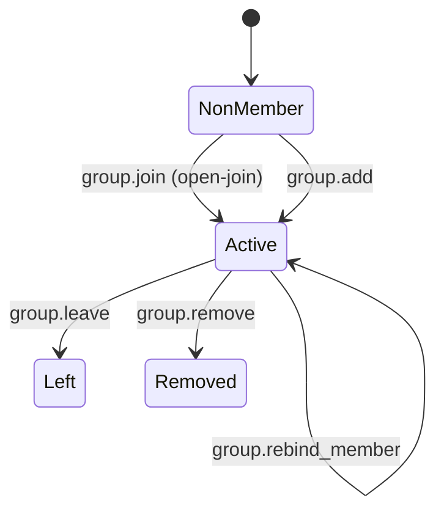
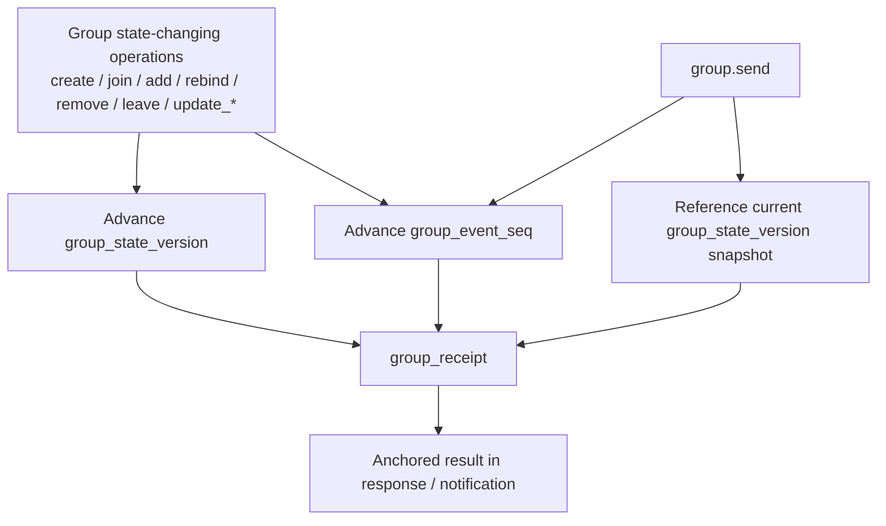
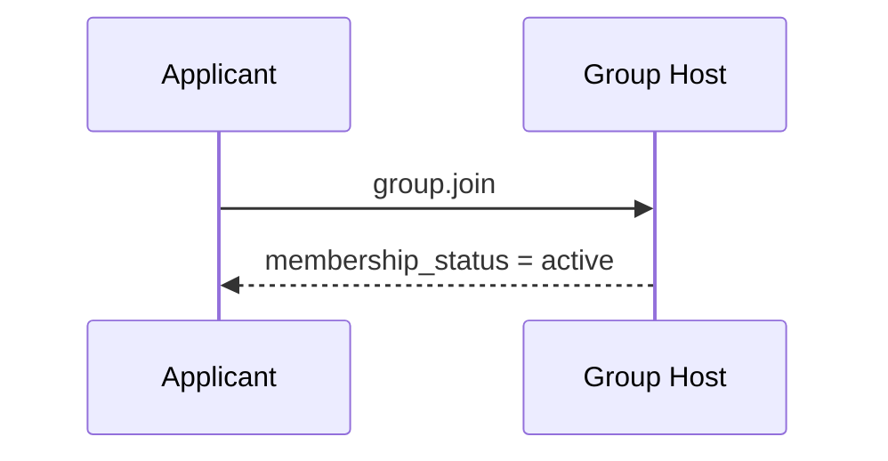
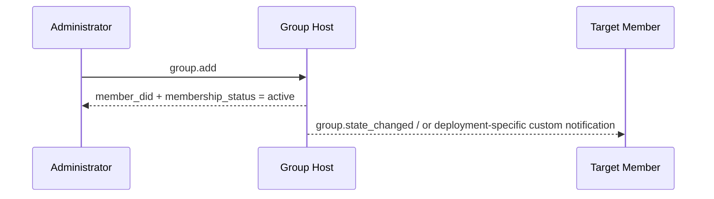
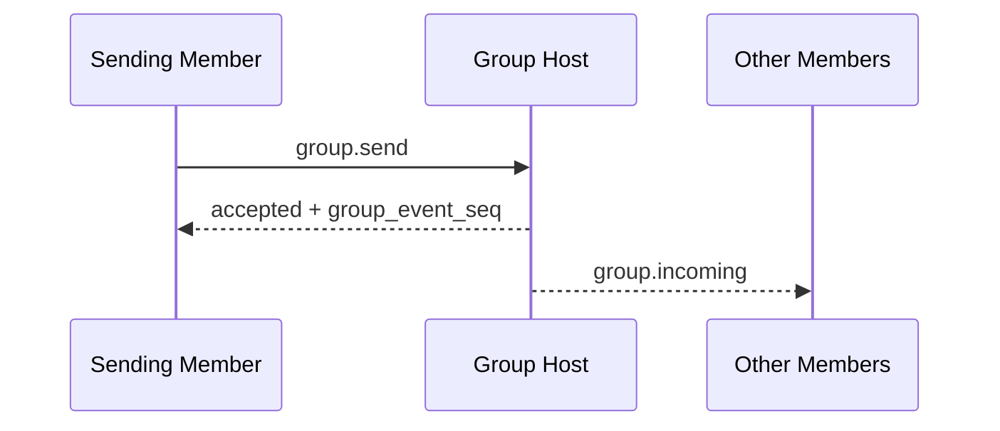
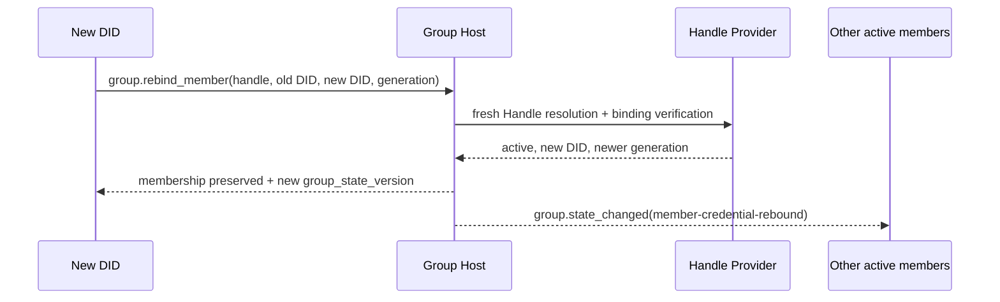

<!-- translation-review: full; source=deprecated/04-group-messaging-base-semantics.md; method=full-original-to-translation-semantic-comparison -->
> 日本語参考訳（原文全体を段落ごとに意味照合済み）。deprecated配下の旧版で、Released・1.1・v1は当時の状態です。自主参加・直接追加とHandle再バインドの仕様を原文どおり保持しています。規範となるのは原文です。
> 原文: [deprecated/04-group-messaging-base-semantics.md](../../deprecated/04-group-messaging-base-semantics.md) / 基準コミット: `0837cfdfaf4ddcf834f0890ddaf34fc4c824e066`

# ANPプロファイル4：グループメッセージの基本的な意味

- 文書ID：ANP-P4
- タイトル：グループメッセージの基本的な意味
- 状態：公開済み（Released）
- バージョン：1.1
- 原文言語：英語／本ページは日本語参考訳
- 適用範囲：Group DIDに基づくグループの存続期間、管理、メッセージの基本的な意味。グループE2EEのアルゴリズム自体は含みません。

---

> 注：この版はv1中核の入群経路を「自主参加」と「直接追加」の2つへ集約します。
>
> 1. `group.invite`、`group.accept_invite`、標準`invitation`オブジェクトはv1中核の外へ移しました。
> 2. `membership_request`、`membership_request_digest`、`group.approve_membership`、`group.reject_membership`も外へ移しました。
> 3. `group_policy`を`message_security_profile + bootstrap_security_profile + admission_mode + permissions`へ集約しました。
> 4. 非メンバー向けの管理通知`group.governance_notice`も中核の外へ移しました。
> 5. `group.state_changed`は、グループ内の順序付け済み状態通知として維持します。

---

## 1. 目的

本プロファイルは、グループの基本的な意味を定義し、次を規定します。

1. アプリケーション層のグローバル識別子としてのGroup DID。
2. 作成、自主参加、メンバー直接追加、削除、退会、情報更新、ポリシー更新。
3. `group.send`の基本的な意味。
4. Group Host Serviceの順序付け責任。
5. Group E2EE Overlayをアプリケーション上の意味へ重ねる方法。
6. 任意の安定Handleによる会員基点、現在のDID資格情報の再バインド、グループID継続性。

本プロファイルでは、次を定義しません。

- 具体的なグループE2EEアルゴリズム。
- 過去メッセージの取得。
- 既読・オンライン状態。
- 端末や内部複製の概念。
- 外部ディレクトリー同期の詳細。
- 招待リンク、Join Tokenなどの帯域外資格情報の、配置固有の配送手段。
- Agent内の動的状態の保存方法。

---

## 2. 用語と規範上の慣例

### 2.1 規範キーワード

本書の**MUST**、**MUST NOT**、**REQUIRED**、**SHALL**、**SHALL NOT**、**SHOULD**、**SHOULD NOT**、**RECOMMENDED**、**NOT RECOMMENDED**、**MAY**、**OPTIONAL**は、大文字の場合に規範的な要求として解釈します。

### 2.2 用語

- **Group**：`group_did`が識別するグループのプロトコル主体。
- **Group Host Service**：基本状態の順序付け、ポリシー適用、グループメッセージの入口を担うサービス。
- **Group State**：情報、ポリシー、メンバー関係など、ある時点のアプリケーション層の状態。
- **Group State Version**：Hostが割り当てる現在の状態バージョン識別子。
- **Group Event Sequence**：制御操作とメッセージを含め、Hostが割り当てる単調増加のイベント番号。
- **Member**：グループ内のAgentメンバー。
- **Admission Mode**：非メンバーに対する既定の入群経路。v1の値は`admin-add`と`open-join`です。中国語の「自動参加」に対応するワイヤー値も、`open-join`に統一します。
- **Policy**：送信、直接追加、削除、情報更新、ポリシー更新を誰ができるか決める業務層の規則。
- **Origin Proof**：操作やメッセージを開始するAgentが、did:wba JSON bearer認証に基づいて生成するアプリケーション層の送信元証明。
- **Group Receipt**：操作やメッセージが受理され、特定の状態位置を得たことを証明する、Host生成の検証可能な受領証。
- **論理宛先URI**：ホップのHTTP URLでなく、転送中も署名が安定するようP1付録Aが全体に定義するURI。
- **Group State Changed Event**：Hostが順序付け、現在のactiveメンバーへ同期する状態変更イベント。
- **Member Handle**：WNSに従う完全なHandle。`group_member`へ記録した場合、その会員関係の恒久的で安定した基点。
- **Handle-backed Member**：検証済み`member_handle`を持つメンバー。Handleが安定した会員関係を、`agent_did`が現在の暗号資格情報を識別します。
- **Handle Binding Generation**：WNS解決文書の単調増加`binding_generation`。P4では10進文字列`handle_binding_generation`で表します。
- **Member Credential Rebind**：ロール、状態、参加時刻を変えず、Handle-backed Memberの現在の`agent_did`を原子的に置き換えること。

---

## 3. 設計原則

### 3.1 1グループに1つのGroup DID

各グループは1つの`group_did`を持たなければなりません（**MUST**）。`group_did`はグローバルな識別子として次に使います。

- グループ発見。
- グループ管理。
- グループメッセージの宛先指定。
- 後続Group E2EE Overlayのバインドの基点。

### 3.2 順序付けはGroup Hostの責任

状態変更操作はすべてHostが受理し、順序付けなければなりません（**MUST**）。

Hostは明確な線形順序を維持し、受理した各状態変更へ新しい`group_state_version`を割り当てなければなりません（**MUST**）。

### 3.3 アプリケーションと暗号処理の意味を分離

ここではグループのアプリケーション層の操作とオブジェクトだけを定義します。鍵確立、メンバーの暗号状態の進行、welcome、暗号化業務メッセージなどはGroup E2EE Profileが定義します。

### 3.4 プロトコル終端は引き続きAgent

メンバーはプロトコル層ではAgentです。内部の複製、ワーカー、デバイス、端末は相互運用の意味へ含めません。

### 3.5 対象外の機能

本プロファイルは次を提供**しません**。

- 全体の履歴再生。
- 強い同期の意味。
- 端末単位の会員関係。
- 端末単位の配送。
- 内部実行主体単位の権限制御。
- 標準化された承認フロー。

### 3.6 開始者の認証と、グループ結果の証明を分離

グループには通常、異なる意味の署名が2つあります。

1. **開始者の署名**：`sender_did`が実際に操作やメッセージを開始したことを証明。
2. **グループ結果の証明**：受理され、確定した`group_state_version`、`group_event_seq`などの状態位置を得たことを証明。

本プロファイルでは次を要求します。

- 状態変更要求と`group.send`は、開始者の`auth.origin_proof`を持つ（**MUST**）。
- Group DIDの署名は、Hostの`group_receipt`に置くことが望ましい（**SHOULD**）。
- 開始者署名をグループ署名で代用せず（**MUST NOT**）、グループ結果証明を開始者署名でも代用しない（**MUST NOT**）。

### 3.7 入群経路の集約

v1中核の非メンバーの入群操作は2つだけです。

- `group.join`：対象Agentが自主参加し、成功時に直ちに`active`になります。
- `group.add`：既存の認可メンバーが直接追加し、成功時に直ちに有効になります。

v1は標準`invitation`、`invitation_id`、`group.invite`、`group.accept_invite`を定義しません。招待リンク、Join Tokenなどで`group.join`を補助する場合は配置上の拡張として扱い（**MUST**）、`group.join`の成功前に標準メンバー状態を作ってはなりません（**MUST NOT**）。

標準承認フローはなく、`pending`という管理上の中間状態も中核に導入しません。

### 3.8 Handle会員基点とDID資格情報を分離

AgentはDID-onlyかHandle-backedのいずれかで会員になれます。

- DID-onlyは現在の`agent_did`で識別します。DID文字列の変更に自動継続性はありません。
- Handle-backedでは、`member_handle`が会員基点、`agent_did`が認証・署名・経路・Overlay用の現在の資格情報です。
- 恒久的に譲渡不能・再利用不能のWNS Handleを使わなければならず（**MUST**）、HostはHandle Providerを継続性の信頼の根として扱わなければなりません（**MUST**）。
- Handleが`revoked`なら再バインドは禁止（**MUST NOT**）です。`active`のまま内部DIDが変わったときに`group.rebind_member`を使います。

ワイヤー上のHandle-backed会員キーは`(group_did, member_handle)`で、`agent_did`は再バインド可能です。DID-onlyは`(group_did, agent_did)`です。内部でローカルUser IDに対応付けても、そのIDはANPへ出しません。

両モードを、現在同じDIDに解決するだけの理由で暗黙に変換・統合してはなりません（**MUST NOT**）。継続性が必要なら会員作成時にHandleを提出します。DID-only会員へ後からHandleを付けるメソッドは定義しません。

---

## 4. グループ管理モデルの概要（非規範的）

### 4.1 規則の概要

| 場面 | 入口 | 即時結果 | 権威ある状態 | `active`になる時点 | 注 |
|---|---|---|---|---|---|
| 自主参加 | `group.join` | 呼び出し元が参加 | `group_member.status = active` | 即時 | `open-join`のみ |
| 直接追加 | `group.add` | 対象を直接追加 | `group_member.status = active` | 即時 | 通常`admin-add`で使用 |
| 自主退会 | `group.leave` | 退会 | `group_member.status = left` | 対象外 | 現在の`active`のみ |
| 管理者による削除 | `group.remove` | 削除 | `group_member.status = removed` | 対象外 | 現在の`active`のみ |
| Handle会員のDID再バインド | `group.rebind_member` | 旧DIDが権限を失い、新DIDへ変更 | `group_member`は`active`を維持 | Hostの受理時 | Handle-backedのみ |

> 注：帯域外の招待リンク、Join Token、サイト内通知で入群を案内しても、標準相互運用層では最終的に`group.join`か`group.add`の成功結果を示さなければなりません（**MUST**）。

### 4.2 状態オブジェクトの比較

| オブジェクト | 主要状態 | 意味 |
|---|---|---|
| `group_member` | `active` | アプリケーション層の会員関係が有効 |
| `group_member` | `left` / `removed` | 会員関係が終了 |

### 4.3 状態機械の図



---

## 5. プロファイル識別子と依存関係

### 5.1 プロファイル名

本プロファイルの標準名は次のとおりです。

`anp.group.base.v1`

### 5.2 依存関係

本プロファイルは、次のプロファイルに依存しなければなりません（**MUST**）。

- `anp.core.binding.v1`
- `anp.identity.discovery.v1`

Handle-backedを使う場合、形式、解決、双方向バインド、`binding_generation`、恒久的な譲渡・再利用禁止について、[ANP DID-WBA名前空間仕様（WNS）](../04-anp-did-wba-name-space-specification.md)にも依存しなければなりません（**MUST**）。

### 5.3 セキュリティプロファイル

基本グループProfileとして単独で動作する場合、

- `meta.profile`は`anp.group.base.v1`（**MUST**）。
- `meta.security_profile`は`transport-protected`でなければなりません（**MUST**）。

後からGroup E2EE Overlayを重ねる場合、状態とメッセージを暗号学的にバインドする方法を明示しなければなりません（**MUST**）。

---

## 6. グループモデル

### 6.1 `group_did`

`group_did`はグループのアプリケーション層のグローバル識別子です。

`group_did`は、

- グループ管理の宛先識別子に使う（**MUST**）。
- グループメッセージの宛先識別子に使う（**MUST**）。
- 特定の暗号実装内部の`group_id`と自動的に同一視しない（**MUST NOT**）。

### 6.2 `group_state_version`

`group_state_version`は、現在の業務上のグループ状態の版を識別します。

要件：

- Hostが割り当てる（**MUST**）。
- 不透明な文字列として扱う（**MUST**）。
- 成功した状態変更ごとに、新しい`group_state_version`を生成（**MUST**）。
- メッセージ送信によって`group_state_version`を進めない（**MUST NOT**）。
- メッセージの成功応答に含む`group_state_version`は、受理時の状態スナップショットを示します。

### 6.3 `group_event_seq`

`group_event_seq`はグループイベントの番号です。

要件：

- 同じグループ内で単調増加（**MUST**）。
- 制御操作とメッセージをともに含む（**MUST**）。
- 10進文字列で表す（**MUST**）。
- 安全性の意味の唯一の根拠にしない（**MUST NOT**）。

どの操作が状態版を進め、どの操作がイベント番号だけを進め、`group_receipt`が何を固定するかは混同されやすい点です。次の図へまとめます。



*図P4-1：`group_state_version`、`group_event_seq`、`group_receipt`の関係（非規範的）。*

`group.send`、`group.state_changed`、`group_receipt`を読む際はこの図を参照してください。メッセージは順序付けに参加しますが、それ自体で新たな`group_state_version`を進めません。

### 6.4 ロールモデル

最低限、次のロールへ対応しなければなりません（**MUST**）。

- `owner`
- `admin`
- `member`

ロールの階層は次に固定します。

`owner > admin > member`

解釈規則：

- 最低ロールが`member`なら、`admin`と`owner`も満たします。
- 最低ロールが`admin`なら、`owner`も満たします。
- v1の最低相互運用範囲に独自ロールを導入してはなりません（**MUST NOT**）。

### 6.5 メンバー状態

最低限、次の状態に対応しなければなりません（**MUST**）。

- `active`
- `left`
- `removed`

---

## 7. 標準オブジェクト

### 7.1 `group_policy`

`group_policy`は、アプリケーション層の認可と入群規則を表します。

推奨構造は次のとおりです。

```json
{
  "message_security_profile": "transport-protected",
  "bootstrap_security_profile": "transport-protected",
  "admission_mode": "open-join",
  "permissions": {
    "send": "member",
    "add": "admin",
    "remove": "admin",
    "update_profile": "admin",
    "update_policy": "owner"
  },
  "attachments_allowed": true,
  "max_members": "500"
}
```

フィールドの説明：

- `message_security_profile`：文字列（**SHOULD**）。推奨値：`transport-protected`, `group-e2ee`
- `bootstrap_security_profile`：文字列（**SHOULD**）。推奨値：`transport-protected`, `group-e2ee`
- `admission_mode`：文字列（**MUST**）。
- `permissions`：オブジェクト（**MUST**）。
- `attachments_allowed`：真偽値（**MAY**）。
- `max_members`：10進文字列（**MAY**）。

解釈規則：

1. `message_security_profile`が制約するのは、
   - `group.send`
   - `active`になった後のメンバー専用操作。

2. `bootstrap_security_profile`が制約するのは、
   - `group.join`
   - 後続Overlayが明示する導入・初期設定メソッド。

3. `admission_mode`は次のいずれか（**MUST**）。
   - `admin-add`
   - `open-join`

4. `permissions`には次の標準キーだけを、すべて含める（**MUST**）。
   - `send`
   - `add`
   - `remove`
   - `update_profile`
   - `update_policy`

5. `permissions.*`の値は次のいずれか（**MUST**）。
   - `owner`
   - `admin`
   - `member`

6. 既定の解釈：
   - `admission_mode = "admin-add"`なら`group.join`は拒否（**MUST**）。通常の入口は`group.add`。
   - `admission_mode = "open-join"`なら`group.join`を認める（**MUST**）。
   - `group.add`の可否は、引き続き`permissions.add`で決定。

7. `max_members`があれば、`active`の人数制限として解釈（**MUST**）。

### 7.2 `group_member`

`group_member`はグループ会員関係のオブジェクトです。

推奨する最小フィールド：

- `agent_did`：文字列（**MUST**）。
- `member_handle`：完全なWNS Handle。Handle-backedでは必須（**MUST**）、DID-onlyでは禁止（**MUST NOT**）。
- `handle_binding_generation`：正の10進文字列。Handle-backedでは必須（**MUST**）、DID-onlyでは禁止（**MUST NOT**）。
- `role`：文字列（**MUST**）。
- `status`：文字列（**MUST**）。
- `joined_at`：RFC 3339時刻文字列（**MAY**）。
- `added_by`：DID文字列（**MAY**）。

注：

- 既定の`role`は`member`と解釈（**MUST**）。
- `status = active`は会員関係が有効な状態。
- `status = left`または`removed`は会員関係の終了。
- `added_by`は`group.add`で作成された関係の場合だけ推奨。
- `agent_did`は、認証・認可・メッセージ・経路・Overlayのための現在のDID。
- `member_handle`はWNS正規化済みの完全形（**MUST**）で、`group.rebind_member`中に変更しない（**MUST NOT**）。
- `handle_binding_generation`は、作成時または最後の再バインド時に検証したWNSの`binding_generation`を正確に写す（**MUST**）。
- Handle文字列だけで関係を作成・再バインドしてはなりません（**MUST NOT**）。まずWNS解決とバインド検証を完了します。

`user_id`、`member_user_id`などのローカルDB識別子は定義・送信しません。内部で`group_member`を安定したローカルキーへ対応付けてもかまいませんが（**MAY**）、それはANPの会員識別子ではなく、ドメイン間認証・認可へ使ってはなりません（**MUST NOT**）。

### 7.3 配置拡張としての入群資格情報

v1は、標準`invitation`も`invitation_id`も定義しません。

`group.join`を補助する招待リンク、Join Tokenなどの帯域外資格情報を設けてもかまいません（**MAY**）。ただし、

- v1中核の相互運用オブジェクトと見なさない（**MUST NOT**）。
- `group.join`成功前に標準メンバー状態を作らない（**MUST NOT**）。
- 制御されたチャネルで配布することが望ましい（**SHOULD**）。

### 7.4 `group_profile`

`group_profile`は、表示用データのオブジェクトです。

推奨フィールド：

- `display_name`：文字列。作成時の提供が望ましい（**SHOULD**）。
- `description`：文字列（**MAY**）。
- `avatar_uri`：文字列（**MAY**）。
- `discoverability`：文字列（**MAY**）。推奨値：`private`, `listed`, `public`
- `labels`：オブジェクト（**MAY**）。

### 7.5 `group_state_ref`

`group_state_ref`は、グループ状態の参照オブジェクトです。

推奨する最小フィールド：

- `group_did`：文字列（**MUST**）。
- `group_state_version`：文字列（**MUST**）。
- `policy_hash`：文字列（**MAY**）。
- `roster_hash`：文字列（**MAY**）。

### 7.6 グループメッセージのペイロード

`group.send`には`meta.content_type`が必要です（**MUST**）。

最低限の相互運用では、次の内容種別に対応しなければなりません（**MUST**）。

- `text/plain`
- `application/json`
- `application/anp-attachment-manifest+json`

`group.send`の`body`内の`text`、`payload`、`payload_b64u`には、次を適用します。

- ちょうど1つだけ存在しなければなりません（**MUST**）。
- 複数が存在すれば、受信者は要求を拒否しなければなりません（**MUST**）。
- 3つとも存在しなければ、受信者は要求を拒否しなければなりません（**MUST**）。

`payload_b64u`について、

- パディングなしbase64urlを使う（**MUST**）。
- バイナリ拡張や独自拡張オブジェクトだけに使うことが望ましい（**SHOULD**）。

`meta.content_type = "application/json"`では、`body.payload`に
JSONオブジェクトを直接格納しなければなりません（**MUST**）。内部フィールドの業務上の意味は
ANPは定めず、グループのアプリケーションやHostが解釈します。

### 7.7 `auth`オブジェクト

`group.get_info`を除く状態変更要求と、`group.send`の`params`には、`auth`オブジェクトが必要です（**MUST**）。

proofの保持、Signed Request Object、署名要素の対応付けは、P1付録Aの共通定義を使わなければなりません（**MUST**）。P4は独自のproofフィールド名、Signed Payload、局所的な`@target-uri`を**もはや定義しません**。

推奨構造は次のとおりです。

```json
{
  "auth": {
    "scheme": "anp-rfc9421-origin-proof-v1",
    "origin_proof": {
      "contentDigest": "sha-256=:BASE64_SHA256_DIGEST:",
      "signatureInput": "sig1=(\"@method\" \"@target-uri\" \"content-digest\");created=1733402096;expires=1733402156;nonce=\"abc123\";keyid=\"did:wba:example.com:user:alice:e1_<fingerprint>#key-1\"",
      "signature": "sig1=:BASE64_SIGNATURE:"
    }
  }
}
```

フィールドの要件：

- `auth.scheme`は`anp-rfc9421-origin-proof-v1`でなければなりません（**MUST**）。
- 状態変更操作と`group.send`すべてで、`auth.origin_proof`が必要（**MUST**）。
- `auth`自体を`contentDigest`へ含めない（**MUST NOT**）。

### 7.8 共有Signed Request Objectへのバインド

`auth.origin_proof.contentDigest`は、P1付録Aの共有**Signed Request Object**へバインドしなければなりません（**MUST**）。

Group Baseでは、

- `group.send`などのメッセージには、`meta.message_id`と`meta.content_type`が必要（**MUST**）。
- `group.create`の`meta.target.kind`は`service`（**MUST**）。
- 既存グループ宛ての操作の`meta.target.kind`は`group`（**MUST**）。

### 7.8.1 共通の署名要素への参照

`auth.origin_proof`が必要な全Group Baseメソッドは、P1付録Aの共通対応付けを使わなければなりません（**MUST**）。

したがって、

- `group.create`では、`meta.target.kind = "service"`から`@target-uri = anp://service/<pct-encoded meta.target.did>`を再構築。
- 既存グループ操作では、`meta.target.kind = "group"`から`@target-uri = anp://group/<pct-encoded meta.target.did>`を再構築。
- P1の共通規則であり、P4独自の局所的な対応付けでは**ありません**。

### 7.9 `group_receipt`

`group_receipt`は、Hostが操作やメッセージを受理し、状態機械へ書き込んだことの検証可能な証明です。

推奨フィールド：

- `receipt_type`：文字列（**MUST**）。推奨値：`group-operation-accepted`, `group-message-accepted`
- `group_did`：文字列（**MUST**）。
- `group_state_version`：文字列（**MUST**）。
- `group_event_seq`：10進文字列（**MUST**）。
- `subject_method`：文字列（**MUST**）。
- `operation_id`：文字列（**MUST**）。
- `message_id`：文字列（**MAY**）。
- `actor_did`：文字列（**MUST**）。
- `accepted_at`：RFC 3339時刻文字列（**MUST**）。
- `payload_digest`：文字列（**MUST**）。
- `proof`：オブジェクト。推奨（**SHOULD**）で、`group_receipt`がHostのドメイン外へ出て他ドメインが依拠する場合は必須（**MUST**）。

`group_receipt.proof`は、P1付録Bの共有**Object Proof Profile**を使わなければなりません（**MUST**）。

`group_receipt`では、

- 発行者DIDは`group_did`（**MUST**）。
- 保護対象は`proof`を除いた`group_receipt`全体（**MUST**）。
- `proof.verificationMethod`は、`group_did`のDID文書の`assertionMethod`が認める検証メソッドを指す（**MUST**）。
- `group_receipt`署名が証明するのは「グループが結果を受理したこと」であり、「要求を開始した者」ではありません。

共通規則に加え、`group_receipt`には少なくとも次の重要フィールドが必要で（**MUST**）、すべてが`proof`の保護対象となります。

- `receipt_type`
- `group_did`
- `group_state_version`
- `group_event_seq`
- `subject_method`
- `operation_id`
- `actor_did`
- `accepted_at`
- `payload_digest`
- `message_id`も存在するなら保護へ含める（**MUST**）。

`group_receipt.proof`の検証後も、各フィールドが実際の応答、通知コンテキスト、状態位置に一致するか確認しなければなりません（**MUST**）。

### 7.10 状態変更イベントオブジェクト

`group.state_changed`のイベントを共通オブジェクトへ集約し、`event_type`で種別を区別します。

#### 7.10.1 共通フィールド

共通イベントの推奨構造：

```json
{
  "event_id": "evt-001",
  "event_type": "member-credential-rebound",
  "group_did": "did:example:group-123",
  "group_state_version": "43",
  "group_event_seq": "129",
  "subject_method": "group.rebind_member",
  "changed_at": "2026-03-29T14:11:00Z",
  "actor_did": "did:example:agent-c",
  "subject_handle": "carol.example.com",
  "previous_subject_did": "did:example:agent-c-old",
  "subject_did": "did:example:agent-c",
  "handle_binding_generation": "9",
  "membership_status": "active",
  "group_profile": { "...": "..." },
  "group_policy": { "...": "..." },
  "group_receipt": { "...": "..." }
}
```

共通規則：

1. `group.state_changed`の`body`にイベントオブジェクトを直接入れる（**MUST**）。
2. 未参加者への帯域外入群資格情報、リマインダー、結果通知に使わない（**MUST NOT**）。
3. `group_event_seq`と同じ順序の意味を維持することが望ましい（**SHOULD**）。
4. `subject_method = "group.join"`か`"group.add"`なら、`event_type = "member-activated"`。
5. `subject_method = "group.rebind_member"`なら、`event_type`は`member-credential-rebound`（**MUST**）。

#### 7.10.2 標準`event_type`

v1は、次の`event_type`を推奨します。

- `member-activated`
- `member-removed`
- `member-left`
- `member-credential-rebound`
- `group-profile-updated`
- `group-policy-updated`

内訳：

- `member-activated`には`subject_did`と`membership_status = "active"`が必要（**MUST**）。
- `member-removed`には`subject_did`が必要（**MUST**）。
- `member-left`には`subject_did`が必要（**MUST**）。
- `member-credential-rebound`には`subject_handle`、`previous_subject_did`、`subject_did`、`handle_binding_generation`、`membership_status = "active"`が必要（**MUST**）。
- `group-profile-updated`には`group_profile`を含めることが望ましい（**SHOULD**）。
- `group-policy-updated`には`group_policy`を含めることが望ましい（**SHOULD**）。

---

## 8. 標準メソッドと通知

`group.get_info`を除く、本節のすべての状態変更要求は、次の共通規則を満たさなければなりません（MUST）。

- `params.auth.scheme`は`anp-rfc9421-origin-proof-v1`（**MUST**）。
- `params.auth.origin_proof`が存在し、対応Signed Request Objectへバインド（**MUST**）。
- ドメインをまたぐ場合、元の`auth.origin_proof`を転送し（**MUST**）、中間サービスが上書きしない（**MUST NOT**）。

Hostが受理するすべての状態変更と`group.send`では、

- 非フェデレーション配置では、成功応答で`group_receipt`を返すことが望ましい（**SHOULD**）。
- 他ドメインが依拠するためにHostのドメイン外へ出る応答では、`group_receipt`が必要（**MUST**）で、`group_receipt.proof`も必要（**MUST**）。

次の2つの非同期通知メソッドは、

- `group.incoming`
- `group.state_changed`

**任意（OPTIONAL）のプッシュ機能**です。最低相互運用の必須メソッドではありません。ただし実装した場合は、標準Notificationエンベロープと、本書の標準`body`を使わなければなりません（**MUST**）。

### 8.1 `group.create`

#### 8.1.1 意味

新規グループを作成し、Hostが新しい`group_did`と初期`group_state_version`を割り当てます。

#### 8.1.2 要求の要件

`group.create`要求は、次を満たさなければなりません（**MUST**）。

1. `method = "group.create"`
2. `meta.profile = "anp.group.base.v1"`
3. `meta.security_profile = "transport-protected"`
4. `meta.sender_did`が存在（**MUST**）。
5. `meta.target.kind = "service"`
6. `meta.target.did`は宛先の`ANPMessageService.serviceDid`（**MUST**）。
7. `meta.operation_id`が存在（**MUST**）。
8. `body.group_profile`が存在することが望ましい（**SHOULD**）。
9. `body.group_policy`が必要（**MUST**）。
10. `body.initial_members`は任意（**MAY**）。
11. `params.auth.origin_proof`が必要（**MUST**）。
12. `body.creator_handle`は任意（**MAY**）。

`body.creator_handle`があれば、WNS解決・検証を行い（**MUST**）、状態が`active`で（**MUST**）、`did`が`meta.sender_did`と厳密に一致することを求めます（**MUST**）。成功時は作成者の`group_member`へ`member_handle`と`handle_binding_generation`を記録（**MUST**）し、なければDID-onlyとします。

`body.initial_members`は次の規則で処理しなければなりません（**MUST**）。

- 作成者自身は`owner`となり、直ちに`active`（**MUST**）。
- 他の`initial_members`は、作成中の`group.add`相当と解釈してもかまいません（**MAY**）。
- 各要素は`member_did`か`member_handle`をちょうど1つ持ち（**MUST**）、両方・どちらもなしは禁止（**MUST NOT**）。
- Handle要素は第8.4節に従い解決・検証・保存（**MUST**）。
- `initial_members`で`role`未指定なら、`member`と解釈（**MUST**）。

#### 8.1.3 成功応答

成功応答には少なくとも次が必要です（**MUST**）。

- `group_did`
- `group_state_version`
- `created_at`
- `creator_did`

成功応答に次を含めてもかまいません（**MAY**）。

- `creator_handle`
- `handle_binding_generation`
- `group_event_seq`
- `group_profile`
- `group_policy`
- `group_receipt`

要求に`creator_handle`があれば、応答に`creator_handle`と`handle_binding_generation`が必要（**MUST**）。なければ両方を含めてはなりません（**MUST NOT**）。

### 8.2 `group.get_info`

#### 8.2.1 意味

現在のグループの基本情報のスナップショットを取得します。

#### 8.2.2 要求の要件

- `meta.target.kind`は`"group"`（**MUST**）。
- `meta.target.did`は宛先`group_did`（**MUST**）。

`body`へ次を含めてもかまいません（**MAY**）。

- `include_policy`
- `include_member_list`

IDの要件：

- `discoverability = "public"`か`"listed"`なら、`group.get_info`を匿名参照してもよく（**MAY**）、`meta.sender_did`も省略してかまいません（**MAY**）。
- `discoverability = "private"`なら、IDを提供しなければなりません（**MUST**）。
- 要求する情報の範囲が呼び出し元の可視範囲外なら、`group.policy_violation`を返す（**MUST**）。

#### 8.2.3 成功応答

成功応答には少なくとも次が必要です（**MUST**）。

- `group_did`
- `group_state_version`
- `group_profile`

成功応答に次を含めてもかまいません（**MAY**）。

- `group_policy`（`include_policy = true`で、閲覧権限がある場合だけ）
- `member_list`（`include_member_list = true`で、閲覧権限がある場合だけ。要素型は`group_member`（**MUST**））
- `member_count`（10進文字列。現在の`active`の人数を表すことが望ましい（**SHOULD**））

`member_list`を返す場合、現在の`active`だけを含めることが望まれます（**SHOULD**）。

### 8.3 `group.join`

#### 8.3.1 意味

`group.join`は非メンバーの自主参加用で、v1中核では成功時に直ちに`active`となります。

#### 8.3.2 要求の要件

`body`へ次を含めてもかまいません（**MAY**）。

- `member_handle`
- `reason_text`

`member_handle`がなければDID-onlyとして`meta.sender_did`で参加します。`member_handle`があれば、次を行わなければなりません（**MUST**）。

1. WNSに従いHandleを正規化・解決し、双方向バインドを検証。
2. 解決文書の`status = "active"`を要求。
3. 解決した`did`と`meta.sender_did`の完全一致を要求。
4. 正規化済み`member_handle`と解決した`binding_generation`を会員記録へ保存。

現在`open-join`でなければ、拒否しなければならず（**MUST**）、`group.policy_violation`を返すことが望まれます（**SHOULD**）。

#### 8.3.3 成功応答

成功応答には少なくとも次が必要です（**MUST**）。

- `group_did`
- `member_did`は`meta.sender_did`（**MUST**）。
- `membership_status`は`active`（**MUST**）。
- `group_state_version`

成功応答に次を含めてもかまいません（**MAY**）。

- `member_handle`
- `handle_binding_generation`
- `group_receipt`

要求に`member_handle`があれば、応答に`member_handle`と`handle_binding_generation`が必要（**MUST**）。DID-only応答には両方とも含めません（**MUST NOT**）。

### 8.4 `group.add`

#### 8.4.1 意味

認可されたメンバーが対象Agentを直接追加し、成功時に直ちに`active`にします。

#### 8.4.2 要求の要件

`body`は次の識別子をちょうど1つ持たなければなりません（**MUST**）。

- `member_did`
- `member_handle`

`body`へ次を含めてもかまいません（**MAY**）。

- `role`
- `reason_text`

`role`を明示しなければ、`member`と解釈しなければなりません（**MUST**）。

`member_did`ならDID-onlyとして作成（**MUST**）。`member_handle`ならWNS正規化・解決・双方向バインド検証を行い（**MUST**）、Handleが`active`であることを要求し、現在のDIDでHandle-backedを作ります。`member_handle`、`agent_did`、`handle_binding_generation`を一緒に保存（**MUST**）します。

#### 8.4.3 成功応答

成功応答には少なくとも次が必要です（**MUST**）。

- `group_did`
- `member_did`
- `membership_status`は`active`（**MUST**）。
- `group_state_version`

成功応答に次を含めてもかまいません（**MAY**）。

- `member_handle`
- `handle_binding_generation`
- `group_receipt`

要求が`member_handle`なら、応答に`member_handle`と`handle_binding_generation`が必要（**MUST**）。`member_did`ならどちらも含めません（**MUST NOT**）。

### 8.5 `group.remove`

#### 8.5.1 意味

認可されたメンバーが、現在`active`のメンバーを削除します。

#### 8.5.2 要求の要件

`body`には次が必要です（**MUST**）。

- `member_did`

`body`へ次を含めてもかまいません（**MAY**）。

- `reason_text`

#### 8.5.3 処理規則

- 対象が`active`なら、`group.remove`で`group_member.status = "removed"`にする（**MUST**）。
- すでに`left`、`removed`、または存在しないなら拒否（**MUST**）。

#### 8.5.4 成功応答

成功応答には少なくとも次が必要です（**MUST**）。

- `group_did`
- `member_did`
- `group_state_version`

成功応答に次を含めてもかまいません（**MAY**）。

- `membership_status`
- `group_receipt`

### 8.6 `group.leave`

#### 8.6.1 意味

現在の送信者が自主退会することを示します。

#### 8.6.2 要求の要件

- `meta.sender_did`は現在退会する本人のDID（**MUST**）。

#### 8.6.3 成功応答

成功応答には少なくとも次が必要です（**MUST**）。

- `group_did`
- `leaver_did`
- `group_state_version`

成功応答に次を含めてもかまいません（**MAY**）。

- `group_receipt`

### 8.7 `group.update_profile`

#### 8.7.1 意味

グループの表示用データを更新します。

#### 8.7.2 要求の要件

`body`には次が必要です（**MUST**）。

- `group_profile_patch`

`group_profile_patch`はRFC 7386 JSON Merge Patchの意味に従わなければなりません（**MUST**）。

#### 8.7.3 成功応答

成功応答には少なくとも次が必要です（**MUST**）。

- `group_did`
- `group_state_version`
- `group_profile`

成功応答に次を含めてもかまいません（**MAY**）。

- `group_receipt`

### 8.8 `group.update_policy`

#### 8.8.1 意味

グループのポリシーを更新します。

#### 8.8.2 要求の要件

`body`には次が必要です（**MUST**）。

- `group_policy_patch`

`group_policy_patch`はRFC 7386 JSON Merge Patchの意味に従わなければなりません（**MUST**）。

#### 8.8.3 成功応答

成功応答には少なくとも次が必要です（**MUST**）。

- `group_did`
- `group_state_version`
- `group_policy`

成功応答に次を含めてもかまいません（**MAY**）。

- `group_receipt`

### 8.9 `group.send`

#### 8.9.1 意味

グループへアプリケーション層のメッセージを送ります。

#### 8.9.2 要求の要件

適合する`group.send`要求は、次を満たさなければなりません（**MUST**）。

1. `method = "group.send"`
2. `meta.profile = "anp.group.base.v1"`
3. `meta.security_profile = "transport-protected"`
4. `meta.target.kind = "group"`
5. `meta.target.did`は宛先`group_did`（**MUST**）。
6. `meta.sender_did`は現在の送信Agent DID（**MUST**）。
7. `meta.message_id`が必要（**MUST**）。
8. `meta.operation_id`が必要（**MUST**）。
9. `meta.content_type`が必要（**MUST**）。
10. `body`がペイロード排他規則に適合（**MUST**）。
11. `params.auth.origin_proof`が存在し、Signed Request Objectへバインド（**MUST**）。

#### 8.9.3 `group.send`の`body`

`group.send`の`body`は次を含められます。

- `thread_id`：文字列（**MAY**）。
- `reply_to_message_id`：文字列（**MAY**）。
- `annotations`：オブジェクト（**MAY**）。
- `text`、`payload`、`payload_b64u`のちょうど1つが必要（**MUST**）。

#### 8.9.4 成功応答

成功応答には少なくとも次が必要です（**MUST**）。

- `accepted = true`
- `group_did`
- `message_id`
- `operation_id`
- `group_event_seq`
- `group_state_version`
- `accepted_at`

成功応答に次を含めてもかまいません（**MAY**）。

- `group_receipt`

### 8.10 `group.incoming`

`group.incoming`はHostが受理したメッセージを、現在のactiveメンバーAgentへ非同期プッシュします。Notificationとして使わなければなりません（**MUST**）。

実装する`group.incoming`のNotificationは、次を満たさなければなりません（**MUST**）。

- `meta.profile = "anp.group.base.v1"`
- `meta.security_profile`は受理時のモードと一致（**MUST**）。
- `meta.target.kind = "agent"`
- `meta.target.did`は現在の通知受信者DID（**MUST**）。
- `meta.sender_did`は元のグループメッセージの送信主体DID（**MUST**）。
- `meta.operation_id`は元の`group.send.meta.operation_id`（**MUST**）。
- `meta.message_id`は元の`group.send.meta.message_id`（**MUST**）。
- `meta.content_type`は元メッセージの`meta.content_type`（**MUST**）。

`body`の推奨構造：

```json
{
  "group_did": "did:example:group-123",
  "group_state_version": "42",
  "group_event_seq": "128",
  "accepted_at": "2026-03-29T14:10:01Z",
  "group_receipt": { "...": "..." },
  "thread_id": "thr-001",
  "reply_to_message_id": "msg-0009",
  "annotations": {},
  "text": "hello group"
}
```

規則は次のとおりです。

- `body`は元の業務ペイロードと一致させる（**MUST**）。
- `params.auth`が存在する場合、
- `params.auth.scheme`は`anp-rfc9421-origin-proof-v1`（**MUST**）。
  - `params.auth.origin_proof`は元の`origin_proof`の損失のないコピー（**MUST**）。
  - 中間サービスが新しい業務proofへ書き換えない（**MUST NOT**）。

### 8.11 `group.state_changed`

`group.state_changed`は標準の非同期状態変更通知です。順序付け済みの会員関係、グループ情報、ポリシーの変更を現在のactiveメンバーへ同期します。Notificationとして使わなければなりません（**MUST**）。

Notificationは次を満たさなければなりません（**MUST**）。

- `meta.profile = "anp.group.base.v1"`
- `meta.security_profile = "transport-protected"`
- `meta.target.kind = "agent"`
- `meta.target.did`は現在の通知受信者DID（**MUST**）。
- `meta.sender_did`は`body.group_did`（**MUST**）。
- `body`は第7.10節のイベントオブジェクトをちょうど1つ直接運ぶ（**MUST**）。

`group.state_changed`を帯域外の入群資格情報、非メンバーへのリマインダー、通常なら`direct.send`を使う個別の管理通知へ使用してはなりません（**MUST NOT**）。

### 8.12 `group.rebind_member`

#### 8.12.1 意味

`group.rebind_member`は、Handle-backedの内部DIDが変わった後、現在の資格情報を原子的に置き換えます。新規メンバーを作らず、会員基点を変えず、DID-onlyメンバーの復旧もしません。

WNSの対応変更は新バインドを発見可能にするだけで、会員関係を自動更新してはなりません（**MUST NOT**）。Hostがポーリングやキャッシュ更新で新DIDを見つけても、グループごとに新DIDが本メソッドを提出して成功するのを待ちます。本メソッドと厳密増加の`handle_binding_generation`が、DID変更をグループへ伝える標準手段です。

#### 8.12.2 呼び出し元と要求の要件

新DIDが開始し、次を満たさなければなりません（**MUST**）。

- `meta.security_profile`は`transport-protected`（**MUST**）。
- `meta.sender_did`は`body.new_member_did`（**MUST**）。
- `auth.origin_proof`は、新DIDの有効な`authentication`検証メソッドで生成（**MUST**）。
- `body`は`member_handle`、`previous_member_did`、`new_member_did`、`handle_binding_generation`を持つ（**MUST**）。

推奨する`body`：

```json
{
  "member_handle": "alice.example.com",
  "previous_member_did": "did:wba:example.com:agents:alice:e1_<old-fingerprint>",
  "new_member_did": "did:wba:example.com:agents:alice:e1_<new-fingerprint>",
  "handle_binding_generation": "9"
}
```

受理前にHostは、次を行わなければなりません（**MUST**）。

1. 同グループに`status = "active"`、完全一致の`member_handle`、現在の`agent_did = previous_member_did`を満たす会員関係をちょうど1つ見つける。
2. `member_handle`を新たにWNS解決し、双方向バインドを検証。有効TTLを超えたキャッシュだけには依存しない。
3. 解決文書の`status = "active"`と、`did`と`new_member_did`の完全一致を要求。
4. `binding_generation`と`handle_binding_generation`の完全一致を要求し、10進整数比較で保存済み旧`handle_binding_generation`より厳密に大きいことを確認。
5. 新DID文書とその所持証明を検証。旧DIDの署名だけでは継続性証明として不十分。
6. `new_member_did`が同じグループの別の`active`会員関係を識別しないことを確認。
7. Handleが`suspended`、`revoked`、WNS検証不能、または同時更新競合なら、安全側に拒否。

検証成功後、Hostは1つの原子的な状態変更として、次を行わなければなりません（**MUST**）。

- `agent_did`を`new_member_did`へ更新。
- `handle_binding_generation`を新値へ更新。
- `member_handle`、`role`、`status`、`joined_at`、`added_by`、active人数を維持。
- `group_state_version`と`group_event_seq`を進める。
- `previous_member_did`による会員操作の認可を直ちに停止。
- `member-credential-rebound`イベントを発行。

過去のメッセージ、`group_receipt`、イベント、DID、署名を書き換えてはなりません（**MUST NOT**）。

#### 8.12.3 成功応答

成功応答には少なくとも次が必要です（**MUST**）。

- `group_did`
- `member_handle`
- `previous_member_did`
- `member_did`：値は新DID。
- `handle_binding_generation`
- `membership_status`は`active`（**MUST**）。
- `group_state_version`

成功応答に`group_receipt`を含めてもかまいません（**MAY**）。

---

## 9. フローの概要（非規範的）

### 9.1 自主参加（`open-join`）



### 9.2 直接追加（`admin-add`）



### 9.3 グループメッセージの経路



### 9.4 Handle-backedメンバーのDID再バインド



---

## 10. 順序付け、同時実行、競合

### 10.1 順序付けの責任

Hostは同じ`group_did`の全受理イベントに線形順序を維持しなければなりません（**MUST**）。対象は次です。

- `group.create`
- `group.join`
- `group.add`
- `group.rebind_member`
- `group.remove`
- `group.leave`
- `group.update_profile`
- `group.update_policy`
- `group.send`

### 10.2 メッセージと状態バージョン

`group.send`受理後は、

- 新しい`group_event_seq`を割り当てる（**MUST**）。
- メッセージ自体で`group_state_version`を進めない（**MUST NOT**）。
- `group_receipt`とともに返す`group_state_version`は、受理時の状態スナップショットです。

### 10.3 冪等性と重複排除

状態変更とメッセージでは、次を冪等性の基礎にしなければなりません（**MUST**）。

- `sender_did`
- `group_did`
- `method`
- `operation_id`

この組で冪等性を確認しなければなりません（**MUST**）。

`group.send`の重複検出には、さらに次を使うことが望まれます（**SHOULD**）。

- `sender_did`
- `group_did`
- `message_id`

この組で重複を検出することが望まれます（**SHOULD**）。

---

## 11. セキュリティとポリシー

### 11.1 安全な伝送の要件

単独で動作する場合、認証された安全な伝送層に依存しなければなりません（**MUST**）。

### 11.2 操作開始者の認証

すべての状態変更操作と`group.send`では、

- Hostが`auth.origin_proof`を認証（**MUST**）。
- `auth.origin_proof`の`keyid`の所属DIDと`meta.sender_did`が一致（**MUST**）。
- `keyid`の指すメソッドがDID文書の`authentication`で認可されている（**MUST**）。
- パス型`e1_` DIDは、did:wbaに従いDIDとバインド鍵の関係を検証（**MUST**）。
- P1付録AのOrigin Proof規約も満たす（**MUST**）。

### 11.3 開始者認証とポリシーによる認可

追加、削除、情報更新、ポリシー更新、送信などの権限は、`group_policy`で決めなければなりません（**MUST**）。

具体的には次に基づき（**MUST**）、

- `group_policy.permissions.send`
- `group_policy.permissions.add`
- `group_policy.permissions.remove`
- `group_policy.permissions.update_profile`
- `group_policy.permissions.update_policy`
- `group_policy.admission_mode`

現在の要求を認可するか判断します。

### 11.4 Group DID署名を使う場所

Group DIDの署名は、クライアントから入る要求の第2の署名では**ありません**。用途は次です。

- 受理した状態変更の結果を証明。
- 受理した`group.send`の結果を証明。
- 操作・メッセージの受理について、持ち運べる証明をドメイン間呼び出し元へ提供。

`group_receipt.proof`の構文、保護対象文書、検証手順は、P1付録BのObject Proof Profileを使わなければなりません（**MUST**）。

### 11.5 ドメイン間転送

他のサービスを経由する場合、

- 元の`auth.origin_proof`を変更せず転送（**MUST**）。
- 宛先Hostが`auth.origin_proof`を独立に検証（**MUST**）。
- サービスホップ間のサービス認証も追加で行う（**MUST**）。

### 11.6 アクセストークン最適化

did:wbaのアクセストークンで、呼び出し元とHostの間やサービス間の繰り返し呼び出しを最適化してもかまいません（**MAY**）。ただし、

- トークンで`auth.origin_proof`を代用しない（**MUST NOT**）。
- 通常のBearer tokenより送信者制約付きトークンを優先することが望ましい（**SHOULD**）。

### 11.7 セキュリティプロファイルの要件

`message_security_profile`が`group-e2ee`を要求する場合、

- `group.send`と、`active`参加後のメンバー専用操作はGroup E2EE Profileを使う（**MUST**）。
- Hostは該当する`transport-protected`要求を拒否（MUST）。

`bootstrap_security_profile`が`group-e2ee`を要求する場合、

- `group.join`と、Overlayが明示する導入・初期設定でGroup E2EE Profileを使う（**MUST**）。
- 明示的交渉なしに`transport-protected`へ暗黙に下げない（**MUST NOT**）。

`group.rebind_member`は、既存MLS会員が生成する通常操作とは異なる復旧制御です。P4再バインドには`transport-protected`と新DIDの`origin_proof`を使わなければなりません（**MUST**）。E2EEなら現在のownerがP6 MLS Controllerとして`group.e2ee.add(new DID)`、次に`group.e2ee.remove(old DID)`を自動実行し（**MUST**）、HostはP6に従い業務メッセージを止めます（**MUST**）。P4 proofでどちらのMLS Commitも代用してはなりません（**MUST NOT**）。

### 11.8 Overlayとのバインド点

後続Group E2EE Overlayは、少なくとも次へバインドすることが望まれます（**SHOULD**）。

- `group_did`
- `sender_did`
- `group_state_version`または同等の状態参照。
- `message_id`
- `content_type`
- `security_profile`
- `auth.origin_proof.contentDigest`または同等のOrigin Proofのダイジェスト

### 11.9 Handle解決と再バインドの安全性

- HandleはWNS検証後の安定会員基点にすぎず、DIDの要求署名を代用してはなりません（**MUST NOT**）。
- Providerは恒久的な譲渡・再利用禁止にコミットし、失効Handleを恒久tombstoneとして保持しなければなりません（**MUST**）。満たさないHandleの使用は禁止（**MUST NOT**）。
- Hostは最後に受理した`handle_binding_generation`を永続化し、同値、過去、10進整数として比較できない世代を拒否（**MUST**）。
- キャッシュが失効、または要求された新世代と競合すれば、再解決し、安全側に拒否（**MUST**）。
- `group.rebind_member`は、新DIDが現在の`agent_did`になる前に使える狭い例外です。権限は第8.12節の同じHandleの資格情報更新だけです。
- 旧DIDトークン、セッション、経路キャッシュの無効化は実装依存ですが、再バインド受理後に旧DIDがその会員のP4認可を通ってはなりません（**MUST NOT**）。

---

## 12. プロファイル固有のエラー（推奨）

ANP Coreの共通エラーモデルに従う前提で、次の`anp_code`を推奨します。

| `code` | `anp_code` | 意味 |
|---|---|---|
| 3000 | `group.not_member` | 呼び出し元が非メンバー |
| 3001 | `group.already_member` | 対象がすでにメンバー |
| 3002 | `group.admission_not_allowed` | 入群経路が利用不能、または前提条件未達 |
| 3003 | `group.policy_violation` | ポリシー違反 |
| 3005 | `group.member_conflict` | メンバー状態が競合 |
| 3006 | `group.security_mode_required` | より高い安全性のモードが必要 |
| 3007 | `group.host_unavailable` | Hostが一時利用不能 |
| 3008 | `group.invalid_origin_proof` | 開始者proofが無効、失効、欠落 |
| 3009 | `group.origin_did_mismatch` | `meta.sender_did`と`keyid`の所属DIDが不一致 |
| 3010 | `group.invalid_group_receipt` | 受領証の署名が無効か、結果と不一致 |
| 3011 | `group.invalid_handle_binding` | Handleの形式、状態、解決結果、双方向バインドが不正 |
| 3012 | `group.handle_binding_stale` | 世代が厳密増加せず、巻き戻り、または古いキャッシュ |
| 3013 | `group.rebind_not_allowed` | 適格なHandle-backed active会員でないか、Handleが停止・失効 |
| 3014 | `group.rebind_conflict` | 新DIDが他のactive会員に属するか、同時更新が競合 |

---

## 13. プライバシー上の考慮事項

### 13.1 メンバー一覧の開示最小化

`include_member_list`に対応しても、認可された呼び出し元へ必要最小限だけ返すことが望まれます（**SHOULD**）。公開グループの匿名参照で、既定で全員を公開しないことが望まれます（**SHOULD NOT**）。

Handle-backedを選ぶと、該当名簿フィールドの閲覧権限者へ完全な`member_handle`を開示します。この境界を明確にすることが望まれ（**SHOULD**）、公開・匿名の名簿には既定でHandleを出さないことが望まれます（**SHOULD NOT**）。

### 13.2 帯域外入群資格情報の配布

招待リンクやJoin Tokenなどで`group.join`を開始する配置では、無関係な相手への資格情報公開を避け（**SHOULD**）、制御されたチャネル、帯域外チャネル、保護された直接メッセージを優先することが望まれます（**SHOULD**）。

### 13.3 公開発見と匿名参照

`public`や`listed`の匿名参照では、最小スナップショットだけを返すことが望まれます（**SHOULD**）。そこから内部会員関係、ロール分布、不要な状態を推測しないことが望まれます（**SHOULD NOT**）。

---

## 14. 最低相互運用要件

本プロファイルに適合する実装は、少なくとも次に対応しなければなりません（MUST）。

1. `group.create`
2. `group.get_info`
3. `group.join`
4. `group.add`
5. `group.remove`
6. `group.leave`
7. `group.update_profile`
8. `group.update_policy`
9. `group.send`
10. `group.rebind_member`
11. `group_did`
12. `group_state_version`
13. `group_event_seq`
14. DID-onlyとHandle-backedの両方式。
15. ロール：`owner`、`admin`、`member`。
16. 状態：`active`、`left`、`removed`。
17. `member-credential-rebound`を含む、`group.state_changed`の統一イベントの意味。
18. 安全な伝送での動作。

プッシュを提供する実装の`group.incoming`と`group.state_changed`は、標準Notificationの意味に従わなければなりません（**MUST**）。

---

## 15. 例

### 15.1 `group.create`の例

```json
{
  "jsonrpc": "2.0",
  "id": "req-30001",
  "method": "group.create",
  "params": {
    "meta": {
      "profile": "anp.group.base.v1",
      "security_profile": "transport-protected",
      "sender_did": "did:wba:a.example:agents:alice:e1_<fingerprint>",
      "target": {
        "kind": "service",
        "did": "did:wba:groups.example"
      },
      "operation_id": "op-30001",
      "created_at": "2026-03-29T12:30:00Z"
    },
    "auth": {
      "scheme": "anp-rfc9421-origin-proof-v1",
      "origin_proof": {
        "contentDigest": "sha-256=:BASE64_SHA256_OF_SIGNED_REQUEST_OBJECT:",
        "signatureInput": "sig1=(\"@method\" \"@target-uri\" \"content-digest\");created=1774787400;expires=1774787460;nonce=\"n-30001\";keyid=\"did:wba:a.example:agents:alice:e1_<fingerprint>#key-1\"",
        "signature": "sig1=:BASE64_SIGNATURE:"
      }
    },
    "body": {
      "group_profile": {
        "display_name": "Cross-Domain Agents",
        "description": "Collaboration Group",
        "discoverability": "private"
      },
      "group_policy": {
        "message_security_profile": "transport-protected",
        "bootstrap_security_profile": "transport-protected",
        "admission_mode": "admin-add",
        "permissions": {
          "send": "member",
          "add": "admin",
          "remove": "admin",
          "update_profile": "admin",
          "update_policy": "owner"
        },
        "attachments_allowed": true,
        "max_members": "500"
      },
      "initial_members": [
        {
          "agent_did": "did:wba:a.example:agents:alice:e1_<fingerprint>",
          "role": "owner"
        }
      ]
    }
  }
}
```

通常のJSONペイロードの例：

```json
{
  "jsonrpc": "2.0",
  "id": "req-30005",
  "method": "group.send",
  "params": {
    "meta": {
      "profile": "anp.group.base.v1",
      "security_profile": "transport-protected",
      "sender_did": "did:wba:a.example:agents:alice:e1_<fingerprint>",
      "target": {
        "kind": "group",
        "did": "did:wba:groups.example:team:dev:e1_<fingerprint>"
      },
      "operation_id": "msg-30005",
      "message_id": "msg-30005",
      "created_at": "2026-03-29T12:51:00Z",
      "content_type": "application/json"
    },
    "body": {
      "thread_id": "thr-001",
      "payload": {
        "type": "example",
        "data": {
          "hello": "group"
        }
      }
    }
  }
}
```

`payload`内部のフィールドはアプリケーションが定め、ANPは規定しません。

成功応答の例：

```json
{
  "jsonrpc": "2.0",
  "id": "req-30001",
  "result": {
    "group_did": "did:wba:groups.example:team:dev:e1_<fingerprint>",
    "group_state_version": "1",
    "group_event_seq": "1",
    "created_at": "2026-03-29T12:30:01Z",
    "creator_did": "did:wba:a.example:agents:alice:e1_<fingerprint>",
    "group_receipt": {
      "receipt_type": "group-operation-accepted",
      "group_did": "did:wba:groups.example:team:dev:e1_<fingerprint>",
      "group_state_version": "1",
      "group_event_seq": "1",
      "subject_method": "group.create",
      "operation_id": "op-30001",
      "actor_did": "did:wba:a.example:agents:alice:e1_<fingerprint>",
      "accepted_at": "2026-03-29T12:30:01Z",
      "payload_digest": "sha-256=:BASE64_SHA256_OF_SIGNED_REQUEST_OBJECT:",
      "proof": {
        "type": "DataIntegrityProof",
        "cryptosuite": "eddsa-jcs-2022",
        "verificationMethod": "did:wba:groups.example:team:dev:e1_<fingerprint>#assert-1",
        "proofPurpose": "assertionMethod",
        "created": "2026-03-29T12:30:01Z",
        "proofValue": "zBASE58MULTIBASE_PROOF"
      }
    }
  }
}
```

### 15.2 `group.add`の例

```json
{
  "jsonrpc": "2.0",
  "id": "req-30002",
  "method": "group.add",
  "params": {
    "meta": {
      "profile": "anp.group.base.v1",
      "security_profile": "transport-protected",
      "sender_did": "did:wba:a.example:agents:alice:e1_<fingerprint>",
      "target": {
        "kind": "group",
        "did": "did:wba:groups.example:team:dev:e1_<fingerprint>"
      },
      "operation_id": "op-30002",
      "created_at": "2026-03-29T12:40:00Z"
    },
    "auth": {
      "scheme": "anp-rfc9421-origin-proof-v1",
      "origin_proof": {
        "contentDigest": "sha-256=:BASE64_SHA256_OF_SIGNED_REQUEST_OBJECT:",
        "signatureInput": "sig1=(\"@method\" \"@target-uri\" \"content-digest\");created=1774788000;expires=1774788060;nonce=\"n-30002\";keyid=\"did:wba:a.example:agents:alice:e1_<fingerprint>#key-1\"",
        "signature": "sig1=:BASE64_SIGNATURE:"
      }
    },
    "body": {
      "member_handle": "bob.b.example",
      "role": "member",
      "reason_text": "Join the collaboration group"
    }
  }
}
```

成功応答の例：

```json
{
  "jsonrpc": "2.0",
  "id": "req-30002",
  "result": {
    "group_did": "did:wba:groups.example:team:dev:e1_<fingerprint>",
    "member_did": "did:wba:b.example:agents:bob:e1_<fingerprint>",
    "member_handle": "bob.b.example",
    "handle_binding_generation": "3",
    "group_state_version": "2",
    "membership_status": "active",
    "group_receipt": {
      "receipt_type": "group-operation-accepted",
      "group_did": "did:wba:groups.example:team:dev:e1_<fingerprint>",
      "group_state_version": "2",
      "group_event_seq": "2",
      "subject_method": "group.add",
      "operation_id": "op-30002",
      "actor_did": "did:wba:a.example:agents:alice:e1_<fingerprint>",
      "accepted_at": "2026-03-29T12:40:01Z",
      "payload_digest": "sha-256=:BASE64_SHA256_OF_SIGNED_REQUEST_OBJECT:",
      "proof": {
        "type": "DataIntegrityProof",
        "cryptosuite": "eddsa-jcs-2022",
        "verificationMethod": "did:wba:groups.example:team:dev:e1_<fingerprint>#assert-1",
        "proofPurpose": "assertionMethod",
        "created": "2026-03-29T12:40:01Z",
        "proofValue": "zBASE58MULTIBASE_PROOF"
      }
    }
  }
}
```

### 15.3 `group.join`の例（自主参加可能）

```json
{
  "jsonrpc": "2.0",
  "id": "req-30003",
  "method": "group.join",
  "params": {
    "meta": {
      "profile": "anp.group.base.v1",
      "security_profile": "transport-protected",
      "sender_did": "did:wba:c.example:agents:carol:e1_<fingerprint>",
      "target": {
        "kind": "group",
        "did": "did:wba:groups.example:public:news:e1_<fingerprint>"
      },
      "operation_id": "op-30003",
      "created_at": "2026-03-29T12:45:00Z"
    },
    "auth": {
      "scheme": "anp-rfc9421-origin-proof-v1",
      "origin_proof": {
        "contentDigest": "sha-256=:BASE64_SHA256_OF_SIGNED_REQUEST_OBJECT:",
        "signatureInput": "sig1=(\"@method\" \"@target-uri\" \"content-digest\");created=1774788300;expires=1774788360;nonce=\"n-30003\";keyid=\"did:wba:c.example:agents:carol:e1_<fingerprint>#key-1\"",
        "signature": "sig1=:BASE64_SIGNATURE:"
      }
    },
    "body": {
      "reason_text": "Subscribe to the public group"
    }
  }
}
```

成功応答の例：

```json
{
  "jsonrpc": "2.0",
  "id": "req-30003",
  "result": {
    "group_did": "did:wba:groups.example:public:news:e1_<fingerprint>",
    "member_did": "did:wba:c.example:agents:carol:e1_<fingerprint>",
    "membership_status": "active",
    "group_state_version": "8",
    "group_receipt": {
      "receipt_type": "group-operation-accepted",
      "group_did": "did:wba:groups.example:public:news:e1_<fingerprint>",
      "group_state_version": "8",
      "group_event_seq": "41",
      "subject_method": "group.join",
      "operation_id": "op-30003",
      "actor_did": "did:wba:c.example:agents:carol:e1_<fingerprint>",
      "accepted_at": "2026-03-29T12:45:01Z",
      "payload_digest": "sha-256=:BASE64_SHA256_OF_SIGNED_REQUEST_OBJECT:",
      "proof": {
        "type": "DataIntegrityProof",
        "cryptosuite": "eddsa-jcs-2022",
        "verificationMethod": "did:wba:groups.example:public:news:e1_<fingerprint>#assert-1",
        "proofPurpose": "assertionMethod",
        "created": "2026-03-29T12:45:01Z",
        "proofValue": "zBASE58MULTIBASE_PROOF"
      }
    }
  }
}
```

### 15.4 `group.send`の例

```json
{
  "jsonrpc": "2.0",
  "id": "req-30004",
  "method": "group.send",
  "params": {
    "meta": {
      "profile": "anp.group.base.v1",
      "security_profile": "transport-protected",
      "sender_did": "did:wba:a.example:agents:alice:e1_<fingerprint>",
      "target": {
        "kind": "group",
        "did": "did:wba:groups.example:team:dev:e1_<fingerprint>"
      },
      "operation_id": "msg-30004",
      "message_id": "msg-30004",
      "created_at": "2026-03-29T12:50:00Z",
      "content_type": "text/plain"
    },
    "auth": {
      "scheme": "anp-rfc9421-origin-proof-v1",
      "origin_proof": {
        "contentDigest": "sha-256=:BASE64_SHA256_OF_SIGNED_REQUEST_OBJECT:",
        "signatureInput": "sig1=(\"@method\" \"@target-uri\" \"content-digest\");created=1774788600;expires=1774788660;nonce=\"n-30004\";keyid=\"did:wba:a.example:agents:alice:e1_<fingerprint>#key-1\"",
        "signature": "sig1=:BASE64_SIGNATURE:"
      }
    },
    "body": {
      "thread_id": "thr-001",
      "text": "Hello everyone"
    }
  }
}
```

成功応答の例：

```json
{
  "jsonrpc": "2.0",
  "id": "req-30004",
  "result": {
    "accepted": true,
    "group_did": "did:wba:groups.example:team:dev:e1_<fingerprint>",
    "message_id": "msg-30004",
    "operation_id": "msg-30004",
    "group_event_seq": "9",
    "group_state_version": "2",
    "accepted_at": "2026-03-29T12:50:01Z",
    "group_receipt": {
      "receipt_type": "group-message-accepted",
      "group_did": "did:wba:groups.example:team:dev:e1_<fingerprint>",
      "group_state_version": "2",
      "group_event_seq": "9",
      "subject_method": "group.send",
      "operation_id": "msg-30004",
      "message_id": "msg-30004",
      "actor_did": "did:wba:a.example:agents:alice:e1_<fingerprint>",
      "accepted_at": "2026-03-29T12:50:01Z",
      "payload_digest": "sha-256=:BASE64_SHA256_OF_SIGNED_REQUEST_OBJECT:",
      "proof": {
        "type": "DataIntegrityProof",
        "cryptosuite": "eddsa-jcs-2022",
        "verificationMethod": "did:wba:groups.example:team:dev:e1_<fingerprint>#assert-1",
        "proofPurpose": "assertionMethod",
        "created": "2026-03-29T12:50:01Z",
        "proofValue": "zBASE58MULTIBASE_PROOF"
      }
    }
  }
}
```

### 15.5 `group.rebind_member`の例

```json
{
  "jsonrpc": "2.0",
  "id": "req-30005",
  "method": "group.rebind_member",
  "params": {
    "meta": {
      "profile": "anp.group.base.v1",
      "security_profile": "transport-protected",
      "sender_did": "did:wba:b.example:agents:bob:e1_<new-fingerprint>",
      "target": {
        "kind": "group",
        "did": "did:wba:groups.example:team:dev:e1_<fingerprint>"
      },
      "operation_id": "op-30005",
      "created_at": "2026-03-29T13:00:00Z"
    },
    "auth": {
      "scheme": "anp-rfc9421-origin-proof-v1",
      "origin_proof": {
        "contentDigest": "sha-256=:BASE64_SHA256_OF_SIGNED_REQUEST_OBJECT:",
        "signatureInput": "sig1=(\"@method\" \"@target-uri\" \"content-digest\");created=1774789200;expires=1774789260;nonce=\"n-30005\";keyid=\"did:wba:b.example:agents:bob:e1_<new-fingerprint>#key-1\"",
        "signature": "sig1=:BASE64_SIGNATURE:"
      }
    },
    "body": {
      "member_handle": "bob.b.example",
      "previous_member_did": "did:wba:b.example:agents:bob:e1_<old-fingerprint>",
      "new_member_did": "did:wba:b.example:agents:bob:e1_<new-fingerprint>",
      "handle_binding_generation": "4"
    }
  }
}
```

成功応答の例：

```json
{
  "jsonrpc": "2.0",
  "id": "req-30005",
  "result": {
    "group_did": "did:wba:groups.example:team:dev:e1_<fingerprint>",
    "member_handle": "bob.b.example",
    "previous_member_did": "did:wba:b.example:agents:bob:e1_<old-fingerprint>",
    "member_did": "did:wba:b.example:agents:bob:e1_<new-fingerprint>",
    "handle_binding_generation": "4",
    "membership_status": "active",
    "group_state_version": "3"
  }
}
```

---

## 16. レジストリーのプレースホルダー

後続版では、次のレジストリーを設けることが望まれます（**SHOULD**）。

1. グループロール。
2. メンバー状態。
3. `group_policy.admission_mode`。
4. `group.state_changed.event_type`。
5. グループエラーコード。

---

## 17. 参考実装上の注意（非規範的）

実装者は、次の原則に従うことが望まれます。

- v1中核は`group_member`という入群結果だけを維持し、標準`invitation`や承認オブジェクトを導入しません。
- `group_policy`の固定`admission_mode + permissions`は、多数の真偽値スイッチより明確で実装しやすい構造です。
- `group.incoming`はメッセージのプッシュ、`group.state_changed`はグループ内の順序付き状態同期を担います。
- 内部に`user_id`を使っても、ワイヤーでは現在のDIDと任意の安定Handleだけを使います。
- Handle-backedでは`member_handle`で継続性を保ち、`agent_did`を置換可能な現在の資格情報と扱うことが望まれます。
- DID-onlyではDID変更時の自動継続性はなく、IDを推測・統合してはなりません。
- 招待リンク、Join Token、サイト内通知などは配置拡張で、v1中核要件ではありません。
- `group.send`は状態版の同時実行制御に参加しません。現在の`active`メンバーで`send`権限を持つかを確認します。
