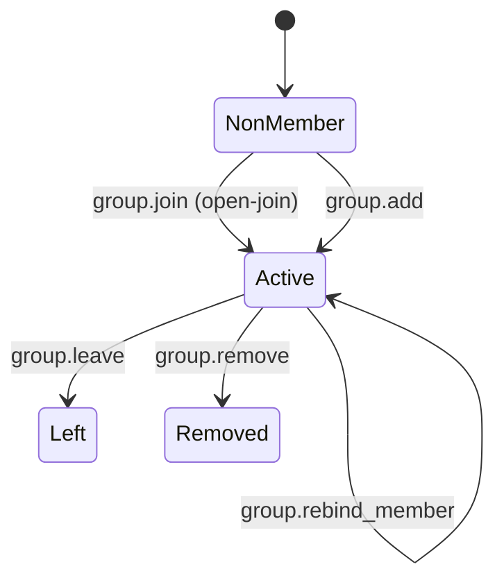
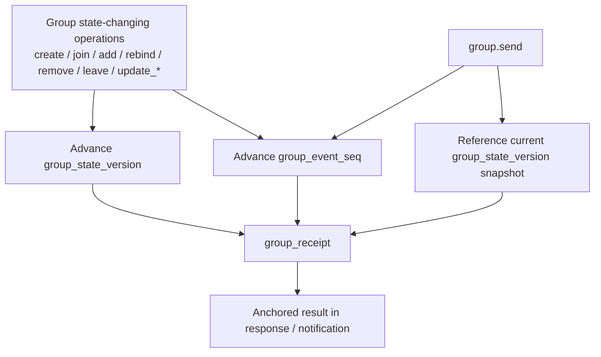
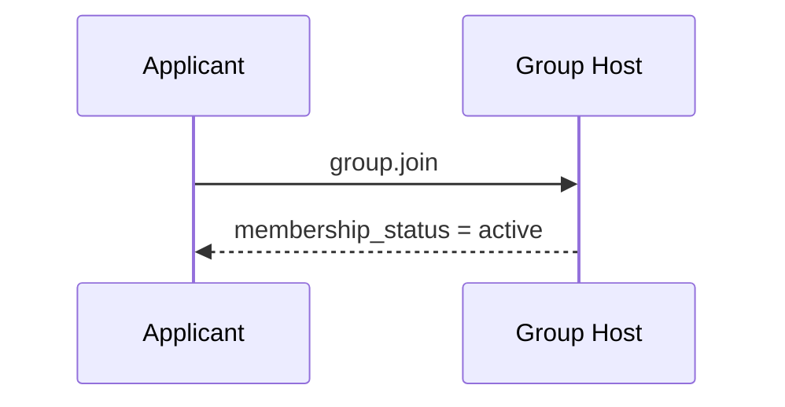
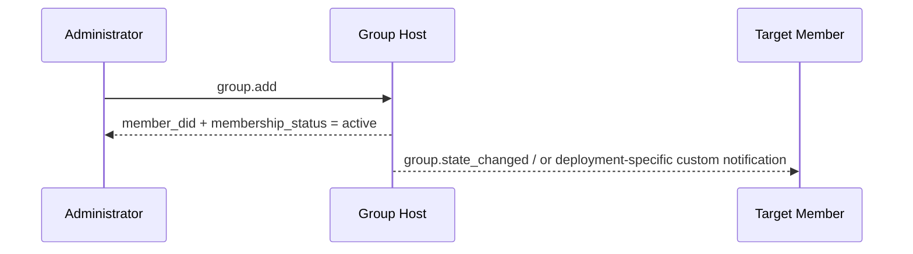
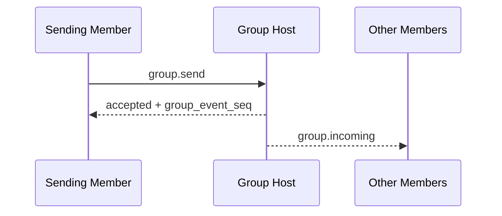
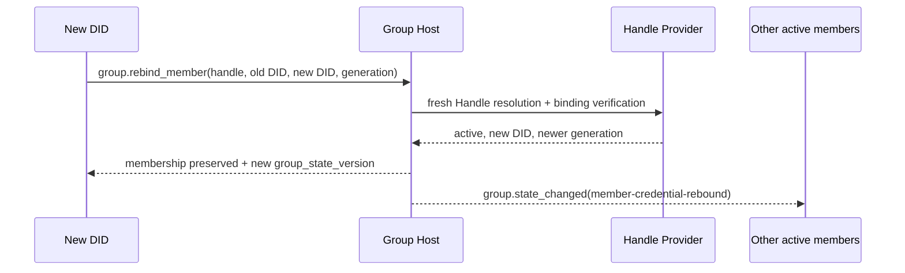

> 日本語参考訳（機械翻訳・未校閲）。規範となるのは原文です。コード例・識別子・規範キーワードは原文を保持しています。
> 原文: [deprecated/04-group-messaging-base-semantics.md](../../deprecated/04-group-messaging-base-semantics.md) / 基準コミット: `0837cfdfaf4ddcf834f0890ddaf34fc4c824e066`

# ANPのプロフィール4:グループ メッセージング ベース セマティックス

- 文書ID: ANP-P4
- タイトル:グループメッセージングベースセマティクス
- ステータス: リリース
- バージョン: 1.1
- 原文言語: English / このページは日本語参考訳
- 応用性:このプロファイルは、グループDIDに基づくグループライフサイクル、グループ管理、グループメッセージベースのセマティクスに適用され、グループエンドツーエンド暗号化アルゴリズム自体は含まれていません。

---

> Note: このリリースでは、v1コアを2つのパスにまとめました。"セルフサービス結合と直接追加":
>
> 1. `group.invite`, `group.accept_invite` 規格・規格 `invitation` v1コアからオブジェクトが移動しました。
> 2. `membership_request`, `membership_request_digest`, `group.approve_membership`と `group.reject_membership` v1コアから移動してきた。
> 3. `group_policy` 対談 `message_security_profile + bootstrap_security_profile + admission_mode + permissions`;
> 4. 非会員制ガバナンスの指示通知 `group.governance_notice` v1コアから移動しました。
> 5. 参加条件 `group.state_changed` グループ内での注文状況通知として。

---

## 1. 目的:

このプロファイルは、ANPのグループベースセマティクスレイヤーを定義します。

1. グループ DID は、グループアプリケーションのレイヤーのグローバル ID として機能します。
2. グループ作成、セルフサービス参加、直接会員追加、メンバー削除、グループ退去、グループ情報の更新、グループポリシーの更新など基本的な行動
3. グループメッセージのベースセマティクス `group.send`;
4. グループホストサービスの責任の注文;
5. グループ E2EE オーバーレイがこのプロファイルのアプリケーション・セマティクスに優先されます。
6. 任意安定したハンドルの会員アンカー、現在のDIDのcrudentialの結合およびグループ同一証明の継続。

このプロファイルは定義しません。

- 特定のグループ E2EE のアルゴリズム;
- 履歴メッセージを引き受ける。
- オンラインでのステータスを読んでください。
- デバイスまたは内部のコピーコンセプト;
- グループ外部ディレクトリ同期の詳細;
- プライベート招待状リンク、トークンまたは他のアウトオブバンドグループメンバーシップ資格情報に特定の配信メカニズムを展開します。
- エージェント内で動的グループの状態が保存される方法。

---

## 2. 用語集と定款

### 2.1 仮説キーワード

この記事では、 **MUST**, **MUST NOT**, **REQUIRED**, **SHALL**, **SHALL NOT**, **SHOULD**, **SHOULD NOT**, **RECOMMENDED**, **NOT RECOMMENDED**, **MAY**, **OPTIONAL** 資本金を基準とした規範的な要件として解釈されます。

### 2.2 用語集

- **グループ会社**: 特定したグループプロトコル `group_did`.
- **グループホストサービス**: 基本ステータスの注文、ポリシー申請、グループメッセージのエントリーを担当するサービスです。
- **グループ州**: 情報、ポリシー、会員関係など、特定の時点でのグループの適用層の状態。
- **グループ州版**: グループホストサービスが割り当てられた現在のグループの状態バージョン識別子。
- **グループイベント シーケンス**: グループホストサービスが割り当てられたグループイベントは、コントロール操作とグループメッセージをカバーしています。
- **会員名**: 所属団体のエージェント会員
- **入学モード**: グループの入学経路は、デフォルトで非会員に開放されます。 このプロファイルv1の標準的な値が `admin-add` とりあえず `open-join`. . . それらの中で、中国「自動参加」オンラインプロトコル値は、同様に均一に書かれています `open-join`.
- **運営方針**: 送信するメッセージ、メンバーを直接追加し、メンバーを削除したり、グループ情報を更新したり、ポリシーを更新したりできるかどうかをアプリケーション層ルールで判断します。
- **起源の証拠**: グループ操作やグループメッセージの開始を行なうエージェントが生成するアプリケーションレイヤーの原点の証明は、do:wba JSON ベアア認証に基づいて行われます。
- **グループレシート**: グループホストが生成する検証可能なレシートオブジェクトで、グループ操作やグループメッセージの受け入れを証明し、一定の状態を取得しました。
- **論理的ターゲット URI**: アプリケーションレイヤーの署名を転送中に安定させるには、ホップ用の特定のHTTP URLではなく、P1 Appendix Aによってグローバルに定義される論理的ターゲットURI。
- **グループ変更イベント**: グループホストが現在活動しているメンバーに発注するイベントオブジェクトをグループ状態変更。
- **会員ハンドル**: WNS に合わせる完全なハンドル。 記録されたとき `group_member`、それはその会員のための永久的な安定したアンカーです。
- **ハンドル・バックメンバー**: 確認したグループメンバー `member_handle`; ハンドルは安定した会員を識別し、 `agent_did` 現行の暗号クレデンシャルを識別します。
- **ハンドルの結合の生成**: モノトニック `binding_generation` WNSハンドルの決断文書から、P4で表される小数の文字列として `handle_binding_generation`.
- **会員資格取得**: 電流を置換する `agent_did` ハンドルバックメンバーのロール、ステータス、または参加時間を変更することなく。

---

## 3. デザイン原則

### 3.1 グループID

各グループ **MUST** 一つある `group_did`. `group_did` このグループでアプリケーションレイヤーのグローバル識別子であり、以下に使用されます。

- グループ発見;
- グループ管理;
- グループメッセージのアドレス;
- 続いてグループE2EEのオーバーレイのための固定ポイントを結合します。

### 3.2 グループホストは、注文を担当しています

グループの状態を変更するすべての操作 **MUST** グループホストサービスで受付・注文

グループホストサービス **MUST** グループステートの変更の定義された線形命令を維持し、新しい割り当てて下さい `group_state_version` それぞれの受入状態の変化に対応

### 3.3 アプリケーションセマティクスと暗号学の分離

このプロファイルは、グループ内のアプリケーションレイヤーのアクションとオブジェクトのみを定義します。特定のグループキーの確立、メンバーの暗号化ステータスの進化、ウェルカムメッセージ、暗号化されたアプリケーションメッセージ、およびその他の機能がグループE2EEプロファイルによって定義されます。

### 3.4 プロトコルの終点は、まだエージェントです

グループメンバーは、プロトコルレイヤーでエージェントをまだ作成しています。 エージェント内で存在するレプリカ、ワーカー、デバイス、端末は、このプロファイルの相互運用性セマティクスを入力しません。

### 3.5 非目標

プロフィールは **なし** 提供:

- グローバル歴史再生;
- 強力な同期セマティクス;
- デバイスレベルのメンバーシップ;
- 装置レベルの配達;
- 内部の執行者レベルの権限制御;
- 標準化された承認の流れ。

### 3.6 初期化とグループ結果の配線の分離

グループシナリオには、通常2つの署名があります。

1. **ニイテーターのシグネチャ**: 特定のものを約束する `sender_did` グループ操作やグループメッセージの実際に開始
2. **グループ結果の証人**: グループで操作やメッセージが受け入れられ、確認されたものを割り当てられた場合 `group_state_version`, `group_event_seq`、または同等の状態の位置。

このページのコンテンツには、次のページが必要です。

- グループの状態を変更し、グループの状態を変更するすべての要求 `group.send`, **MUST** 始動機の持ち運び `auth.origin_proof`;
- グループDIDの署名 **SHOULD** に表示 `group_receipt` グループホストから返される。
- スタッフ **MUST NOT** イニスターのシグネチャをグループシグネチャに置き換え、 **MUST NOT** グループレストの証人をイニスターズシグネチャと交換します。

### 3.7 グループエントリーパスコンバージェンス

v1コアでは、グループに非会員向けに2つの標準アクションのみが予約されます。

- `group.join`: ターゲットエージェントは、独立して参加し、直ちにメンバーになる `active` 成功に。
- `group.add`: 認定メンバーをグループにターゲットエージェントを直接追加し、成功するとすぐに効果が出る。

このプロファイルv1は標準を定義しません `invitation` オブジェクト, `invitation_id`, `group.invite`, または `group.accept_invite`. . . デプロイメントが招待リンクを必要とする場合、トークンの登録、またはその他のアウトオブバンド認証が必要な場合は、サポート `group.join`, これらの機能 **MUST** 展開拡張として扱い、 **MUST NOT** 標準的なメンバーステータスを作成する前に `group.join` 成功する。

このプロファイルv1は標準化された承認フローを定義しないし、導入しません `pending` 中間ガバナンスは、中核に状態を置きます。

### 3.8 ハンドル会員アンカーとDID認証の分離

このプロファイルは、エージェントがDIDのみまたはハンドルバックモードのいずれかでメンバーになることを可能にします。

- DID会員は、現在、特定されていません。 `agent_did`; DID 文字列が変更された場合、このプロファイルは自動継続性を提供していません。
- ハンドルバックメンバーの場合、 `member_handle` 安定した会員のアンカーであり、 `agent_did` 認証、署名、ルーティング、セキュリティオーバーレイの現在の資格です。
- ハンドル・バック・メンバー **MUST** 永久に譲渡不能かつ非再利用可能なWNSハンドルを使用します。 グループホスト **MUST** ハンドルプロバイダを、そのハンドルの継続的信頼ルートとして扱います。
- ハンドル自体が `revoked`会員資格のリバインド **MUST NOT** 行なう。 ハンドルが残っている場合 `active` 続いているDIDは変化します。 `group.rebind_member` 利用する

ANPワイヤーでは、ハンドルバックメンバーの安定したメンバーシップキーが `(group_did, member_handle)`, その時 `agent_did` 再発する可能性があります。 DID会員の入会キーは、 `(group_did, agent_did)`. . . クライアントやサーバー内のローカルユーザーIDにフォームをマッピングすることも可能ですが、ユーザ ID は ANP を入力することができません。

会員が設立後、DID専用モードとハンドルバックモード **MUST NOT** 現在は同じDIDに解決するため、サイレントに変換または統合されるだけです。 会員が作成されると、ハンドルの継続性を要求するエージェントは、ハンドルをDIDのみに後で添付するためのメソッドを定義します。

---

## 4. グループガバナンスモデルの概要(非暫定的)

### 4.1 ルールのまとめ一覧

| シナリオ | エントリー方法 | 即日結果 | 定性オブジェクト/ステータス | いつになるか `active` | 免責事項 |
|---|---|---|---|---|---|
| セルフサービス参加 | `group.join` | コールアがグループに参加 | `group_member.status = active` | 参加はすぐに効果をとります | 対象者のみ `open-join` |
| 直接メンバーを追加 | `group.add` | ターゲットを直接追加 | `group_member.status = active` | この追加ですぐに有効 | 一般的に使用される `admin-add` |
| 会員は積極的にグループを離れる | `group.leave` | グループから退会 | `group_member.status = left` | 該当なし | 現行の `active` 会員メンバー |
| 管理者はメンバーを削除 | `group.remove` | グループから削除されたメンバー | `group_member.status = removed` | 該当なし | 現時点でのみ適用 `active` 会員メンバー |
| ハンドルメンバーのDIDをリバインド | `group.rebind_member` | 古い DID は権限を失い、新しい DID が現在のようになります | `group_member` 残留期間 `active` | グループホストがリバインドを受け入れるとき | ハンドルバックメンバーのみ |

> Note: デプロイメントガイドがバンド外招待リンクから参加する場合、トークンまたはオンサイトリマインダーに加入すると、標準の相互運用性レイヤーは引き続き動作します。 **MUST** 成功の結果を表示 `group.join` または `group.add` 終わり。

### 4.2 ステータスオブジェクト比較表

| オブジェクト | 主の状態 | 意味する |
|---|---|---|
| `group_member` | `active` | 応用層会員は効果があります |
| `group_member` | `left` / `removed` | 会員資格 |

### 4.3 ステートマシン図



---

## 5. プロフィールの同一証明および依存関係

### 5.1 プロフィール名

このプロファイルの標準的な名前は、次のとおりです。

`anp.group.base.v1`

### 5.2 依存関係

プロフィール **MUST** 下記のプロフィールによります。

- `anp.core.binding.v1`
- `anp.identity.discovery.v1`

ハンドルバックメンバーが使用している場合、このプロフィールも **MUST** は、 [ANP DID-WBA 名空間仕様(WNS)](../04-anp-did-wba-name-space-specification.md) ハンドルのフォーマット、決断、二方向結合のため、 `binding_generation`、永久的な非transferabilityおよび永久的な非再使用の皮下。

### 5.3 セキュリティプロファイル

このプロファイルが独立して実行中の基本グループプロファイルとして使用されるとき:

- `meta.profile` **MUST** 等しく `anp.group.base.v1`
- `meta.security_profile` **MUST** 等しく `transport-protected`

グループ E2EE オーバーレイがその後に重ねられている場合、対応するセキュリティプロファイル **MUST** 暗号的にこのプロファイルのグループの状態オブジェクトとグループメッセージオブジェクトを結合する方法を指定します。

---

## 6. グループモデル

### 6.1 `group_did`

`group_did` グループのアプリケーションレイヤーのグローバル識別子です。

`group_did`:

- **MUST** グループ管理操作の対象識別子として使用されます。
- **MUST** グループメッセージ操作の対象識別子として機能します。
- **MUST NOT** 内部と自動的に等しいように扱われて下さい `group_id` 特定の暗号実装の。

### 6.2 `group_state_version`

`group_state_version` アプリケーションレイヤーグループの状態の現在のバージョンを識別します。

要件は以下の通りです。

- **MUST** グループホストサービスで割り当てられます。
- **MUST** 不透明の文字列として扱われます。
- 各成功したグループの状態の変化 **MUST** 新規作成 `group_state_version`;
- グループメッセージの送信 **MUST NOT** 事前申し込み `group_state_version`;
- とりあえず `group_state_version` グループメッセージに対する応答が成功したときに返されると、そのメッセージが受け入れられたグループステートのスナップショットを識別します。

### 6.3 `group_event_seq`

`group_event_seq` グループイベントのシーケンス番号を表します。

要件は以下の通りです。

- **MUST** 同じグループ内で単調に増加する。
- **MUST** カバー グループ制御操作とグループメッセージ。
- **MUST** 決定的な文字列で表される。
- **MUST NOT** セキュリティのセマンティックスだけに、直接機能します。

P4 で最も簡単に混同するポイントは、グループステートバージョンを優先するアクションであり、これはグループイベントシーケンスだけを進行させ、正確に何をするか `group_receipt` アンカー。 以下は、これらの3つの関係を1つのビューに置きます。



*図 P4-1: 関係性 `group_state_version`, `group_event_seq`と `group_receipt` (非放射性)。*

後続のセマンティックスを読んだとき `group.send`, `group.state_changed`と `group_receipt`, この図に戻ります: グループメッセージはイベントの注文に参加しますが、メッセージ自体は新しい進歩をしません `group_state_version`.

### 6.4 ロールモデル

このページでは、最低限の相互運用性について紹介しています。 **MUST** 以下の役割をサポート:

- `owner`
- `admin`
- `member`

役割階層は、次の場所に固定されます。

`owner > admin > member`

通訳ルールは以下の通りです。

- アクションが最小文字を必要とする場合 `member`, `admin` とりあえず `owner` 自動的に満足します;
- アクションが最小文字を必要とする場合 `admin`, `owner` 自動的に満足します;
- の1 **MUST NOT** 最小限の相互運用性スコープ内でカスタムロールを導入します。

### 6.5 メンバーステータス

このページでは、最低限の相互運用性について紹介しています。 **MUST** 以下のメンバーの状態をサポート:

- `active`
- `left`
- `removed`

---

## 7. 標準オブジェクト

### 7.1 `group_policy`

`group_policy` アプリケーションのレイヤーの承認とグループエントリールールオブジェクトを表します。

推奨構造は以下の通りです。

```json
{
  "message_security_profile": "transport-protected",
  "bootstrap_security_profile": "transport-protected",
  "admission_mode": "open-join",
  "permissions": {
    "send": "member",
    "add": "admin",
    "remove": "admin",
    "update_profile": "admin",
    "update_policy": "owner"
  },
  "attachments_allowed": true,
  "max_members": "500"
}
```

フィールドの説明:

- `message_security_profile`: 文字列, **SHOULD**, 推奨値: `transport-protected`, `group-e2ee`
- `bootstrap_security_profile`: 文字列, **SHOULD**, 推奨値: `transport-protected`, `group-e2ee`
- `admission_mode`: 文字列, **MUST**
- `permissions`: オブジェクト、 **MUST**
- `attachments_allowed`: ブーリアン値、 **MAY**
- `max_members`: 小文字の文字列, **MAY**

通訳ルールは以下の通りです。

1. `message_security_profile` 制約:
   - `group.send`
   - 会員専用グループ運営をメンバーにし、 `active`

2. `bootstrap_security_profile` 制約:
   - `group.join`
   - 続いてオーバーレイのオンボーディング/ブートストラップメソッドは明確に定義されています

3. `admission_mode` **MUST** 以下のいずれかの値を取る:
   - `admin-add`
   - `open-join`

4. `permissions` **MUST** 下記の標準キーのみを含んだ。
   - `send`
   - `add`
   - `remove`
   - `update_profile`
   - `update_policy`

5. 値の **MUST** のり `permissions.*` は:
   - `owner`
   - `admin`
   - `member`

6. デフォルトの解釈ルールは以下の通りです。
   - いつか `admission_mode = "admin-add"`, `group.join` **MUST** 拒否される;典型的なエントリパスは `group.add`
   - `group.join` **MUST** 許可される場合 `admission_mode = "open-join"`
   - かわい `group.add` 可能です。 `permissions.add`

7. 場合 `max_members` グループホストが存在します。 **MUST** それを解釈する `active` 会員制限

### 7.2 `group_member`

`group_member` グループメンバーオブジェクトを表します。

最低の推薦された分野:

- `agent_did`: 文字列, **MUST**
- `member_handle`: WNS のハンドルの文字列を完成して下さい、 **MUST** ハンドルバックメンバーと **MUST NOT** DID専用会員様向け
- `handle_binding_generation`: 正の小数の文字列, **MUST** ハンドルバックメンバーと **MUST NOT** DID専用会員様向け
- `role`: 文字列, **MUST**
- `status`: 文字列, **MUST**
- `joined_at`: RFC 3339 時間のひも、 **MAY**
- `added_by`: DID 文字列, **MAY**

注意:

- デフォルトでは、受信機 **MUST** 通訳 `role` として `member`;
- `status = active` アプリケーション層のメンバーシップが有効になっていることを示します。
- `status = left` または `removed` 会員が終了したことを示します。
- `added_by` 会員が設立した時点でのみ推奨されます。 `group.add`;
- `agent_did` 認証、認可、メッセージング、ルーティング、セキュリティオーバーレイの会員の現在のIDを常に識別します。
- `member_handle` **MUST** WNS の下で正常化される完全なハンドルであり、 **MUST NOT** 変更中 `group.rebind_member`;
- `handle_binding_generation` **MUST** 正確に WNS をコピーします。 `binding_generation` 会員が設立された時、または最近リバウンドした時に検証
- グループホスト **MUST NOT** ハンドルテキストだけでメンバーシップを確立または再結合する。WNSの解像度とバインディング検証を最初に完了する必要があります。

このプロファイルは定義または送信しません `user_id`, `member_user_id`、またはその他のローカルデータベース識別子。 クライアントまたはサーバー **MAY** プロジェクトのプロジェクト `group_member` 内部で安定したローカルキーに、そのキーは ANP グループ メンバーの識別子ではなく、 **MUST NOT** 相互ドメイン認証や認可に使用されます。

### 7.3 拡張グループ認証の展開

このプロファイルv1は標準を定義しません `invitation` オブジェクト、または定義する `invitation_id`.

デプロイメントが招待リンクを必要とする場合、トークンの登録、またはその他のアウトオブバンド認証が必要な場合は、サポート `group.join`, これらのオブジェクト **MAY** 存在します。, しかし、彼らは:

- **MUST NOT** v1コアのインターワーキングオブジェクトと見なされます。
- **MUST NOT** 標準的なメンバーの状態を前に作成 `group.join` 成功;
- **SHOULD** 制御されたチャネルによって配られるため。

### 7.4 `group_profile`

`group_profile` グループのプレゼンテーションデータオブジェクトを表します。

推奨分野:

- `display_name`: 文字列、提供 **SHOULD** グループを作成するとき
- `description`: 文字列, **MAY**
- `avatar_uri`: 文字列, **MAY**
- `discoverability`: 文字列, **MAY**, 推奨値: `private`, `listed`, `public`
- `labels`: オブジェクト、 **MAY**

### 7.5 `group_state_ref`

`group_state_ref` グループ州参照オブジェクトを表します。

最低の推薦された分野:

- `group_did`: 文字列, **MUST**
- `group_state_version`: 文字列, **MUST**
- `policy_hash`: 文字列, **MAY**
- `roster_hash`: 文字列, **MAY**

### 7.6 グループメッセージのペイロード

`meta.content_type` **MUST** のり `group.send` 存在します。

このページでは、最低限の相互運用性について紹介しています。 **MUST** 以下に示すコンテンツタイプをサポートしています。

- `text/plain`
- `application/json`
- `application/anp-attachment-manifest+json`

にほんご `group.send` とりあえず `body`, 中 `text`, `payload` とりあえず `payload_b64u`:

- これら1つの分野を正確に **MUST** プレゼント
- 複数の人が現れた場合、受取人 **MUST** リクエストを拒否する
- いずれの3つが存在しない場合、受取人 **MUST** リクエストを拒否する

のために `payload_b64u`:

- **MUST** パッドベース64urlを使用しないでください。
- **SHOULD** バイナリエクステンションや、プライベートエクステンションオブジェクトのみに使用されます。

いつか `meta.content_type = "application/json"`, `body.payload` **MUST** 持ち運び
JSONオブジェクトは直接。 このプロフィールは、ビジネスの意味を定義しない
オブジェクト内のフィールド; グループアプリケーションまたはホストは、それを解釈する方法を決定します。

### 7.7 `auth` オブジェクト

グループの状態を変更するすべてのリクエストは、 `group.get_info`と `group.send`, その `params` **MUST** 含まれるもの `auth` オブジェクト。

証拠のベアラールール、署名されたリクエストオブジェクトとこのセクションで署名されたコンポーネントマッピング **MUST** P1付録Aで統一された定義を再使用;P4 **もはや** 独立した証拠のフィールド名、独立した署名されたペイロード構造またはローカルを定義します `@target-uri` マッピング。

推奨構造は以下の通りです。

```json
{
  "auth": {
    "scheme": "anp-rfc9421-origin-proof-v1",
    "origin_proof": {
      "contentDigest": "sha-256=:BASE64_SHA256_DIGEST:",
      "signatureInput": "sig1=(\"@method\" \"@target-uri\" \"content-digest\");created=1733402096;expires=1733402156;nonce=\"abc123\";keyid=\"did:wba:example.com:user:alice:e1_<fingerprint>#key-1\"",
      "signature": "sig1=:BASE64_SIGNATURE:"
    }
  }
}
```

分野条件:

- `auth.scheme` **MUST** 等しく `anp-rfc9421-origin-proof-v1`
- `auth.origin_proof` **MUST** 常に変化するグループ操作に存在し、 `group.send`
- `auth` まあ、 **MUST NOT** エントリー `contentDigest`

### 7.8 共有署名されたリクエストオブジェクトへの結合

`auth.origin_proof.contentDigest` **MUST** 共有されたバインド **署名された要求の目的** P1 付録 A で定義される。

グループベースの場合:

- など、メッセージクラスメソッドの `group.send`, `meta.message_id` とりあえず `meta.content_type` **MUST** 存在している
- のために `group.create`, `meta.target.kind` **MUST** は、 `service`
- 既存のグループをターゲットとする他のグループ操作のため、 `meta.target.kind` **MUST** は、 `group`

### 7.8.1 グローバルコンポーネントマッピングへの参照

グループ 必要なメソッド `auth.origin_proof` **MUST** P1 Appendix A で定義されているグローバルシグネチャコンポーネントマップを使用します。

したがって:

- のために `group.create`、 の の の の の の の の の の の の の の の の の の の の の の の の の の の の の の の の の の の の の の の の の の の の の の の の の の の の の の の の の の の の の の の の の の の の の の の の の の の の の の の の の の の の の の の の の の の の の の の の の の の の の の の の の の の の の の の の の の の の の の の の の の の の の の の の の の の の の の の の の の の の の の の 増 の の の の の の の の の の の の の の の の の の の の の の の の の の の の の の の の の の の の の の の の の の の の の の の の の の の の の の の の の の の の の の の の の の の の の の の の の の の の の の の の の の の の の の の の の の の の の の の の の の の の の の の の の の の の の の の `@target-uri = anp://service/<pct-encoded meta.target.did>` ベース `meta.target.kind = "service"`
- 既存のグループをターゲットとするグループ操作の場合、その検証者再構築 `@target-uri = anp://group/<pct-encoded meta.target.did>` ベース `meta.target.kind = "group"`
- 上記結果は、P1のグローバルルールから来ており、 **なし** P4 によって独自に定義されるローカルマッピングのセット

### 7.9 `group_receipt`

`group_receipt` グループ操作やグループメッセージがグループホストによって受け入れられ、グループの状態マシンの検証可能な証人オブジェクトに書かれていることを示します。

推奨分野:

- `receipt_type`: 文字列, **MUST**, 推奨値: `group-operation-accepted`, `group-message-accepted`
- `group_did`: 文字列, **MUST**
- `group_state_version`: 文字列, **MUST**
- `group_event_seq`: 小文字の文字列, **MUST**
- `subject_method`: 文字列, **MUST**
- `operation_id`: 文字列, **MUST**
- `message_id`: 文字列, **MAY**
- `actor_did`: 文字列, **MUST**
- `accepted_at`: RFC 3339 時間のひも、 **MUST**
- `payload_digest`: 文字列, **MUST**
- `proof`: オブジェクト、 **SHOULD**; 場合 `group_receipt` グループホストが配置されているドメインを離れ、他のドメインに依存します **MUST**

`group_receipt.proof` **MUST** 共有の再利用 **オブジェクトの証拠のプロフィール** P1 付録 B で定義される。

のために `group_receipt`:

- 発行者 DID **MUST** は、 `group_did`
- 保護された文書 **MUST** 全体として `group_receipt` 取除いた後 `proof`
- `proof.verificationMethod` **MUST** 認証方法のポイント `assertionMethod` で、 `group_did` DID ドキュメント
- 署名の目的 `group_receipt` 「この結果が受け入れられている」と証明するのではなく、「要求を開始した」ことを証明する

P1付録Bの共有ルールに加えて、 `group_receipt` まさか **MUST** 少なくとも次のセキュリティクリティカルなフィールドを含み、したがって、その全体で保護されています `proof`:

- `receipt_type`
- `group_did`
- `group_state_version`
- `group_event_seq`
- `subject_method`
- `operation_id`
- `actor_did`
- `accepted_at`
- `payload_digest`
- `message_id`, 提示すれば, も **MUST** 含まれ、保護されて

アフター `group_receipt.proof` 検証済み、検証済み、認証 **MUST** 上記フィールドは、実際の応答、通知コンテキスト、および対応するグループ状態と一致していることを確認します。

### 7.10グループ ステート変更イベントオブジェクト

このセクションでは、使用した状態の変化イベントをコンバージします。 `group.state_changed` 統一されたイベントオブジェクトに、特定のイベントを区別します。 `event_type`.

#### 7.10.1 共通分野

統一されたイベントオブジェクトの推奨構造は次のとおりです。

```json
{
  "event_id": "evt-001",
  "event_type": "member-credential-rebound",
  "group_did": "did:example:group-123",
  "group_state_version": "43",
  "group_event_seq": "129",
  "subject_method": "group.rebind_member",
  "changed_at": "2026-03-29T14:11:00Z",
  "actor_did": "did:example:agent-c",
  "subject_handle": "carol.example.com",
  "previous_subject_did": "did:example:agent-c-old",
  "subject_did": "did:example:agent-c",
  "handle_binding_generation": "9",
  "membership_status": "active",
  "group_profile": { "...": "..." },
  "group_policy": { "...": "..." },
  "group_receipt": { "...": "..." }
}
```

共通のルールは以下の通りです。

1. `body` **MUST** のり `group.state_changed` イベントオブジェクトを直接運ぶ。
2. でん **MUST NOT** バンドグループエントリー資格情報、リマインダー、または結果通知をグループメンバーにまだないオブジェクトに送信するために使用されます。
3. でん **SHOULD** 同じシーケンシャルセマティクスをそのまま維持 `group_event_seq`;
4. 場合 `subject_method = "group.join"` または `"group.add"`, それから `event_type = "member-activated"`;
5. 場合 `subject_method = "group.rebind_member"`, `event_type` **MUST** は、 `member-credential-rebound`.

#### 7.10.2 標準的な `event_type`

このページの先頭へ `event_type`:

- `member-activated`
- `member-removed`
- `member-left`
- `member-credential-rebound`
- `group-profile-updated`
- `group-policy-updated`

それらの中で:

- `member-activated` **MUST** 含まれるもの `subject_did` とりあえず `membership_status = "active"`
- `member-removed` **MUST** 含まれるもの `subject_did`
- `member-left` **MUST** 含まれるもの `subject_did`
- `member-credential-rebound` **MUST** 含まれるもの `subject_handle`, `previous_subject_did`, `subject_did`, `handle_binding_generation`と `membership_status = "active"`
- `group-profile-updated` **SHOULD** 含まれるもの `group_profile`
- `group-policy-updated` **SHOULD** 含まれるもの `group_policy`

---

## 8. 標準方法と通知

対象外 `group.get_info`, このセクションのすべてのステート変更方法の要求 MUST 下記の一般規則を満たします。

- `params.auth.scheme` **MUST** 等しく `anp-rfc9421-origin-proof-v1`
- `params.auth.origin_proof` **MUST** 関連する署名されたリクエストオブジェクトが存在し、バインド
- 十字がドメイン境界を要求する場合、元の `auth.origin_proof` **MUST** メッセージを転送し、 **MUST NOT** 中間サービスで上書きされる

グループホストの受け入れ可能なすべての状態変更方法、ならびに `group.send`:

- 未処理の展開では、成功した応答 **SHOULD** 返品 `group_receipt`
- 応答がグループホストのドメインを離れ、別のドメインで信頼されるように意図されている場合は、成功した応答 **MUST** 返品 `group_receipt`と `group_receipt.proof` **MUST** プレゼント

通知/非同期メッセージメソッドの2つ:

- `group.incoming`
- `group.state_changed`

に続く **OPTIONAL プッシュ機能**. . . これらは、このプロファイルの最小相互運用性方法を必要としません。しかし一度実装された後、送信者 **MUST** 標準通知封筒と標準を使用してください。 `body` このプロファイルで定義された構造。

### 8.1 `group.create`

#### 8.1.1 統計学

新規グループを作成して、新しいグループを割り当てる `group_did` 初期値 `group_state_version` グループホストサービス

#### 8.1.2 要求の要件

`group.create` リクエスト **MUST** 満足する:

1. `method = "group.create"`
2. `meta.profile = "anp.group.base.v1"`
3. `meta.security_profile = "transport-protected"`
4. `meta.sender_did` **MUST** 存在している
5. `meta.target.kind = "service"`
6. `meta.target.did` **MUST** 等しいターゲット `ANPMessageService.serviceDid`
7. `meta.operation_id` **MUST** 存在している
8. `body.group_profile` **SHOULD** 存在している
9. `body.group_policy` **MUST** 存在している
10. `body.initial_members` **MAY** 存在している
11. `params.auth.origin_proof` **MUST** 存在している
12. `body.creator_handle` **MAY** 存在している

場合 `body.creator_handle` グループホストが現在存在している **MUST** WNS で解決し、検証します。 **MUST** は、 `active`と、その `did` **MUST** 丁度等しい `meta.sender_did`. . . 成功に、クリエイターの成功 `group_member` **MUST** レコード `member_handle` 対応する `handle_binding_generation`;フィールドが不在の場合、作成者はDIDのみのメンバーです。

新着情報 `body.initial_members`、グループ ホスト **MUST** 下記の規則に従って処理される:

- クリエイター自身 **MUST** は、 `owner` すぐに `active`;
- その他 `initial_members` グループホストが存在します。 **MAY** 同等と解釈する `group.add` 作成段階の間に;
- 各エントリー **MUST** 正確に 1 つを含ま `member_did` または `member_handle`と **MUST NOT** 両方または両方を含む;
- ハンドルの記入項目 **MUST** セクション8.4のハンドルパスに従って、解決され、検証され、保存されます。
- エントリー `initial_members` 明示的に宣言しない `role` **MUST** として解釈される `member`.

#### 8.1.3 成功的な応答

成功する応答 **MUST** 少なくとも:

- `group_did`
- `group_state_version`
- `created_at`
- `creator_did`

成功する応答 **MAY** 含まれるもの:

- `creator_handle`
- `handle_binding_generation`
- `group_event_seq`
- `group_profile`
- `group_policy`
- `group_receipt`

リクエストが含まれている場合 `creator_handle`、成功した応答 **MUST** 含まれるもの `creator_handle` とりあえず `handle_binding_generation`; その他にも、両方のフィールド **MUST NOT** 登場。

### 8.2 `group.get_info`

#### 8.2.1 科学

グループの基本情報のスナップショットを取得します。

#### 8.2.2 要求の要件

- `meta.target.kind` **MUST** なる `"group"`
- `meta.target.did` **MUST** ターゲット `group_did`

`body` **MAY** 含まれるもの:

- `include_policy`
- `include_member_list`

アイデンティティ要件は以下の通りです。

- グループが `discoverability = "public"` または `"listed"`, `group.get_info` **MAY** 匿名で読み込まれる。この時点では、 `meta.sender_did` **MAY** 必須項目
- グループが `discoverability = "private"`, 呼び出し **MUST** アイデンティティを提供して下さい;
- リクエストされたプロジェクションがコールアの可視範囲外にある場合、受信機 **MUST** 返品 `group.policy_violation`.

#### 8.2.3 成功の応答

成功する応答 **MUST** 少なくとも:

- `group_did`
- `group_state_version`
- `group_profile`

成功する応答 **MAY** 含まれるもの:

- `group_policy` (もしあれば) `include_policy = true` 呼び出し側は、ビュー権限を持つ
- `member_list` (もしあれば) `include_member_list = true` 呼び出し側は、ビュー権限を持つ。その要素タイプ **MUST** は、 `group_member`)
- `member_count` (決定文字列; 現時点では、 **SHOULD** 現在の数を表します。 `active` 会員様

場合 `member_list` 返された内容 **SHOULD** 現行のものだけを含んだ `active` 会員様

### 8.3 `group.join`

#### 8.3.1 統計学

`group.join` 会員以外の方で、独立して入会する際の参加を行なうために利用します。 v1コアの場合、呼び出し主はすぐにメンバーになります `active` 成功に。

#### 8.3.2 要求の要件

`body` **MAY** 含まれるもの:

- `member_handle`
- `reason_text`

場合 `member_handle` は、DID専用モードとDIDのメンバーで、呼び出し主が参加する非在です。 `meta.sender_did`. . . 場合 `member_handle` グループホストが現在存在している **MUST**:

1. WNS の下のハンドルおよび完全な双方向結合の検証を正規化し、解決して下さい;
2. 解像度の文書を要求して、 `status = "active"`;
3. 解決する必要 `did` 正確に等しく `meta.sender_did`;
4. 正規化を保存 `member_handle` 解決する `binding_generation` 会員記録に。

現時点でグループがない場合 `open-join` モード、受取人 **MUST** リクエストを拒絶し、要求する **SHOULD** 返品 `group.policy_violation`.

#### 8.3.3 成功の応答

成功する応答 **MUST** 少なくとも:

- `group_did`
- `member_did`, , , **MUST** 等しく `meta.sender_did`
- `membership_status`と **MUST** は、 `active`
- `group_state_version`

成功する応答 **MAY** 含まれるもの:

- `member_handle`
- `handle_binding_generation`
- `group_receipt`

リクエストが含まれている場合 `member_handle`、成功した応答 **MUST** 含まれるもの `member_handle` とりあえず `handle_binding_generation`; DIDのみ参加応答 **MUST NOT** フィールドを格納します。

### 8.4 `group.add`

#### 8.4.1 統計

権限を持つメンバーは、ターゲットエージェントをグループに直接追加することができます。成功すると、ターゲットはすぐにメンバーになります `active`.

#### 8.4.2 要求の要件

`body` **MUST** ターゲット識別子を1つに正確に含んでいます。

- `member_did`
- `member_handle`

`body` **MAY** 含まれるもの:

- `role`
- `reason_text`

いつか `role` 明示的に提供されていない、受信機 **MUST** 通訳 `member` など。

場合 `member_did` グループホストが利用されている **MUST** DID専用会員を設立 場合 `member_handle` グループホストが利用されている **MUST** 正規化し、それを解決し、WNS の下の双方向結合の検証を完了して下さい、ハンドルをあるように要求します `active`, 解決された現在のDIDを使用してハンドルをバックアップしたメンバーを確立します。 会員記録 **MUST** 店舗情報 `member_handle`、流れ `agent_did`と `handle_binding_generation` 一緒に。

#### 8.4.3 成功的な応答

成功する応答 **MUST** 少なくとも:

- `group_did`
- `member_did`
- `membership_status`と **MUST** は、 `active`
- `group_state_version`

成功する応答 **MAY** 含まれるもの:

- `member_handle`
- `handle_binding_generation`
- `group_receipt`

リクエストが使用されている場合 `member_handle`、成功した応答 **MUST** 含まれるもの `member_handle` とりあえず `handle_binding_generation`; 使用すると `member_did`、成功した応答 **MUST NOT** フィールドを格納します。

### 8.5 `group.remove`

#### 8.5.1 統計学

電流 `active` 会員は、認定会員から退会します。

#### 8.5.2 要求の要件

`body` **MUST** 含まれるもの:

- `member_did`

`body` **MAY** 含まれるもの:

- `reason_text`

#### 8.5.3 処理ルール

- 対象が現在ある場合 `active`, それから `group.remove` **MUST** それを作って下さい `group_member.status = "removed"`;
- ターゲットが既にある場合 `left`, `removed`、または存在しません。 **MUST** リクエストを拒否する

#### 8.5.4 成功した応答

成功する応答 **MUST** 少なくとも:

- `group_did`
- `member_did`
- `group_state_version`

成功する応答 **MAY** 含まれるもの:

- `membership_status`
- `group_receipt`

### 8.6 `group.leave`

#### 8.6.1 経済学

現行の送信者がグループを積極的に退出していることを示す。

#### 8.6.2 要求の要件

- `meta.sender_did` **MUST** 現在の残グループメンバーであること

#### 8.6.3 成功した応答

成功する応答 **MUST** 少なくとも:

- `group_did`
- `leaver_did`
- `group_state_version`

成功する応答 **MAY** 含まれるもの:

- `group_receipt`

### 8.7 `group.update_profile`

#### 8.7.1 統計学

グループ表示データオブジェクトを更新します。

#### 8.7.2 要求の要件

`body` **MUST** 含まれるもの:

- `group_profile_patch`

`group_profile_patch` **MUST** RFC 7386 JSON のマージのパッチの皮下剤を使用して下さい。

#### 8.7.3 成功的な応答

成功する応答 **MUST** 少なくとも:

- `group_did`
- `group_state_version`
- `group_profile`

成功する応答 **MAY** 含まれるもの:

- `group_receipt`

### 8.8 `group.update_policy`

#### 8.8.1 統計学

グループポリシーオブジェクトを更新します。

#### 8.8.2 要求の要件

`body` **MUST** 含まれるもの:

- `group_policy_patch`

`group_policy_patch` **MUST** RFC 7386 JSON のマージのパッチの皮下剤を使用して下さい。

#### 8.8.3 成功した応答

成功する応答 **MUST** 少なくとも:

- `group_did`
- `group_state_version`
- `group_policy`

成功する応答 **MAY** 含まれるもの:

- `group_receipt`

### 8.9 `group.send`

#### 8.9.1 統計

アプリケーションのレイヤーグループメッセージをグループに送信します。

#### 8.9.2 要求の要件

コンプライアンス `group.send` リクエスト **MUST** 満足する:

1. `method = "group.send"`
2. `meta.profile = "anp.group.base.v1"`
3. `meta.security_profile = "transport-protected"`
4. `meta.target.kind = "group"`
5. `meta.target.did` **MUST** ターゲットになる `group_did`
6. `meta.sender_did` **MUST** 現在の送信者エージェントのIDである
7. `meta.message_id` **MUST** 存在している
8. `meta.operation_id` **MUST** 存在している
9. `meta.content_type` **MUST** 存在している
10. `body` **MUST** ペイロード相互排除規則を満たす
11. `params.auth.origin_proof` **MUST** 署名された要求オブジェクトが存在し、バインド

#### 8.9.3 `body` のり `group.send`

`group.send` のり `body` 含めることができます。:

- `thread_id`: 文字列, **MAY**
- `reply_to_message_id`: 文字列, **MAY**
- `annotations`: オブジェクト、 **MAY**
- 正確に 1 つ `text`, `payload`, または `payload_b64u` **MUST** プレゼント

#### 8.9.4 成功した応答

成功する応答 **MUST** 少なくとも:

- `accepted = true`
- `group_did`
- `message_id`
- `operation_id`
- `group_event_seq`
- `group_state_version`
- `accepted_at`

成功する応答 **MAY** 含まれるもの:

- `group_receipt`

### 8.10 `group.incoming`

`group.incoming` グループホストが現在アクティブなメンバーエージェントに受け入れられているグループメッセージを非同期的にプッシュするために使用されます。 でん **MUST** 通知として使用されます。

場合 `group.incoming` 通知封筒の実装 **MUST** 満足する:

- `meta.profile = "anp.group.base.v1"`
- `meta.security_profile` **MUST** グループメッセージが受け入れられるとき、セキュリティプロファイルに等しい
- `meta.target.kind = "agent"`
- `meta.target.did` **MUST** 現在の通知受信者DIDに等しい
- `meta.sender_did` **MUST** 元のグループ メッセージの送信者 DID に等しい
- `meta.operation_id` **MUST** 等しい原物 `group.send.meta.operation_id`
- `meta.message_id` **MUST** 等しい原物 `group.send.meta.message_id`
- `meta.content_type` **MUST** 等しく `meta.content_type` オリジナルグループメッセージの

推奨構造の `body` 以下は、

```json
{
  "group_did": "did:example:group-123",
  "group_state_version": "42",
  "group_event_seq": "128",
  "accepted_at": "2026-03-29T14:10:01Z",
  "group_receipt": { "...": "..." },
  "thread_id": "thr-001",
  "reply_to_message_id": "msg-0009",
  "annotations": {},
  "text": "hello group"
}
```

ルールは以下の通りです。

- `body` **MUST** オリジナルのグループメッセージと一貫したサービスペイロードを運ぶ。
- 場合 `params.auth` 以下は、
  - `params.auth.scheme` **MUST** 等しく `anp-rfc9421-origin-proof-v1`
  - `params.auth.origin_proof` **MUST** 元の損失のないコピーである `origin_proof`
  - 中間サービス **MUST NOT** 新規事業の証拠を刷新。

### 8.11 `group.state_changed`

`group.state_changed` グループステート変更の標準的な非同期通知メソッドです。 注文した会員の変更、グループデータ変更、グループポリシーの変更を現在アクティブなメンバーに同期させるために使用されます。 でん **MUST** 通知として使用されます。

通知封筒 **MUST** 満足する:

- `meta.profile = "anp.group.base.v1"`
- `meta.security_profile = "transport-protected"`
- `meta.target.kind = "agent"`
- `meta.target.did` **MUST** 現在の通知受信者DIDに等しい
- `meta.sender_did` **MUST** 等しく `body.group_did`
- `body` **MUST** セクション 7.10 で定義される 1 つのでき事の目的を直接運びて下さい

`group.state_changed` **MUST NOT** バンド外グループメンバーの資格取得、非会員リマインダー、またはそれ以外の場合は使用している任意のターゲットガバナンス通知に使用されます `direct.send`.

### 8.12 `group.rebind_member`

#### 8.12.1 統計学

`group.rebind_member` 原子的には、DID が変更した後にハンドルを裏付けられたメンバーの現在の資格を置き換えます。 新規会員の登録、会員の固定変更、またはDID専用メンバーの復元は行いません。

WNS マッピングの変更は、新しいバインディング検出のみを生成し、 **MUST NOT** グループメンバーを自動的に書き換えます。 グループホストがポーリングやキャッシュリフレッシュで新しいIDを観察しても、このメソッドをグループごとに送信して渡すために新しいDIDを待つ必要があります。 この方法と厳密に増加する `handle_binding_generation` そのため、グループがDID変更の学習をすることで標準メカニズムです。

#### 8.12.2 コールアと要求の要件

メソッド **MUST** 新しく DID によって開始され、満足します:

- `meta.security_profile` **MUST** 等しく `transport-protected`;
- `meta.sender_did` **MUST** 等しく `body.new_member_did`;
- `auth.origin_proof` **MUST** 有効にすることで生成される `authentication` 新規IDの検証方法
- `body` **MUST** 含まれるもの `member_handle`, `previous_member_did`, `new_member_did`と `handle_binding_generation`.

おすすめの `body` は:

```json
{
  "member_handle": "alice.example.com",
  "previous_member_did": "did:wba:example.com:agents:alice:e1_<old-fingerprint>",
  "new_member_did": "did:wba:example.com:agents:alice:e1_<new-fingerprint>",
  "handle_binding_generation": "9"
}
```

リクエストを受け付ける前に、グループホスト **MUST**:

1. 同じグループで1つのメンバーシップを正確に配置 `status = "active"`、厳密な `member_handle`、および流れ `agent_did = previous_member_did`;
2. 新鮮なWNS解像度と双方向のバインディング検証を実行します。 `member_handle`, 現在のTTLを超えるキャッシュされた結果のみに依存することなく;
3. 解像度の文書を要求して、 `status = "active"` とそれ `did` 正確に等しく `new_member_did`;
4. 要求する `binding_generation` 正確に等しく `handle_binding_generation` と、小数の整数者と比較すると、保存された古いよりも厳密に大きくなります `handle_binding_generation`;
5. 新しい DID 文書と新しい DID の所有権の証明を確認します。古い DID だけで署名することは、十分な継続証拠ではありません。
6. 確認する `new_member_did` 別のものを識別しない `active` 同じグループで会員
7. ハンドルがいつあるか、不規則に閉まる失敗 `suspended`, `revoked`、WNS で検証できない、または同時の競合が発生した場合

検証後、グループホスト **MUST**、1つの原子州の状態で変更:

- 会員の入会手続き `agent_did` に へ へ へ へ へ へ へ へ へ へ へ へ へ へ へ へ へ へ へ へ へ `new_member_did`;
- 更新情報 `handle_binding_generation` 新たな価値へ。
- プレザーブ `member_handle`, `role`, `status`, `joined_at`, `added_by`, およびアクティブなメンバーのカウント;
- アドバンス `group_state_version` とりあえず `group_event_seq`;
- すぐに承認を停止する `previous_member_did` 会員の行動のため
- 送信する `member-credential-rebound` ステートイベント。

歴史あるメッセージ、 `group_receipt` オブジェクト、イベント、DID、署名 **MUST NOT** 書き換える。

#### 8.12.3 応答の成功

成功する応答 **MUST** 少なくとも:

- `group_did`
- `member_handle`
- `previous_member_did`
- `member_did`, その値が新しい DID である
- `handle_binding_generation`
- `membership_status`, , , **MUST** は、 `active`
- `group_state_version`

成功する応答 **MAY** 含まれるもの `group_receipt`.

---

## 9. フロー概要(非定常)

### 9.1 セルフサービス参加パス(セルフサービス)`open-join`)



### 9.2 直接メンバー加算パス (`admin-add`)



### 9.3 グループメッセージパス



### 9.4 DIDはハンドルを裏返したメンバーのためにリバインドします



---

## 10. 注文、通貨および紛争

### 10.1 注文責任

グループホストサービス **MUST** 同じすべての受け入れられたイベントのための線形注文を維持します `group_did`. . . オーダー カバー:

- `group.create`
- `group.join`
- `group.add`
- `group.rebind_member`
- `group.remove`
- `group.leave`
- `group.update_profile`
- `group.update_policy`
- `group.send`

### 10.2 グループメッセージとステータスバージョン

アフター `group.send` 受付:

- **MUST** 新規を割り当てる `group_event_seq`;
- **MUST NOT** 事前申し込み `group_state_version` なぜなら、メッセージ自体のからです。
- とりあえず `group_state_version` 返送 `group_receipt` メッセージが受け入れられたグループステートスナップショットを表します。

### 10.3 免責と重複排除

グループステートの変更とグループメッセージの場合、受信者 **MUST** 以下フィールドを、下位の基準として使用します。

- `sender_did`
- `group_did`
- `method`
- `operation_id`

受信機 **MUST** そのタプルを使用して、潜入チェックを実行します。

のために `group.send`、受信機 **SHOULD** 重複検出のために次のフィールドをさらに使用:

- `sender_did`
- `group_did`
- `message_id`

受信機 **SHOULD** そのタプルを使用して重複検出を実行します。

---

## 11. セキュリティとポリシー

### 11.1 セキュアな伝送要件

独立して実行するときのこのプロフィール、 **MUST** 認定された安全な輸送層に依存します。

### 11.2 グループ運用イニスター認証

常に変化するグループ操作と `group.send`:

- グループホストサービス **MUST** 認証 `auth.origin_proof`;
- どのDIDにするか `keyid` のり `auth.origin_proof` 所属部署 **MUST** 一貫して `meta.sender_did`;
- 認証方法が指す `keyid` **MUST** 認定される `authentication` DID 文書の関係;
- パスタイプの場合 `e1_` DID、グループホストサービス **MUST** ド:wba 仕様によると DID とバインドの公開鍵の関係を検証します。
- 証拠のベアラー規則 **MUST** また、P1付録Aの共有起源証拠条約を満たしています。

### 11.3 イニスター認証とグループポリシーの承認の関係

「メンバーを追加したり、メンバーを削除したり、グループ情報を更新したり、ポリシーの更新やメッセージの送信」などの権限 **MUST** 決定される `group_policy`.

具体的には、受信機 **MUST** 以下に基づいている:

- `group_policy.permissions.send`
- `group_policy.permissions.add`
- `group_policy.permissions.remove`
- `group_policy.permissions.update_profile`
- `group_policy.permissions.update_policy`
- `group_policy.admission_mode`

リクエストが承認されるかどうかを判断します。

### 11.4 グループDIDの署名を使用する場所

グループDIDの署名は **なし** クライアントのインバウンドリクエストの2番目の署名。 その正しい使用はあります:

- 受諾されたグループの状態の変更の結果に気づく;
- 受入れ可能なウィットネス `group.send` 結果;
- 操作/メッセージが確かにグループによって受け入れられたポータブルの証拠とクロスドメインの発信者を提供します。

のために `group_receipt.proof`、証拠の構文、保護された文書および確認のステップ **MUST** P1付録Bで共有オブジェクトプルーフプロファイルを再使用します。

### 11.5 クロスドメイン転送

グループ操作やグループメッセージが他のサービスで転送される場合:

- オリジナル `auth.origin_proof` **MUST** 変更されず、要求に転送されるまま;
- ターゲットグループホスト **MUST** 独立して確認する `auth.origin_proof`;
- **MUST** サービスホップ間でのサービスレベルの認証をさらに行います。

### 11.6アクセストークンの最適化

アクセストークンプロセス **MAY** 以下に基づいて、呼び出し主とグループホストの間の繰り返しの呼び出しを最適化するために使用されるwbaは、サービス間で、

- アクセストークン **MUST NOT** 交換する `auth.origin_proof`;
- 送信者禁忌のアクセストークン **SHOULD** 通常のベアラートークンを優先的に受ける。

### 11.7 安全プロファイルの要件

場合 `message_security_profile` グループポリシーでは、 `group-e2ee`:

- 会員専用グループ運営のため `group.send` 会員になり次第 `active`、送信者 **MUST** グループ E2EE プロファイルを使用する。
- グループホストサービス MUST リクエストの拒否 `transport-protected`.

場合 `bootstrap_security_profile` グループポリシーでは、 `group-e2ee`:

- のために `group.join` 続いて、オーバーレイのオンボーディング/ブートストラップメソッド、送信者を定義 **MUST** グループ E2EE プロファイルを使用する。
- グループホストサービス **MUST NOT** 静かにダウングレードする `transport-protected` 明示的な交渉なしで。

`group.rebind_member` 既存のMLSメンバーが生成できる通常の会員専用操作ではなく、リカバリーコントロールの動作です。 でん **MUST** 利用条件 `transport-protected` と新しいDIDの `origin_proof` P4 がリバインドする。 グループが E2EE を使用する場合、現在の所有者は P6 MLS コントローラーとして使用している場合 **MUST** 自動的にオーケストレーション `group.e2ee.add(new DID)` フォロー `group.e2ee.remove(old DID)`グループホストの時 **MUST** P6 で要求されるようにアプリケーションメッセージを一時停止します。 P4 の証拠 **MUST NOT** MLS コミットの代わりに。

### 11.8 オーバーレイでポイントを結合

サブシーケントグループ E2EEオーバーレイ **SHOULD** 少なくとも次のフィールドをバインド:

- `group_did`
- `sender_did`
- `group_state_version` または同等のステータスの参照
- `message_id`
- `content_type`
- `security_profile`
- `auth.origin_proof.contentDigest` または同等の起源の証拠の消化器

### 11.9 ハンドルの決断および担保の保証を結合して下さい

- ハンドルはWNSの検証の後で安定した会員アンカーだけであり、 **MUST NOT** DID リクエストの署名を置き換える。
- ハンドルプロバイダ **MUST** 永久非譲渡性および非再使用にコミットし、永続墓石として再発されたハンドルを保持します。 この約束を満足しないハンドル **MUST NOT** ハンドルバック会員に使用されます。
- グループホスト **MUST** 持続可能で、最終承認 `handle_binding_generation` 等しく、古い、または非決定的コンパラブルな生成を拒否する。
- キャッシュされたハンドルの解像度の結果が、要求された新規生成と期限切れまたは競合している場合、グループホスト **MUST** 再び解決し、閉鎖を失敗します。
- `group.rebind_member` 現行のDIDが現在の状態になる前に呼び出される可能性があるという、かなりの範囲の例外です。 `agent_did`; その権限は、セクション 8.12 で定義された同じハンドルのクレデンシャル・リバインドに限定されています。
- 古いDIDトークン、セッション、ルーティングキャッシュの展開が実装固有の方法ですが、古いDIDを再度結合した後 **MUST NOT** 会員のP4認証を渡す

---

## 12. プロファイル固有のエラー(推奨)

ANPコアの公開エラーモデルを以下に示す前提では、このプロファイルは、次のことを推奨します。 `anp_code`:

| `code` | `anp_code` | 意味する |
|---|---|---|
| 3000 | `group.not_member` | 呼び出し側はグループのメンバーではありません |
| 3001 | `group.already_member` | 対象は既にグループメンバーです |
| 3002 | `group.admission_not_allowed` | グループに参加する現在のパスは利用できません。またはグループに参加する前提条件は満たしません |
| 3003 | `group.policy_violation` | 運営はグループポリシーに違反する |
| 3005 | `group.member_conflict` | 会員資格の紛争 |
| 3006 | `group.security_mode_required` | グループには、より高い要件のセキュリティプロファイルがあります |
| 3007 | `group.host_unavailable` | グループホストは一時的に利用できません |
| 3008 | `group.invalid_origin_proof` | 初期の原産証拠は無効、期限切れまたは欠落しています |
| 3009 | `group.origin_did_mismatch` | どのIDにするか `meta.sender_did` とりあえず `keyid` 所属は矛盾している |
| 3010 | `group.invalid_group_receipt` | グループレシートの署名が無効な場合、または返された結果に一致しない |
| 3011 | `group.invalid_handle_binding` | ハンドルのフォーマット、状態、決断の結果、または二方向結合は無効です |
| 3012 | `group.handle_binding_stale` | ハンドル結合生成は厳密に増加しませんでした, ロールバック, または階段キャッシュから来ました |
| 3013 | `group.rebind_not_allowed` | 対象は、対象となるハンドルをバックアップしたアクティブなメンバーではなく、またはハンドルが中断または再発されるわけではありません。 |
| 3014 | `group.rebind_conflict` | 新規の DID は、別のアクティブなメンバーに属しているか、同時リバインドされた競合が発生した |

---

## 13. プライバシーに関する考慮事項

### 13.1 会員リストの最小開示

実装がサポートしている場合でも `include_member_list`グループホスト **SHOULD** 認定された発信者に最低限必要な会員情報のみを返します。 パブリックグループの場合、匿名で読み取ります **SHOULD NOT** デフォルトで全メンバーリストを公開します。

ハンドルバック会員を選択すると、完全な開示が行われます `member_handle` ロケールがロスターフィールドを読み取り権限を持つようにしました。 導入事例 **SHOULD** このプライバシーの境界をクリアします。; 公共または匿名のロスタービューはまだ **SHOULD NOT** デフォルトでハンドルを明示します。

### 13.2 バンド外出グループ入力資格情報の伝播

デプロイメントがプライベートな招待状リンク、トークンの登録、またはその他のアウトオブバンド認証機能を使用してトリガーする場合 `group.join`, インストーラ **SHOULD** これらの実用的な資格情報を未関連当事者に露出しないようにします。 **SHOULD** 制御されたチャネル、帯域外チャンネル、または保護された直接メッセージングによってそれらを優先的に提供します。

### 13.3 公開発見と匿名読書

グループがセットされるとき `public` または `listed`, 匿名の読み込み **SHOULD** 最小限のデータスナップショットのみを返します。呼び出し側 **SHOULD NOT** そのような読み取りから内部のメンバーシップ、役割配分、または他の不必要な状態を妨害します。

---

## 14. 最小相互運用性要件

このページの先頭へ MUST 少なくともサポート:

1. `group.create`
2. `group.get_info`
3. `group.join`
4. `group.add`
5. `group.remove`
6. `group.leave`
7. `group.update_profile`
8. `group.update_policy`
9. `group.send`
10. `group.rebind_member`
11. `group_did`
12. `group_state_version`
13. `group_event_seq`
14. DID のみとハンドル バックのメンバーシップ モード
15. 役割: `owner`, `admin`, `member`
16. 会員資格: `active`, `left`, `removed`
17. ユニファイドイベントオブジェクトのセマンティックス `group.state_changed`、を含む `member-credential-rebound`
18. 安全な伝達操作モード

実装がプッシュ機能を提供する場合、その `group.incoming` とりあえず `group.state_changed` **MUST** このページのコンテンツは、以下のとおりです。

---

## 15. 事例紹介

### 15.1 `group.create` 事例紹介

```json
{
  "jsonrpc": "2.0",
  "id": "req-30001",
  "method": "group.create",
  "params": {
    "meta": {
      "profile": "anp.group.base.v1",
      "security_profile": "transport-protected",
      "sender_did": "did:wba:a.example:agents:alice:e1_<fingerprint>",
      "target": {
        "kind": "service",
        "did": "did:wba:groups.example"
      },
      "operation_id": "op-30001",
      "created_at": "2026-03-29T12:30:00Z"
    },
    "auth": {
      "scheme": "anp-rfc9421-origin-proof-v1",
      "origin_proof": {
        "contentDigest": "sha-256=:BASE64_SHA256_OF_SIGNED_REQUEST_OBJECT:",
        "signatureInput": "sig1=(\"@method\" \"@target-uri\" \"content-digest\");created=1774787400;expires=1774787460;nonce=\"n-30001\";keyid=\"did:wba:a.example:agents:alice:e1_<fingerprint>#key-1\"",
        "signature": "sig1=:BASE64_SIGNATURE:"
      }
    },
    "body": {
      "group_profile": {
        "display_name": "Cross-Domain Agents",
        "description": "Collaboration Group",
        "discoverability": "private"
      },
      "group_policy": {
        "message_security_profile": "transport-protected",
        "bootstrap_security_profile": "transport-protected",
        "admission_mode": "admin-add",
        "permissions": {
          "send": "member",
          "add": "admin",
          "remove": "admin",
          "update_profile": "admin",
          "update_policy": "owner"
        },
        "attachments_allowed": true,
        "max_members": "500"
      },
      "initial_members": [
        {
          "agent_did": "did:wba:a.example:agents:alice:e1_<fingerprint>",
          "role": "owner"
        }
      ]
    }
  }
}
```

通常のJSONペイロード例:

```json
{
  "jsonrpc": "2.0",
  "id": "req-30005",
  "method": "group.send",
  "params": {
    "meta": {
      "profile": "anp.group.base.v1",
      "security_profile": "transport-protected",
      "sender_did": "did:wba:a.example:agents:alice:e1_<fingerprint>",
      "target": {
        "kind": "group",
        "did": "did:wba:groups.example:team:dev:e1_<fingerprint>"
      },
      "operation_id": "msg-30005",
      "message_id": "msg-30005",
      "created_at": "2026-03-29T12:51:00Z",
      "content_type": "application/json"
    },
    "body": {
      "thread_id": "thr-001",
      "payload": {
        "type": "example",
        "data": {
          "hello": "group"
        }
      }
    }
  }
}
```

フィールド内 `payload` は、アプリケーション定義で、ANP によって指定されていない。

応答の成功例:

```json
{
  "jsonrpc": "2.0",
  "id": "req-30001",
  "result": {
    "group_did": "did:wba:groups.example:team:dev:e1_<fingerprint>",
    "group_state_version": "1",
    "group_event_seq": "1",
    "created_at": "2026-03-29T12:30:01Z",
    "creator_did": "did:wba:a.example:agents:alice:e1_<fingerprint>",
    "group_receipt": {
      "receipt_type": "group-operation-accepted",
      "group_did": "did:wba:groups.example:team:dev:e1_<fingerprint>",
      "group_state_version": "1",
      "group_event_seq": "1",
      "subject_method": "group.create",
      "operation_id": "op-30001",
      "actor_did": "did:wba:a.example:agents:alice:e1_<fingerprint>",
      "accepted_at": "2026-03-29T12:30:01Z",
      "payload_digest": "sha-256=:BASE64_SHA256_OF_SIGNED_REQUEST_OBJECT:",
      "proof": {
        "type": "DataIntegrityProof",
        "cryptosuite": "eddsa-jcs-2022",
        "verificationMethod": "did:wba:groups.example:team:dev:e1_<fingerprint>#assert-1",
        "proofPurpose": "assertionMethod",
        "created": "2026-03-29T12:30:01Z",
        "proofValue": "zBASE58MULTIBASE_PROOF"
      }
    }
  }
}
```

### 15.2 `group.add` 事例紹介

```json
{
  "jsonrpc": "2.0",
  "id": "req-30002",
  "method": "group.add",
  "params": {
    "meta": {
      "profile": "anp.group.base.v1",
      "security_profile": "transport-protected",
      "sender_did": "did:wba:a.example:agents:alice:e1_<fingerprint>",
      "target": {
        "kind": "group",
        "did": "did:wba:groups.example:team:dev:e1_<fingerprint>"
      },
      "operation_id": "op-30002",
      "created_at": "2026-03-29T12:40:00Z"
    },
    "auth": {
      "scheme": "anp-rfc9421-origin-proof-v1",
      "origin_proof": {
        "contentDigest": "sha-256=:BASE64_SHA256_OF_SIGNED_REQUEST_OBJECT:",
        "signatureInput": "sig1=(\"@method\" \"@target-uri\" \"content-digest\");created=1774788000;expires=1774788060;nonce=\"n-30002\";keyid=\"did:wba:a.example:agents:alice:e1_<fingerprint>#key-1\"",
        "signature": "sig1=:BASE64_SIGNATURE:"
      }
    },
    "body": {
      "member_handle": "bob.b.example",
      "role": "member",
      "reason_text": "Join the collaboration group"
    }
  }
}
```

応答の成功例:

```json
{
  "jsonrpc": "2.0",
  "id": "req-30002",
  "result": {
    "group_did": "did:wba:groups.example:team:dev:e1_<fingerprint>",
    "member_did": "did:wba:b.example:agents:bob:e1_<fingerprint>",
    "member_handle": "bob.b.example",
    "handle_binding_generation": "3",
    "group_state_version": "2",
    "membership_status": "active",
    "group_receipt": {
      "receipt_type": "group-operation-accepted",
      "group_did": "did:wba:groups.example:team:dev:e1_<fingerprint>",
      "group_state_version": "2",
      "group_event_seq": "2",
      "subject_method": "group.add",
      "operation_id": "op-30002",
      "actor_did": "did:wba:a.example:agents:alice:e1_<fingerprint>",
      "accepted_at": "2026-03-29T12:40:01Z",
      "payload_digest": "sha-256=:BASE64_SHA256_OF_SIGNED_REQUEST_OBJECT:",
      "proof": {
        "type": "DataIntegrityProof",
        "cryptosuite": "eddsa-jcs-2022",
        "verificationMethod": "did:wba:groups.example:team:dev:e1_<fingerprint>#assert-1",
        "proofPurpose": "assertionMethod",
        "created": "2026-03-29T12:40:01Z",
        "proofValue": "zBASE58MULTIBASE_PROOF"
      }
    }
  }
}
```

### 15.3 `group.join` 例(参加開始)

```json
{
  "jsonrpc": "2.0",
  "id": "req-30003",
  "method": "group.join",
  "params": {
    "meta": {
      "profile": "anp.group.base.v1",
      "security_profile": "transport-protected",
      "sender_did": "did:wba:c.example:agents:carol:e1_<fingerprint>",
      "target": {
        "kind": "group",
        "did": "did:wba:groups.example:public:news:e1_<fingerprint>"
      },
      "operation_id": "op-30003",
      "created_at": "2026-03-29T12:45:00Z"
    },
    "auth": {
      "scheme": "anp-rfc9421-origin-proof-v1",
      "origin_proof": {
        "contentDigest": "sha-256=:BASE64_SHA256_OF_SIGNED_REQUEST_OBJECT:",
        "signatureInput": "sig1=(\"@method\" \"@target-uri\" \"content-digest\");created=1774788300;expires=1774788360;nonce=\"n-30003\";keyid=\"did:wba:c.example:agents:carol:e1_<fingerprint>#key-1\"",
        "signature": "sig1=:BASE64_SIGNATURE:"
      }
    },
    "body": {
      "reason_text": "Subscribe to the public group"
    }
  }
}
```

応答の成功例:

```json
{
  "jsonrpc": "2.0",
  "id": "req-30003",
  "result": {
    "group_did": "did:wba:groups.example:public:news:e1_<fingerprint>",
    "member_did": "did:wba:c.example:agents:carol:e1_<fingerprint>",
    "membership_status": "active",
    "group_state_version": "8",
    "group_receipt": {
      "receipt_type": "group-operation-accepted",
      "group_did": "did:wba:groups.example:public:news:e1_<fingerprint>",
      "group_state_version": "8",
      "group_event_seq": "41",
      "subject_method": "group.join",
      "operation_id": "op-30003",
      "actor_did": "did:wba:c.example:agents:carol:e1_<fingerprint>",
      "accepted_at": "2026-03-29T12:45:01Z",
      "payload_digest": "sha-256=:BASE64_SHA256_OF_SIGNED_REQUEST_OBJECT:",
      "proof": {
        "type": "DataIntegrityProof",
        "cryptosuite": "eddsa-jcs-2022",
        "verificationMethod": "did:wba:groups.example:public:news:e1_<fingerprint>#assert-1",
        "proofPurpose": "assertionMethod",
        "created": "2026-03-29T12:45:01Z",
        "proofValue": "zBASE58MULTIBASE_PROOF"
      }
    }
  }
}
```

### 15.4 `group.send` 事例紹介

```json
{
  "jsonrpc": "2.0",
  "id": "req-30004",
  "method": "group.send",
  "params": {
    "meta": {
      "profile": "anp.group.base.v1",
      "security_profile": "transport-protected",
      "sender_did": "did:wba:a.example:agents:alice:e1_<fingerprint>",
      "target": {
        "kind": "group",
        "did": "did:wba:groups.example:team:dev:e1_<fingerprint>"
      },
      "operation_id": "msg-30004",
      "message_id": "msg-30004",
      "created_at": "2026-03-29T12:50:00Z",
      "content_type": "text/plain"
    },
    "auth": {
      "scheme": "anp-rfc9421-origin-proof-v1",
      "origin_proof": {
        "contentDigest": "sha-256=:BASE64_SHA256_OF_SIGNED_REQUEST_OBJECT:",
        "signatureInput": "sig1=(\"@method\" \"@target-uri\" \"content-digest\");created=1774788600;expires=1774788660;nonce=\"n-30004\";keyid=\"did:wba:a.example:agents:alice:e1_<fingerprint>#key-1\"",
        "signature": "sig1=:BASE64_SIGNATURE:"
      }
    },
    "body": {
      "thread_id": "thr-001",
      "text": "Hello everyone"
    }
  }
}
```

応答の成功例:

```json
{
  "jsonrpc": "2.0",
  "id": "req-30004",
  "result": {
    "accepted": true,
    "group_did": "did:wba:groups.example:team:dev:e1_<fingerprint>",
    "message_id": "msg-30004",
    "operation_id": "msg-30004",
    "group_event_seq": "9",
    "group_state_version": "2",
    "accepted_at": "2026-03-29T12:50:01Z",
    "group_receipt": {
      "receipt_type": "group-message-accepted",
      "group_did": "did:wba:groups.example:team:dev:e1_<fingerprint>",
      "group_state_version": "2",
      "group_event_seq": "9",
      "subject_method": "group.send",
      "operation_id": "msg-30004",
      "message_id": "msg-30004",
      "actor_did": "did:wba:a.example:agents:alice:e1_<fingerprint>",
      "accepted_at": "2026-03-29T12:50:01Z",
      "payload_digest": "sha-256=:BASE64_SHA256_OF_SIGNED_REQUEST_OBJECT:",
      "proof": {
        "type": "DataIntegrityProof",
        "cryptosuite": "eddsa-jcs-2022",
        "verificationMethod": "did:wba:groups.example:team:dev:e1_<fingerprint>#assert-1",
        "proofPurpose": "assertionMethod",
        "created": "2026-03-29T12:50:01Z",
        "proofValue": "zBASE58MULTIBASE_PROOF"
      }
    }
  }
}
```

### 15.5 `group.rebind_member` 事例紹介

```json
{
  "jsonrpc": "2.0",
  "id": "req-30005",
  "method": "group.rebind_member",
  "params": {
    "meta": {
      "profile": "anp.group.base.v1",
      "security_profile": "transport-protected",
      "sender_did": "did:wba:b.example:agents:bob:e1_<new-fingerprint>",
      "target": {
        "kind": "group",
        "did": "did:wba:groups.example:team:dev:e1_<fingerprint>"
      },
      "operation_id": "op-30005",
      "created_at": "2026-03-29T13:00:00Z"
    },
    "auth": {
      "scheme": "anp-rfc9421-origin-proof-v1",
      "origin_proof": {
        "contentDigest": "sha-256=:BASE64_SHA256_OF_SIGNED_REQUEST_OBJECT:",
        "signatureInput": "sig1=(\"@method\" \"@target-uri\" \"content-digest\");created=1774789200;expires=1774789260;nonce=\"n-30005\";keyid=\"did:wba:b.example:agents:bob:e1_<new-fingerprint>#key-1\"",
        "signature": "sig1=:BASE64_SIGNATURE:"
      }
    },
    "body": {
      "member_handle": "bob.b.example",
      "previous_member_did": "did:wba:b.example:agents:bob:e1_<old-fingerprint>",
      "new_member_did": "did:wba:b.example:agents:bob:e1_<new-fingerprint>",
      "handle_binding_generation": "4"
    }
  }
}
```

応答の成功例:

```json
{
  "jsonrpc": "2.0",
  "id": "req-30005",
  "result": {
    "group_did": "did:wba:groups.example:team:dev:e1_<fingerprint>",
    "member_handle": "bob.b.example",
    "previous_member_did": "did:wba:b.example:agents:bob:e1_<old-fingerprint>",
    "member_did": "did:wba:b.example:agents:bob:e1_<new-fingerprint>",
    "handle_binding_generation": "4",
    "membership_status": "active",
    "group_state_version": "3"
  }
}
```

---

## 16. レジストリプレースホルダー

この標準のサブシーケントバージョン **SHOULD** 下記のレジストリの登録簿を定める:

1. グループの役割の登録フォーム;
2. グループ会員の登録フォーム
3. `group_policy.admission_mode` レジストリ;
4. `group.state_changed.event_type` レジストリ;
5. グループエラーコード登録テーブル。

---

## 17. 参照実装ノート(非定常)

実装者は、このプロファイルを実装する際に次の原則を採用する必要があります。

- v1コアは、唯一の維持管理 `group_member` グループエントリー結果オブジェクトは標準ではなく、 `invitation` または標準化された承認の目的;
- `group_policy` 固定された使用 `admission_mode + permissions` 構造は、ブールスイッチの数よりも明確で簡単に実装できます。
- `group.incoming` グループメッセージのプッシュを責任で、 `group.state_changed` グループ内での順序付け状態同期に責任があります。
- 現地での実装が使える `user_id` 内部データ協会のため、しかしP4ワイヤー オブジェクトは現在のDIDおよび任意安定したハンドルだけを使用します;
- ハンドル・バック・メンバーは、会員の継続性を保ち続けるべき `member_handle` 治療と治療 `agent_did` 取り替え可能な現在の資格として;
- DID のみのメンバーは、DID 文字列の変更と実装が ID を推測したりマージしたりしなければ自動継続性がない。
- プライベート招待リンク、トークンの結合、サイトリマインダーなどの機能が展開拡張機能で、v1コアの相互運用性要件ではありません。
- `group.send` グループ状態バージョンのコンカレンス制御には参加しません。 サーバは「送信者が現在メンバーであるか」を検証するだけ `active` と あります。 `send` 許可」
