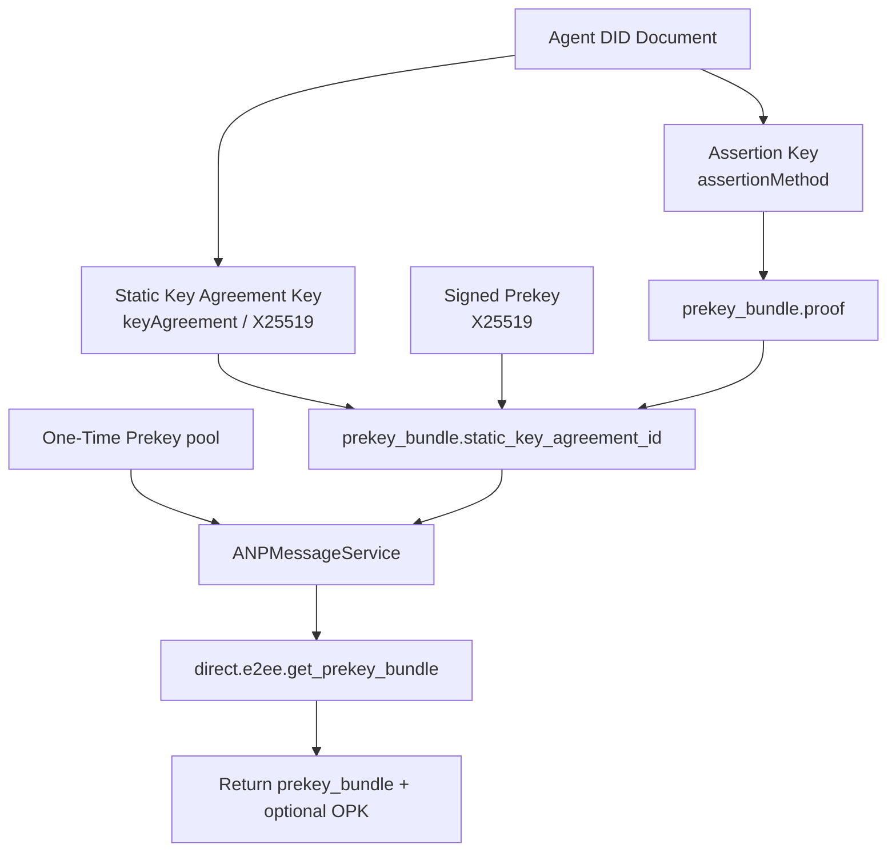
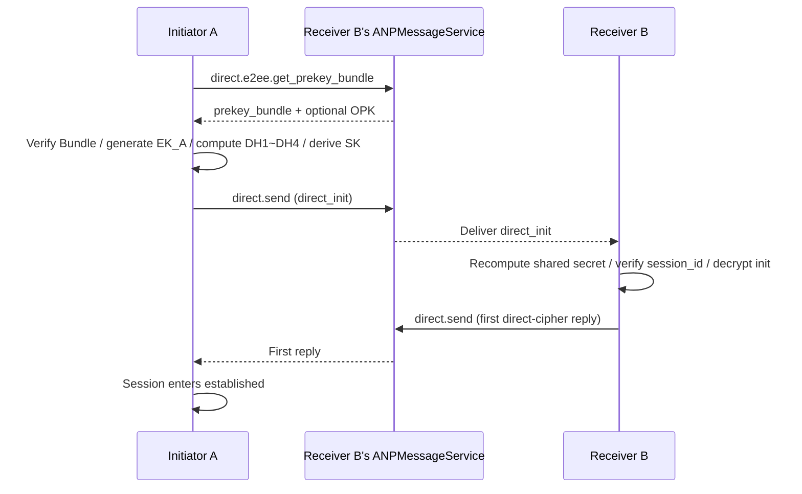
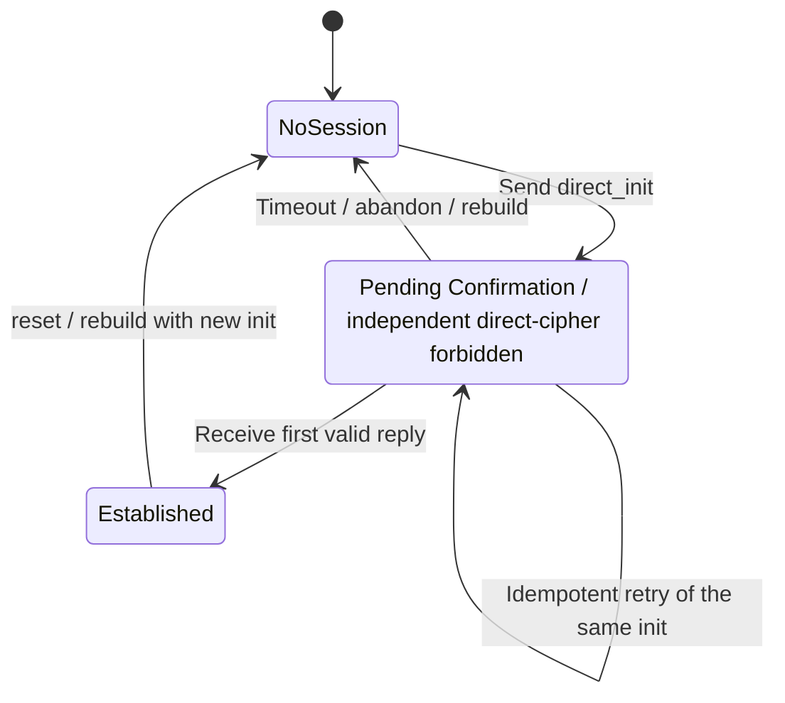

<!-- translation-review: machine-fully-reviewed; scope=full-document-source-lines-1-1631; inventory=japanese/reviews/deprecated-p5-review.json -->
> 日本語参考訳（機械翻訳から全文を意味校閲済み）。deprecated配下の旧版1.1の記録です。現行仕様へ更新していません。規範となるのは原文です。コード例・識別子・規範キーワードを保持し、原文の不整合は訳注で明示しています。独立した二次校閲や実装適合性の検証は未実施です。
> 原文: [deprecated/05-direct-end-to-end-encryption.md](<../../deprecated/05-direct-end-to-end-encryption.md>) / 基準コミット: `0837cfdfaf4ddcf834f0890ddaf34fc4c824e066`

# ANP Profile 5：個別メッセージのエンドツーエンド暗号化

- 文書ID：ANP-P5
- タイトル：個別メッセージのエンドツーエンド暗号化
- 状態：リリース済み
- バージョン：1.1
- 原文言語：English
- 適用範囲：`agent_did`に基づく、個別メッセージのエンドツーエンド暗号化Overlayに適用されます。
- 依存関係：
  - `anp.core.binding.v1`
  - `anp.identity.discovery.v1`
  - `anp.direct.base.v1`
  - `did:wba`のアイデンティティと証明のProfile（外部依存）

---

## 1. 目標と範囲

このProfileは、ANPの個別メッセージのエンドツーエンド暗号化について、実装可能な完全な方式を定義し、次を規定します。

1. `did:wba`のアイデンティティとサービス発見の機能を、個別メッセージのE2EEへ接続する方法。
2. Prekey Bundleの公開、発見、検証の方法。
3. `X3DH-like`に基づく、初回の非同期セッション確立の方法。
4. `Double Ratchet-like`で後続メッセージを保護する方法。
5. AAD、リプレイ防止、順不同の処理、セッション再構築、エラーモデルの定義方法。
6. デバイスという概念を導入せず、個別メッセージのE2EEをエージェントに結び付ける方法。

このProfileは次を定義しません。

- デバイス、複数端末ログイン、内部コピーの同期。
- 過去のメッセージの取得。
- 既読状態。
- プレゼンス。
- グループのエンドツーエンド暗号化。
- エージェント内部の鍵複製の仕組み。
- `did:wba`メソッド自体の解決、更新、取り消しの仕組み。

---

## 2. 規範キーワードと用語

### 2.1 規範キーワード

本書の**MUST**、**MUST NOT**、**REQUIRED**、**SHALL**、**SHALL NOT**、**SHOULD**、**SHOULD NOT**、**RECOMMENDED**、**NOT RECOMMENDED**、**MAY**、**OPTIONAL**は、大文字表記に従って規範的要件として解釈します。

### 2.2 用語

- **Agent DID**：外部通信で使うエージェントの識別子。このProfileでは、外側の`direct.send`の業務主体識別子に加えて、AAD、Bundle検証、セッションバインディングのアイデンティティアンカーでもあります。
- **Assertion Key**：`did:wba`のDID文書で`assertionMethod`により認可され、任意で`authentication`にも現れる署名鍵。BundleやBinding Proofへの署名に使い、DH計算には参加しません。
- **静的鍵合意鍵（Static Key Agreement Key）**：DID文書の`keyAgreement`で宣言する長期X25519公開鍵。長期DHアイデンティティ素材で、wireプロトコルでは通常`static_key_agreement_id`で参照します。
- **署名付き事前鍵（Signed Prekey、SPK）**：受信側が生成し、Assertion Keyで署名・バインドした、中期X25519公開鍵。初回のセッション確立で、送信側の静的・一時鍵とともにDH計算に参加し、`signed_prekey.key_id`で参照します。
- **使い捨て事前鍵（One-Time Prekey、OPK）**：受信側の使い捨てX25519公開鍵。初回セッション確立に、使い捨てによる追加の前方秘匿性を与えます。使用に成功したら消費する必要があり、再利用できません。
- **Prekey Bundle**：開始側が取得する、セッション確立用の公開素材の集合。長期静的合意鍵や現在のSPKなどの静的情報を記述しますが、OPKを直接埋め込みません。
- **Direct Session**：`session_id`で識別する、二つのエージェント間のE2EEセッション。以後のDouble Ratchet状態、順不同の処理、リプレイ検出を、このセッションを中心に維持します。
- **Application Plaintext**：暗号化前の個別メッセージングのアプリケーション層平文オブジェクト。Direct Baseのアプリケーションペイロードを正規化した内側の表現で、AEAD暗号化へ渡します。
- **Ratchet Header**：後続メッセージに必要な、公開ヘッダーフィールドの最小集合。受信側はこれを使い、受信チェーンを特定し、DHラチェットを進める必要があるか判断し、順不同のメッセージを処理します。
- **Replay Cache**：初期メッセージや後続メッセージの重複を識別するための状態の集合。ローカル状態であり、標準wireプロトコルのフィールドではありません。

---

## 3. 全体の設計原則

### 3.1 エージェントがプロトコルの終端である

このProfileの外部通信のエンドポイントは`agent_did`です。デバイス、端末、複製、worker、executorを識別しません。

### 3.2 セキュリティOverlayと業務上の意味の分離

このProfileは個別メッセージングの業務上の意味を再定義せず、`anp.direct.base.v1`の次の要素を再利用します。

- `direct.send`メソッド。
- `sender_did`／`target.did`の意味。
- `message_id`／`operation_id`の意味。
- 個別メッセージングの成功の意味（宛先エージェントの入口サービスが受け入れたこと）。
- アプリケーション層のコンテンツ型の意味。

### 3.3 v1基準の選択

このProfileの**v1必須相互運用基準**は、次を採用します。

- 初回セッション確立：`X3DH-like`（did:wba向けに適応）
- 長期静的合意鍵：`X25519`
- KDF：`HKDF-SHA-256`
- メッセージAEAD：`ChaCha20-Poly1305`
- 後続メッセージ：`Double Ratchet-like`

### 3.4 将来のアップグレード経路

このProfileは、`PQXDH-like`へのアップグレードの余地を残します。v1は耐量子スイートを強制しませんが、スイートレジストリを通じて、v2への互換経路を維持するべきです。

### 3.5 initメッセージ全体への長期鍵による署名は既定で不要

v1では、`direct_init`オブジェクト全体への、長期DIDアイデンティティ鍵による署名を、既定で**要求しません**。

理由は次のとおりです。

1. X3DH-likeの認証自体は、長期静的合意鍵と受信側SPKの組み合わせから得られる。
2. 受信側SPKはAssertion Keyによってバインドされている。
3. initメッセージ全体への長期鍵による署名を必須にすると、「送信元を帰属できる制御メッセージ」モデルへ大きく寄り、Signal方式の否認可能性を弱める。

配備環境で、より高い監査可能性が必要な場合、`Direct Init Accountability Extension`を有効にしてもかまいません（MAY）。この拡張は任意で、このprofileの既定の動作には含まれません。

### 3.6 `anp.direct.e2ee.v1`のMTI wireオブジェクト集合

`method = "direct.send"`かつ`meta.profile = "anp.direct.e2ee.v1"`の場合、v1 MTI経路では、`meta.content_type`に次の二つの値だけを認めます。

- `application/anp-direct-init+json`
- `application/anp-direct-cipher+json`

送信側は、v1 MTI経路で、別のwireオブジェクト型を使ってはなりません（**MUST NOT**）。
他の`content_type`を受け取った受信側は、拡張交渉でその機能を明示的に有効化していない限り、拒否しなければなりません（MUST）。

### 3.7 `anp.direct.e2ee.v1`の`direct.send`におけるメッセージID制約

`meta.profile = "anp.direct.e2ee.v1"`の`direct.send`では：

- `meta.message_id`が存在しなければなりません（**MUST**）。
- `meta.operation_id`が存在しなければなりません（**MUST**）。
- `meta.operation_id`は`meta.message_id`と完全に等しくなければなりません（**MUST**）。

### 3.8 `anp.direct.e2ee.v1`の`direct.send`における`auth`制約

`meta.profile = "anp.direct.e2ee.v1"`の`direct.send`では、`params.auth`が存在してはなりません（**MUST**）。

配備環境が`Direct Init Accountability Extension`を明示的に交渉した場合、追加の証明オブジェクトを導入してもかまいません（**MAY**）。拡張を交渉していない場合、受信側は、受け取った`params.auth`をすべて拒否しなければなりません（**MUST**）。

---


### 3.9 P3の発信元バインディング要件との関係

P3の9.7節の「`auth.origin_proof.contentDigest`または同等の発信元証明ダイジェスト」という要件に対し、このProfileは次のオブジェクトを組み合わせて同等のバインディングを満たします。

- `AD_init`
- `AD_msg`
- AEAD保護下の`Application Plaintext`

`Direct Init Accountability Extension`を交渉していない場合、v1 MTIは、P3形式の`params.auth.origin_proof`を追加で運ぶことを**要求されません**。

## 4. `did:wba`の統合規則

### 4.1 DID文書の最小要件

このProfileに対応するAgent DID文書は、次を満たさなければなりません（**MUST**）。

1. アイデンティティ認証に使えるAuthentication Keyと、アサーション署名に使えるAssertion Keyが、少なくとも一つずつある。
2. 少なくとも一つの`keyAgreement`検証メソッドがある。
3. 少なくとも一つの`ANPMessageService`または同等のサービスエントリがある。
4. 呼び出し元が`ANPMessageService`を解決してアクセスでき、このProfileが要求する鍵素材メソッドを提供していなければならない（**MUST**）。

### 4.2 鍵の役割の分離

このProfileは、鍵の役割を分離しなければなりません（**MUST**）。

1. `authentication`／`assertionMethod`に列挙された鍵を次に使う。
   - Prekey Bundleへの署名。
   - 強いアイデンティティ所有証明が必要な制御オブジェクトへの署名（拡張が有効な場合）。
2. `keyAgreement`に列挙された鍵を次に使う。
   - 長期静的鍵合意。
   - 初期共有鍵の導出。
3. Assertion Keyと静的鍵合意鍵を兼用してはならない（**MUST NOT**）。

補足：wireプロトコルでは、前者は通常`proof.verificationMethod`で、後者はBundleの`static_key_agreement_id`またはinitの`sender_static_key_agreement_id`で参照します。実装は、同じ鍵に両方の意味を担わせるべきではありません。

### 4.3 `did:wba`のフィンガープリントバインディング


`did:wba`仕様の規則を参照してください。

### 4.4 `ANPMessageService`の鍵素材の機能

`ANPMessageService`は、このprofileが要求する次の鍵素材機能に対応しなければなりません（**MUST**）。

- Prekey Bundleを公開する。
- OPKプールを補充またはローテーションする。
- Prekey Bundleを照会する。
- 利用できるOPKを一回につき一つ発行する（存在し、ポリシーが認める場合）。
- OPKを、割り当て済み、消費済み、または再利用不可として記録する。
- Bundleの取り消し・無効化状態を返す（実装が対応する場合）。

P5を理解する最初の難所はアルゴリズムではなく、誰が署名し、誰がDHを行い、誰がBundle／OPKを公開するかです。次の図は、後続のセッション確立フローに向けて、DID文書の鍵の役割と、外部に公開する素材を一つにまとめています。



*図P5-1：鍵の役割と公開素材の関係（非規範）。*

この図は責務の分離を強調します。Assertion Keyがアイデンティティのバインディングを担当し、長期の`keyAgreement`とSPK／OPK鍵がDH計算を担当します。実装は、同じ鍵に両方の意味を担わせるべきではありません。

---

## 5. 実装必須スイート（MTI）

### 5.1 MTIスイート名

v1のMTIスイートは、次のように定義します。

`ANP-DIRECT-E2EE-X3DH-25519-CHACHA20POLY1305-SHA256-V1`

### 5.2 MTIスイートのパラメーター

スイートのパラメーターは次に固定します。

- 静的鍵合意の曲線：`X25519`
- 一時鍵合意の曲線：`X25519`
- HKDF：`HKDF-SHA-256`
- AEAD：`ChaCha20-Poly1305`
- Bundleオブジェクト証明のprofile：`prekey_bundle.proof`は、P1付録Bで定義する共通の`Object Proof Profile`を再利用しなければなりません（**MUST**）。


この要件は、少なくとも次に適用されます。

- `prekey_bundle`の保護対象文書（本書で`Signed Bundle Object`とも呼ぶ）。
- `AD_init`
- `AD_msg`
- `Application Plaintext`


### 5.3 推奨する任意スイート

実装は、追加で次に対応してもかまいません（**MAY**）。

- `ANP-DIRECT-E2EE-X3DH-25519-AES256GCM-SHA256-V1`
- `ANP-DIRECT-E2EE-PQXDH-HYBRID-V1`（予約済み）

ただし、v1の相互運用実装はすべて、MTIスイートに対応しなければなりません（**MUST**）。

---

## 6. 公開素材とBundleの構造

### 6.1 長期静的鍵合意鍵

各エージェントは、自分のDID文書の`keyAgreement`に、少なくとも一つの長期静的X25519公開鍵を宣言しなければなりません（**MUST**）。

推奨するフィールド：

- `id`：例：`did:wba:example.com:agent:alice:e1_xxx#ka-1`
- `type`：実装で選べますが、X25519であることを明記する必要があります。
- `publicKeyMultibase`または同等の公開鍵表現。


各フィールドの用途：

- `id`：Bundle、Initメッセージ、AADで、「今回どの長期DH鍵を使ったか」を正確に示します。
- `type`：検証メソッドのアルゴリズムと符号化方式を宣言し、相手が正しくデコードし、実際にX25519であることを検証できるようにします。
- `publicKeyMultibase`または同等の表現：実際の公開鍵バイト列を運び、相手がDH計算を行う際の入力元になります。

### 6.2 `prekey_bundle`の構造

`prekey_bundle`は、受信側が長期にわたり公開し、`did:wba`アイデンティティ証明で結び付ける**静的なセッション確立素材**です。Signal方式の照会ごとのOPK発行モデルに合わせ、`prekey_bundle`に`one_time_prekey`を直接埋め込んではなりません（**MUST NOT**）。OPKは照会時にサーバーが返します。

`prekey_bundle`の推奨定義は次のとおりです。

```json
{
  "bundle_id": "bundle-20260329-001",
  "owner_did": "did:wba:example.com:agent:alice:e1_xxx",
  "suite": "ANP-DIRECT-E2EE-X3DH-25519-CHACHA20POLY1305-SHA256-V1",
  "static_key_agreement_id": "did:wba:example.com:agent:alice:e1_xxx#ka-1",
  "signed_prekey": {
    "key_id": "spk-001",
    "public_key_b64u": "BASE64URL_X25519_SPK",
    "expires_at": "2026-04-05T00:00:00Z"
  },
  "proof": {
    "type": "DataIntegrityProof",
    "cryptosuite": "eddsa-jcs-2022",
    "verificationMethod": "did:wba:example.com:agent:alice:e1_xxx#assert-1",
    "proofPurpose": "assertionMethod",
    "created": "2026-03-29T00:00:00Z",
    "proofValue": "zBASE58MULTIBASE_PROOF"
  }
}
```

各フィールドの用途：

- `bundle_id`：この静的Bundle版の安定した識別子。送信側は`direct_init`と`AD_init`に含め、受信側も監査、キャッシュヒット、リプレイ範囲の区別に使えます。
- `owner_did`：Bundleの所属するAgent DID。送信側はこのDIDに基づいてDID文書を解決し、`proof`を検証して、Bundleのアイデンティティを確認します。
- `suite`：このBundleに適用する暗号スイート名。送信側は、まずローカルで対応するか判断してから、このBundleでセッションを確立するかを決めるべきです。
- `static_key_agreement_id`：`owner_did`のDID文書内の長期静的X25519鍵を指すDID URL。「このBundleがどの長期DH鍵に対応するか」を相手へ伝えます。
- `signed_prekey.key_id`：現在のSPKの安定した識別子。送信側が`direct_init`で参照し、受信側が正しいSPK秘密鍵を見つけるために使います。
- `signed_prekey.public_key_b64u`：パディングなしのbase64urlで表現したSPKの公開鍵バイト列。初期DHの入力の一つです。
- `signed_prekey.expires_at`：SPKの有効期限。送信側は、Bundleを使う前に期限切れでないことを検証する必要があります。
- `proof.type`：証明オブジェクトの種類。v1 MTIでは`DataIntegrityProof`に固定します。
- `proof.cryptosuite`：具体的な証明暗号スイート名。v1 MTIでは`eddsa-jcs-2022`に固定します。
- `proof.verificationMethod`：Bundleへの署名に使う検証メソッドのDID URL。送信側は、`owner_did`文書が認める`assertionMethod`関係に属するか確認するべきです。
- `proof.proofPurpose`：署名で使う認可関係を宣言し、DID文書内の認可関係との対応に使います。
- `proof.created`：この証明を生成した時刻。監査とポリシー検査に使います。
- `proof.proofValue`：Bundleの正規化表現を検証するための証明値。〔訳注：このフィールドの原文説明は英文の構文が不明確です。具体的な証明の規則は、後続の節と共通のObject Proof Profileに従います。〕

### 6.2.1 `prekey_bundle.proof`と共通のObject Proof Profile

`prekey_bundle.proof`は、P1付録Bで定義する共通の**Object Proof Profile**を再利用しなければなりません（**MUST**）。

`prekey_bundle`について：

- 発行者DIDは`owner_did`でなければなりません（**MUST**）。
- 保護対象文書は、`proof`を削除した`prekey_bundle`オブジェクト全体でなければなりません（**MUST**）。
- 本書では、その保護対象文書を`Signed Bundle Object`と呼びます。
- `proof.verificationMethod`は、`owner_did`のDID文書の`assertionMethod`によって認可された認証メソッドを指さなければなりません（**MUST**）。
- `proofPurpose`は`assertionMethod`に固定しなければなりません（**MUST**）。


### 6.2.2 `bundle_id`の意味は再定義できない

ローカルの受け入れ期間内で、同じ`bundle_id`は、次のフィールドの組み合わせだけへ一意に対応付けなければなりません（**MUST**）。

- `owner_did`
- `suite`
- `static_key_agreement_id`
- `signed_prekey.key_id`
- `signed_prekey.public_key_b64u`

サーバーは、短い猶予期間内に異なる複数の`bundle_id`値を同時に受け入れてもかまいません（**MAY**）。ただし、同じ`bundle_id`を再定義してはなりません（**MUST NOT**）。

`bundle_id`が受け入れ期間内にある間、受信側は、その期間が終わるまで、対応するSPK秘密鍵、Bundleメタデータ、必要な検索索引を保持しなければなりません（**MUST**）。

### 6.2.3 Bundle証明のオブジェクト固有の制約

P1付録Bの共通規則に加えて、v1 MTIでは、`prekey_bundle`が次を満たさなければなりません（**MUST**）。

- `proof`が存在しなければなりません（**MUST**）。
- `proof.verificationMethod`の所属DIDは、`owner_did`と等しくなければなりません（**MUST**）。
- `prekey_bundle.proof`がP1付録Bを満たさない、またはその発行者DIDが`owner_did`と一致しない場合、受信側は`anp.direct.e2ee.bundle_invalid`でBundleを拒否しなければなりません（**MUST**）。

### 6.3 Bundleフィールドの要件

`prekey_bundle`は次を含まなければなりません（**MUST**）。

- `bundle_id`
- `owner_did`
- `suite`
- `static_key_agreement_id`
- `signed_prekey`
- `proof`

`prekey_bundle`に次を直接含めてはなりません（**MUST NOT**）。

- `one_time_prekey`

### 6.4 Bundle証明のオブジェクト固有のフィールド制約

P1付録Bの「`proof`を削除したオブジェクト全体」という共通の保護範囲要件に加えて、`prekey_bundle`は少なくとも次のセキュリティ上重要なフィールドを含まなければならず（**MUST**）、その全体が`proof`によって保護されます。

- `bundle_id`
- `owner_did`
- `suite`
- `static_key_agreement_id`
- `signed_prekey`

`proof`は静的Bundleに結び付きます。実行時に一回ごとに発行されるOPKを、静的Bundle証明の対象内容にしてはなりません（**MUST NOT**）。

### 6.5 Bundleの検証要件

送信側は、Bundleの使用前に次を行わなければなりません（**MUST**）。

1. `owner_did`のDID文書を解決する。
2. `proof.verificationMethod`が参照する公開鍵が、`owner_did`のDID文書の`assertionMethod`で認可された検証メソッドに属するか検証する。
3. P1付録Bの共通のObject Proof Profileに従って、`prekey_bundle.proof`を検証する（保護対象文書は`Signed Bundle Object`）。
4. `static_key_agreement_id`がDID文書の`keyAgreement`に存在するか検証する。
5. `suite`がローカルで対応するスイートかを検証する。
6. `signed_prekey.expires_at`が期限切れでないことを検証する。
7. `direct.e2ee.get_prekey_bundle`の成功応答に`one_time_prekey`が付いている場合、送信側は、そのフィールド形式が有効であることを検証し、後続のセッション確立、消費、監査のために`key_id`を記録しなければならない（**MUST**）。
8. 送信側が後で`direct_init`を構築するとき、`recipient_signed_prekey_id`は、選んだ`prekey_bundle.signed_prekey.key_id`と等しくなければならない（**MUST**）。

### 6.6 OPKポリシー

v1で`one_time_prekey`の使用は推奨（**SHOULD**）ですが、省略してもかまいません（**MAY**）。

Signal方式の使い捨て事前鍵の発行に合わせ、受信側は、発行可能なOPKを自分の`ANPMessageService`へ事前に一括アップロードするべきです（**SHOULD**）。サーバーは、`direct.e2ee.get_prekey_bundle`の成功応答で、利用可能なOPKを一つずつ返します。

成功応答にOPKを付ける場合、推奨オブジェクト形式は次のとおりです。

```json
{
  "key_id": "opk-001",
  "public_key_b64u": "BASE64URL_X25519_OPK"
}
```

各フィールドの用途：

- `key_id`：このOPK記録の安定したID。送信側が`direct_init`の`recipient_one_time_prekey_id`で参照し、受信側が対応する秘密鍵を探して消費するために使います。
- `public_key_b64u`：パディングなしのbase64urlで表現したOPKの公開鍵バイト列。任意の`DH4`への入力です。

規則は次のとおりです。

- サーバーはOPKを返すとき、直ちに割り当て済みと記録するべきです（**SHOULD**）。
- 同じOPKを、複数の送信者へ同時に配ってはなりません（**MUST NOT**）。
- OPKを使って初回のセッション確立に成功したら、サーバーは消費済みと記録しなければならず（**MUST**）、受信側は対応するOPK秘密鍵を削除しなければなりません（**MUST**）。
- 割り当て後にセッション確立が完了しなかった場合、回収を認めるかは配備ポリシーで決めます。ただし、セッション確立に成功したことが確認されたOPKを再発行してはなりません（**MUST NOT**）。
- `direct.e2ee.get_prekey_bundle`の成功応答にOPKがなくても、開始側はセッション確立を続けられます。ただし、初期共有秘密の前方秘匿性は、SPKのライフサイクルへより強く依存します。

---

## 7. 鍵サービスのメソッド

### 7.1 `direct.e2ee.publish_prekey_bundle`

このメソッドは、送信側自身の公開`ANPMessageService`へ新しい静的Prekey Bundleを公開し、任意でOPKの一括補充を行うために使います。

#### 要求の要件

- `meta.profile = anp.direct.e2ee.v1`
- `meta.security_profile = transport-protected`
- `meta.target.kind = "service"`
- `meta.target.did`は、公開者自身の公開`ANPMessageService.serviceDid`と等しくなければなりません（**MUST**）。
- `meta.sender_did`が存在しなければなりません（**MUST**）。
- `meta.operation_id`が存在しなければなりません（**MUST**）。
- 拡張を交渉していない限り、`params.auth`が存在してはなりません（**MUST**）。
- `body.prekey_bundle`が存在しなければなりません（**MUST**）。
- `body.prekey_bundle.owner_did`は`meta.sender_did`と等しくなければなりません（**MUST**）。
- `body.one_time_prekeys`は存在してもかまいません（**MAY**）。存在する場合、空でない配列でなければならず（**MUST**）、各要素は少なくとも`key_id`と`public_key_b64u`を含まなければなりません（**MUST**）。

認証上の制約：

- このメソッドは、**サービスをスコープとする**制御プレーンメソッドです。
- v1標準経路では、呼び出し元は、認証済みローカルセッション、または同等のホップ単位・サービス単位の認証コンテキスト内で動作しなければなりません（**MUST**）。
- v1は、このメソッドに追加の業務層`origin_proof`を**要求しません**。
- サーバーは、要求を受け入れる前に、ホップ単位・サービス単位の認証を検証するだけでなく、認証された呼び出し元が、`meta.sender_did`の代理として`body.prekey_bundle.owner_did`の素材を公開する権限を持つことを検証しなければなりません（**MUST**）。


冪等性の要件：

- サーバーは、`(meta.sender_did, meta.target.did, method, meta.operation_id)`を冪等性キーに使わなければなりません（**MUST**）。
- 同じ冪等性キーの繰り返し要求では、`body.prekey_bundle`と`body.one_time_prekeys`が意味的に等価なら、元の結果または同等の結果を返さなければなりません（**MUST**）。
- 同じ冪等性キーに対応する要求bodyの意味が競合する場合、`anp.idempotency_conflict`または同等のエラーを返さなければなりません（**MUST**）。

各フィールドの用途：

- `meta.security_profile = transport-protected`は、セッション確立後のE2EE暗号文の送信ではなく、鍵制御プレーンの呼び出しであることを示します。
- `body.prekey_bundle`は、現在、他者が利用できる静的セッション確立素材の公開・置換に使います。
- `body.one_time_prekeys`は、OPKプールの一括補充に使います。任意の一括アップロードであり、静的Bundle証明には入りません。

#### 成功応答

成功応答は、少なくとも次を含まなければなりません（**MUST**）。

- `published = true`
- `owner_did`
- `bundle_id`
- `published_at`

成功応答は次を含めてもかまいません（**MAY**）。

- `published_opk_count`


### 7.2 `direct.e2ee.get_prekey_bundle`

このメソッドは、宛先エージェントが公開する`ANPMessageService`を通じて利用可能な静的Bundleを取得し、必要に応じて利用可能なOPKも取得するために使います。

#### 要求の要件

- `meta.profile = anp.direct.e2ee.v1`
- `meta.security_profile = transport-protected`
- `meta.target.kind = "service"`
- `meta.target.did`は、宛先エージェントが公開する`ANPMessageService.serviceDid`と等しくなければなりません（**MUST**）。
- `meta.sender_did`が存在しなければなりません（**MUST**）。
- `meta.operation_id`が存在しなければなりません（**MUST**）。
- 拡張を交渉していない限り、`params.auth`が存在してはなりません（**MUST**）。

`body`は次を含まなければなりません（**MUST**）。

- `target_did`

`body`は次を含めてもかまいません（**MAY**）。

- `preferred_suite`
- `require_opk`

認証上の制約：

- このメソッドは、**サービスをスコープとする**制御プレーンメソッドです。
- v1の相互運用の最小基準では、少なくともホップ単位・サービス単位の認証が必要です。
- v1標準経路では、拡張を交渉していない場合、`params.auth`が存在してはなりません（**MUST**）。
- **BundleやOPKの匿名取得はv1 MTIに含まれません**。配備環境が匿名アクセスを認める場合、それは追加の配備ポリシーです。

各フィールドの用途：

- `target_did`：誰のセッション確立素材を取得するかを示します。サーバーは、他の主体のキャッシュ結果ではなく、そのDIDに結び付くBundleを返すべきです。
- `preferred_suite`：サーバーが複数のスイートを同時に持つ場合、呼び出し元がどのスイートの素材を優先して取得したいかを表します。
- `require_opk`：「利用可能なOPKがないままセッション確立を弱めない」ことを意味します。`true`なら、呼び出し元は`DH4`に直接使える使い捨て事前鍵を期待します。


#### 成功応答

成功応答は、少なくとも次を含まなければなりません（**MUST**）。

- `target_did`
- `prekey_bundle`

成功応答は次を含めてもかまいません（**MAY**）。

- `one_time_prekey`


成功応答の各フィールドの用途：

- `target_did`：返した素材が実際に属する宛先DIDを再掲し、呼び出し元がキャッシュと要求した宛先との一致を確認できるようにします。
- `prekey_bundle`：宛先主体が現在利用できる静的セッション確立素材を返します。送信側は、実際のセッション確立前に、なお6.5節に従った検証を完了する必要があります。
- `one_time_prekey`：存在する場合、サーバーがこの照会のために利用可能なOPKを割り当てたことを示します。送信側は、長期にキャッシュする公開情報ではなく、後続のinit試行に結び付く素材として扱うべきです。

`require_opk = true`で、現在発行できるOPKがない場合、サーバーは、古いOPKを偽造・再利用せず、明示的なエラーを返すべきです（**SHOULD**）。


冪等性とOPK割り当ての要件：

- サーバーは、`(meta.sender_did, meta.target.did, method, meta.operation_id)`を冪等性キーに使わなければなりません（**MUST**）。
- ある成功応答で、その冪等性キーへ`one_time_prekey`を割り当てていれば、同じキーの再試行には、同じ`prekey_bundle`と同じ`one_time_prekey`を返さなければなりません（**MUST**）。
- サーバーは、「冪等性記録の書き込み＋OPK割り当て／保持状態の書き込み」を原子的に完了しなければなりません（**MUST**）。
- サーバーは、同じ冪等性キーの再試行によって、別のOPKを再割り当てしてはなりません（**MUST NOT**）。


### 7.3 サーバー側のBundle配布規則

`ANPMessageService`がBundleを返す場合：

- まだ有効な最新の静的`prekey_bundle`を優先して返すべきです（**SHOULD**）。
- 利用可能なOPKがあり、ポリシーが認めるなら、追加で`one_time_prekey`を付けるべきです（**SHOULD**）。
- 返す`one_time_prekey`は、現在`owner_did`で利用可能なOPKプールから取得しなければならず（**MUST**）、静的Bundle証明の署名対象の一部であるかのように見せかけてはなりません（**MUST NOT**）。
- OPKを返したら、サーバーは割り当て済みと記録するべきです（**SHOULD**）。
- OPKを付けて返すとき、サーバーは、「この応答の冪等性記録の書き込み＋OPK割り当て／保持状態の書き込み」を原子的に完了しなければなりません（**MUST**）。
- サーバーは、同じOPKを複数の送信者へ同時に配布してはなりません（**MUST NOT**）。
- 宛先受信者がinitを正常に処理したら、サーバーは対応するOPKを消費済みと記録しなければならず（**MUST**）、受信側は対応するOPK秘密鍵を削除しなければなりません（**MUST**）。
- 宛先サービスが要求を拒否したり、その他の処理に失敗したりした場合、OPKの回収を認めるかは配備環境次第です。ただし、セッション確立に成功したことが確認されたOPKを再発行してはなりません（**MUST NOT**）。
- ホップ単位・サービス単位の認証によって、呼び出し元の識別、レート制限、不正利用対策ポリシーを適用しなければなりません（**MUST**）。

---

## 8. 初回セッション確立：X3DH-like（did:wba向け適応版）

## 8.1 設計の説明

このProfileの初回セッション確立は、Signal X3DHのそのままのコピーではなく、適応した**X3DH-like**方式です。

- 元のX3DHの長期アイデンティティDH鍵の役割は、このProfileでは、DID文書の`keyAgreement`の長期静的X25519鍵が担います。
- DIDのAssertion KeyはDHに参加せず、Bundleの署名だけを担当します。
- 署名鍵とDH鍵を分離しているため、元のX3DHがXEdDSAで同じ鍵を使うことに対して導入したドメイン分離の詳細の一部は、そのままコピーする必要がなくなります。

## 8.2 関与する鍵

### 送信側A

- `KA_A`：送信側の長期静的X25519 `keyAgreement`公開鍵・秘密鍵の組。wireプロトコルでは、通常`sender_static_key_agreement_id`で指定します。
- `EK_A`：送信側の使い捨て一時X25519公開鍵・秘密鍵の組。新しいinitごとに生成し直し、`sender_ephemeral_pub_b64u`で公開鍵部分を公開します。

### 受信側B

- `KA_B`：受信側の長期静的X25519 `keyAgreement`公開鍵・秘密鍵の組。送信側は、`recipient_bundle_id`と、そのBundle内の`static_key_agreement_id`を介して、選択したBundle版を特定します。
- `SPK_B`：受信側の署名付き中期X25519事前鍵。wireプロトコルでは`recipient_signed_prekey_id`で指定し、Bundle証明によってDIDアイデンティティに結び付けます。
- `OPK_B`：受信側の使い捨てX25519事前鍵（任意）。サーバーが返した場合、wireプロトコルの`recipient_one_time_prekey_id`で指定し、セッション確立に成功した後で消費します。

## 8.3 セッション確立の前提条件

この節の`recipient_did`は、外側の`direct.send.params.meta.target.did`の略記であり、独立したwireフィールドを追加しません。

送信側は、セッション確立を開始する前に次を行わなければなりません（**MUST**）。

1. 宛先の`recipient_did`を解決・検証する。
2. 宛先の`prekey_bundle`を取得・検証する。応答に`one_time_prekey`が付いている場合、そのOPKも記録する。
3. 送信側自身の長期静的`keyAgreement`鍵を取得・検証する。
4. 新しい一時X25519鍵ペア`EK_A`を生成する。

## 8.4 DH計算

`direct.e2ee.get_prekey_bundle`の成功応答にOPKがない場合、送信側は次を計算しなければなりません（**MUST**）。

```text
DH1 = DH(KA_A, SPK_B)
DH2 = DH(EK_A, KA_B)
DH3 = DH(EK_A, SPK_B)
IKM = DH1 || DH2 || DH3
```

`direct.e2ee.get_prekey_bundle`の成功応答にOPKがある場合、送信側は追加で次を計算しなければなりません（**MUST**）。

```text
DH4 = DH(EK_A, OPK_B)
IKM = DH1 || DH2 || DH3 || DH4
```

## 8.5 初期共有秘密の導出

送信側と受信側は、次を使わなければなりません（**MUST**）。

```text
PRK = HKDF-Extract(salt = 0x00...00(32 bytes), IKM)
SK  = HKDF-Expand(PRK, info = "ANP Direct E2EE v1 Initial Secret", L = 32)
```

次に`SK`から次を導出します。

```text
RK0 = HKDF-Expand(SK, info = "ANP Direct E2EE v1 Root Key", L = 32)
CK0 = HKDF-Expand(SK, info = "ANP Direct E2EE v1 Chain Key", L = 32)
SID = HKDF-Expand(SK, info = "ANP Direct E2EE v1 Session ID", L = 16)
```

各値の意味：

- `RK0`：初期Root Key。
- `CK0`：最初のinit暗号文を消費する前の、初期チェーンの開始点。
- `SID`：16バイトのセッションID。Base64URLで符号化し、`session_id`とします。


### 8.5.1 最初のメッセージ鍵とnonce

`SK`から`RK0`と`CK0`を導出したら、送信側と受信側は直ちに、`CK0`に対して`kdf_ck`を実行しなければなりません（**MUST**）。

```text
CK1, MK0, NONCE0 = kdf_ck(CK0)
```

各値の意味：

- `MK0`は、`direct_init.ciphertext_b64u`の暗号化・復号だけに使います。
- `NONCE0`は、最初のinit暗号文のAEAD nonceだけに使います。
- init成功後の後続チェーン状態の開始点は、`CK1`だけです。

v1の共通規則では、initメッセージがチェーンの0番目のメッセージを消費します。つまり、`CK0`は`MK0`、`NONCE0`、`CK1`を導出するためだけに使います。init成功後、双方は`CK1`から継続しなければならず（**MUST**）、後続の送信・受信チェーンの開始点に`CK0`を使ってはなりません（**MUST NOT**）。

また、`ciphertext_b64u`が含むのは、**AEAD暗号文（認証タグを含む）の本体だけ**であり、nonceを追加連結したり先頭に付けたりしません。nonceは常に、このProfileのKDF規則に従って導出します。


## 8.6 初期の関連データ

セッション確立時の初期AEAD AADを`AD_init`と表記します。正規化したJSON構造と一意なバイト列は9.4.2節が定義し、UTF-8＋RFC 8785 JCS符号化を使わなければなりません（**MUST**）。

`AD_init`は、少なくとも次のフィールドをバインドしなければなりません（**MUST**）。

- `content_type = application/anp-direct-init+json`
- `sender_did`
- `recipient_did`
- `suite`
- `recipient_bundle_id`
- `sender_static_key_agreement_id`
- `recipient_signed_prekey_id`
- `recipient_one_time_prekey_id`（存在する場合）
- `session_id`
- `message_id`
- `profile = anp.direct.e2ee.v1`
- `security_profile = direct-e2ee`

各フィールドの目的：

- `content_type`：現在のwireオブジェクト型をバインドし、同じ暗号文を別のオブジェクト型と解釈することを防ぐ。
- `sender_did`／`recipient_did`：双方の業務アイデンティティをセッション確立にバインドし、アイデンティティの誤った結び付けのリスクを減らす。
- `suite`：使用する暗号スイートをバインドし、同じ暗号文を別スイートで誤解釈することを防ぐ。
- `recipient_bundle_id`：受信側が使う具体的なBundle版をバインドし、異なるBundle間で素材を混在させることを防ぐ。
- `sender_static_key_agreement_id`：実際にDHに参加する、送信側の長期静的鍵をバインドする。
- `recipient_signed_prekey_id`：今回受信側が使うSPKの版をバインドする。
- `recipient_one_time_prekey_id`：存在する場合、今回のセッション確立で消費するOPKの記録をバインドする。
- `session_id`：今回導出したセッションIDをバインドし、同じ暗号文が他のセッションで使われることを防ぐ。
- `message_id`：外側の`direct.send.meta.message_id`を指し、init暗号文を特定の業務メッセージインスタンスへ結び付けます。
- `profile`／`security_profile`：プロトコル解釈のコンテキストをバインドし、Profileやsecurity profileをまたぐ置換を防ぐ。


## 8.7 初期のアプリケーションメッセージ

v1 MTIでは、`direct_init.ciphertext_b64u`は、完全な内側の`Application Plaintext`オブジェクトを運ばなければなりません（**MUST**）。

つまり、v1 MTIは「空のinit」を定義しません。送信側は`SK`の導出に成功したら、`CK0`から`kdf_ck`で導出した`MK0`／`NONCE0`で最初の`Application Plaintext`を暗号化し、`ciphertext_b64u`へ書き込まなければなりません（MUST）。

次のシーケンス図は、Bundleの取得、任意のOPKの選択、`direct_init`の送信、受信側の初期化、最初の応答を、一つの完全な経路としてつなぎます。後の式を読む際、メッセージと状態が一緒に進む様子を確認できます。



*図P5-2：X3DH-likeによる初回セッション確立のシーケンス（非規範）。*

ここで「確立に成功する」とは、Bundleの取得成功ではありません。双方が同じ導出結果に基づいて初期化を完了し、開始側が、同じ`session_id`の下で最初の有効な応答を受信したことを意味します。


---

## 9. `application/anp-direct-init+json`オブジェクト

### 9.1 トップレベルの構造

`meta.content_type = application/anp-direct-init+json`の場合、`body`は次の構造を採用しなければなりません（**MUST**）。

```json
{
  "session_id": "BASE64URL_16_BYTES",
  "suite": "ANP-DIRECT-E2EE-X3DH-25519-CHACHA20POLY1305-SHA256-V1",
  "sender_static_key_agreement_id": "did:wba:example.com:agent:alice:e1_xxx#ka-1",
  "recipient_bundle_id": "bundle-20260329-001",
  "recipient_signed_prekey_id": "spk-001",
  "recipient_one_time_prekey_id": "opk-001",
  "sender_ephemeral_pub_b64u": "BASE64URL_X25519_EK_A",
  "ciphertext_b64u": "BASE64URL_INIT_CIPHERTEXT"
}
```

### 9.2 フィールドの要件

`direct_init`は次を含まなければなりません（**MUST**）。

- `session_id`
- `suite`
- `sender_static_key_agreement_id`
- `recipient_bundle_id`
- `recipient_signed_prekey_id`
- `sender_ephemeral_pub_b64u`
- `ciphertext_b64u`

`direct_init`は次を含めてもかまいません（**MAY**）。

- `recipient_one_time_prekey_id`

各フィールドの用途：

- `session_id`：この新しいセッションの識別子。初期共有秘密から導出し、後続の`application/anp-direct-cipher+json`メッセージでも、Ratchet状態を索引するために再利用します。
- `suite`：このinitで使う暗号スイートを宣言します。受信側は、これに従って正しいKDF、AEAD、メッセージ解釈規則を先に選ぶべきです。
- `sender_static_key_agreement_id`：実際にDHに参加する、送信側DID文書内の長期静的`keyAgreement`鍵を指します。
- `recipient_bundle_id`：このinitで使う受信側の静的Bundle版を示します。受信側は、これに従ってSPKのライフサイクル、ローカルの受け入れ期間、リプレイ範囲を特定できます。
- `recipient_signed_prekey_id`：今回受信側が使うSPK記録を指します。受信側は、これに従って正しいSPK秘密鍵を見つける必要があります。送信側が`direct_init`を構築するとき、値は、選んだ`prekey_bundle.signed_prekey.key_id`と等しくなければなりません（**MUST**）。
- `recipient_one_time_prekey_id`：存在する場合、このinitがOPKも消費したことを示します。受信側は、これに従って該当鍵を特定し、セッション確立の成功後に対応する秘密鍵を消費するべきです。
- `sender_ephemeral_pub_b64u`：送信側がこのinitのために新しく生成した、一時X25519公開鍵。受信側では、ローカルの長期鍵／事前鍵とともにDH計算に使います。
- `ciphertext_b64u`：initから導出した最初のメッセージ鍵で暗号化したAEAD暗号文のバイト列。v1ではnonceを別途送らず、このProfileの`kdf_ck`規則で導出するため、`ciphertext_b64u`は**暗号文本体だけを含み、nonceを連結しません**。


### 9.3 外側のメソッドの要件

`direct_init`は`direct.send`で運ばなければならず（**MUST**）、次を満たさなければなりません（**MUST**）。

- `meta.profile = anp.direct.e2ee.v1`
- `meta.security_profile = direct-e2ee`
- `meta.content_type = application/anp-direct-init+json`
- `meta.operation_id`は`meta.message_id`と完全に同じでなければなりません（**MUST**）。
- 拡張を交渉していない限り、`params.auth`が存在してはなりません（**MUST**）。

補足：ここの外側の`meta.content_type`は、`body`が使うE2EE運搬オブジェクトの形式を表します。実際の最初の業務の平文コンテンツ型は、`ciphertext_b64u`で暗号化した内側の`Application Plaintext`にあります。

### 9.4 一意なセッション確立と状態初期化のアルゴリズム（規範）

この節は、init暗号文の生成、init後のローカル状態の確立、応答側の最初の応答、開始側が最初の応答を受信する前後の状態進行規則を、一体として定義します。実装は、他の節で、この節と矛盾する初期化の意味を追加定義してはなりません（**MUST NOT**）。

#### 9.4.1 入力と前提条件

送信側Aは、`direct_init`を開始する前に次を完了しなければなりません（**MUST**）。

1. 宛先の`recipient_did`を解決・検証する。
2. 宛先の`prekey_bundle`を取得・検証する。
3. 応答に`one_time_prekey`が付いている場合、そのOPKを記録する。
4. 送信側自身の長期静的`keyAgreement`鍵を取得・検証する。
5. 新しい一時X25519鍵ペア`EK_A`を生成する。

送信側と受信側は、8.4節と8.5節に従って次を導出します。

- `SK`
- `RK0`
- `CK0`
- `SID`

そして、次のように定めます。

- `session_id = base64url(SID)`

受信側は`direct_init`を処理するとき、受け取った`body.session_id`が、ローカルで導出した`session_id`と同一であることを検証しなければなりません（**MUST**）。

#### 9.4.2 `AD_init`の一意なバイト列

`AD_init`は、次のJSONオブジェクトをUTF-8＋RFC 8785 JCSで符号化したバイト列でなければなりません（**MUST**）。

```json
{
  "content_type": "application/anp-direct-init+json",
  "message_id": "<outer meta.message_id>",
  "profile": "anp.direct.e2ee.v1",
  "security_profile": "direct-e2ee",
  "sender_did": "<outer meta.sender_did>",
  "recipient_did": "<outer meta.target.did>",
  "suite": "<body.suite>",
  "recipient_bundle_id": "<body.recipient_bundle_id>",
  "sender_static_key_agreement_id": "<body.sender_static_key_agreement_id>",
  "recipient_signed_prekey_id": "<body.recipient_signed_prekey_id>",
  "recipient_one_time_prekey_id": "<body.recipient_one_time_prekey_id>",
  "session_id": "<body.session_id>"
}
```

各項目の規則：

- `recipient_one_time_prekey_id`は、既定では省略しなければなりません（**MUST**）。
- 既定の任意フィールドは、すべて直接省略しなければなりません（**MUST**）。
- 省略するフィールドの代わりに、`null`、空文字列、その他のプレースホルダー値を使ってはなりません（**MUST NOT**）。

#### 9.4.3 内側のinit平文のバイト列

initで暗号化する`Application Plaintext`は、まず10.4節が定義する内側の平文オブジェクトとして構築し、次にUTF-8＋RFC 8785 JCSでバイト列へ符号化しなければなりません（**MUST**）。

#### 9.4.4 init暗号文の生成

送信側と受信側は、先に次を実行しなければなりません（**MUST**）。

```text
CK1, MK0, NONCE0 = kdf_ck(CK0)
```

その後：

- 送信側は、`MK0`、`NONCE0`、`AD_init`で内側のinit平文を暗号化しなければなりません（**MUST**）。
- 生成したAEAD暗号文（タグを含む）を`ciphertext_b64u`へ書き込みます。
- `ciphertext_b64u`にnonceを含めてはなりません（**MUST NOT**）。

#### 9.4.5 initはチェーンの0番目のメッセージを消費する

v1の共通規則では、init暗号文は「初期のA→Bチェーン」の0番目のメッセージです。

したがって、送信側Aが`direct_init`の送信に成功したら、ローカル状態を次のように設定しなければなりません（**MUST**）。

- `RK = RK0`
- `DHs = EK_A`
- `DHr = null`
- `CKs = CK1`
- `CKr = null`
- `Ns = 1`
- `Nr = 0`
- `PN = 0`
- `MKSKIPPED = empty`
- `status = "pending-confirmation"`

各値の意味：

- `Ns = 1`は、initが0番目のメッセージを消費したことを示します。
- `status`はローカル状態フィールドであり、wireプロトコルのフィールドではありません。

#### 9.4.6 開始側が最初の応答を受けるまでの送信制限

ローカルセッションが`status = "pending-confirmation"`の間、開始側は、独立した`application/anp-direct-cipher+json`を送ってはなりません（**MUST NOT**）。

同じ`direct_init`の冪等な再試行は認められます。ただし、追加のアプリケーションメッセージは、同じ`session_id`で相手からの最初の有効な応答を受信して正常に復号するまで、ローカルにバッファーしなければなりません（**MUST**）。

#### 9.4.7 受信側がinitを正常処理した後のローカル状態

受信側Bは、`direct_init`の復号に成功した後、次を行わなければなりません（**MUST**）。

1. `recipient_one_time_prekey_id`が存在する場合、対応するOPKを消費する。
2. 次のローカル状態を作成する。

- `RK = RK0`
- `DHr = EK_A`
- `CKr = CK1`
- `Nr = 1`
- `DHs = GenerateRatchetKeyPair()`
- `(RK, CKs) = kdf_rk(RK, DH(DHs, DHr))`
- `Ns = 0`
- `PN = 0`
- `MKSKIPPED = empty`
- `status = "established"`

#### 9.4.8 受信側の最初の応答

受信側Bの最初の応答は、`application/anp-direct-cipher+json`を使わなければなりません（**MUST**）。

このメッセージの`ratchet_header`は、次を満たさなければなりません（**MUST**）。

- `dh_pub_b64u = DHs.public`
- `pn = "0"`
- `n = "0"`

メッセージ鍵は、nonceとともに`kdf_ck(CKs)`で導出しなければなりません（**MUST**）。送信完了後、受信側は、ローカルの`CKs`を導出した`CKs'`へ更新し、`Ns = 1`に設定しなければなりません（**MUST**）。

#### 9.4.9 開始側が最初の応答を受信する

開始側Aが同じ`session_id`の下で最初の有効な応答を受信したとき、現在のセッションが`status = "pending-confirmation"`なら、受信した`ratchet_header`は、まず次を満たさなければなりません（**MUST**）。

- `pn = "0"`
- `n = "0"`

これらの条件を満たさない場合、開始側は、`anp.direct.e2ee.bad_init_message`または`anp.direct.e2ee.invalid_security_binding`で拒否しなければならず（**MUST**）、ローカル状態を進めてはなりません（**MUST NOT**）。

上の検査に成功したら、開始側は、次の順序で処理を進めなければなりません（**MUST**）。

1. `DHr_new = ratchet_header.dh_pub_b64u`とする。
2. 次を計算する。
   - `(RK, CKr) = kdf_rk(RK, DH(DHs, DHr_new))`
3. `DHr = DHr_new`とする。
4. `PN = Ns`とする。
5. `Ns = 0`とする。
6. `Nr = 0`とする。
7. 新しいローカル送信DH鍵ペア`DHs_new`を生成する。
8. 次を計算する。
   - `(RK, CKs) = kdf_rk(RK, DH(DHs_new, DHr))`
9. `DHs = DHs_new`とする。
10. 次を実行する。
    - `CKr_next, MK_reply0, NONCE_reply0 = kdf_ck(CKr)`
11. `MK_reply0`、`NONCE_reply0`、10.5節が定義する`AD_msg`を使って、最初の応答を復号する。
12. 復号に成功したら、次のようにする。
    - `CKr = CKr_next`
    - `Nr = 1`
    - `status = "established"`

手順11の復号に失敗した場合、実装は、この仮の状態進行を破棄し、メッセージ受信前のセッション状態を変えずに保持しなければなりません（**MUST**）。

この節の処理が完了した後、後続メッセージは10章の定常状態のDouble Ratchet処理に入ります。

文章だけでは、実装者は`pending-confirmation`と`established`の境界を誤解しがちです。次の状態図はv1の初期化状態を一つにまとめ、最初の有効な応答を受信する前に、独立した後続暗号文を開始側が送ってはならない制約を強調します。



*図P5-3：セッションの初期化状態（非規範）。*

開始側のローカルバッファリング、再送、エラー回復を扱う際、実装はこの状態図に従い、`direct_init`を送った直後に、そのセッションを定常状態の通信へ全面的に使用できると扱うべきではありません。


### 9.5 initメッセージは既定では署名しない

v1は、既定では`direct_init`オブジェクト全体への追加の長期DID署名を**要求しません**。

より高い監査可能性が必要な配備環境では、`Direct Init Accountability Extension`を有効にしてもかまいません（**MAY**）。この拡張は、`params.auth`に`origin_proof`または同等の証明オブジェクトを導入してもかまいません（**MAY**）。それ以外の場合、`params.auth`が存在してはなりません（**MUST**）。

この拡張はv1 MTIに含まれません。


---

## 10. 後続メッセージ：Double Ratchet-like

## 10.1 初期化状態

initの初期化、最初のinit暗号文、受信側の最初の応答、開始側が最初の応答を受信する前後の状態初期化は、すべて9.4節が定義します。この節は、定常状態のセッションで最低限保存する必要のあるフィールドだけを列挙します。

各セッションは、少なくとも次を保存しなければなりません（**MUST**）。

- `session_id`
- `suite`
- `peer_did`
- `RK`：Root Key。
- `DHs`：ローカルの送信用DH秘密鍵・公開鍵の組。
- `DHr`：相手の最新のDH公開鍵。
- `CKs`：送信チェーンのChain Key。
- `CKr`：受信チェーンのChain Key。
- `Ns`：送信チェーンのメッセージ番号。
- `Nr`：受信チェーンのメッセージ番号。
- `PN`：直前の送信チェーンの長さ。
- `MKSKIPPED`：スキップしたメッセージ鍵のキャッシュ。
- `status`：ローカルセッションの状態。推奨値：`pending-confirmation`、`established`。

各状態フィールドの役割：

- `session_id`：このセッションに対応するRatchet状態を索引する。
- `suite`：このセッションで使う暗号スイートを示し、後続メッセージを同じ規則で処理できるようにする。
- `peer_did`：相手のAgent DIDを記録し、AADのバインディングとセッション所有関係の検査に使います。
- `RK`：Root Key。DHラチェットが進むたびに、新しいチェーン鍵を導出し続けるために使う。
- `DHs`：現在のローカル送信ラチェットのDH鍵ペア。ローカル側がラチェットを切り替えると更新する。
- `DHr`：相手が最後に受け入れたラチェット公開鍵。受信側DHラチェットをいつ進める必要があるか判断する。〔訳注：この説明の原文は「相手が受け入れた」と記載し、前の状態一覧では「相手の最新のDH公開鍵」と記載しています。主語の不明確さを黙って修正せず、両記載を保持しています。〕
- `CKs`／`CKr`：それぞれ送信・受信チェーンのChain Key。メッセージ鍵を一つずつ導出するために使う。
- `Ns`／`Nr`：それぞれ現在の送信・受信チェーンのメッセージカウンター。
- `PN`：直前の送信チェーンの長さ。`ratchet_header.pn`を通じて、ラチェット切り替え前のスキップした番号のメッセージを相手が処理する助けになる。
- `MKSKIPPED`：順不同メッセージに対応する導出済みメッセージ鍵をキャッシュし、適切な期間内に復号できるようにする。
- `status`：ローカルセッションの段階。開始側はinit送信後に`pending-confirmation`へ入り、相手からの最初の有効な応答を受信・復号したら`established`へ入る。

## 10.2 Ratchet Header

`meta.content_type = application/anp-direct-cipher+json`の場合、`body`は`ratchet_header`を含まなければなりません（**MUST**）。

```json
{
  "dh_pub_b64u": "BASE64URL_DH_PUB",
  "pn": "12",
  "n": "3"
}
```

フィールドの要件：

- `dh_pub_b64u`：必須（**MUST**）
- `pn`：必須（**MUST**）
- `n`：必須（**MUST**）

各フィールドの用途：

- `dh_pub_b64u`：現在の送信側のラチェット公開鍵。受信側が、DHラチェットを進めるか判断するために使います。
- `pn`：直前の送信チェーンの総メッセージ数。ラチェットの切り替え前に旧チェーンのメッセージが最大何件あるかを受信側に伝えます。
- `n`：現在の送信チェーンのメッセージ連番。受信側は`dh_pub_b64u`と`n`を組み合わせ、導出または検索するメッセージ鍵を特定します。

### 10.2.1 KDF規則（規範）

実装間の相互運用を確保するため、このProfileは次の導出規則を使わなければなりません（**MUST**）。

**`kdf_rk(RK, dh_out) -> (RK', CK)`**

```text
PRK = HKDF-Extract(salt = RK, IKM = dh_out)
OUT = HKDF-Expand(PRK, info = "ANP Direct E2EE v1 KDF_RK", L = 64)
RK' = OUT[0:32]
CK  = OUT[32:64]
```

**`kdf_ck(CK) -> (CK', MK, NONCE)`**

```text
PRK = HKDF-Extract(salt = 0x00...00(32 bytes), IKM = CK)
OUT = HKDF-Expand(PRK, info = "ANP Direct E2EE v1 KDF_CK", L = 76)
CK'   = OUT[0:32]
MK    = OUT[32:64]
NONCE = OUT[64:76]
```

注：

- `MK`はAEAD鍵です。
- `NONCE`は12バイト固定で、ChaCha20-Poly1305のnonceとして直接使います。
- v1ではnonceを別途送信せず、`ciphertext_b64u`にも連結しません。

### 10.2.2 DH Ratchetの進行（規範）

この節は、確立済みセッションの定常状態でのDH Ratchetの進行だけを定義します。initによる初期化、最初のinit暗号文、受信側の最初の応答、開始側の最初の応答の前後の状態初期化は、すべて9.4節が定義します。

現在のセッションがまだ`pending-confirmation`である、または`DHr`がまだ確立されていない場合、処理は9.4.9節に従わなければならず（**MUST**）、この節を直接適用してはなりません（**MUST NOT**）。

受信した`ratchet_header.dh_pub_b64u`が、現在記録している`DHr`と一致しない場合、受信側は次の定常状態DHラチェット処理を行わなければなりません（**MUST**）。

1. まず`ratchet_header.pn`に従い、旧受信チェーンに保持する必要があるスキップしたメッセージ鍵を処理する。
2. `DHr_new = ratchet_header.dh_pub_b64u`とする。
3. 次を計算する。
   - `(RK, CKr) = kdf_rk(RK, DH(DHs, DHr_new))`
4. `DHr = DHr_new`とする。
5. `PN = Ns`とする。
6. `Ns = 0`とする。
7. `Nr = 0`とする。
8. 新しいローカル送信DH鍵ペア`DHs_new`を生成する。
9. 次を計算する。
   - `(RK, CKs) = kdf_rk(RK, DH(DHs_new, DHr))`
10. `DHs = DHs_new`とする。


### 10.2.3 メッセージ鍵の導出と復号処理（規範）

この節は、定常状態における相互運用の最小処理アルゴリズムを定義します。

#### 10.2.3.1 `RatchetEncrypt()`

送信側は、後続メッセージを送るとき、次を行わなければなりません（**MUST**）。

1. `CKs_next, MK, NONCE = kdf_ck(CKs)`を実行する。
2. `ratchet_header = { dh_pub_b64u = DHs.public, pn = decimal(PN), n = decimal(Ns) }`を構築する。
3. 10.5節に従って`AD_msg`を構築する。
4. `MK`、`NONCE`、`AD_msg`を使い、10.4節の`Application Plaintext`を暗号化する。
5. 送信後、次のように設定する。
   - `CKs = CKs_next`
   - `Ns = Ns + 1`

#### 10.2.3.2 `TrySkippedMessageKeys()`

受信側は、後続メッセージを処理する前に`MKSKIPPED[(dh_pub_b64u, n)]`を確認しなければなりません（**MUST**）。見つかった場合は次に従います。

1. 対応する`MK`と`NONCE`を取り出す。
2. 10.5節に従って`AD_msg`を構築する。
3. 復号を試みる。
4. 成否にかかわらず、そのエントリを削除しなければならない（**MUST**）。
5. 復号に成功したらメッセージ処理を完了する。失敗したら、`anp.direct.e2ee.decrypt_failed`を返さなければならない（**MUST**）。

#### 10.2.3.3 `SkipMessageKeys(until_n)`

`until_n < Nr`の場合、新たなスキップ鍵を生成してはなりません（**MUST NOT**）。
`until_n - Nr > MAX_SKIP`の場合、`anp.direct.e2ee.max_skip_exceeded`を返さなければなりません（**MUST**）。

それ以外では、受信側は`Nr < until_n`の間、次を繰り返さなければなりません（**MUST**）。

1. `CKr_next, MK, NONCE = kdf_ck(CKr)`を実行する。
2. `(DHr, Nr)`または同等のキーを使い、`(MK, NONCE)`を`MKSKIPPED`へ書き込む。
3. `CKr = CKr_next`とする。
4. `Nr = Nr + 1`とする。

#### 10.2.3.4 `RatchetDecrypt()`

受信側は、後続メッセージを処理するとき、次を行わなければなりません（**MUST**）。

1. まず`TrySkippedMessageKeys()`を実行する。
2. `ratchet_header.dh_pub_b64u`が現在の`DHr`と一致しない場合、先に10.2.2節の定常状態DHラチェットを実行する。
3. `ratchet_header.n < Nr`で、`MKSKIPPED`に見つからない場合、`anp.direct.e2ee.decrypt_failed`を返さなければならない（**MUST**）。
4. `SkipMessageKeys(ratchet_header.n)`を実行する。
5. `CKr_next, MK, NONCE = kdf_ck(CKr)`を実行する。
6. 10.5節に従って`AD_msg`を構築する。
7. `MK`、`NONCE`、`AD_msg`で復号する。
8. 復号に成功したら、次のようにする。
   - `CKr = CKr_next`
   - `Nr = Nr + 1`

実装は、手順5-8を仮の状態または同等のロールバック機構で行うべきです（**SHOULD**）。復号に失敗したら、`CKr`を消費したり`Nr`を増やしたりしてはならず（**MUST NOT**）、`anp.direct.e2ee.decrypt_failed`を返さなければなりません（**MUST**）。

定常状態に入ると、P5の難所は、通常のチェーン進行と新たなDHラチェットを区別することになります。次の図は、`RK / DHs / DHr / CKs / CKr / Ns / Nr / PN`の中心的な進行経路をまとめます。

```mermaid
flowchart TD
Start[Current session state<br/>RK / DHs / DHr / CKs / CKr / Ns / Nr / PN]

Start --> Send[Send subsequent message]
Send --> K1[kdf_ck(CKs)]
K1 --> MK1[Obtain MK / NONCE / CKs']
MK1 --> SMsg[Encrypt Application Plaintext]
SMsg --> SUpd[Update CKs = CKs' ; Ns++]

Start --> RecvSame[Receive message<br/>dh_pub equals current DHr]
RecvSame --> K2[kdf_ck(CKr)]
K2 --> MK2[Obtain MK / NONCE / CKr']
MK2 --> RMsg[Decrypt and verify AD_msg]
RMsg --> RUpd[Update CKr = CKr' ; Nr++]

Start --> RecvNew[Receive message<br/>dh_pub differs from current DHr]
RecvNew --> RK1[kdf_rk(RK, DH(DHs, DHr_new))]
RK1 --> NewCKr[Obtain new CKr]
NewCKr --> Rotate[Generate new DHs]
Rotate --> RK2[kdf_rk(RK, DH(DHs_new, DHr_new))]
RK2 --> NewCKs[Obtain new CKs]
NewCKs --> ResetCtr[PN = Ns ; Ns = 0 ; Nr = 0]
```

*図P5-4：Double Ratchet状態の進行（非規範）。*

以降の`RatchetEncrypt()`、`RatchetDecrypt()`、スキップメッセージ鍵の処理を読む際、送信、受信、順不同からの回復について、この状態進行図を具体化したものとして捉えてください。

### 10.3 `application/anp-direct-cipher+json`オブジェクト

推奨する構造は次のとおりです。

```json
{
  "session_id": "BASE64URL_16_BYTES",
  "ratchet_header": {
    "dh_pub_b64u": "BASE64URL_DH_PUB",
    "pn": "12",
    "n": "3"
  },
  "ciphertext_b64u": "BASE64URL_CIPHERTEXT"
}
```

フィールドの要件：

- `session_id`：必須（**MUST**）
- `ratchet_header`：必須（**MUST**）
- `ciphertext_b64u`：必須（**MUST**）
- `suite`：任意（**MAY**）

各フィールドの用途：

- `session_id`：この暗号文が、どの確立済みDirect Sessionに属するかを示します。受信側は、これに従って対応するRatchet状態を読み込みます。
- `suite`：存在する場合、値は`session_id`に結び付くセッションのスイートと完全に同じでなければなりません（**MUST**）。省略時、受信側は、ローカルセッション状態に結び付くBundleを使わなければなりません（**MUST**）。〔訳注：原文後半はBundleと記載しています。暗号スイートに関する前半の要件へ黙って書き換えず、原記載を保持しています。〕
- `ratchet_header`：後続メッセージで公開されるラチェットの座標を運びますが、認証によるバインディングが必要です。
- `ciphertext_b64u`：内側の`Application Plaintext`を暗号化したAEAD暗号文文字列。パディングなしのbase64urlで表現します。v1では、暗号文本体だけを含み、nonceを含みません。


### 10.4 内側の`Application Plaintext`

暗号化前に、送信側はDirect Baseのアプリケーションペイロードを、次の形へ正規化しなければなりません（**MUST**）。

```json
{
  "application_content_type": "text/plain | application/json | application/anp-attachment-manifest+json | ...",
  "conversation_id": "conv-001",
  "reply_to_message_id": "msg-0001",
  "annotations": {},
  "text": "...",
  "payload": {},
  "payload_b64u": "..."
}
```

各フィールドの用途：

- `application_content_type`：内側の元のアプリケーションペイロードの型。Direct Baseの`meta.content_type`に対応するフィールドを、暗号文内に置いたものです。
- `conversation_id`：任意のアプリケーション会話コンテキストID。会話の統合に使い、E2EEセッションやRatchet状態のIDではありません。
- `reply_to_message_id`：任意の返信参照。この内側のアプリケーションメッセージが、どの業務メッセージへ返信するかを示します。
- `annotations`：暗号化保護下の、アプリケーション拡張メタデータ。P3の`annotations`フィールドと同じ意味を維持し、外側のルーティングや冪等性の判断に使うべきではありません。
- `text`／`payload`／`payload_b64u`：それぞれ、相互排他的な三つの運搬方式である、プレーンテキスト、構造化JSONオブジェクト、バイナリ拡張ペイロードに対応します。意味はDirect Baseと同じですが、位置を暗号文の内側へ移します。
  `application_content_type = "application/json"`の場合、`payload`はJSONオブジェクトを直接運ばなければなりません（**MUST**）。
  このProfileは、そのオブジェクト内部のフィールドの業務上の
  意味を定義しません。

そして、次を満たします。

- `application_content_type`が存在しなければなりません（**MUST**）。
- `text`、`payload`、`payload_b64u`のうち、正確に一つが存在しなければなりません（**MUST**）。

送信側は、暗号化前に`Application Plaintext`オブジェクト全体をUTF-8＋RFC 8785 JCSでバイト列へ直列化しなければならず（**MUST**）、受信側は復号後、同じ規則でオブジェクトを解釈しなければなりません（**MUST**）。

通常のJSONアプリケーション平文の例：

```json
{
  "application_content_type": "application/json",
  "conversation_id": "conv-001",
  "payload": {
    "type": "example",
    "data": {
      "hello": "world"
    }
  }
}
```

既定の任意フィールドは、直接省略しなければなりません（**MUST**）。`conversation_id`と`reply_to_message_id`を省略する場合、代わりに`null`や空文字列を使ってはなりません（**MUST NOT**）。`annotations`も省略時はフィールド自体を省かなければなりません（**MUST**）。存在する場合は`{}`でもかまいません（**MAY**）。フィールドの意味で別の定めがない限り、送信側は「フィールドが存在しない」ことの代わりに空オブジェクト、空配列、その他のプレースホルダー値を使ってはなりません（MUST NOT）。


### 10.5 メッセージのAAD

各後続メッセージのAEAD AADを`AD_msg`と表記します。次のJSONオブジェクトをUTF-8＋RFC 8785 JCSで符号化したバイト列でなければなりません（**MUST**）。

```json
{
  "content_type": "application/anp-direct-cipher+json",
  "message_id": "<outer meta.message_id>",
  "profile": "anp.direct.e2ee.v1",
  "security_profile": "direct-e2ee",
  "sender_did": "<outer meta.sender_did>",
  "recipient_did": "<outer meta.target.did>",
  "session_id": "<body.session_id>",
  "ratchet_header": { ... }
}
```

各フィールドの目的：

- `content_type`：現在のwireオブジェクト型をバインドし、同じ暗号文を他のオブジェクトとして解釈することを防ぐ。
- `message_id`：外側の`direct.send.meta.message_id`を指し、暗号文をアプリケーション層のメッセージ識別子に結び付けます。
- `profile`／`security_profile`：Profileやsecurity profileをまたぐ暗号文の再利用を防ぐ。
- `sender_did`／`recipient_did`：後続暗号文の属する送信・受信主体（原文ではservice sender and receiver）をバインドする。
- `session_id`：特定のDirect Sessionへ結び付け、暗号文を他のセッション状態へ移して解釈することを防ぐ。
- `ratchet_header`：公開ヘッダーと暗号文を一体として認証し、ヘッダーや暗号文のフィールドの置換・連結を防ぐ。

注：

- `ratchet_header`は、実際にwireオブジェクトで送った`ratchet_header`と完全に同じでなければなりません（**MUST**）。
- `application_content_type`は、引き続き内側の`Application Plaintext`にだけ存在し、AEAD自体が完全性を保護します。
- v1は、追加のAADフィールドとして`attachment_manifest_digest`を使うことを**要求しません**。配備環境がこのバインディングを追加する場合、それはMTIではなく拡張機能です。


### 10.6 ヘッダー暗号化

v1では、ヘッダー暗号化はMTIで**要求しません**。

実装は、ヘッダー暗号化の派生方式に対応してもかまいません（**MAY**）。ただし、対応する場合、機能交渉で明示的に公開し、ヘッダーのAEADとnonceの規則を定義する必要があります。

---

## 11. 順不同の処理、スキップしたメッセージ番号、リプレイ防止

### 11.1 状態に基づくリプレイ防止

`anp.direct.e2ee.v1`の`direct.send`では、`operation_id`が`message_id`と完全に等しくなければならないため（**MUST**）、外側の業務冪等性キーとメッセージIDは同じ値に結び付きます。受信側は、Ratchet状態を進める前に、外側の冪等性検査を完了しなければなりません（**MUST**）。

受信側は、少なくとも次の軸に基づくリプレイ防止を実装しなければなりません（**MUST**）。

- `session_id`
- `message_id`
- `ratchet_header.dh_pub_b64u`
- `ratchet_header.n`
- 暗号文のダイジェスト（任意）。

### 11.2 番号が飛んだメッセージへの対応

実装は、一定範囲内で番号が飛んだメッセージに対応し、そのために`MKSKIPPED`を維持しなければなりません（**MUST**）。

### 11.3 `MAX_SKIP`

実装は`MAX_SKIP`を定義しなければなりません（**MUST**）。

v1の推奨値：

- `MAX_SKIP = 1000`

実装は、より小さい値や大きい値を使ってもかまいません（**MAY**）。ただし、機能交渉を通じて公開する必要があります。

### 11.4 スキップ鍵の削除

実装は、`MKSKIPPED`に次を設定するべきです（**SHOULD**）。

- セッションごとの最大エントリ数。
- 削除ポリシー。
- 決定的な発動条件。

純粋に実時刻へ依存するより、「メッセージ受信回数／ラチェット進行回数」に基づく決定的な削除を優先することを推奨します。

### 11.5 初期メッセージのリプレイと冪等性

受信側は、二種類の状態を同時に維持しなければなりません（**MUST**）。

1. 外側の冪等性記録。キーには少なくとも次を含む。
   - `(sender_did, recipient_did, method, operation_id)`

2. initのリプレイ記録。キーには少なくとも次を含む。
   - `(recipient_bundle_id, sender_did, sender_ephemeral_pub_b64u, session_id)`

処理規則は次のとおりです。

- 繰り返し要求が同じ`operation_id`に一致し、initリプレイキーも同じ場合、同じinitの冪等な再試行とみなし、元の結果または同等の結果を返さなければなりません（**MUST**）。
- initリプレイキーが同じで、`operation_id`または`message_id`が異なる場合、拒否して`anp.direct.e2ee.replay_detected`を返さなければなりません（**MUST**）。
- 後続の`application/anp-direct-cipher+json`では、重複配信によってRatchet状態を再び進めてはなりません（**MUST NOT**）。


---

## 12. セッションの再確立と制御メッセージ

### 12.1 再構築の原則

次の場合、Sessionを再確立するべきです（**SHOULD**）。

- 連続する復号失敗が、ローカルのしきい値に達した。
- 明示的な再構築の指示を受信した。
- 相手のスイートが変わった。
- ローカルポリシーが長期素材の更新を要求する。

### 12.2 v1の推奨する再構築方法

v1は、複雑な独立した再鍵生成プロトコルを設計する代わりに、新しい`application/anp-direct-init+json`を通じて直接セッションを再確立し、鍵を更新することを推奨します。


### 12.2.1 セッションの共存と既定の送信セッション

同じ`(local_agent_did, peer_did, suite)`の間で、複数の`session_id`が共存してもかまいません（**MAY**）。

アプリケーション層が`session_id`を明示しない場合、既定の送信セッションには、`status = "established"`の最新のものを選ぶべきです（**SHOULD**）。`established`セッションがなければ、送信側は新しい`direct_init`を開始するべきであり（**SHOULD**）、`pending-confirmation`セッション上で、独立した`application/anp-direct-cipher+json`としてメッセージを送ってはなりません（**MUST NOT**）。

受信側が未知の`session_id`の`application/anp-direct-cipher+json`を受信した場合、`anp.direct.e2ee.session_not_found`を返さなければなりません（**MUST**）。

### 12.3 制御オブジェクト（MTI外の拡張）

`application/anp-direct-control+json`は、v1 MTIにも、`anp.direct.e2ee.v1`の`direct.send`の標準wireオブジェクトにも含まれません。

実装が明示的なセッション制御を必要とする場合、拡張交渉によってこのオブジェクトを定義してもかまいません（**MAY**）。拡張を交渉していない場合、送信側は使ってはならず（**MUST NOT**）、受信側は拒否しなければなりません（**MUST**）。

推奨する制御の種類：

- `reset`
- `close`
- `error`

これらの制御オブジェクトは、確立済みのセッション鍵で保護するべきです（**SHOULD**）。セッションが期限切れなら、先に新しいinitを使ってセッションを再確立します。


---

## 13. エラーモデル

このProfileは、個別メッセージングのE2EEエラーに`5000-5012`のコード範囲を固定割り当てします。サーバーがこの節のエラーを返す場合、`error.data.anp_code`が存在しなければなりません（**MUST**）。〔訳注：原文の本文はこの範囲を記載しますが、直後の表は4000〜4012です。この不一致を修正せず、双方を保持しています。〕

| `code` | `anp_code` | 意味 |
|---|---|---|
| 4000 | `anp.direct.e2ee.bundle_not_found` | 利用可能なBundleが見つからない |
| 4001 | `anp.direct.e2ee.bundle_invalid` | Bundleが無効、または証明検証が失敗 |
| 4002 | `anp.direct.e2ee.bundle_expired` | BundleまたはSPKが期限切れ |
| 4003 | `anp.direct.e2ee.opk_unavailable` | 要求でOPKが必要だが、現在利用可能なOPKがない |
| 4004 | `anp.direct.e2ee.missing_key_agreement` | 利用可能な`keyAgreement`素材がない |
| 4005 | `anp.direct.e2ee.session_not_found` | セッション状態が見つからない |
| 4006 | `anp.direct.e2ee.session_conflict` | セッション状態の競合、または重複したセッション確立の競合 |
| 4007 | `anp.direct.e2ee.bad_init_message` | initメッセージの構造またはバインディングの検証が失敗 |
| 4008 | `anp.direct.e2ee.replay_detected` | リプレイ、または冪等性と両立しないinitの重複を検出 |
| 4009 | `anp.direct.e2ee.decrypt_failed` | 復号失敗 |
| 4010 | `anp.direct.e2ee.max_skip_exceeded` | `MAX_SKIP`上限を超過 |
| 4011 | `anp.direct.e2ee.reset_required` | ローカルポリシーがセッション再確立を要求 |
| 4012 | `anp.direct.e2ee.invalid_security_binding` | 外側のバインディング、AADバインディング、security profileのバインディングが不一致 |

可能な場合、エラー応答は`error.data`に次を示すべきです（**SHOULD**）。

- `target_did`
- `bundle_id`
- `opk_id`
- `session_id`
- `required_security_profile`
- `retryable`


---

## 14. セキュリティ要件と制限

### 14.1 アイデンティティの誤った結び付けへの対策

実装は、初期メッセージのAADに次をバインドしなければなりません（**MUST**）。

- `sender_did`
- `recipient_did`
- 関連する鍵ID。
- `bundle_id`
- `session_id`

これは、アイデンティティの誤った結び付けやunknown key shareのリスクを減らすためです。

### 14.2 Bundle署名は省略できない

DH計算自体が一定の認証特性を提供する場合でも、受信側のSigned Prekeyは、DID文書の`assertionMethod`で認可された認証メソッドによってバインドしなければなりません（MUST）。この手順を省くと、悪意あるサーバーに偽の事前鍵を提供する機会を与え、前方秘匿性を弱めます。

`one_time_prekey`を静的Bundle証明に含める必要はありません。OPKの使い捨ての意味は、サーバー側の発行・消費状態の管理で保証します。悪意あるサーバーが引き起こせる影響は、最大でも、提供拒否、セッション確立失敗、OPKなし経路への移行にとどめるべきであり（SHOULD）、`signed_prekey`のバインディング検証を置き換えてはなりません（**MUST NOT**）。

### 14.3 サーバーの信頼境界

悪意ある鍵サービスや中継サービスは、依然として次を行えます。

- 転送を拒む。
- OPKの発行を拒む。
- セッション確立を誘導できないこと。〔訳注：原文はこの箇条書きを「Failed to induce session establishment.」と記載しています。前後と英文のつながりが不明確なため、意図を推測して別の主張へ置き換えていません。〕

したがって、長期の配備環境では、透明性ディレクトリ、監査可能なBundleログ、同等の仕組みを重ねるべきです（**SHOULD**）。

### 14.4 X3DH-like v1の境界

X3DH-likeをv1として使う場合、次を明示する必要があります。

- 耐量子方式ではない。
- 長期静的な`keyAgreement`鍵とAssertion Keyの分離が必要。
- 「すべての制御オブジェクトが長期鍵で署名される」という、強い帰属の意味を既定では提供しない。
- 将来の量子攻撃への耐性をさらに高める必要がある場合、後続の版のPQXDH-likeスイートへ切り替えるべき。

---

## 15. 相互運用の最小要件

このProfileに適合する実装は、少なくとも次に対応しなければなりません（MUST）。

1. DID文書内の`authentication`、`assertionMethod`、`keyAgreement`、`ANPMessageService`を解決する。
2. `prekey_bundle`を公開・取得する。OPK対応を主張する実装は、OPKプールの補充と、一回ごとの発行にも対応しなければならない（**MUST**）。
3. `direct.e2ee.publish_prekey_bundle`／`direct.e2ee.get_prekey_bundle`で、サービスをスコープとする`target.kind = "service"`の対象モデルを明示的に採用する。
4. `prekey_bundle.proof`を検証し、P1付録Bの共通の`Object Proof Profile`に対応する。
5. MTIスイートでX3DH-likeの初回セッション確立を実行する。
6. `anp.direct.e2ee.v1`の下で、`direct.send`のv1 MTI経路に認めるのは、`application/anp-direct-init+json`と`application/anp-direct-cipher+json`だけ。
7. `anp.direct.e2ee.v1`の下で、`direct.send.meta.operation_id`が`meta.message_id`と完全に等しくなければならない（**MUST**）。
8. `anp.direct.e2ee.v1`の下で、拡張を交渉していない限り、`direct.send.params.auth`が存在してはならない（**MUST**）。
9. `application/anp-direct-init+json`を`direct.send`で運ぶ。
10. `application/anp-direct-cipher+json`を`direct.send`で運ぶ。
11. このProfileで定義する`kdf_rk`、`kdf_ck`、nonce導出規則を固定して使う。
12. initメッセージがチェーンの0番目のメッセージを消費しなければならず（**MUST**）、init成功後、双方が`CK1`から継続しなければならない（**MUST**）。
13. `direct_init.ciphertext_b64u`が完全な`Application Plaintext`を運ばなければならない（**MUST**）。
14. 開始側が、相手からの最初の有効な応答を受信する前に、独立した`application/anp-direct-cipher+json`を送ってはならない（**MUST NOT**）。
15. Double Ratchet-likeの状態を維持する。
16. `RatchetEncrypt()`、`RatchetDecrypt()`、`SkipMessageKeys()`、`TrySkippedMessageKeys()`と等価な処理を実装する。
17. `MAX_SKIP`と`MKSKIPPED`を実装する。
18. `direct.e2ee.publish_prekey_bundle`／`direct.e2ee.get_prekey_bundle`の冪等処理を実装する。`get_prekey_bundle`でOPKを割り当てたら、同じ冪等性キーの再試行で、同じOPKを返さなければならない（**MUST**）。
19. 初期メッセージのリプレイに起因する、壊滅的な鍵の再利用を防ぐ。
20. デバイスや内部複製の概念をwireプロトコルへ公開しない。


## 16. 例

### 16.1 Bundleの公開

```json
{
  "jsonrpc": "2.0",
  "id": "req-50001",
  "method": "direct.e2ee.publish_prekey_bundle",
  "params": {
    "meta": {
      "anp_version": "1.0",
      "profile": "anp.direct.e2ee.v1",
      "security_profile": "transport-protected",
      "sender_did": "did:wba:example.com:agent:alice:e1_xxx",
      "target": {
        "kind": "service",
        "did": "did:wba:example.com"
      },
      "operation_id": "op-50001",
      "created_at": "2026-03-29T12:00:00Z"
    },
    "body": {
      "prekey_bundle": {
        "bundle_id": "bundle-20260329-001",
        "owner_did": "did:wba:example.com:agent:alice:e1_xxx",
        "suite": "ANP-DIRECT-E2EE-X3DH-25519-CHACHA20POLY1305-SHA256-V1",
        "static_key_agreement_id": "did:wba:example.com:agent:alice:e1_xxx#ka-1",
        "signed_prekey": {
          "key_id": "spk-001",
          "public_key_b64u": "BASE64URL_X25519_SPK",
          "expires_at": "2026-04-05T00:00:00Z"
        },
        "proof": {
          "type": "DataIntegrityProof",
          "cryptosuite": "eddsa-jcs-2022",
          "verificationMethod": "did:wba:example.com:agent:alice:e1_xxx#assert-1",
          "proofPurpose": "assertionMethod",
          "created": "2026-03-29T00:00:00Z",
          "proofValue": "zBASE58MULTIBASE_PROOF"
        }
      },
      "one_time_prekeys": [
        {
          "key_id": "opk-001",
          "public_key_b64u": "BASE64URL_X25519_OPK_001"
        },
        {
          "key_id": "opk-002",
          "public_key_b64u": "BASE64URL_X25519_OPK_002"
        }
      ]
    }
  }
}
```

### 16.2 初回セッション確立のメッセージ

```json
{
  "jsonrpc": "2.0",
  "id": "req-50002",
  "method": "direct.send",
  "params": {
    "meta": {
      "anp_version": "1.0",
      "profile": "anp.direct.e2ee.v1",
      "security_profile": "direct-e2ee",
      "sender_did": "did:wba:example.com:agent:alice:e1_xxx",
      "target": {
        "kind": "agent",
        "did": "did:wba:example.org:agent:bob:e1_yyy"
      },
      "operation_id": "msg-50002",
      "message_id": "msg-50002",
      "created_at": "2026-03-29T12:01:00Z",
      "content_type": "application/anp-direct-init+json"
    },
    "body": {
      "session_id": "BASE64URL_16_BYTES",
      "suite": "ANP-DIRECT-E2EE-X3DH-25519-CHACHA20POLY1305-SHA256-V1",
      "sender_static_key_agreement_id": "did:wba:example.com:agent:alice:e1_xxx#ka-1",
      "recipient_bundle_id": "bundle-bob-20260329-001",
      "recipient_signed_prekey_id": "spk-bob-001",
      "recipient_one_time_prekey_id": "opk-bob-007",
      "sender_ephemeral_pub_b64u": "BASE64URL_EK_A",
      "ciphertext_b64u": "BASE64URL_INIT_CIPHERTEXT"
    }
  }
}
```

### 16.3 後続の暗号化メッセージ

```json
{
  "jsonrpc": "2.0",
  "id": "req-50003",
  "method": "direct.send",
  "params": {
    "meta": {
      "anp_version": "1.0",
      "profile": "anp.direct.e2ee.v1",
      "security_profile": "direct-e2ee",
      "sender_did": "did:wba:example.com:agent:alice:e1_xxx",
      "target": {
        "kind": "agent",
        "did": "did:wba:example.org:agent:bob:e1_yyy"
      },
      "operation_id": "msg-50003",
      "message_id": "msg-50003",
      "created_at": "2026-03-29T12:02:00Z",
      "content_type": "application/anp-direct-cipher+json"
    },
    "body": {
      "session_id": "BASE64URL_16_BYTES",
      "ratchet_header": {
        "dh_pub_b64u": "BASE64URL_DH_PUB",
        "pn": "4",
        "n": "1"
      },
      "ciphertext_b64u": "BASE64URL_CIPHERTEXT"
    }
  }
}
```

---

## 付録A（参考）：元のX3DHとの差異

このProfileと元のSignal X3DHの主要な差異は次のとおりです。

1. 長期DHアイデンティティは、署名アイデンティティ鍵が直接担うのではなく、DID文書の`keyAgreement`が担う。
2. 静的Bundleのバインディングは、元のXEdDSA専用形式ではなく、`did:wba`証明を再利用する。OPKは静的Bundle証明に入れず、サーバーが一つずつ発行する。
3. このProfileは、エージェントをプロトコルの主体とし、複数デバイスのwireプロトコル上の意味を導入しない。
4. v1は、initメッセージ全体への長期鍵による署名を既定で強制せず、Signal方式に近いセキュリティ特性を保つ。
5. v1は、PQXDH-likeへのアップグレード経路を明示的に残す。

## 付録B（参考）：今後の推奨事項

1. できるだけ早く、v2候補として`ANP-DIRECT-E2EE-PQXDH-HYBRID-V1`を追加することを推奨する。
2. Bundleの公開に、透明性ディレクトリや監査ログを追加することを推奨する。
3. 実装差異を避けるため、did:wba証明の正規化規則をアイデンティティprofile内へ固定実装することを推奨する。
4. 監査可能な配備環境向けに`Direct Init Accountability Extension`を定義することを推奨するが、MTIにはしない。
