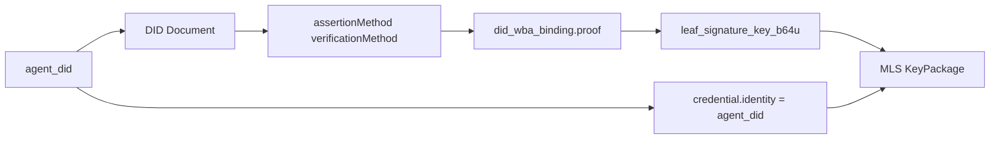
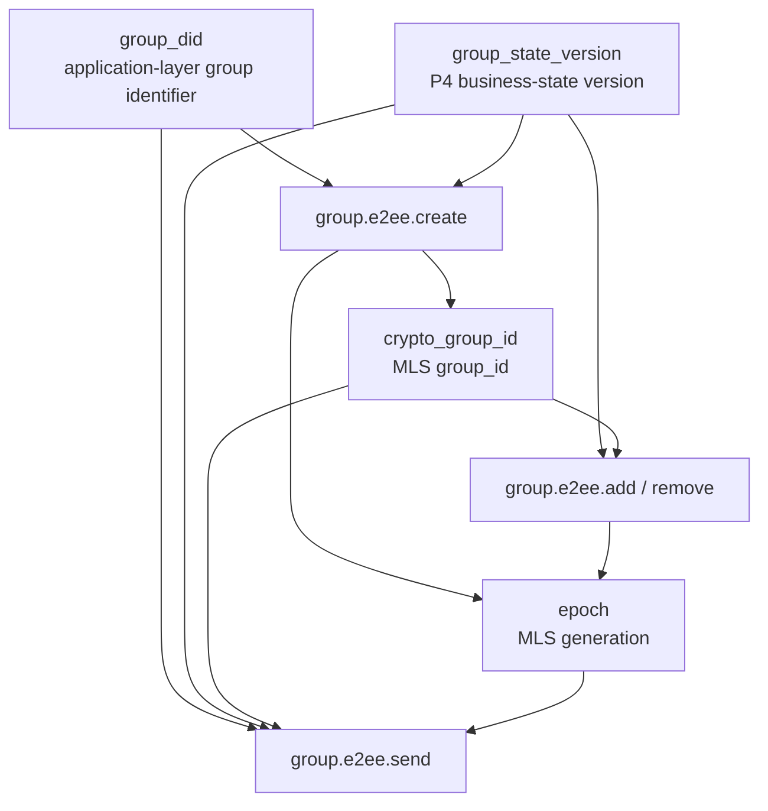
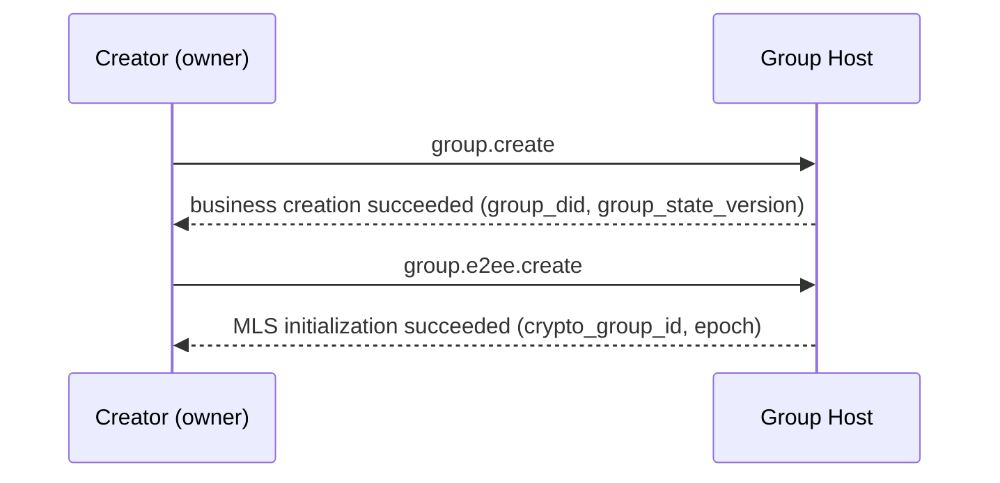
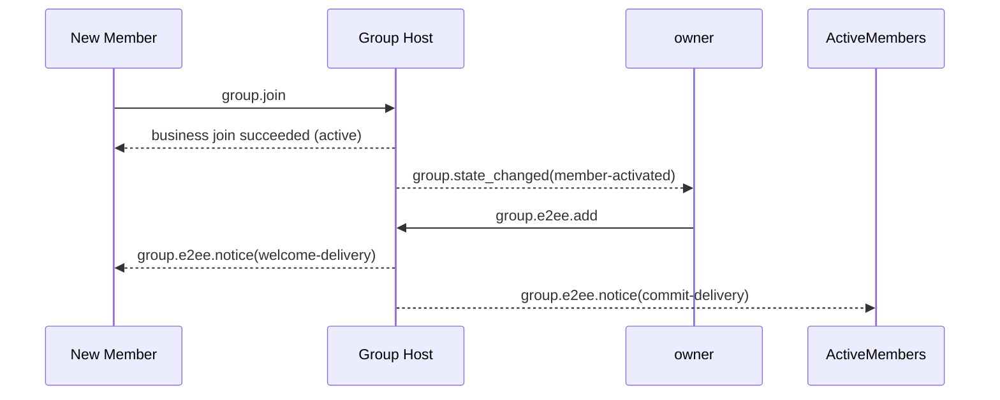
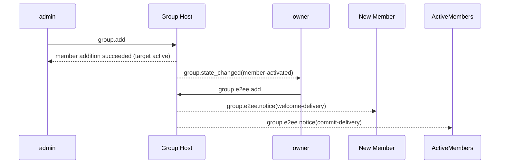
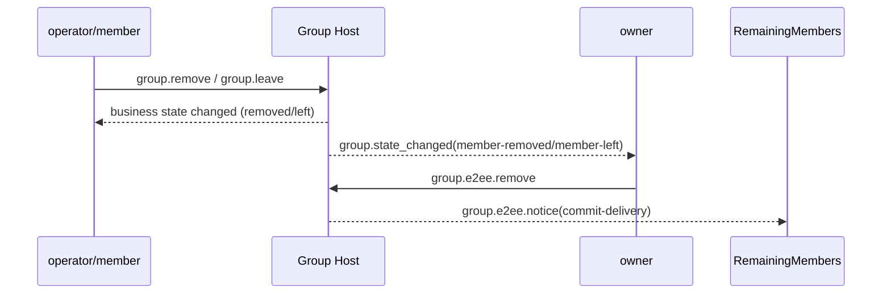
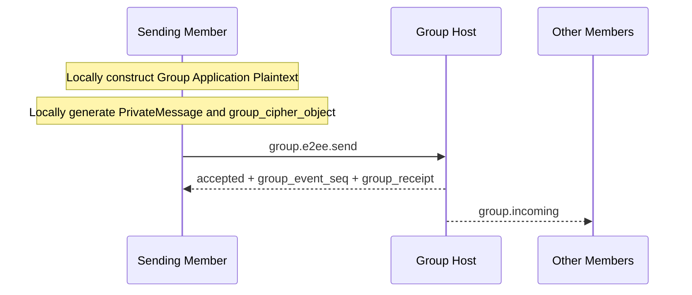
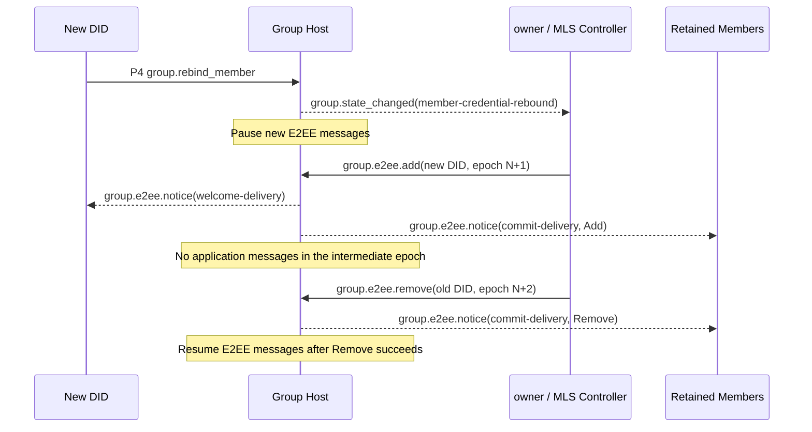

<!-- translation-review: full; scope: entire original source; paragraph-by-paragraph agent review; source code unchanged -->
> 日本語訳：原文の全段落を意味照合済みです。deprecated内の旧版（Released / 1.1 / v1）を翻訳しており、現行P6の公開状態やv2デバイス拡張を示すものではありません。コード例と識別子は原文のままです。
> 原文：[deprecated/06-group-end-to-end-encryption.md](../../deprecated/06-group-end-to-end-encryption.md)（SHA-256: `e59cdb0e34a6d28bf7f83e8d666db191baff8546de8dc38ba5a520fe41060582`）

# ANP Profile 6：グループのエンドツーエンド暗号化

- 文書ID：ANP-P6
- タイトル：グループのエンドツーエンド暗号化
- 状態：公開済み
- バージョン：1.1
- 原文言語：English
- 適用範囲：Group DIDに基づくグループのエンドツーエンド暗号化制御層を対象とし、`anp.group.base.v1`と密接に連携します。

---

## 1. 目的

このProfileは、ANPのグループのエンドツーエンド暗号化制御層を定義し、次を規定します。

1. `group_did`、`group_state_version`、`group_event_seq`をグループの暗号状態機械に結び付ける方法。
2. グループ鍵確立、メンバー変更、アプリケーションメッセージ保護の基礎プロトコルとしてMLSを使う方法。
3. `did:wba`のIDを、MLSメンバー資格情報、KeyPackage、Leaf署名鍵へ結び付ける方法。
4. MLS暗号操作を専用に運ぶ、独立した`group.e2ee.*` JSON-RPCメソッド群を定義する方法。
5. 「P4メソッドへMLSハンドシェイクオブジェクトを埋め込む」のではなく、**状態の連動**を通じて`anp.group.base.v1`と密接に連携する方法。
6. `epoch`、`Welcome`、`PrivateMessage`、`PublicMessage`、`epoch_authenticator`、フォーク検出、回復の扱い方。
7. P4がHandle-backed MemberのDID再バインドを受理した後、順序付けた`group.e2ee.add`と`group.e2ee.remove`を通じて、対応するMLS Leafを置換する方法。

このProfileは次を定義しません。

- 過去のメッセージの取得。
- 既読状態やオンライン状態。
- デバイスや内部レプリカの概念。
- Agent内の複数の実行単位間でグループ鍵状態を共有する方法。
- グループ外のディレクトリ同期の具体的な実装。
- グループ以外の場面のエンドツーエンド暗号化。
- External Commitの主要経路。
- `group_join_info`と`group.e2ee.get_join_info`。
- `accept_welcome`プロトコルメソッド。
- 第二の業務メンバー状態モデル。
- 失われた過去のMLS epoch秘密情報の回復・再配布。

---

## 2. 用語と規範上の表記

### 2.1 規範キーワード

本書の**MUST**、**MUST NOT**、**REQUIRED**、**SHALL**、**SHALL NOT**、**SHOULD**、**SHOULD NOT**、**RECOMMENDED**、**NOT RECOMMENDED**、**MAY**、**OPTIONAL**は、大文字表記に従って規範的要件として解釈します。

### 2.2 用語

- **Group DID**：グループのアプリケーション層のグローバル識別子。`group_did`です。
- **Crypto Group ID**：グループ暗号処理内部の識別子。MLSの`group_id`に対応し、`group_did`とは異なっていてもかまいません。
- **グループHostサービス（Group Host Service）**：グループの基本状態の順序付け、ポリシー適用、グループメッセージの入口を担当するサービス。MLSコントローラーではありません。
- **MLS Group State**：MLSに基づいて維持するグループの暗号状態。
- **Epoch**：MLSグループ状態が一世代進むこと。
- **KeyPackage**：新しいメンバーをグループに追加するためのMLS追加用素材オブジェクト。
- **Welcome**：新しいメンバーがグループ状態を初期化するのを助ける、MLSのWelcomeオブジェクト。
- **PrivateMessage**：メンバー認証を備えた、暗号化されたMLSメッセージ。
- **PublicMessage**：署名のみを行い、暗号化しないMLSメッセージ。
- **did:wba Binding**：MLS Leaf署名鍵、メンバー資格情報、KeyPackageを`agent_did`へ結び付ける、検証可能な証明オブジェクト。
- **MLS Controller**：MLSメンバー変更制御操作を担当する主体。v1ではグループの`owner`に固定します。
- **状態の連動（State Coupling）**：P4とP6をメソッドごとに対応させるのではなく、業務状態の変化を通じて暗号状態の進行を起動する連動方式。
- **E2EE Notice**：`commit`や`welcome`などの暗号処理結果を届けるために、P6が独自に定義する独立した暗号処理通知オブジェクト。
- **フォーク（Fork）**：同じ`group_did`について、異なるメンバーが、両立できない`epoch`／`epoch_authenticator`／状態進行の列を観測したこと。
- **MLS Member Credential Rebind**：P4が同じHandleメンバーのDID再バインドを受理した後、`group.e2ee.add(new DID)`、続いて`group.e2ee.remove(old DID)`という順序付きの二つのCommitでMLS Leafを置換する、暗号処理の編成。

---

## 3. 設計原則

### 3.1 グループアイデンティティと暗号状態の階層化

このProfileは、次を明確に区別します。

- `group_did`：アプリケーション層のグループのグローバル識別子。
- `crypto_group_id`：暗号処理グループ内部の識別子。
- `group_state_version`：グループHostが割り当てるアプリケーション層のグループ状態バージョン。
- `epoch`：MLS状態機械が割り当てる暗号グループの世代。〔訳注：原文の形容詞はCryptozoologicalで、この文脈と不整合です。ここは、同節の他の記述が示す暗号グループの世代として訳しています。〕

四つを機械的に同一視してはなりません（MUST NOT）。ただし、それらの間には、検証可能なバインディングが存在しなければなりません（MUST）。

### 3.2 一つのAgent＝一人の外部グループメンバー

このProfileの外部相互運用境界では、MLSメンバーを常に現在の`agent_did`で表します。P4の任意の`member_handle`は安定した業務メンバーシップの基点ですが、MLSの`credential.identity`内の現在のDIDを置換してはなりません（**MUST NOT**）。プロトコル層には、デバイス、端末、ローカルUser ID、内部レプリカのメンバーを導入しません。

Agent内に複数の実行レプリカがある場合、MLSグループ状態を共有・同期する方法はAgentの内部実装に属し、このProfileの相互運用の意味には含まれません。

### 3.3 P4が主要な業務プロトコル、P6が暗号制御層

このProfileと`anp.group.base.v1`の関係は次のとおりです。

- P4はグループの業務操作、業務状態、順序付けの意味、受領証の意味を定義します。
- P6はMLS暗号操作、暗号オブジェクト、バインディング規則、検証要件を定義します。
- 業務層の権威は、引き続きP4です。
- P6は、`active / left / removed`などの業務メンバー状態を再定義**しません**。
- P6は、P4メソッドのbodyでMLSネイティブオブジェクトを直接運ぶことを要求しません。

### 3.4 メソッドごとの対応ではなく、状態の連動

P4とP6の連動は、「あるP4メソッドがあるP6メソッドに直接対応する」ことではなく、**状態**を通じて実現します。

具体的には次のとおりです。

- P4が、業務上有効かどうかを決めます。
- P6が業務状態の変化を観測し、それに応じてMLS状態を進めます。

例：

- P4でグループを作成でき、作成者が`owner`になった→ownerが`group.e2ee.create`を自動実行する。
- P4でメンバーが`active`になり、まだMLSメンバー集合に入っていない→ownerが自動的に`group.e2ee.add`を実行。
- P4でメンバーが`left`または`removed`になり、まだMLSメンバー集合にいる→ownerが自動的に`group.e2ee.remove`を実行。
- P4でHandle-backed Memberの`member-credential-rebound`が生じ、旧DIDのLeafがまだMLSメンバー集合にいる→ownerが自動的に`group.e2ee.add(new DID)`を実行し、成功後に`group.e2ee.remove(old DID)`を実行。

### 3.5 ownerが唯一のMLSコントローラー

v1ではownerだけがMLSコントローラーの役割を担います。

ownerの責務：

- MLSグループの作成。
- `add`の実行。
- `remove`の実行。
- 順序付けた`add(new DID)`と`remove(old DID)`によってメンバー資格情報を再バインドする。
- メンバー変更に対応する`commit`の生成。
- 新メンバー向けの`welcome`の生成。
- メンバー変更後の`epoch`の進行。

P6の中心的な考え方は、MLSオブジェクトをP4メソッドのbodyへ入れることではなく、業務状態とともに暗号状態を進めることです。次の図はこの状態の連動をまとめ、詳細な制約を読む前にメソッド間の因果関係を理解できるようにします。

```mermaid
flowchart TB
P4[P4 business-state changes<br/>group.create / member active / member left or removed / credential rebound]
OBS[owner observes business state]

CREATE[group.e2ee.create]
ADD[group.e2ee.add]
REMOVE[group.e2ee.remove]
REBIND_ADD[group.e2ee.add(new DID)]
REBIND_REMOVE[group.e2ee.remove(old DID)]

HOST[Group Host]
NOTICE[group.e2ee.notice]

P4 --> OBS
OBS -->|group created and has no crypto_group_id yet| CREATE
OBS -->|member active and not yet in MLS| ADD
OBS -->|member left or removed and still in MLS| REMOVE
OBS -->|Handle member rebound and old leaf still in MLS| REBIND_ADD

CREATE --> HOST
ADD --> HOST
REMOVE --> HOST
REBIND_ADD --> HOST
REBIND_ADD -->|execute after rebind Add is accepted| REBIND_REMOVE
REBIND_REMOVE --> HOST

HOST --> NOTICE
```

*図P6-1：P4／P6の状態連動の概観（非規範）。*

この図が強調するのは起動の関係であり、新しい業務状態機械ではありません。P4が引き続き業務層の権威であり、P6はその業務結果を観測し、MLSのcreate／add／remove操作として実体化するだけです。

### 3.6 グループHostは順序付けを担当し、MLS制御は担当しない

グループHostサービスの責務：

- P4業務操作の受信と順序付け。
- 受け入れたイベントへの`group_event_seq`の割り当て。
- `group_state_version`の進行。
- `group_receipt`の生成。
- グループメッセージとE2EE Noticeの配信。
- MLS制御結果の業務層での成立を証明すること。

既定では、グループHostサービスは：

- MLSコントローラーとして動作するべきではありません（**SHOULD NOT**）。
- MLSグループメンバーになるべきではありません（**SHOULD NOT**）。
- グループアプリケーション平文の復号能力を持つべきではありません（**SHOULD NOT**）。

### 3.7 ownerがグループ状態を管理し、activeなメンバーがグループメッセージを扱う

ownerが制御するのは次のものだけです。

- メンバー変更。
- グループ暗号状態の進行。
- `epoch`の更新。

すべての`active`メンバーは次を実行できます。

- 現在のグループ状態を使い、自分のグループメッセージ暗号文を生成する。
- `group.e2ee.send`を呼び、自分のグループメッセージを送信する。
- 他のメンバーのグループメッセージを復号する。

このProfileは、すべてのグループメッセージをownerが暗号化することを要求しません。

### 3.8 v1はExternal Commitに対応しない

v1では、

- External Commitに対応しません。
- `group_join_info`を定義しません。
- `group.e2ee.get_join_info`を定義しません。
- `accept_welcome`プロトコルメソッドを定義しません。

すべてのグループ参加経路は、最終的に、暗号層でownerが開始するMLSの`add`へ統一されます。

### 3.9 PrivateMessageに入るのはメッセージ側だけ

v1では、

- `group.e2ee.send`のアプリケーションメッセージ内容だけが、MLSの`PrivateMessage`に入り暗号化されます。
- `group.e2ee.create`、`group.e2ee.add`、`group.e2ee.remove`は、引き続き平文のJSON-RPC要求bodyを使います。再バインドの編成は`add`と`remove`を再利用し、新しい要求メソッドを定義しません。
- `commit`や`welcome`などのオブジェクトは、メソッド入力やNoticeペイロードとして現れ、P4業務メソッドのbodyへ埋め込みません。

---

## 4. 依存関係、Profileの識別、対象モデル

### 4.1 Profile名

このProfileの標準名は次のとおりです。

`anp.group.e2ee.v1`

### 4.2 依存関係

このProfileは、次のProfileに依存しなければなりません（**MUST**）。

- `anp.core.binding.v1`
- `anp.identity.discovery.v1`
- `anp.group.base.v1`

### 4.3 Security Profile

このProfileを使う場合：

- `meta.profile`は`anp.group.e2ee.v1`でなければなりません（**MUST**）。

具体的には：

- `group.e2ee.publish_key_package`、`group.e2ee.get_key_package`、`group.e2ee.notice`は、`transport-protected`を使わなければなりません（**MUST**）。
- `group.e2ee.create`、`group.e2ee.add`、`group.e2ee.remove`、`group.e2ee.send`は`group-e2ee`を使わなければなりません（**MUST**）。

`group.e2ee.send`の`group-e2ee`は、運ぶメッセージの意味がグループE2EE側に属することを示します。外側のJSON-RPC要求bodyを、グループによって再び暗号化するという意味ではありません。

### 4.4 メソッドの対象モデル

### 4.4.1 サービスをスコープとするメソッド

次のメソッドは、`service-scoped`でなければなりません（**MUST**）。

- `group.e2ee.publish_key_package`
- `group.e2ee.get_key_package`
- `group.e2ee.create`

規則：

- `meta.target.kind = "service"`
- `meta.target.did`は、宛先の公開`ANPMessageService.serviceDid`と等しくなければなりません（**MUST**）。

`group.e2ee.create`がservice-scopedを使う理由：
業務層の`group.create`が成功する前に、グループの業務状態が成立したばかりであり、`group_did`も生成されています。ただし、作成操作自体はグループHostのサービス入口に対して暗号初期化を行うため、v1では一律にservice-scopedを使います。〔訳注：原文は「成功する前」と「状態が成立済み」を併記しています。第9.2節・第11.4節の業務作成受理後という記述との不整合は、原文のまま保持しています。〕

### 4.4.2 グループを宛先とするメソッド

次のメソッドは、`group-addressed`でなければなりません（**MUST**）。

- `group.e2ee.add`
- `group.e2ee.remove`
- `group.e2ee.send`

規則：

- `meta.target.kind = "group"`
- `meta.target.did`は、宛先の`group_did`と等しくなければなりません（**MUST**）。

### 4.4.3 Agent宛ての通知

次の通知は`agent-addressed`でなければなりません（**MUST**）。

- `group.e2ee.notice`

規則：

- `meta.target.kind = "agent"`
- `meta.target.did`は、通知を受け取るAgent DIDと等しくなければなりません（**MUST**）。

---

## 5. 暗号処理の主要経路とMTIスイート

### 5.1 主要プロトコル

このProfileのグループ鍵の主要経路は、MLS 1.0の意味に基づいて実装しなければなりません（**MUST**）。ただしv1では、使用する機能の制限された部分集合だけを固定します。

v1の主要経路は少なくとも次を含みます。

- KeyPackage
- Add
- Remove
- Commit
- Welcome
- PrivateMessage
- Epochの進行

Handle-backed Memberの資格情報再バインドでは、新しいP6メソッドもMLSプリミティブも導入しません。まず`group.e2ee.add`で新DIDのLeafを追加するCommitを行い、次に`group.e2ee.remove`で旧DIDのLeafを削除するCommitを行います。

具体的には：

- `commit_b64u`は、TLSで直列化した完全なMLS `MLSMessage`（`mls-public-message`）の生バイト列で表現しなければなりません（**MUST**）。
- `welcome_b64u`は、TLSで直列化したMLS `Welcome`オブジェクトの生バイト列で表現しなければなりません（**MUST**）。
- `PrivateMessage`は、グループアプリケーションメッセージの唯一の暗号文運搬オブジェクトでなければなりません（**MUST**）。

MLSライブラリーは、`Update`、Proposalのバッチ処理、PSK、ReInitなどの標準機能にも対応してかまいません（**MAY**）。ただし、これらの機能はこのProfile v1の最小限の主要経路には**含まれず**、v1の相互運用要件にもなりません。

### 5.2 実装必須スイート

相互運用の最小要件を確保するため、このProfileに適合する実装は、次のMTIスイートに対応しなければなりません（MUST）。

`MLS_128_DHKEMX25519_AES128GCM_SHA256_Ed25519`

### 5.3 追加のスイート

実装は、さらに多くのMLSスイートに対応してもかまいません（**MAY**）。ただし：

- 同じグループの全メンバーは、使うスイートに合意しなければなりません（**MUST**）。
- グループポリシーが許可するスイート集合を制限する場合、MLSコントローラーは、ポリシーを満たさないスイートを拒否しなければなりません（**MUST**）。

### 5.4 did:wbaとの関係

このProfileの主要経路とdid:wbaの関係は次のとおりです。

- DID文書の`authentication`／`assertionMethod`を、IDのバインディング証明に使います。
- DID文書の`keyAgreement`には、エージェントがE2EE機能を持つことを示すため、少なくとも一つのX25519エントリを含めるべきです（**SHOULD**）。
- MLSグループメンバーのLeaf署名鍵を、DIDの長期ID署名鍵と直接同一視しないことが望まれます（原文の規範語は**SHOUNT**）。〔訳注：英語原文の綴りを保持し、対応する中国語原文の「不应」に従って否定の意味を訳しています。〕
- Leaf署名鍵は独立して生成し、`did:wba Binding`を通じて`agent_did`へ結び付けることが望まれます（**SHOULD**）。

---

## 6. did:wbaとMLSのバインディングモデル

### 6.1 バインディングの対象

このProfileでは、次のMLS要素を`agent_did`へ結び付ける必要があります。

1. KeyPackageの所有者。
2. 現在のLeaf署名鍵。
3. グループメンバー資格情報内のID文字列。

### 6.2 資格情報のアイデンティティ規則

このProfileでは、MLSメンバー資格情報の`credential.identity`は、そのLeafの現在の`agent_did`のUTF-8バイト列と一致しなければなりません（**MUST**）。Handleを`credential.identity`へ書き込んだり、その代わりに使ったりしてはなりません（**MUST NOT**）。

実装は、`credential.identity`を、ローカルアカウントID、デバイスID、数値の利用者ID、その他の非DID文字列に置き換えてはなりません（**MUST NOT**）。

### 6.3 `did_wba_binding`オブジェクト

このProfileは、MLS Leaf署名鍵を`agent_did`へ結び付けるための`did_wba_binding`オブジェクトを定義します。

推奨する構造は次のとおりです。

```json
{
  "agent_did": "did:wba:example.com:agents:alice:e1_<fingerprint>",
  "verification_method": "did:wba:example.com:agents:alice:e1_<fingerprint>#key-1",
  "leaf_signature_key_b64u": "BASE64URL_ED25519_LEAF_PK",
  "issued_at": "2026-03-29T12:00:00Z",
  "expires_at": "2026-04-29T12:00:00Z",
  "proof": {
    "type": "DataIntegrityProof",
    "cryptosuite": "eddsa-jcs-2022",
    "created": "2026-03-29T12:00:00Z",
    "proofPurpose": "assertionMethod",
    "verificationMethod": "did:wba:example.com:agents:alice:e1_<fingerprint>#key-1",
    "proofValue": "z..."
  }
}
```

`did_wba_binding.proof`は、P1付録Bの共通の**Object Proof Profile**を再利用しなければなりません（**MUST**）。

`did_wba_binding`について：

- 発行者DIDは`agent_did`でなければなりません（**MUST**）。
- 保護対象文書は、`proof`を削除した`did_wba_binding`オブジェクト全体でなければなりません（**MUST**）。
- `proof.verificationMethod`は、`agent_did`のDID文書の`assertionMethod`が認可する検証メソッドを指さなければなりません（**MUST**）。〔訳注：原文はauthentication methodと記しますが、認可関係は明示どおりassertionMethodです。〕

### 6.4 `did_wba_binding`の検証規則

受信側は、KeyPackage、LeafNode更新、新メンバーを受け入れる前に、次の検証を完了しなければなりません（MUST）。

1. `agent_did`を解決できること。
2. `verification_method`がDID文書に存在すること。
3. `verification_method`がDID文書の`assertionMethod`によって認可されていなければなりません（**MUST**）。
4. `proof`が存在し（**MUST**）、P1付録Bの共通Object Proof Profileを満たさなければなりません（**MUST**）。
5. `proof`の発行者DIDが`agent_did`と一致しなければなりません（**MUST**）。
6. `proof`の検証が成功すること。
7. `proof`で保護する文書内容は、少なくとも`agent_did`、`verification_method`、`leaf_signature_key_b64u`、`issued_at`、`expires_at`を網羅しなければなりません（**MUST**）。
8. KeyPackage／LeafNode内の実際のLeaf署名公開鍵が`leaf_signature_key_b64u`と一致すること。
9. MLS資格情報の`credential.identity`が`agent_did`と一致すること。
10. `issued_at`／`expires_at`が存在する場合、実装はローカルの時刻有効性ポリシーに従って有効期間を検証しなければなりません（**MUST**）。

P6が`did_wba_binding`を定義するのは、MLS Leaf署名鍵をDIDの長期アイデンティティ署名鍵と直接同一視すべきでないためです。次の図は、`agent_did`、DID文書、バインディングオブジェクト、KeyPackage／`credential.identity`を結び、検証順を理解できるようにします。



*図P6-2：did:wbaとMLSのバインディングの連鎖（非規範的）。*

検証時には、MLS内部の署名が有効かを調べるだけでは不十分です。受信者はこの連鎖をたどり、`credential.identity`、Leaf署名鍵、`agent_did`が完全に結び付いていることも確認します。

### 6.5 `e1_`と`k1_`の互換性

- 既定の`e1_` DIDでは、`did_wba_binding.proof`はP1付録Bの共通Object Proof Profileを再利用しなければなりません（**MUST**）。
- 互換対象の`k1_` DIDでは、`did_wba_binding.proof`は、明示的な拡張ネゴシエーションで定義する代替Object Proof Profileを使ってかまいません（**MAY**）。ただし、そのネゴシエーションがなければ、v1 MTIは`k1_`のproofによるバインディングを既定の相互運用経路とは**しません**。
- DIDのアイデンティティ曲線にかかわらず、バインディング証明が成り立つ限り、MLSグループのMTI Leaf署名鍵にEd25519を使ってもかまいません（**MAY**）。

---

## 7. 中核オブジェクト

### 7.1 `crypto_group_id`

`crypto_group_id`は、MLS内部の`group_id`を表します。

規則は次のとおりです。

- `crypto_group_id`は不透明なバイト列として扱わなければなりません（**MUST**）。
- JSONでは`base64url`で表現しなければなりません（**MUST**）。推奨フィールド名は`crypto_group_id_b64u`です。
- `crypto_group_id`は、`group_did`との検証可能なバインディングを確立しなければなりません（**MUST**）。

### 7.2 `group_state_ref`

このProfileは、P4の`group_state_ref`の概念を再利用し、E2EEグループに少なくとも次を含めることを要求します。

- `group_did`
- `group_state_version`
- `policy_hash`（グループポリシーをハッシュ化している場合）

グループE2EEでは、異なる層にある四つの識別子／バージョン、すなわちGroup DID、業務状態バージョン、暗号処理内部のグループID、MLS epochの関係を誤解しやすくなります。次の図は、それぞれの情報源と進行の関係を一つにまとめます。



*図P6-3：`group_did`、`crypto_group_id`、`group_state_version`、`epoch`の関係（非規範）。*

以降のオブジェクト構造と検証規則では、この四つの値を、異なる層の座標として捉えてください。相互に結び付ける必要はありますが、互いを置き換えることはできず、機械的に同じ値と扱うべきではありません。

### 7.3 `group_key_package`

このProfileは、グループへの追加素材を包む次のオブジェクトを定義します。

```json
{
  "key_package_id": "kp-001",
  "owner_did": "did:wba:example.com:agents:bob:e1_<fingerprint>",
  "suite": "MLS_128_DHKEMX25519_AES128GCM_SHA256_Ed25519",
  "mls_key_package_b64u": "BASE64URL_KEYPACKAGE",
  "did_wba_binding": { ... },
  "expires_at": "2026-04-30T00:00:00Z"
}
```

具体的には：

- `key_package_id`が存在しなければなりません（**MUST**）。
- `owner_did`が存在しなければなりません（**MUST**）。
- `suite`が存在しなければなりません（**MUST**）。
- `mls_key_package_b64u`が存在しなければなりません（**MUST**）。
- `did_wba_binding`が存在しなければなりません（**MUST**）。
- `expires_at`は存在するべきです（**SHOULD**）。
- `mls_key_package_b64u`は、MLS 1.0 TLSで直列化したMLS `KeyPackage`オブジェクトの生バイト列を、パディングなしのbase64urlで表現しなければなりません（**MUST**）。

`group_key_package`は、主にownerが後で`group.e2ee.add`を実行するために使います。

### 7.4 `group_cipher_object`

`group_cipher_object`は、`group.e2ee.send`のwireプロトコルのメッセージbodyオブジェクトです。

推奨する構造は次のとおりです。

```json
{
  "crypto_group_id_b64u": "BASE64URL_GROUPID",
  "epoch": "7",
  "private_message_b64u": "BASE64URL_PRIVATEMESSAGE",
  "group_state_ref": {
    "group_did": "did:wba:groups.example:team:dev:e1_<fingerprint>",
    "group_state_version": "42",
    "policy_hash": "sha-256:..."
  },
  "epoch_authenticator": "BASE64URL_AUTH"
}
```

規則：

- `crypto_group_id_b64u`が存在しなければなりません（**MUST**）。
- `epoch`が存在しなければなりません（**MUST**）。
- `private_message_b64u`が存在しなければなりません（**MUST**）。
- `private_message_b64u`は、MLS 1.0 TLSで直列化したMLS `PrivateMessage`オブジェクトの生バイト列を、パディングなしのbase64urlで表現しなければなりません（**MUST**）。
- `group_state_ref.group_did`は、外側の宛先`group_did`と等しくなければなりません（**MUST**）。

### 7.5 `Group Application Plaintext`

グループアプリケーションメッセージをMLSの`PrivateMessage`で暗号化する前に、次の内側の平文オブジェクトへ正規化しなければなりません（**MUST**）。

```json
{
  "application_content_type": "text/plain | application/json | application/anp-attachment-manifest+json | ...",
  "thread_id": "thr-001",
  "reply_to_message_id": "msg-0009",
  "annotations": {},
  "text": "...",
  "payload": {},
  "payload_b64u": "..."
}
```

規則：

- `application_content_type`が存在しなければなりません（**MUST**）。
- `text`、`payload`、`payload_b64u`のうち、正確に一つが存在しなければなりません（**MUST**）。
- P4のメッセージ意味フィールド`thread_id`、`reply_to_message_id`、`annotations`は、グループE2EEでは内側のオブジェクトへ配置しなければなりません（**MUST**）。
- 送信側は、暗号化前に`Group Application Plaintext`オブジェクト全体をUTF-8＋RFC 8785 JCSでバイト列へ直列化しなければならず（**MUST**）、受信側は復号後に同じ規則で解釈しなければなりません（**MUST**）。

`application_content_type = "application/json"`の場合、`payload`はJSONオブジェクトを直接運ばなければなりません（**MUST**）。
このProfileは、そのオブジェクト内部のフィールドの業務上の意味を
定義しません。

通常のJSONグループアプリケーション平文の例：

```json
{
  "application_content_type": "application/json",
  "thread_id": "thr-001",
  "payload": {
    "type": "example",
    "data": {
      "hello": "group"
    }
  }
}
```

### 7.6 `e2ee_notice_object`

P6は、暗号処理結果の配信用に、独立した暗号処理通知オブジェクトを定義します。

推奨する構造は次のとおりです。

```json
{
  "notice_id": "en-001",
  "notice_type": "commit-delivery | welcome-delivery",
  "group_did": "did:wba:groups.example:team:dev:e1_<fingerprint>",
  "group_state_ref": {
    "group_did": "did:wba:groups.example:team:dev:e1_<fingerprint>",
    "group_state_version": "43",
    "policy_hash": "sha-256:..."
  },
  "crypto_group_id_b64u": "BASE64URL_GROUPID",
  "epoch": "8",
  "subject_did": "did:wba:b.example:agents:bob:e1_<fingerprint>",
  "subject_status": "active | removed",
  "commit_b64u": "BASE64URL_MLSMESSAGE",
  "welcome_b64u": "BASE64URL_WELCOME",
  "ratchet_tree_b64u": "BASE64URL_RATCHET_TREE",
  "epoch_authenticator": "BASE64URL_AUTH",
  "group_receipt": { ... }
}
```

規則：

- `notice_type`が存在しなければなりません（**MUST**）。
- `group_did`が存在しなければなりません（**MUST**）。
- `group_state_ref`が存在しなければなりません（**MUST**）。
- `crypto_group_id_b64u`が存在しなければなりません（**MUST**）。
- `epoch`が存在しなければなりません（**MUST**）。
- `notice_type = "commit-delivery"`の場合、`commit_b64u`が存在しなければなりません（**MUST**）。
- `notice_type = "welcome-delivery"`の場合、`welcome_b64u`と`ratchet_tree_b64u`が同時に存在しなければなりません（**MUST**）。
- 資格情報再バインドの編成が生成する通知では、`group_state_ref`は、両方のP6操作が使う、受理済みP4 `member-credential-rebound`イベントを厳密に参照しなければなりません（**MUST**）。受信者はHandle、バインディング世代、以前のDID、新しいDIDを、重複したP6継続性フィールドからではなく、そのP4イベントから取得しなければなりません（**MUST**）。
- `subject_did`と`subject_status`は、このP6操作で影響を受けるLeafを表します。Addでは新DIDと`active`を、Removeでは以前のDIDと`removed`を使います。
- `ratchet_tree_b64u`は、ラチェット木をTLS直列化した生バイト列の、パディングなしbase64urlでなければなりません（**MUST**）。
- `group_receipt`は、暗号処理結果を業務の順序位置に関連付けるために存在してもかまいません（**MAY**）。

---

## 8. KeyPackageの公開と発見のメソッド

### 8.1 `group.e2ee.publish_key_package`

#### 8.1.1 意味

エージェントが、グループ参加に使えるKeyPackageを、自分が公開する`ANPMessageService`へ公開します。

#### 8.1.2 要求の要件

- `method = "group.e2ee.publish_key_package"`
- `meta.profile = "anp.group.e2ee.v1"`
- `meta.security_profile = "transport-protected"`
- `meta.target.kind = "service"`
- `meta.target.did`は、公開者自身の公開`ANPMessageService.serviceDid`と等しくなければなりません（**MUST**）。
- `meta.sender_did`が存在しなければなりません（**MUST**）。
- `body.group_key_package`が存在しなければなりません（**MUST**）。
- `body.group_key_package.owner_did`は`meta.sender_did`と等しくなければなりません（**MUST**）。

認証上の制約：

- このメソッドは、**サービスをスコープとする**制御プレーンメソッドです。
- 呼び出し元は、認証済みのローカルセッション、または同等のホップ単位・サービス単位の認証コンテキスト内で動作しなければなりません（**MUST**）。
- v1では、このメソッドに追加の業務層`origin_proof`を**要求しません**。

#### 8.1.3 成功応答

成功応答は、少なくとも次を含まなければなりません（**MUST**）。

- `published = true`
- `owner_did`
- `key_package_id`
- `published_at`

### 8.2 `group.e2ee.get_key_package`

#### 8.2.1 意味

宛先エージェントの`ANPMessageService`を通じて、利用可能なKeyPackageを取得します。

#### 8.2.2 要求の要件

- `meta.profile = "anp.group.e2ee.v1"`
- `meta.security_profile = "transport-protected"`
- `meta.target.kind = "service"`
- `meta.target.did`は、宛先エージェントが公開する`ANPMessageService.serviceDid`と等しくなければなりません（**MUST**）。

`body`は次を含まなければなりません（**MUST**）。

- `target_did`

`body`は次を含めてもかまいません（**MAY**）。

- `preferred_suite`
- `require_fresh`

認証上の制約：

- このメソッドは、**サービスをスコープとする**制御プレーンメソッドです。
- v1の最小相互運用要件は、少なくともホップ／サービス単位での認証です。
- **KeyPackageの匿名取得はv1 MTIに含まれません**。

#### 8.2.3 成功応答

成功応答は、少なくとも次を含まなければなりません（**MUST**）。

- `target_did`
- `group_key_package`

#### 8.2.4 サーバー側の配布規則

`ANPMessageService`が`group_key_package`を返す場合：

- 期限切れでも、取り消し済みでも、消費済みでもないKeyPackageを返すべきです（**SHOULD**）。
- サーバーは、同時の再発行を防ぐため、返却後に`reserved`または同等の状態へ設定してもかまいません（**MAY**）。
- 再バインド編成のAdd段階も含め、対応する`group.e2ee.add`がグループHostに正常に受理され、暗号メンバーシップの変更が完了した場合、サービスはKeyPackageを`consumed`とマークするか、公開集合から削除しなければなりません（**MUST**）。
- 対応する処理が失敗、取消し、タイムアウトになった場合、予約したKeyPackageの解放は配備環境ごとに決めます。ただし、同じKeyPackageを、成功する二つの`group.e2ee.add`操作で同時に再利用させるべきではありません（**SHOULD NOT**）。
- ホップ／サービス単位の認証に基づき、呼び出し元の識別、レート制限、不正利用対策ポリシーを実装しなければなりません（**MUST**）。

---

## 9. MLS制御プレーンのメソッド

### 9.1 全体

この章のメソッドは独立したJSON-RPCメソッドです。P4業務メソッドの「追加フィールド」ではなく、P6自体の暗号制御操作です。

具体的には：

- `group.e2ee.create`、`group.e2ee.add`、`group.e2ee.remove`は、**メンバー変更の制御メソッド**です。
- `group.e2ee.send`は、**メッセージ送信メソッド**です。
- `group.e2ee.create/add/remove`は、既存のP4業務状態に結び付きますが、**新しいP4業務メンバー状態を作成しません**。
- `group.e2ee.send`をwire上の配信メソッドとして直接使い、`group.send`で再び包みません。

### 9.2 `group.e2ee.create`

#### 9.2.1 意味

新しいMLSグループ状態を作成し、ownerを初期メンバーとして追加します。

#### 9.2.2 呼び出し元

ownerのみ。

#### 9.2.3 要求の要件

- `method = "group.e2ee.create"`
- `meta.profile = "anp.group.e2ee.v1"`
- `meta.security_profile = "group-e2ee"`
- `meta.target.kind = "service"`
- `meta.target.did`は、宛先グループHostが公開する`ANPMessageService.serviceDid`と等しくなければなりません（**MUST**）。
- `meta.sender_did`は、現在のグループの`owner`と等しくなければなりません（**MUST**）。
- `auth.origin_proof`が存在しなければなりません（**MUST**）。

`body`は、少なくとも次を含まなければなりません（**MUST**）。

- `group_did`
- `group_state_ref`
- `suite`
- `creator_key_package`
- `crypto_group_id_b64u`
- `epoch`

規則：

- `creator_key_package.owner_did`は`meta.sender_did`と等しくなければなりません（**MUST**）。
- `group_state_ref.group_did`は`body.group_did`と等しくなければなりません（**MUST**）。
- 初期グループ状態の`epoch`は、`"0"`または実装が明示的に合意した初期値であるべきです（**SHOULD**）。

#### 9.2.4 成功応答

成功応答は、少なくとも次を含まなければなりません（**MUST**）。

- `created = true`
- `group_did`
- `group_state_ref`
- `crypto_group_id_b64u`
- `epoch`
- `accepted_at`

注：

- `group.e2ee.create`自体が、新しいP4業務グループを作成してはなりません（**MUST NOT**）。
- 業務層が`group.create`を受け入れた後でのみ実行します。
- `group_state_version`や`group_event_seq`を新たに独立生成しません。

### 9.3 `group.e2ee.add`

#### 9.3.1 意味

ownerはMLSの`add`を実行し、業務層で`active`になっているものの、まだMLSメンバー集合に入っていないメンバーを暗号グループに追加します。

#### 9.3.2 呼び出し元

ownerのみ。

#### 9.3.3 要求の要件

- `method = "group.e2ee.add"`
- `meta.profile = "anp.group.e2ee.v1"`
- `meta.security_profile = "group-e2ee"`
- `meta.target.kind = "group"`
- `meta.target.did`は、宛先の`group_did`と等しくなければなりません（**MUST**）。
- `meta.sender_did`は、現在のグループの`owner`と等しくなければなりません（**MUST**）。
- `auth.origin_proof`が存在しなければなりません（**MUST**）。

`body`は、少なくとも次を含まなければなりません（**MUST**）。

- `member_did`
- `group_state_ref`
- `group_key_package`
- `crypto_group_id_b64u`
- `epoch`
- `commit_b64u`
- `welcome_b64u`
- `ratchet_tree_b64u`

規則：

- `group_state_ref.group_did`は、外側の宛先`group_did`と等しくなければなりません（**MUST**）。
- `group_key_package.owner_did`は`member_did`と等しくなければなりません（**MUST**）。
- `commit_b64u`は、完全なMLS `MLSMessage`オブジェクトをTLSで直列化した、パディングなしbase64urlでなければなりません（**MUST**）。
- `welcome_b64u`は、MLS `Welcome`オブジェクトをTLSで直列化した、パディングなしbase64urlでなければなりません（**MUST**）。
- `ratchet_tree_b64u`は、ラチェット木をTLS直列化した生バイト列の、パディングなしbase64urlでなければなりません（**MUST**）。
- `epoch`は、この`add`の後の新しい`epoch`を示さなければなりません（**MUST**）。
- 通常の参加経路では、`member_did`は、まだMLSメンバー集合に入っていないP4の`active`なDIDでなければなりません（**MUST**）。
- 再バインド経路では、`group_state_ref`は受理済みのP4 `member-credential-rebound`イベントを厳密に参照し（**MUST**）、`member_did`はそのイベントの`subject_did`と一致し（**MUST**）、新KeyPackageはその新DIDへ結び付いていなければなりません（**MUST**）。
- 再バインド経路の`group.e2ee.add(new DID)`は、対応する`group.e2ee.remove(old DID)`より先に成功しなければなりません（**MUST**）。

#### 9.3.4 成功応答

成功応答は、少なくとも次を含まなければなりません（**MUST**）。

- `accepted = true`
- `group_did`
- `member_did`
- `group_state_ref`
- `crypto_group_id_b64u`
- `epoch`
- `accepted_at`

注：

- `group.e2ee.add`自体が、宛先メンバーのP4業務状態を`active`へ変えてはなりません（**MUST NOT**）。
- 業務状態は、P4によって既に決定されていなければなりません（**MUST**）。
- このメソッドが担当するのは、業務結果をMLSで実現することだけです。

### 9.4 `group.e2ee.remove`

#### 9.4.1 意味

ownerはMLSの`remove`を実行し、業務層で`removed`または`left`となったメンバーを暗号グループから削除するか、受理済みのHandle再バインド編成で旧DIDのLeafを削除します。

#### 9.4.2 呼び出し元

ownerのみ。

#### 9.4.3 要求の要件

- `method = "group.e2ee.remove"`
- `meta.profile = "anp.group.e2ee.v1"`
- `meta.security_profile = "group-e2ee"`
- `meta.target.kind = "group"`
- `meta.target.did`は、宛先の`group_did`と等しくなければなりません（**MUST**）。
- `meta.sender_did`は、現在のグループの`owner`と等しくなければなりません（**MUST**）。
- `auth.origin_proof`が存在しなければなりません（**MUST**）。

`body`は、少なくとも次を含まなければなりません（**MUST**）。

- `member_did`
- `group_state_ref`
- `crypto_group_id_b64u`
- `epoch`
- `commit_b64u`

規則：

- `commit_b64u`は、完全なMLS `MLSMessage`オブジェクトをTLSで直列化した、パディングなしbase64urlでなければなりません（**MUST**）。
- `epoch`は、この`remove`の後の新しい`epoch`を示さなければなりません（**MUST**）。
- 通常の削除経路では、`member_did`に対応するP4メンバー状態が、すでに`removed`または`left`でなければなりません（**MUST**）。
- 唯一の例外は再バインド経路です。`member_did`は参照先のP4 `member-credential-rebound`イベントの`previous_subject_did`と一致し（**MUST**）、`group_state_ref`は先に成功した`group.e2ee.add(new DID)`と厳密に一致しなければなりません（**MUST**）。また、そのAddですでにイベントの`subject_did`を追加している必要があります。
- 再バインドの例外を、状態が`active`のままの任意のメンバーを削除するために使ってはなりません（**MUST NOT**）。

#### 9.4.4 成功応答

成功応答は、少なくとも次を含まなければなりません（**MUST**）。

- `accepted = true`
- `group_did`
- `member_did`
- `group_state_ref`
- `crypto_group_id_b64u`
- `epoch`
- `accepted_at`

### 9.5 `group.e2ee.send`

#### 9.5.1 意味

MLSで暗号化したグループメッセージを、グループへ直接送ります。

#### 9.5.2 呼び出し元

現在の任意の`active`メンバー。

#### 9.5.3 要求の要件

適合する`group.e2ee.send`要求は、次を満たさなければなりません（**MUST**）。

1. `method = "group.e2ee.send"`
2. `meta.profile = "anp.group.e2ee.v1"`
3. `meta.security_profile = "group-e2ee"`
4. `meta.target.kind = "group"`
5. `meta.target.did`は、宛先の`group_did`でなければなりません（**MUST**）。
6. `meta.sender_did`は、現在の送信側Agent DIDでなければなりません（**MUST**）。
7. `meta.message_id`が存在しなければなりません（**MUST**）。
8. `meta.operation_id`が存在しなければなりません（**MUST**）。
9. `meta.content_type`は`application/anp-group-cipher+json`に固定しなければなりません（**MUST**）。
10. `auth.origin_proof`が存在しなければなりません（**MUST**）。
11. `body`は`group_cipher_object`を直接保持しなければなりません（**MUST**）。

注：

- `group.e2ee.send`自体が、wire上の送信メソッドです。
- P4の`group.send`を通じてもう一層包みません。

#### 9.5.4 成功応答

成功応答は、少なくとも次を含まなければなりません（**MUST**）。

- `accepted = true`
- `group_did`
- `message_id`
- `operation_id`
- `group_event_seq`
- `group_state_version`
- `accepted_at`
- `epoch`
- `group_receipt`

成功が意味すること：

- グループHostが、一つのMLS暗号文オブジェクトを受け入れ、順序付けた。
- 全メンバーがメッセージを正常に復号したことを、自動的に意味するわけではありません。

---

## 10. 状態の連動規則

### 10.1 全体

P4とP6の連動は、**業務状態の変化**を通じて行います。
このProfileは、`group.create -> create`や`group.add -> add`のような、メソッドごとの対応表を維持することを要求しません。

ownerは、信頼できる状態観測を通じて、次を把握しなければなりません（**MUST**）。

- あるグループが業務層で作成された。
- あるメンバーが業務上`active`になった。
- あるメンバーが業務上`left`または`removed`になった。
- Handle-backed Memberで`member-credential-rebound`が生じたこと。

状態観測の方法には次を使ってもかまいません（**MAY**）。

- ローカル側とグループHostの内部での処理編成。
- `group.state_changed`の購読。
- その他の同等で信頼できる状態観測機構。

### 10.2 グループ作成の連動規則

ownerが、次の業務状態が同時に成り立つことを観測した場合：

- ある`group_did`が作成済み。
- 作成者が自分自身。
- まだグループに結び付く`crypto_group_id`がない。

ownerは、一度だけ`group.e2ee.create`を起動しなければなりません（**MUST**）。

### 10.3 メンバー参加の連動規則

ownerが、次の業務状態が同時に成り立つことを観測した場合：

- ある`member_did`が、既にP4でそのグループの`active`メンバー。
- メンバーが現在、MLSメンバー集合に入っていない。
- メンバーが利用可能な`group_key_package`を持つ。

ownerは`group.e2ee.add`を一度起動しなければなりません（**MUST**）。

この規則は次にも適用されます。

- `group.join`
- `group.add`
- 配備環境の拡張による招待参加。
- 配備環境の拡張による承認。

つまり、P4のさまざまな業務入口は、最終的に暗号層の`group.e2ee.add`へ収束します。

### 10.4 メンバー削除・離脱の連動規則

ownerが、次の業務状態が同時に成り立つことを観測した場合：

- ある`member_did`がP4で`removed`または`left`になった。
- メンバーが現在、まだMLSメンバー集合にいる。

ownerは`group.e2ee.remove`を一度起動することが望まれます（**SHOULD**）。

### 10.5 メンバー資格情報再バインドの連動規則

ownerがP4の`member-credential-rebound`イベントを観測した場合、その`subject_did`は新DIDを、`previous_subject_did`は旧DIDを示します。旧DIDのLeafがまだMLSメンバー集合にいるなら、ownerは既存のメソッドを次の順序で編成しなければなりません（**MUST**）。

1. イベントの`subject_did`と新しいKeyPackageを指定して`group.e2ee.add`を呼び出す。
2. Addが成功してepochが一つ進んだ後、イベントの`previous_subject_did`を指定して`group.e2ee.remove`を呼び出す。
3. Removeが成功してepochがもう一つ進んだ後、暗号上の再バインドを完了する。

両要求は、同じP4 `member-credential-rebound`の`group_state_ref`を厳密に参照しなければなりません（**MUST**）。AddはRemoveより先に成功しなければなりません（**MUST**）。Removeで削除できるのはイベントの`previous_subject_did`だけであり、再バインドの手順を使って別のメンバーを削除してはなりません（**MUST NOT**）。

再バインドの編成中、グループHostはP6メンバー変更制御操作を直列化しなければなりません（**MUST**）。現在の段階の冪等な再試行と、Add成功直後の対応するRemoveを除き、再バインドが完了するまでは、無関係な`group.e2ee.add`や`group.e2ee.remove`を受理してはなりません（**MUST NOT**）。

P4再バインドイベントの受理からRemove成功まで、グループHostは当該グループへの新しい`group.e2ee.send`の受理を停止しなければなりません（**MUST**）。Addが生成する中間epochではアプリケーションメッセージを運んではなりません（**MUST NOT**）。Addが失敗したら停止を維持してAddを再試行しなければなりません（**MUST**）。Addが成功してもRemoveが失敗した場合、旧Leafと新Leafが一時的に併存してもかまいませんが、実装は停止を維持してRemoveを再試行しなければなりません（**MUST**）。

P6の失敗によってP4再バインドを取り消したり、旧DIDのP4権限を復活させたり、新しいP6業務メンバー状態を作ったりしてはなりません（**MUST NOT**）。P4のメンバーシップ、ロール、状態、参加時刻、メンバー数は、元の再バインドイベントによって決まったままです。

再バインドの対象がownerの場合、新DIDは現在のP4 ownerとして、自身の`origin_proof`を使ってAddを開始しなければなりません（**MUST**）。過渡的なAdd Commitは、保持している旧ownerのLeafのMLS状態から生成してかまいません（**MAY**）。新ownerのLeafが参加した後、Remove(old DID) Commitは新ownerのLeafで生成しなければなりません（**MUST**）。ownerが現在のMLS状態を失い、継続できる別の認可済みコントローラーもいない場合、システムは安全側に拒否し、E2EEメッセージプレーンの停止を維持しなければなりません（**MUST**）。

### 10.6 メッセージ送信規則

`group.e2ee.send`は、状態の連動を起動するメソッドでは**ありません**。
メンバーが明示的に開始する、wire上の送信メソッドです。

ただし、その業務上の整合性要件は、引き続きP4と強く結び付きます。

- 送信者は現在の`active`メンバーでなければなりません（**MUST**）。
- 送信者はP4の`group_policy.permissions.send`を満たさなければなりません（**MUST**）。
- 成功応答の`group_event_seq`、`group_state_version`、`group_receipt`の意味は、P4のグループメッセージの定義に従います。

---


## 11. MLSの使用Profile（規範）

### 11.1 全体と外部仕様の参照

この章は、このProfileによるMLSの**制限された使用部分集合と固定構成**を定義します。
MLS標準を書き直すことではなく、次を示すことが目的です。

- v1で使用できるMLSのオブジェクトと状態機械の操作。
- wireプロトコルでの、それらのオブジェクトの符号化方法。
- owner、activeメンバー、グループHostが、それぞれ担うローカル状態と処理義務。
- `group.e2ee.create`、`group.e2ee.add`、`group.e2ee.remove`、`group.e2ee.send`の背後にあるMLS上の意味。

実装はMLSの中核アルゴリズムの意味を変更してはなりません（**MUST NOT**）。ただし、MLS標準ライブラリーの既定の自由度と、このProfile v1の制限規則が競合する場合は、このProfileの規則を優先しなければなりません（**MUST**）。

### 11.2 v1で許可するMLSの部分集合

このProfile v1のMLS主要経路では、次のオブジェクトと操作だけを相互運用境界に含めます。

- `KeyPackage`
- `Add`
- `Remove`
- `Commit`
- `Welcome`
- `PrivateMessage`
- `epoch`の進行

このProfile v1では、

- `commit_b64u`は完全なMLS `MLSMessage`に対応しなければならず（**MUST**）、wire形式は`mls-public-message`でなければなりません（**MUST**）。
- `welcome_b64u`はMLSの`Welcome`に対応しなければなりません（**MUST**）。
- `private_message_b64u`はMLSの`PrivateMessage`に対応しなければなりません（**MUST**）。

このProfile v1では、次の機能を相互運用の主要経路に**含めません**。

- External Commit
- `GroupInfo`／`group_join_info`。
- `group.e2ee.get_join_info`
- 独立した`accept_welcome`プロトコルメソッド。
- 複数コントローラーの同時送信。
- owner以外が開始するメンバー変更。
- プロトコル上の主要操作としての`Update`。
- 相互運用要件としてのproposalの一括処理。
- v1 MTIで必須となるReInit、PSK、Subgroup、独自MLS拡張。

実装が使うMLSライブラリーは、これらの機能に対応していてもかまいません（**MAY**）。ただし、明示的に拡張ネゴシエーションを行わない限り、v1のwire相互運用に持ち込んではなりません（**MUST NOT**）。

### 11.3 MTIスイートと固定アルゴリズム

このProfile v1は、次のMTI暗号スイートを実装しなければなりません（**MUST**）。

`MLS_128_DHKEMX25519_AES128GCM_SHA256_Ed25519`

対応する固定アルゴリズム構成：

- KEM／HPKE DH：`DHKEMX25519`
- AEAD：`AES-128-GCM`
- ハッシュ／KDFの基礎：`SHA-256`
- Leaf署名：`Ed25519`

さらに、このProfileで、証明、AAD、内側の平文のバインディングに入るすべてのJSONオブジェクトを、UTF-8＋RFC 8785 JCSで符号化しなければなりません（MUST）。少なくとも次に適用します。

- `did_wba_binding`の保護対象オブジェクト。
- `Group Application Plaintext`
- `group.e2ee.send`の`authenticated_data`。
- メンバー変更の送信時の、認証されるバインディングオブジェクト。

### 11.4 `group.e2ee.create`のMLS上の意味

`group.e2ee.create`は、業務層が`group.create`を受け入れた後にだけ実行します。

`group.e2ee.create`を実行する際、ownerのローカルMLSランタイムは次を実行しなければなりません（**MUST**）。

1. `creator_key_package`を検証する。
2. その中の`did_wba_binding`を検証する。
3. 新しいMLSグループ状態を作る。
4. 新しい`crypto_group_id`を生成する。
5. ownerを最初のMLSメンバーとして追加する。
6. 初期`epoch`を形成する。
7. ownerのローカル永続状態を確立する。

`group.e2ee.create`は、新しいP4業務グループを別個に作成してはなりません（**MUST NOT**）。既存の業務グループに対応する初期MLS状態だけを作成します。

### 11.5 `group.e2ee.add`のMLS上の意味

`group.e2ee.add`は、v1で唯一の標準的な暗号上のグループ参加経路です。

`group.e2ee.add`を実行する際、ownerのローカルMLSランタイムは次を実行しなければなりません（**MUST**）。

1. 対象メンバーの`group_key_package`を取得し検証する。
2. `KeyPackage`と`did_wba_binding`を検証する。
3. 対象DIDが、通常の参加経路ならP4の`active`メンバー、再バインド経路なら参照先P4 `member-credential-rebound`イベントの`subject_did`であることを確認する。
4. 現在のグループ状態に基づいてMLSの`Add`を実行する。
5. 新しい`Commit`を生成する。
6. 新メンバー用の`Welcome`を生成する。
7. 新メンバーの初期化に十分なラチェット木の素材をエクスポートまたは構築する。
8. 新しい`epoch`へ進める。
9. ownerのローカルグループ状態を更新する。

したがって、v1の標準的なグループ暗号処理の主要経路は次のとおりです。

```text
KeyPackage
→ Add
→ Commit
→ Welcome
→ ratchet_tree
→ new epoch
```

実装の曖昧さを減らすため、v1では次を規定します。

- `commit_b64u`は、完全なMLS `MLSMessage`をTLS直列化した生バイト列でなければなりません（**MUST**）。
- `welcome_b64u`は、MLS `Welcome`オブジェクトをTLS直列化した生バイト列でなければなりません（**MUST**）。
- `ratchet_tree_b64u`を、新メンバーにだけ明示的に提供しなければなりません（**MUST**）。
- `welcome-delivery`は、「Welcomeが内部にラチェット木を含む場合がある」という、ライブラリの任意動作に依存してはなりません（**MUST NOT**）。

資格情報再バインドの編成では、本節のAddが第1段階です。P4再バインドイベントの`group_state_ref`を参照し、新DIDへ結び付いたLeafを追加して、その新DIDへWelcomeを届けなければなりません（**MUST**）。この操作自体は旧DIDのLeafを削除しません。

### 11.6 `group.e2ee.remove`のMLS上の意味

`group.e2ee.remove`を実行する際、ownerのローカルMLSランタイムは次を実行しなければなりません（**MUST**）。

1. 対象メンバーが、通常経路では`removed`または`left`になっていること、再バインド経路では参照先P4イベントの`previous_subject_did`そのものであることを確認する。
2. メンバーがまだMLSメンバー集合にいることを確認する。
3. 現在のグループ状態に基づいてMLSの`Remove`を実行する。
4. 新しい`Commit`を生成する。
5. 新しい`epoch`へ進める。
6. ownerのローカルグループ状態を更新する。
7. 削除したメンバーが後続メッセージを復号できないようにする。

`group.e2ee.remove`のwireプロトコルの出力は、少なくとも次を含まなければなりません（**MUST**）。

- `commit_b64u`
- `crypto_group_id_b64u`
- `epoch`
- `group_state_ref`

資格情報再バインドの編成では、本節のRemoveが第2段階です。同じ`group_state_ref`によるAdd(new DID)が成功した後でのみ実行でき、そのP4イベントが示す旧DIDのLeafだけを削除できます。

### 11.7 `group.e2ee.send`の暗号化の意味

送信側が`group.e2ee.send`を呼ぶとき、ローカルMLS実行環境は次を行わなければなりません（**MUST**）。

1. 自身が現在`active`メンバーであることを確認する。
2. P4の`permissions.send`を満たすことを確認する。
3. `Group Application Plaintext`を構築する。
4. 第13節で定義する`authenticated_data`を構築する。
5. 現在のMLSグループ状態を使い、内側の平文をMLSの`PrivateMessage`へ暗号化する。
6. `group_cipher_object`を構築する。
7. `group.e2ee.send`の`body`として、そのオブジェクトをグループHostへ送信する。

`group.e2ee.send`の成功が意味するのは、次だけです。

- グループHostが、一つのMLS暗号文オブジェクトを受け入れ、順序付けた。
- 全メンバーがメッセージを正常に復号したことを、自動的に意味するわけではありません。

### 11.8 グループメッセージの復号義務

受信メンバーは、`group.e2ee.send`に対応する暗号文オブジェクトを受信した後、次を実行しなければなりません（**MUST**）。

1. `group_did`に基づいて、対応するローカルMLSグループ状態を見つける。
2. `crypto_group_id_b64u`がローカルのバインディングと一致することを確認する。
3. `epoch`が受理可能な範囲内であるか確認する。
4. ローカルMLS状態を使い、`private_message_b64u`を復号する。
5. `authenticated_data`を検証する。
6. 内側の`Group Application Plaintext`を解析する。
7. すべての検査が成功した後でのみ、メッセージを上位層へ届ける。

いずれかの手順が失敗した場合、受信側は、有効なグループメッセージとしてアプリケーション層へ渡してはなりません（**MUST NOT**）。

### 11.9 `group.e2ee.notice`のローカル処理義務

#### 11.9.1 `commit-delivery`

`notice_type = "commit-delivery"`を受け取った場合、受信側のローカルMLS実行環境は、次を行わなければなりません（**MUST**）。

1. `commit_b64u`をデコードする。
2. `group_did`、`group_state_ref`、`crypto_group_id_b64u`、`epoch`を検証する。
3. ローカルMLSグループ状態にCommitを適用する。
4. ローカルの現在の`epoch`を更新する。
5. 存在する場合、必要な`epoch_authenticator`や整合性状態を記録する。

#### 11.9.2 `welcome-delivery`

新メンバーのローカルMLSランタイムは、`notice_type = "welcome-delivery"`を受信した際、次を実行しなければなりません（**MUST**）。

1. `welcome_b64u`をデコードする。
2. `ratchet_tree_b64u`をデコードする。
3. `group_did`、`group_state_ref`、`crypto_group_id_b64u`、`epoch`を検証する。
4. `welcome_b64u`＋`ratchet_tree_b64u`でローカルMLSグループ状態を初期化する。
5. その状態をローカルの`group_did`へ結び付ける。
6. 後続の`commit-delivery`やグループメッセージを受信する準備を整える。

Welcomeの処理は、ローカル動作の仕様であり、新しいJSON-RPCプロトコルメソッドではありません。

### 11.10 ローカル永続状態の要件

再起動や通知時機の違いをまたいで実装を成立させるため、各参加者は、少なくとも次の状態を永続化することが望まれます（**SHOULD**）。

#### 11.10.1 owner

ownerは少なくとも次を永続化することが望まれます（**SHOULD**）。

- `group_did`
- `crypto_group_id`
- 現在の`epoch`。
- 現在のMLSグループ状態。
- 同期された、現在の業務層のメンバー集合の見方。
- 最後に受理した`add/remove`結果への参照。資格情報再バインドの編成では両段階を含みます。

#### 11.10.2 activeメンバー

通常のactiveメンバーは少なくとも次を永続化することが望まれます（**SHOULD**）。

- `group_did`
- `crypto_group_id`
- 現在利用できるMLSグループ状態。
- 現在の`epoch`。
- 最近正常に適用した`commit/welcome`への参照。

#### 11.10.3 グループHost

グループHostは、少なくとも次を永続化するべきです（**SHOULD**）。

- `group_state_version`
- `group_event_seq`
- `group_receipt`
- `crypto_group_id`、`epoch`への外側のバインディング参照。
- 受理済みの`create/add/remove`操作から導出した、現在の公開DID→Leaf対応。この対応にMLS秘密鍵やepoch秘密情報を含めてはなりません（**MUST NOT**）。
- 資格情報再バインドの編成がAddとRemoveのどちらの段階かを示す内部進捗。これは新しいプロトコル上のメンバー状態ではありません。

既定では、グループHostに、グループメッセージを復号できるMLS秘密状態の永続化を**要求しません**。

### 11.11 v1で対応しないMLS機能

第11.2節で除外した項目に加え、このProfile v1は次に対応しません。

- 独立したプロトコル上の操作としての`Update`の公開。
- `group_state_ref`に結び付かない暗号処理結果のNoticeによる配信。
- 不足した木素材をMLSライブラリが暗黙・自動的に復元することへの依存。
- owner以外のメンバーが、メンバー集合を変える`Commit`を送信すること。
- グループHostが、メンバーの代わりにMLSの最終有効性判断を完了すること。

### 11.12 Handle-backed Member再バインドのMLS編成

ownerのローカルMLS実行環境は、次を行わなければなりません（**MUST**）。

1. 対応するP4 `member-credential-rebound`状態イベントを検証し、旧DID、新DID、`group_state_ref`を確認する。
2. 旧DIDが現在、厳密に一つのMLS Leafに対応することを確認する。
3. 新DIDの`group_key_package`と`did_wba_binding`を取得し、完全に検証する。
4. 第1のCommitを生成し、`group.e2ee.add`で新DIDのLeafを追加してepoch N+1へ進める。
5. 対応する`Welcome`と明示的なラチェット木を新DIDへ届け、Add Commitを現在のメンバーへ届ける。
6. 第2のCommitを生成し、`group.e2ee.remove`で旧DIDのLeafを削除してepoch N+2へ進める。
7. Remove Commitを残留メンバーへ届ける。
8. Remove成功後にのみアプリケーションメッセージを再開し、旧Leafがepoch N+2以降のアプリケーションメッセージを導出・復号できないようにする。

両Commitは同じP4 `group_state_ref`へ結び付かなければなりません（**MUST**）。epoch N+1は再バインドを完了するためだけの中間epochであり、アプリケーションメッセージを運んではなりません（**MUST NOT**）。新DIDは、このWelcomeから現在以降の状態だけを取得します。このProfileが、失われた過去のepoch秘密情報を復元してはなりません（**MUST NOT**）。

再バインドの対象がownerの場合、過渡的なAdd Commitは、保持している旧ownerのLeafのMLS状態で生成してかまいません（**MAY**）。新ownerのLeafの参加後、Remove Commitは新ownerのLeafで生成しなければなりません（**MUST**）。ownerが現在のMLS状態を失い、v1に他の認可済みMLS Controllerもいない場合、実装は安全側に拒否しなければなりません（**MUST**）。このProfileは自動的なownerのMLS回復を提供せず、グループHostが新DIDへ現在や過去のepoch秘密情報を渡してはなりません（**MUST NOT**）。

---

## 12. 独立した通知モデル

### 12.1 全体

P6は、独立した通知を独自に定義します。

- `group.e2ee.notice`

WelcomeやCommitを渡すために、P4の`group.state_changed`を再利用しません。
P4の`group.state_changed`は、引き続き**業務状態の変化**だけを担当します。
P6の`group.e2ee.notice`は、暗号処理結果の配信を専用に担当します。

### 12.2 `group.e2ee.notice`

#### 12.2.1 意味

グループ暗号処理に関わる結果オブジェクトを、対象Agentへ直接届けます。

#### 12.2.2 通知エンベロープの制約

- `method = "group.e2ee.notice"`
- `meta.profile = "anp.group.e2ee.v1"`
- `meta.security_profile = "transport-protected"`
- `meta.target.kind = "agent"`
- `meta.target.did`は、現在の通知受信者DIDと等しくなければなりません（**MUST**）。
- `meta.sender_did`は、`group_did`と等しいべきです（**SHOULD**）。
- `body`は、`e2ee_notice_object`を直接運ばなければなりません（**MUST**）。

### 12.3 `notice_type = "commit-delivery"`

現在のMLSメンバーへの配信では：

- `commit_b64u`
- 新しい`epoch`。
- 新しい`epoch_authenticator`（取得できる場合）。

受信後、受信者はローカルMLSランタイムの規則に従ってCommitを処理します。

### 12.4 `notice_type = "welcome-delivery"`

新メンバーを対象とする配信では：

- `welcome_b64u`
- `ratchet_tree_b64u`
- 新しい`epoch`。
- `group_state_ref`

規則は次のとおりです。

- `welcome_b64u`は、MLS `Welcome`オブジェクトをTLS直列化した生バイト列でなければなりません（**MUST**）。
- `ratchet_tree_b64u`は、ラチェット木をTLS直列化した生バイト列でなければなりません（**MUST**）。
- この通知を、意図した新メンバー以外へ送ってはなりません（**MUST NOT**）。
- 新メンバーは、`welcome_b64u + ratchet_tree_b64u`を使ってローカル初期化を完了しなければなりません（**MUST**）。
- 資格情報再バインド編成のAdd段階では、通知先はイベントの`subject_did`が示す新DIDでなければなりません（**MUST**）。Welcomeを`previous_subject_did`へ送ってはなりません（**MUST NOT**）。

### 12.5 P4通知との関係

- P4の`group.state_changed`：業務イベントだけを運ぶ。
- P4の`group.incoming`：引き続きグループメッセージを届ける。
- P6の`group.e2ee.notice`：暗号処理通知だけを運ぶ。

こうして三者の境界を明確にし、相互に代用しません。

---

## 13. バインディング、AAD、認証の要件

### 13.1 最小のバインディング集合

次のフィールドを、認証されるバインディング範囲へ含めなければなりません（**MUST**）。

- `group_did`
- `crypto_group_id`
- `group_state_version`（または`group_state_ref`）
- `policy_hash`（存在する場合）
- `meta.sender_did`
- `meta.message_id`／`meta.operation_id`。
- `meta.security_profile = group-e2ee`

### 13.1.1 `group.e2ee.send`の`authenticated_data`

`group.e2ee.send`でMLS `PrivateMessage`を使う場合、`authenticated_data`は、次のJSONオブジェクトをUTF-8＋RFC 8785 JCSで符号化したバイト列でなければなりません（**MUST**）。

```json
{
  "content_type": "application/anp-group-cipher+json",
  "group_did": "<outer meta.target.did>",
  "crypto_group_id_b64u": "<body.crypto_group_id_b64u>",
  "group_state_ref": { "...": "..." },
  "security_profile": "group-e2ee",
  "sender_did": "<outer meta.sender_did>",
  "message_id": "<outer meta.message_id>",
  "operation_id": "<outer meta.operation_id>"
}
```

### 13.1.2 `group.e2ee.add/remove`送信時のバインディング

ownerが`group.e2ee.add/remove`用の`commit_b64u`をローカルで生成するとき、例えばMLSの`authenticated_data`や同等のコンテキストを使い、認証されるバインディング範囲へ少なくとも次の意味を入れるべきです（**SHOULD**）。

```json
{
  "group_did": "<outer meta.target.did>",
  "crypto_group_id_b64u": "<body.crypto_group_id_b64u>",
  "group_state_ref": { "...": "..." },
  "subject_method": "group.e2ee.add | group.e2ee.remove",
  "member_did": "<body.member_did>",
  "epoch": "<body.epoch>",
  "security_profile": "group-e2ee",
  "sender_did": "<outer meta.sender_did>",
  "operation_id": "<outer meta.operation_id>"
}
```

既定の任意フィールドは直接省略しなければならず（**MUST**）、`null`、空文字列、その他のプレースホルダーで表してはなりません（**MUST NOT**）。`member_did`は、常に実際のAddまたはRemove操作の対象DIDを示さなければなりません（**MUST**）。

資格情報再バインドの編成では、両Commitは上記のバインディングを使い、同じP4 `group_state_ref`を参照しなければなりません（**MUST**）。Addの`member_did`はイベントの`subject_did`と一致し（**MUST**）、Removeの`member_did`はイベントの`previous_subject_did`と一致しなければなりません（**MUST**）。P6要求には`member_handle`、`handle_binding_generation`、`previous_member_did`、`new_member_did`フィールドを追加しません。継続性を表すこれらのフィールドは、参照先P4イベントが提供します。

### 13.2 KeyPackageの検証

受信側は、グループ参加用KeyPackageを受け入れる前に、次を行わなければなりません（**MUST**）。

1. MLS `KeyPackage`をデコードする。
2. プロトコル版とスイートがグループの要件を満たすことを検証する。
3. 期限切れでも、取り消し済みでも、消費済みでもないことを検証する。
4. `leaf_node`が`KeyPackage`に対して有効であることを検証する。
5. `leaf_node.credential`内の公開鍵で、`KeyPackage`署名を検証する。
6. `credential.identity == owner_did`を検証する。
7. `did_wba_binding`を検証する。
8. Leaf署名公開鍵が`did_wba_binding.leaf_signature_key_b64u`と一致することを確認する。

再バインド編成のAdd段階も含め、KeyPackageを`group.e2ee.add`で正常に使用し、グループHostが受理した場合、デプロイメントがlast-resort例外を明示していない限り、実装は、そのKeyPackageを再利用可能な有効な参加素材として扱ってはなりません（**MUST NOT**）。

### 13.3 `group.e2ee.send`要求の検証

グループHostは、`group.e2ee.send`を受け入れる前に、少なくとも次を検証しなければなりません（**MUST**）。

1. `auth.origin_proof`が有効。
2. `group_did`が存在し、現在のHostが管理できる。
3. `group_state_ref.group_did`が外側の宛先と一致。
4. `meta.sender_did`が現在の`active`メンバーである。
5. `group_policy.permissions.send`が、この送信者を許可する。
6. `group_cipher_object`のフィールドが揃い、形式が正しい。

### 13.4 `group.e2ee.add/remove`要求の検証

グループHostは、`group.e2ee.add`や`group.e2ee.remove`を受け入れる前に、少なくとも次を検証しなければなりません（**MUST**）。

1. `auth.origin_proof`が有効。
2. `meta.sender_did`が現在のグループ`owner`である。
3. `group_state_ref.group_did`が外側の宛先と一致。
4. `crypto_group_id`が、グループの現在の暗号学的バインディングと一致。
5. `member_did`が、要求対象の意味と一致する。
6. `commit_b64u`と、存在する場合の`welcome_b64u`が有効な形式。

さらに：

- 通常のAddは、まだMLSに入っていない現在のP4 `active` DIDを対象にしなければなりません（**MUST**）。再バインドAddは、P4 `member-credential-rebound`を厳密に参照し、その`subject_did`を対象にして、新KeyPackageがそのDIDへ結び付いていることを確認しなければなりません（**MUST**）。
- 通常のRemoveは、P4状態がすでに`removed`または`left`であるDIDを対象にしなければなりません（**MUST**）。再バインドRemoveは、同じイベントの`previous_subject_did`を対象にし、Addと厳密に同じ`group_state_ref`を参照し、Add(new DID)の成功を確認しなければなりません（**MUST**）。
- グループHostは、対応するAddより先の再バインドRemoveを拒否し（**MUST**）、再バインドの例外を使って他の`active`メンバーを削除する操作も拒否しなければなりません（**MUST**）。
- Add成功後、グループHostは対応するRemoveを、次に受理できるメンバー変更制御操作にし、無関係なAdd/Removeを拒否または保留しなければなりません（**MUST**）。
- 同じP4再バインドイベントに対するAddとRemoveの再試行は、冪等でなければなりません（**MUST**）。

グループHostによるこれらの検査を、メンバーのMLSランタイムによる最終的なCommit／Welcome検証の代わりにしてはなりません（**MUST NOT**）。

### 13.5 `group.e2ee.create`要求の検証

グループHostは、`group.e2ee.create`を受け入れる前に、少なくとも次を検証しなければなりません（**MUST**）。

1. `auth.origin_proof`が有効。
2. `meta.sender_did`が現在の業務層のownerである。
3. `creator_key_package.owner_did`が`meta.sender_did`と一致する。
4. `crypto_group_id_b64u`、`epoch`、`group_state_ref`のフィールドが完全。
5. 現在、このグループに受け入れ済みMLS初期状態がない。

---

## 14. 順序付け、Epoch、受領証、フォーク

### 14.1 順序付けの責任

- P4業務操作と`group.e2ee.send`は、グループHostからグループイベント順序付け経路に入ります。
- `group.e2ee.create/add/remove`は既存業務状態に結び付く暗号制御操作であり、新しいP4 `group_state_version`を独立して作成してはなりません（**MUST NOT**）。
- 関連する暗号処理結果を、`group.e2ee.notice`で配信します。

### 14.2 `epoch`の処理

- 外側のオブジェクトの`epoch`は、十進数文字列で表現しなければなりません（**MUST**）。
- 受信側は、明らかに古く、許容期間外のアプリケーションメッセージを拒否しなければなりません（**MUST**）。
- 遅延メッセージ用に、有限の旧epoch復号期間を保持してもかまいません（**MAY**）。ただし、上限を設定しなければなりません（**MUST**）。

### 14.3 `epoch_authenticator`

スイートから`epoch_authenticator`または同等の整合性トークンを出力できる場合、実装は、次の箇所に値を公開するべきです（**SHOULD**）。

- `group_cipher_object`
- `group.e2ee.notice`
- `group_receipt`（該当する場合）

これにより、メンバーが整合性を検査できるようにします。

### 14.4 グループ受領証

- `group_receipt`は引き続きグループHostが生成します。
- `group.e2ee.send`では、`group_receipt`は引き続き標準の戻り値フィールドです。
- `group.e2ee.add/remove/create`では、暗号処理結果を対応する業務状態へ位置付けるため、`group.e2ee.notice`に追加情報として`group_receipt`を含めてもかまいません（**MAY**）。
- `group_receipt`が`proof`を運ぶ場合、その証明構文、保護対象文書、検証手順は、P4の7.9節とP1付録Bの共通Object Proof Profileを再利用しなければなりません（**MUST**）。

### 14.5 フォークの検出

メンバーが次を観測した場合：

- 同じ`group_did`が、複数の両立しない`crypto_group_id`に対応する。
- 同じまたは隣接状態の`epoch_authenticator`が不一致。
- 同じコンテキストに、異なる有効な`Commit`がある。

実装は、グループを`fork-suspected`と記録し、状態を再確認するまで新しいグループメッセージの送信を停止するべきです（**SHOULD**）。

---

## 15. フロー図

### 15.1 グループの確立フロー



### 15.2 自己参加フロー（open-join）



### 15.3 直接追加フロー（admin-add）



### 15.4 削除・離脱フロー



### 15.5 グループメッセージの送信フロー



### 15.6 Handle-backed Memberの資格情報再バインドの手順



---

## 16. セキュリティとポリシーの要件

### 16.1 Hostはメンバーの暗号化権限を代替しない

グループHostが順序付けを担当するという理由だけで、グループ平文にアクセスできると想定してはなりません（**MUST NOT**）。

### 16.2 `origin_proof`とMLSメンバー署名の関係

- `auth.origin_proof`は「アプリケーション層で誰がこの操作を要求したか」を証明します。
- MLSメンバー署名／Commitオブジェクトは「どの暗号グループメンバーがこの暗号文やCommitを生成したか」を証明します。

両者を相互に代用してはなりません（**MUST NOT**）。

### 16.3 グループポリシーは、純粋な暗号能力より優先する

純粋なMLSの観点でメンバーが「ある種のProposal／Commit／PrivateMessageを生成できる」としても、アプリケーション層が実行を認めるかは、P4の`group_policy`で決めなければなりません（**MUST**）。

### 16.4 `group.e2ee.send`の送信権限

送信者が次を満たす場合にだけ：

- 現在の`active`メンバーである。
- `group_policy.permissions.send`を満たす。

グループHostは、`group.e2ee.send`を受け入れられます。

### 16.5 唯一のコントローラーとしてのowner

v1を複数コントローラーモデルへ拡張しない限り、

- `group.e2ee.create/add/remove`を呼び出せるのはownerだけです。
- adminはこれらのメソッドを直接呼び出せません。
- adminの業務層の操作はP4状態だけに影響し、最終的にownerがMLSで実現します。

### 16.6 再バインド後の将来秘匿性と過去データの境界

- `group.e2ee.remove(old DID)`のCommit受理後、旧DIDのLeafが、その新epoch以降のメッセージを復号できてはなりません（**MUST NOT**）。
- Add(new DID)とRemove(old DID)の間の中間epochでは、アプリケーションメッセージを運んではなりません（**MUST NOT**）。
- 新DIDがこのWelcomeから受け取るのは、新epoch以降の状態だけです。このProfileが、失われた過去のepoch秘密情報を再配布してはなりません（**MUST NOT**）。
- 再バインドを理由に、過去の暗号文、送信者DID、MLS資格情報、受領証を書き換えてはなりません（**MUST NOT**）。
- 過去の平文の回復が必要なアプリケーションには、このProfile外の明示的な暗号化バックアップ機構が必要です。

---

## 17. Profile固有のエラー（推奨）

ANP Coreの共通エラーモデルに従うことを前提に、このProfileは次の`anp_code`を推奨します。

| `code` | `anp_code` | 意味 |
|---|---|---|
| 5000 | `group.e2ee.key_package_not_found` | 利用可能なKeyPackageが見つからない |
| 5001 | `group.e2ee.invalid_key_package` | KeyPackageが無効 |
| 5002 | `group.e2ee.did_binding_invalid` | did:wbaバインディングの検証に失敗 |
| 5003 | `group.e2ee.controller_required` | 現在の呼び出し元がMLSコントローラーではない |
| 5004 | `group.e2ee.state_not_ready` | 対応する業務状態がまだ準備できていない |
| 5005 | `group.e2ee.epoch_conflict` | epochの競合 |
| 5006 | `group.e2ee.crypto_group_mismatch` | `group_did`と`crypto_group_id`のバインディングが不一致 |
| 5007 | `group.e2ee.private_message_invalid` | グループメッセージの暗号文オブジェクトが無効 |
| 5008 | `group.e2ee.commit_invalid` | Commitオブジェクトが無効 |
| 5009 | `group.e2ee.welcome_invalid` | Welcomeオブジェクトが無効 |
| 5010 | `group.e2ee.fork_suspected` | フォークの疑いを検出 |
| 5011 | `group.e2ee.notice_type_unsupported` | 未対応のE2EE Notice型 |
| 5012 | `group.e2ee.key_package_consumed` | KeyPackageが消費済みで、再利用不可 |

資格情報再バインドの編成は、専用エラーコードを定義しません。状態未準備、Commit無効、epoch競合、呼び出し元が非コントローラーという場合、実装はそれぞれ`group.e2ee.state_not_ready`、`group.e2ee.commit_invalid`、`group.e2ee.epoch_conflict`、`group.e2ee.controller_required`を再利用します。

---

## 18. 相互運用の最小要件

このProfileに適合する実装は、少なくとも次に対応しなければなりません（MUST）。

1. `MLS_128_DHKEMX25519_AES128GCM_SHA256_Ed25519`
2. 11章のMLS Usage Profileで定義する、制限された使用部分集合。
3. `group.e2ee.publish_key_package`
4. `group.e2ee.get_key_package`
5. `group.e2ee.create`
6. `group.e2ee.add`
7. `group.e2ee.remove`
8. `group.e2ee.send`
9. did:wbaバインディングの検証。
10. `group.e2ee.create`のサービススコープの対象モデル。
11. `group.e2ee.add/remove/send`のグループ宛て対象モデル。
12. `group.e2ee.notice`のAgent宛て通知モデル。
13. 唯一のMLSコントローラーとしてのowner。
14. P4業務状態を通じて`create/add/remove`を駆動する。
15. P4の`member-credential-rebound`から`add(new DID)`、続いて`remove(old DID)`を駆動し、両段階を同じ`group_state_ref`へ結び付けること。
16. P4再バインドの受理からRemove完了までアプリケーションメッセージを停止し、AddとRemoveの間のメンバー変更制御操作を直列化すること。
17. `group.e2ee.send`で、`group.send`に包まずMLS暗号文を直接送る。
18. `welcome-delivery`と`commit-delivery`に`group.e2ee.notice`を使う。
19. `welcome-delivery`で`ratchet_tree_b64u`を明示的に配信する。
20. `group.incoming`が、引き続きグループメッセージの受信通知を担うこと。
21. メッセージ側だけを`PrivateMessage`へ入れる。
22. `group_receipt`、`group_state_version`、`group_event_seq`の業務上の意味をP4と一致させる。
23. Remove(old DID)成功後、旧Leafが将来のメッセージを復号できないようにすること。

このProfile v1は、次を要求**しません**。

- External Commit
- `group_join_info`
- `group.e2ee.get_join_info`
- `accept_welcome`
- 独立した`get_state`メソッド。
- プロトコル上の主要操作としての`Update`。
- 複数コントローラーの同時送信。

---

## 19. 例

### 19.1 `group.e2ee.publish_key_package`の例

```json
{
  "jsonrpc": "2.0",
  "id": "req-gk-001",
  "method": "group.e2ee.publish_key_package",
  "params": {
    "meta": {
      "anp_version": "1.0",
      "profile": "anp.group.e2ee.v1",
      "security_profile": "transport-protected",
      "sender_did": "did:wba:a.example:agents:alice:e1_<fingerprint>",
      "target": {
        "kind": "service",
        "did": "did:wba:a.example"
      },
      "operation_id": "op-gk-001",
      "created_at": "2026-03-29T16:00:00Z"
    },
    "body": {
      "group_key_package": {
        "key_package_id": "kp-001",
        "owner_did": "did:wba:a.example:agents:alice:e1_<fingerprint>",
        "suite": "MLS_128_DHKEMX25519_AES128GCM_SHA256_Ed25519",
        "mls_key_package_b64u": "BASE64URL_KEYPACKAGE",
        "did_wba_binding": {
          "agent_did": "did:wba:a.example:agents:alice:e1_<fingerprint>",
          "verification_method": "did:wba:a.example:agents:alice:e1_<fingerprint>#key-1",
          "leaf_signature_key_b64u": "BASE64URL_ED25519_LEAF_PK",
          "issued_at": "2026-03-29T16:00:00Z",
          "expires_at": "2026-04-29T16:00:00Z",
          "proof": {
            "type": "DataIntegrityProof",
            "cryptosuite": "eddsa-jcs-2022",
            "created": "2026-03-29T16:00:00Z",
            "proofPurpose": "assertionMethod",
            "verificationMethod": "did:wba:a.example:agents:alice:e1_<fingerprint>#key-1",
            "proofValue": "z..."
          }
        },
        "expires_at": "2026-04-30T00:00:00Z"
      }
    }
  }
}
```

### 19.2 `group.e2ee.create`の例

```json
{
  "jsonrpc": "2.0",
  "id": "req-gec-001",
  "method": "group.e2ee.create",
  "params": {
    "meta": {
      "anp_version": "1.0",
      "profile": "anp.group.e2ee.v1",
      "security_profile": "group-e2ee",
      "sender_did": "did:wba:a.example:agents:alice:e1_<fingerprint>",
      "target": {
        "kind": "service",
        "did": "did:wba:groups.example"
      },
      "operation_id": "op-gec-001",
      "created_at": "2026-03-29T16:10:00Z"
    },
    "auth": {
      "scheme": "anp-rfc9421-origin-proof-v1",
      "origin_proof": {
        "contentDigest": "sha-256=:BASE64_DIGEST:",
        "signatureInput": "sig1=(\"@method\" \"@target-uri\" \"content-digest\");created=1774797000;expires=1774797060;nonce=\"n-create\";keyid=\"did:wba:a.example:agents:alice:e1_<fingerprint>#key-1\"",
        "signature": "sig1=:BASE64_SIGNATURE:"
      }
    },
    "body": {
      "group_did": "did:wba:groups.example:team:dev:e1_<fingerprint>",
      "group_state_ref": {
        "group_did": "did:wba:groups.example:team:dev:e1_<fingerprint>",
        "group_state_version": "1",
        "policy_hash": "sha-256:abcd"
      },
      "suite": "MLS_128_DHKEMX25519_AES128GCM_SHA256_Ed25519",
      "creator_key_package": {
        "key_package_id": "kp-owner-001",
        "owner_did": "did:wba:a.example:agents:alice:e1_<fingerprint>",
        "suite": "MLS_128_DHKEMX25519_AES128GCM_SHA256_Ed25519",
        "mls_key_package_b64u": "BASE64URL_KEYPACKAGE",
        "did_wba_binding": { "agent_did": "did:wba:a.example:agents:alice:e1_<fingerprint>" }
      },
      "crypto_group_id_b64u": "BASE64URL_GROUPID",
      "epoch": "0"
    }
  }
}
```

### 19.3 `group.e2ee.add`の例

```json
{
  "jsonrpc": "2.0",
  "id": "req-gea-001",
  "method": "group.e2ee.add",
  "params": {
    "meta": {
      "anp_version": "1.0",
      "profile": "anp.group.e2ee.v1",
      "security_profile": "group-e2ee",
      "sender_did": "did:wba:a.example:agents:alice:e1_<fingerprint>",
      "target": {
        "kind": "group",
        "did": "did:wba:groups.example:team:dev:e1_<fingerprint>"
      },
      "operation_id": "op-gea-001",
      "created_at": "2026-03-29T16:20:00Z"
    },
    "auth": {
      "scheme": "anp-rfc9421-origin-proof-v1",
      "origin_proof": {
        "contentDigest": "sha-256=:BASE64_DIGEST:",
        "signatureInput": "sig1=(\"@method\" \"@target-uri\" \"content-digest\");created=1774797600;expires=1774797660;nonce=\"n-add\";keyid=\"did:wba:a.example:agents:alice:e1_<fingerprint>#key-1\"",
        "signature": "sig1=:BASE64_SIGNATURE:"
      }
    },
    "body": {
      "member_did": "did:wba:b.example:agents:bob:e1_<fingerprint>",
      "group_state_ref": {
        "group_did": "did:wba:groups.example:team:dev:e1_<fingerprint>",
        "group_state_version": "2",
        "policy_hash": "sha-256:efgh"
      },
      "group_key_package": {
        "key_package_id": "kp-bob-001",
        "owner_did": "did:wba:b.example:agents:bob:e1_<fingerprint>",
        "suite": "MLS_128_DHKEMX25519_AES128GCM_SHA256_Ed25519",
        "mls_key_package_b64u": "BASE64URL_KEYPACKAGE",
        "did_wba_binding": { "agent_did": "did:wba:b.example:agents:bob:e1_<fingerprint>" }
      },
      "crypto_group_id_b64u": "BASE64URL_GROUPID",
      "epoch": "1",
      "commit_b64u": "BASE64URL_MLSMESSAGE_COMMIT",
      "welcome_b64u": "BASE64URL_WELCOME",
      "ratchet_tree_b64u": "BASE64URL_RATCHET_TREE"
    }
  }
}
```

### 19.4 `group.e2ee.send`の例

```json
{
  "jsonrpc": "2.0",
  "id": "req-ges-001",
  "method": "group.e2ee.send",
  "params": {
    "meta": {
      "anp_version": "1.0",
      "profile": "anp.group.e2ee.v1",
      "security_profile": "group-e2ee",
      "sender_did": "did:wba:a.example:agents:alice:e1_<fingerprint>",
      "target": {
        "kind": "group",
        "did": "did:wba:groups.example:team:dev:e1_<fingerprint>"
      },
      "operation_id": "msg-ges-001",
      "message_id": "msg-ges-001",
      "content_type": "application/anp-group-cipher+json",
      "created_at": "2026-03-29T16:30:00Z"
    },
    "auth": {
      "scheme": "anp-rfc9421-origin-proof-v1",
      "origin_proof": {
        "contentDigest": "sha-256=:BASE64_DIGEST:",
        "signatureInput": "sig1=(\"@method\" \"@target-uri\" \"content-digest\");created=1774798200;expires=1774798260;nonce=\"n-send\";keyid=\"did:wba:a.example:agents:alice:e1_<fingerprint>#key-1\"",
        "signature": "sig1=:BASE64_SIGNATURE:"
      }
    },
    "body": {
      "crypto_group_id_b64u": "BASE64URL_GROUPID",
      "epoch": "1",
      "private_message_b64u": "BASE64URL_PRIVATEMESSAGE",
      "group_state_ref": {
        "group_did": "did:wba:groups.example:team:dev:e1_<fingerprint>",
        "group_state_version": "2",
        "policy_hash": "sha-256:efgh"
      },
      "epoch_authenticator": "BASE64URL_AUTH"
    }
  }
}
```

### 19.5 `group.e2ee.notice`の例（welcome-delivery）

```json
{
  "jsonrpc": "2.0",
  "method": "group.e2ee.notice",
  "params": {
    "meta": {
      "profile": "anp.group.e2ee.v1",
      "security_profile": "transport-protected",
      "sender_did": "did:wba:groups.example:team:dev:e1_<fingerprint>",
      "target": {
        "kind": "agent",
        "did": "did:wba:b.example:agents:bob:e1_<fingerprint>"
      },
      "operation_id": "op-notice-001",
      "created_at": "2026-03-29T16:21:00Z"
    },
    "body": {
      "notice_id": "en-001",
      "notice_type": "welcome-delivery",
      "group_did": "did:wba:groups.example:team:dev:e1_<fingerprint>",
      "group_state_ref": {
        "group_did": "did:wba:groups.example:team:dev:e1_<fingerprint>",
        "group_state_version": "2",
        "policy_hash": "sha-256:efgh"
      },
      "crypto_group_id_b64u": "BASE64URL_GROUPID",
      "epoch": "1",
      "subject_did": "did:wba:b.example:agents:bob:e1_<fingerprint>",
      "welcome_b64u": "BASE64URL_WELCOME",
      "ratchet_tree_b64u": "BASE64URL_RATCHET_TREE"
    }
  }
}
```

### 19.6 Handle-backed Member再バインドの編成例

P4の`member-credential-rebound`受理後、メッセージプレーンが停止した状態で、ownerはまずAdd(new DID)を送信します。

```json
{
  "jsonrpc": "2.0",
  "id": "req-ger-add-001",
  "method": "group.e2ee.add",
  "params": {
    "meta": {
      "anp_version": "1.0",
      "profile": "anp.group.e2ee.v1",
      "security_profile": "group-e2ee",
      "sender_did": "did:wba:a.example:agents:alice:e1_<fingerprint>",
      "target": {
        "kind": "group",
        "did": "did:wba:groups.example:team:dev:e1_<fingerprint>"
      },
      "operation_id": "op-ger-add-001",
      "created_at": "2026-03-29T16:25:00Z"
    },
    "auth": {
      "scheme": "anp-rfc9421-origin-proof-v1",
      "origin_proof": {
        "contentDigest": "sha-256=:BASE64_DIGEST:",
        "signatureInput": "sig1=(\"@method\" \"@target-uri\" \"content-digest\");created=1774797900;expires=1774797960;nonce=\"n-rebind-add\";keyid=\"did:wba:a.example:agents:alice:e1_<fingerprint>#key-1\"",
        "signature": "sig1=:BASE64_SIGNATURE:"
      }
    },
    "body": {
      "member_did": "did:wba:b.example:agents:bob:e1_<new-fingerprint>",
      "group_state_ref": {
        "group_did": "did:wba:groups.example:team:dev:e1_<fingerprint>",
        "group_state_version": "3",
        "policy_hash": "sha-256:efgh"
      },
      "group_key_package": {
        "key_package_id": "kp-bob-002",
        "owner_did": "did:wba:b.example:agents:bob:e1_<new-fingerprint>",
        "suite": "MLS_128_DHKEMX25519_AES128GCM_SHA256_Ed25519",
        "mls_key_package_b64u": "BASE64URL_NEW_KEYPACKAGE",
        "did_wba_binding": {
          "agent_did": "did:wba:b.example:agents:bob:e1_<new-fingerprint>"
        }
      },
      "crypto_group_id_b64u": "BASE64URL_GROUPID",
      "epoch": "2",
      "commit_b64u": "BASE64URL_ADD_NEW_DID_COMMIT",
      "welcome_b64u": "BASE64URL_NEW_DID_WELCOME",
      "ratchet_tree_b64u": "BASE64URL_RATCHET_TREE"
    }
  }
}
```

Addが受理されepoch 2へ進んだ後も、グループHostはアプリケーションメッセージの停止を維持し、ownerはRemove(old DID)を送信します。両要求は厳密に同じ`group_state_ref`を使います。

```json
{
  "jsonrpc": "2.0",
  "id": "req-ger-remove-001",
  "method": "group.e2ee.remove",
  "params": {
    "meta": {
      "anp_version": "1.0",
      "profile": "anp.group.e2ee.v1",
      "security_profile": "group-e2ee",
      "sender_did": "did:wba:a.example:agents:alice:e1_<fingerprint>",
      "target": {
        "kind": "group",
        "did": "did:wba:groups.example:team:dev:e1_<fingerprint>"
      },
      "operation_id": "op-ger-remove-001",
      "created_at": "2026-03-29T16:26:00Z"
    },
    "auth": {
      "scheme": "anp-rfc9421-origin-proof-v1",
      "origin_proof": {
        "contentDigest": "sha-256=:BASE64_DIGEST:",
        "signatureInput": "sig1=(\"@method\" \"@target-uri\" \"content-digest\");created=1774797960;expires=1774798020;nonce=\"n-rebind-remove\";keyid=\"did:wba:a.example:agents:alice:e1_<fingerprint>#key-1\"",
        "signature": "sig1=:BASE64_SIGNATURE:"
      }
    },
    "body": {
      "member_did": "did:wba:b.example:agents:bob:e1_<old-fingerprint>",
      "group_state_ref": {
        "group_did": "did:wba:groups.example:team:dev:e1_<fingerprint>",
        "group_state_version": "3",
        "policy_hash": "sha-256:efgh"
      },
      "crypto_group_id_b64u": "BASE64URL_GROUPID",
      "epoch": "3",
      "commit_b64u": "BASE64URL_REMOVE_OLD_DID_COMMIT"
    }
  }
}
```

---

## 20. レジストリの予約枠

この標準の後続版は、次のレジストリを設けるべきです（**SHOULD**）。

1. グループE2EEスイートの登録表。
2. did:wba Binding証明種別レジストリー。
3. `group.e2ee.notice.notice_type`レジストリ。
4. グループE2EEエラーコードレジストリー。

---

## 21. 参考実装の注記（非規範）

実装者は、このProfileを次のように捉えるべきです。

- `anp.group.base.v1`と密接に連携するMLS制御層。
- ownerがメンバー変更制御を担当し、メンバーが通常メッセージの送信を担当するグループE2EEモデル。
- 状態変化を通じて`create/add/remove`を駆動する収束方式。
- P4 `member-credential-rebound`イベントが駆動する、add(new DID)、続いてremove(old DID)という二つのCommitから成る順序付きの手順。
- 独立した`group.e2ee.notice`で`commit`と`welcome`を配信する方式。

将来の版では、さらに次を検討できます。

- 代替MLSコントローラーとしてのadmin。
- 複数コントローラーの協働。
- 任意拡張としてのExternal Commitの再導入。
- より詳細なフォーク回復機構。
- 耐量子の群スイート（原文：Post-Quantum Swarm Kit）。
