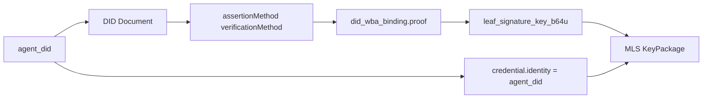
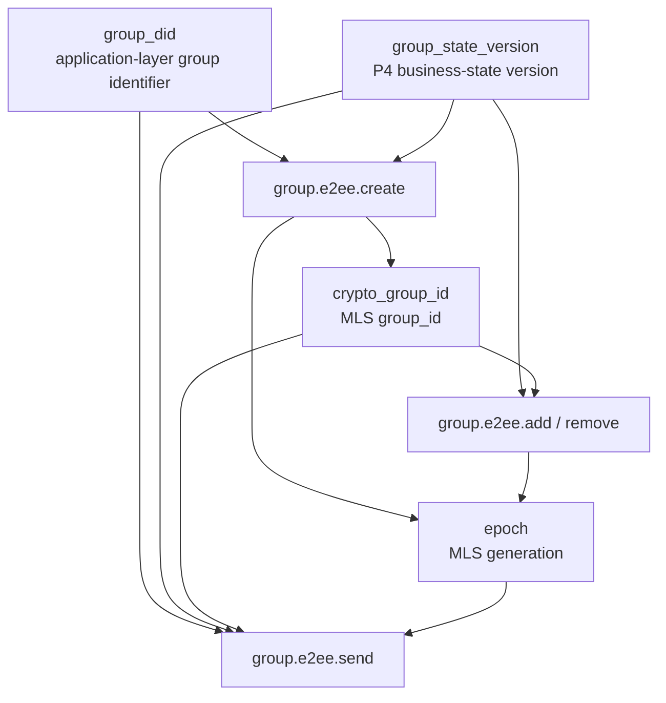
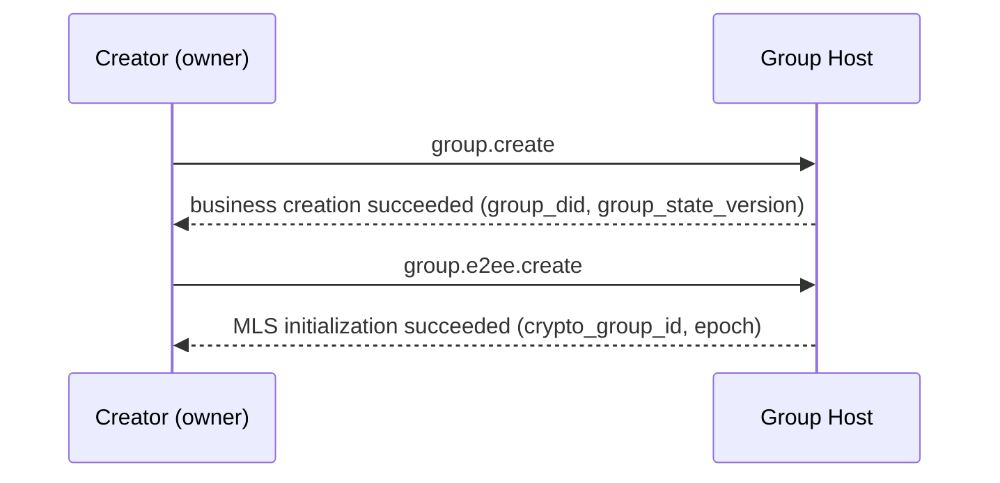
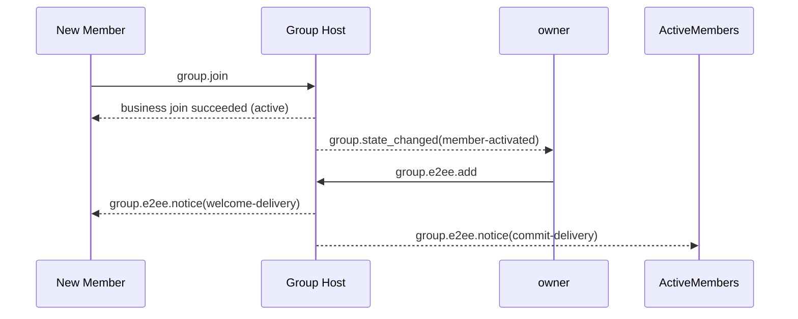
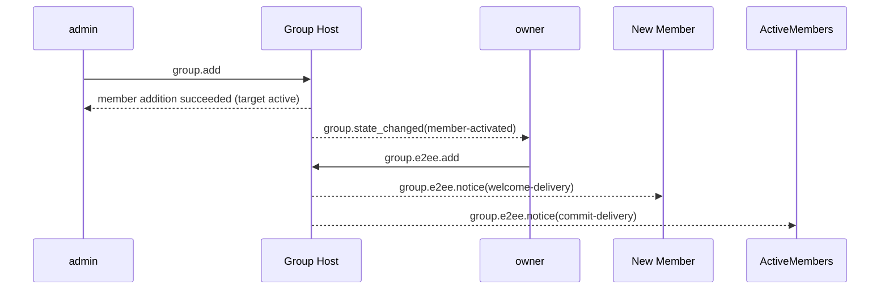
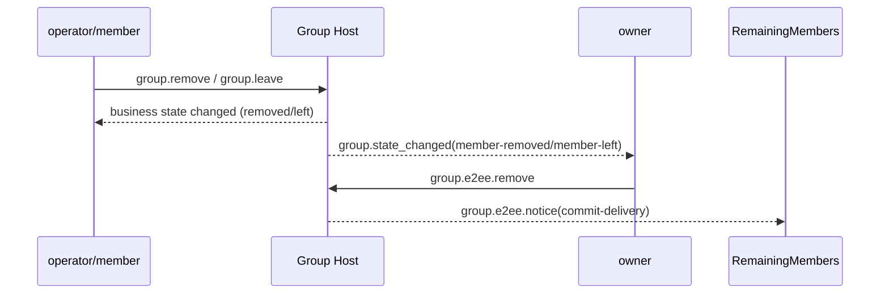
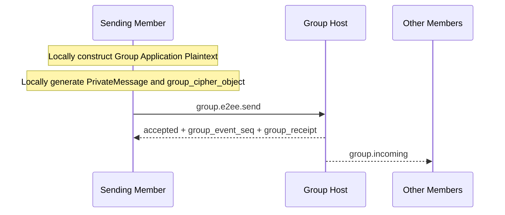
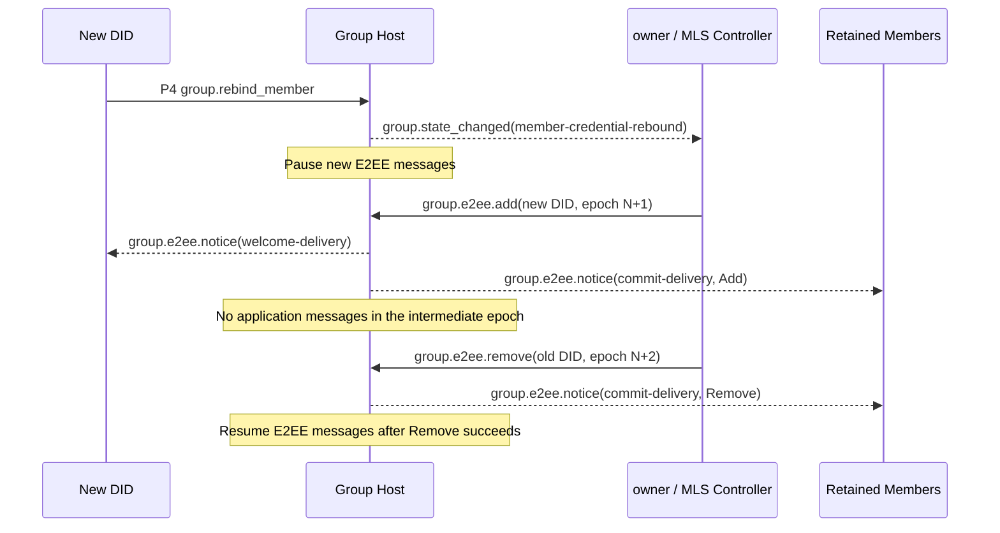

> 日本語参考訳（機械翻訳・未校閲）。規範となるのは原文です。コード例・識別子・規範キーワードは原文を保持しています。
> 原文: [deprecated/06-group-end-to-end-encryption.md](../../deprecated/06-group-end-to-end-encryption.md) / 基準コミット: `0837cfdfaf4ddcf834f0890ddaf34fc4c824e066`

# ANPプロファイル6:グループエンドツーエンド暗号化

- 文書ID: ANP-P6
- タイトル:グループエンドツーエンド暗号化
- ステータス: リリース
- バージョン: 1.1
- 原文言語: English / このページは日本語参考訳
- 応用性:このプロフィールはグループDIDに基づいてグループのエンドツーエンドの暗号化制御層のために適しています、密接に働くこと `anp.group.base.v1`.

---

## 1. 目的:

このプロファイルは、ANPのグループエンドツーエンド暗号化制御レイヤーを定義します。

1. 結合する方法 `group_did`, `group_state_version`と `group_event_seq` グループ暗号化状態機械に。
2. グループキーの確立、メンバーの変更およびアプリケーションメッセージ保護のための基本的なプロトコルとしてMLSを使用する方法;
3. 結合する方法 `did:wba` MLS 会員資格、KeyPackage、および葉署名キーのアイデンティティ。
4. 独立したセットを定義する方法 `group.e2ee.*` JSON-RPC メソッドは、MLS の暗号アクションを具体的に運ぶ。
5. 密接に働く方法 `anp.group.base.v1` とりあえず **ステートカップリング** 代わりに「P4メソッドでMLSハンドシェイクオブジェクトを埋め込む」;
6. 対処方法 `epoch`, `Welcome`, `PrivateMessage`, `PublicMessage`, `epoch_authenticator`、フォークの検出および回復。
7. 注文したMLSの葉を交換する方法 `group.e2ee.add` とりあえず `group.e2ee.remove` P4 以降は、ハンドルバックメンバーの DID が再結合されます。

このプロファイルは定義しません。

- 履歴メッセージを引き受ける。
- オンラインでのステータスを読んでください。
- デバイスまたは内部のコピーコンセプト;
- エージェント内の複数の実行単位でグループキーステータスを共有する方法
- グループ外でのディレクトリ同期の特定の実装。
- グループ以外のシナリオのためのエンドツーエンド暗号化;
- 外的なコミットの本管;
- `group_join_info` とりあえず `group.e2ee.get_join_info`;
- `accept_welcome` プロトコルメソッド;
- 会員ステータスモデルの2セット。
- 失われた歴史MLSのエポック秘密の回復または再配布。

---

## 2. 用語集と定款

### 2.1 仮説キーワード

この記事では、 **MUST**, **MUST NOT**, **REQUIRED**, **SHALL**, **SHALL NOT**, **SHOULD**, **SHOULD NOT**, **RECOMMENDED**, **NOT RECOMMENDED**, **MAY**, **OPTIONAL** 資本金を基準とした規範的な要件として解釈されます。

### 2.2 用語集

- **グループID**: グループのアプリケーションレイヤーグローバル識別子、つまり `group_did`.
- **暗号グループID**: グループの暗号化内部識別子、MLS対応 `group_id`、と異なってもいいです `group_did`.
- **グループホストサービス**: グループ基本ステータスの注文、ポリシーアプリケーション、グループメッセージの入力を担当するサービスです。MLS コントローラではなく、
- **MLSグループの状態**: MLS に基づくグループ暗号化状態を維持
- **エスポック**: MLSグループ状態の世代別進出
- **キーパッケージ**: マテリアルオブジェクトを追加するMLS、グループに新しいメンバーを追加するために使用される。
- **おすすめ**: MLS のウェルカムオブジェクトは、グループの状態を初期化するために新しいメンバーを助けるために使われます。
- **プライベートメッセージ**: 会員認証でMLSメッセージを暗号化しました。
- **パブリックメッセージ**: 署名されたものだけで暗号化されていないMLSメッセージ。
- **行なった:wbaの結合**: MLS の葉署名キー、メンバー認証、または KeyPackage を検証可能な証拠オブジェクトに結合 `agent_did`.
- **MLS のコントローラー**: MLSメンバー変更のコントロールアクションを実行するための責任 グループ固定 `owner` v1 で。
- **州のカップリング**: P4とP6はメソッドによるマッピングではなく、ビジネス状態の変化を通した暗号状態の進歩をトリガーするカップリング方法はありません。
- **E2EE 通知**: P6 の自己定義された独立した暗号化通知オブジェクト、などの暗号結果を提供するために使用されます `commit` とりあえず `welcome`.
- **フォーク**: 不安定なシーケンス `epoch` / `epoch_authenticator` / 同一メンバーの異なるメンバーがステータスの推移を観察 `group_did`.
- **MLSメンバー認証レバインド**: P4 が同じハンドルメンバーに DID をリバインドするのを承諾した後、MLS リーフを 2 つのオーダー コミットで置き換える暗号オーケストレーション: `group.e2ee.add(new DID)` フォロー `group.e2ee.remove(old DID)`.

---

## 3. デザイン原則

### 3.1 グループアイデンティティと暗号ステータスのストラテジー

このプロフィールは、以下の点を明らかに区別します。

- `group_did`: アプリケーションレイヤーグループグローバル識別子;
- `crypto_group_id`: 暗号化グループ内部識別子;
- `group_state_version`: グループホストが指定したアプリケーションレイヤーグループの状態バージョン。
- `epoch`: MLS ステートマシンが割り当てられたクリプトソロジーグループ生成。

4人で MUST NOT 機械的に等しくなる。しかしそこに MUST それらの間に検証可能な結合である。

### 3.2 エージェント = 外部グループのメンバー

このプロファイルの外部相互運用性境界内で、MLSメンバーは常に現在のところ代表されます。 `agent_did`. . . P4の任意 `member_handle` 安定したビジネスマンシップアンカーですが、 **MUST NOT** MLS の現在の DID を取り替えて下さい `credential.identity`. . . プロトコルレイヤーは、デバイス、端末、ローカルユーザーID、または内部のレプリカメンバーを紹介しません。

エージェント内で複数の実行コピーがある場合、MLS グループの状態を共有または同期する方法は、エージェントの内部実装に属し、このプロファイルの相互運用性に所属しません。

### 3.3 P4は主要なビジネス プロトコルであり、P6は暗号化制御の層です

このプロフィールとの間の関係 `anp.group.base.v1` 以下は、

- P4は、グループにおける経営行動、ビジネス状態、秩序や領収書のセマティクスを定義します。
- P6 は MLS の暗号行為、暗号オブジェクト、結合ルールおよび検証要件を定義します。
- P4は、まだビジネス層の権限です。
- プチ6 **しない** 上記のようなビジネス会員のステータスを赤化 `active / left / removed`;
- P6 は、PS4 メソッド本体に直接 MLS のネイティブオブジェクトを直接実行する必要はありません。

### 3.4 メソッドによるマッピングではなく、ステートカップリング

P4とP6のカップリングは、 **ステート**, "特定のP4メソッドを直接特定のP6メソッドをマッピングする"ではなく、

具体的に:

- P4は、ビジネス用語で何かが有効であるかを決定します。
- P6は、事業状態の変化を観察し、それに応じてMLS状態を進歩させます。

たとえば:

- P4 でグループが正常に作成され、クリエイターは `owner` → 所有者は自動的に実行します `group.e2ee.create`
- 会員が `active` P4 では、まだ MLS のメンバーシップ セット → 所有者が自動的に実行されていない `group.e2ee.add`
- 会員が `left` または `removed` P4 では、まだ MLS のメンバーシップ セット → 所有者が自動的に実行されます `group.e2ee.remove`
- ハンドル・バック・メンバーが生成する `member-credential-rebound` 旧DIDの葉がMLS会員セット→所有者に自動的に残っている間P4 `group.e2ee.add(new DID)` そして、それが成功した後、 `group.e2ee.remove(old DID)`

### 3.5 オーナーは MLS のコントローラーだけです

v1 では、所有者は MLS のコントローラーの役割を想定しているだけ。

オーナーは、以下の責任を負います。

- MLS グループを作成する。
- 実行する `add`;
- 実行する `remove`;
- 会員資格のリバインドを注文 `add(new DID)` とりあえず `remove(old DID)`;
- 生成する `commit` 会員の変更に対応
- 生成する `welcome` 新規会員の場合
- アドバンス `epoch` 会員変更後。

P6のコアアイデアは、MLSオブジェクトをP4メソッドボディに置くことはないが、暗号化状態をビジネスの状態と共に進歩させるようにする。 以下の図は、読者が以下の詳細な制約を読む前に方法間の因果関係を理解することができるように、この状態のカップリングを要約します。

```mermaid
flowchart TB
P4[P4 business-state changes<br/>group.create / member active / member left or removed / credential rebound]
OBS[owner observes business state]

CREATE[group.e2ee.create]
ADD[group.e2ee.add]
REMOVE[group.e2ee.remove]
REBIND_ADD[group.e2ee.add(new DID)]
REBIND_REMOVE[group.e2ee.remove(old DID)]

HOST[Group Host]
NOTICE[group.e2ee.notice]

P4 --> OBS
OBS -->|group created and has no crypto_group_id yet| CREATE
OBS -->|member active and not yet in MLS| ADD
OBS -->|member left or removed and still in MLS| REMOVE
OBS -->|Handle member rebound and old leaf still in MLS| REBIND_ADD

CREATE --> HOST
ADD --> HOST
REMOVE --> HOST
REBIND_ADD --> HOST
REBIND_ADD -->|execute after rebind Add is accepted| REBIND_REMOVE
REBIND_REMOVE --> HOST

HOST --> NOTICE
```

*図P6-1: P4/P6状態のカップリング(非放射性)の概要。*

この図は、新しいビジネスステートマシンではなくトリガー関係を強調します。P4 は、事業レイヤーの権限を保持し、P6 はそれらの事業結果を観察し、MLS が作成/追加/削除する操作としてそれらを材料化します。

### 3.6 グループ ホストは、注文を担当し、MLS 制御に責任を負わない

グループホストサービスの責任は次のとおりです。

- P4事業の受入・発注
- ソリューション `group_event_seq` 受付けたイベント
- アドバンス `group_state_version`;
- 生成 `group_receipt`;
- グループメッセージとE2EE通知を配信する。
- 業務レイヤーでMLS制御結果の実装を一目瞭然。

デフォルトでは、グループホストサービス:

- **SHOULD NOT** MLS のコントローラーとして機能して下さい;
- **SHOULD NOT** MLSグループメンバーとして機能する。
- **SHOULD NOT** グループアプリケーションプレーンテキストの復号化機能を保持します。

### 3.7 所有者はグループの状態を管理します。, アクティブなメンバーはグループメッセージを管理する

オーナーは、以下の操作のみを制御します。

- 会員の変更
- グループ暗号状態の高度化;
- 更新情報 `epoch`.

全て すべて `active` 会員は、次のことができます。

- 現在のグループの状態を使用して、独自のグループメッセージの暗号文を生成する。
- コールセンター `group.e2ee.send` 独自のグループメッセージを送信する
- 他のメンバーのグループメッセージを復号化します。

このプロファイルは、すべてのグループメッセージが所有者によって暗号化されることを必要としません。

### 3.8 v1は外部コミットをサポートしていません

v1 で:

- 外部コミットはサポートされていません。
- `group_join_info` 定義されていない;
- `group.e2ee.get_join_info` 定義されていない;
- とりあえず `accept_welcome` プロトコルメソッドは定義されていません。

すべてのグループエントリーパスは、最終的にMLSに統一されます `add` 暗号層の所有者によって開始される。

### 3.9 メッセージ側のみがPrivateMessageに入ります

v1 で:

- アプリケーションのメッセージ内容だけ `group.e2ee.send` MLS を入力してください `PrivateMessage` 暗号化される
- `group.e2ee.create`, `group.e2ee.add`と `group.e2ee.remove` 今後もプレーンテキストJSON-RPCリクエストボディの活用を続け、オーケストレーションの再編 `add` とりあえず `remove` 新規リクエストメソッドを定義し、
- オブジェクトなど `commit` とりあえず `welcome` P4ビジネスメソッドボディに埋め込まれる代わりに、メソッドの入力や通知ペイロードとして表示されます。

---

## 4. 依存性、プロファイル識別およびターゲットモデリング

### 4.1 プロフィール名

このプロファイルの標準的な名前は、次のとおりです。

`anp.group.e2ee.v1`

### 4.2 依存関係

プロフィール **MUST** 下記のプロフィールによります。

- `anp.core.binding.v1`
- `anp.identity.discovery.v1`
- `anp.group.base.v1`

### 4.3 セキュリティプロファイル

このページの先頭へ:

- `meta.profile` **MUST** 等しいです `anp.group.e2ee.v1`.

それらの中で:

- `group.e2ee.publish_key_package`, `group.e2ee.get_key_package`, `group.e2ee.notice` **MUST** 利用条件 `transport-protected`
- `group.e2ee.create`, `group.e2ee.add`, `group.e2ee.remove`, `group.e2ee.send` **MUST** 利用条件 `group-e2ee`

のために `group.e2ee.send`, `group-e2ee` グループE2EE側に属するメッセージのセマティクスを意味します。それは、その外部JSON-RPCリクエストボディが再びグループによって暗号化されるという意味ではありません。

### 4.4 方法ターゲットモデリング

### 4.4.1 サービススコープ

次の方法 **MUST** は、 `service-scoped`:

- `group.e2ee.publish_key_package`
- `group.e2ee.get_key_package`
- `group.e2ee.create`

ルール:

- `meta.target.kind = "service"`
- `meta.target.did` **MUST** 等しいターゲット 公共 `ANPMessageService.serviceDid`

理由はなぜ `group.e2ee.create` サービススコープを使用する:
成功の前の `group.create` 経営層に、グループが持つ事業状態が確立されました。 ですが、 `group_did` 生成された、作成アクション自体はグループホストサービス入り口の暗号化初期化をまだ完了しています。そのため、v1はサービススコープを均一に使用しています。

### 4.4.2 グループアドレス

次の方法 **MUST** は、 `group-addressed`:

- `group.e2ee.add`
- `group.e2ee.remove`
- `group.e2ee.send`

ルール:

- `meta.target.kind = "group"`
- `meta.target.did` **MUST** 等しいターゲット `group_did`

### 4.4.3 エージェントが通知をアドレス指定

下記の通知 **MUST** は、 `agent-addressed`:

- `group.e2ee.notice`

ルール:

- `meta.target.kind = "agent"`
- `meta.target.did` **MUST** 通知受信者エージェント DID に等しい

---

## 5. 暗号メインラインとMTIスイート

### 5.1 主流プロトコル

プロフィールのグループキーの本管 **MUST** MLS 1.0 のセマンティックスに基づいて実装されますが、v1 は制限された使用サブセットのみを固定します。

v1 のメインラインは、少なくとも次のものを含んでいます:

- キーパッケージ
- アクセサリー
- 削除
- コンテンツ
- おすすめ
- プライベートメッセージ
- エッチングの進歩

ハンドルバックされたメンバーの資格再バインドは、新しいP6方法と新しいMLSプリミティブの両方を導入していません。 初めて利用する `group.e2ee.add` 新しくDIDの葉をコミットし、次に使用するために `group.e2ee.remove` 古いDIDの葉の除去をコミットする。

それらの中で:

- `commit_b64u` **MUST** 完全なMLSの生バイトとして表される `MLSMessage` (`mls-public-message`) TLSによってシリアライズされる;
- `welcome_b64u` **MUST** MLSの生バイトとして表される `Welcome` TLS でシリアライズされたオブジェクト。
- `PrivateMessage` **MUST** グループアプリケーションメッセージの唯一の ciphertext ベアラーオブジェクトとして機能します。

MLSライブラリ **MAY** 標準的な機能も追加でサポート `Update`, 提案のバッチ処理, PSK, そして、ReInit; しかしながら, これらの機能 **所属しない** このプロファイルv1の最小プロトコルメインラインに、v1の相互運用性要件を構成していません。

### 5.2 必須-ツー・イポメンドスイート

最小限の相互運用性を確保するために、このプロファイルに準拠した実装 MUST 以下のMTIパッケージをサポート:

`MLS_128_DHKEMX25519_AES128GCM_SHA256_Ed25519`

### 5.3 追加スイート

導入事例 **MAY** MLS スイートをもっとサポートします。

- 同じグループ内のすべてのメンバー **MUST** 使用されるキットに同意します。
- グループポリシー制限により、パッケージコレクションが許可されている場合、MLS コントローラー **MUST** 方針に満足しないパッケージを拒否します。

### 5.4 と関連した:wba

このプロフィールとwbaのメインラインの関係は、次の通りです。

- `authentication`/`assertionMethod` DID 文書では、ID の証拠を結合するために使用されます;
- `keyAgreement` **SHOULD** DID ドキュメントには、エージェントが E2EE 機能を持っていることを示す少なくとも 1 つの X25519 エントリが含まれている。
- MLSグループメンバーの葉署名キー **ショーン** DID の長期署名キーと直接等しいこと;
- 葉の署名キー **SHOULD** 別々に生成され、境界線を `agent_did` ビア `did:wba Binding`.

---

## 6. ウィバとMLSの結合モデル

### 6.1 結合ターゲット

このプロファイルは、次のMLS要素をバインドする必要があります `agent_did`:

1. KeyPackage オーナー;
2. 現在の葉の署名キー;
3. グループメンバーの資格情報にアイデンティティ文字列を入力します。

### 6.2 犯罪者ID規則

このページのトップへ `credential.identity` MLSメンバー資格 **MUST** 同じく、その葉の現在のUTF-8バイト文字列 `agent_did`. . . ハンドル **MUST NOT** 書き込むか、または取り替えて下さい `credential.identity`.

導入事例 **MUST NOT** 交換する `credential.identity` ローカルアカウントID、デバイスID、数値ユーザID、その他非DID文字列で。

### 6.3 `did_wba_binding` オブジェクト

このプロファイルは、 `did_wba_binding` MLS の葉署名キーを結合するのに使用されるオブジェクト `agent_did`.

推奨構造は以下の通りです。

```json
{
  "agent_did": "did:wba:example.com:agents:alice:e1_<fingerprint>",
  "verification_method": "did:wba:example.com:agents:alice:e1_<fingerprint>#key-1",
  "leaf_signature_key_b64u": "BASE64URL_ED25519_LEAF_PK",
  "issued_at": "2026-03-29T12:00:00Z",
  "expires_at": "2026-04-29T12:00:00Z",
  "proof": {
    "type": "DataIntegrityProof",
    "cryptosuite": "eddsa-jcs-2022",
    "created": "2026-03-29T12:00:00Z",
    "proofPurpose": "assertionMethod",
    "verificationMethod": "did:wba:example.com:agents:alice:e1_<fingerprint>#key-1",
    "proofValue": "z..."
  }
}
```

`did_wba_binding.proof` **MUST** 共有の再利用 **オブジェクトの証拠のプロフィール** P1 付録 B で定義される。

のために `did_wba_binding`:

- 発行者 DID **MUST** は、 `agent_did`
- 保護された文書 **MUST** 全体として `did_wba_binding` 取除の後の目的 `proof`
- `proof.verificationMethod` **MUST** 認証方法のポイント `assertionMethod` で、 `agent_did` DID ドキュメント

### 6.4 `did_wba_binding` 検証ルール

受取人 MUST KeyPackage、Fリーフノードの更新、または新規メンバーを受け入れる前に、次の検証を完了します。

1. `agent_did` 解析することができます。
2. `verification_method` DID ドキュメントに存在する。
3. `verification_method` **MUST** 認定される `assertionMethod` DID 文書の;
4. `proof` **MUST** 存在し、 **MUST** P1付録Bの共有オブジェクトプルーフプロファイルを満たします。
5. 発行者 DID **MUST** のり `proof` 等しいです `agent_did`;
6. `proof` 認証が渡された;
7. ドキュメントコンテンツが境界線に `proof` **MUST** カバー少なくとも `agent_did`, `verification_method`, `leaf_signature_key_b64u`, `issued_at`と `expires_at`;
8. KeyPackage/Fリーフノードの実際の葉署名公開鍵は、一貫性のあるものです。 `leaf_signature_key_b64u`;
9. `credential.identity` MLS 証明書は、MLS 証明書と一致しています。 `agent_did`;
10. 場合 `issued_at` / `expires_at` 存在し、実行する **MUST** ローカルタイムの有効期間ポリシーに従って、時刻ウィンドウを検証します。

P6 は定義します `did_wba_binding` MLS の葉署名キーは DID の長期同一証明鍵と直接一致しないべきではないですので。 次の図は、 `agent_did`, DID ドキュメント, 結合オブジェクト, KeyPackage/ `credential.identity` 読者が確認の順序を理解できるように。



*図P6-2:wbaとMLS結合チェーン(非放射性)をしました。*

検証中に、受信者は内部の MLS 署名が有効であることを確認するだけでなく、 また、このチェーンに従うべきことを確認し、 `credential.identity`、葉の署名キーおよび `agent_did` 完全に境界線です。

### 6.5 `e1_` と互換性があります `k1_`

- デフォルトでは `e1_` ドイド, `did_wba_binding.proof` **MUST** P1付録Bの共有オブジェクトプルーフプロファイルを再使用します。
- 互換性のあるため `k1_` ドイド, `did_wba_binding.proof` **MAY** 明示的な拡張交渉によって定義される代替オブジェクトプルーフプロファイルを使用します。 しかし、明示的なエクステンション交渉がないとき、v1 MTI **しない** ビーコン `k1_` デフォルトでインターワーキング・パスとして証拠;
- MLSグループのためのMTIの葉の署名キーはまだ **MAY** 結合の証拠が保持する限り、DIDのアイデンティティ・カーブに関係なくEd25519を使用して下さい。

---

## 7. コアオブジェクト

### 7.1 `crypto_group_id`

`crypto_group_id` MLSの内部を表します `group_id`.

ルールは以下の通りです。

- `crypto_group_id` **MUST** 不透明バイトとして扱われる;
- JSON では、 **MUST** によって表現される `base64url`フィールド名は、 `crypto_group_id_b64u`;
- `crypto_group_id` **MUST** 検証可能な結合を確立する `group_did`.

### 7.2 `group_state_ref`

このページの先頭へ `group_state_ref` P4の概念は、E2EEグループが少なくとも含まれていることを要求します。

- `group_did`
- `group_state_version`
- `policy_hash` (グループポリシーがハッシュされた場合)

グループE2EEでは、リーダーは異なるレイヤーで4つの識別子/バージョン間で誤った精神モデルを簡単に接続できます。グループID、ビジネスステートバージョン、暗号化内部グループID、およびMLSのEPOC。 以下は、ソースと進歩関係を1つのビューに置きます。



*図P6-3:関係性 `group_did`, `crypto_group_id`, `group_state_version`と `epoch` (非放射性)。*

後続のオブジェクト構造と検証ルールを読むときは、これらの4つの値を異なるレイヤーから座標として扱います。それらはバインドする必要がありますが、互いに交換してはならないため、同じ値として機械的に処理されるべきではありません。

### 7.3 `group_key_package`

このプロファイル定義グループは、材料包装オブジェクトを追加します。

```json
{
  "key_package_id": "kp-001",
  "owner_did": "did:wba:example.com:agents:bob:e1_<fingerprint>",
  "suite": "MLS_128_DHKEMX25519_AES128GCM_SHA256_Ed25519",
  "mls_key_package_b64u": "BASE64URL_KEYPACKAGE",
  "did_wba_binding": { ... },
  "expires_at": "2026-04-30T00:00:00Z"
}
```

それらの中で:

- `key_package_id` **MUST** 存在;
- `owner_did` **MUST** 存在;
- `suite` **MUST** 存在;
- `mls_key_package_b64u` **MUST** 存在;
- `did_wba_binding` **MUST** 存在;
- `expires_at` **SHOULD** 存在;
- `mls_key_package_b64u` **MUST** MLSの生バイトのためのno-padding base64url `KeyPackage` MLS 1.0 TLS によるシリアライズ後のオブジェクト。

`group_key_package` 主に所有者が実行するために使用されます `group.e2ee.add`.

### 7.4 `group_cipher_object`

`group_cipher_object` のワイヤー プロトコル メッセージ ボディ オブジェクトです。 `group.e2ee.send`.

推奨構造は以下の通りです。

```json
{
  "crypto_group_id_b64u": "BASE64URL_GROUPID",
  "epoch": "7",
  "private_message_b64u": "BASE64URL_PRIVATEMESSAGE",
  "group_state_ref": {
    "group_did": "did:wba:groups.example:team:dev:e1_<fingerprint>",
    "group_state_version": "42",
    "policy_hash": "sha-256:..."
  },
  "epoch_authenticator": "BASE64URL_AUTH"
}
```

ルール:

- `crypto_group_id_b64u` **MUST** 存在;
- `epoch` **MUST** 存在;
- `private_message_b64u` **MUST** 存在;
- `private_message_b64u` **MUST** MLSの生バイトのためのno-padding base64url `PrivateMessage` MLS 1.0 TLS でシリアル化されたオブジェクト。
- `group_state_ref.group_did` **MUST** 外部ターゲットに等しくなる `group_did`.

### 7.5 `Group Application Plaintext`

グループアプリケーションメッセージが MLS に入る前に `PrivateMessage` 暗号化, **MUST** 次の内文脈オブジェクトに正規化される:

```json
{
  "application_content_type": "text/plain | application/json | application/anp-attachment-manifest+json | ...",
  "thread_id": "thr-001",
  "reply_to_message_id": "msg-0009",
  "annotations": {},
  "text": "...",
  "payload": {},
  "payload_b64u": "..."
}
```

ルール:

- `application_content_type` **MUST** 存在;
- 正確に 1 つ `text`, `payload`, または `payload_b64u` **MUST** プレゼント
- メッセージのセマンティックフィールド `thread_id`, `reply_to_message_id`と `annotations` で P4 **MUST** グループE2EEの下の内部の目的にある;
- 送信者 **MUST** 全体にシリアライズ `Group Application Plaintext` 暗号化前のUTF-8 + RFC 8785 JCSを使用してバイト文字列にオブジェクト; 受信機 **MUST** 復号後に同じルールに従ってオブジェクトを解釈します。

いつか `application_content_type = "application/json"`, `payload` **MUST**
JSON オブジェクトを直接運ぶ。 このプロフィールは、事業の意味を定義しない
そのオブジェクト内のフィールド。

通常のJSONグループアプリケーションプレーンテキスト例:

```json
{
  "application_content_type": "application/json",
  "thread_id": "thr-001",
  "payload": {
    "type": "example",
    "data": {
      "hello": "group"
    }
  }
}
```

### 7.6 `e2ee_notice_object`

P6 は、暗号化結果を提供するために使用される独立した暗号通知オブジェクトを定義します。

推奨構造は以下の通りです。

```json
{
  "notice_id": "en-001",
  "notice_type": "commit-delivery | welcome-delivery",
  "group_did": "did:wba:groups.example:team:dev:e1_<fingerprint>",
  "group_state_ref": {
    "group_did": "did:wba:groups.example:team:dev:e1_<fingerprint>",
    "group_state_version": "43",
    "policy_hash": "sha-256:..."
  },
  "crypto_group_id_b64u": "BASE64URL_GROUPID",
  "epoch": "8",
  "subject_did": "did:wba:b.example:agents:bob:e1_<fingerprint>",
  "subject_status": "active | removed",
  "commit_b64u": "BASE64URL_MLSMESSAGE",
  "welcome_b64u": "BASE64URL_WELCOME",
  "ratchet_tree_b64u": "BASE64URL_RATCHET_TREE",
  "epoch_authenticator": "BASE64URL_AUTH",
  "group_receipt": { ... }
}
```

ルール:

- `notice_type` **MUST** 存在;
- `group_did` **MUST** 存在;
- `group_state_ref` **MUST** 存在;
- `crypto_group_id_b64u` **MUST** 存在;
- `epoch` **MUST** 存在;
- `commit_b64u` **MUST** いつか存在している `notice_type = "commit-delivery"` プレゼント
- いつか `notice_type = "welcome-delivery"`, `welcome_b64u` とりあえず `ratchet_tree_b64u` **MUST** 同時に存在します。
- クレデンシャル・レバインドのオーケストレーションで制作された通知については、 `group_state_ref` **MUST** 正確に受け入れられたP4を参照して下さい `member-credential-rebound` P6 の操作で使われるイベント 受信機 **MUST** 重複したP6連続フィールドではなく、P4イベントからハンドル、結合生成、以前のID、および新しいDIDを取得。
- `subject_did` とりあえず `subject_status` この特定のP6操作によって影響される葉を記述して下さい:加えて下さい新しいDIDを使用して下さい `active`, 削除時に、以前の DID を 使った DID を使用する `removed`;
- `ratchet_tree_b64u` **MUST** ラチェットツリーのTLSシリアライズのための未加工バイトのno-padding base64urlである;
- `group_receipt` **MAY** 仮想通貨の取引状況をビジネス注文の場所と関連付ける存在です。

---

## 8. KeyPackage 公開と発見方法

### 8.1 `group.e2ee.publish_key_package`

#### 8.1.1 統計学

エージェントが露出したままに公開 `ANPMessageService`、グループ結合に使用できるKeyPackage。

#### 8.1.2 要求の要件

- `method = "group.e2ee.publish_key_package"`
- `meta.profile = "anp.group.e2ee.v1"`
- `meta.security_profile = "transport-protected"`
- `meta.target.kind = "service"`
- `meta.target.did` **MUST** 出版社の公開と等しい `ANPMessageService.serviceDid`
- `meta.sender_did` **MUST** 存在している
- `body.group_key_package` **MUST** 存在している
- `body.group_key_package.owner_did` **MUST** 等しく `meta.sender_did`

認証制約:

- このメソッドは、 **サービススコープ** 制御計画方法;
- 呼び出し者 **MUST** 認証されたローカルセッションまたは同等のホップとサービスレベルの認証コンテキストで実行されます。
- v1 は **なし** 追加のビジネスレイヤーが必要です `origin_proof` こんな方法。

#### 8.1.3 成功的な応答

成功する応答 **MUST** 少なくとも:

- `published = true`
- `owner_did`
- `key_package_id`
- `published_at`

### 8.2 `group.e2ee.get_key_package`

#### 8.2.1 科学

対象となるエージェントの対象エージェントから利用可能なKeyPackageを入手 `ANPMessageService`.

#### 8.2.2 要求の要件

- `meta.profile = "anp.group.e2ee.v1"`
- `meta.security_profile = "transport-protected"`
- `meta.target.kind = "service"`
- `meta.target.did` **MUST** 等しいこと `ANPMessageService.serviceDid` ターゲットエージェントが露出

`body` **MUST** 含まれるもの:

- `target_did`

`body` **MAY** 含まれるもの:

- `preferred_suite`
- `require_fresh`

認証制約:

- このメソッドは、 **サービススコープ** 制御計画方法;
- v1 最小相互運用性要件は、少なくともホップ/サービスレベルの認証です。
- **KeyPackageの匿名検索はv1 MTIの一部です**.

#### 8.2.3 成功の応答

成功する応答 **MUST** 少なくとも:

- `target_did`
- `group_key_package`

#### 8.2.4 サーバー側の配布ルール

`ANPMessageService` 返還する時 `group_key_package`:

- **SHOULD** 期限が切れていないKeyPackageを返す, 再発されていないと消費されない;
- サーバ **MAY** マークとして `reserved`、または同時再発行を避けるために、返された後の同等のステータスを割り当てる。
- 対応するタイミング `group.e2ee.add`、リバインドのオーケストレーションの追加ステップを含む、グループホストと暗号会員の変更が正常に受け入れられています。 **MUST** マークとして `consumed` 公開セットから削除するか
- 対応するプロセスが失敗した場合は、キャンセルまたは消去され、予約済みKeyPackageのリリースは展開固有のものですが、 **SHOULD NOT** 同じKeyPackageが2つの成功によって同時再使用されるようにする `group.e2ee.add` 業務;
- コールワーID、レート制限およびアンチユースポリシー **MUST** ホップ/サービスレベルの認証に基づく実装

---

## 9. MLS制御計画法

### 9.1 一般

この章のメソッドは独立系JSON-RPCメソッドです。 P4 のビジネスメソッドに「追加フィールド」ではなく、P6 独自の暗号化制御アクションです。

それらの中で:

- `group.e2ee.create`, `group.e2ee.add`と `group.e2ee.remove` は、 **会員変更の制御方法**
- `group.e2ee.send` は、 **メッセージ送信方法**
- `group.e2ee.create/add/remove` 既存のP4ビジネス状態にバインドされるが、 **新規P4ビジネスメンバーのステートを作成しない**
- `group.e2ee.send` 直接オンライン配達方法として、二次包装なしで使用されます `group.send`

### 9.2 `group.e2ee.create`

#### 9.2.1 科学

新規のMLSグループステートを作成し、初期メンバーとしてオーナーを追加します。

#### 9.2.2 コールア

オーナーのみ。

#### 9.2.3 要求の要件

- `method = "group.e2ee.create"`
- `meta.profile = "anp.group.e2ee.v1"`
- `meta.security_profile = "group-e2ee"`
- `meta.target.kind = "service"`
- `meta.target.did` **MUST** 等しいこと `ANPMessageService.serviceDid` 対象グループホストによる露出
- `meta.sender_did` **MUST** 現在のグループに等しくなる `owner`
- `auth.origin_proof` **MUST** 存在している

`body` **MUST** 少なくとも:

- `group_did`
- `group_state_ref`
- `suite`
- `creator_key_package`
- `crypto_group_id_b64u`
- `epoch`

ルール:

- `creator_key_package.owner_did` **MUST** 等しく `meta.sender_did`
- `group_state_ref.group_did` **MUST** 等しく `body.group_did`
- `epoch` 初期グループの状態の場合 **SHOULD** は、 `"0"` または初期値が明示的に実装によって合意された

#### 9.2.4 応答の成功

成功する応答 **MUST** 少なくとも:

- `created = true`
- `group_did`
- `group_state_ref`
- `crypto_group_id_b64u`
- `epoch`
- `accepted_at`

注意:

- `group.e2ee.create` まあ、 **MUST NOT** P4 の新しい事業グループを作成します。
- 実行後のみ実行されます。 `group.create` 営業層の受入れを受けています。
- 新規生成がなくなりました `group_state_version` または `group_event_seq` 独立して。

### 9.3 `group.e2ee.add`

#### 9.3.1 統計

オーナーがMLSを実行 `add` 会員を新規登録する `active` 営業層にはまだ暗号化グループにセットされているMLS会員を入力していません。

#### 9.3.2 コールア

オーナーのみ。

#### 9.3.3 要求の要件

- `method = "group.e2ee.add"`
- `meta.profile = "anp.group.e2ee.v1"`
- `meta.security_profile = "group-e2ee"`
- `meta.target.kind = "group"`
- `meta.target.did` **MUST** 等しいターゲット `group_did`
- `meta.sender_did` **MUST** 現在のグループに等しくなる `owner`
- `auth.origin_proof` **MUST** 存在している

`body` **MUST** 少なくとも:

- `member_did`
- `group_state_ref`
- `group_key_package`
- `crypto_group_id_b64u`
- `epoch`
- `commit_b64u`
- `welcome_b64u`
- `ratchet_tree_b64u`

ルール:

- `group_state_ref.group_did` **MUST** 等しい外ターゲット `group_did`
- `group_key_package.owner_did` **MUST** 等しく `member_did`
- `commit_b64u` **MUST** 完全なMLSのための no-padding base64url `MLSMessage` TLS によるオブジェクトのシリアル化
- `welcome_b64u` **MUST** MLS の no-padding base64url は、 `Welcome` TLSによるシリアライズ後のオブジェクト
- `ratchet_tree_b64u` **MUST** ラチェットツリーのTLSシリアライズのための未加工バイトの no-padding base64url
- `epoch` **MUST** 新規に表示する `epoch` あとは `add`
- 通常の参加パスでは、 `member_did` **MUST** は、P4 `active` まだMLS会員セットに入らないID。
- 再結合パスで、 `group_state_ref` **MUST** 正確に受け入れられたP4を参照して下さい `member-credential-rebound` イベント `member_did` **MUST** イベントの事と同じです `subject_did`と新しいKeyPackage **MUST** 新しく DID を結合する。
- 再結合パス `group.e2ee.add(new DID)` **MUST** 対応する前の成功 `group.e2ee.remove(old DID)`.

#### 9.3.4 応答の成功

成功する応答 **MUST** 少なくとも:

- `accepted = true`
- `group_did`
- `member_did`
- `group_state_ref`
- `crypto_group_id_b64u`
- `epoch`
- `accepted_at`

注意:

- `group.e2ee.add` まあ、 **MUST NOT** 対象となるメンバーのP4ビジネス状態を切り替えて `active`;
- 営業状態 **MUST** P4 によって既に決定されている;
- この方法は、MLS に事業成果を実装するだけ責任があります。

### 9.4 `group.e2ee.remove`

#### 9.4.1 統計

オーナーがMLSを実行 `remove` 会員を退会する `removed` または `left` 暗号化グループからビジネスレイヤーで、または受け入れられたハンドルのレバインドオーケストレーションで古いDIDリーフを削除するために。

#### 9.4.2 コールア

オーナーのみ。

#### 9.4.3 要求の要件

- `method = "group.e2ee.remove"`
- `meta.profile = "anp.group.e2ee.v1"`
- `meta.security_profile = "group-e2ee"`
- `meta.target.kind = "group"`
- `meta.target.did` **MUST** 等しいターゲット `group_did`
- `meta.sender_did` **MUST** 現在のグループに等しくなる `owner`
- `auth.origin_proof` **MUST** 存在している

`body` **MUST** 少なくとも:

- `member_did`
- `group_state_ref`
- `crypto_group_id_b64u`
- `epoch`
- `commit_b64u`

ルール:

- `commit_b64u` **MUST** 完全なMLSのための no-padding base64url `MLSMessage` TLS によるオブジェクトのシリアル化
- `epoch` **MUST** 新規に表示する `epoch` あとは `remove`
- 通常の除去パスでは、P4 会員ステータスが対応しています。 `member_did` **MUST** 既に存在している `removed` または `left`;
- 再結合パスは例外です。 `member_did` **MUST** 等しく `previous_subject_did` 参照されたP4で `member-credential-rebound` イベント `group_state_ref` **MUST** 以前成功を収めたとまったく一致 `group.e2ee.add(new DID)`, そして、その追加は既にイベントを追加している必要があります `subject_did`;
- 再結合例外 **MUST NOT** ステータスが残っている任意のメンバーを削除するために使用される `active`.

#### 9.4.4 応答の成功

成功する応答 **MUST** 少なくとも:

- `accepted = true`
- `group_did`
- `member_did`
- `group_state_ref`
- `crypto_group_id_b64u`
- `epoch`
- `accepted_at`

### 9.5 `group.e2ee.send`

#### 9.5.1 統計

直接、MLS暗号化されたグループメッセージをグループに送信します。

#### 9.5.2 コールア

任意の電流 `active` 会員様

#### 9.5.3 要求の要件

コンプライアンス `group.e2ee.send` リクエスト **MUST** 満足する:

1. `method = "group.e2ee.send"`
2. `meta.profile = "anp.group.e2ee.v1"`
3. `meta.security_profile = "group-e2ee"`
4. `meta.target.kind = "group"`
5. `meta.target.did` **MUST** ターゲットになる `group_did`
6. `meta.sender_did` **MUST** 現在の送信者エージェントのIDである
7. `meta.message_id` **MUST** 存在している
8. `meta.operation_id` **MUST** 存在している
9. `meta.content_type` **MUST** 固定される `application/anp-group-cipher+json`
10. `auth.origin_proof` **MUST** 存在している
11. `body` **MUST** 直接運送 `group_cipher_object`

注意:

- `group.e2ee.send` オンライン送信方法自体です。
- P4 で別のレイヤーをラップしなくなった `group.send`.

#### 9.5.4 応答の成功

成功する応答 **MUST** 少なくとも:

- `accepted = true`
- `group_did`
- `message_id`
- `operation_id`
- `group_event_seq`
- `group_state_version`
- `accepted_at`
- `epoch`
- `group_receipt`

成功のセマティクスは言う:

- グループホストは、MLS 暗号文オブジェクトを承諾し注文しています。
- 会員全員がメッセージの復号化を成功させたことを自動で意味しません。

---

## 10. ステートカップリングルール

### 10.1 全般

P4とP6のカップリングは、 **業務状態の変化**.
このプロファイルは、メソッドによるマッピングテーブルのメンテナンスを必要としません `group.create -> create` とりあえず `group.add -> add`.

オーナー **MUST** 信頼できる状態の観察によって知られている:

- 特定のグループがビジネスレイヤーで作成されました。
- 会員がなってきた `active` 業務レベル
- 会員がなってきた `left` または `removed` 業務レベル
- ハンドル・バック・メンバーが制作 `member-credential-rebound`.

ステータスの観察方法 **MAY** は:

- 現地およびグループホストの内部のオーケストレーション
- サブスクリプション `group.state_changed`;
- または他の等しく、信頼できる状態の観察メカニズム。

### 10.2 グループ作成のカップリング規則

所有者が次の事業状態が同時に真であることを観察する場合:

- 特定の `group_did` 作成されました。
- クリエイターは自分です。
- ありません `crypto_group_id`sは、まだこのグループに添付

オーナー **MUST** トリガー `group.e2ee.create` 一度。

### 10.3 会員結合ルール

所有者が次の事業状態が同時に真であることを観察する場合:

- 特定の `member_did` 既に会員です。 `active` P4のグループ;
- 会員は、現在MLS会員にはありません。
- 会員様は `group_key_package` 利用できる

オーナー **MUST** トリガー `group.e2ee.add` 一度。

このルールは、次の規則にも適用されます。

- `group.join`
- `group.add`
- 展開拡張は参加を招待します
- 承認される展開延長

つまり、P4の様々なサービスエントリポイントは最終的にコンバージする `group.e2ee.add` 暗号層で。

### 10.4 会員の取り外し/転倒のカップリングの規則

所有者が次の事業状態が同時に真であることを観察する場合:

- アナウンス `member_did` は、 `removed` または `left` P4で;
- 会員は、現在MLS会員セットに在籍しています。

オーナー **SHOULD** トリガー `group.e2ee.remove` 一度。

### 10.5 会員資格取得規則

所有者がP4を観察するとき `member-credential-rebound` イベント、イベント `subject_did` 新規IDとその識別 `previous_subject_did` 古い DID を識別します。 古いDIDの葉がMLS会員セットに残っている場合、所有者 **MUST** この順序で既存のメソッドをオーケスト:

1. コールセンター `group.e2ee.add` イベントの開催 `subject_did` と新しいKeyPackage;
2. Add 成功し、1つのエポックを進歩させ、呼び出します `group.e2ee.remove` イベントの開催 `previous_subject_did`;
3. 暗号リバインドを完了します。 完了後、Remo 成功し、再びエポックを進行します。

リクエスト **MUST** 同じP4を丁度参照して下さい `member-credential-rebound` `group_state_ref`. . . アクセサリー **MUST** 削除する前に成功します。 削除はイベントの削除のみ `previous_subject_did` とりあえず **MUST NOT** 別のメンバーを削除するために、リバインドワークフローを使用します。

オーケストラの共鳴を繰り返しながら、グループホスト **MUST** P6メンバー変更の制御操作をシリアライズします。 現在のステップの不当な再試行を除き、追加成功直後にマッチするグループホストは、 **MUST NOT** 関係のない受け入れ `group.e2ee.add` または `group.e2ee.remove` 再結合が完了するまで。

完了までP4リバインドイベントの受入から、グループホスト **MUST** 新規の仮面受け入れ `group.e2ee.send` グループのための操作。 加えることによって作り出される中間のepoch **MUST NOT** アプリケーションのメッセージを運ぶ。 Add が失敗した場合、実装 **MUST** 未使用のままで再試行を追加. Add が成功するが、Remove が失敗すると、古い葉と新しい葉は一時的に共存するかもしれませんが、実装 **MUST** 未使用のままで、再試行削除。

P6 の失敗 **MUST NOT** P4 をリバインド、古い DID の P4 権限を復元するか、新しい P6 ビジネス メンバーシップの状態を作成します。 P4会員、ロール、ステータス、参加時間、会員数は、元のリバインドイベントで決定されます。

再結合対象が所有者である場合、新しいDID **MUST** 独自のP4オーナーとして追加 `origin_proof`. . . 移行を追加 コミット **MAY** 旧式の葉の保持されたMLS状態から生成されます。 新規所有者の葉が参加した後、Remove(old DID)コミット **MUST** 新規所有者の葉で生成されます。 所有者が現在のMLS状態を失い、他の承認されたコントローラーが続行できるならば、システム **MUST** E2EEメッセージの飛行機を閉じて保存しても問題ありません。

### 10.6 送信ルール

`group.e2ee.send` は、 **なし** ステートカップリングをトリガーするメソッド。
会員が明示的に開始するオンライン送信方法です。

しかし、そのビジネスの一貫性の要件はまだP4に縛られています:

- 送信者 **MUST** 現会員になる `active`;
- カレンダー **MUST** 会って下さい P4 `group_policy.permissions.send`
- の皮質の `group_event_seq`, `group_state_version`と `group_receipt` 成功するレスポンスでは、P4 のグループメッセージの定義に従ってください。

---


## 11. MLS利用プロファイル(仮称)

### 11.1 一般および外部仕様の参照

この章は、 **制限された使用のサブセットおよび固定構成** このページのトップへ
この章の目的は、MLS 規格をリライトするものではありませんが、以下のものを提供していません。

- MLSのオブジェクトとステートマシンの動作は、v1で使用できるもの。
- これらのオブジェクトはオンラインプロトコルでエンコードされる方法
- オーナー、アクティブメンバー、グループホストのローカルステータスと処理義務はそれぞれに負担する必要がありますか?
- 背後にあるMLSの皮脂質とは何ですか? `group.e2ee.create`, `group.e2ee.add`, `group.e2ee.remove`と `group.e2ee.send`.

導入事例 **MUST NOT** MLS のコアアルゴリズムセマンティクスを変更します。ただし、MLS 標準ライブラリの自由度がこのプロファイルの v1 制限されたルールと相関する場合には、 **MUST** 優先する。

### 11.2 MLS サブセット v1 で許可

このプロファイルv1のMLSメインラインは、次のオブジェクトと操作性境界を入力するアクションのみを可能にします。

- `KeyPackage`
- `Add`
- `Remove`
- `Commit`
- `Welcome`
- `PrivateMessage`
- `epoch` アドバンス

このプロフィールv1で:

- `commit_b64u` **MUST** 完全なMLSに対応 `MLSMessage`およびワイヤー フォーマット **MUST** は、 `mls-public-message`
- `welcome_b64u` **MUST** MLS対応 `Welcome`
- `private_message_b64u` **MUST** MLS対応 `PrivateMessage`

プロフィール v1 **しない** 主要な相互運用性ラインに次の機能が含まれています。

- 外部コミット
- `GroupInfo` / `group_join_info`
- `group.e2ee.get_join_info`
- スタンドアロン `accept_welcome` プロトコルメソッド
- 複数のコントローラーによる同時送信
- 所有者以外のメンバーの変更
- `Update` プロトコルレベルのメインラインアクションとして
- 相互運用性の条件としてバッチ処理を提案
- ReInit、PSK、Subgroup、またはv1 MTIとして要求されるカスタムMLS拡張

実装で利用するMLSライブラリ **MAY** 上記機能をサポート。ただし、交渉が明示的に延長されていない場合 **MUST NOT** v1 ワイヤープロトコルのインターワーキングに持って下さい。

### 11.3 MTIスイートと固定アルゴリズム

プロフィール v1 **MUST** 以下のMTIスイートを実装します。

`MLS_128_DHKEMX25519_AES128GCM_SHA256_Ed25519`

対応する固定アルゴリズムの設定は、次の通りです。

- ケム/HPKE DH: `DHKEMX25519`
- エイエイド: `AES-128-GCM`
- ハッシュ/KDF ベース: `SHA-256`
- 葉の署名: `Ed25519`

さらに、このプロファイルのすべてのJSONオブジェクトは、証拠、AAD、または内部のプレーンテキスト結合に入る MUST UTF-8 + RFC 8785 JCS を使用してエンコードされます。 この条件は少なくともに適用します:

- 保護されたオブジェクト `did_wba_binding`
- `Group Application Plaintext`
- `group.e2ee.send` のり `authenticated_data`
- 会員変更による認証されたバインディングオブジェクト

### 11.4 MLSの皮質 `group.e2ee.create`

`group.e2ee.create` 実行後のみ `group.create` 営業層の受入れを受けています。

実行時に `group.e2ee.create`オーナーのローカルMLSランタイム **MUST**:

1. 検証 `creator_key_package`
2. 検証 `did_wba_binding` で、
3. 新規 MLS グループの状態を作成する
4. 新規生成 `crypto_group_id`
5. オーナーを最初のMLSメンバーとして追加
6. フォーム初期 `epoch`
7. オーナーのローカル永続状態を確立

`group.e2ee.create` **MUST NOT** 新規P4事業グループを別々に作成します。既存の事業グループで対応する初期のMLS状態のみを作成します。

### 11.5 MLSのセマンティックス `group.e2ee.add`

`group.e2ee.add` v1 の標準的なエントリ暗号化メインラインのみです。

実行時に `group.e2ee.add`オーナーのローカルMLSランタイム **MUST**:

1. 取得し、確認して下さい `group_key_package` 対象メンバーの
2. 検証 `KeyPackage` とりあえず `did_wba_binding`
3. 対象のDIDがP4のいずれかであることを確認 `active` 通常の参加パスまたは `subject_did` 参照されたP4で `member-credential-rebound` イベント情報
4. MLS を実行 `Add` 現在のグループの状態に基づく
5. 新規生成 `Commit`
6. 生成する `Welcome` 新規会員
7. 新規メンバーのブートストラップに十分なラチェットツリー素材をエクスポートまたは構築する
8. 新規事業 `epoch`
9. オーナーのローカルグループの状態を更新する

そのため、v1の標準的なグループ暗号化の主な行は次のとおりです。

```text
KeyPackage
→ Add
→ Commit
→ Welcome
→ ratchet_tree
→ new epoch
```

実装の曖昧性を減らすために、v1は次のように規定します。

- `commit_b64u` **MUST** 完全なMLSのTLSserializedの未加工バイトである `MLSMessage`;
- `welcome_b64u` **MUST** MLSのTLS-serializedの未加工バイトである `Welcome` オブジェクト;
- `ratchet_tree_b64u` **MUST** 新しく会員のみ、明示的に提供されなければならない。
- `welcome-delivery` **MUST NOT** ライブラリレベルのオプションの動作に依存します。 "Welcomeは内部でラチェットツリーを付属しているかもしれません。"

クレデンシャル・レバインドのオーケストレーションでは、このセクションで追加する最初のステップです。 でん **MUST** P4 がイベントを再結合する参照 `group_state_ref`, 新しいIDに縛られた葉を追加し、その新しいDIDへの歓迎を配信. 古いDIDの葉はそれ自体を取除きます。

### 11.6 MLSのセマンティックス `group.e2ee.remove`

実行時に `group.e2ee.remove`オーナーのローカルMLSランタイム **MUST**:

1. 対象となるメンバーが入力したことを確認 `removed` または `left` 通常のパスでは、または参照されたP4イベントの `previous_subject_did` 再結合パス
2. 会員がまだMLS会員セットに含まれていることを確認してください
3. MLS を実行 `Remove` 現在のグループの状態に基づく
4. 新規生成 `Commit`
5. 新規事業 `epoch`
6. オーナーのローカルグループの状態を更新する
7. 削除されたメンバーは、その後のメッセージを復号化する能力を失います

行のプロトコル出力 `group.e2ee.remove` **MUST** 少なくとも:

- `commit_b64u`
- `crypto_group_id_b64u`
- `epoch`
- `group_state_ref`

クレデンシャル・レバインドのオーケストレーションでは、このセクションで削除する2番目のステップです。 Add(新規ID) が同じで成功した後にのみ実行できます。 `group_state_ref`,そのP4イベントで識別される古いDIDの葉だけを削除することができます.

### 11.7 暗号化の皮質 `group.e2ee.send`

送信者呼び出し時 `group.e2ee.send`ローカルMLSランタイム **MUST**:

1. 現在会員であることを確認 `active`
2. P4 を満たしていることを確認してください。 `permissions.send`
3. コンサルティング `Group Application Plaintext`
4. コンサルティング `authenticated_data` 第13章で定義
5. 現在の MLS グループの状態を使用して、内部のプレーンテキストを MLS に暗号化します。 `PrivateMessage`
6. コンサルティング `group_cipher_object`
7. オブジェクトをグループホストに送信する `body` のり `group.e2ee.send`

成功への貢献 `group.e2ee.send` 単に意味:

- グループホストは、MLS 暗号文オブジェクトを承諾し注文しています。
- 会員全員がメッセージの復号化を成功させたことを自動で意味しません。

### 11.8 グループメッセージの復号化義務

受信メンバーが対応する暗号文オブジェクトを受信した後 `group.e2ee.send`, **MUST**:

1. ローカル対応のMLSグループの状態をベースで見つけます `group_did`
2. それを検証する `crypto_group_id_b64u` ローカル結合と一貫しています
3. 検証するかどうか `epoch` 受諾可能な窓の内であります
4. 復号化 `private_message_b64u` ローカル MLS の状態を使用して下さい
5. 検証 `authenticated_data`
6. パース内層 `Group Application Plaintext`
7. チェックパスがすべて終了した後に、メッセージは上層へ配信されます。

どのステップでも失敗すれば、受信機 **MUST NOT** 有効なグループメッセージとして、アプリケーションレイヤーにメッセージを届けます。

### 11.9 ローカル処理の義務 `group.e2ee.notice`

#### 11.9.1 `commit-delivery`

受取のとき `notice_type = "commit-delivery"`、受信機のローカルMLSランタイム **MUST**:

1. デコード `commit_b64u`
2. 検証 `group_did`, `group_state_ref`, `crypto_group_id_b64u`, `epoch`
3. コミットをローカルMLSグループの状態に適用します
4. ローカルの現在の更新 `epoch`
5. 必要な書類を提出 `epoch_authenticator` または一貫性のある状態が存在する場合

#### 11.9.2 `welcome-delivery`

新規会員のローカルMLSランタイム **MUST** 受取時 `notice_type = "welcome-delivery"`:

1. デコード `welcome_b64u`
2. デコード `ratchet_tree_b64u`
3. 検証 `group_did`, `group_state_ref`, `crypto_group_id_b64u`, `epoch`
4. ローカルMLSグループの状態を初期化 `welcome_b64u` + `ratchet_tree_b64u`
5. ローカルにこのステータスを埋め込む `group_did`
6. 受け取る準備 `commit-delivery` グループメッセージ

ようこそ、JSON-RPCプロトコルメソッドではなく、ローカルの動作仕様です。

### 11.10 ローカル永続状態の要件

再起動と通知のタイミングを横断して達成性を確保するために、各参加者 **SHOULD** 少なくとも次の状態を主張しなければなりません。

#### 11.10.1 オーナー

オーナー **SHOULD** 少なくとも永続的である:

- `group_did`
- `crypto_group_id`
- 流れの `epoch`
- 現在のMLSグループの状態
- 現行のビジネスレイヤーのシンクロナイズドメンバーセットビュー
- 最近受け入れられる最も最近への参照 `add/remove` その結果、クレデンシャル・レバインドのオーケストレーションの両ステップを含む

#### 11.10.2 アクティブメンバー

普通のアクティブメンバー **SHOULD** 少なくとも永続的である:

- `group_did`
- `crypto_group_id`
- 現在、MLSグループの状態が使用可能です。
- 流れの `epoch`
- 最近は正常に適用されて `commit/welcome` リファレンス

#### 11.10.3 グループホスト

グループホスト **SHOULD** 少なくとも持続的な:

- `group_state_version`
- `group_event_seq`
- `group_receipt`
- 外面の結合参照への `crypto_group_id`, `epoch`
- 現行のDID-to-leafプロジェクトが採択されました `create/add/remove` 業務;この投影 **MUST NOT** MLS 秘密鍵やエポックの秘密を含んだ
- クレデンシャル・レバインドのオーケストレーションが追加または削除にあるかどうかを内部進行。この進捗は新しいプロトコルレベルのメンバーシップ状態ではありません

デフォルトでは、グループホストは **必須事項** グループメッセージを復号化できる MLS のプライベートな状態を永続的に行える。

### 11.11 MLS 機能 v1 でサポートされていない

セクション11.2にリストされている例外に加えて、このプロファイルv1はサポートしていません。

- エクスポーター `Update` 別のプロトコルレベルのアクションとして
- 暗号化されていない結果の配信 `group_state_ref` 連絡方法
- MLSライブラリに適して、不意に復元し、欠落したツリー素材を自動的に復元します
- 所有者以外のメンバーに提出する `Commit` 会員セットの変更
- グループホストは、会員の代表的な最終MLS妥当性判断を完了させます

### 11.12 ハンドル・バック・メンバーがMLSオーケストレーションをリバインド

オーナーのローカルMLSランタイム **MUST**:

1. 対応するP4を検証 `member-credential-rebound` 状態イベントと古いID、新しいID、および `group_state_ref`;
2. 古い DID が現在 1 つの MLS の葉に相当することを確認します。
3. 新規のDIDを入手して完全に検証する `group_key_package` とりあえず `did_wba_binding`;
4. 最初にコミットを生成し、使用 `group.e2ee.add` 新しくDIDの葉を追加し、EPOCOT N+1に先立って;
5. 対応する `Welcome` と、新しいDIDにラチェットツリーを明示し、現在のメンバーに追加コミットを配信します。
6. 第二コミットを生成します。, 使用 `group.e2ee.remove` 古いDIDの葉を取除き、EPOCCH N + 2に先立って;
7. 会員の退会を行なった場合
8. 削除が完了した後にアプリケーションメッセージを再開し、古い葉がEPOCT N + 2またはそれ以降のアプリケーションメッセージの生成や復号化を行わないことを確認します。

両方コミット **MUST** 同じP4を結合して下さい `group_state_ref`. . . Epoch N+1は、リバインドを完了するためにのみ使用される中間のエポックです **MUST NOT** アプリケーションのメッセージを運ぶ。 DID は、このウェルカムを通じて現在およびそれ以降の状態のみを取得しています。 このプロファイル **MUST NOT** 失われた歴史のエポックの秘密を復元します。

再結合対象が所有者である場合、移行はCommitを追加します **MAY** 旧式の葉の保持されたMLS状態を使って生成します。 新規所有者の葉が参加した後、Commitを削除します **MUST** 新規所有者の葉で生成されます。 所有者が現在のMLS状態を失い、v1は他の認可されたMLSのコントローラーがなければ、実装 **MUST** 不定休 このプロフィールは自動所有者MLSの回復およびグループ ホストを提供しません **MUST NOT** 現行または歴史的なエポックの秘密を新しいDIDにリリースします。

---

## 12. 独立通知モデル

### 12.1 全般

P6 は、自分で独立した通知を定義します。

- `group.e2ee.notice`

P4 の再利用は行いません `group.state_changed` 歓迎またはコミットを渡すため。
`group.state_changed` P4は、引き続き、責任をもって対応いたします。 **業務状態の変化**;
P6の `group.e2ee.notice` 暗号結果の配信については、特に責任があります。

### 12.2 `group.e2ee.notice`

#### 12.2.1 経済学

グループの暗号関連結果オブジェクトをターゲットエージェントに直接配信します。

#### 12.2.2 通知封筒制約

- `method = "group.e2ee.notice"`
- `meta.profile = "anp.group.e2ee.v1"`
- `meta.security_profile = "transport-protected"`
- `meta.target.kind = "agent"`
- `meta.target.did` **MUST** 現在の通知の受信者を等しい DID
- `meta.sender_did` **SHOULD** 等しいです `group_did`
- `body` **MUST** 直接運送 `e2ee_notice_object`

### 12.3 `notice_type = "commit-delivery"`

現行のMLS会員への配送について:

- `commit_b64u`
- 新着情報 `epoch`
- 新着情報 `epoch_authenticator` (利用可能な場合)

受信後、受信機はローカルMLSランタイムルールに従ってコミットを処理する必要があります。

### 12.4 `notice_type = "welcome-delivery"`

新規会員への配送を対象とする:

- `welcome_b64u`
- `ratchet_tree_b64u`
- 新着情報 `epoch`
- `group_state_ref`

ルールは以下の通りです。

- `welcome_b64u` **MUST** MLSのTLS-serializedの未加工バイトである `Welcome` オブジェクト;
- `ratchet_tree_b64u` **MUST** ラチェットツリーのTLS-serializedの未加工バイトである;
- 新着情報 **MUST NOT** 意図した新規会員以外の受取人に送出される
- 新規会員 **MUST** 利用条件 `welcome_b64u + ratchet_tree_b64u` ローカルのブートストラップを完了します。
- クレデンシャル・レバインドのオーケストレーションの追加ステップについて、通知対象 **MUST** イベントの特定した新しいDIDである `subject_did`; 歓迎 **MUST NOT** 送信する `previous_subject_did`.

### 12.5 P4通知との関係

- プチ4 `group.state_changed`: 業務イベントのみ
- プチ4 `group.incoming`: グループメッセージ配信を続けて
- プチ6 `group.e2ee.notice`: 暗号化通知のみ

このようにして、三つの境界線はクリアで、それぞれに接するべきではありません。

---

## 13. 結合、ADおよび認証の要件

### 13.1 最小結合セット

下記項目 **MUST** 認証された結合スコープを入力してください。

- `group_did`
- `crypto_group_id`
- `group_state_version` (または) `group_state_ref`)
- `policy_hash` (プレゼントの場合)
- `meta.sender_did`
- `meta.message_id` / `meta.operation_id`
- `meta.security_profile = group-e2ee`

### 13.1.1 `authenticated_data` のり `group.e2ee.send`

`group.e2ee.send` MLS の使用時 `PrivateMessage`, , , , , , , , , , , , , , , , , , , , , , , , , , , , , , , , , , , , , , , , , , , , , , , , , , , , , , , , , , , , , , , , , , , , , , , , , , , , , , , , , , , , , , , , , , , , , , , , , , , , , , , , , , , , , , , , , , , , , , , , , , , , , , , , , , , , , , , , , , , , , , , , , , , , , , , , , , , , , , , , , , , , , , , , , , , , , , , , , , , , , , , , , , , , , , , , , , , , , , , , , , , , , , , , , , , , , , , , , , , , , , , , , , , , , , , , , , , , , , , , , , , , , , , , , , , , , , , , `authenticated_data` **MUST** 次のJSONオブジェクトのUTF-8 + RFC 8785 JCSエンコードバイト文字列になります。

```json
{
  "content_type": "application/anp-group-cipher+json",
  "group_did": "<outer meta.target.did>",
  "crypto_group_id_b64u": "<body.crypto_group_id_b64u>",
  "group_state_ref": { "...": "..." },
  "security_profile": "group-e2ee",
  "sender_did": "<outer meta.sender_did>",
  "message_id": "<outer meta.message_id>",
  "operation_id": "<outer meta.operation_id>"
}
```

### 13.1.2 提出書類の結合 `group.e2ee.add/remove`

所有者が生成するとき `commit_b64u` ローカル `group.e2ee.add/remove`, , , , , , , , , , , , , , , , , , , , , , , , , , , , , , , , , , , , , , , , , , , , , , , , , , , , , , , , , , , , , , , , , , , , , , , , , , , , , , , , , , , , , , , , , , , , , , , , , , , , , , , , , , , , , , , , , , , , , , , , , , , , , , , , , , , , , , , , , , , , , , , , , , , , , , , , , , , , , , , , , , , , , , , , , , , , , , , , , , , , , , , , , , , , , , , , , , , , , , , , , , , , , , , , , , , , , , , , , , , , , , , , , , , , , , , , , , , , , , , , , , , , , , , , , , , , , , , , **SHOULD** 少なくとも次のセマティクスを認証されたバインディングスコープに置きます。例えば、MLS を通して `authenticated_data` または同等のコンテキスト:

```json
{
  "group_did": "<outer meta.target.did>",
  "crypto_group_id_b64u": "<body.crypto_group_id_b64u>",
  "group_state_ref": { "...": "..." },
  "subject_method": "group.e2ee.add | group.e2ee.remove",
  "member_did": "<body.member_did>",
  "epoch": "<body.epoch>",
  "security_profile": "group-e2ee",
  "sender_did": "<outer meta.sender_did>",
  "operation_id": "<outer meta.operation_id>"
}
```

すべてのデフォルトオプションフィールド **MUST** 直接、 **MUST NOT** によって表現される `null`、空の文字列、または別のプレースホルダー。 `member_did` **MUST** 常に、実際の追加または削除操作の対象DIDを識別します。

クレデンシャル・レバインドのオーケストレーションのために、両方のコミット **MUST** 上記結合を使用して、同じP4を参照して下さい `group_state_ref`: アドオン `member_did` **MUST** イベントの等しい `subject_did`, 削除’s `member_did` **MUST** イベントの等しい `previous_subject_did`. . . P6 リクエストは不要 `member_handle`, `handle_binding_generation`, `previous_member_did`, または `new_member_did` フィールド; それらの継続フィールドは、参照されたP4イベントによって提供されます。

### 13.2 キーパッケージ検証

受信機がグループに加わってKeyPackageを受け入れる前に、 **MUST**:

1. MLS のデコード `KeyPackage`
2. このグループでプロトコルバージョンとスイートが要件を満たしていることを確認してください
3. 期限が切れていないことを確認し、再発され、消費されるようにマークされていないことを確認
4. それを検証する `leaf_node` 有効です `KeyPackage`
5. 確認する `KeyPackage` 公開鍵を使って署名する `leaf_node.credential`
6. 検証 `credential.identity == owner_did`
7. 検証 `did_wba_binding`
8. 葉署名公鍵が一貫していることを確認します。 `did_wba_binding.leaf_signature_key_b64u`

KeyPackageが正常に使用されている場合 `group.e2ee.add`、グループホストによるオーケストレーションの結合ステップの追加、実装を含む **MUST NOT** 展開が明示的に最後のリゾート例外を宣言しない限り、再利用可能な有効結合材料として扱います。

### 13.3 `group.e2ee.send` リクエスト検証

受付前に `group.e2ee.send`グループホスト **MUST** 少なくとも確認して下さい:

1. `auth.origin_proof` 法的です
2. `group_did` 現在のホストによって存在し、管理することができます
3. `group_state_ref.group_did` 外部ターゲットと一貫しています
4. `meta.sender_did` 会員の登録 `active`
5. `group_policy.permissions.send` この送信者を許可する
6. とりあえず `group_cipher_object` フィールドは完了し、正しいフォーマットで。

### 13.4 `group.e2ee.add/remove` リクエスト検証

グループホストが受け入れる前に `group.e2ee.add` または `group.e2ee.remove`, **MUST** 少なくとも確認して下さい:

1. `auth.origin_proof` 法的です
2. `meta.sender_did` 現在はグループ `owner`
3. `group_state_ref.group_did` 外部ターゲットと一貫しています
4. `crypto_group_id` グループの現在の暗号結合と一貫しています
5. `member_did` 要求ターゲットと密接に一致しています
6. とりあえず `commit_b64u` (と) `welcome_b64u`, 現時点で)フィールド形式は法的です

加えて:

- 普通の追加 **MUST** ターゲットを現行P4 `active` MLS ではまだ未だ DID です。 再結合する Add **MUST** P4 を正確に参照 `member-credential-rebound`, ターゲット `subject_did`, 新しい KeyPackage が DID にバインドしていることを検証します。
- 普通の削除 **MUST** P4 ステータスが既にある DID をターゲットに `removed` または `left`. . . リバインド解除 **MUST** 同じイベントをターゲットに `previous_subject_did`、参照は丁度同じです `group_state_ref` Add として、Add(新しい DID)が成功していることを確認します。
- グループホスト **MUST** 再結合を拒否する その対応する追加を優先し、 **MUST** 再結合例外の使用を拒否し、別の削除 `active` 会員名
- Add が成功した後、グループホスト **MUST** 対応するメンバー変更のコントロールアクションを削除し、関連しない追加/削除操作を拒否したりします。
- 同じP4リバインドイベントのレトリーの追加と削除 **MUST** 不法な皮質薬があります。

グループホストチェック **MUST NOT** 会員MLSランタイムで最終コミットとウェルカム検証を交換します。

### 13.5 `group.e2ee.create` リクエスト検証

受付前に `group.e2ee.create`グループホスト **MUST** 少なくとも確認して下さい:

1. `auth.origin_proof` 法的です
2. `meta.sender_did` 現在の事業層の所有者です
3. `creator_key_package.owner_did` と一貫性のある `meta.sender_did`
4. `crypto_group_id_b64u`, `epoch`と `group_state_ref` フィールドは完了です
5. 現在、本グループではMLSの初期状態が認められていない。

---

## 14. 注文、Epoch、レシートおよびフォーク

### 14.1 注文責任

- P4事業運営・事業展開 `group.e2ee.send` グループホストからグループイベント注文リンクを入力してください。
- `group.e2ee.create/add/remove` 既存のビジネス状態に縛られる暗号制御行為であり、 **MUST NOT** 独立して新しいP4を作成します。 `group_state_version`;
- 関連する暗号結果が、 `group.e2ee.notice`.

### 14.2 `epoch` 加工プロセス

- `epoch` **MUST** 外部オブジェクトの小数文字列として表現される。
- 受信機 **MUST** 公差ウィンドウの外に明らかに古いアプリケーションメッセージを拒否します。
- 実装 **MAY** 遅延メッセージの送信元に存在する古いepochの復号ウィンドウを留保しますが、 **MUST** 上限を設定

### 14.3 `epoch_authenticator`

パッケージが輸出できる場合 `epoch_authenticator` または同等の一貫性トークンを実装 **SHOULD** で:

- `group_cipher_object`
- `group.e2ee.notice`
- `group_receipt` (該当する場合)

一貫性チェックを行うことができるように、この値を公開します。

### 14.4 グループレシート

- `group_receipt` グループホストによって生成される継続
- のために `group.e2ee.send`, `group_receipt` それでも標準的なリターン分野です;
- のために `group.e2ee.add/remove/create`, `group_receipt` **MAY** 追加の情報として表示 `group.e2ee.notice` 対応するビジネス状態に暗号結果をアンカーするため。
- 場合 `group_receipt` ミッション `proof`、証拠の構文、保護された文書および確認のステップ **MUST** P4 セクション 7.9 および P1 付録 B の共有オブジェクトのプルーフプロファイルを再使用します。

### 14.5 フォークの検出

会員が観察する場合:

- 同じ `group_did` 複数個体に不安定に対応 `crypto_group_id`
- パートナー `epoch_authenticator` 同じか隣接した州で
- 異なる有効 `Commit`s は同じコンテキストで

それから実行して下さい **SHOULD** グループをマークする `fork-suspected` ステータスが変更されるまで、グループメッセージの送信を中断します。

---

## 15. フロー図

### 15.1 グループ設立プロセス



### 15.2 セルフサービス結合プロセス(オープンジョイント)



### 15.3 直接追加プロセス(admin-add)



### 15.4 取り外し/プロセスを去ること



### 15.5 グループメッセージ送信プロセス



### 15.6 ハンドルバックメンバー認証プロセス



---

## 16. セキュリティとポリシーの要件

### 16.1 ホストは、会員の暗号化権限を交換しません

グループホスト **MUST NOT** 注文を責任で管理しているため、グループプレーンテキストへのアクセス権を持っていると仮定されます。

### 16.2 関係間の `origin_proof` 会員の署名とMLSメンバー

- `auth.origin_proof` 「アプリケーションレイヤーでこのアクションを要求した」と証明します。
- MLSメンバーシグネチャ/コミットオブジェクトは、「この暗号グループのメンバーがこの暗号文またはコミットを生成した」ことを証明します。

両方とも **MUST NOT** それぞれを交換します。

### 16.3 グループポリシーは、純粋な暗号化能力を優先的に受け止めます

会員が「提案/コミット/プライベートメッセージ」の一部を純粋なMLSの視点から生成できる場合でも、アプリケーションレイヤーは実行を許可するかどうか **MUST** P4の決定 `group_policy`.

### 16.4 許可の送信 `group.e2ee.send`

送信者の場合だけ:

- 会員の募集 `active`;
- おすすめ `group_policy.permissions.send`;

グループホストは、ただ受け入れるだけ `group.e2ee.send`.

### 16.5 所有者は、唯一のコントローラとして

複数の制御回路モデルにv1が拡張されていない限り、次のようになります。

- 所有者のみがコールできる `group.e2ee.create/add/remove`
- 管理者はこれらのメソッドを直接呼び出しません
- 管理者の業務層の行動はP4ステータスにのみ影響を及ぼし、最終的にはMLSに所有者によって実装されます。

### 16.6 再結合後の未来の秘密と歴史境界

- アフター `group.e2ee.remove(old DID)` コミットは、旧DIDの葉を受け入れます **MUST NOT** 新たにエポックや後方からのメッセージを復号化します。
- Add(新しいID)とRemove(古いDID)の中間のepoch **MUST NOT** アプリケーションメッセージの送信
- 新しくDIDは、このウェルカムを通じて新しいEPOCと後続状態だけを受け取る。 プロフィール **MUST NOT** 失われた歴史のエポックの秘密を再配布する。
- 歴史の暗号文、送信者ID、MLSの資格情報、およびレシート **MUST NOT** 再結合のために書き換えられる;
- 歴史的な平文回復を必要とするアプリケーションは、このプロファイルの外に明示的に暗号化されたバックアップ機構が必要です。

---

## 17. プロファイル固有のエラー(推奨)

ANPコアの公開エラーモデルを以下に示す前提では、このプロファイルは、次のことを推奨します。 `anp_code`:

| `code` | `anp_code` | 意味する |
|---|---|---|
| 5000 | `group.e2ee.key_package_not_found` | 利用可能なKeyPackageが見つかりません |
| 5001 | `group.e2ee.invalid_key_package` | KeyPackage は無効です |
| 5002 | `group.e2ee.did_binding_invalid` | 発行:wba 結合検証失敗 |
| 5003 | `group.e2ee.controller_required` | 現在の呼び出し主はMLSコントローラーではありません |
| 5004 | `group.e2ee.state_not_ready` | 対応するビジネス状態はまだ準備が整っていない |
| 5005 | `group.e2ee.epoch_conflict` | epoch の競合 |
| 5006 | `group.e2ee.crypto_group_mismatch` | 結合の `group_did` とりあえず `crypto_group_id` 不整合性 |
| 5007 | `group.e2ee.private_message_invalid` | グループメッセージ ciphertext オブジェクトは無効です |
| 5008 | `group.e2ee.commit_invalid` | コミットオブジェクトは無効です |
| 5009 | `group.e2ee.welcome_invalid` | ウェルカムオブジェクトは無効です |
| 5010 | `group.e2ee.fork_suspected` | 潜在的なフォーク検出 |
| 5011 | `group.e2ee.notice_type_unsupported` | サポートされていないE2EE通知タイプ |
| 5012 | `group.e2ee.key_package_consumed` | KeyPackage は消費され、再使用できません |

クレデンシャル・レバインドのオーケストレーションは、専用のエラーコードを定義しません。 状態が準備されていない場合、Commit は無効です。epoch の競合、または発信者はコントローラーではなく、実装再使用 `group.e2ee.state_not_ready`, `group.e2ee.commit_invalid`, `group.e2ee.epoch_conflict`と `group.e2ee.controller_required`,それぞれ.

---

## 18. 最小相互運用性要件

このページの先頭へ MUST 少なくともサポート:

1. `MLS_128_DHKEMX25519_AES128GCM_SHA256_Ed25519`
2. MLS 利用プロファイル 制限された 使用サブセットを第11章で定義
3. `group.e2ee.publish_key_package`
4. `group.e2ee.get_key_package`
5. `group.e2ee.create`
6. `group.e2ee.add`
7. `group.e2ee.remove`
8. `group.e2ee.send`
9. 渡された:wbaの結合の検証
10. サービススコープ対象モデル `group.e2ee.create`
11. グループアドレス対象モデルの `group.e2ee.add/remove/send`
12. エージェントが通知モデルをアドレス指定 `group.e2ee.notice`
13. オーナーはMLSコントローラーをソールに
14. ドライブ `create/add/remove` P4ビジネスの状態を通した
15. ドライブ `add(new DID)` フォロー `remove(old DID)` P4から `member-credential-rebound`, 同じに縛られたステップで `group_state_ref`
16. 完了を解除し、メンバー変更のコントロールアクションをシリアライズするまでP4リバインドの受け入れからアプリケーションメッセージを再利用
17. `group.e2ee.send` 直接、パッケージ化されていない MLS 暗号文を送信します `group.send`
18. `group.e2ee.notice` のために使用される `welcome-delivery` とりあえず `commit-delivery`
19. 迅速な配達 `ratchet_tree_b64u` でん `welcome-delivery`
20. `group.incoming` グループメッセージとして通知を受信し続けます
21. メッセージ側のみが入力 `PrivateMessage`
22. 経営の分野 `group_receipt`, `group_state_version`と `group_event_seq` P4 と一貫して
23. 削除後の将来のメッセージを復号化しないようにする(古いDID)成功

このプロファイルv1は、 **なし** 要求して下さい:

- 外部コミット
- `group_join_info`
- `group.e2ee.get_join_info`
- `accept_welcome`
- スタンドアロン `get_state` メソッド
- `Update` プロトコルレベルのメインラインアクションとして
- 複数のコントローラーによる同時送信

---

## 19. 事例紹介

### 19.1 `group.e2ee.publish_key_package` 事例紹介

```json
{
  "jsonrpc": "2.0",
  "id": "req-gk-001",
  "method": "group.e2ee.publish_key_package",
  "params": {
    "meta": {
      "anp_version": "1.0",
      "profile": "anp.group.e2ee.v1",
      "security_profile": "transport-protected",
      "sender_did": "did:wba:a.example:agents:alice:e1_<fingerprint>",
      "target": {
        "kind": "service",
        "did": "did:wba:a.example"
      },
      "operation_id": "op-gk-001",
      "created_at": "2026-03-29T16:00:00Z"
    },
    "body": {
      "group_key_package": {
        "key_package_id": "kp-001",
        "owner_did": "did:wba:a.example:agents:alice:e1_<fingerprint>",
        "suite": "MLS_128_DHKEMX25519_AES128GCM_SHA256_Ed25519",
        "mls_key_package_b64u": "BASE64URL_KEYPACKAGE",
        "did_wba_binding": {
          "agent_did": "did:wba:a.example:agents:alice:e1_<fingerprint>",
          "verification_method": "did:wba:a.example:agents:alice:e1_<fingerprint>#key-1",
          "leaf_signature_key_b64u": "BASE64URL_ED25519_LEAF_PK",
          "issued_at": "2026-03-29T16:00:00Z",
          "expires_at": "2026-04-29T16:00:00Z",
          "proof": {
            "type": "DataIntegrityProof",
            "cryptosuite": "eddsa-jcs-2022",
            "created": "2026-03-29T16:00:00Z",
            "proofPurpose": "assertionMethod",
            "verificationMethod": "did:wba:a.example:agents:alice:e1_<fingerprint>#key-1",
            "proofValue": "z..."
          }
        },
        "expires_at": "2026-04-30T00:00:00Z"
      }
    }
  }
}
```

### 19.2 `group.e2ee.create` 事例紹介

```json
{
  "jsonrpc": "2.0",
  "id": "req-gec-001",
  "method": "group.e2ee.create",
  "params": {
    "meta": {
      "anp_version": "1.0",
      "profile": "anp.group.e2ee.v1",
      "security_profile": "group-e2ee",
      "sender_did": "did:wba:a.example:agents:alice:e1_<fingerprint>",
      "target": {
        "kind": "service",
        "did": "did:wba:groups.example"
      },
      "operation_id": "op-gec-001",
      "created_at": "2026-03-29T16:10:00Z"
    },
    "auth": {
      "scheme": "anp-rfc9421-origin-proof-v1",
      "origin_proof": {
        "contentDigest": "sha-256=:BASE64_DIGEST:",
        "signatureInput": "sig1=(\"@method\" \"@target-uri\" \"content-digest\");created=1774797000;expires=1774797060;nonce=\"n-create\";keyid=\"did:wba:a.example:agents:alice:e1_<fingerprint>#key-1\"",
        "signature": "sig1=:BASE64_SIGNATURE:"
      }
    },
    "body": {
      "group_did": "did:wba:groups.example:team:dev:e1_<fingerprint>",
      "group_state_ref": {
        "group_did": "did:wba:groups.example:team:dev:e1_<fingerprint>",
        "group_state_version": "1",
        "policy_hash": "sha-256:abcd"
      },
      "suite": "MLS_128_DHKEMX25519_AES128GCM_SHA256_Ed25519",
      "creator_key_package": {
        "key_package_id": "kp-owner-001",
        "owner_did": "did:wba:a.example:agents:alice:e1_<fingerprint>",
        "suite": "MLS_128_DHKEMX25519_AES128GCM_SHA256_Ed25519",
        "mls_key_package_b64u": "BASE64URL_KEYPACKAGE",
        "did_wba_binding": { "agent_did": "did:wba:a.example:agents:alice:e1_<fingerprint>" }
      },
      "crypto_group_id_b64u": "BASE64URL_GROUPID",
      "epoch": "0"
    }
  }
}
```

### 19.3 `group.e2ee.add` 事例紹介

```json
{
  "jsonrpc": "2.0",
  "id": "req-gea-001",
  "method": "group.e2ee.add",
  "params": {
    "meta": {
      "anp_version": "1.0",
      "profile": "anp.group.e2ee.v1",
      "security_profile": "group-e2ee",
      "sender_did": "did:wba:a.example:agents:alice:e1_<fingerprint>",
      "target": {
        "kind": "group",
        "did": "did:wba:groups.example:team:dev:e1_<fingerprint>"
      },
      "operation_id": "op-gea-001",
      "created_at": "2026-03-29T16:20:00Z"
    },
    "auth": {
      "scheme": "anp-rfc9421-origin-proof-v1",
      "origin_proof": {
        "contentDigest": "sha-256=:BASE64_DIGEST:",
        "signatureInput": "sig1=(\"@method\" \"@target-uri\" \"content-digest\");created=1774797600;expires=1774797660;nonce=\"n-add\";keyid=\"did:wba:a.example:agents:alice:e1_<fingerprint>#key-1\"",
        "signature": "sig1=:BASE64_SIGNATURE:"
      }
    },
    "body": {
      "member_did": "did:wba:b.example:agents:bob:e1_<fingerprint>",
      "group_state_ref": {
        "group_did": "did:wba:groups.example:team:dev:e1_<fingerprint>",
        "group_state_version": "2",
        "policy_hash": "sha-256:efgh"
      },
      "group_key_package": {
        "key_package_id": "kp-bob-001",
        "owner_did": "did:wba:b.example:agents:bob:e1_<fingerprint>",
        "suite": "MLS_128_DHKEMX25519_AES128GCM_SHA256_Ed25519",
        "mls_key_package_b64u": "BASE64URL_KEYPACKAGE",
        "did_wba_binding": { "agent_did": "did:wba:b.example:agents:bob:e1_<fingerprint>" }
      },
      "crypto_group_id_b64u": "BASE64URL_GROUPID",
      "epoch": "1",
      "commit_b64u": "BASE64URL_MLSMESSAGE_COMMIT",
      "welcome_b64u": "BASE64URL_WELCOME",
      "ratchet_tree_b64u": "BASE64URL_RATCHET_TREE"
    }
  }
}
```

### 19.4 `group.e2ee.send` 事例紹介

```json
{
  "jsonrpc": "2.0",
  "id": "req-ges-001",
  "method": "group.e2ee.send",
  "params": {
    "meta": {
      "anp_version": "1.0",
      "profile": "anp.group.e2ee.v1",
      "security_profile": "group-e2ee",
      "sender_did": "did:wba:a.example:agents:alice:e1_<fingerprint>",
      "target": {
        "kind": "group",
        "did": "did:wba:groups.example:team:dev:e1_<fingerprint>"
      },
      "operation_id": "msg-ges-001",
      "message_id": "msg-ges-001",
      "content_type": "application/anp-group-cipher+json",
      "created_at": "2026-03-29T16:30:00Z"
    },
    "auth": {
      "scheme": "anp-rfc9421-origin-proof-v1",
      "origin_proof": {
        "contentDigest": "sha-256=:BASE64_DIGEST:",
        "signatureInput": "sig1=(\"@method\" \"@target-uri\" \"content-digest\");created=1774798200;expires=1774798260;nonce=\"n-send\";keyid=\"did:wba:a.example:agents:alice:e1_<fingerprint>#key-1\"",
        "signature": "sig1=:BASE64_SIGNATURE:"
      }
    },
    "body": {
      "crypto_group_id_b64u": "BASE64URL_GROUPID",
      "epoch": "1",
      "private_message_b64u": "BASE64URL_PRIVATEMESSAGE",
      "group_state_ref": {
        "group_did": "did:wba:groups.example:team:dev:e1_<fingerprint>",
        "group_state_version": "2",
        "policy_hash": "sha-256:efgh"
      },
      "epoch_authenticator": "BASE64URL_AUTH"
    }
  }
}
```

### 19.5 `group.e2ee.notice` 例(welcome-delivery)

```json
{
  "jsonrpc": "2.0",
  "method": "group.e2ee.notice",
  "params": {
    "meta": {
      "profile": "anp.group.e2ee.v1",
      "security_profile": "transport-protected",
      "sender_did": "did:wba:groups.example:team:dev:e1_<fingerprint>",
      "target": {
        "kind": "agent",
        "did": "did:wba:b.example:agents:bob:e1_<fingerprint>"
      },
      "operation_id": "op-notice-001",
      "created_at": "2026-03-29T16:21:00Z"
    },
    "body": {
      "notice_id": "en-001",
      "notice_type": "welcome-delivery",
      "group_did": "did:wba:groups.example:team:dev:e1_<fingerprint>",
      "group_state_ref": {
        "group_did": "did:wba:groups.example:team:dev:e1_<fingerprint>",
        "group_state_version": "2",
        "policy_hash": "sha-256:efgh"
      },
      "crypto_group_id_b64u": "BASE64URL_GROUPID",
      "epoch": "1",
      "subject_did": "did:wba:b.example:agents:bob:e1_<fingerprint>",
      "welcome_b64u": "BASE64URL_WELCOME",
      "ratchet_tree_b64u": "BASE64URL_RATCHET_TREE"
    }
  }
}
```

### 19.6 ハンドルバックメンバーがオーバド・オーケストラティ例

P4の後 `member-credential-rebound` 受け入れられ、メッセージ平面がパユースされ、所有者は最初にAdd(新しいID)を提出します。

```json
{
  "jsonrpc": "2.0",
  "id": "req-ger-add-001",
  "method": "group.e2ee.add",
  "params": {
    "meta": {
      "anp_version": "1.0",
      "profile": "anp.group.e2ee.v1",
      "security_profile": "group-e2ee",
      "sender_did": "did:wba:a.example:agents:alice:e1_<fingerprint>",
      "target": {
        "kind": "group",
        "did": "did:wba:groups.example:team:dev:e1_<fingerprint>"
      },
      "operation_id": "op-ger-add-001",
      "created_at": "2026-03-29T16:25:00Z"
    },
    "auth": {
      "scheme": "anp-rfc9421-origin-proof-v1",
      "origin_proof": {
        "contentDigest": "sha-256=:BASE64_DIGEST:",
        "signatureInput": "sig1=(\"@method\" \"@target-uri\" \"content-digest\");created=1774797900;expires=1774797960;nonce=\"n-rebind-add\";keyid=\"did:wba:a.example:agents:alice:e1_<fingerprint>#key-1\"",
        "signature": "sig1=:BASE64_SIGNATURE:"
      }
    },
    "body": {
      "member_did": "did:wba:b.example:agents:bob:e1_<new-fingerprint>",
      "group_state_ref": {
        "group_did": "did:wba:groups.example:team:dev:e1_<fingerprint>",
        "group_state_version": "3",
        "policy_hash": "sha-256:efgh"
      },
      "group_key_package": {
        "key_package_id": "kp-bob-002",
        "owner_did": "did:wba:b.example:agents:bob:e1_<new-fingerprint>",
        "suite": "MLS_128_DHKEMX25519_AES128GCM_SHA256_Ed25519",
        "mls_key_package_b64u": "BASE64URL_NEW_KEYPACKAGE",
        "did_wba_binding": {
          "agent_did": "did:wba:b.example:agents:bob:e1_<new-fingerprint>"
        }
      },
      "crypto_group_id_b64u": "BASE64URL_GROUPID",
      "epoch": "2",
      "commit_b64u": "BASE64URL_ADD_NEW_DID_COMMIT",
      "welcome_b64u": "BASE64URL_NEW_DID_WELCOME",
      "ratchet_tree_b64u": "BASE64URL_RATCHET_TREE"
    }
  }
}
```

Add が受け入れられ、EPOC 2 に進むと、Group Host はアプリケーション メッセージの未使用を保ち、所有者は Remove(古い DID) を提出します。 どちらのリクエストも同じように使う `group_state_ref`:

```json
{
  "jsonrpc": "2.0",
  "id": "req-ger-remove-001",
  "method": "group.e2ee.remove",
  "params": {
    "meta": {
      "anp_version": "1.0",
      "profile": "anp.group.e2ee.v1",
      "security_profile": "group-e2ee",
      "sender_did": "did:wba:a.example:agents:alice:e1_<fingerprint>",
      "target": {
        "kind": "group",
        "did": "did:wba:groups.example:team:dev:e1_<fingerprint>"
      },
      "operation_id": "op-ger-remove-001",
      "created_at": "2026-03-29T16:26:00Z"
    },
    "auth": {
      "scheme": "anp-rfc9421-origin-proof-v1",
      "origin_proof": {
        "contentDigest": "sha-256=:BASE64_DIGEST:",
        "signatureInput": "sig1=(\"@method\" \"@target-uri\" \"content-digest\");created=1774797960;expires=1774798020;nonce=\"n-rebind-remove\";keyid=\"did:wba:a.example:agents:alice:e1_<fingerprint>#key-1\"",
        "signature": "sig1=:BASE64_SIGNATURE:"
      }
    },
    "body": {
      "member_did": "did:wba:b.example:agents:bob:e1_<old-fingerprint>",
      "group_state_ref": {
        "group_did": "did:wba:groups.example:team:dev:e1_<fingerprint>",
        "group_state_version": "3",
        "policy_hash": "sha-256:efgh"
      },
      "crypto_group_id_b64u": "BASE64URL_GROUPID",
      "epoch": "3",
      "commit_b64u": "BASE64URL_REMOVE_OLD_DID_COMMIT"
    }
  }
}
```

---

## 20. レジストリプレースホルダー

この標準のサブシーケントバージョン **SHOULD** 下記のレジストリの登録簿を定める:

1. グループE2EEスイート登録フォーム;
2. 行なわれた:wba 結合の証明のタイプ レジストリ;
3. `group.e2ee.notice.notice_type` レジストリ;
4. グループ E2EE エラーコードレジストリ。

---

## 21. 参照実装ノート(非定常)

このプロファイルを実行すると、インストーラは以下のようにみなします。

- 密接に機能するMLS制御層 `anp.group.base.v1`;
- オーナーがメンバー変更管理を担当するグループE2EEモデルと、通常のメッセージの送信に責任を負います。
- ドライブを駆動するコンバージェントスキーム `create/add/remove` 状態の変化による;
- add(new DID) の2コミットワークフローを、P4 によって駆動する remove(old DID) で順に並べ替えます。 `member-credential-rebound` イベント
- 配達を完了するソリューション `commit` とりあえず `welcome` 独立者による `group.e2ee.notice`.

将来のバージョンについては、次の点について検討してください。

- 別のMLSのコントローラーとして管理して下さい;
- 多制御回路のコラボレーション;
- 外部コミットはオプションの拡張子として再導入されます。
- より詳細なフォーク回復メカニズム;
- 後量子の Swarm キット。
