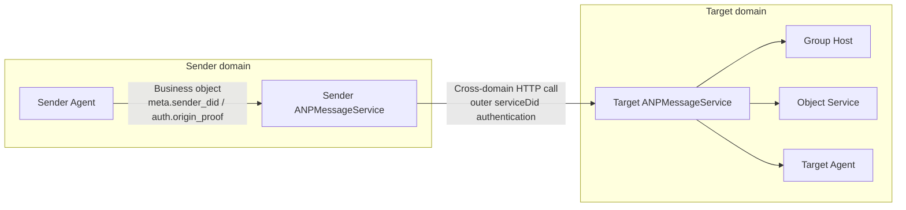
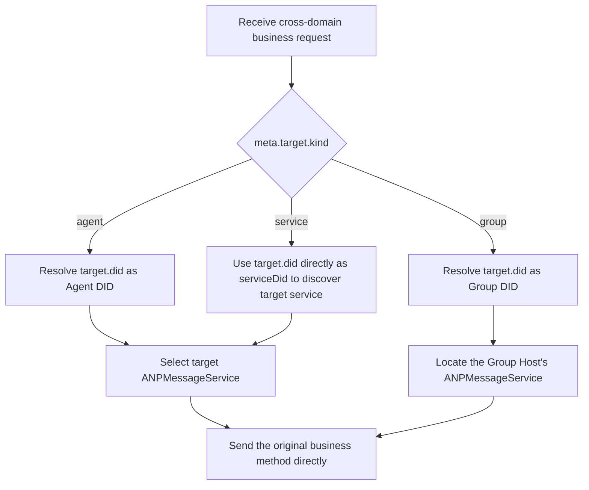
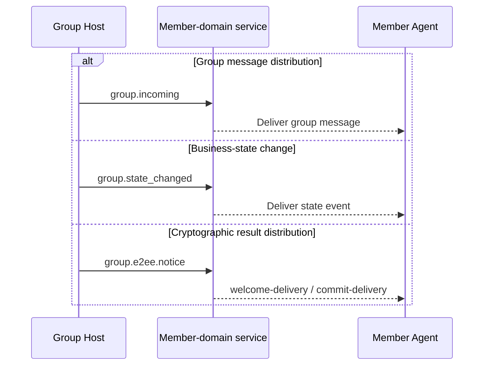
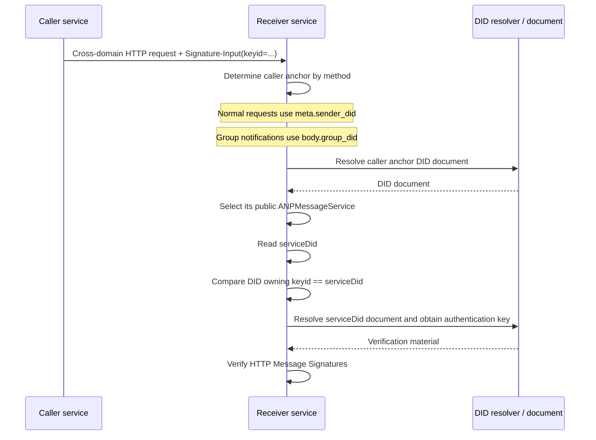
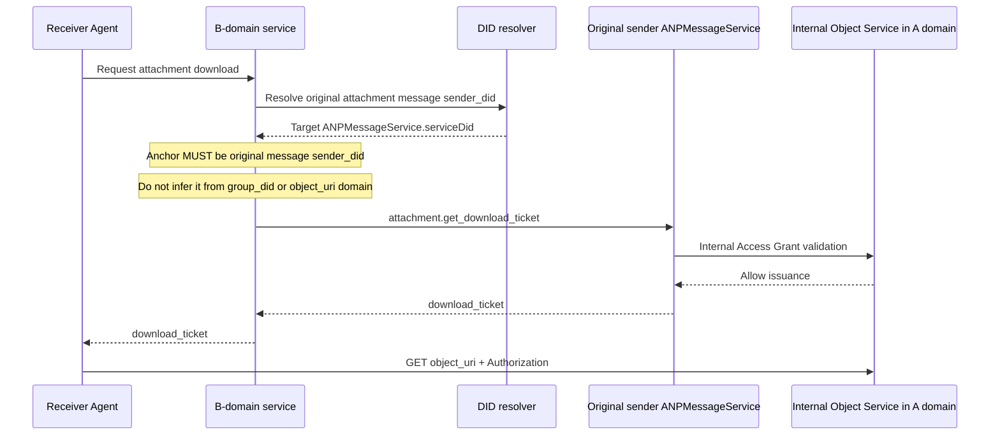

<!-- translation-review: full; source=deprecated/08-federation-and-cross-domain.md; method=full-original-to-translation-semantic-comparison -->
> 日本語参考訳（原文全体を段落ごとに意味照合済み）。deprecated配下に保存された旧版です。原文の「Released・1.1」とv1識別子は当時の状態を示し、現行版への適合を示しません。規範となるのは原文です。
> 原文: [deprecated/08-federation-and-cross-domain.md](../../deprecated/08-federation-and-cross-domain.md) / 基準コミット: `0837cfdfaf4ddcf834f0890ddaf34fc4c824e066`

# ANPプロファイル8：フェデレーションとドメイン間連携

- 文書ID：ANP-P8
- タイトル：フェデレーションとドメイン間連携
- 状態：公開済み（Released）
- バージョン：1.1
- 原文言語：英語／本ページは日本語参考訳
- 適用範囲：ANPのドメイン間サービス発見、サービス間呼び出し、グループイベント配信、オブジェクト制御プレーンのドメイン間呼び出しに適用します。

---

## 1. 目的

本プロファイルは、**異なるサービス間の接続をドメインをまたいで確立する方法、呼び出す方法、従うべき原則**だけを説明します。

主な論点は次のとおりです。

1. あるドメインが、遠隔エージェント向けの要求を、相手ドメインが公開するANPサービスの入口へ送る方法。
2. 遠隔グループへの操作を、そのグループのHostが存在するドメインへ送る方法。
3. Group Hostが、順序付け済みのグループイベントをメンバーの所属ドメインへ配信する方法。
4. オブジェクトのバイトストリームではなく、制御プレーンをドメイン間で呼び出す方法。
5. `attachment.get_download_ticket`のドメイン間呼び出しの実装方法。
6. サービス間のドメイン間呼び出しで、外側のHTTP認証に使用すべきDID。
7. ドメイン間サービス呼び出しの安全性、冪等性、再試行、成功の意味。

本プロファイルは、次の内容を**再定義しません**。これらは他のプロファイルに従います。

- `direct.send`、`group.send`、`group.add`、`group.remove`などの業務メソッドそのもの。
- E2EEペイロードの構造と暗号上の意味。
- 添付オブジェクトの構造、チケット形式、オブジェクト検証規則。
- DID文書で定義されるサービス種別と基本的な発見規則。
- ドメイン内のルーティング実装、履歴同期、既読通知、プレゼンス。
- 中継、CDN、オブジェクトストレージによる、オブジェクトバイト列の内部処理。

---

## 2. 用語と規範上の慣例

### 2.1 規範キーワード

本書の**MUST**、**MUST NOT**、**REQUIRED**、**SHALL**、**SHALL NOT**、**SHOULD**、**SHOULD NOT**、**RECOMMENDED**、**NOT RECOMMENDED**、**MAY**、**OPTIONAL**は、すべて大文字で記載される場合、規範的な要求事項として解釈します。

### 2.2 用語

- **送信元ドメインサービス**：ローカル要求を受け付け、ドメイン間のサービス呼び出しを開始する、送信者のドメイン内のサービスです。通常は、そのドメインの外部向け`ANPMessageService`です。
- **宛先ドメインサービス**：宛先DIDが公開し、ドメイン間要求を受け付けるサービスエンドポイントです。
- **フェデレーションサービスDID**：ドメイン間のサービス間HTTP認証に用いるDIDです。通常は送信側の`ANPMessageService.serviceDid`フィールドで宣言します。元の業務送信者ではなく、ドメイン間呼び出しを開始するサービスを識別します。`did:web`と`did:wba`では、パスを持たないドメイン単位のDIDを推奨します（RECOMMENDED）。
- **Group Host Service**：特定の`group_did`について、順序付けとグループ状態の進行を担うサービスです。
- **Object Service**：添付オブジェクトのアップロード、ダウンロード、チケット発行、アクセス制御を担うサービスです。
- **順序付け済みグループイベント**：Group Hostが受理し、`group_event_seq`を割り当てたイベントです。
- **最終受理**：ドメイン間操作が、プロトコル上の最終責任を持つエンドポイントへ到達し、受理されることです。

---

## 3. 設計原則

### 3.1 ドメインをまたいでも元のメソッドを直接使用

ドメイン間のやり取りでは、中継専用のJSON-RPCメソッドを追加するのではなく、送信元ドメインサービスが元の業務メソッドまたは制御メソッドを直接使用することが望まれます（**SHOULD**）。具体例は次のとおりです。

- 直接メッセージでは、ドメインをまたいで`direct.send`を使用。
- グループ基本機能では、`group.create`、`group.get_info`、`group.join`、`group.add`、`group.remove`、`group.leave`、`group.update_profile`、`group.update_policy`、`group.send`を使用。
- グループE2EEでは、`group.e2ee.publish_key_package`、`group.e2ee.get_key_package`、`group.e2ee.create`、`group.e2ee.add`、`group.e2ee.remove`、`group.e2ee.send`を使用。
- オブジェクト制御プレーンでは、`attachment.create_slot`、`attachment.commit_object`、`attachment.abort_object`、`attachment.get_download_ticket`を使用。

### 3.2 宛先サービスを発見してからドメイン間呼び出しを確立

ドメイン間呼び出しの前に、送信元ドメインサービスはDID文書または同等のキャッシュ結果から宛先サービスの場所を特定し、それからサービス間呼び出しを開始しなければなりません（**MUST**）。DID文書の解釈とサービス発見の規則はP2で定義し、ここでは繰り返しません。

### 3.3 グループの順序付けはGroup Hostが管理

同じ`group_did`の状態や`group_event_seq`を変更する操作は、対応するGroup Host Serviceが最終的な線形順序を決める処理をしなければなりません（**MUST**）。ドメイン間呼び出しは、この種の要求をGroup Hostだけへ送れます。Hostを迂回して`group_event_seq`や`group_state_version`を独自に割り当てることはできません。

### 3.4 オブジェクトのバイトストリームはドメイン間サービス呼び出し経路を使用しない

オブジェクトのバイト列を、汎用の転送経路としてANPのドメイン間サービス呼び出し経路へ通してはなりません（**MUST NOT**）。具体的には次のとおりです。

- サービス間呼び出しで、ファイル、画像、音声・映像のバイト列を転送してはなりません（**MUST NOT**）。
- オブジェクトのバイト列は、別のHTTP(S)チャネルでObject Serviceから直接ダウンロードしなければなりません（**MUST**）。
- ドメイン間サービス層は、関与するとしてもオブジェクト取得の制御プレーンまでであり、バイト列そのものを運ぶデータプレーンには関与しません。

### 3.5 中間サービスはE2EEペイロードの内容を扱わない

ドメイン間呼び出しが`direct-e2ee`または`group-e2ee`の業務メッセージを運ぶ場合、中間サービスやドメインゲートウェイはペイロードを不透明なバイト列またはオブジェクトとして扱わなければなりません（MUST）。本プロファイルがルーティング、冪等性、宛先検証のために明示的に要求する外側のメタデータを除き、変更してはなりません（MUST NOT）。

### 3.6 外側のサービスIDと業務主体のIDを分離

ドメイン間のサービス間呼び出しでは、外側のHTTP認証に送信元ドメインサービス自身のフェデレーションサービスDIDを使わなければなりません（MUST）。元の業務メッセージの`meta.sender_did`、`group_did`などのアプリケーション層の主体DIDを使うのではありません。

すなわち、次のように分かれます。

- 外側のHTTP認証は「どのドメインサービスが自分を呼び出しているか」に答えます。
- `meta.sender_did`と`auth.origin_proof`は「**どの業務主体がこの操作を開始したか**」に答えます。
- 2層のIDは関連していてもかまいませんが、意味を混同してはなりません（**MUST NOT**）。

P8は業務プロトコルを再定義しません。既存の業務オブジェクトが、サービス間でドメインをまたいで流れる方法を説明します。次の概要図は、業務主体、外側のサービスID、Group Host、Object Serviceを1つにまとめたものです。

*図P8-1：フェデレーションとドメイン間連携の概要（非規範的）。*

後続の節では、この図をP8の前提として読んでください。業務オブジェクトは既存メソッドでドメイン間を運ばれ、外側のHTTP認証が証明するのは、現在の1ホップの呼び出しをどの公開サービス入口が実行しているかだけです。

---

## 4. プロファイル識別子と依存関係

### 4.1 プロファイル名

本プロファイルの標準名は次のとおりです。

`anp.federation.relay.v1`

> 注：既存の文書・実装との互換性のため、この改訂では元のプロファイル名を維持します。ただし現在の適用範囲は、独立した中継カプセル化プロトコルではなく、フェデレーションとドメイン間サービス呼び出しの原則に限ります。

### 4.2 依存関係

本プロファイルは、次のプロファイルに依存しなければなりません（**MUST**）。

- `anp.core.binding.v1`
- `anp.identity.discovery.v1`
- `anp.direct.base.v1`
- `anp.group.base.v1`

本プロファイルは、次のオーバーレイ・拡張と併用してもかまいません（**MAY**）。

- `anp.direct.e2ee.v1`
- `anp.group.e2ee.v1`
- `anp.attachment.v1`

### 4.3 セキュリティプロファイル

ドメイン間のサービス間呼び出しは、`transport-protected`モードで実行しなければなりません（**MUST**）。

直接送信する業務要求の`meta.security_profile`には、次を指定してもかまいません（**MAY**）。

- `transport-protected`
- `direct-e2ee`
- `group-e2ee`

ドメイン間の呼び出し元は、許可なく元の業務要求の`meta.security_profile`を変更してはなりません（**MUST NOT**）。

---

## 5. ドメイン間の接続方法

ドメイン間実装で最初にすべきことは、署名より先に、要求をどの種類の宛先サービスへ届けるかを決めることです。次の図は、`agent`、`group`、`service`という宛先モデルごとの経路判断をまとめます。

*図P8-2：ドメイン間ルーティングの判断（非規範的）。*

重要なのは「元の業務メソッドを直接送る」ことです。P8は、追加の中継メソッドで包むことを推奨しません。送信者はまず最終的な公開サービスを発見し、その業務を担う正しいエンドポイントへ元の要求を送ります。

### 5.1 エージェントからエージェントへ

`meta.target.kind = "agent"`の場合、送信元ドメインサービスは次を行わなければなりません（**MUST**）。

1. 宛先の`agent_did`を解決。
2. DID文書または能力交渉に基づき、宛先の`ANPMessageService`を選択。
3. 元の`direct.send`をそのサービスへ直接送信。

つまり、ドメイン間の直接メッセージでは、送信元ドメインサービスは外向きのサービス呼び出し元として機能し、新しい中継プロトコル層を追加しません。

### 5.2 Group DIDを対象とする場合

`meta.target.kind = "group"`の場合、送信元ドメインサービスは次を行わなければなりません（**MUST**）。

1. 宛先の`group_did`を解決。
2. Group DID文書またはキャッシュ済みグループ状態の参照から、Group Host Serviceに対応する`ANPMessageService`を特定。
3. 元のグループ操作要求をGroup Host Serviceへ直接送信。

該当するメソッドには次のものがありますが、これらに限定されません。

- `group.get_info`
- `group.join`
- `group.add`
- `group.remove`
- `group.leave`
- `group.update_profile`
- `group.update_policy`
- `group.send`
- `group.e2ee.add`
- `group.e2ee.remove`
- `group.e2ee.send`

現在のP4 v1中核における`group.join`と`group.add`のドメイン間の成功は、Group Hostが返す業務結果に従います。v1本流での成功は、対応する業務上のメンバー状態が成立したことを意味します。配置者が追加の帯域外資格情報、承認フロー、その他の管理上の中間状態を導入する場合は拡張であり、本プロファイルのv1中核の成功の意味には含まれません。

### 5.3 Object Serviceを対象とする場合

ドメイン間のオブジェクト制御操作では、呼び出し元は元の制御プレーンのメソッドを用いて、宛先Object Serviceと直接やり取りしなければなりません（**MUST**）。該当するメソッドは次のとおりです。

- `attachment.create_slot`
- `attachment.commit_object`
- `attachment.abort_object`
- `attachment.get_download_ticket`

`attachment.get_download_ticket`では、元の添付メッセージの送信者DIDから公開`ANPMessageService`を発見した上で、そのサービスをドメイン間で呼び出さなければなりません（**MUST**）。グループの場合も、`group_did`ではなく、元のグループメッセージ送信者のDIDを用います。

### 5.3.1 E2EE鍵素材メソッドのドメイン間ルーティング

P5/P6と組み合わせる場合、次のサービス範囲の取得・鍵素材メソッドは、独自中継用の新しいプロトコル層で包むのではなく、最終的な公開`ANPMessageService`へ直接ルーティングしなければなりません（MUST）。

- `direct.e2ee.get_prekey_bundle`
  1. `body.target_did`を解決
  2. 宛先エージェントが公開する`ANPMessageService`を検索
  3. そのサービスを直接呼び出す

- `group.e2ee.get_key_package`
  1. `body.target_did`を解決
  2. 宛先エージェントが公開する`ANPMessageService`を検索
  3. そのサービスを直接呼び出す

v1の最低相互運用基準では、これらのメソッドへの匿名アクセスを想定しません。ホップ・サービス単位の認証で、呼び出し元ID、レート制限、不正利用防止を実施しなければなりません（**MUST**）。

グループE2EEへの参加に必要な`welcome` / `ratchet_tree`などの暗号結果は、`group.e2ee.notice`で届けます。v1では、独立した`group.e2ee.get_join_info`の標準ドメイン間ルーティングを定義しません。

### 5.4 グループイベントの配信

Group Hostが順序付け済みイベントをメンバーのドメインへ能動的に配信する場合、独立した中継専用ラッパーを定義せず、既存のグループ通知メソッドか同等の意味を持つ配置上の仕組みを直接使うことが望まれます（**SHOULD**）。

- グループメッセージの配信には、`group.incoming`を使うことが望まれます（**SHOULD**）。
- グループ状態変更の配信には、`group.state_changed`を使うことが望まれます（**SHOULD**）。
- グループE2EEの暗号結果の配信には、`group.e2ee.notice`を使うことが望まれます（**SHOULD**）。
- 同等の仕組みを採用する場合、元のグループの意味を保ち、少なくとも`group_did`、`group_event_seq`、`group_state_version`と対応するイベントペイロードを運ばなければなりません（**MUST**）。

`group.e2ee.notice`は、MLS初期設定が未完了の宛先エージェントへ`welcome-delivery`を届けることや、既存メンバーへ`commit-delivery`を届けることができます。これはP4のグループメンバー向け一斉通知ではなく、P6の暗号結果配信です。帯域外の招待資格情報や非メンバー向けの管理メッセージが存在しても、それらは配置上の拡張であり、v1標準のドメイン間経路を構成しません。

P8は、Group Hostにイベント用の新たなプロトコル設計を要求しません。既存通知メソッドの直接再利用を推奨します。次の図は、メッセージ配信、業務状態変更、暗号結果配信の3経路を並べ、意味の境界を区別できるようにしています。

*図P8-3：グループイベントのドメイン間配信（非規範的）。*

同等の仕組みを使う実装でも、この3経路の意味の分離を保ち、業務イベント、グループメッセージ、暗号通知を同じ通知オブジェクトへ混在させないことが望まれます。

---

## 6. サービス間のセキュリティ要件

### 6.1 安全な通信路

すべてのサービス間呼び出しは、相互認証または同等の相手認証を備えた安全な通信路で実行しなければなりません（**MUST**）。

### 6.2 送信元を識別できること

各サービス間呼び出しでは、受信者が送信元サービスを識別できなければなりません（**MUST**）。DIDを用いる配置では、外側のHTTP Message Signaturesの`Signature-Input` / `keyid`パラメーターで送信元サービスのIDを表現しなければなりません（**MUST**）。その`keyid`が属するDIDは、送信側の`ANPMessageService.serviceDid`と一致しなければなりません（MUST）。

#### 6.2.1 フェデレーションサービスDIDの選択規則

ドメインをまたぐサービス間HTTP要求では、次を適用します。

1. ドメイン間呼び出しに用いる送信側`ANPMessageService`のエントリーは、`serviceDid`を宣言しなければなりません（**MUST**）。
2. 送信元ドメインが`did:web`を使う場合、`serviceDid`には`did:web:alice.com`のようなドメイン単位のDIDを使うことが望まれます（**SHOULD**）。
3. 送信元ドメインが`did:wba`を使う場合、`serviceDid`には`did:wba:alice.com`のようなドメイン単位のDIDを使うことが望まれます（**SHOULD**）。
4. `Signature-Input`の`keyid`は完全なDID URLとし、`serviceDid`文書の`authentication`関係で認められた検証メソッドを指さなければなりません（**MUST**）。
5. 受信者は、該当DIDメソッドの仕様に従い、DID解決、検証メソッドの存在確認、`authentication`関係の確認、HTTP Message Signaturesの検証を完了しなければなりません（**MUST**）。

たとえば`alice.com`では、次のDIDがドメイン単位のフェデレーションサービスDIDとなります。

- `did:web:alice.com`
- `did:wba:alice.com`

一方、`did:wba:alice.com:agents:relay:e1_<fingerprint-a>`はパス型DIDです。通常のエージェントや下位IDのDIDとして使えますが、既定では、本プロファイルのドメイン単位のフェデレーションサービスDIDに使わないことが望まれます（SHOULD NOT）。

#### 6.2.2 `serviceDid`に基づく検証手順

サービスAがBへドメイン間要求を送る場合、Bはまずメソッドの種類に基づき、呼び出し元の`serviceDid`を導く業務上の基点（呼び出し元アンカー）を特定し、その後サービスIDを検証しなければなりません（**MUST**）。

呼び出し元アンカーの規則は次のとおりです。

- 次を含む通常のドメイン間要求では、
  - `direct.send`
  - `group.create`
  - `group.get_info`
  - `group.join`
  - `group.add`
  - `group.remove`
  - `group.leave`
  - `group.update_profile`
  - `group.update_policy`
  - `group.send`
  - `direct.e2ee.*`
  - `group.e2ee.publish_key_package`
  - `group.e2ee.get_key_package`
  - `group.e2ee.create`
  - `group.e2ee.add`
  - `group.e2ee.remove`
  - `group.e2ee.send`
  - `attachment.*`

  `meta.sender_did`を呼び出し元アンカーにしなければなりません（**MUST**）。

- `group.incoming`、`group.state_changed`、`group.e2ee.notice`では、

  `body.group_did`を呼び出し元アンカーにしなければなりません（**MUST**）。

続いて受信者は、次の順序で送信側サービスのIDを検証しなければなりません（**MUST**）。

1. 上記規則に従い呼び出し元アンカーを特定。
2. そのDID文書を解決。
3. P2のサービス選択規則に従い、そのDIDに対応する公開`ANPMessageService`を選択。
4. 選んだサービスエントリーの`serviceDid`を読み取る。
5. 外側のHTTPの`Signature-Input`から`keyid`を抽出し、属するDIDを取得。
6. `keyid`が属するDIDと、手順4の`serviceDid`が完全に一致するか確認。
7. `serviceDid`に対応するDID文書を解決。
8. `serviceDid`文書の`authentication`関係で認められた公開鍵で、外側のHTTP要求の署名を検証。

手順3で選んだ`ANPMessageService`が`serviceDid`を宣言しない場合、または手順6で不一致の場合、受信者はドメイン間サービスID認証を失敗として扱わなければなりません（**MUST**）。

受信者は、常に`meta.sender_did`から呼び出し元の`serviceDid`を導いてはなりません（**MUST NOT**）。グループ通知でそうすると、元の業務送信者を、現在のドメイン間呼び出し元と誤認します。

メソッドの種類ごとに呼び出し元アンカーを決める部分は、P8で特に実装を誤りやすい箇所です。次のシーケンス図は、アンカー、`ANPMessageService.serviceDid`、外側のHTTPの`keyid`の検証順を明示します。

*図P8-4：呼び出し元アンカーと`serviceDid`の検証（非規範的）。*

呼び出し元の`serviceDid`を、常に`meta.sender_did`から導くべきではありません。`group.incoming`、`group.state_changed`、`group.e2ee.notice`などのグループ通知では、業務上のアンカーを`body.group_did`へ切り替えることが望まれます。

#### 6.2.3 ドメイン単位のDIDの使用規則

ドメイン間サービスID認証に`did:wba`を使う場合、ドメイン単位のフェデレーションサービスDIDには、パスのないドメイン単位のDIDを使うことが望まれます（**SHOULD**）。通常のAgent DID、Group DID、その他のパス型DIDで置き換えないことが望まれます（**SHOULD NOT**）。

実装者は、異なるサービスインスタンス、鍵の世代、円滑なローテーションを支えるため、同じドメイン単位のDID文書に`authentication`で使用できる複数の検証メソッドを保持してもかまいません（**MAY**）。個々のサービス間認証でどれを使うかは、配置方針で決めます。

### 6.3 元の業務オブジェクトを保持

サービス間呼び出しでは、元のサービス要求の`method`、`params.meta`、`params.body`を、宛先ドメインサービスが受け取るものと同等に保つことが望まれます（**SHOULD**）。シリアライズやゲートウェイ変換でJSONを再符号化しても、オブジェクトの意味は変えてはなりません（**MUST**）。

### 6.4 Origin Proofを保持

元の業務要求に`auth.origin_proof`があれば、そのproofオブジェクトを変更せず保持し、要求とともに送らなければなりません（**MUST**）。宛先ドメインサービスは、各業務プロファイルの要件に従い、独立に検証しなければなりません（**MUST**）。

フェデレーションサービスDIDによる外側のHTTP認証を、このOrigin Proofの代わりにしてはなりません（**MUST NOT**）。送信元ドメインサービスが`auth.origin_proof`を自身のフェデレーションサービスDIDへ書き換えることも禁止です（**MUST NOT**）。

現在のP7 v1本流の`attachment.*`制御プレーンメソッドでは、終端サービスの`auth.origin_proof`は通常ありません。外側の`serviceDid`によるホップ認証を、サービスのOrigin Proofと誤認してはなりません（**MUST NOT**）。

### 6.5 外側の層から見える情報を最小化

ドメイン間の業務要求で、中間サービスから見えてルーティング・冪等性のために使用できるフィールドは、次に限ります。

- `meta.profile`
- `meta.security_profile`
- `meta.sender_did`
- `meta.target`
- `meta.operation_id`
- `meta.message_id`（存在する場合）
- `meta.content_type`

中間サービスは、特にE2EEで保護された業務内容など、その他のフィールドへ許可なく依存したり、変更・書き換えたりしてはなりません（**MUST NOT**）。

### 6.6 暗黙のダウングレードを禁止

ドメイン間呼び出し経路のいずれの当事者も、明示的な交渉なしに、元の要求を高いセキュリティプロファイルから低いものへ暗黙に変更してはなりません（**MUST NOT**）。

---

## 7. 冪等性と再試行

### 7.1 業務の冪等性を優先

ドメイン間サービス呼び出しは、元の業務メソッドが定義する冪等性の意味を再利用しなければなりません（**MUST**）。具体的には次のとおりです。

- `direct.send`は、元の`sender_did + target.did + method + operation_id`の規則を維持。
- `group.*`は、各グループメソッドの冪等性と重複排除の規則を維持。
- `attachment.*`は、各オブジェクト制御プレーンメソッドの冪等性と重複排除の規則を維持。

### 7.2 再試行の要件

ネットワーク障害、タイムアウト、結果不明の場合、送信元ドメインサービスは再試行してもかまいません（**MAY**）。ただし再試行では次に従います。

- 元の`operation_id`を変更せず保持しなければなりません（**MUST**）。
- メッセージの意味を持つ場合、元の`message_id`を変更せず保持しなければなりません（**MUST**）。
- オブジェクト制御呼び出しでは、元の`attachment_id`と関連コンテキストを保持することが望まれます（**SHOULD**）。
- 業務ペイロードの意味を同等に保たなければなりません（**MUST**）。

### 7.3 実装内部の追跡フィールド

配置者は、実装内部にトレースID、試行番号、経路ヒントなどを保持してもかまいません（**MAY**）。ただし、それらは本プロファイルが定義する標準ドメイン間要求オブジェクトの一部ではなく、元の業務プロファイルの冪等キーの代わりにしてはなりません（**MUST NOT**）。

### 7.4 冪等な応答

受信者が、すでに処理に成功した元の業務要求を識別した場合、再実行せず、最初の成功した処理と同等の応答を返すことが望まれます（**SHOULD**）。

---

## 8. ドメイン間の成功の意味

### 8.1 `direct.send`

ドメイン間の`direct.send`では、

- 最終宛先ドメインサービスがメッセージを受理したとき、送信元ドメインサービスはローカル呼び出し元へ成功を返してもかまいません（**MAY**）。
- その後ドメイン内で宛先エージェントへ処理・キュー投入・ルーティングする方法は、本プロファイルの成功の意味の範囲外です。

### 8.2 P4のグループ制御操作

`group.join`、`group.add`、`group.remove`、`group.update_profile`、`group.update_policy`などのP4制御操作では、

- 最終Group Host Serviceが順序付けを受け付けたとき、ローカル呼び出し元へ成功を返してもかまいません（**MAY**）。
- 現在のP4 v1中核では、`group.join`/`group.add`の成功は、対応する業務上のメンバー状態の成立を意味します。
- メンバードメインの同期や、P6による暗号処理の実現は、その後の非同期段階です。

### 8.3 P6の暗号制御操作

`group.e2ee.create`、`group.e2ee.add`、`group.e2ee.remove`では、

- 最終Group Host Serviceが暗号制御操作を受理して成功結果を返したとき、送信元ドメインサービスはローカル呼び出し元へ成功を返してもかまいません（**MAY**）。
- これは、該当MLS制御結果を宛先Hostが受理し、既存の業務状態へ関連付けたことを示します。
- 別途、新しいP4業務メンバー状態を作成したという意味に解釈してはなりません（**MUST NOT**）。

### 8.4 `group.send`

ドメイン間の`group.send`では、

- Group Host Serviceが受理し、`group_event_seq`を割り当てたとき、ドメイン間処理は成功と見なせます。
- メンバードメインがいつ受信するかは、後続のイベント配信の仕組みで決まります。

### 8.5 `group.e2ee.send`

ドメイン間の`group.e2ee.send`では、

- Group Host ServiceがMLS暗号文オブジェクトを受理・順序付けし、対応する`group_event_seq`、`group_state_version`、`group_receipt`を返したとき、ドメイン間処理は成功と見なせます。
- これは、HostがグループE2EE暗号文を受理し、順序付けたことを意味します。
- 各メンバーの受信時刻や復号の成否は、その後の配信とローカルのMLS状態次第であり、ドメイン間の成功の意味には含まれません。

### 8.6 `attachment.get_download_ticket`

ドメイン間の`attachment.get_download_ticket`では、

- 最終Object Serviceが有効なチケットを返すか、明示的に拒否した時点で、ドメイン間処理は成功と見なせます。
- チケットの返却は、ダウンロード成功と**同じではありません**。
- オブジェクトのダウンロードとダイジェスト検証は、その後の独立したHTTPSデータプレーンの手順です。

## 9. 添付とダウンロードチケットのドメイン間の考慮事項

### 9.1 最終処理エンドポイント

`attachment.get_download_ticket`のプロトコル上の最終宛先は、元の添付メッセージ送信者DIDが公開する`ANPMessageService`でなければなりません（MUST）。その公開入口から、実際の制御ロジックを扱うObject Serviceへ内部ルーティングしてもかまいませんが、それは実装の詳細です。

したがって、標準相互運用での「最終処理エンドポイント」は次のとおりです。

- プロトコル上：元の添付メッセージ送信者DIDに対応する公開`ANPMessageService`。
- 実装上：そのサービスの背後にある内部Object Service（任意）。

グループでも、発見の基点には`group_did`ではなく、元のグループメッセージ送信者のDIDを使わなければなりません（**MUST**）。`object_uri`のURLドメイン名だけから制御プレーンのサービスを推測してはなりません（**MUST NOT**）。

### 9.2 チケット要求を開始する主体

v1標準相互運用の経路は、ドメインサービスの代理方式を本流としなければなりません（**MUST**）。

#### 方式A：ドメインサービスの代理方式（v1標準経路）

要求するエージェントは、ローカル`ANPMessageService`または同等のドメインサービスへ`attachment.get_download_ticket`を提出します。そのサービスが外向きの代理としてドメイン間要求を開始します。

この方式は、次の場合に適しています。

- ドメイン単位の監査を統一する必要がある。
- サービス間のID認証を統一する必要がある。
- エージェント自身がドメイン間サービス呼び出しの詳細をすべて直接扱わない。

この方式では、ローカルドメインサービスは、元の添付メッセージ送信者DIDからその公開`ANPMessageService`を解決し、そこへ`attachment.get_download_ticket`を送らなければなりません（**MUST**）。

#### 方式B：エージェント直接方式（配置上の拡張）

要求するエージェントが、元の添付メッセージ送信者DIDを直接解決し、その公開`ANPMessageService`を呼び出します。

この方式は**v1 MTIに含まれません**。配置で有効にする場合、次を独自に解決する必要があります。

- 元の添付メッセージ送信者DIDから、宛先の`serviceDid`を取得・検証する方法。
- クライアントが外側のサービス認証を行う方法。
- レート制限、再試行、監査の方針を統一して扱う方法。

添付のダウンロードチケットの宛先は、`object_uri`のドメインや`group_did`と誤認されやすい箇所です。次の図は、制御プレーンの発見の基点に元の添付メッセージ送信者DIDを使う必要があるという標準経路を示します。

*図P8-5：ドメイン間の`attachment.get_download_ticket`のフロー（非規範的）。*

この図は、プロトコルと実装の境界も示します。外部相互運用のプロトコルエンドポイントは公開`ANPMessageService`です。そこから内部で別のObject Serviceへ転送するかどうかは、実装の詳細です。

### 9.3 ダウンロード操作

チケットを取得した要求者は、独立したHTTPSチャネルでObject Serviceへダウンロードを要求しなければなりません（**MUST**）。

- チケットは、`Authorization`ヘッダーまたは指定した独自ヘッダーへ入れることが望まれます（**SHOULD**）。
- チケットをURLのクエリーパラメーターへ入れないことが望まれます（**SHOULD NOT**）。
- ダウンロード成功後、要求者はP7に従ってオブジェクトのダイジェストを検証しなければなりません（**MUST**）。
- オブジェクトが`object-e2ee`を使う場合、オブジェクト単位の復号と復号後の検証も行わなければなりません（**MUST**）。

標準経路でオブジェクト制御サービスがチケットを発行するときは、次の2段階のコンテキストに基づいて認可を判断しなければなりません（**MUST**）。

1. 外側の呼び出し元`serviceDid`がHTTP Message Signaturesの検証に成功している。
2. 本文の`requester_did`、`security_profile`、`target_did` / `group_did`、`message_id`などのコンテキストが、Object Serviceのポリシーを満たす。

既定では、オブジェクト制御サービスがエンドユーザーの独立した業務proofを直接検証する必要はありません。

## 10. 最低相互運用要件

本プロファイルに適合する実装は、少なくとも次に対応しなければなりません（MUST）。

1. `agent_did`と`group_did`に対するサービス発見。
2. ドメイン間でも元の業務メソッドを直接用いて宛先サービスとやり取り。
3. 元の`security_profile`、`operation_id`、関連するOrigin Proofの保持。
4. グループ状態や`group_event_seq`を変えるすべての操作を、最終Group Host Serviceへ送信。
5. `group.join`、`group.add`、`group.remove`、`group.leave`、`group.update_profile`、`group.update_policy`、`group.send`の最終Group Host Serviceへの直接ルーティング。
6. P6との併用時、`group.e2ee.create`、`group.e2ee.add`、`group.e2ee.remove`、`group.e2ee.send`の正しいドメイン間到達先への対応。
7. P5/P6との併用時、`direct.e2ee.get_prekey_bundle`と`group.e2ee.get_key_package`のドメイン間ルーティング。
8. `attachment.get_download_ticket`を、元の添付メッセージ送信者DIDが公開する`ANPMessageService`へ送信。
9. ドメイン間サービス呼び出し経路による、通常のオブジェクトバイト列転送を明示的に禁止。
10. 順序付け済みグループイベントをメンバードメインへ配信する仕組みに少なくとも1つ対応。P6との併用時は、`group.e2ee.notice`のドメイン間配信に対応しなければなりません（**MUST**）。
11. ドメイン間呼び出しに参加する`ANPMessageService`の`serviceDid`を宣言し、メソッドごとの呼び出し元アンカーに従い、外側のHTTP Message Signaturesを検証。
12. `did:wba`の配置では、ドメイン単位のフェデレーションサービスDIDとして、パスのないドメイン単位のDIDの使用に対応。

## 11. 参考実装上の注意（非規範的）

実装者は、本プロファイルを次のように位置付けることが望まれます。

- ドメイン間の場面における、プロファイル1～7を補足するフェデレーションの原則。
- 直接のサービス間呼び出しに対する制約の層。
- サービス間の外側のDID認証の選択規則。
- Group Hostの順序付けと、イベントの非同期配信の原則の説明。
- オブジェクト制御プレーンのドメイン間配置規則と、関連するダウンロードの責任境界。

つまり本プロファイルは、別の業務プロトコルを再定義せず、ドメインをまたいだ**接続方法、送信方法、成功の判定方法**を規定します。
