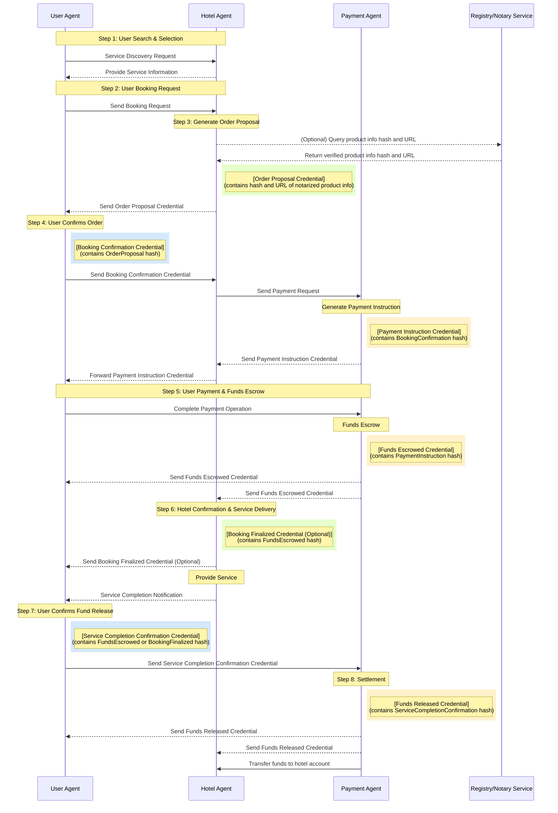

> 日本語参考訳（機械翻訳・未校閲）。規範となるのは原文です。コード例・識別子・規範キーワードは原文を保持しています。
> 原文: [deprecated/09-anp-peer-to-peer-agent-transaction-specification.md](../../deprecated/09-anp-peer-to-peer-agent-transaction-specification.md) / 基準コミット: `0837cfdfaf4ddcf834f0890ddaf34fc4c824e066`

# ANP ベースのエージェントトランザクションフレームワーク:要件とテクニカルデザイン文書(ドラフト)

## 1. 導入事例

### 1.1. . 問題の声明: 安全な、相互運用可能なエージェント取引の必要性

人工知能技術の急速な発展に伴い、AIエージェントはますます普及し、インターネットにアクセスして人件数を交換し、情報処理やタスクの実行につながります。 エージェントの増殖時代、新たな相互作用パラダイムが形成される。

今後インターネットは、人から人まで、あるいは人からのウェブサイトのやりとりを特徴とするものではありませんが、エージェント間の直接接続やコミュニケーションによって機能するわけではありません。 従来のインターメディアモデルよりも、ピアツーピアエージェントのインタラクションモデルはより効率的で、中間ステップを減らし、情報伝達と意思決定プロセスを加速します。

しかし、インターネットは信頼できない環境であり、エージェントが取引中のユーザーを表す場合、彼らはいくつかのコア課題に直面しています。

- **認証**: エージェントのやり取りのアイデンティティが本物で信頼性が高いことを確認する方法?
- **情報認証**: エージェント間での情報交換が改ざんされていないか確認する方法
- **取引セキュリティ**: 中央プラットフォームなしで取引セキュリティを確保する方法
- **紛争解決**: 取引問題が発生したときに、紛争を効果的に処理する方法

そのため、安全な効率的な運用と直感的なエージェントのピアツーピアトランザクションフレームワークの設計は、エージェントエコノミーのインフラとして機能するので特に重要です。 エージェントネットワークプロトコル(ANP)のビジョンは、エージェントネットワークの相互接続と効率的なコラボレーションの問題に対処するため、データサイロを破り、AIが完全なコンテキスト情報にアクセスできるようにします(1)。

### .1.2.(日) ソリューション概要: ANP ベースのエージェントトランザクションフレームワーク

上記の課題に対処するために設計されたエージェントベースのトランザクションフレームワークをご提案します。 フレームワークは、エージェントネットワークプロトコル(ANP)(2)を通じて交流するために、ユーザー、ホテル、決済プラットフォーム、仲裁機関など、さまざまな参加者を代表するエージェントを活用しています。 コア技術スタックには、以下が含まれます。

1. **エージェントネットワークプロトコル(ANP)**: エージェント間のコミュニケーションのための基礎プロトコルとして、発見、相互作用を定義し、メッセージ配信メカニズムを指示し、安全で相互運用可能な通信を実現することを目指しています(2)。
2. **分散型識別子(DID)**: 参加者と各エージェントを一意に識別し、そのアイデンティティを検証するために必要な公開鍵やその他の情報を関連付けるのに利用し、信頼に基づいて形成する(3)。
3. **W3C 検証可能な認証 (VC) とデータ整合性証拠**: 取引中に構造化された、検証可能なデータクレーム(注文提案、支払い確認など)を交換し、情報の信頼性、完全性、非取得を保証します(6)。 資格の対象となる前の資格情報を含むことにより、資格チェーンの不全が達成されます。

この文書は、フレームワークの要件、コアプロセス、テクニカルデザイン、セキュリティメカニズムを精巧に解釈する例としてホテルの予約と支払いを使用します。 設計全体では、信頼、トレーサビリティ、オートメーション、ユーザー管理、相互運用性を最小限にとり、より安全で透明性のある効率的な分散型の取引エコシステムを構築することを目指しています。

## 2. システム要件

### .2.1.(日) 機能要件

- **エージェントの機能**:
  - **ユーザーエージェント**: サービスの発見、予約のリクエスト、ホテルの認証情報の確認、確認の資格情報の作成、支払い手順の処理、決済の開始、サービス完了の確認、または紛争の開始
  - **ホテルの代理店**: サービスの情報を公開し、注文提案資格(引用を含む)を生成し、一時在庫をロックし、ユーザー確認の資格情報を確認したり、支払いパーティへの支払いリクエストを開始したり、支払い受領を確認し、予約を確定したり、サービスが満たしたままに記録したり、キャンセルや紛争対応を処理します。
  - **支払代理店**: 支払いリクエストの受け取りと確認、支払い命令認証(エスクローリンクなど)を生成し、ユーザーの決済処理を行い、エスクローに資金を置き、ファンドステータス通知資格情報を送信し、ホテルへの資金の送金や指示に基づいてユーザーに返金を解除する必要があります(ユーザー確認、タイムアウト、アダグレーション)。
  - **仲裁代理店** (オプション): ルールに従って、当事者、メディアテ、またはアドファジトによって提出された証拠の資格情報を受信し、「紛争解決資格」を結合する可能性がある必要があります。

- **取引ライフサイクル**: 本サービスの発見、見積書および提案、注文確認、支払い要求および命令生成、資金調達のエスクロー、サービス提供の履行確認、資金調達または返金、紛争の開始および解決。 これらの手順は、パート4で説明したコアプロセスにマップする必要があります。

- **認証処理**: すべてのエージェントは、特定の種類の検証可能な資格(VC)を発行、提示、受信、および確認する機能を持っている必要があります。 クレデンシャルのデータ完全性(証拠による)と発行者のシグネチャの暗号化検証、およびクレデンシャルチェーンの完全性の確認(クレデンシャルサブジェクトの前のクレデンシャルのハッシュ経由)を含む必要があります。 クレデンシャルタイプは、注文提案、予約確認、支払いリクエスト、入金確認などのキートランザクションノードをカバーする必要があります。 (6). .

- **国家管理**: システムは、有効なVCが受信または事前定義されたイベント(タイムアウトなど)によってトリガーされた状態遷移で、トランザクションの注文を正確に維持しなければなりません。 コア州には、新規、保留中の支払い、エスクロー、フルフィルメント、保留中の決済、決済、および紛争等を含む場合があります。

- **例外処理**: 認証の失敗、ユーザ決済のタイムアウト、ホテルの空室/オーバーソルド、ユーザーキャンセル(支払い前/後)、サービス紛争、決済障害、自動支払リリースのタイムアウト、キー妥協/識別異常、エージェント/ネットワーク中断など、パート5に記載されているさまざまな例外的な状況を処理することができる必要があります。 処理方法は、特定のエラーやステータス通知VCの送信を通常関与する明確に定義する必要があります。

### . 2.2. 非機能要件

- **セキュリティー**:
  - **通信セキュリティ**: エージェントツーエージェント通信は、エンドツーエンド暗号化を使用して、eavesdroppingと改ざん防止(ANPのセキュリティレイヤー1に依存)使用しなければなりません。
  - **アイデンティティ認証**: エージェントのアイデンティティを相互作用する認証性を確保するために、DIDベースの強力な認証メカニズムを使用する必要があります(1)。
  - **データ整合性**: 交換された重要な資格情報は、暗号化証拠(データ整合性証明書など)によって保護され、改ざん防止にする必要があります。 (12)
  - **非再帰**: 認証発行者は、発行済みの有効な資格情報(デジタル署名による)を否定できません。
  - **不変性**: トランザクションフローの認証情報は、初期資格情報(クレデンシャルサブジェクトの前の認証のハッシュを含む)で改ざん防止のために、検証可能なチェーン、VCハッシュチェーンを形成する必要があります。
  - **鍵管理**: 生成、保存、使用、回転、各エージェントの秘密鍵を回復するための安全なメカニズムを持っている必要があります。
  - **アイデンティティ認証**: 相手のアイデンティティを相互作用する信頼性を確保するために、DIDベースの強力な認証メカニズムを使用する必要があります(1)。
  - **データ整合性**: 交換された重要な資格情報は、暗号化証拠(データ整合性証明書など)によって保護され、改ざん防止にする必要があります。 (12)
  - **非再帰**: 認証発行者は、発行済みの有効な資格情報(デジタル署名による)を否定できません。
  - **不変性**: トランザクションフローの認証情報は、初期資格情報(クレデンシャルサブジェクトの前の認証情報を含む)で、後処理を防止する、検証可能なチェーン、VCハッシュチェーンを形成する必要があります。
  - **鍵管理**: 生成、保存、使用、回転、各エージェントの秘密鍵を回復するための安全なメカニズムを持っている必要があります。

- **相互運用性**: システム設計は、異なる開発者が実施するエージェント間のシームレスなやり取りを確保するために、ANP、W3C DID、W3C VCなどのオープン規格を厳密に遵守しなければなりません(2)。

- **トレーサビリティ/可聴性**: トランザクションの全てのステップと状態の変更は、タイムスタンプや署名による検証可能な認証情報によって記録されなければなりません。 VC、データ整合機構、およびクレデンシャルのハッシュチェーンは、この目標を達成するためのコアです(12)。

- **信頼性・可用性**: システムには、可用性が高く、エージェントやネットワークノードの一時的な障害を許容できる必要があります。 メッセージ配信保証機構(例えば、ANP がメッセージキューやリトライメカニズムを提供しているかどうか)とエージェント自身のステート永続機能 (1) を明らかにする必要があります。 ANPプロトコル自体の堅牢性に依存しています。

- **スケーラビリティ**: 建築設計は、将来的にエージェントと取引量の両方の増大をサポートすべきである。 大規模アプリケーションシナリオにおけるANPプロトコルの実際の性能は(2)と見なす必要があります。

- **スタッフ**: 取引要件を満たしている間、ユーザーのプライバシーは考慮されるべきです。 例えば、決済代行に開示された不要な注文情報を制限する。 W3C VC規格の採用により、選択的な開示技術の将来的活用(BBS+シグネチャに基づくVCなど)の可能性も提供しております。
## 3. コアコンセプトと建築

### 3.1. . 用語集

- **ANP(エージェントネットワークプロトコル)**: エージェント間のセキュアで相互運用可能なコミュニケーションを可能にするように設計されたオープンソースのプロトコルフレームワーク。 エージェントの発見、インタラクション、メッセージ配信メカニズムを定義し、エージェントの時代(15)のHTTPになるという目標を掲げています。
- **エージェント**: タスクを実行し、ANPプロトコルを介してやり取りできる特定のエンティ(ユーザー、ホテルなど)を表す自律的なソフトウェアプログラム。
- **DID(分散型識別子)**: 組織が集中管理登録機関(3)に基づいて、自分の識別子を生成し制御できる、グローバルにユニークな識別子の新しいタイプ。 DID は DID ドキュメントに解決できます。
- **DID ドキュメント**: 認証(公開鍵)、サービスエンドポイントなどの暗号化材料など、DIDに関連した情報を含むデータセット。 (16). .
- **検証可能な認証(VC)**: 被験者によるクレームのセット, 暗号証拠を伴って, 検証者は、独自にその正当性と完全性を確認することができます (6). 一般的にJSON-LD形式で表現(18)。
- **データ整合性証拠**: VCや他のデジタル文書の信頼性と完全性を保護するために使用される暗号化証拠機構は、通常VCの証拠プロパティに埋め込まれています (12).
- **VCハッシュチェーン**: VCのクレデンシャルサブジェクト内の前のVCのハッシュ値を含む複数のVCをシーケンスにリンクするこの提案で採用されたメカニズムは、クレデンシャルシーケンスの完全性と改ざん抵抗を保証します。
- **ステートマシン**: トランザクション(注文など)がライフサイクル内で行われる一連の明確に定義された状態を記述し、ステート遷移をトリガーするイベントや条件を記述します。
- **発行者**: VC(例えば、ホテルのエージェントは注文提案VCを発行するなど)を作成および問題のあるエンティティティティ
- **ホルダー**:必要に応じてVCを保持し、提示するエンティティティ(例えば、ユーザエージェントはホテルのオーダー提案VCを保持) (7)。
- **資格の主題**: VCに申し立てる事業者(例えば、ホテル予約VCの件名はユーザーと予約内容) (6)。 この提案では、最初のVCを除き、以前のVCのハッシュ値も含まれます。
- **クリプトスイート**: 特定の暗号アルゴリズムの組み合わせを定義し、データ整合性証拠(変換アルゴリズム、ハッシュアルゴリズム、署名アルゴリズムなど)を生成および検証します。 (12).
- **DIDの決断**: DID を対応する DID ドキュメントに変換するプロセスは、通常 DID のリゾルバーによって実行されます(16)。
- **検証可能なデータレジストリ(VDR)**: DID文書、VCスキーマ、リボケーションリストなど、VCやDIDに関連するデータを録画・管理するために使用されるシステム データベース、分散型レジャー、その他の信頼できるシステムとして使用できます。

### 3.2. . システムアーキテクチャの概要

プログラムは、インテリジェントに基づいて分散構造で構成されます。各参加者(ユーザー、ホテル、決済プラットフォーム、仲裁機関)は、独自のスマートボディによって表されます。

コアインタラクティブなプロセスは、州のコーディネートのための集中型ビジネスプラットフォームに依存しませんが、インテリジェントなボディ間のデータ情報プルーフ(VC)の認証を渡すと検証することで、変更とコンセンサスビルディングを駆動します。トラストビルは、プラットフォームの信頼性ではなく暗号化に基づいています:

2. **データ検証**: VCのデータの整合性証拠を検証することで、情報の信頼性、完全性、およびソースの信頼性を確保 (12).
3. **プロセス整合性**: VC のハッシュ値を含む、クレデンシャルサブジェクト内の前のVCのハッシュ値を含む、VC ハッシュチェーンを形成し、履歴レコードの不当性を確保します。

ANPプロトコルスタックは、セキュアな通信(暗号化)とID認証(DIDに基づく)機能、および、可能な上層プロトコルの交渉(Meta-Protocol)とアプリケーションプロトコルフレームワーク(15)を提供します。 この提案は主に、そのアイデンティティ/暗号化レイヤーとメッセージ配信機能を利用して、あらかじめ定義されたVCを交換します。

以下は、システムにおけるさまざまな役割と関係のアーキテクチャの概要を示しています。


*図1: ANPエージェントピアツーピアトランザクションシステムアーキテクチャ - ユーザーの、ホテル、決済システムとオプションの仲裁および公正なサービス間の相互作用の関係を表示します。 エージェント間の通信は、ANPプロトコルに基づいており、検証と検証を検証できる認証情報(VC)で行います。*

### 3.3. . 参加する役割と責任

以下は、システムおよびそのエージェントの責任においての主な参加者を詳述します。

**表1:参加役**
| 役割・役割 | 責任キーワード | 詳しい記述 |
|------|------------|----------|
| **ユーザ名** | エンドコンシューマー | ホテルのサービスに関するお問い合わせ |
| **ユーザーエージェント** | 参照 → 確認 → ペイ → フィードバック/ 失効 | ユーザを表すソフトウェアエージェント。 ユーザーの DID と秘密鍵の管理、ANP によるサービスを発見し、予約リクエスト、ホテルの認証情報の確認、支払い手順の処理、決済の開始、サービスの完了確認、または ANP によるすべてのやり取りを承認します。 クレデンシャルチェーン(ハッシュリンクによる)の保存と検証を責任をもって行います。 |
| **ホテル モンテネグロ** | サービスプロバイダ | 宿泊施設サービスの提供 |
| **ホテルの代理店** | 見積り→ロック在庫→確認の確認→請求支払い→サービスの提供 | ホテルを代表するソフトウェアエージェント サービスの情報を公開し、注文提案の資格情報(引用を含む)を生成し、在庫を一時的にロックし、ユーザーの確認資格を検証し、支払いパーティへの支払い要求を開始し、領収書を確認し、予約を確定し、サービス完了を記録し、キャンセルや紛争対応を処理する。 クレデンシャルチェーン(ハッシュリンクによる)の保存と検証を責任をもって行います。 |
| **決済インフラ** | 資金調達プラットフォーム | 決済処理や銀行などのプラットフォームで、決済・エスクロー・決済サービスを提供します。 |
| **支払代理店** | エスクローファンド→ステータス通知→決済/返金 | 決済インフラを代表するソフトウェアエージェント DID と秘密鍵の管理、支払いリクエストの受け取りと検証、支払い命令認証(例えば、エスクローリンク)を生成し、ユーザーの支払い処理やエスクローでの資金の場所の処理、ファンドステータス通知資格情報を送信し、指示に基づいてユーザーに資金を解放するか、払い戻しを解除します(ユーザー確認、タイムアウト、アダディケーション)、ANPを介してすべての相互作用。 クレデンシャルチェーン(ハッシュリンクによる)の保存と検証を責任をもって行います。 |
| **仲裁代理店** (オプション) | プロセス争訟 → 媒体/Adjudicate | 中立的な第三者の紛争解決団体を表すソフトウェアエージェント。 ユーザーの行動やホテルが紛争解決を交渉できないとき、DIDと秘密鍵を管理することで、ルールに応じて提出された証拠の資格情報を受信し、ANPによる結合「紛争解決資格」を生成します。 |
| **公証・登録サービス** (オプション) | 店舗・認証サービス情報 | VC参照用のハッシュ値やその他のキー属性を保存および認証するための信頼できるサードパーティサービスを提供します。 |

表1 値ステートメント: この表は、システムとそのコアの責任において、各参加者を明確に定義します。 これにより、その後のプロセス設計、エージェントのインタラクションロジック、機能的要件の割り当てを理解することが非常に重要です。 システム設計の完全性を保証し、各ロールの期待される動作を明確にします。 オプションの公証サービスの役割を追加しました。

## 4. プロセス仕様

### 4.1. . 理想的な取引の流れと国家の移行

以下は、ANPプロトコルを介して送信されたVCメッセージによって駆動されるエージェント間のすべての相互作用で、ユーザー予約とホテルの支払いのための理想的なプロセスです。 キー資格は、クレデンシャルサブジェクトの前のクレデンシャルのハッシュ値を含むリンクされ、シーケンスと不変性を確保します。

**ステップ1: オファー&ロック在庫**
- **トリガー**: 利用者の代理人はホテルの代理店に価格照会か予約要求を(ANPサービスによって発見することができます)送ります。
- **加工プロセス**: ホテルのエージェントは在庫と価格をチェックします。
- **認証生成**: 注文オファー認証(VCタイプ:OrderOfferCredential)を生成します。
  - credentialSubjectには、客室タイプ、価格、有効期間、キャンセルポリシー、一時注文IDなど、主要なサービスの詳細が含まれます。
  - (オプション) 外部の公証/登録サービスにサービスの詳細情報とポインターのハッシュ値を含めることができます。
  - ホテルの秘密鍵に署名し、証拠を生成します。
- **ステート**: 旅館は、対応する在庫を一時的にロックします。 注文は「オファー」状態に入ります。
- **インターアクション**: 注文オファー認証は、ANP 経由でユーザーエージェントに送信されます。

**ステップ2: ユーザ確認**
- **トリガー**: ユーザエージェントはOrderOfferCredentialの署名と内容を受信し、確認します。 ユーザーは予約確認を決定します。
- **認証生成**: 利用者エージェントは「確認認証」を生成します(VCタイプ:予約確認認証)。
  - credentialSubject には、OrderOfferCredential ID の参照とオファーの受諾を示すことがあり、以前の VC (OrderOfferCredential) のハッシュ(例えば、前の CredentialHash 属性に格納される)が含まれています。
  - ユーザーの秘密鍵で署名し、証拠を生成します。
- **インターアクション**: ANP経由のホテル代理店へご予約確認メールが届きます。
- **ステート**: エージェントが予約確認認証と、その証拠および前方認証を検証した後、注文状況は「お支払い」に更新されます。

**ステップ3: 支払いリクエスト**
- **トリガー**: 有効な予約確認認証を受けているホテルのエージェント
- **認証生成**: 決済リクエスト認証(VCタイプ:PaymentRequestCredential)を生成します。
  - credentialSubjectには、必要な支払い情報のみが含まれます。 orderId(または予約確認認証IDを参照)、金額、通貨、ペイディッド(ホテル)、ペイアディド(ユーザー)、PaymentAgentDid。 個人情報保護のため、ホテルや商品情報などは含まれておりません。 以前のVC(BookingConfirmationCredential)のハッシュ(例、以前のCredentialHash)が含まれています。
  - ホテルの秘密鍵に署名し、証拠を生成します。
- **インターアクション**: ANP による所定の支払業者に、PaymentRequestCredential が送信されます。
- **ステート**: 注文状況を「決済開始完了」に更新しました。

**ステップ4: エスクローの指示の生成及び運送**
- **トリガー**: 決済代行業者がPaymentRequestCredentialおよびその証拠と旧CredentialHashを受信し、確認します。
- **認証(決済代行)**: 決済代行業者は、決済取引ID、金額、支払方法の詳細(エスクロー決済リンク/QRコードなど)、支払い期限などの「支払い処理認証」を生成します。
  - credentialSubject には、以前の VC (PaymentRequestCredential) のハッシュ(例、前方CredentialHash)が含まれています。
  - 支払プラットフォームの秘密鍵で署名し、証拠を生成します。
- **相互作用1(支払いエージェント→ホテルエージェント)**: 決済代行は、ANP経由のホテル代理店にPaymentInstructionCredentialを送信します。
- **インターアクション2(ホテルエージェント→ユーザーエージェント)**: エージェントが受け渡し、(オプション)PaymentInstructionCredential を認証した後、ANP 経由でユーザーエージェントに転送します。
- **ステート**: 決済タスクは「支払い待ち」状態に入ります。

**ステップ5:ユーザー決済とエスクロー**
- **トリガー**: 利用者の代理人は(ホテルの代理店から)受け取り、PaymentInstructionCredentialおよびその証拠および前のCredentialHashを検証します。 ユーザーは、認証情報に提供されたリンク/メソッドを通じて支払いを完了します。
- **加工プロセス**: 決済プラットフォームのエスクローアカウントに入金口座が入出金
- **認証生成**: 決済代行業者は、資金受領(エスクロー)を確認し、「資金のエスクローブ認証」を生成します。(VCタイプ:ファンドのエスクローブ認証)
  - credentialSubject には、トランザクション ID、注文 ID、金額、タイムスタンプなどが含まれます。また、以前の VC (PaymentInstructionCredential) のハッシュ(例、前述のCredentialHash)を含みます。
  - 支払プラットフォームの秘密鍵で署名し、証拠を生成します。
- **インターアクション**:ファンドのEscrowedCredentialは、ANPを介してユーザーエージェントとホテル代理店に送信されます。
- **ステート**: 注文状況を「Escrowed」に更新しました。
**ステップ6:ホテルの確認とサービス配達**
- **トリガー**: 弊社代理店は、その証拠と前方CredentialHashと共にファンドのEscrowedCredentialを受け取り、検証します。
- **加工プロセス**: 当ホテルは、予約確認とリソースのロックを正式に行います。
- **認証(オプション)**: お客様が送信する「最終認証認証」(VCタイプ: BookingFinalizedCredential)を生成し、前回のVC(FundsEscrowedCredential)のハッシュを含むクレデンシャルサブジェクトで作成できます。
- **業務内容**: ユーザーは予約ごとに到着し、ホテルではサービスを提供します。
- **ステート**: 注文は「サービス/フルフィルメント」状態に入ります。
- **サービス完了**: サービスの終了後、ホテルのエージェントはサービス完了通知またはANP(例えば、サービス完了通知を経由してユーザーエージェントにプッシュすることができます。これはまた、クレデンシャルチェーンをVCとしてリンクすることもできます)。

**ステップ7: ユーザーがサービス完了を確認**
- **トリガー**: 利用者(ユーザーエージェント)は、本サービスが合意通り完了したことを確認します。
- **認証生成**: 利用者エージェントは、「サービス完了確認認証」を生成します(VCタイプ:ServiceCompletionConfirmationCredential)。
  - credentialSubject には、注文/トランザクション ID と確認タイムスタンプ、および前のVC (FundsEscrowedCredential またはステップ6)のハッシュが含まれます。
  - ユーザーの秘密鍵で署名し、証拠を生成します。
- **インターアクション**: ANP 経由で決済代行にサービス完了確認認証をお送りします。
- **タイムアウト機構**: ユーザーが指定した時間内での紛争を確認・開始しなければ、自動確認ロジックは自動資金リリースをトリガーするように設計されています。
- **ステート**: 注文状況を「決済完了」に更新しました。

**ステップ8: 決済**
- **トリガー**: 決済代行業者は、その証拠と前方CredentialHashと共にServiceCompletionConfirmationCredentialを受け取り、または自動ファンドリリース条件がトリガーされます。
- **ファンド運営**: 決済代行は、エスクローされた資金をホテルの口座に転送します。
- **認証生成**: 「資金が残された認証」を生成(VCタイプ:ファンドReleasedCredential)。
  - credentialSubject は、最終決済状況と取引の詳細を記録し、以前のVC (ServiceCompletionConfirmationCredential) のハッシュを含みます。
  - 決済プラットフォームの秘密鍵に署名し、証拠を生成します。
- **インターアクション**:ファンドReleasedCredential は、ANP 経由でユーザーエージェントやホテルの代理店に送信されます。
- **ステート**: 注文確定ステータスを「設定」に更新しました。

**理想的な流れの図表:**



*図2: ANPエージェントの理想的な取引フロー図 - ユーザーの検索から決済までのプロセスを完全に表示し、明確にクレデンシャル生成ステップ(VCマーカー)をマークし、ユーザーエージェント、ホテルエージェント、および決済エージェント間の相互作用を明確に宣言します。*

**中心の国家転移図(受容器):**
```stateDiagram-v2
    [*] --> New
    New --> Pending_Payment: User confirms (credential contains order proposal hash)
    Pending_Payment --> Escrowed: Funds escrowed (credential contains payment instruction hash)
    Pending_Payment --> Cancelled: Payment timeout / User cancels
    Escrowed --> In_Service: Hotel confirms booking (optional credential contains escrow credential hash)
    Escrowed --> Cancelled: User cancels (policy compliant)
    Escrowed --> In_Dispute: Dispute initiated (credential contains escrow credential hash)
    In_Service --> Pending_Settlement: User confirms service (credential contains escrow/booking finalized credential hash) / Automatic confirmation timeout
    In_Service --> In_Dispute: Dispute initiated (credential contains in-service state hash)
    Pending_Settlement --> Settled: Funds released (credential contains service completion confirmation hash)
    Pending_Settlement --> In_Dispute: Dispute initiated (credential contains pending settlement state hash)
    In_Dispute --> Settled: Arbitration decision (credential) -> Release funds
    In_Dispute --> Cancelled: Arbitration decision (credential) -> Refund
    Cancelled --> [*]
    Settled --> [*]
```

*図3: VC認証ハッシュチェーンに基づくコアステート遷移図 - 明らかに予約プロセス全体ですべての状態の移行、ならびにこれらの状態の変化を運転するクレデンシャルハッシュチェーンの関係を示しています。*

**表2:コア州の遷移(典型的なハッシュチェーン関係)**

| 現在の状態 | トリガーイベント/認証タイプ | 主な行動・検証 | 次の州 | インフォメーション |
|---------|-----------------|--------------|--------|------|
| 新規/オファー | 予約確認 認証情報(ユーザー) | ユーザ署名、提案参照、認証のハッシュをクレデンシャルサブジェクトマッチで確認するOrderOfferCredential | ペンディング_お支払い | |
| ペンディング_お支払い | 資金のエスクロー・クレデンシャル(支払いプラットフォーム) | 決済プラットフォームの署名、エスクローの金額を確認し、認証対象のハッシュを検証する支払い指示 | エスクローリング | |
| ペンディング_お支払い | 支払期限切れ | 支払代理店はタイムアウトを検出し、通知を送信します | キャンセル | タイムアウトの期間は定義を必要とします |
| エスクローリング | (内部ロジック/オプション予約確定認証) | ホテルでは予約リソース(VCが存在する場合)が認証されたハッシュを認証するFundsEscrowedCredential | でん_業務内容 | スケジュール通りサービスがスタート |
| でん_業務内容 | サービス完了確認認証(ユーザー) | ユーザ署名の確認、サービスの完了確認、認証のハッシュの認証、FundesEscrowedCredentialまたは BookingFinalizedCredential | ペンディング_定価総額 | |
| でん_業務内容 | ユーザ確認タイムアウト | 支払いエージェントはプリセットルールに基づいてトリガーします | ペンディング_定価総額 | 自動確認ルールと期間は明確な定義を必要とします |
| ペンディング_定価総額 | (内部送金完了) | 決済代行は決済を実行し、資金調達を発行する資格(クレデンシャルによるサービス完了確認書) | テライト | |
| エスクローリング/イン_サービス/販売_定価総額 | 紛争の開始資格(ユーザー/ホテル) | 署名、一時基金の運用を確認し、クレデンシャルサブジェクトのハッシュを最新の状態のVCにマッチさせます。 | でん_紛争 | |
| でん_紛争 | 争訟 決議 犯罪者(仲裁人) | 仲裁人署名を検証し、決定に基づいてファンド運用を実行します, (VCが存在する場合) 紛争のイニシアチブにマッチするクレデンシャルでハッシュを検証 | 定形/キャンセル | 仲裁結果は最終的な状態を駆動します |
| 任意の状態 | キャンセルリクエスト 資格(ユーザー) | 現在の状態とキャンセルポリシーに基づくプロセス(VCが存在する場合)は、クレデンシャルハッシュチェーンを検証します。 | キャンセル/(変更なし) | キャンセルポリシーが複雑になる場合があります |
| 任意の状態 | 認証の失敗 | 認証(署名またはハッシュチェーン検証失敗を含む)を拒絶し、エラー通知を送信 | (変更なし) | プロセスパユース |

**表2値注記**: この表は、理想的なプロセスにおける状態遷移ロジックの正確な説明を提供し、州遷移中にクレデンシャルサブジェクトのハッシュによるVCチェーン検証の役割を強調します。 それぞれの状態遷移、検証または実行する必要があるアクション、最終状態が達成され、決定主義、一貫性、プロセスの改ざん抵抗を保証します。

**理想的なVCハッシュチェーン**

以下の図は、理想的な条件下でANPプロトコルにおける様々な認証情報(VC)との間の関係をリンクするハッシュを示しています。 各クレデンシャルは、前のクレデンシャルのハッシュを含む不変なチェーン構造を形成し、トランザクションプロセス全体に対する完全性と検証性を保証します。 図内の異なる色は、異なるエージェントが発行する資格情報を表し、矢印はハッシュ参照関係を示します。


*図4: ANPプロトコルのVCハッシュチェーン - 注文提案から最終決済までの完全なクレデンシャルチェーンを表示し、各クレデンシャルが前項のハッシュを含む不変なチェーン構造を形成し、トランザクションの完全性と検証性を保証します。*

クレデンシャルチェーンの主な特徴:
1. **完全なプロセス追跡性**: 最終資金リリースの資格はハッシュチェーンを通して初期注文提案に遡ることができます
2. **タンパープロフ機構**: 認証への変更は、その後の認証情報でハッシュ検証失敗を引き起こします
3. **クリアな発行体責任**:異なる色は、異なるエージェントによって発行された資格情報を特定し、責任の境界を明確にします
4. **選択的な検証パス**: 必須および任意ハッシュ参照パス、高めるシステム柔軟性を支えて下さい
5. **国家の移行の一貫性**:各認証の生成と検証は、状態遷移図における対応する状態の変化を同時に駆動します。

## 4.2. . 例外処理プロセス

システムは、様々な例外的な状況を堅牢に処理できるようにしなければなりません。 以下は、主要な例外のシナリオと処理プロセスであり、すべての通知および状態の変更は、対応するVCやANPを介して送信されたエラーメッセージによって行われます。 例外関連のVCは、可能な限りクレデンシャルサブジェクトのハッシュを介してクレデンシャルチェーン内の関連資格情報にもリンクする必要があります。

表3:例外処理の概要

| シナリオ | トリガーポイント | ANP/VCによる簡単な操作 |
|------|------------------------|-----------------------------------|
| 認証の有効化失敗 | 認証受付ステップ | 受信エージェントは、無効な認証情報(無効なシグニチャ、不適切なフォーマット、非準拠のコンテンツ、無効なVCハッシュチェーンリンクなど)を拒否し、通知クレデンシャルがエラー情報を含むエラー情報(例、CredentialValidationError VC)をANP経由で返します。 プロセス停止、修正または手動介入を待っています。 |
| ユーザ決済タイムアウト | ステップ4の支払指示が発行された後、タイムアウトは起こります | 決済代行は、利用者やホテルの代理店(クレデンシャル・サブジェクトにはPaymentInstructionCredential hash)に「支払いタイムアウト認証」を生成し、送信する支払いタイムアウトを検出します。 キャンセルするステータスの移行を注文します。 ホテルのエージェントは通知時に在庫をロック解除します。 |
| ホテル ノー 可用性/オーバーオール | ステップ1または2 | 問い合わせや確認(例、不十分な在庫)中にホテルのエージェントが達成できないことを発見した場合、ユーザーエージェントに「注文のキャンセル資格」(OrderCancellationCredential)を生成し、送信する必要があります。理由を説明する(そのクレデンシャルサブジェには、関連する要求またはOrderOfferCredentialのハッシュが含まれます)。 キャンセルするステータスの移行を注文します。 |
| キャンセル(前払い) | ステップ5の前に | 利用者の代理人は、ホテルの代理店(そのクレデンシャルサブジェクトには予約確認書が含まれます)に「キャンセル要求認証」(キャンセルリクエスト認証)を送信します。 合意された場合、ホテルの代理店は「キャンセル確認認証」(キャンセル確認認証)を返し、その資格がキャンセル請求されます。 キャンセルするステータスの移行を注文します。 |
| キャンセル(お支払い後/サービス前) | ステップ5の後、サービスがステップ6で始まる前に | ユーザエージェントは、ホテルや決済代行業者にキャンセルリクエストを送信します(その資格料は、ファンドのEscrowedCredentialハッシュを含みます)。 キャンセルポリシーに基づいて返金額を計算し、支払いエージェントに「キャンセル処理された認証」(キャンセル処理される認証)を生成および送信する(クレデンシャルがその資格を請求する)。 決済代行は、この資格に基づいて返金を実行し、最終ステータス認証(例:ファンドsRefundedCredential)を送信します。(そのクレデンシャルサブジェクトにはキャンセル処理済み認証ハッシュが含まれます)。 キャンセルするステータスの移行を注文します。 |
| チェックイン/サービス争訟 | ステップ6のサービス中または後 | ユーザエージェント(またはホテルのエージェント)は、他の当事者および決済業者(クレデンシャル)に「紛争発生認証」(ディスプテ・イニティエーション・クレデンシャル)を生成し、送信する(クレデンシャルサブジェクトには、紛争を引き起こす関連するVCのハッシュが含まれる)。 決済代行は、受領時にファンドリリースを一時停止します。 ステータスの推移をIn Disputeに注文します。 エージェントは交渉を試みる。失敗した場合は、証拠VCを仲裁代理店に提出してください。 仲裁代理人は決定を下す, 生成し、「紛争解決資格」(DisputeResolutionCredential)を送信 (そのクレデンシャルサブジェクトには、争訟InitiationCredential hashを含みます). 決済代行は、この資格に基づいてファンド運用を実行し、最終ステータス認証を送信します。 |
| 支払失敗か拒絶 | ユーザーがステップ5で支払いを試みるとき | 決済インフラ(決済代行)は、決済の失敗を検知し、「支払い失敗した認証」(ペイメント失敗した認証情報)を生成し、ユーザエージェントやホテルのエージェントに通知します(その認証対象はPaymentInstructionCredentialハッシュを含みます)。 注文状況は、支払いを保留するか、または直接失敗/キャンセルに移行する可能性があります。 |
| 自動ファンドリリースタイムアウト | ステップ7回でユーザー確認ステップ | 自動確認機構が構成されている場合、決済代行はファンドのリリースを自動的にトリガーし、決済を実行し、ANP(クレデンシャルサブジェクトにはFUNDSEscrowedCredentialまたはBookingFinalizedCredentialハッシュ)を介して両当事者にFundsReleasedCredentialを送信します。 ステータス遷移を順に設定します。 |
| キー妥協/アイデンティティ異常 | ステージ | 重要な妥協やアイデンティティ異常を検知するパーティは、キーを再読んだり、関連するトランザクション・パーティーに「セキュリティアラート認証」(SecurityAlertCredential)をANP経由で直接通知したりする試みがすぐに行われるはずです。 関連するエージェントはトランザクションを一時停止する必要があります。 |
| エージェント/ネットワークの中断 | ステージ | ANPプロトコル(例、メッセージキュー、リトライメカニズム)の堅牢性およびエージェント独自の状態永続性とタイムアウト処理能力に依存しています。 送信者を再試行する必要があります。 受信者は重複したメッセージを処理する必要があります。 中断が延ばすと、トランザクションの失敗をタイムアウトに引き起こすことができます。 |

**表3値注記**: 本表は、トランザクションプロセス中に発生する可能性のあるさまざまな非特定の状況を体系的に概説し、例外処理中にクレデンシャルサブジェクトのハッシュによるクレデンシャルチェーンリンクを維持する重要性を強調しながら、ANPとVCベースの応答戦略の概要を提供します。 システム設計の堅牢性を確保し、障害経路を考慮し、開発者に例外的な状況を処理するためのガイダンスフレームワークを提供します。

## 5. 技術的な設計仕様

### 5.2. . アイデンティティと信頼層(DID)

- **特定目的・特定**: エコシステムにおけるコア参加型企業やエージェントシステムを一意に特定します。(3). DIDは、永続的、検証可能な、分散型アイデンティティの基盤を提供します。
- **DID 文書構造と検証方法**: 各DIDはW3C DIDの中心v1.0の指定の後でDID文書と関連付けられます。 DID Documents には、認証方法(id,type, controller,publicKeyJwk や publicKeyMultibase などの公開鍵情報を含む)と検証関係(VC発行や認証のアサートメソッドなど)が含まれています。
- **DIDの決断の条件**:
  - 解像度インフラストラクチャ依存:システムの信頼チェーンは、信頼性の高いDID解像度メカニズムに依存しています。 DID メソッドを解決できる DID のリゾルバーへの展開やアクセスは必須です。 決議の失敗は、資格確認を防止します。
- **経営の重要な考慮事項**:
  - キー管理バーデン: DID のコアは、公開秘密鍵ペアコントロール (3) です。 さまざまなエージェントがユーザーの重要な課題を提示するプライベートキーを安全に管理します。 世代別、ストレージ(HSM/TEE/ウォレット)、使用量、回転数、回復量を網羅する包括的な戦略が必要です。 分散型システム(21)の採用に大きな障壁が残っています。
  - メソッド固有の認証: ANP の例は、主に do:wba (1) に基づいています。 DID メソッドは異なる依存関係を持っています。 他のDIDメソッドを使用してエージェントとのやり取りは、複数の方法の解像度のサポートを必要とする場合があります。 依存関係:wbaは、異質なDIDエコシステムにおける相互運用性を制限する可能性があります。

### 5.3. . 認証管理(検証可能な資格)

- **認証設計の哲学と要件**: 取引プロセスにおける重要な状態の証拠と責任の偏差は、検証可能な資格情報に依存します。 これらの資格情報: ソースと整合性のために独立して検証する必要があります, 発行後の非再帰化可能, 機械読み取りおよび解析可能, サポートクロスプラットフォームの相互運用性, そして、クレデンシャルサブジェクトのハッシュ値を介してタンパー明白なチェーンにリンクすることができます.

- **選択された標準**: W3C 検証可能な認証データモデル v2.0:
  - 標準化と相互運用性:W3C規格は、オープンエコシステムを容易にします
  - DID とのネイティブインテグレーション: DID とシームレスに連携する設計
  - 豊富なセマンティック式:JSON-LDに基づいて、@contextを通じて明確なセマンティクスを可能とする
  - 柔軟性と拡張性:柔軟なデータモデル、簡単に拡張可能
  - プライバシー保護の可能性:選択的な開示(例えば、BBS+)のような高度の技術を支える
  - 標準的成熟検討:VC DM v2.0はW3Cの候補者の推薦(CR)の記述の時の状態でした

- **コアVC構造(JSON-LD)**: 各VCは、キープロパティを含む有効なJSON-LDオブジェクトでなければなりません。
  - `@context`: (必須) 用語文を定義し、最初の項目は "https://www.w3.org/ns/credentials/v2"
  - `id`: (オプション、推奨) VC(URL)のユニークな識別子
  - `type`: (必須) 「検証可能な認証」や特定のタイプを含むタイプの配列
  - `issuer`: (必須) DID または DID を含むオブジェクトの発行者
  - `issuanceDate` / `validFrom` / `validUntil`: (オプション/必須) タイムスタンプ
  - `credentialSubject`: (必須) クレームを含むオブジェクトのコレクション。 OrderOfferCredential では、キーサービスの詳細を必ず含めていただきます。 最初に1つ以外のすべてのVCには、以前のVCのハッシュを格納する前のCredentialHash属性を含める必要があります。
  - `proof`: (必須) 完全性および原産を検証するための証拠オブジェクトが含まれています
  - `credentialSchema`: (オプション) VC が続くデータスキーマを記述する
  - `credentialStatus`:(オプション) 資格情報へのポイント(例、取消状況)

- **VCハッシュチェーン実装**:
  - メカニズム: 2番目のVCから始まると、各VCのクレデンシャルサブジェクトには、前のVCのハッシュ値を含む以前のCredentialHash属性が含まれている必要があります。
  - ハッシュ計算:ハッシュ計算プロセスは明確に定義する必要があります。 推奨方法は、SHA-256のようなアルゴリズムを使用してハッシュを計算する前に、以前のVC(JCSを使用するなど)を正規化することです。
  - 検証: 検証者は、その証拠を検証するだけでなく、以前のVCのハッシュを計算し、現在のVCで前のCredentialHash値と比較する必要があります。

- **オプション: 外部サービスを使用して、サービス情報の確認**:
  - 情報ハッシュ:OrderOfferCredentialのクレデンシャルでホテルの完全なサービスの説明のハッシュを含める
  - ノタライゼーション/Registry Service Reference:信頼できるサードパーティの公正サービスまたはVDRでホテルサービスの説明(またはそのハッシュ)を登録し、注文オファー認証におけるこのレジストリエントリとハッシュへのリンクが含まれています

- **特定の資格の種類定義**:

**表4: 検証可能な認証タイプ(v3 - VCハッシュチェーン)**

| 認証タイプ | 発行者の役割 | 演題ロール | 主資格サブジェクト属性例 | 目的: | プライバシー・セキュリティに関する注意事項 |
|-------------------|------------------------|--------------------------|--------------------------------|---------------------|--------------|
| 注文オファー必須 | ホテルの代理店 | ユーザーエージェント、注文の詳細 | orderId, hotelDid, roomType, 価格, checkInDate, checkOutDate, cancelPolicy, OfferExpiry, (オプション)serviceDescriptionHash, (オプション)registryPointer | ホテルでは、見積りと予約条件を提供しています | 重要なサービスの詳細を必ず含める必要があります。 オプションの外部検証。 チェーンの最初のVC、前のCredentialHashはありません。 |
| 予約確認必須 | ユーザーエージェント | ホテルの代理店、順序の細部 | orderId, OfferCredentialId, userDid,ConfirmTimestamp, beforeCredentialHash: クライアントのアカウントを、 <hash_of_OrderOfferCredential> | 注文提案の受諾を承認するユーザ | credentialSubject には、以前の VC のハッシュが含まれています。 |
| お支払いについて | ホテルの代理店 | 支払代理店、ユーザーエージェント | orderId(または確認CredentialId)、金額、通貨、ペイディド(ホテル)、ペイアディッド(ユーザー)、支払いエージェントディード、前方CredentialHash: <hash_of_BookingConfirmationCredential> | 決済プラットフォームからのホテルリクエスト | 詳細な注文/項目情報が含まれていません。 credentialSubject には、以前の VC のハッシュが含まれています。 |
| お支払い方法説明必須 | 支払代理店 | ユーザエージェント、ホテルエージェント | transactionId、orderId、金額、通貨、PaymentMethodDetails(例、URL)、PaymentDeadline、前方CredentialHash: <hash_of_PaymentRequestCredential> | 決済プラットフォームは、支払い手順(先着順)を提供します。 | credentialSubject には、以前の VC のハッシュが含まれています。 |
| 資金の開示 | 支払代理店 | ユーザエージェント、ホテルエージェント | transactionId、orderId、金額、通貨、escrowTimestamp、前のCredentialHash: <hash_of_PaymentInstructionCredential> | 決済プラットフォームは、エスクローに資金が確認される | credentialSubject には、以前の VC のハッシュが含まれています。 |
| 予約確定認証(オプション) | ホテルの代理店 | ユーザーエージェント | orderId, bookingReference,ConfirmTimestamp, beforeCredentialHash: 以下は、次の手順で行います。 <hash_of_FundsEscrowedCredential> | ホテルが予約確定(送金後) | credentialSubject には、以前の VC のハッシュが含まれています。 |
| サービス完了確認認証 | ユーザーエージェント | 支払代理店、ホテルの代理店 | orderId, transactionId,ConfirmTimestamp, beforeCredentialHash: リリース <hash_of_FundsEscrowed_or_BookingFinalized> | ユーザーはサービスの完了を確認し、支払いリリースを承認します | credentialSubject には、以前の VC のハッシュが含まれています。 |
| ファンドリース・資格 | 支払代理店 | ユーザエージェント、ホテルエージェント | transactionId、orderId、mountReleased、決済タイムスタンプ、ペイディード、前処理ハッシュ: <hash_of_ServiceCompletionConfirmation> | 決済プラットフォームは、ペイにリリースされたエスクローされた資金を確認します | credentialSubject には、以前の VC のハッシュが含まれています。 |
| 資金返金保証 | 支払代理店 | ユーザエージェント、ホテルエージェント | transactionId、orderId、数量返金、払い戻しタイムスタンプ、ペイアディッド、前処理ハッシュ: <hash_of_triggering_VC> | 決済プラットフォームは、送金者に返金された資金を確認 | credentialSubject には、以前の VC のハッシュが含まれています。 |
| 争訟開始資格 | ユーザエージェント/ホテルエージェント | 仲裁代理店, カウンターパーティー | orderId, 紛争Reason, 証拠CredentialIds, イニスターDid, タイムスタンプ, 前CredentialHash: <hash_of_disputed_VC> | 取引紛争の開始 | credentialSubject には、以前の VC のハッシュが含まれています。 |
| 紛争解決資格 | 仲裁代理店 | ユーザエージェント、ホテルエージェント、決済代行 | 紛争ID、注文ID、決定、決議事項、解決タイムスタンプ、前のCredentialHash: <hash_of_DisputeInitiation> | 仲裁代理人は、紛争解決結果を公開します | credentialSubject には、以前の VC のハッシュが含まれています。 |
| キャンセルリクエスト必須 | ユーザーエージェント | ホテルの代理店、支払代理人 | orderId, 理由, リクエストタイムスタンプ, 前CredentialHash: <hash_of_relevant_VC> | ユーザリクエストの注文キャンセル | credentialSubject には、以前の VC のハッシュが含まれています。 |
| キャンセル確認必須 | ホテルの代理店/支払の代理店 | ユーザーエージェント | orderId, キャンセル結果, タイムスタンプ, 前CredentialHash: <hash_of_CancellationRequest> | 注文キャンセル処理結果の確認 | credentialSubject には、以前の VC のハッシュが含まれています。 |
| 認証の無効化エラー | あらゆる代理店 | ベンダーエージェント | 無効CredentialId、errorDescription、timestamp | 認証の検証失敗を通知 | ハッシュチェーンの一部ではありません。 |
| 支払期限切れ | 支払代理店 | ユーザエージェント、ホテルエージェント | transactionId, orderId, timeoutTimestamp, 前CredentialHash: <hash_of_PaymentInstruction> | 支払いタイムアウトの通知 | credentialSubject には、以前の VC のハッシュが含まれています。 |
| お支払い失敗必須 | 支払代理店 | ユーザエージェント、ホテルエージェント | transactionId、orderId、failReason、タイムスタンプ、CredentialHash: <hash_of_PaymentInstruction> | 支払いの失敗を通知 | credentialSubject には、以前の VC のハッシュが含まれています。 |
| セキュリティアラート認証 | あらゆる代理店 | 関連する部分 | alertType, 影響を受けたID, 詳細, timestamp | 放送セキュリティ警告 | ハッシュチェーンの一部ではありません。 |

- *表4値ノート*: この表は、エージェント間で交換する必要がある実際のデータ認証情報に抽象的なトランザクションプロセスのステップを隠します。 それぞれのキークレデンシャルの目的、発行者、被写体、コアデータフィールドを定義し、 **明確に、個人情報保護対策(支払い)、キーサービス情報(注文提案)の必須的包含、およびCredentialHash属性による関係をリンクするVCハッシュチェーンをクレデンシャルサブジェクトで指定します。**.
### 5.4. . 証拠と検証メカニズム(データ整合とVCハッシュチェーン)

- **選定機構**: データの整合性証拠:VCの信頼性および完全性を保障するためにW3Cのデータ整合性の指定を採用します

- **VC のハッシュ チェーン 不変性のため**:
  - メカニズム: 2番目のVCから始まると、各VCのクレデンシャルサブジェクトには、以前のVCのハッシュを格納する前のCredentialHash属性が含まれている
  - 効果: トランザクションプロセス内のすべてのVCをシーケンスでリンクし、検証可能なチェーンを形成します。 チェーン内の初期VCへの変更は、検証の失敗になります
  - 検証要件: 検証者は、VCの証拠を検証するだけでなく、前のVCとハッシュリンクを確認する必要があります。

- **Cryptographic Suiteの推奨事項**: 正規化のためのJCSと組み合わせて、EDDSAまたはECDSAに基づく暗号スイートを使用して推奨
  - 実装の複雑性:データの整合性を実装することは、単純なシグネチャよりも複雑です。 W3C仕様に準拠したライブラリを使用することをお勧めします
  - 将来のプライバシーの強化:選択的な開示をサポートする暗号スイートの導入を検討する(BBS +など)

- **証拠生成と検証プロセス(VCハッシュチェーンを含む)**:
  - 生成(イシュアー):
    1. VCデータの準備、古い証拠を取除いて下さい
    2. (非最初のVCの場合) 前のVCを取得し、ハッシュを正規化して計算する
    3. (非最初のVCの場合) 計算されたハッシュを現在のVCのcrudentialSubject.previousCredentialHashに追加する
    4. 現在のVCを正規化
    5. 正規化データのハッシュを計算する
    6. プライベートキーを使用してハッシュを署名する
    7. 種類、暗号スイート、作成されるおよび他の分野を含む証拠の目的を、構成して下さい
    8. VC データにプルーフオブジェクトを追加します。

  - 検証(Verifier):
    1. 分離された証拠およびVCデータ
    2. 認証方法と解析 DID を公鍵を取得
    3. 仮想通貨スイートを入手
    4. VC データの正規化
    5. ハッシュを計算する
    6. パブリックキーとプルーフバリューで署名を検証
    7. (非最初のVCの場合) 前のCredentialHash値を取得する
    8. (非最初のVCの場合) 前のVCを取得してハッシュを計算する
    9. (非最初のVCの場合) 計算されたハッシュを前後CredentialHash値と比較する
    10. (オプション) 作成されたタイムスタンプ、校正器などをチェックする

- **トレーサビリティの強化(ハッシュアンカー)**:
  - クレデンシャルチェーンの固有のトレーサビリティ:VCハッシュチェーンメカニズム自体は、強力なトレーサビリティとタンパー抵抗を提供します
  - 任意オンチェーンの固定:付加的な証拠ポイントとして公共のレジャーに主VCのハッシュ ダイジェストを固定することを考慮して下さい

### ... 5. . セキュリティデザイン

- **認証と認可**:
  - 認証: ANP のアイデンティティレイヤーと DID に依存します。
  - 認可: 機能ベース認証モデル、有効なVCの検証とVCハッシュチェーンにおけるポジションによる承認操作

- **メッセージの完全性と機密性**:
  - 整合性:VCおよびVCハッシュチェーンのデータ整合性証拠によって保証される
  - 機密性: ANPのエンドツーエンド暗号化された通信層に依存します

- **非再送**: VC上でのデジタル署名(データ整合性証拠)を実装

- **タンパーの抵抗**: VCハッシュチェーンメカニズムによる履歴認証の修正を防止

- **個人情報保護**: 注文の詳細を保護します。 送信されたデータをPaymentRequestCredential に制限することでプライバシーを保護します

- **紛争解決の保証**: 仲裁代理人に提出された証拠は、資格チェーンにリンクされている検証可能なVCでなければなりません

- **鍵管理のセキュリティ**: 秘密鍵の安全な管理は、秘密鍵を保護するための強力な対策を必要とする基礎的です

- **ANPプロトコルセキュリティの検討**:
  - DID解像度DoS、通信脆弱性など、ANPプロトコル自体のリスクを評価する必要があります。
  - LLM 主導のメタプロトコル交渉は、プロンプト注射と同様の攻撃に対する警戒が必要です
  - ANPの独立セキュリティ監査が推奨されます

- **セキュリティメカニズムマッピング**:

**表5:セキュリティメカニズムマッピング(v3)**

| セキュリティ目標 | メカニズム | コンポーネント/プロトコル | ノート/参考文献 |
|---------------|-----------|---------------------|------------------|
| アイデンティティ認証 | DID認証 | DID、DID文書、ANPのアイデンティティ レイヤー | 暗号化証拠、分散化に基づく [1] |
| データ整合性 | VC上のデータの整合性証拠 | VC、データ整合性、Cryptosuites | 認証内容が改ざんされていないことを確認してください [12] |
| データ機密性 | エンドツーエンド暗号化された通信 | ANP暗号化レイヤー | 送信中のメッセージ内容を保護する [1] |
| 非再送 | デジタル署名(データの整合性証拠による) | VC の証拠、ID のキー | 発行者が発行した有効な資格情報を拒否できない [12] |
| タンパー抵抗(歴史的記録) | VCハッシュチェーン(クレデンシャルサブジェクト経由) | VC 認証サブジェクト(前面CredentialHash)、ハッシュ化アルゴリズム | 発行された資格情報の変更を防止 |
| 認証 | VCベースの機能検証(VCハッシュチェーン検証を含む) | VC検証ロジック | 特定のVCおよびチェーンポジションの保持と検証は、権限を意味します |
| トレーサビリティ/可聴性 | 署名された認証チェーン(VCハッシュチェーン)(オプションのオンチェーンハッシュアンカー) | VC シーケンス、データの整合性証拠、ハッシュ | 改ざん防止トランザクション履歴を提供 [12] |
| プライバシー保護(支払い) | 決済制限請求必須コンテンツ | VC デザイン(支払いリクエスト認証) | 決済パーティに開示された情報を最小限に抑える |
| プライバシー保護(未来) | 選択ディスクロージャー(BBS+など)、ZKP | 高度な Cryptosuites | 属性をすべての情報を公開することなくプロファイリングできます [18] |
| 鍵セキュリティ | セキュアなキー管理ポリシー | エージェントキー管理モジュール | 重要な課題 [21] |
| プロトコルセキュリティ | ANPプロトコルのセキュリティデザイン(評価が必要)、セキュリティ監査 | ANPプロトコルスタック | ANPプロジェクト堅牢性に依存 |
| 点の抵抗 | (ANPとDIDのリゾルバー設計に配慮) | ANPネットワーク、ID の解決 | サービス攻撃の拒否をカウンターで |

  - *表5の価値ノート*: この表は、セキュリティアーキテクチャマッピングを更新します。 **特に、VCハッシュチェーン(クレデンシャルサブジェクトによる実装)を、タンパー抵抗の達成のためのコア機構として組み込んでおり、支払いプライバシーの保護対策を明確に**.

## 6. 結論と今後の検討

### 6.1. . ソリューションレビュー

このソリューションは、ANP のオープンプロトコルフレームワーク、DID、W3C 検証可能な認証 (VC)、およびデータ整合性証拠に基づいて包括的なエージェントトランザクションプロセスを詳細に説明します。 ホテルの予約を例にすると、サービス発見から最終決済までの完全なループと例外処理が整います。 このソリューションのコア利点は次のとおりです。

- **オートメーション**: エージェントを利用して、ほとんどのトランザクションインタラクションを自動的に実行します。
- **セキュリティー**: DID による強力なアイデンティティ認証を実施し、VC や Data Integrity を介してデータの完全性および非再帰を保証し、ANP を通じてエンドツーエンドの暗号化通信を有効にします。 VCハッシュチェーン機構はトランザクション履歴の不全を保証します。
- **トレーサビリティ**: 署名ベースのVCハッシュチェーンを通じて、透明性と改ざん防止トランザクションレコードを提供します。
- **相互運用性**: 異なるシステム間のコラボレーションを容易にするために、オープン規格(ANP、DID、VC)に依存します。
- **分散化**: 集中管理された仲介、ユーザー制御およびシステム弾性を高めることの依存を減らして下さい。
- **プライバシーの強化**: 決済パーティに送信される不要な注文の詳細を制限します。

### 6.2. . 実装課題

ソリューションは、数多くの利点にもかかわらず、実用的な実装において重要な課題に直面しています。

- **ANP 成熟度と依存リスク**: ANPプロジェクトとその開発に大きく依存するソリューション (1)
- **経営の複雑性**: 秘密鍵を安全に管理し、効果的に管理することは大きな課題です(21)。
- **VC/データ整合性/VCハッシュチェーン実装の複雑さ**: W3C VC、データ整合性、カスタム VC ハッシュ チェーンのメカニズムを実装することで、開発チームからの高い専門知識が要求されます (12)。 VCハッシュチェーンはW3C標準機構ではありません。カスタム実装と契約が必要です。
- **DIDの決断のインフラ**: 安定的、効率的で安全なDID解像度サービスが必要です。
- **標準的な進化**: W3C規格は、現在(VC DM v2.0、データ整合性など)に依拠して、まだ進化する可能性があります(6)。
- **システム統合**: 既存のシステムとの統合には、エージェントのプロキシの適応または開発が必要です。
- **ユーザ体験と信頼**: ユーザフレンドリーで分かりやすく、信頼できるインターフェイスやプロセスを設計することは必須です。

### 6.3. の 潜在的な強化の方向

今後の検討の展開には、以下が含まれます。

- **プライバシーの強化**: 選択的な開示(BBS+など)をサポートする暗号スイートを導入
- **プロトコルの交渉**: ANPのメタプロトコル層の深層利用 (1)
- **相互プロトコルの相互運用性**: ANPと他のエージェント通信プロトコル(Langchain Agent Protocol、Google A2Aなど)間の相互運用性の研究。
- **標準化の深化**: 業界固有のVCスキーマの標準化を推進(6)。
- **経営革新**: より便利で安全なキー管理ソリューションをご覧ください。
- **より強力なサービス情報検証**:ホテル・商品情報の真贋確認のため、外部の公正・登録サービスの確保または標準化
- **標準的な証拠の鎖を採用します**: W3Cデータ整合性仕様(13)で定義されたプルーフチェーン機構に切り替えて、標準化と相互運用性を改善することを検討してください。

### 6.4. 6.4. エコシステムコンテキスト

エージェント通信プロトコルの広範なエコシステムに ANP を配置するとき、その独自性は、集中型アイデンティティ(DID)と、コアコンポーネントとして検証可能な認証情報(VC)を深く統合し、自動交渉のための革新的なメタプロトコルレイヤーを含む(15)。 これにより、強力なアイデンティティ検証、信頼できるデータ交換、および高い柔軟性を必要とする分散型のコラボレーションシナリオに特に適しています。

対照的に、他のプロトコルは、標準のエージェント実行フロー(Langchain Agent Protocolなど)や、企業環境(Google A2Aなど)固有の相互運用性に重点を置くことができます。 このエコシステムにおけるANPの立場を理解することで、その適用性を評価し、将来のクロスプロトコル統合または移行のための参照を提供します。

ANPを選ぶと、分散型信頼と適応型コラボレーションの可能性が広がっています。また、その相対的な新しさと生態系の課題を解決しつつも、建設中にも対処できます。