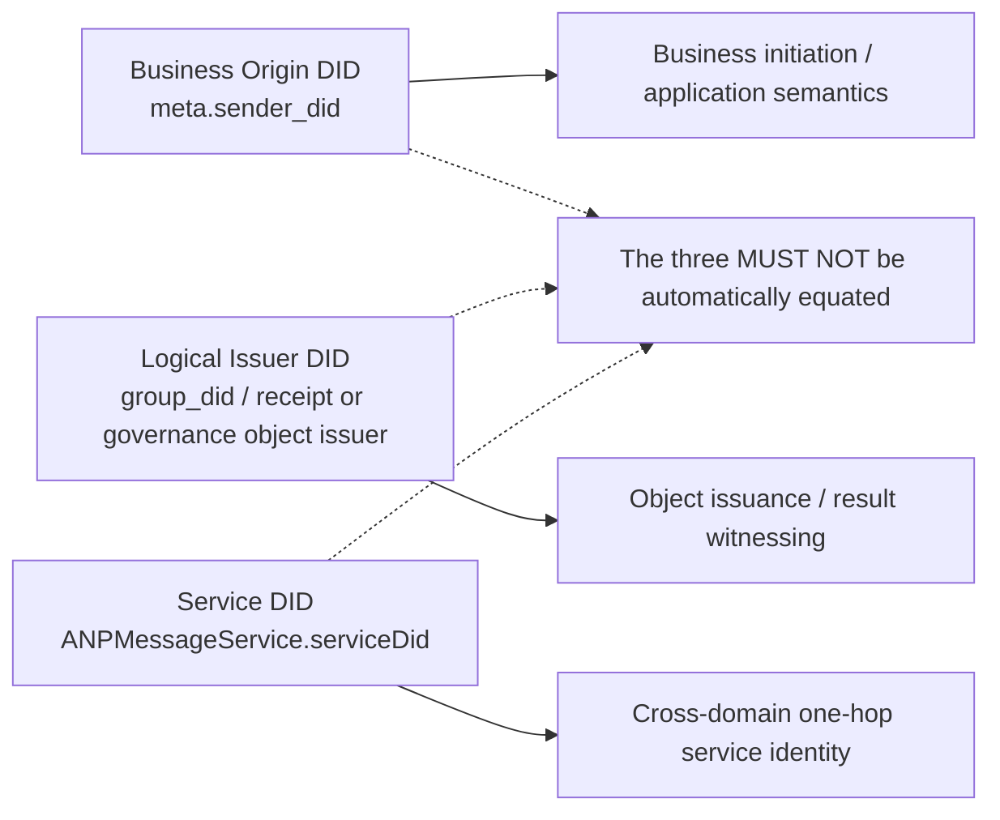
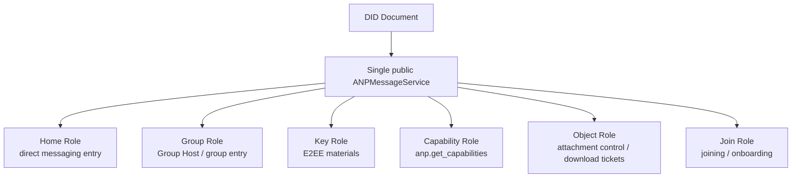
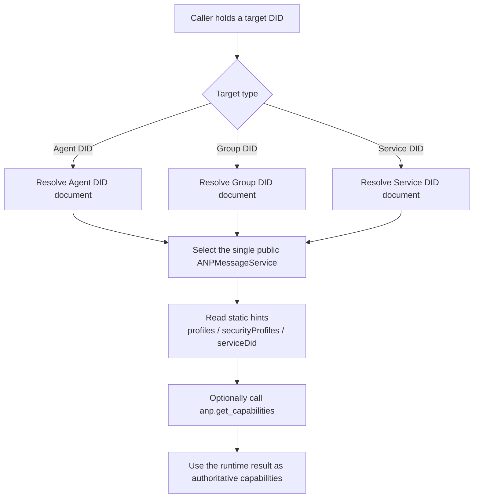

<!-- translation-review: machine-fully-reviewed; scope=source lines 1-945; inventory=japanese/reviews/core-review.json; full prose compared against source -->
> 日本語参考訳（機械翻訳を原文と全文照合し、意味・用語を校閲済み）。規範となるのは原文です。コード例・識別子・規範キーワードは原文を保持しています。
> 原文: [message/02-identity-and-discovery.md](../../message/02-identity-and-discovery.md) / 基準コミット: `0837cfdfaf4ddcf834f0890ddaf34fc4c824e066`

# ANPプロファイル2: 本人性と発見

- 文書ID: ANP-P2
- タイトル: 本人性と発見
- 状態: リリース済み
- バージョン: 1.2
- 仕様セット: ANP のメッセージング 1.2
- 原文言語: English / このページは日本語参考訳
- プロフィール: `anp.identity.discovery.v1`
- 依存関係: `anp.core.binding.v1`
- 適用範囲: ANPにおけるエージェントとグループの本人性、サービス発見、サービスエンドポイントの解釈に適用します。

---

## 1. 目的:

本プロファイルはANPの識別モデルと発見モデルを定義し、次を規定します。

1. エージェントとグループを表すDIDを使用する方法
2. DID 文書のどの属性が ANP に対する規範的な意義を持っているか。
3. DID 文書で ANP サービスエンドポイントを表現する方法
4. 呼び出し側が DID 文書に基づいて対話型 ANP サービスを発見する方法。
5. DID Documentに置いてはいけない動的状態。
6. デバイスアドレス E2EE プロファイルが DID レベルのビジネスのアドレスを変更することなく、最小の暗号エンドポイント情報を発見する方法。

このプロファイルは定義しません。

- DID メソッド自体;
- DID解決プロトコル自体。
- ハードウェアまたは機器のアイデンティティ、製品面でのデバイス名、またはデバイスの登録ワークフロー。
- 内部レプリカの同期。
- 特定のE2EEのアルゴリズムの細部;
- グループの具体的な状態機械。

---

## 2. 用語と規範上の表記規則

### 2.1 規範キーワード

本書の**MUST**、**MUST NOT**、**REQUIRED**、**SHALL**、**SHALL NOT**、**SHOULD**、**SHOULD NOT**、**RECOMMENDED**、**NOT RECOMMENDED**、**MAY**、**OPTIONAL**は、大文字表記に従って規範要件と解釈します。

### 2.2 用語集

- **Agent DID**: エージェントというプロトコル主体を表すDID。
- **Group DID**: グループというプロトコル主体を表すDID。
- **Controller**: DID Documentを更新したり、DIDに代わって制御対象の操作を開始したりできる主体。
- **ANPMessageService**: DID Documentで外部に公開する統一ANPサービス入口。
- **Federated Service DID**: 導入者がクロスドメインのサービス間HTTP認証に使うサービスDID。通常は`ANPMessageService.serviceDid`で宣言します。
- **Discovery**: DID Documentを解析し、後続の対話に適したサービスエンドポイントを選ぶ処理。
- **Device Endpoint**: Agent DID配下の暗号学的エンドポイント。デバイスを指定するE2EEプロファイルだけで不透明な`device_id`により識別し、DIDや業務上の参加者ではありません。
- **Device Manifest**: Agent DID Document内の任意の`deviceManifest`構造。そのDIDがデバイス指定のE2EEプロファイル対応を宣言する場合にのみ必須となります。
- **有資格デバイス**: 利用時に、キー参照と宣言されたプロファイルセットがE2EEプロファイルを満足させるデバイスマニフェストエントリ。

---

## 3. アイデンティティモデル

### 3.1 基本原則

ANP は、次のファーストクラスの指定を採用しています。

- **Agent DID**
- **Group DID**

ANPプロトコル層はデバイスDID、端末DID、セッションDID、レプリカDIDを定義しません。業務上の宛先、連絡先、メンバー資格、認可ロール、通常メッセージの配信はAgent DIDまたはGroup DIDに属します。

デバイス指定のE2EEプロファイルは、不透明な`device_id`でAgent DID配下の暗号学的Device Endpointを選んでもかまいません（**MAY**）。これは第一級の本人性、メンバー、`target.kind`ではなく、Baseプロファイルは必須にしたり含めたりしてはいけません（**MUST NOT**）。複数の実行時レプリカや通常の非E2EEのデバイス別配信は実装内部の事項です。

### 3.2 Agent DID

ANPプロトコル主体としてメッセージを送受信できる各エージェントは、`agent_did`を持たなければなりません（MUST）。

`agent_did` のために使用されます:

1. ダイレクトメッセージの送信者と受信者を特定する。
2. 制御操作の開始者を識別すること。
3. 利用可能なサービスエンドポイントを解決すること。
4. セキュリティオーバーレイに必要な公開情報を取得すること。
5. 認可と監査の文脈を確立すること。

### 3.3 Group DID

発見、参照、管理、クロスドメインのグループメッセージ送信の対象となる各グループは、`group_did`を持たなければなりません（**MUST**）。

`group_did` のために使用されます:

1. グループのグローバルアプリケーション層識別子として;
2. グループディスカバリーとガバナンスのアンカーポイントとしての役割を果たす。
3. グループ管理とグループメッセージングの共通ターゲット識別子として。
4. グループサービスのエンドポイントの発見入口としての役割
5. 続いてグループ暗号化プロファイルのバインディングオブジェクトとして機能します。

### 3.4 暗号識別子の分離

続いているセキュリティオーバーレイプロファイルが独立した暗号内部識別子を定義する場合、など `crypto_group_id`, `session_id`と `channel_id`, それから:

- これらは`group_did`や`agent_did`と同じでなくてもかまいません（**MAY**）。
- ただし対応するプロファイルは、その内部識別子をDIDへ暗号学的に結び付ける方法を明確に規定しなければなりません（**MUST**）。
- その結合を受信者が検証できなければなりません（**MUST**）。

### 3.5 ANP アイデンティティレイヤー

文書間で異なるレベルのアイデンティティを混合することを避けるため、ANPは少なくとも次の3つのDIDを区別します。

1. **Business Origin DID**: 業務の開始者または論理上の送信主体。要求の`meta.sender_did`など。
2. **Logical Issuer DID**: 通知、受領証、ガバナンスオブジェクトが論理的に代表する発行主体。`group_did`など。
3. **Service DID**: ホップ単位のサービス間呼び出しで使うサービスの本人性。すなわち`ANPMessageService.serviceDid`。

上記3つのアイデンティティのカテゴリ:

- 自動的に同一主体と扱ってはいけません（**MUST NOT**）。
- 対応するプロファイルは誰が署名、認可、ルーティングに責任を持つか明記しなければなりません（**MUST**）。
- クロスドメインでは`serviceDid`で業務主体のDIDを置き換えてはいけません（**MUST NOT**）。
- `serviceDid`は「どの公開サービス入口が1ホップのサービス呼び出しを実行しているか」だけを示し、グループの`owner/admin/member`など業務ロールの判定に直接使ってはいけません（**MUST NOT**）。

---

ANPの最も簡単な間違いの1つは、ビジネス送信者、オブジェクト発行者、およびワンホップサービスアイデンティティを混同することです。 次の図は、これらの3つのDIDレイヤーを1ビューに置き、その後のプロファイルはそれぞれ参照できるようにします。



*図P2-1: ANPの本人性の階層関係（規範ではありません）。*

後続文書で署名、認可、ルーティングを要求するときは、3主体を同じと読者が解釈すると仮定せず、どのDID階層を使うか明示するべきです。

## 4. DID文書のANP解釈ルール

### 4.1 一般ルール

ANP では、DID ドキュメントには以下のような責任があります。

1. 安定した本人性の入口を提供すること。
2. 認証関係と信頼されるキー素材の宣言
3. サービスエンドポイントを公開すること。
4. サービス発見の手掛かりを提供すること。
5. デバイス指定のE2EE対応を宣言するとき、その暗号学的エンドポイントの検証に必要な最小限の現行Device Manifestを公開すること。

DID Documentを次として扱ってはいけません（**MUST NOT**）。

- リアルタイムメッセージステータスデータベース
- グループメンバーのリアルタイムストレージ。
- オンライン状態の貯蔵;
- 高頻度の鍵ローテーションログ。
- エージェント内部のレプリカリスト。

<a id="method-validation"></a>
#### 4.1.1 DID メソッドの検証

本プロファイルは[ANP-02の識別情報](../02-anp-did-authentication-protocol-specification.md#identity-input)と該当DIDメソッドバインディングに従ってDID Documentを解決・検証します。`did:wba`、`did:web`、その他対応メソッドは同じサービス発見、鍵用途、デバイス適格性の規則を使い、メソッド固有のDocument検証は各メソッド仕様が定めます。

発見とオブジェクトの署名検証にリクエスト認証手順の実施は不要です。`authentication`、`assertionMethod`、`keyAgreement`には引き続き、本プロファイルと担当メッセージプロファイルの操作要件に従う検査を適用します。

### 4.2 DID文書の最小要件

ANP で使用される DID 文書の場合:

- `id`が存在しなければなりません（**MUST**）。
- 能動的に発見・対話するDIDでは`service`が存在しなければなりません（**MUST**）。
- 検証・参照だけに使うDIDでは`service`を省略してもかまいません（**MAY**）。
- 要求に業務開始者DIDとして現れるDIDには`authentication`が存在しなければなりません（**MUST**）。
- 主張を表す署名オブジェクトに対応する場合、`assertionMethod`が存在するべきです（**SHOULD**）。
- 暗号化オーバーレイに対応する場合、`keyAgreement`が存在するべきです（**SHOULD**）。
- `capabilityInvocation`は任意拡張として存在してもかまいません（**MAY**）が、v1の最小相互運用要件には含みません。
- Agent DIDがデバイス指定のE2EE対応を宣言する場合、`deviceManifest`が存在し§5.5を満たさなければなりません（**MUST**）。BaseだけのDIDには不要です。

### 4.3 DID文書の最小化の原則

DID Documentの情報は次を保つべきです（**SHOULD**）。

- 変更頻度が低いこと。
- 機密性が低いこと。
- 低い関連性;
- DIDの使用状況に直接関連しています。

これらを満たさない内容は、DID Documentに直接埋め込まず、制御されたサービスエンドポイントで提供する側へ移すべきです（**SHOULD**）。

---

## 5. エージェント DID 仕様

### 5.1 Agent DID Documentに必要な意味内容

ANPのAgent DID Documentは少なくとも次を表現しなければなりません（MUST）。

1. `id`
2. 後続対話に利用できる少なくとも1つの`service`。

### 5.2 認証関係

Agent DIDが業務開始者として`meta.sender_did`に現れる、または`anp-rfc9421-origin-proof-v1`を使うとする業務証明の`keyid`検証経路に現れる場合、DID Documentは`authentication`関係を提供しなければなりません（**MUST**）。

要求が`auth.origin_proof`を使う場合、検証者は`keyid`が指す認証メソッドがこのDID Documentの`authentication`関係で認可されているか確認しなければなりません（**MUST**）。

Agent DIDを受動的参照、オブジェクト所有、オフライン検証だけに使い、要求開始者としてANP対話に参加しない場合、`authentication`を省略してもかまいません（**MAY**）。

グループ管理、宣言、署名付き制御オブジェクトに主張を行う必要がある場合、DID Documentは`assertionMethod`関係を提供するべきです（**SHOULD**）。

### 5.3 鍵合意の関係

E2EEオーバーレイに対応する場合、DID Documentは`keyAgreement`関係を提供するべきです（**SHOULD**）。
`keyAgreement`が参照する検証メソッドは、鍵合意または機密情報受信のための公開鍵情報を表す用途にだけ使わなければなりません（**MUST**）。

### 5.4 サービスエンドポイント

直接メッセージング、機能発見、オブジェクト制御、その他能動的発見が必要なANP機能に対応するAgent DID Documentには、少なくとも1つの`ANPMessageService`を含めなければなりません（**MUST**）。

この統一入口はさらに次の機能を担ってもかまいません（**MAY**）。

- ダイレクトメッセージのメインエントランス。
- 能力の交渉;
- セキュリティオーバーレイの公開情報へのアクセス。
- オブジェクト制御プレーンとオブジェクトダウンロード入口の発見。

内部で複数部品に機能を分けても実装の詳細であり、DID Documentで機能ごとに複数の独立ANPサービス型を公開するべきではありません（**SHOULD NOT**）。

外部公開の添付ファイル制御プレーンのメソッドにも、DID Documentの統一`ANPMessageService`を通じてアクセスしなければなりません（**MUST**）。内部でObject Service、Key Service、Group Hostの独立部品へ要求を振り分けるかは実装の詳細で、外部の標準サービス発見モデルは変わりません。

### 5.5 デバイス指定のE2EEプロファイル用Device Manifest

`deviceManifest`はAgent DID Documentのトップレベル拡張で、Direct E2EEやGroup E2EEなど暗号学的なデバイスエンドポイントを宛先とするセキュリティプロファイルだけが使います。Agent DIDを複数の業務本人性の集合に変えるものではなく、通常のBaseメッセージングも使いません。

標準形状は:

```json
{
  "deviceManifest": {
    "type": "ANPDeviceManifest",
    "devices": [
      {
        "device_id": "dev-a-7N3KQ2",
        "signing_key_id": "did:example:agent-a#dev-a-sign",
        "e2ee_key_id": "did:example:agent-a#dev-a-e2ee",
        "profiles": [
          "anp.core.binding.v1",
          "anp.identity.discovery.v1",
          "anp.direct.base.v1",
          "anp.direct.e2ee.v2"
        ]
      }
    ]
  }
}
```

下記のルールが適用されます。

1. デバイス指定のE2EEを宣言または呼び出すAgent DIDは、現行の`deviceManifest`を公開しなければなりません（**MUST**）。Baseだけに対応するAgent DIDは省略してもかまいません（**MAY**）。
2. `deviceManifest.type`は`ANPDeviceManifest`と等しくなければなりません（**MUST**）。`devices`は配列でなければなりません（**MUST**）。各標準デバイスエントリーは正確に`device_id`、`signing_key_id`、`e2ee_key_id`、`profiles`を含めなければなりません（**MUST**）。
3. `device_id`は現Agent DID Manifest内で一意な不透明文字列でなければならず（**MUST**）、除去後に再利用してはいけません（**MUST NOT**）。DID、ハードウェア番号、表示名、ロールではありません。
4. `signing_key_id`と`e2ee_key_id`は同じAgent DID Documentの検証メソッドを参照するDID URLでなければなりません（**MUST**）。`signing_key_id`は担当E2EEプロファイルが要求する検証関係で認可されていなければなりません（**MUST**）。Origin Proofでは`authentication`、Object Proofでは`assertionMethod`です。`e2ee_key_id`は`keyAgreement`で認可されていなければなりません（**MUST**）。
5. `profiles`はデバイスが対応する完全な依存集合を含む空でない文字列配列でなければなりません（**MUST**）。P5にはP1・P2・P3・P5、P6にはP1・P2・P4・P6を含めます。Baseを依存として列挙してもBase操作がデバイス指定になるわけではありません。
6. P3 Direct Base、P4 Group Base、P7の通常添付、その他の非E2EEフローで、Manifestを使ってセレクターを要求したり、デバイス別結果を公開したり、DID単位の配信意味論を変えたりしてはいけません（**MUST NOT**）。
7. デバイス除去は、そのエントリーと有効なデバイス鍵参照を除いた更新済みDID Documentの公開を意味します。以後、そのデバイスを選ぶデバイス指定操作は拒否しなければなりません（**MUST**）。再登録は新しい`device_id`と新しい鍵を使います。
8. マニフェストは、DID メソッドのドキュメントの一部として保護され更新されます。 このプロファイルは、別のマニフェストエンドポイント、プルーフ、エポック、ハッシュ、チェックポイント、または比較およびスワッププロトコルを定義しません。
9. Manifestに秘密鍵、製品内部のロール・トークン、人に読みやすいデバイス名、ハードウェア識別子、オンライン状態、回復状態、内部レプリカ構成を含めてはいけません（**MUST NOT**）。

---

## 6. グループDID仕様

### 6.1 グループ DID 文書に必要なセマティクス

ANPのGroup DID Documentは少なくとも次を表現しなければなりません（MUST）。

1. `id`
2. `controller`
3. 少なくとも1つのグループサービスエンドポイント(`ANPMessageService`)

### 6.2 グループ制御の権利

`controller` 単一の DID か複数の DID である場合もあります。
複数のコントローラーがある場合、それら間の内部のコラボレーション機構はこのプロファイルでは定義されていないが、次の機能があります。

- DID Document更新の正当性はDIDメソッドが保証しなければなりません（**MUST**）。
- 呼び出し元は解決したDID Documentに従わなければなりません（**MUST**）。
- グループガバナンスのプロファイルはグループ内ロールと認可規則をさらに定義しなければなりません（**MUST**）。

### 6.3 グループガバナンスの検証関係

`anp.group.base.v2`対応のGroup DID Documentでは:

- `assertionMethod`が存在しなければなりません（**MUST**）。
- `capabilityInvocation`は追加のガバナンス能力委任関係として存在してもかまいません（**MAY**）が、`assertionMethod`を代替しません。

グループ管理・ポリシー・状態オブジェクトが署名を要求する場合、検証者はDID Documentが許す検証関係を使わなければなりません（**MUST**）。

### 6.4 グループDID文書禁止内容

次をGroup DID Documentに直接埋め込んではいけません（MUST NOT）。

- ダイナミックメンバーリスト
- オンライン会員リスト
- 現在のメッセージのシーケンス番号;
- 現在のグループ epoch;
- メッセージごとの状態。
- ワンタイムプレキーリスト;
- MLS KeyPackage リアルタイムコレクション;
- 頻繁に変化する招待・グループガバナンスのキュー。
- エージェント内部のレプリカリスト。

### 6.5 グループ DID ドキュメント オプションのコンテンツ

次は存在してもかまいません（**MAY**）が、機密情報の開示を避ける必要があります。

- グループ表示名;
- グループ アイコンの参照;
- グループ 公開 説明;
- グループの公開ポリシーの要約。
- 文書版情報;
- サービス機能のまとめ

任意フィールドに重大なプライバシー漏洩や関連付けの危険がある場合、DID Documentに書くべきではなく（**SHOULD NOT**）、アクセスを制限したサービスエンドポイントで提供するべきです。

---

## 7. ANPサービスエンドポイントタイプ

### 7.1 一般

ANPはDID Document内の`service`に基づいてサービスを発見します。
全てのANPサービスエンドポイントオブジェクトは次を持たなければなりません（**MUST**）。

- `id`
- `type`
- `serviceEndpoint`

サービスエンドポイントオブジェクトは少数の静的な手掛かりを含めてもかまいません（**MAY**）が、v1の標準相互運用が要求するのは次だけです。

- `profiles`
- `securityProfiles`
- `serviceDid`

現行版ではDID Documentは標準ANPサービス型として`ANPMessageService`だけを公開するべきです（**SHOULD**）。
直接メッセージング、グループ、鍵、オブジェクト、クロスドメイン転送を内部で複数部品に分けても実装の詳細であり、DID Documentに別の標準`service type`を定義するものではありません。

クロスドメイン呼び出しでの選択の曖昧さを減らすため、各DID Documentはドメイン間で呼び出せる`ANPMessageService`を1つだけ公開しなければなりません（**MUST**）。
内部に複数のサービス部品があっても、同じ外部公開のクロスドメイン`ANPMessageService`の下に集約しなければなりません（**MUST**）。

### 7.2 `ANPMessageService`

#### 7.2.1 意味

`ANPMessageService`は、DID Documentを通じて外部から発見できる統一されたメッセージング・対話の入口です。

#### 7.2.2 目的

- `direct.send`を受信する。
- `group.get_info`、`group.send`、`group.e2ee.send`、グループ管理・E2EE関連の操作を受信する。
- 提供サービス `anp.get_capabilities`
- Direct/Group E2EEに必要な公開情報へのアクセスを提供する。
- `group.e2ee.notice`の受信・配布を担う（グループE2EE対応の場合）。
- 提供サービス `attachment.create_slot`, `attachment.commit_object`, `attachment.abort_object`, `attachment.get_download_ticket`
- オブジェクトHTTP(S)ダウンロードポータルとして発見されたサービスアンカー(デプロイメントでサポートされている場合)

外部公開の添付ファイル制御プレーンのメソッドは、このDIDが公開する統一`ANPMessageService`を入口としなければなりません（**MUST**）。内部で独立のObject Service、Key Service、Group Hostへ振り分けるかは実装の詳細で、外部の標準サービス発見モデルは変わりません。

#### 7.2.3 条件

- 能動的に発見・対話できるAgent DID Documentは、少なくとも1つの`ANPMessageService`を含めなければなりません（**MUST**）。
- Group DID Documentは、少なくとも1つの`ANPMessageService`を含めなければなりません（**MUST**）。
- クロスドメインのサービス間呼び出しに参加する`ANPMessageService`のエントリーは、`serviceDid`を宣言しなければなりません（**MUST**）。
- 複数の内部部品があっても、DID Documentは統一入口だけを公開し、実行時機能交渉で細かな機能境界を返さなければなりません（**MUST**）。
- 鍵情報や添付制御を含む外部公開のサービス単位のメソッドは、対象サービス本人性の基点として統一入口の`serviceDid`を使わなければなりません（**MUST**）。対応プロファイルがendpoint-localと明示する場合は例外です。

クロスドメインでのサービス選択の曖昧さを減らすため、v1は単一の統一`ANPMessageService`の外部公開を勧めます。次の図はその入口と代表的な内部論理ロールを併記し、公開サービス型と内部の分担を区別します。



*図P2-2: 統一ANPMessageServiceと内部ロールの関係（規範ではありません）。*

図のロールは内部機能境界の例にすぎず、新しいDIDの`service type`を定義せず、標準のサービス発見フィールドを置き換えるものでもありません。


### 7.3 論理的役割 `ANPMessageService`

本節は統一入口の内部にある代表的な機能境界の**非規範的な説明**です。DID Documentの独立した標準サービス型や、v1のサービス選択フィールドではありません。

#### 7.3.1 ホームロール

Home RoleはAgent側の主入口機能を表し、`direct.send`の受信、機能情報の返却、後続の対話経路の提示に使います。

#### 7.3.2 キーの役割

Key Roleはセキュリティオーバーレイに必要な公開情報の公開・発見機能を表し、次に使います。

- Direct E2EEに必要な公開情報の発見。
- Group E2EEに必要な初期導入用情報の発見。
- 続いているセキュリティプロファイルで定義されたパブリックオブジェクトを発見

#### 7.3.3 グループの役割

グループの役割は、グループの主要な入り口またはホスト機能を表し、以下に使用されます。

- `group.create`後のグループ管理操作を処理する。
- `group.send`と`group.e2ee.send`を受信する。
- グループポリシー、グループE2EE機能または関連する制御の入り口を公開
- グループ状態の変更を順序付ける正本となる入口として機能する。

#### 7.3.4 Join Role

Join Roleは参加・招待関連の入口機能を表します。

#### 7.3.5 機能の役割

機能のロールは、機能交渉のエントリー能力を表します。

#### 7.3.6 オブジェクトの役割

オブジェクトロールは、オブジェクトのアップロード、オブジェクトアクセス制御、ダウンロードチケット発行、オブジェクトのダウンロードポータルの検出の機能を表しています。

#### 7.3.7 クロスドメイン転送機能

`ANPMessageService`の背後でクロスドメイン転送やドメインゲートウェイを実装してもかまいません（**MAY**）が、現行版はその独立DIDサービス型を**定義しません**。

クロスドメインのサービス間呼び出しを有効にする場合、ドメインゲートウェイやドメインサービスの外側HTTP認証は、通常のAgent DIDやGroup DIDでなく、ドメイン所有者が確保した連合サービスDIDを使うべきです（**SHOULD**）。詳細はP8が定義します。

#### 7.3.8 透明ディレクトリと監査インデックス

ディレクトリの透明性、透明性ログ、監査索引に対応する場合、`ANPMessageService`の拡張機能として提供してもかまいません（**MAY**）。現行版は別個の独立DIDサービス型を定義しません。

---

## 8. ANPサービスエンドポイント拡張フィールド

実装間の発見を容易にするため、本プロファイルはv1の静的ヒントを少数フィールドに限り、残りの機能情報は`anp.get_capabilities`で提供するべきです（**SHOULD**）。

### 8.1 `profiles`

- タイプ: 文字列配列
- 意味: サービスエンドポイントが直接対応するANPプロファイルの集合。
- 条件: **SHOULD**
- Note: このフィールドは静的、キャッシュ可能な粗粒状のヒントだけを表現し、ランタイム機能交渉を置き換えません。

### 8.2 `securityProfiles`

- タイプ: 文字列配列
- 意味: サービスエンドポイントが対応するセキュリティプロファイルの集合。
- 条件: **SHOULD**
- 説明: このフィールドはエンドポイントレベルでサポートされるセキュリティプロファイルのセットを示します。 広告されたセキュリティプロファイルごとにすべての方法が利用可能であることを保証するものではありません。

### 8.3 `acceptedContentTypes`

- タイプ: 文字列配列
- 意味: サービスエンドポイントが受け入れるメッセージのコンテンツ型の集合。
- 条件: **標準のv1 DIDヒントではなく**
- 説明:
  - この情報を公開する必要がある場合、`anp.get_capabilities`で返すべきです（**SHOULD**）。
  - DID Document内に現れた場合、受信者は実装拡張として扱ってもかまいません（**MAY**）。

### 8.4 `acceptedObjectTypes`

- タイプ: 文字列配列
- 意味: サービスエンドポイントが受け入れる制御プレーンのオブジェクト型の集合。
- 条件: **標準のv1 DIDヒントではなく**
- 説明: 静的DID Documentヒントでなく実行時機能として提供することを推奨します（RECOMMENDED）。

### 8.5 `priority`

- タイプ: 整数
- 意味: エンドポイントの優先順位。
- 条件: **標準のv1 DIDヒントではなく**
- 説明:
  - v1のサービス選択はDID Document内の`priority`に依存しません。
  - 展開がこのフィールドをカスタマイズする場合、プライベートエクステンションとして扱われるべきです。

### 8.6 `authSchemes`

- タイプ: 文字列配列
- 意味: このエンドポイントが対応する、呼び出し元からサービスへの呼び出し元認証方式。
- 条件: **標準のv1 DIDヒントではなく**
- 説明:
  - この機能は、通常、ランタイムゲートウェイの設定で変更されます。
  - `anp.get_capabilities`で公開するほうが適しています。
  - 業務層の`anp-rfc9421-origin-proof-v1`の証明搬送形式を記述するものでも**ありません**。

### 8.7 `serviceDid`

- タイプ: 文字列
- 意味: クロスドメインのサービス間HTTP認証で使う`ANPMessageService`のDID。
- 要件: このエンドポイントがクロスドメインのサービス間呼び出しに参加する場合は必須（**MUST**）。

ルール:

1. `serviceDid`はDID文字列でなければならず（**MUST**）、DID URLではありません。
2. 外側HTTP Message Signaturesの`keyid`は、`serviceDid`のDocumentの`authentication`関係で認可された検証メソッドを指さなければなりません（**MUST**）。
3. `did:web`と`did:wba`の環境では、`serviceDid`にベアドメインDIDを優先するべきです（**SHOULD**）。
4. `serviceDid`は「どのサービスの本人性がクロスドメイン呼び出しを行うか」を表し、`meta.sender_did`が表す業務主体の本人性ではありません。
5. `serviceDid`の具体的な実行時検証手順はP8が定義します。
6. DID Documentの`serviceDid`は発見の手掛かりであり、実際の信頼はP8の実行時検証に成功して確立します。
7. サービス単位のメソッドでは、`meta.target.did`を対象の公開`ANPMessageService.serviceDid`に結び付けるべきです（**SHOULD**）。オブジェクト制御、鍵情報、グループ参加情報の各メソッドも、プロファイルがendpoint-localと明示する場合以外は同じ原則に従います。

---

## 9. ディスカバリー・プロセス

以下でAgent、Group、`serviceDid`の発見を個別に説明します。先に示す統一図では、3経路がいずれも公開`ANPMessageService`と実行時機能交渉に集約されることが分かります。



*図P2-3: Agent / Group / Serviceの統一発見フロー（規範ではありません）。*

以下の§9.1・9.2・9.3は、独立した3種類の発見思想ではなく、この統一図を3つの対象型に適用した具体例として読んでください。

### 9.1 エージェントの発見

`agent_did`の発見手順は次のとおりです。

1. `agent_did`を解決してDID Documentを得ます。
2. `service`一覧を読みます。
3. 唯一のクロスドメイン`ANPMessageService`を選びます。
4. 後でクロスドメインのサービス間呼び出しを使う場合、選択エントリーの`serviceDid`を読みます。
5. `profiles`、`securityProfiles`、実行時機能交渉の結果、ローカルポリシーを合わせて、統一入口で使える機能を決めます。
6. 通常のBase操作はAgent DIDと選択サービスを直接使います。`deviceManifest`を要求したり、デバイスを選択したり、既定デバイスを作り出したりしてはいけません。
7. デバイス指定E2EEでは現行`deviceManifest`を解決し、担当E2EEプロファイルに従って適格なデバイスだけを選びます。
8. 明示的な機能交渉には同じ入口で`anp.get_capabilities`を呼びます。

### 9.2 グループディスカバリー

`group_did`の発見手順は次のとおりです。

1. `group_did`を解決してDID Documentを得ます。
2. 唯一の`ANPMessageService`を読みます。
3. 後でクロスドメインのサービス間呼び出しを使う場合、選択エントリーの`serviceDid`を読みます。
4. `profiles`、`securityProfiles`、実行時機能交渉結果、ローカルポリシーを合わせて、統一入口で使えるグループ管理、メッセージング、参加、E2EE関連の機能を決めます。
5. Group E2EEが有効なら、グループ側の公開情報、暗号学的結果の配信機能、関連制御を同じ入口から発見します。メンバーの参加情報は引き続きAgent DIDに対応する統一入口で発見します。

### 9.3 サービスDIDの発見

サービス単位メソッドの対象`serviceDid`が分かる場合、発見手順は次のとおりです。

1. `serviceDid`に対応するDID Documentを解決します。
2. その`serviceDid`に対応する`ANPMessageService`を選びます。
3. `serviceEndpoint`と静的ヒントを読みます。
4. 正確な機能境界には同じ入口で`anp.get_capabilities`を呼びます。
5. P8の実行時サービス本人性結合検証に成功した後だけ、その`serviceDid`を信頼できるクロスドメインサービスの本人性と扱えます。

添付のDownload Ticket取得では、添付一覧を含む元メッセージの送信者DIDを発見の基点とし、公開`ANPMessageService`を解決しなければなりません（**MUST**）。グループでも元グループメッセージの送信者からDIDを取り、`group_did`は使いません。`object_uri`のURLドメインだけから制御プレーンサービスを逆算してはいけません（**MUST NOT**）。


### 9.4 サービス選択

複数の候補エンドポイントがある場合、まず次の順序で選ばなければなりません（**MUST**）。

1. 要求する`profile`で絞ります。
2. 次に要求する`security_profile`で絞ります。
3. 実行時機能交渉の結果を正本の検証結果として使います。
4. 複数の結果がまだある場合は、ローカルポリシーに従って選択してください。

v1の標準サービス選択は、DID Document内の`supportedMethods`、`logicalRoles`、`priority`に依存しません。

### 9.5 キャッシュ

DID解決結果とサービス選択結果をキャッシュしてもかまいません（**MAY**）。
ただし次の場合は再解決するべきです（**SHOULD**）。

- 署名検証が失敗しました。
- 鍵合意が失敗した場合。
- サービスエンドポイントは、能力変化を返します。
- DIDの制御権変更が疑われる場合。
- `serviceDid` 検証が失敗しました。
- エンドポイントオリジンバインディングが失敗しました。
- 静的ヒントは、ランタイム機能結果と競合します。
- ローカルキャッシュが期限切れになります。

---

## 10. DID文書とセキュリティのオーバーレイの関係

### 10.1 利用の目的 `keyAgreement`

Agent DIDまたはGroup DID Documentが`keyAgreement`を宣言する場合、後続セキュリティプロファイルは、そのDIDの機密情報受信や鍵合意の基礎として、そこで許可されたメソッドだけを使わなければなりません（**MUST**）。

### 10.2 署名検証関係

オブジェクトが DID でアサートされると主張する場合:

特に`auth.origin_proof`を使う要求では、認証制御操作として扱い、`authentication`を確認しなければなりません（**MUST**）。

- オブジェクトが認証制御操作なら、`authentication`を確認するべきです（**SHOULD**）。
- 宣言や署名による主張なら、`assertionMethod`を確認するべきです（**SHOULD**）。
- ガバナンス能力の呼び出しなら、`capabilityInvocation`を確認してもかまいません（**MAY**）が、v1の最小相互運用要件には含みません。

### 10.2.1 デバイスセキュリティのバインディング

デバイスセレクターや公開鍵を使う前に、デバイス指定E2EEプロファイルは現Agent DIDの`deviceManifest`に照らして選択エントリーを検証しなければなりません（**MUST**）。そのエントリーは要求E2EEプロファイルと依存関係を宣言しなければならず（**MUST**）、鍵参照は実際の操作で使う鍵と一致しなければなりません（**MUST**）。

`auth.origin_proof`と`meta.sender_device_id`を併用する場合、証明の`keyid`はそのエントリーの`signing_key_id`と等しくなければなりません（**MUST**）。E2EEで`meta.recipient_device_id`を使う場合、暗号化・セッション確立の鍵は選択エントリーの`e2ee_key_id`でなければなりません（**MUST**）。P5/P6のような担当E2EEプロファイルが正確な認証対象文脈と拒否箇所を定めます。

通常のBase操作はセレクターを含めずデバイス鍵も選ばないため、これらの検査は適用しません。

### 10.3 動的セキュリティ材料の外部配置

次はDID Documentに埋め込まず、制御されたサービスエンドポイントで提供するべきです（**SHOULD**）。

- 高頻度でローテーションする公開情報。
- 一度限りの初期導入用情報。
- グループエポック関連材料;
- 動的なグループ状態の要約。

---

## 11. グループDIDとグループガバナンス

### 11.1 グループDIDの役割

`group_did` グループのアプリケーションレイヤーグローバル識別子であり、特定の暗号化実装内部IDと等しくはありません。

### 11.2 グループガバナンスの外部化

グループメンバー資格、ロールの認可、招待状態、メンバー状態、ポリシー版、状態要約などのオブジェクトは、次を通じて表すべきです（**SHOULD**）。

- グループに対応する`ANPMessageService`。
- または将来のグループガバナンスプロファイル

DID Document内ではなく、署名付きで提供します。

### 11.3 制御・グループポリシーの分離

`controller` DID ドキュメントでは、DID 文書自体をコントロールしている人のみを示します。
グループ内の「誰がメンバーの追加・除去やポリシー変更を行えるか」はアプリケーション層のガバナンス規則で、`controller`から機械的に導くべきではありません。
同様に`serviceDid`はサービス呼び出しの本人性だけを表し、グループの`owner/admin/member`などの業務ロール主体と直接解釈するべきではありません。

---

## 12. エージェント DID 移行検証

### 12.1 方法固有の移行プロファイル

P2はAgent DID移行の共通呼び出し意味論を定め、証明規則は各DIDメソッド仕様が担当します。実装は次に相当する内部操作を提供するべきです（**SHOULD**）。

```text
resolve_current_agent_did(input_did, trusted_cache)
  -> { requested_did, current_did, transition_status, assurance }
  | error
```

この結果は実装内部のものであり、ANP Messagingの通信オブジェクトに`stable_subject_id`、安定主体パス、その他の本人性フィールドを追加してはいけません（**MUST NOT**）。

### 12.2 `e1_`パス型did:wbaの移行

本仕様で最初に登録する自動移行経路は、最終セグメントが`e1_`フィンガープリントプロファイルのパス型did:wbaです。以前に信頼したDIDから開始し、[ANP-03メソッド規則](../03-did-wba-method-design-specification.md#wba-method-rules)に従って全ホップと最終の有効状態のDID Documentを検証し、循環、後継の競合、信頼済みキャッシュとの競合を拒否しなければなりません（**MUST**）。

未信頼の新DIDから始め、パスが既存の本人性に似ているだけで継続性を推定してはいけません（**MUST NOT**）。

### 12.3 継続保証

移行結果は実際の保証水準を保たなければなりません（**MUST**）。

- `verified`: 旧DIDの結合ルート鍵が無効化と後継関係に署名している。
- `recovery_verified`: 以前に信頼された古い文書で承認された回復キーは、移行を確立します。
- `provider_asserted`: 旧結合鍵や事前認可回復鍵の証明はないが、認証済み同一オリジンHTTPS解決で証明が有効な最終DIDまで完全な直接後継チェーンを検証するか、本人性Providerが別途認証した回復・移行権限チャネルで前任・後継関係を提供している。単独の`successorDid`、Handle/WNS対応付け、単一の未署名ホップ、409の手掛かりだけではこの水準にならない。
- `unverified`: 受入継続証拠が存在しません。

移行リゾルバーが`provider_asserted`を報告するのは認証された完全チェーン解決の成功後だけです。別途認証されたProvider権限チャネルは担当業務システムが評価します。いずれも結合鍵・回復鍵による暗号学的継続性へ格上げするものではありません。どの関係や認可を継承できるかは担当業務システムが判断します。

担当業務プロファイルは`provider_asserted`を`verified`や`recovery_verified`として扱ってはいけません（**MUST NOT**）。また、保証が`provider_asserted`という理由だけで失敗させてもいけません（**MUST NOT**）。十分かどうか、どの業務関係・認可を継承するかは担当業務システムが判断します。`unverified`は移行の継続性を確立しません。

### 12.4 ヒントとサポートされていない移行プロファイル

`alsoKnownAs`と一致する安定主体パスで候補を識別してもかまいません（**MAY**）が、いずれも単独で移行、ロール、メンバー資格、ACL、添付の権限、E2EEの適格性を認可できません。

ベアドメインdid:wba、`k1_` DID、結合フィンガープリントのない旧パス、`did:web`、その他ANP移行検証プロファイルが未登録のDIDメソッドでは:

- アクティブで検証可能なDIDは、厳密に書面として使用し続けます。
- 名前、パス、`alsoKnownAs`だけからDID間の継続性を導いてはいけません（**MUST NOT**）。
- 無効化済みDIDでは`anp.did_transition_invalid`と`reason = transition_profile_not_supported`で安全側に閉じて失敗しなければなりません（**MUST**）。

### 12.5 グループ DID 境界

本仕様はGroup DIDの自動移行を定義しません。正確な`group_did`が無効化された場合、Group Hostは新しいグループ操作とP6アプリケーションメッセージ処理を拒否しなければなりません（**MUST**）。Group DIDの後継を自動でたどってはいけません（**MUST NOT**）。過去の受領証・署名は過去のGroup DIDで検証できます。

---

## 13. プライバシーと最小限の開示

### 13.1 サービスエンドポイントの最小化

DID Document内の`service`節は最小化するべきです（**SHOULD**）。
公開発見に不要なサービスはDID Documentに載せるべきではありません（**SHOULD NOT**）。

### 13.2 関係制御

実装者は次を避けるべきです（**SHOULD**）。

- 複数のDID文書でユニークなエンドポイントパターンを再利用することで、強力な相関性が生まれます。
- 組織構造、展開トポロジー、内部ロール分布を直接推論できる DID 文書に説明を配置します。
- DID文書によるメッセージのボリューム、アクティビティ、オンラインステータス、内部のレプリカ構造を公開します。

### 13.3 公開情報と制限付き情報の分離

公開発見に必要な情報はDID Documentに置いてもかまいません（**MAY**）。
アクセス制御が必要な情報は制限付きサービスエンドポイントで返すべきです（**SHOULD**）。

### 13.4 デバイスマニフェストミニマライゼーション

デバイス指定E2EEでManifestが必要な場合、公開内容は§5.5の4つのデバイスエントリーフィールドだけに制限しなければなりません（**MUST**）。不透明でユーザー向けでない`device_id`を使うべきであり、デバイス名、ハードウェア詳細、在席状態、ローカルポリシー、回復データはDID Documentの外に保つ必要があります。

---

## 14. 最小相互運用性要件

本プロファイルの適合実装は少なくとも次を満たさなければなりません（MUST）。

1. 各エージェントが`agent_did`を持つこと。
2. 各グループが`group_did`を持つこと。
3. Agent DIDとGroup DID Documentが少なくとも1つの`ANPMessageService`を提供すること。
4. DID文書に基づくサービスディスカバリーの実行をサポート
5. 静的ヒントが少なくとも`profiles`、`securityProfiles`、`serviceDid`に対応すること。
6. 実行時機能の正本を`anp.get_capabilities`とすること。
7. DID 文書に動的グループ状態を埋め込むことはありません。
8. デバイスセレクターや必須マニフェストなしで、通常のベースディスカバリーとDIDレベルの配信を保ちます。
9. デバイス指定E2EEの宣言時に、§5.5の最小`deviceManifest`を公開・検証すること。
10. デバイスDID、デバイスビジネス会員、または製品内レプリカのセマティクスは導入しないでください。
11. 登録されたエージェントの DID 移行に対する実際の保証を 2 番目のワイヤ ID を追加せずに返します。
12. 当該移行プロファイルの対応を主張する場合、第12章の`e1_` did:wba移行検証規則を実装すること。
13. `alsoKnownAs`は候補にとどめ、登録済み移行プロファイルがない無効化DIDでは安全側に閉じて失敗すること。
14. グループIDを自動で移行しないでください。

---

## 15. 事例紹介

### 15.1 エージェント DID ドキュメントのフラグメント例

次のフラグメントは、ダイレクトE2EEの2つの暗号デバイスエンドポイントで1つのエージェントIDを示しています。 2つのエントリは、2つのエージェントを作成しず、サービスによってリストされている通常のベースプロファイルは、DID-addressedままです。

```json
{
  "id": "did:example:agent-a",
  "verificationMethod": [
    {
      "id": "did:example:agent-a#dev-a-sign",
      "type": "JsonWebKey2020",
      "controller": "did:example:agent-a",
      "publicKeyJwk": {
        "kty": "OKP",
        "crv": "Ed25519",
        "x": "..."
      }
    },
    {
      "id": "did:example:agent-a#dev-a-e2ee",
      "type": "JsonWebKey2020",
      "controller": "did:example:agent-a",
      "publicKeyJwk": {
        "kty": "OKP",
        "crv": "X25519",
        "x": "..."
      }
    },
    {
      "id": "did:example:agent-a#dev-a2-sign",
      "type": "JsonWebKey2020",
      "controller": "did:example:agent-a",
      "publicKeyJwk": {
        "kty": "OKP",
        "crv": "Ed25519",
        "x": "..."
      }
    },
    {
      "id": "did:example:agent-a#dev-a2-e2ee",
      "type": "JsonWebKey2020",
      "controller": "did:example:agent-a",
      "publicKeyJwk": {
        "kty": "OKP",
        "crv": "X25519",
        "x": "..."
      }
    }
  ],
  "authentication": [
    "did:example:agent-a#dev-a-sign",
    "did:example:agent-a#dev-a2-sign"
  ],
  "assertionMethod": [
    "did:example:agent-a#dev-a-sign",
    "did:example:agent-a#dev-a2-sign"
  ],
  "keyAgreement": [
    "did:example:agent-a#dev-a-e2ee",
    "did:example:agent-a#dev-a2-e2ee"
  ],
  "service": [
    {
      "id": "did:example:agent-a#message",
      "type": "ANPMessageService",
      "serviceEndpoint": "https://agent-a.example.com/anp",
      "serviceDid": "did:example:domain-a",
      "profiles": [
        "anp.core.binding.v1",
        "anp.identity.discovery.v1",
        "anp.direct.base.v1",
        "anp.direct.e2ee.v2",
        "anp.attachment.v1"
      ],
      "securityProfiles": [
        "transport-protected",
        "direct-e2ee"
      ]
    }
  ],
  "deviceManifest": {
    "type": "ANPDeviceManifest",
    "devices": [
      {
        "device_id": "dev-a-7N3KQ2",
        "signing_key_id": "did:example:agent-a#dev-a-sign",
        "e2ee_key_id": "did:example:agent-a#dev-a-e2ee",
        "profiles": [
          "anp.core.binding.v1",
          "anp.identity.discovery.v1",
          "anp.direct.base.v1",
          "anp.direct.e2ee.v2"
        ]
      },
      {
        "device_id": "dev-a2-9R5TLM",
        "signing_key_id": "did:example:agent-a#dev-a2-sign",
        "e2ee_key_id": "did:example:agent-a#dev-a2-e2ee",
        "profiles": [
          "anp.core.binding.v1",
          "anp.identity.discovery.v1",
          "anp.direct.base.v1",
          "anp.direct.e2ee.v2"
        ]
      }
    ]
  }
}
```

### 15.2 グループ DID ドキュメントのフラグメント例

```json
{
  "id": "did:example:group-123",
  "controller": [
    "did:example:group-host",
    "did:example:group-admin-controller"
  ],
  "verificationMethod": [
    {
      "id": "did:example:group-123#gov-1",
      "type": "JsonWebKey2020",
      "controller": "did:example:group-123",
      "publicKeyJwk": {
        "kty": "OKP",
        "crv": "Ed25519",
        "x": "..."
      }
    }
  ],
  "assertionMethod": [
    "did:example:group-123#gov-1"
  ],
  "service": [
    {
      "id": "did:example:group-123#message",
      "type": "ANPMessageService",
      "serviceEndpoint": "https://group-host.example.com/anp/groups/group-123",
      "serviceDid": "did:example:group-host-domain",
      "profiles": [
        "anp.core.binding.v1",
        "anp.identity.discovery.v1",
        "anp.group.base.v2",
        "anp.group.e2ee.v2"
      ],
      "securityProfiles": [
        "transport-protected",
        "group-e2ee"
      ]
    }
  ]
}
```

Group DIDはグループの業務本人性なので`deviceManifest`を持ちません。P6がメンバーのデバイスエンドポイントを必要とするときは、そのメンバーのAgent DID Manifestを解決します。通常のGroup Base発見では行いません。

---

## 16. レジストリプレースホルダー

本標準の後続版では次のレジストリを設けるべきです（**SHOULD**）。

1. ANP DID サービス タイプ レジストリ;
2. ANPサービスエンドポイントの拡張フィールドのレジストリ。
3. ANPの本人性発見エラーコードのレジストリ。
4. ANPグループガバナンスオブジェクトタイプレジストリ。

---

## 17. 参照実装の注記（規範ではありません）

実装者は、このプロファイルを実装する際に次の原則を採用する必要があります。

- DID ドキュメントは「リアルタイムステータステーブル」ではなく、「安定したエントリー」です。
- サービスエンドポイントは「発見の基点」であり、「全データの容器」ではありません。
- 動的機能はDID Documentに詰め込まず、可能な限り`anp.get_capabilities`で返すべきです。
- Group DIDは「アプリケーション層のグループ識別子」であり、「全暗号内部状態の一意なシリアライズ」ではありません。
- ベースメッセージングデバイスファンアウト、登録状態、製品ローカルデバイスレジストリの状態、レプリカ、内部の実行者はエージェント内にあり、ワイヤプロトコルを入力しません。
- デバイスアドレス E2EE プロファイルは、現在の資格を現在の状態からのみ決定します `deviceManifest`、参照されたキー、広告機能、およびそのプロファイルの独自のルール。それは、未決定のレジストリバージョンやチェックポイントに依存しない。
