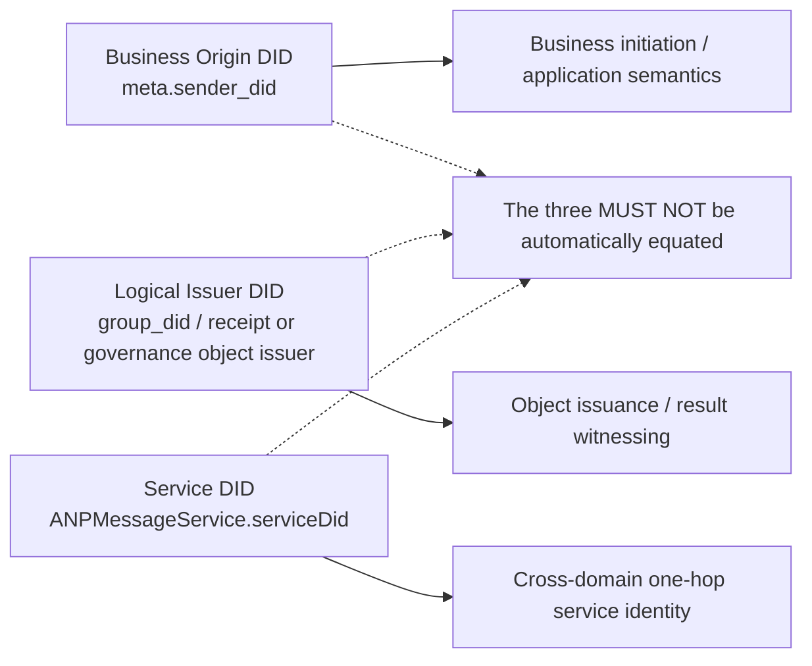
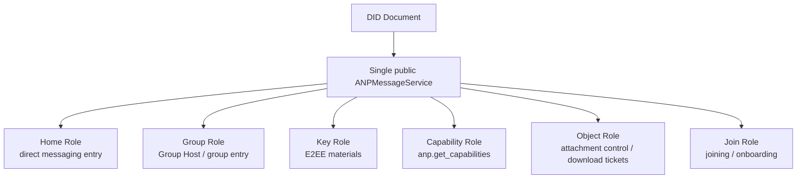
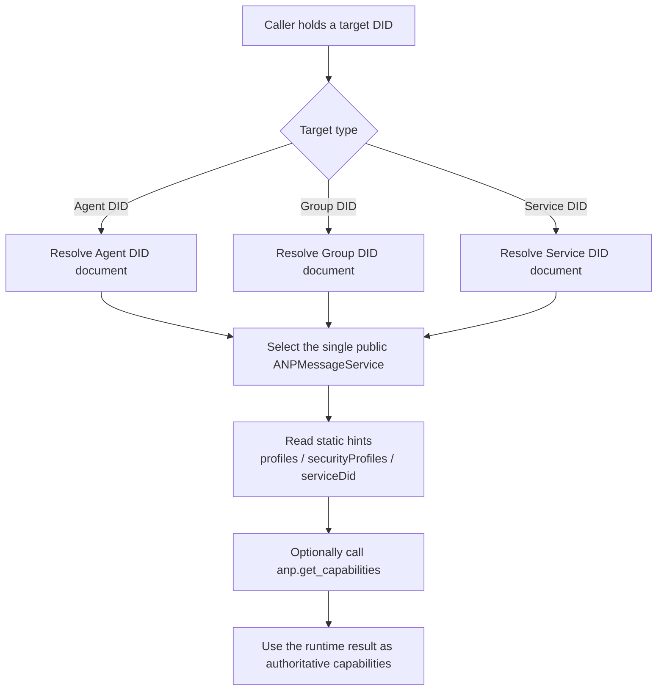

> 日本語参考訳（機械翻訳・未校閲）。規範となるのは原文です。コード例・識別子・規範キーワードは原文を保持しています。
> 原文: [message/02-identity-and-discovery.md](../../message/02-identity-and-discovery.md) / 基準コミット: `0837cfdfaf4ddcf834f0890ddaf34fc4c824e066`

# ANP プロフィール 2: アイデンティティとディスカバリー

- 文書ID: ANP-P2
- タイトル:アイデンティティとディスカバリー
- ステータス: リリース
- バージョン: 1.2
- 仕様セット: ANP のメッセージング 1.2
- 原文言語: English / このページは日本語参考訳
- プロフィール: `anp.identity.discovery.v1`
- 依存関係: `anp.core.binding.v1`
- 応募者:このプロフィールは、ANPのエージェント・アイデンティティ、グループ・アイデンティティ、サービス・ディスカバリーおよびサービスのエンドポイント・解釈に適用される。

---

## 1. 目的:

このプロファイルは、ANPの識別モデルと発見モデルを定義します。, stipulating:

1. エージェントとグループを表すDIDを使用する方法
2. DID 文書のどの属性が ANP に対する規範的な意義を持っているか。
3. DID 文書で ANP サービスエンドポイントを表現する方法
4. 呼び出し側が DID 文書に基づいて対話型 ANP サービスを発見する方法。
5. DID 文書に動的状態が置かれなければならず、
6. デバイスアドレス E2EE プロファイルが DID レベルのビジネスのアドレスを変更することなく、最小の暗号エンドポイント情報を発見する方法。

このプロファイルは定義しません。

- DID メソッド自体;
- DID はプロトコル自体を解析します。
- ハードウェアまたは機器のアイデンティティ、製品面でのデバイス名、またはデバイスの登録ワークフロー。
- 内部コピー同期;
- 特定のE2EEのアルゴリズムの細部;
- 特定のグループ州機械細部。

---

## 2. 用語集と定款

### 2.1 仮説キーワード

この記事では、 **MUST**, **MUST NOT**, **REQUIRED**, **SHALL**, **SHALL NOT**, **SHOULD**, **SHOULD NOT**, **RECOMMENDED**, **NOT RECOMMENDED**, **MAY**, **OPTIONAL** 資本金を基準とした規範的な要件として解釈されます。

### 2.2 用語集

- **エージェントID**: エージェントプロトコルの対象のDIDを表します。
- **グループID**: グループ合意の対象のDIDを代表します。
- **コントローラー**: DID 文書の更新や、DID の代わって管理された操作を開始できるエンティティティティ
- **ANPMessageサービス**: 外部の世界に公開するDID文書の統一されたANPサービス入口。
- **受託サービス DID**: デプロイメント・サービス・ツー・サービスの HTTP 認証で利用する DID は、通常、 `ANPMessageService.serviceDid`.
- **インフォメーション**: DID 文書に基づいて DID ドキュメントを解析し、適切なサービスエンドポイントを選択して、その後のやり取りを完了します。
- **デバイスエンドポイント**: エージェントIDの下の暗号エンドポイント、不透明で識別される `device_id` デバイスアドレスの E2EE プロファイルのみ。 DIDやビジネス参加者ではありません。
- **デバイスマニフェスト**: オプション `deviceManifest` エージェントの DID ドキュメントの構造。 DIDがデバイスアドレスのE2EEプロファイルを宣伝するときにのみ必要になります。
- **有資格デバイス**: 利用時に、キー参照と宣言されたプロファイルセットがE2EEプロファイルを満足させるデバイスマニフェストエントリ。

---

## 3. アイデンティティモデル

### 3.1 基本原則

ANP は、次のファーストクラスの指定を採用しています。

- **エージェントID**
- **グループID**

ANP プロトコルレイヤーは、デバイス DID、端末 DID、セッション DID、または DID を複製するものではありません。 業務のアドレス、連絡先、会員、権限の役割、および普通のメッセージ配信は、エージェントDIDまたはグループDIDに添付されています。

デバイスアドレス E2EE プロファイル **MAY** 選択する 暗号デバイスエンドポイント エージェント DID による opaque `device_id`. . . 第一級のアイデンティティ、メンバー、または `target.kind`, およびベースプロファイル **MUST NOT** 必要または持ち運び。 複数のランタイムコピーと通常の非E2EEデバイスファンアウトは実装内部のままです。

### 3.2 エージェントID

ANPプロトコルの対象としてメッセージの送信や受信が可能な各エージェント MUST 保持する `agent_did`.

`agent_did` のために使用されます:

1. ダイレクトメッセージの送信者と受信者を特定する。
2. 制御操作のイニシアチブを特定する。
3. サービスエンドポイントは分析に使用できます。
4. セキュリティーのオーバーレイに必要な公的資料を入手する。
5. 認可と監査文の確立。

### 3.3 グループID

ドメイン間で送信されたメッセージを発見、参照、管理、またはグループ化できる各グループ **MUST** 保持する `group_did`.

`group_did` のために使用されます:

1. グループのグローバルアプリケーション層識別子として;
2. グループディスカバリーとガバナンスのアンカーポイントとしての役割を果たす。
3. グループ管理とグループメッセージングの共通ターゲット識別子として。
4. グループサービスのエンドポイントの発見入口としての役割
5. 続いてグループ暗号化プロファイルのバインディングオブジェクトとして機能します。

### 3.4 暗号識別子の分離

続いているセキュリティオーバーレイプロファイルが独立した暗号内部識別子を定義する場合、など `crypto_group_id`, `session_id`と `channel_id`, それから:

- 彼らを **MAY** 同じではない `group_did` または `agent_did`;
- しかし、対応するプロファイル **MUST** 暗号的にこれらの内部識別子をDIDに結合する方法を明確に規定する。
- この結合 **MUST** 受信機で検証可能

### 3.5 ANP アイデンティティレイヤー

文書間で異なるレベルのアイデンティティを混合することを避けるため、ANPは少なくとも次の3つのDIDを区別します。

1. **業務用原産品 DID**: 業務開始者やビジネスロジックの送信対象など `meta.sender_did` リクエスト
2. **論理発行体 DID**: 通知、受領、またはガバナンスのオブジェクトが論理的に表現するという問題は、 `group_did`;
3. **サービスID**: ホップレベルのサービスtoサービスの呼び出しを実行する際に使用されるサービスID,すなわち、 `ANPMessageService.serviceDid`.

上記3つのアイデンティティのカテゴリ:

- **MUST NOT** 同じ主題として自動的に扱われます;
- 対応するプロファイル **MUST** 署名を担当する明確に述べ、承認の責任があり、ルーティングを担当する者。
- 横断的なシナリオで, `serviceDid` **MUST NOT** 業務用IDを交換する。
- `serviceDid` 「1ホップサービスコールの公益サービス入口」のみを示します。 **MUST NOT** 以下のような事業の決定に直接参加する `owner/admin/member` グループで。

---

ANPの最も簡単な間違いの1つは、ビジネス送信者、オブジェクト発行者、およびワンホップサービスアイデンティティを混同することです。 次の図は、これらの3つのDIDレイヤーを1ビューに置き、その後のプロファイルはそれぞれ参照できるようにします。



*図P2-1: ANPアイデンティティレイヤー関係(非放射性)。*

その後の文書は署名、承認、またはルーティングを必要とするとき、読者が同じ組織として3つの主題を扱いますと仮定する代わりにDIDレイヤーが使用する明示的に状態にする必要があります。

## 4. DID文書のANP解釈ルール

### 4.1 一般ルール

ANP では、DID ドキュメントには以下のような責任があります。

1. 安定した身元を提示する。
2. 認証関係と信頼されるキー素材の宣言
3. 万博サービスエンドポイント;
4. サービスの発見に手を加える
5. デバイスアドレス E2EE プロファイルが広告されると、その暗号エンドポイントを検証するために必要な最小電流 Device Manifest を公開します。

書類の提出 **MUST NOT** として扱われて下さい:

- リアルタイムメッセージステータスデータベース
- グループメンバーのリアルタイムストレージ。
- オンライン状態の貯蔵;
- 高周波キーの回転丸太;
- エージェント内部のレプリカリスト。

<a id="method-validation"></a>
#### 4.1.1 DID メソッドの検証

このプロファイルは、DID 文書を解決し、検証します。 [ANP-02 身元入力](../../02-anp-did-authentication-protocol-specification.md#identity-input) および適当な DID 方法結合。 `did:wba`, `did:web`と他のサポートされているメソッドは、このプロファイルの同じサービスディスカバリ、キーパーシャル、およびデバイス資格規則を使用します。メソッド固有のドキュメント検証は、対応するメソッド仕様によって定義されます。

ディスカバリーとオブジェクト検証はリクエスト認証の手順を必要としません。 `authentication`, `assertionMethod`と `keyAgreement` プロフィールおよび所有メッセージのプロフィールの操作条件に依ります。

### 4.2 DID文書の最小要件

ANP で使用される DID 文書の場合:

- `id` **MUST** 存在;
- `service` **MUST** 積極的に発見され、相互作用するDIDのために存在します。
- `service` **MAY** 検証や参照のためにのみ使用されるDIDに省略されます。
- `authentication` **MUST** 業務の原始者DIDとして要求に表示される DIDが存在します。
- 宣言的な署名オブジェクトがサポートされている場合、 `assertionMethod` **SHOULD** 存在;
- 暗号化オーバーレイがサポートされている場合、 `keyAgreement` **SHOULD** 存在;
- `capabilityInvocation` 任意拡張機能です、 **MAY** 存在しますが、v1の最小相互運用性要件の一部ではありません。
- エージェント DID がデバイスアドレス E2EE プロファイルを広告する場合、 `deviceManifest` **MUST** セクション5.5が存在し、満足させる。ベースプロファイルのみをサポートするDIDは要求しません。

### 4.3 DID文書の最小化の原則

DID文書の情報 **SHOULD** 残り:

- 低い頻度変更;
- 低い感受性;
- 低い関連性;
- DIDの使用状況に直接関連しています。

上記要件を満たしていないコンテンツは、 **SHOULD** 管理されたサービスエンドポイントプロバイダにDID文書に直接埋め込むのではなく、移動します。

---

## 5. エージェント DID 仕様

### 5.1 エージェント DID 文書は、セマティックスが必要

ANP のエージェント DID ドキュメント MUST 少なくとも表現して下さい:

1. `id`
2. 少なくとも1つ `service` 以降に続くやりとりのために利用可能

### 5.2 認証関係

エージェント DID が表示される場合 `meta.sender_did` 業務のイニシアチブ・アイデンティティ、または `keyid` 利用する主張するあらゆるビジネス証拠の検証リンク `anp-rfc9421-origin-proof-v1`, DID ドキュメント **MUST** 提供して下さい `authentication` 関係。

リクエストをリクエストする場合 `auth.origin_proof`、認証者 **MUST** 認証方法が指すかどうかをチェック `keyid` は、 `authentication` このDID文書の関連性。

`authentication` **MAY** エージェント DID がパッシブリファレンス、オブジェクトオーナーシップ、オフライン検証のみに使用されている場合は、ANP インタラクションをリクエストイニシアムとして参加しない場合は、省略します。

エージェントがグループ管理オブジェクト、宣言オブジェクト、およびシグネチャコントロールオブジェクトをアサートする必要がある場合は、DIDドキュメント **SHOULD** 提供して下さい `assertionMethod` 関係。

### 5.3 キー交渉関係

エージェントが E2EE オーバーレイをサポートしている場合、DID ドキュメント **SHOULD** 提供して下さい `keyAgreement` 関係。
参照される検証方法 `keyAgreement` **MUST** 鍵の合意や機密情報を受信するために、公鍵素材を代表するだけに使用されます。

### 5.4 サービスエンドポイント

ダイレクトメッセージング、機能検出、オブジェクトコントロール操作、またはアクティブディスカバリーを必要とするその他のANP機能をサポートする任意のエージェントDID文書 **MUST** 少なくとも1つを含有して下さい `ANPMessageService`.

本サービスの登録 **MAY** また、次の機能を実行します。

- ダイレクトメッセージのメインエントランス。
- 能力の交渉;
- 安全なオーバーレイ公共材料アクセス;
- オブジェクトのダウンロードポータルで見つかったオブジェクト制御平面。

デプロイメント・アット・インクルードがこれらの機能を複数のコンポーネントに分割する場合、そのスプリットは実装の詳細です。 DID ドキュメント **SHOULD NOT** 複数の独立した ANP サービスタイプを各機能に公開します。

パブリックに利用可能な添付ファイル コントロール・プラン方法 **MUST** 未確認の状態でもアクセス可能 `ANPMessageService` DID ドキュメントで公開。 デプロイメント・サービスの内部で、独立したオブジェクト・サービス、キー・サービスまたはグループ・ホスト・サブコンポーネントへのリクエストをルーティングするかどうかは、実装の詳細であり、外部の標準的なサービス・ディスカバリー・モデルを変更しません。

### 5.5 デバイス重視のE2EEプロファイル用のデバイスマニフェスト

`deviceManifest` ダイレクトE2EEやグループE2EEなどの暗号化デバイスエンドポイントに取り組むセキュリティプロファイルのみで使用されているトップレベルのエージェントDIDドキュメント拡張です。 エージェントのIDを、通常のベースメッセージングで使用していない、ビジネスのアイデンティティのコレクションに変えません。

標準形状は:

```json
{
  "deviceManifest": {
    "type": "ANPDeviceManifest",
    "devices": [
      {
        "device_id": "dev-a-7N3KQ2",
        "signing_key_id": "did:example:agent-a#dev-a-sign",
        "e2ee_key_id": "did:example:agent-a#dev-a-e2ee",
        "profiles": [
          "anp.core.binding.v1",
          "anp.identity.discovery.v1",
          "anp.direct.base.v1",
          "anp.direct.e2ee.v2"
        ]
      }
    ]
  }
}
```

下記のルールが適用されます。

1. デバイスアドレスのE2EEプロファイルを広告したり、呼び出すエージェントID **MUST** 現行の公開 `deviceManifest`;ベースプロファイルのみをサポートするエージェントID **MAY** それを省略して下さい。
2. `deviceManifest.type` **MUST** 等しく `ANPDeviceManifest`. `devices` **MUST** 配列になります。 各標準デバイスエントリ **MUST** 正確に含まて下さい `device_id`, `signing_key_id`, `e2ee_key_id`と `profiles`.
3. `device_id` **MUST** 現在のエージェント DID マニフェスト内でユニークで不透明な文字列である、 **MUST NOT** 取り外しの後で再使用されて。 DID、ハードウェアシリアル番号、表示名、ロールではありません。
4. `signing_key_id` とりあえず `e2ee_key_id` **MUST** 同一の Agent DID ドキュメントで検証方法を参照する DID URL になります。 `signing_key_id` **MUST** 独自のE2EEプロファイルで必要な検証関係によって認可される。 Origin Proofが使用されると、それは `authentication`オブジェクトのプルーフが使用されるとき、それは `assertionMethod`. `e2ee_key_id` **MUST** 認定される `keyAgreement`.
5. `profiles` **MUST** このデバイスがサポートする完全依存セットを含む非空文字列配列です。 P5 エントリは、P1、P2、P3、および P5 を含む。 P6 エントリーには、P1、P2、P4、および P6 が含まれます。 ベースプロファイルを依存性としてリストすると、ベース操作デバイスがアドレス指定されていない。
6. P3 直接基盤、P4 グループの基盤、P7 の普通付属品および他の非 E2EE の流れ **MUST NOT** セレクターを必要とするマニフェストに相談し、デバイスごとの結果を公開するか、DIDレベルのデリバリーセマティクスを変更します。
7. デバイスを除去すると、そのエントリなしで更新されたID文書を公開し、アクティブデバイスキー参照なしに公開することを意味します。 今後のデバイスアドレス指定操作を選択 **MUST** 拒否します。 再登録は、新しい使用 `device_id` と新しいキー。
8. マニフェストは、DID メソッドのドキュメントの一部として保護され更新されます。 このプロファイルは、別のマニフェストエンドポイント、プルーフ、エポック、ハッシュ、チェックポイント、または比較およびスワッププロトコルを定義しません。
9. メイフェスト **MUST NOT** 秘密鍵、製品ローカルロール、トークン、人読みのデバイス名、ハードウェア識別子、オンライン状態、回復状態、または内部レプリカトポロジーが含まれています。

---

## 6. グループDID仕様

### 6.1 グループ DID 文書に必要なセマティクス

ANPグループDドキュメント MUST 少なくとも表現して下さい:

1. `id`
2. `controller`
3. 少なくとも1つのグループサービスエンドポイント(`ANPMessageService`)

### 6.2 グループ制御の権利

`controller` 単一の DID か複数の DID である場合もあります。
複数のコントローラーがある場合、それら間の内部のコラボレーション機構はこのプロファイルでは定義されていないが、次の機能があります。

- DID文書の更新の合法性 **MUST** DID メソッドで保証される
- 呼び出し者 **MUST** パースされた DID 文書を参照します。
- グループガバナンスプロファイル **MUST** グループ内での役割と権限ルールを定義します。

### 6.3 グループガバナンスの検証関係

グループDIDのドキュメントをサポート `anp.group.base.v2`:

- `assertionMethod` **MUST** 存在;
- `capabilityInvocation` **MAY** 追加のガバナンス機能委任関係として存在しますが、置換しません `assertionMethod`.

グループ管理オブジェクト、グループポリシーオブジェクト、グループステートオブジェクトがシグネチャを必要とするとき、 **MUST** DID 文書で許可されている検証関係を使用します。

### 6.4 グループDID文書禁止内容

以下について MUST NOT グループDID文書に直接埋め込む:

- ダイナミックメンバーリスト
- オンライン会員リスト
- 現在のメッセージのシーケンス番号;
- 現在のグループ epoch;
- メッセージによるメッセージ送信ステータス;
- ワンタイムプレキーリスト;
- MLS KeyPackage リアルタイムコレクション;
- 招待/グループガバナンスのキューを高まる;
- エージェント内部のレプリカリスト。

### 6.5 グループ DID ドキュメント オプションのコンテンツ

以下について **MAY** 存在しますが、機密開示は避けなければなりません:

- グループ表示名;
- グループ アイコンの参照;
- グループ 公開 説明;
- グループ公共政策の概要;
- 文書版情報;
- サービス機能のまとめ

オプションのフィールドが重要なプライバシー漏洩や関連するリスクをポーズする可能性がある場合、実装 **SHOULD NOT** DID ドキュメントに書き込むと、サービスエンドポイントを制限する代わりに、そのサービスを提供します。

---

## 7. ANPサービスエンドポイントタイプ

### 7.1 一般

ANPはサービスディスカバリーをベースとしたサービスディスカバリーを行います。 `service` DID ドキュメントで。
ANPサービスエンドポイントオブジェクト **MUST** と:

- `id`
- `type`
- `serviceEndpoint`

サービスエンドポイントオブジェクト **MAY** 静的ヒントを数多く運ぶが、v1 標準の相互運用性は以下だけである。

- `profiles`
- `securityProfiles`
- `serviceDid`

現在のバージョンでは、DID ドキュメント **SHOULD** ANP は 1 つの標準的なサービス タイプだけを分かち合います: `ANPMessageService`.
実装者が内部で直接メッセージング、グループ、キー、オブジェクト、またはクロスドメイン転送機能を複数のコンポーネントに分割した場合、この分割は実装詳細であり、標準を分離しません `service type` DID ドキュメントで。

相互ドメイン呼び出しにおけるサービス選択の曖昧性を減らすため、各DID文書 **MUST** たった1つしか露出しない `ANPMessageService` ドメイン間で呼び出される場合があります。
実装内で複数のサービスコンポーネントがある場合、それらは **MUST** 同じ外面に露出したクロスドメインの下に収束される `ANPMessageService`.

### 7.2 `ANPMessageService`

#### 7.2.1 科学

`ANPMessageService` DID 文書の ANP によって一般に発見された統一されたメッセージングおよび相互作用の記入項目を表します。

#### 7.2.2 目的

-受取 `direct.send`
- インフォメーション `group.get_info`, `group.send`, `group.e2ee.send` グループ管理/グループ E2EE 関連のアクション
- 提供サービス `anp.get_capabilities`
- ダイレクト/グループE2EEの公的資料へのアクセス
- ベアア受付または配布 `group.e2ee.notice` (デプロイメントがグループE2EEをサポートしている場合)
- 提供サービス `attachment.create_slot`, `attachment.commit_object`, `attachment.abort_object`, `attachment.get_download_ticket`
- オブジェクトHTTP(S)ダウンロードポータルとして発見されたサービスアンカー(デプロイメントでサポートされている場合)

外部に露出した添付ファイル制御-計画方法 **MUST** 未確認の状態でも入力されます `ANPMessageService` このページの先頭へ デプロイメント・サービスの内部で、独立したオブジェクト・サービス、キー・サービスまたはグループ・ホスト・サブコンポーネントへのリクエストをルーティングするかどうかは、実装の詳細であり、外部の標準的なサービス・ディスカバリー・モデルを変更しません。

#### 7.2.3 条件

- 積極的に発見し、対話することができるエージェントのDID文書 **MUST** 少なくとも1つを含有して下さい `ANPMessageService`
- グループID文書 **MUST** 少なくとも1つを含有して下さい `ANPMessageService`
- こんなこと `ANPMessageService` サービスの内訳、サービスへのサービスへの介入、サービスエントリに参加する **MUST** 宣言 `serviceDid`
- 実装内で複数のコンポーネントがある場合、DID ドキュメント **MUST** 統一されたエントリを調べ、ランタイム機能交渉を通じて、より細かい処理能力境界を返します。
- 外部に露出したサービススコープ方式、主要な材料方法および付属品の制御平面法を含む、 **MUST** 利用する `serviceDid` 対象となるプロファイルがエンドポイントローカルとして明示的に宣言されていない限り、ターゲットサービス ID アンカーとしての統一された入口の

ドメインサービス選択の曖昧性を削減するために、v1は1つの統一のみを公開することを奨励します `ANPMessageService` 外部へ。 次の図は、共通の内部論理的役割と一体となってエントリーを統一し、読者が公益サービスの種類と労働の実装内分岐を区別できるようにする。



*図P2-2:統一されたANPMessageServiceと内部ロール(非定性)の関係。*

この図のロールは、内部機能境界のイラストだけです。 新規の DID を定義しない `service type` 値と標準サービスディスカバリフィールドを交換しないでください。


### 7.3 論理的役割 `ANPMessageService`

このセクションは、 **非定着説明** 統一されたエントリの背後にある一般的な機能境界の; 彼らは、DID 文書に独立した標準サービス タイプではなく、v1 のサービス選択フィールドです。

#### 7.3.1 ホームロール

ホームロールは、受信するために使用されるエージェント側の主なエントリ機能を表します。 `direct.send`、機能情報を返すし、さらにインタラクションパスを示す。

#### 7.3.2 キーの役割

キーロールは、セキュリティ上敷で必要な公共資料を発行または発見する能力を表し、次の用途に使用されます。

- ダイレクトメッセージングE2EEに必要な開示資料をご覧いただけます。
- グループE2EEを発見するために必要な入門資料
- 続いているセキュリティプロファイルで定義されたパブリックオブジェクトを発見

#### 7.3.3 グループの役割

グループの役割は、グループの主要な入り口またはホスト機能を表し、以下に使用されます。

- プロセスグループ管理のアクションの後の `group.create`
- インフォメーション `group.send` とりあえず `group.e2ee.send`
- グループポリシー、グループE2EE機能または関連する制御の入り口を公開
- グループステートの変更を注文するための権限のあるエントリ ポイントとしてセルフ

#### 7.3.4 役割を結ぼう

参加するロールは、招待状に関連するエントリーに参加する能力を表します。

#### 7.3.5 機能の役割

機能のロールは、機能交渉のエントリー能力を表します。

#### 7.3.6 オブジェクトの役割

オブジェクトロールは、オブジェクトのアップロード、オブジェクトアクセス制御、ダウンロードチケット発行、オブジェクトのダウンロードポータルの検出の機能を表しています。

#### 7.3.7 クロスドメイン転送機能

デプロイメント **MAY** 後続するクロスドメイン転送またはドメインゲートウェイ機能を実行します `ANPMessageService`, しかし、現在のバージョン **しない** この関数の独立した DID サービス タイプを定義します。

デプロイメントがクロスドメインサービスからサービスへインボケーションが可能な場合、ドメインゲートウェイまたはドメインサービスは外部のHTTP認証を実行している場合、 **SHOULD** 通常のエージェント DID またはグループ DID ではなく、ドメインネーム所有者によって予約されたフェデレーション サービス DID を使用します。 対応するルールはP8で定義されます。

#### 7.3.8 透明ディレクトリと監査インデックス

デプロイメントがディレクトリの透明性、透明なログ、または監査インデックスをサポートしている場合 **MAY** 拡張機能として提供 `ANPMessageService`; 現在のバージョンは独立した DID サービスタイプを定義しません。

---

## 8. ANPサービスエンドポイント拡張フィールド

交差導入の発見を容易にするために、このプロフィールはv1静的ヒントとして少数の分野だけを使用します;残りの機能情報 **SHOULD** シンクへ `anp.get_capabilities`.

### 8.1 `profiles`

- タイプ: 文字列配列
- 管理:サービスエンドポイントで直接サポートされる ANP プロファイルコレクション
- 条件: **SHOULD**
- Note: このフィールドは静的、キャッシュ可能な粗粒状のヒントだけを表現し、ランタイム機能交渉を置き換えません。

### 8.2 `securityProfiles`

- タイプ: 文字列配列
- 管理: サービスエンドポイントのサポートされたセキュリティプロファイル収集
- 条件: **SHOULD**
- 説明: このフィールドはエンドポイントレベルでサポートされるセキュリティプロファイルのセットを示します。 広告されたセキュリティプロファイルごとにすべての方法が利用可能であることを保証するものではありません。

### 8.3 `acceptedContentTypes`

- タイプ: 文字列配列
- 管理: サービスエンドポイントの許容メッセージコンテンツタイプを設定します
- 条件: **標準のv1 DIDヒントではなく**
- 説明:
  - そのような情報を公開する必要がある場合は、 **SHOULD** リターン・スルー `anp.get_capabilities`;
  - DID ドキュメントにこのフィールドが表示される場合、受信者 **MAY** 実装拡張として扱います。

### 8.4 `acceptedObjectTypes`

- タイプ: 文字列配列
- 管理: サービスエンドポイントの許容制御平面オブジェクトタイプの設定
- 条件: **標準のv1 DIDヒントではなく**
- 説明: この情報は RECOMMENDED 静的 DID-document ヒントではなく、ランタイム機能として。

### 8.5 `priority`

- タイプ: 整数
- 社会:エンドポイント優先
- 条件: **標準のv1 DIDヒントではなく**
- 説明:
  - v1 仕様は信頼しません `priority` サービス選択のためのDID文書で;
  - 展開がこのフィールドをカスタマイズする場合、プライベートエクステンションとして扱われるべきです。

### 8.6 `authSchemes`

- タイプ: 文字列配列
- 管理:このエンドポイントでサポートする呼び出し者→サービスコールア認証方法
- 条件: **標準のv1 DIDヒントではなく**
- 説明:
  - この機能は、通常、ランタイムゲートウェイの設定で変更されます。
  - 露出のためのより適した `anp.get_capabilities`;
  - もん **なし** 証拠のベアラーをビジネスレイヤーに記述する `anp-rfc9421-origin-proof-v1`.

### 8.7 `serviceDid`

- タイプ: 文字列
- 社会: `ANPMessageService` 横断ドメインサービスで利用するDID-to-service HTTP認証
- 条件: **MUST** このエンドポイントがクロスドメインサービスからサービスの呼び出しに参加している場合

ルール:

1. `serviceDid` **MUST** DID 文字列ではなく、DID URL になります。
2. `keyid` **MUST** 外部のHTTPメッセージ署名は、認証方法にポイントを付与します。 `authentication` 関係の内にある `serviceDid` ドキュメント;
3. 展開のための `did:web` とりあえず `did:wba`, `serviceDid` **SHOULD** 必須のは、ベアドメインIDを使用します。
4. `serviceDid` 「サービスアイデンティティがクロスドメインコールを実行する」と表現するビジネスの主題ではなく、 `meta.sender_did`;
5. 特定のランタイム検証プロセス `serviceDid` P8 で定義される。
6. `serviceDid` DID 文書は発見のヒントであり、真の信頼の確立は P8 の実行時間検証を成功させる可能性があります。
7. サービススコープ方式の場合、呼び出し側 **SHOULD** ビーコン `meta.target.did` 対象者への公開 `ANPMessageService.serviceDid`; オブジェクト制御平面、キー材料方法およびグループ結合材料方法は、特定のプロファイルが明示的にエンドポイントローカルとして宣言されていない限り、この原則に従う。

---

## 9. ディスカバリー・プロセス

エージェント、グループ、およびエージェントのディスカバリーの詳細を以下に示します。 `serviceDid`. . . 最初に下の図は、統一された概要を与え、最終的に3つのパスが一般に収まることを示します `ANPMessageService` 実行時間機能交渉。



*図P2-3:エージェント/グループ/サービス(非暫定的)の未発表発見フロー。*

セクション9.1、9.2、および9.3を下回るとき、この統一された発見図の具体的な適用として3つの独立した発見哲学ではなく、3つのターゲット タイプにそれらを扱います。

### 9.1 エージェントの発見

発見プロセスのための `agent_did` 以下は、

1. パーズ `agent_did` DID 文書を入手する。
2. 読みます `service` リスト;
3. 唯一のクロスドメインを選択 `ANPMessageService`;
4. クロスドメインサービスからサービスの呼び出しまでが後で使用された場合、 `serviceDid` 選択したサービスエントリで宣言された。
5. コンバイン `profiles`, `securityProfiles`, 実行時間機能交渉結果とローカルポリシーは、統一されたポータルで利用可能な特定の機能を決定するために;
6. 通常のベース操作では、エージェントのIDと選択したサービスを使用して直接; 必要はありません `deviceManifest`、デバイスを選択するか、デフォルトデバイスを合成します。
7. デバイスアドレス E2EE 操作のために、現在の問題を解決して下さい `deviceManifest` および所有するE2EEのプロフィールに従って有資格装置だけを選んで下さい;
8. 明示的な交渉機能のため、コール `anp.get_capabilities` 同じエントリに。

### 9.2 グループディスカバリー

発見プロセスのための `group_did` 以下は、

1. パーズ `group_did` DID 文書を入手する。
2. ユニークな読み方 `ANPMessageService`;
3. クロスドメインサービスからサービスの呼び出しまでが後で使用された場合、 `serviceDid` 選択したサービスエントリで宣言された。
4. コンバイン `profiles`, `securityProfiles`、ランタイム機能交渉結果と現地のポリシーは、グループ管理、グループメッセージング、参加またはグループE2EE関連機能を統一ポータルで利用できるかどうかを判断します。
5. グループE2EEが有効になっている場合、グループ側のパブリックマテリアル、暗号結果の配信機能および関連する制御アクションは、グループ暗号化プロファイルに拘束される同じ入口で発見されます。メンバーによって追加された材料は、エージェントIDに対応する統一された入り口を通してまだ発見されます。

### 9.3 サービスDIDの発見

ターゲットのタイミング `serviceDid` サービスのスコープメソッドは、呼び出し元に知られています。検出プロセスは次のようになります。

1. DID ドキュメントをパースする `serviceDid`;
2. 選択する `ANPMessageService` 対応する `serviceDid`;
3. 読み込む `serviceEndpoint` そして静的な先端;
4. 精密な機能境界のために、呼出し `anp.get_capabilities` 同じエントリで;
5. とりあえず `serviceDid` P8 で指定されたランタイムサービス ID 結合検証を渡すと、信頼できるクロスドメイン サービス ID とみなされることができます。

添付ファイルのダウンロードチケット検索、コールア **MUST** 元のメッセージ送信者 DID を使用して、添付リストをディスカバリーアンカーとして持ち、その公開を解決します `ANPMessageService`; グループシナリオでは、DIDは元のグループメッセージ送信者から取られます、 `group_did`. . . 呼び出し者 **MUST NOT** URL ドメイン名のみを使用してください。 `object_uri` 制御平面サービスを戻すために。


### 9.4 サービス選択

複数の候補エンドポイントがある場合、呼び出し側 **MUST** 最初に次の順序で選ぶ:

1. 要求されるによる最初のフィルター `profile`;
2. それから要求されるによってろ過して下さい `security_profile`;
3. それから、ランタイム機能交渉結果を権威的な検証として使用して下さい;
4. 複数の結果がまだある場合は、ローカルポリシーに従って選択してください。

v1 仕様は信頼できません `supportedMethods`, `logicalRoles` または `priority` 標準的なサービス選択のためのDID文書で。

### 9.5 キャッシュ

呼び出し者 **MAY** DID 解析結果とサービス選択結果のキャッシュ。
とはいえ、 **SHOULD** 次の状況で再分割される:

- 署名検証が失敗しました。
- 主要な交渉は失敗しました;
- サービスエンドポイントは、能力変化を返します。
- DID 制御の中断された変更;
- `serviceDid` 検証が失敗しました。
- エンドポイントオリジンバインディングが失敗しました。
- 静的ヒントは、ランタイム機能結果と競合します。
- ローカルキャッシュが期限切れになります。

---

## 10. DID文書とセキュリティのオーバーレイの関係

### 10.1 利用の目的 `keyAgreement`

エージェント DID またはグループ DID ドキュメントが宣言されている場合 `keyAgreement`、続くセキュリティプロファイル **MUST** 機密情報やそのDIDに対する主要な交渉を受信するための基礎として、その方法だけを許可します。

### 10.2 署名検証関係

オブジェクトが DID でアサートされると主張する場合:

それらの中、使用しているリクエスト `auth.origin_proof`, 整流器 **MUST** 認証制御アクションとしてこれを処理し、チェックを行います。 `authentication`.

- オブジェクトが認証制御アクションである場合、検証 **SHOULD** チェック `authentication`;
- オブジェクトが宣言または署名のアサーション動作である場合、そのバディファイアー **SHOULD** チェック `assertionMethod`;
- オブジェクトがガバナンス機能の呼び出しアクションである場合、そのバディファイ **MAY** チェック `capabilityInvocation`, しかし、これはv1の最小相互運用性要件ではありません.

### 10.2.1 デバイスセキュリティのバインディング

デバイスセレクターやデバイス公開キーを使用する前に、デバイスアドレスのE2EEプロファイル **MUST** 現在の Agent DID に対する選択したエントリを検証します。 `deviceManifest`. . . 選択したエントリ **MUST** 要求されたE2EEプロファイルとその依存関係を宣言し、そのキーの参照 **MUST** 実際にその操作で使用したキーにマッチします。

操作が使用する場合 `auth.origin_proof` 一緒に `meta.sender_device_id`、証拠 `keyid` **MUST** エントリーの同等 `signing_key_id`. . . 操作が使用する場合 `meta.recipient_device_id` E2EE、暗号化、セッションの確立キー **MUST** 選択したエントリの `e2ee_key_id`. . . 独自のP5/P6-like E2EEプロファイルは、正確な認証されたコンテキストと拒絶点を定義します。

これらのチェックは、これらの操作がセレクターを運ぶか、デバイスキーを選択していないため、通常のベース操作には適用されません。

### 10.3 動的セキュリティ材料の外部配置

以下について **SHOULD** 管理されたサービスエンドポイントを介して提供され、DID 文書に埋め込まれていない:

- 公共材料の高周波回転;
- 使い捨て可能な指導材料;
- グループエポック関連材料;
- ダイナミックグループステートの合計。

---

## 11. グループDIDとグループガバナンス

### 11.1 グループDIDの役割

`group_did` グループのアプリケーションレイヤーグローバル識別子であり、特定の暗号化実装内部IDと等しくはありません。

### 11.2 社外グループガバナンス

グループ会員、ロール・アクセシビリティ、招待状ステータス、会員資格、ポリシーバージョン、グループ・ステート・サマリー、類似のオブジェクト **SHOULD** 通し、表現される:

- `ANPMessageService` グループ対応
- または将来のグループガバナンスプロファイル

DID ドキュメントではなく、署名を付与します。

### 11.3 制御・グループポリシーの分離

`controller` DID ドキュメントでは、DID 文書自体をコントロールしている人のみを示します。
グループ内でメンバーを追加したり、メンバーを削除したり、ポリシーを変更したりすることができます。アプリケーション層のガバナンスルールが設定されており、機械的には得られない `controller`.
同じように、 `serviceDid` 本サービスは、本人を呼びかけ、直接、等して業務上の役割として解釈されるべきではありません。 `owner/admin/member` グループで。

---

## 12. エージェント DID 移行検証

### 12.1 方法固有の移行プロファイル

P2 は、エージェント DID 移行の一般的な呼び出しのセマティクスを定義します。 証拠規則は、該当するDID方法仕様によって保持されます。 導入事例 **SHOULD** 以下のような内部操作を行なう:

```text
resolve_current_agent_did(input_did, trusted_cache)
  -> { requested_did, current_did, transition_status, assurance }
  | error
```

実装内部で、 **MUST NOT** とりあえず `stable_subject_id`、ANPメッセージングワイヤオブジェクトへの安定した被写体パス、または別のアイデンティティフィールド。

### 12.2 `e1_` path-type が:wba トランジションをしました

この仕様の最初の登録自動遷移経路は、最後のセグメントが使用するパスタイプです:wba DID `e1_` 指紋のプロフィール。 以前に信頼されたDIDから始まり、解決者 **MUST** ホップと最終アクティブDID文書を各ホップで検証します。 [ANP-03 メソッドルール](../../03-did-wba-method-design-specification.md#wba-method-rules)サイクルを拒絶し、成功者と信頼されるキャッシュの競合を争い。

検証者 **MUST NOT** 既存のアイデンティティに似ているため、信頼できない新しいIDと推論的な継続から始まります。

### 12.3 継続保証

移行結果 **MUST** 実際の保証を維持する:

- `verified`: 古いDIDの境界ルートキーは、非活性化と後継関係に署名します。
- `recovery_verified`: 以前に信頼された古い文書で承認された回復キーは、移行を確立します。
- `provider_asserted`: 古い結合キーまたは事前承認された回復キーから証明はありませんが、認証された同じorigin HTTPS解像度は、証拠有能なDIDを介して完全な直接成功チェーンを検証するか、アイデンティティプロバイダは、別々の認証された回復/トランスレーション権限チャネルを通じて、前任者ツーシューマを供給します。 分離された `successorDid`、ハンドル/ WNS マッピング、スタンドアローンのサイン入りホップ、または 409 ヒントのみこのレベルに達しません。
- `unverified`: 受入継続証拠が存在しません。

移行のリゾルバーレポート `provider_asserted` 認証された完全チェーンの解像度が成功した後にのみ、別途認証されたプロバイダの権限チャネルは、独自のビジネスシステムによって評価されます。 ソースは、バインディングキーまたはリカバリキーの暗号化の継続性に結果を更新します。 独自の事業システムは、結果が継承する関係と承認を決定する。

経営戦略 **MUST NOT** おすすめ `provider_asserted` として `verified` または `recovery_verified`. . . もてん **MUST NOT** 保証がないので、完全に失敗します `provider_asserted`: 独自の事業システムにより、その保証が十分であるか、ビジネス関係や承認が継承されるかを決定します。 `unverified` 移行継続性を確立しません。

### 12.4 ヒントとサポートされていない移行プロファイル

`alsoKnownAs` 安定した被写体パスとマッチング **MAY** 候補者を識別するが、移行、ロール、メンバーシップ、ACL、添付ファイル付与、またはE2EE資格を独立して許可することはできません。

ベアドメインが:wba DIDs を作った場合、 `k1_` ドス、フィンディング指紋のない歴史的なパス、 `did:web`、および登録された ANP 移行検証プロファイルなしで他の DID メソッド:

- アクティブで検証可能なDIDは、厳密に書面として使用し続けます。
- 導入事例 **MUST NOT** 名前、パス、または名前から派生するクロスDIDの継続性 `alsoKnownAs` 一人で;
- 無効なDID **MUST** 不定休 `anp.did_transition_invalid` とりあえず `reason = transition_profile_not_supported`.

### 12.5 グループ DID 境界

この仕様は、自動グループDID移行を定義しません。 正確で `group_did` グループホストが非アクティブ化 **MUST** 新規グループ運用やP6アプリケーション・メッセージ処理を拒否します。 でん **MUST NOT** グループDIDの成功者を自動的にフォローしてください。 歴史的レシートと署名は、歴史グループIDに対して検証できます。

---

## 13. プライバシーと最小限の開示

### 13.1 サービスエンドポイントの最小化

とりあえず `service` DID ドキュメントのセクション **SHOULD** 最小限に抑えられます。
公開発見のためにサービスが不要でしたら、 **SHOULD NOT** DID ドキュメントに表示します。

### 13.2 関係制御

導入事例 **SHOULD** 避けて下さい:

- 複数のDID文書でユニークなエンドポイントパターンを再利用することで、強力な相関性が生まれます。
- 組織構造、展開トポロジー、内部ロール分布を直接推論できる DID 文書に説明を配置します。
- DID文書によるメッセージのボリューム、アクティビティ、オンラインステータス、内部のレプリカ構造を公開します。

### 13.3 公衆の分離および制限

公開発見に必要な情報 **MAY** DID ドキュメントに置く。
アクセス制御が必要な情報 **SHOULD** サービスのエンドポイントを制限することで返送

### 13.4 デバイスマニフェストミニマライゼーション

デバイスアドレスのE2EEプロファイルでマニフェストが必要な場合は、その公開コンテンツ **MUST** セクション5.5の4つのデバイスエントリーフィールドに制限されています。 実装は、非ユーザの不透明度で使用すべき `device_id` デバイスラベル、ハードウェアの詳細、プレゼンス、ローカルポリシー、およびDID文書の外でのデータを保持する必要があります。

---

## 14. 最小相互運用性要件

このページの先頭へ MUST 少なくとも:

1. 各エージェントは `agent_did`;
2. グループ各社が保有しています。 `group_did`;
3. エージェントのIDとグループID文書は、少なくとも1つを提出しなければなりません `ANPMessageService`;
4. DID文書に基づくサービスディスカバリーの実行をサポート
5. 静的ヒントは、少なくともサポート `profiles`, `securityProfiles`と `serviceDid`;
6. 実行時能力は、権限を持つ `anp.get_capabilities`;
7. DID 文書に動的グループ状態を埋め込むことはありません。
8. デバイスセレクターや必須マニフェストなしで、通常のベースディスカバリーとDIDレベルの配信を保ちます。
9. デバイスアドレスのE2EEプロファイルを広告するとき、最小限の公開と検証 `deviceManifest` セクション5.5で定義される;
10. デバイスDID、デバイスビジネス会員、または製品内レプリカのセマティクスは導入しないでください。
11. 登録されたエージェントの DID 移行に対する実際の保証を 2 番目のワイヤ ID を追加せずに返します。
12. サポート `e1_` 渡された:wba 移行検証ルールは、そのトランジションプロファイルを要求する際にセクション 12 で行なう。
13. 保存する `alsoKnownAs` 候補者のみ、登録済みの移行プロファイルなしでDIDを無効にするために閉鎖されなかった。
14. グループIDを自動で移行しないでください。

---

## 15. 事例紹介

### 15.1 エージェント DID ドキュメントのフラグメント例

次のフラグメントは、ダイレクトE2EEの2つの暗号デバイスエンドポイントで1つのエージェントIDを示しています。 2つのエントリは、2つのエージェントを作成しず、サービスによってリストされている通常のベースプロファイルは、DID-addressedままです。

```json
{
  "id": "did:example:agent-a",
  "verificationMethod": [
    {
      "id": "did:example:agent-a#dev-a-sign",
      "type": "JsonWebKey2020",
      "controller": "did:example:agent-a",
      "publicKeyJwk": {
        "kty": "OKP",
        "crv": "Ed25519",
        "x": "..."
      }
    },
    {
      "id": "did:example:agent-a#dev-a-e2ee",
      "type": "JsonWebKey2020",
      "controller": "did:example:agent-a",
      "publicKeyJwk": {
        "kty": "OKP",
        "crv": "X25519",
        "x": "..."
      }
    },
    {
      "id": "did:example:agent-a#dev-a2-sign",
      "type": "JsonWebKey2020",
      "controller": "did:example:agent-a",
      "publicKeyJwk": {
        "kty": "OKP",
        "crv": "Ed25519",
        "x": "..."
      }
    },
    {
      "id": "did:example:agent-a#dev-a2-e2ee",
      "type": "JsonWebKey2020",
      "controller": "did:example:agent-a",
      "publicKeyJwk": {
        "kty": "OKP",
        "crv": "X25519",
        "x": "..."
      }
    }
  ],
  "authentication": [
    "did:example:agent-a#dev-a-sign",
    "did:example:agent-a#dev-a2-sign"
  ],
  "assertionMethod": [
    "did:example:agent-a#dev-a-sign",
    "did:example:agent-a#dev-a2-sign"
  ],
  "keyAgreement": [
    "did:example:agent-a#dev-a-e2ee",
    "did:example:agent-a#dev-a2-e2ee"
  ],
  "service": [
    {
      "id": "did:example:agent-a#message",
      "type": "ANPMessageService",
      "serviceEndpoint": "https://agent-a.example.com/anp",
      "serviceDid": "did:example:domain-a",
      "profiles": [
        "anp.core.binding.v1",
        "anp.identity.discovery.v1",
        "anp.direct.base.v1",
        "anp.direct.e2ee.v2",
        "anp.attachment.v1"
      ],
      "securityProfiles": [
        "transport-protected",
        "direct-e2ee"
      ]
    }
  ],
  "deviceManifest": {
    "type": "ANPDeviceManifest",
    "devices": [
      {
        "device_id": "dev-a-7N3KQ2",
        "signing_key_id": "did:example:agent-a#dev-a-sign",
        "e2ee_key_id": "did:example:agent-a#dev-a-e2ee",
        "profiles": [
          "anp.core.binding.v1",
          "anp.identity.discovery.v1",
          "anp.direct.base.v1",
          "anp.direct.e2ee.v2"
        ]
      },
      {
        "device_id": "dev-a2-9R5TLM",
        "signing_key_id": "did:example:agent-a#dev-a2-sign",
        "e2ee_key_id": "did:example:agent-a#dev-a2-e2ee",
        "profiles": [
          "anp.core.binding.v1",
          "anp.identity.discovery.v1",
          "anp.direct.base.v1",
          "anp.direct.e2ee.v2"
        ]
      }
    ]
  }
}
```

### 15.2 グループ DID ドキュメントのフラグメント例

```json
{
  "id": "did:example:group-123",
  "controller": [
    "did:example:group-host",
    "did:example:group-admin-controller"
  ],
  "verificationMethod": [
    {
      "id": "did:example:group-123#gov-1",
      "type": "JsonWebKey2020",
      "controller": "did:example:group-123",
      "publicKeyJwk": {
        "kty": "OKP",
        "crv": "Ed25519",
        "x": "..."
      }
    }
  ],
  "assertionMethod": [
    "did:example:group-123#gov-1"
  ],
  "service": [
    {
      "id": "did:example:group-123#message",
      "type": "ANPMessageService",
      "serviceEndpoint": "https://group-host.example.com/anp/groups/group-123",
      "serviceDid": "did:example:group-host-domain",
      "profiles": [
        "anp.core.binding.v1",
        "anp.identity.discovery.v1",
        "anp.group.base.v2",
        "anp.group.e2ee.v2"
      ],
      "securityProfiles": [
        "transport-protected",
        "group-e2ee"
      ]
    }
  ]
}
```

グループDIDは、グループ事業のアイデンティティを維持し、それ故にグループDIDは存在しません `deviceManifest`. . . P6 がメンバーデバイスエンドポイントを必要とするとき、そのメンバーの Agent DID マニフェストを解決します。通常のグループベースディスカバリーはそうではありません。

---

## 16. レジストリプレースホルダー

この標準のサブシーケントバージョン **SHOULD** 下記のレジストリの登録簿を定める:

1. ANP DID サービス タイプ レジストリ;
2. ANPサービスエンドポイント拡張フィールド登録フォーム;
3. ANP の同一証明の検出のエラーコードレジストリ;
4. ANPグループガバナンスオブジェクトタイプレジストリ。

---

## 17. 参照実装ノート(非定常)

実装者は、このプロファイルを実装する際に次の原則を採用する必要があります。

- DID ドキュメントは「リアルタイムステータステーブル」ではなく、「安定したエントリー」です。
- サービスエンドポイントは「機密保持ポイント」ではなく、「すべてのデータコンテナ」ではありません。
- 動的能力は、 `anp.get_capabilities` DID ドキュメントに積まれた代わりにできるだけ可能な限り;
- グループ DID は「アプリケーション層グループ識別子」ではなく、「すべての暗号内部状態の一元シリアライズ」ではありません。
- ベースメッセージングデバイスファンアウト、登録状態、製品ローカルデバイスレジストリの状態、レプリカ、内部の実行者はエージェント内にあり、ワイヤプロトコルを入力しません。
- デバイスアドレス E2EE プロファイルは、現在の資格を現在の状態からのみ決定します `deviceManifest`、参照されたキー、広告機能、およびそのプロファイルの独自のルール。それは、未決定のレジストリバージョンやチェックポイントに依存しない。
