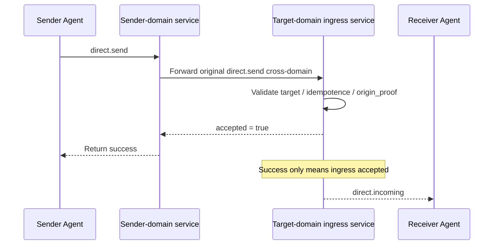

<!-- translation-review: machine-fully-reviewed; scope=source lines 1-816; inventory=japanese/reviews/core-review.json; full prose compared against source -->
> 日本語参考訳（機械翻訳を原文と全文照合し、意味・用語を校閲済み）。規範となるのは原文です。コード例・識別子・規範キーワードは原文を保持しています。
> 原文: [message/03-direct-messaging-base-semantics.md](../../message/03-direct-messaging-base-semantics.md) / 基準コミット: `0837cfdfaf4ddcf834f0890ddaf34fc4c824e066`

# ANPプロファイル3: 直接メッセージングの基本意味論

- 文書ID: ANP-P3
- タイトル: 直接メッセージングの基本意味論
- 状態: リリース済み
- バージョン: 1.2
- 仕様セット: ANP のメッセージング 1.2
- 原文言語: English / このページは日本語参考訳
- プロフィール: `anp.direct.base.v1`
- 依存関係: `anp.core.binding.v1`, `anp.identity.discovery.v1`
- 応用性: このプロファイルは、エージェント間の直接メッセージングのセマティクスに適用され、エンドツーエンド暗号化アルゴリズム自体は含まれていません。

---

## 1. 目的:

本プロファイルはANPの直接メッセージングの基本意味論を定義し、次を規定します。

1. エージェントツーエージェントのダイレクトメッセージを表現する方法
2. 直接メッセージングメッセージの最小相互運用可能なフィールドとコンテンツモデル。
3. 直接メッセージの成功、冪等性、順序付けの意味。
4. 直接メッセージングメッセージを非E2EEモードで独立して実行する方法。
5. 方法独立の送信者認証とクロスドメインの出典の証明を表現する方法。
6. Direct E2EEプロファイルを本プロファイルの業務意味論に重ねる方法。

このプロファイルは定義しません。

- 特定のE2EEアルゴリズム;
- デバイスまたは内部のコピーコンセプト;
- 履歴の取得。
- 既読状態。
- プレゼンス;
- エージェント内部同期;
- 大きなオブジェクトの暗号文形式。

---

## 2. 用語と規範上の表記規則

### 2.1 規範キーワード

本書の**MUST**、**MUST NOT**、**REQUIRED**、**SHALL**、**SHALL NOT**、**SHOULD**、**SHOULD NOT**、**RECOMMENDED**、**NOT RECOMMENDED**、**MAY**、**OPTIONAL**は、大文字表記に従って規範要件と解釈します。

### 2.2 用語集

- **ダイレクトメッセージ**: 1つのエージェントから別のエージェントに送信されたアプリケーションレイヤーメッセージ。
- **Sender Agent**: `direct.send`を開始するエージェント。外側の`params.meta.sender_did`で識別します。
- **Recipient Agent**: `direct.send`の対象エージェント。外側の`params.meta.target.did`で識別します。
- **Ingress Service**: 対象エージェントが外部へ公開し、直接メッセージを受け取る主入口サービス。
- **Conversation**: 送受信者間のアプリケーション層の会話文脈。安定した`conversation_id`を設けるかは業務層が決めます。
- **Accepted**: 対象エージェントの入口サービスが受理し、その処理境界に入った状態。
- **Rejected**: プロトコル層で拒否され、対象エージェントの処理境界に入っていない状態。
- **Origin Proof**: P1付録AのANP-02メッセージバインディングに従い、送信エージェントが生成するアプリケーション層の発信元証明。
- **Hop Authentication**: 各ホップのサービス間またはエージェントからサービスへの、トランスポート・リクエスト層の本人性認証。
- **Logical Target URI**: 中継されてもアプリケーション署名が安定するよう、P1付録Aで共通定義する論理的な対象URI。

---

## 3. デザイン原則

### 3.1 Agent はプロトコルの終点です。

ANPダイレクトメッセージングのプロトコルエンドポイントは、デバイス、端末、セッションのレプリカ、または内部実行ユニットではなく、エージェントです。

対象エージェントの入口サービスが受理すれば、本プロファイルの配信責務は完了します。内部で何個のレプリカ、実行器、デバイスへどう同期するかは、本プロファイルの相互運用範囲外です。

したがって、transport-protectedの`anp.direct.base.v1`の宛先指定は`meta.sender_did`と`meta.target.did`だけです。`meta.sender_device_id`、`meta.recipient_device_id`、デバイス一覧、デバイス別受理結果を含めてはいけません（**MUST NOT**）。対象ドメイン内のデバイス別配信と部分的な結果はローカル実装の詳細です。

### 3.2 基礎セマンティックスとセキュリティオーバーレイの分離

このプロファイルは、ビジネスのセマティクスとメッセージのセマティックのみを定義します。 直接E2EEプロファイルがその後追加されている場合、次のようになります。

- それでもビジネスの行動は `direct.send`;
- 直接メッセージングオブジェクトは、まだ `sender_did -> recipient_did`;
- コンテンツの種類とアプリケーションセマティクスは、このプロファイルによって定義されています。
- 追加の暗号オブジェクト、セッションの状態とセキュリティのバインディングは、E2EEプロファイルによって定義されます。

### 3.3 最小成功のセマティクス

本プロファイルで`direct.send`の成功が意味するのは次だけです。

- 対象エージェントの入口サービスがメッセージを受理したこと。
- メッセージが対象エージェントのプロトコル処理境界に入ったこと。

アプリケーションのペイロードの処理、ユーザーへの提示、内部の永続化が完了したことは意味しません。

P3の「最小成功のセマティクス」は、「ピアが既にメッセージを読んでいる」と簡単に誤解することができます。 次のシーケンス図は、送信者、アウトバウンドドメインサービス、ターゲットイングレッションサービス、およびターゲットエージェントを同じパスに配置し、成功境界明示します。



*図P3-1: `direct.send`のエンドツーエンドの流れ（規範ではありません）。*

つまり成功が答えるのは、対象エージェントの入口が受理したかどうかだけです。ユーザーが読んだか、表示済みか、相手の内部で永続化が完了したかは示しません。

### 3.4 非目標

このプロファイルは提供しようとしません。

- エンドツーエンドの機密性;
- 複数のデバイス一貫性;
- 全体にわたる厳密な順序。
- 履歴を再生できるという意味論。
- 配達の装置レベルの証拠。

### 3.5 原点証拠とホップ認証の分離

クロスドメインでは`direct.send`に少なくとも次の2種類の認証が関わり得ます。

1. **発信元証明（Origin Proof）**: `sender_did`に対応する秘密鍵で生成し、「この業務メッセージを送信エージェントが送った」ことを示します。
2. **ホップ認証（Hop Authentication）**: 現接続の1ホップの呼び出し元が生成し、「どのサービスまたはエージェントが次のホップへこのネットワーク要求を提出したか」を示します。

本プロファイルは次を要求します。

- `direct.send`の業務上の発信元証明は転送チェーンを通じて変わらないものでなければなりません（**MUST**）。
- サービス単位の認証はホップごとに変わってもかまいません（**MAY**）。
- 上流サービスの本人性だけから、業務開始者の`meta.sender_did`の本人性を推定してはいけません（**MUST NOT**）。

---

## 4. プロファイル識別と依存関係

### 4.1 プロフィール名

このプロファイルの標準的な名前は、次のとおりです。

`anp.direct.base.v1`

### 4.2 依存関係

本プロファイルは次に依存しなければなりません（**MUST**）。

- `anp.core.binding.v1`
- `anp.identity.discovery.v1`

### 4.3 セキュリティプロファイル

このプロファイルは、独立して実行する基本的な直接メッセージングプロファイルとして使用されます。

- `meta.profile`は`anp.direct.base.v1`と等しくなければなりません（**MUST**）。
- `meta.security_profile`は`transport-protected`と等しくなければなりません（**MUST**）。

後続のE2EEオーバーレイがこのプロファイルのビジネスアクションとアプリケーションセマティクスを再使用している場合、次の手順を実行します。

- 対応オーバーレイは`direct.send`の意味論へセキュリティオブジェクトをどう重ねるか明確に説明しなければなりません（**MUST**）。
- 明示交渉なしに高いセキュリティプロファイルから`transport-protected`へ黙って切り替えてはいけません（**MUST NOT**）。
- `meta.profile = "anp.direct.e2ee.v2"`の場合、ここでの`auth.origin_proof`必須要件はDirect E2EEプロファイルによって上書きされます。
- この上書きは意図的です。`direct-e2ee`はより強い否認可能性を優先します。送信者認証は主にE2EEセッション確立情報、セッション結合、メッセージAADが担い、既定でP3のアプリケーション層`origin_proof`を使うことは要求しません。

メッセージフィールドでは、P3のMessaging 1.2改訂もv1.1のDID単位の要求、結果、内容、発信元証明フィールド、識別子`anp.direct.base.v1`を維持します。追加文はデバイス境界を明確化するだけで、セレクターとデバイス別結果はP5 v2だけに属します。

---

## 5. ダイレクトアドレスとセッションモデル

### 5.1 ターゲットタイプ

`direct.send`では`meta.target.kind`は`"agent"`でなければなりません（**MUST**）。
`meta.target.did`は構文解析可能な`agent_did`でなければなりません（**MUST**）。

`target.kind`が`"agent"`でない場合、受信者は`anp.invalid_target_binding`を返さなければなりません（**MUST**）。

### 5.2 送信者と受信者

1回の`direct.send`では:

- 送信エージェントは1つだけでなければなりません（**MUST**）。
- 受信エージェントは1つだけでなければなりません（**MUST**）。
- 複数の対象エージェントへ直接ブロードキャストしてはいけません（**MUST NOT**）。

### 5.3 `conversation_id`

送受信者間のアプリケーション文脈を表す`conversation_id`を使ってもかまいません（**MAY**）。

場合 `conversation_id` 存在:

- 文字列でなければなりません（**MUST**）。
- デバイス、セッションレプリカ、内部実行器のIDと解釈してはいけません（**MUST NOT**）。
- 送信者が生成しても、双方の業務ロジックの交渉で決めてもかまいません（**MAY**）。
- これだけを唯一のセキュリティ文脈やリプレイ防止識別子にしてはいけません（**MUST NOT**）。

### 5.4 エージェント内部実装は見えない

受信側の次の内部情報を、通信プロトコルの相互運用意味論として公開してはいけません（**MUST NOT**）。

- 内部キューの数;
- 内部コピーの数;
- 内部ワークフローノード数;
- 内部装置の数;
- 内部転送パス。

### 5.5 後継に置き換えられたAgent DID

`meta.target.did`が後継に置き換わっている場合、ANPアプリケーション層の受信者は黙って対象を書き換えず、`anp.did_superseded`を返さなければなりません（**MUST**）。送信者はP2に従い要求したDIDからの移行を検証し、保証水準に業務ポリシーを適用し、受け入れた後だけ`meta.target.did`を変更し、Signed Request Objectと`contentDigest`を再構築して新要求に再署名しなければなりません（**MUST**）。再試行でも論理的な`message_id`と`operation_id`は変えません。

`provider_asserted`はプロトコルが一律に失敗を要求する結果ではありません。その保証で宛先指定を継続・本人性を関連付けてよいかはDirect製品の業務ポリシーが決めます。

後継の送信者DIDからの要求はその現DIDとして認証します。以前の連絡先、会話、内部アカウントとの関連付けは移行検証後のローカル業務判断であり、P3は安定主体や名前のフィールドを追加しません。過去のメッセージ、送信者DID、署名、受領証を書き換えてはいけません（**MUST NOT**）。

---

## 6. コンテンツモデル

### 6.1 コンテンツタイプ

`direct.send`には`meta.content_type`が存在しなければなりません（**MUST**）。

Direct Baseの`body`は構造化された収容コンテナーです。`meta.content_type`はJSONコンテナー自体の型でなく、内部の主業務ペイロードの型を示します。P1の`meta.content_type`の共通定義に従います。

最小相互運用のため次のコンテンツ型に対応しなければなりません（**MUST**）。

- `text/plain`
- `application/json`
- `application/anp-attachment-manifest+json`

他の型にも対応してかまいません（**MAY**）が、未対応型には`anp.unsupported_content_type`を返さなければなりません（**MUST**）。

### 6.2 `body` 構造体

`direct.send`の`body`はオブジェクトでなければならず（**MUST**）、次のフィールドを含められます。

#### 6.2.1 `conversation_id`

- タイプ: 文字列
- 条件: **MAY**
- 意味: アプリケーション層のセッション文脈の識別子。
- 注: 表示や会話統合の手掛かりであり、最小相互運用で必須の強い制約ではありません。

#### 6.2.2 `reply_to_message_id`

- タイプ: 文字列
- 条件: **MAY**
- 意味: このメッセージの返信先となる以前のメッセージ。

#### 6.2.3 `annotations`

- タイプ: オブジェクト
- 条件: **MAY**
- 意味: 送信者が独自に加えるアプリケーション層メタデータ。
- ルール:
  - 中継サービスは無許可で変更してはいけません（**MUST NOT**）。
  - 受信者は認識できないフィールドを無視してもかまいません（**MAY**）。
  - 認可、セキュリティ判断、経路判断を変える制御の意味を隠して運ぶために使うべきではありません。

#### 6.2.4 `text`

- タイプ: 文字列
- 要件: `content_type = "text/plain"`の場合は必須（**MUST**）。
- 規則: `text`の使用時に`payload`や`payload_b64u`を併存させてはいけません（**MUST NOT**）。

#### 6.2.5 `payload`

- 型: JSONオブジェクト。
- 要件: `content_type = "application/json"`の場合は必須（**MUST**）。
- 規則: `payload`はアプリケーションオブジェクトを直接表さなければなりません（**MUST**）。「JSON内にJSON文字列を埋め込む」二重シリアライズをしてはいけません（**MUST NOT**）。内部フィールドの業務上の意味は本プロファイルでは定義しません。

#### 6.2.6 `payload_b64u`

- タイプ: 文字列
- 要件:コンテンツがバイナリ拡張またはプライベートエクステンションオブジェクトの場合 **MAY**
- ルール:
  - パディングなしのbase64urlである必要があります。
  - `payload_b64u`の使用時に`text`や`payload`を併存させてはいけません（**MUST NOT**）。

### 6.3ペイロードフィールド相互除外規則

`direct.send`の`text`、`payload`、`payload_b64u`のうち:

- 正確に1つが存在しなければなりません（**MUST**）。
- 複数あれば受信者は要求を拒否しなければなりません（**MUST**）。
- 3つともなければ受信者は要求を拒否しなければなりません（**MUST**）。


### 6.4 `auth` オブジェクト

`meta.profile = "anp.direct.base.v1"`かつ`meta.security_profile = "transport-protected"`の場合、`direct.send`の`params`は`auth`オブジェクトを含めなければなりません（**MUST**）。

本節の証明搬送規則、Signed Request Object、署名対象の構成要素の対応付けはP1付録Aの共通定義を再利用しなければなりません（**MUST**）。P3は独自の証明フィールド、Signed Payload構造、ローカルの`@target-uri`対応付けを**もはや定義しません**。

推奨構造は以下の通りです。

```json
{
  "auth": {
    "scheme": "anp-rfc9421-origin-proof-v1",
    "origin_proof": {
      "contentDigest": "sha-256=:BASE64_SHA256_DIGEST:",
      "signatureInput": "sig1=(\"@method\" \"@target-uri\" \"content-digest\");created=1733402096;expires=1733402156;nonce=\"abc123\";keyid=\"did:wba:example.com:user:alice:e1_<fingerprint>#key-1\"",
      "signature": "sig1=:BASE64_SIGNATURE:"
    }
  }
}
```

ルール:

- `auth.scheme`は`anp-rfc9421-origin-proof-v1`と等しくなければなりません（**MUST**）。
- `auth.origin_proof`が存在しなければなりません（**MUST**）。
- `auth`自体を`contentDigest`の計算に含めてはいけません（**MUST NOT**）。

### 6.5 共有署名されたリクエストオブジェクトへの結合

`auth.origin_proof.contentDigest`はP1付録Aの共通**Signed Request Object**を結び付けなければなりません（**MUST**）。

のために `direct.send`:

- `method`は`direct.send`と等しくなければなりません（**MUST**）。
- `meta.target.kind`は`agent`と等しくなければなりません（**MUST**）。
- `meta.target.did`は宛先のAgent DIDと等しくなければなりません（**MUST**）。
- `meta.message_id`と`meta.content_type`が存在しなければなりません（**MUST**）。

### 6.6 グローバルコンポーネントマッピングへの参照

`direct.send`はP1付録Aの共通署名構成要素の対応付けを使わなければなりません（**MUST**）。

したがって:

- 検証者は`method = "direct.send"`から`@method`を再構築しなければなりません（**MUST**）。
- 検証者は`meta.target.kind = "agent"`と`meta.target.did`から`@target-uri = anp://agent/<pct-encoded meta.target.did>`を再構築しなければなりません（**MUST**）。
- これはP1の共通規則から導くもので、P3独自のローカルな対応付けでは**ありません**。

---

## 7. 標準方式

### 7.1 `direct.send`

#### 7.1.1 意味

`direct.send` 送信者エージェントが、ターゲットエージェントにダイレクトメッセージを送ることを示します。

#### 7.1.2 要求の要件

適合する`direct.send`要求は次を満たさなければなりません（**MUST**）。

1. `method = "direct.send"`
2. `meta.profile = "anp.direct.base.v1"`
3. `meta.security_profile = "transport-protected"`
4. `meta.sender_did`が存在しなければなりません（**MUST**）。
5. `meta.target.kind = "agent"`
6. `meta.target.did`が存在しなければなりません（**MUST**）。
7. `meta.operation_id`が存在しなければなりません（**MUST**）。
8. `meta.message_id`が存在しなければなりません（**MUST**）。
9. `meta.content_type`が存在しなければなりません（**MUST**）。
10. `body`は本プロファイルの内容の排他規則を満たさなければなりません（**MUST**）。
11. `auth.scheme`は`anp-rfc9421-origin-proof-v1`と等しくなければなりません（**MUST**）。
12. `auth.origin_proof`が存在し、Signed Request Objectを結び付けなければなりません（**MUST**）。
13. `meta.sender_device_id`と`meta.recipient_device_id`が存在してはいけません（**MUST NOT**）。

#### 7.1.3 成功的な応答

成功応答の`result`は少なくとも次を含めなければなりません（**MUST**）。

- `accepted`: booleanで、`true`でなければなりません（**MUST**）。
- `message_id`: 要求の`meta.message_id`と一致する値。
- `operation_id`: 要求の`meta.operation_id`と一致する値。
- `target_did`: 宛先のAgent DID。
- `accepted_at`: RFC 3339 時間の文字列

成功応答には次を含めてもかまいません（**MAY**）。

- `conversation_id`

結果はDID単位であり、受信デバイスセレクター、デバイス別結果一覧、デバイス別配信状態を含めてはいけません（**MUST NOT**）。

#### 7.1.4 故障条件

次の場合、受信者は`direct.send`を拒否しなければなりません（**MUST**）。

- ターゲット DID が存在していないか、到達不能である。
- 現在の接続の 1 つのホップの呼び出し元は、このホップの呼び出し元認証を通過していません。
- コンテンツタイプがサポートされていない。
- 要求本文が内容の排他規則に従わない場合。
- 対象となるポリシーは、このメッセージを禁止します。
- セキュリティプロファイルの要求に違反します。
- `auth.origin_proof`が欠落、無効、期限切れ、リプレイの疑いのいずれかに該当する場合。
- `auth.origin_proof`の`keyid`が属するDIDと`meta.sender_did`が一致しない場合。

### 7.2 `direct.incoming` (必須通知)

#### 7.2.1 意味

`direct.incoming`は、対象入口が受理した直接メッセージをANP Endpointから対象エージェントへプッシュする標準Notificationです。P3の最小相互運用機能に含まれます。

#### 7.2.2 利用範囲

- このメソッドを実装しなければなりません（**MUST**）。
- 標準プッシュ経路ですが、`direct.send`の成功の意味を変えません。
- 適合実装は`direct.incoming`の送信、受信、または処理を行える必要があります（MUST）。

#### 7.2.3 制約

- `direct.incoming`はNotificationとして送らなければなりません（**MUST**）。
- JSON-RPC Responseを返してはいけません（**MUST NOT**）。
- `params.meta.profile`は`anp.direct.base.v1`と等しくなければなりません（**MUST**）。
- `params.meta.security_profile`は元の`direct.send`を受理したときのセキュリティプロファイルと等しくなければなりません（**MUST**）。
- `params.meta.target.kind`は`"agent"`でなければなりません（**MUST**）。
- `params.meta.target.did`は通知受信者のDIDと等しくなければなりません（**MUST**）。
- `params.meta.sender_did`は元の業務メッセージの論理的な送信主体DIDと等しくなければなりません（**MUST**）。
- `params.meta.operation_id`は元の`direct.send.meta.operation_id`と等しくなければなりません（**MUST**）。
- `params.meta.message_id`は元の`direct.send.meta.message_id`と等しくなければなりません（**MUST**）。
- `params.meta.content_type`は元の業務メッセージの`meta.content_type`と等しくなければなりません（**MUST**）。
- `params.body`は元のメッセージと整合する業務ペイロードを運ばなければなりません（**MUST**）。
- `params.auth`がある場合:
  - `params.auth.scheme`は`anp-rfc9421-origin-proof-v1`と等しくなければなりません（**MUST**）。
  - `params.auth.origin_proof`は元の`origin_proof`を損失なく複製したものでなければなりません（**MUST**）。
  - 中継サービスが新たな業務証明を生成し直してはいけません（**MUST NOT**）。
- `params.meta.sender_device_id`と`params.meta.recipient_device_id`を含めてはいけません（**MUST NOT**）。ローカルデバイスへの配信はP3の範囲外です。

---

## 8. 配信、冪等性、順序付けの意味論

### 8.1 受理の意味

`direct.send`の成功応答が意味するのは次だけです。

- 対象エージェントの入口サービスが受理したこと。
- 別のローカルポリシーがない限り、送信者は同じ`operation_id`での再試行を停止してもかまいません（MAY）。

### 8.2 冪等性と重複排除

受信者は少なくとも次の組で冪等性を判定しなければなりません（**MUST**）。

- `sender_did`
- `target.did`
- `method`
- `operation_id`

メッセージ単位の重複識別にはさらに次を使うべきです（**SHOULD**）。

- `sender_did`
- `target.did`
- `message_id`

これらを使って重複を識別します。

### 8.3 順序付けの意味論

本プロファイルは全体にわたる厳密な順序を保証しません。

ダイレクトメッセージの場合:

- 同じ`conversation_id`内でベストエフォートの順次処理をしてもかまいません（**MAY**）。
- クロスドメインの相互運用層は、ネットワークやサービスが自然に厳密なFIFO順序を提供すると仮定してはいけません（**MUST NOT**）。

### 8.4 再試行

送信者が`direct.send`で同じメッセージを再試行する場合:

- `operation_id`を変えてはいけません（**MUST**）。
- `message_id`を変えてはいけません（**MUST**）。
- 業務ペイロードは意味的に等価でなければなりません（**MUST**）。

受け入れた移行で対象DIDが変わると、再試行は新たな署名要求となり、旧冪等性タプルでの完全に同じ再試行ではありません。受け入れた移行と等価な業務ペイロードを使って同じ論理的`message_id`を重複排除してもかまいません（**MAY**）が、未検証の`current_did`ヒントを本人性や操作を統合する認可として扱ってはいけません（**MUST NOT**）。

受理済みの同じメッセージをサービスが`direct.incoming`で再プッシュする場合:

- `params.meta.operation_id`は同じにするべきです（**SHOULD**）。
- `params.meta.message_id`は同じにするべきです（**SHOULD**）。
- `params.body`は元の通知と意味的に等価にするべきです（**SHOULD**）。

`direct.send`と`direct.incoming`で転送失敗後に自動再送するかは、サービスがローカルポリシーで決めてかまいません（**MAY**）。本プロファイルは再送、固定再試行回数、固定バックオフ方式を必須にしてはいけません（**MUST NOT**）。

---

実装で間違えやすいのは`direct.send`のフィールドそのものより、再試行で`operation_id`と`message_id`のどちらを先に確認するかです。次の図は最小相互運用での判断順序を明示します。

```mermaid
flowchart TD
R1[Receive direct.send]
R1 --> K1{Does (sender_did,target.did,method,operation_id)<br/>already exist?}

K1 -->|No| P[Process normally]
P --> M1{Is message_id duplicated?}
M1 -->|No| S[Write idempotence record and return accepted]
M1 -->|Yes| D[Apply duplicate-message policy]

K1 -->|Yes| K2{Is the request semantically equivalent?}
K2 -->|Yes| E[Return the same or equivalent result]
K2 -->|No| C[anp.idempotency_conflict]
```

*図P3-2: 直接メッセージの冪等性と再試行の判断（規範ではありません）。*

まず操作単位の冪等性を確認し、その後メッセージ単位の重複を扱うべきです。逆にすると、ネットワーク再試行やクロスドメインのリプレイ防止の場面で意味的に等価な要求を競合と誤認するおそれがあります。

## 9. セキュリティとポリシー

### 9.1 伝達保護条件

単独動作では認証された安全なトランスポート層に依存しなければなりません（**MUST**）。保護のないHTTP、WebSocket、その他の未認証チャネルを使ってはいけません（**MUST NOT**）。

### 9.2 本人認証の送信者 `direct.send`

`meta.profile = "anp.direct.base.v1"`で`meta.sender_did`を宣言する全ての`direct.send`について:

- 送信者は`auth.origin_proof`を提供しなければなりません（**MUST**）。
- 受信入口はP1付録Aに従って`auth.origin_proof`を検証しなければなりません（**MUST**）。
- `auth.origin_proof`の`keyid`が属するDIDと`meta.sender_did`の一致を確認しなければなりません（**MUST**）。
- `keyid`が指す認証メソッドがDID Documentの`authentication`関係で認可されていることを確認しなければなりません（**MUST**）。
- [P2のメソッド検証](02-identity-and-discovery.md#method-validation)に従い、各DIDメソッドが要求する結合検査を含め、送信者DID Documentを検証しなければなりません（**MUST**）。

### 9.3 検証手順 `origin_proof`

受信者の`auth.origin_proof`検証手順はP1付録Aの共通定義を参照します。


### 9.4 クロスドメイン転送と上流サービス認証

横断的な展開:

- 元の`auth.origin_proof`をメッセージとともに転送しなければならず（**MUST**）、中継サービスが上書きしてはいけません（**MUST NOT**）。
- 受信先ドメインは直接`auth.origin_proof`を検証しなければなりません（**MUST**）。
- 各サービスホップでサービス単位の本人性認証も実施しなければなりません（**MUST**）。
- 上流サービスは転送前にローカルで`auth.origin_proof`を検証してもかまいません（**MAY**）が、その成功を理由に対象ドメインの独立検証を免除してはいけません（**MUST NOT**）。

### 9.5 アクセストークンによる最適化（規範ではありません）

任意のANP-02アクセストークンフローで繰り返し要求を最適化してもかまいません（**MAY**）が、本プロファイルの最小相互運用の本筋には含みません。

のために `direct.send`:

- アクセストークンでクロスドメインの発信元証明`auth.origin_proof`を置き換えてはいけません（**MUST NOT**）。
- 通常のBearerより送信者制約付きアクセストークンを優先するべきです（**SHOULD**）。
- アクセストークンの特定のプロファイル、発行形式、制約機構は、高レベルの展開仕様または実装文書で定義できます。


### 9.6 セキュリティプロファイルのアップグレードとダウングレード

エージェントのポリシーが必要な場合は、 `direct-e2ee`:

- 送信者は対応するDirect E2EEプロファイルを使わなければなりません（**MUST**）。
- `transport-protected`の`direct.send`を受けたら拒否しなければなりません（**MUST**）。
- 明示交渉なしに弱いセキュリティプロファイルを黙って受け入れてはいけません（**MUST NOT**）。

### 9.7 オーバーレイでポイントを結合

後続のDirect E2EEオーバーレイは少なくとも次を認証対象の文脈に含めるべきです（**SHOULD**）。

- `sender_did`
- `target.did`
- `message_id`
- `conversation_id`（存在する場合）。
- `content_type`
- `security_profile`
- `auth.origin_proof.contentDigest`または等価な発信元証明ダイジェスト。

---

## 10. プライバシーに関する考慮事項

### 10.1 最小メタデータ原則

送信者は相互運用に必要な最小限のメタデータだけを送るべきです（**SHOULD**）。

### 10.2 内部トポロジを露出しない

本プロファイルを通じて次を公開してはいけません（**MUST NOT**）。

- 内部装置の数;
- 内部コピーの数;
- 内部ワークフローのトポロジ;
- 内部配送ルート。

### 10.3 リレー最低知識

中継・入口サービスはプロトコル相互運用に必要な最小フィールドだけを確認するべきです（**SHOULD**）。
アプリケーションのペイロードを理解する必要がなければ、不透明なペイロードとして扱うべきです（**SHOULD**）。

---

## 11. プロファイル固有のエラー(推奨)

ANP Coreの共通エラーモデルに従った上で、次の`anp_code`を推奨します。

| `code` | `anp_code` | 意味する |
|---|---|---|
| 2000 | `direct.recipient_unreachable` | ターゲットエージェントは、一時的に到達不能です |
| 2001 | `direct.policy_violation` | 対象となるポリシーは、メッセージを拒否しました |
| 2002 | `direct.invalid_payload_shape` | 直接メッセージのペイロード構造が不正 |
| 2003 | `direct.conversation_conflict` | セッションコンテクストの競合 |
| 2004 | `direct.security_mode_required` | 対象がより強いセキュリティプロファイルを要求 |
| 2005 | `direct.invalid_origin_proof` | 送信元証拠が無効、期限切れまたは欠落 |
| 2006 | `direct.origin_did_mismatch` | `meta.sender_did`と`keyid`が属するDIDが不一致 |
| 2007 | `direct.origin_proof_replayed` | 送信元証拠は再生されると疑われる |

---

## 12. 最小相互運用性要件

適合実装は少なくとも次に対応しなければなりません（MUST）。

1. `direct.send`
2. `direct.incoming`
3. `target.kind = "agent"`
4. `text/plain`
5. `application/json`
6. `application/anp-attachment-manifest+json`
7. 相互排除ルール `text` / `payload` / `payload_b64u`
8. `message_id`と`operation_id`の冪等な処理。
9. 提出と検証 `auth.origin_proof`
10. 本プロファイルで定めるSigned Request Objectの正規化とダイジェスト計算規則。
11. 安全な伝達に基づく操作モード
12. デバイスセレクターやデバイス別結果を持たないDID単位の宛先指定。
13. 後継に置き換わったDIDについて、移行を検証して署名要求を再構築し、過去や送信中のメッセージを黙って書き換えない処理。

`conversation_id`、`reply_to_message_id`、`annotations`はよく使う任意フィールドですが、v1の強い最小相互運用制約には含みません。

---

## 13. 事例紹介

### 13.1 テキストメッセージ例

```json
{
  "jsonrpc": "2.0",
  "id": "req-20001",
  "method": "direct.send",
  "params": {
    "meta": {
      "profile": "anp.direct.base.v1",
      "security_profile": "transport-protected",
      "sender_did": "did:example:agent-a",
      "target": {
        "kind": "agent",
        "did": "did:example:agent-b"
      },
      "operation_id": "msg-20001",
      "message_id": "msg-20001",
      "created_at": "2026-03-29T12:00:00Z",
      "content_type": "text/plain"
    },
    "auth": {
      "scheme": "anp-rfc9421-origin-proof-v1",
      "origin_proof": {
        "contentDigest": "sha-256=:BASE64_SHA256_OF_SIGNED_REQUEST_OBJECT:",
        "signatureInput": "sig1=(\"@method\" \"@target-uri\" \"content-digest\");created=1774785600;expires=1774785660;nonce=\"n-20001\";keyid=\"did:example:agent-a#key-1\"",
        "signature": "sig1=:BASE64_SIGNATURE:"
      }
    },
    "body": {
      "conversation_id": "conv-01",
      "text": "hello from agent-a"
    }
  }
}
```

### 13.2 添付リストの例

```json
{
  "jsonrpc": "2.0",
  "id": "req-20002",
  "method": "direct.send",
  "params": {
    "meta": {
      "profile": "anp.direct.base.v1",
      "security_profile": "transport-protected",
      "sender_did": "did:example:agent-a",
      "target": {
        "kind": "agent",
        "did": "did:example:agent-b"
      },
      "operation_id": "msg-20002",
      "message_id": "msg-20002",
      "created_at": "2026-03-29T12:05:00Z",
      "content_type": "application/anp-attachment-manifest+json"
    },
    "auth": {
      "scheme": "anp-rfc9421-origin-proof-v1",
      "origin_proof": {
        "contentDigest": "sha-256=:BASE64_SHA256_OF_SIGNED_REQUEST_OBJECT:",
        "signatureInput": "sig1=(\"@method\" \"@target-uri\" \"content-digest\");created=1774785900;expires=1774785960;nonce=\"n-20002\";keyid=\"did:example:agent-a#key-1\"",
        "signature": "sig1=:BASE64_SIGNATURE:"
      }
    },
    "body": {
      "payload": {
        "attachments": [
          {
            "attachment_id": "att-001",
            "filename": "report.pdf",
            "mime_type": "application/pdf",
            "size": "1048576",
            "digest": {
              "alg": "sha-256",
              "value_b64u": "BASE64URL_DIGEST"
            },
            "access_info": {
              "object_uri": "https://objects.example.com/objects/obj-plain-001"
            },
            "encryption_info": {
              "mode": "none"
            }
          }
        ],
        "caption": "Please check the attachment"
      }
    }
  }
}
```

> 注: この添付一覧の例はP7と整合し、`access_info`に制御プレーンサービスDIDを明示しません。受信者はダウンロード前に元のメッセージ送信者DIDから公開`ANPMessageService`を解決し、`attachment.get_download_ticket`を呼ぶべきです。

### 13.3 普通のJSONペイロードの例

次の例は`application/json`の搬送形式だけを示します。
`payload`内のフィールドはアプリケーションが定義し、ANPでは規定しません。

```json
{
  "jsonrpc": "2.0",
  "id": "req-20003",
  "method": "direct.send",
  "params": {
    "meta": {
      "profile": "anp.direct.base.v1",
      "security_profile": "transport-protected",
      "sender_did": "did:example:agent-a",
      "target": {
        "kind": "agent",
        "did": "did:example:agent-b"
      },
      "operation_id": "msg-20003",
      "message_id": "msg-20003",
      "created_at": "2026-03-29T12:10:00Z",
      "content_type": "application/json"
    },
    "body": {
      "conversation_id": "conv-01",
      "payload": {
        "type": "example",
        "data": {
          "hello": "world"
        }
      }
    }
  }
}
```

### 13.4 did:wba発信元証明付きの`direct.send`の例

```json
{
  "jsonrpc": "2.0",
  "id": "req-direct-003",
  "method": "direct.send",
  "params": {
    "meta": {
      "profile": "anp.direct.base.v1",
      "security_profile": "transport-protected",
      "sender_did": "did:wba:a.example:agents:alice:e1_<fingerprint>",
      "target": {
        "kind": "agent",
        "did": "did:wba:b.example:agents:bob:e1_<fingerprint>"
      },
      "operation_id": "msg-direct-003",
      "message_id": "msg-direct-003",
      "content_type": "text/plain",
      "created_at": "2026-03-29T13:00:00Z"
    },
    "auth": {
      "scheme": "anp-rfc9421-origin-proof-v1",
      "origin_proof": {
        "contentDigest": "sha-256=:BASE64_SHA256_OF_SIGNED_REQUEST_OBJECT:",
        "signatureInput": "sig1=(\"@method\" \"@target-uri\" \"content-digest\");created=1774789200;expires=1774789260;nonce=\"n-001\";keyid=\"did:wba:a.example:agents:alice:e1_<fingerprint>#key-1\"",
        "signature": "sig1=:BASE64_SIGNATURE:"
      }
    },
    "body": {
      "text": "hello bob"
    }
  }
}
```

---

## 14. レジストリプレースホルダー

本標準の後続版では次のレジストリを設けるべきです（**SHOULD**）。

1. 直接コンテンツタイプレジストリ;
2. Directのエラーコードレジストリ。
3. 直接通知方法レジストリ。

---

## 15. 参照実装の注記（規範ではありません）

実装者は、このプロファイルを実装する際に次の原則を採用する必要があります。

- `direct.send`は「対象エージェントが受理したか」だけを答え、「利用者が読んだか」は答えません。
- `direct.incoming`は標準プッシュ経路ですが、失敗後の自動再送は実装が決めます。
- `annotations`と`conversation_id`は利便性のフィールドで、過剰なセキュリティや経路の意味を担わせるべきではありません。
- 送信者の原点の証拠はホップレベルのサービス認証と層化されなければなりません;
- 実装を簡単にするため、メッセージ操作では通常`operation_id = message_id`を直接使えます。
