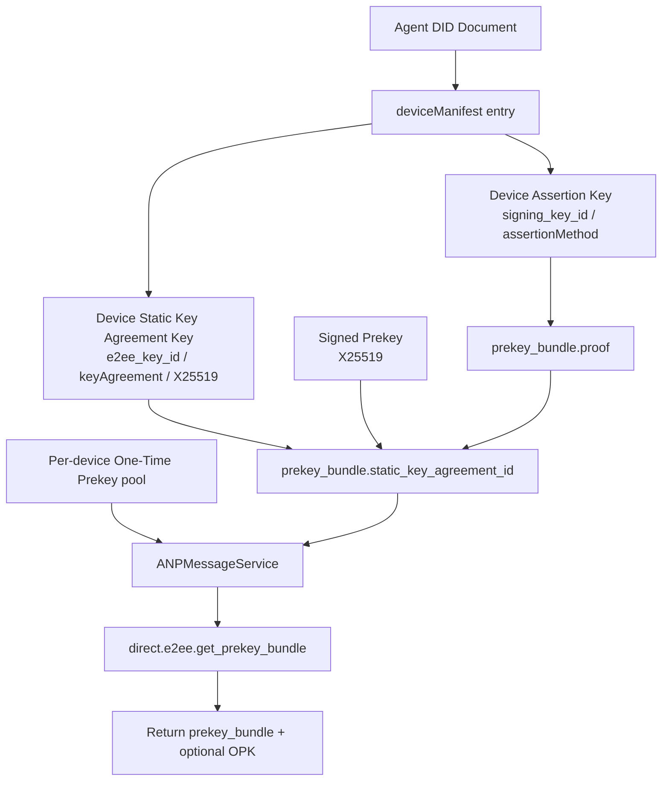
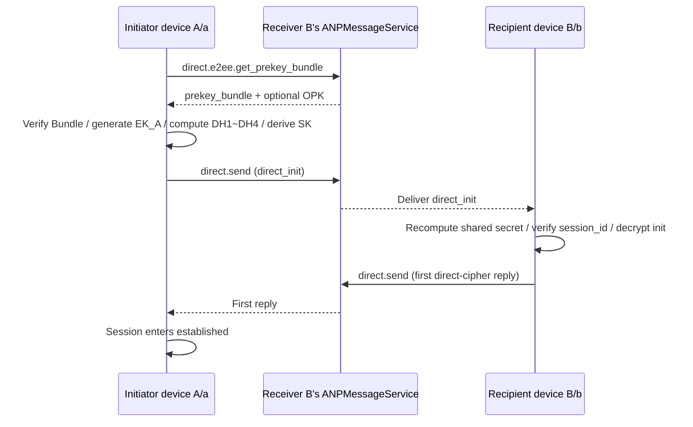
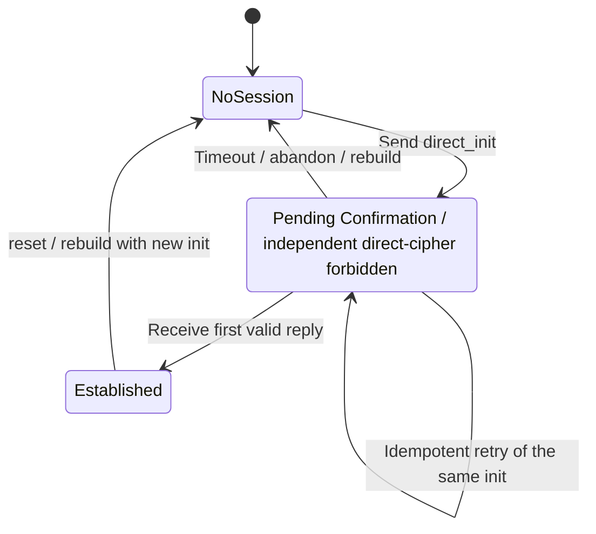

> 日本語参考訳（機械翻訳・未校閲）。規範となるのは原文です。コード例・識別子・規範キーワードは原文を保持しています。
> 原文: [message/05-direct-end-to-end-encryption.md](../../message/05-direct-end-to-end-encryption.md) / 基準コミット: `0837cfdfaf4ddcf834f0890ddaf34fc4c824e066`

# ANP プロファイル 5: エンドツーエンド暗号化

- 文書ID: ANP-P5
- タイトル: 直接エンドツーエンド暗号化
- ステータス: リリース
- バージョン: 1.2
- 仕様セット: ANP のメッセージング 1.2
- 原文言語: English / このページは日本語参考訳
- プロフィール: `anp.direct.e2ee.v2`
- 応用性: このプロファイルは、2つのエージェントIDの下で特定の暗号デバイス間で直接E2EEに適用されます。
- 依存関係:
  - `anp.core.binding.v1`
  - `anp.identity.discovery.v1`
  - `anp.direct.base.v1`
  - [ANP-02 身元入力](../../02-anp-did-authentication-protocol-specification.md#identity-input) および適用可能なDID方法結合(指定の依存性、新しいワイヤー プロフィールではない)

---

## 1. ゴールとスコープ

このプロファイルは、ANP 直接エンドツーエンド暗号化の完全な実行可能なソリューションを定義します。, stipulating:

1. 方法検証済みのID ID、P2 を接続する方法 `deviceManifest`直接E2EEへのサービス発見
2. 各対象となるデバイスが、Prekey Bundle を公開し、発見し、検証する方法
3. 送信者側と受信側側のペアが非同期化をいかに確立するか `X3DH-like` セッション
4. 各デバイスペアが独立した状態を維持する方法 `Double Ratchet-like` 状態;
5. デバイス・バウンド・AD、リプレイ保護、アウト・オブ・オーダー処理、セッションの復興、メールボックスの配信、エラーの動作方法
6. エージェント DID が、明示的なデバイスセレクターが暗号エンドポイントだけを識別しながら、ビジネスのアイデンティティを維持する方法。

論理的な DID-to-DID メッセージは、複数の独立したデバイス ciphertext 操作を生成する可能性があるためです。 このプロファイルは、デバイスを連絡先、参加者、または新しいものに変えません `target.kind`.

このプロファイルは定義しません。

- デバイスの入園または製品ローカルデバイス管理ワークフロー;
- 履歴メッセージを引き受ける。
- ステータスを読んで下さい;
- プレゼンス;
-グループエンドツーエンド暗号化;
- デバイス秘密鍵、ラチェットの状態、または歴史の文脈のコピー。
- DID メソッド自体の解像度、更新、および非アクティブ化メカニズム。

---

## 2. 仮説キーワードと用語集

### 2.1 仮説キーワード

この記事では、 **MUST**, **MUST NOT**, **REQUIRED**, **SHALL**, **SHALL NOT**, **SHOULD**, **SHOULD NOT**, **RECOMMENDED**, **NOT RECOMMENDED**, **MAY**, **OPTIONAL** 資本金を基準とした規範的な要件として解釈されます。

### 2.2 用語集

- **エージェントID**: 外部通信のエージェント識別 このプロファイルでは、それは外面のビジネス対象識別子だけでなく、 `direct.send`、また AAD の同一証明アンカー、束ねられた確認およびセッション結合。
- **デバイスエンドポイント**: エージェントIDの下の暗号エンドポイント、不透明で選択 `device_id` DID の現在の P2 から `deviceManifest`. . . DIDやビジネス参加者ではありません。
- **デバイスペア**: 注文したタプル `(sender_did, sender_device_id, recipient_did, recipient_device_id)` 直接E2EE操作にバインド。
- **インサートキー**: 選択したマニフェストエントリの署名キー `signing_key_id` および承認される `assertionMethod`. . . デバイスのバンドルまたはビンディングプルーフをサインし、DH計算には参加しません。
- **静的キーの一致のキー**: 選択したマニフェストエントリの参照される長期X25519公開鍵 `e2ee_key_id` DID 文書で宣言 `keyAgreement`.
- **署名されたプレキー(SPK)**: 1つのデバイスによって生成されたX25519の公開鍵を、署名し、そのデバイスのAssertionキーでバインドします。
- **ワンタイムプレキー(OPK)**: 1つのデバイスに属する1回X25519公開鍵。 正常に使用した場合は、消費されず再利用することはできません。
- **プレキーバンドル**: セッション・フェスティバルの公共資料は、正確に1つに限って `(owner_did, owner_device_id)`. . . デバイスの長期静的交渉キーと現在のSPKは記述しますが、直接OPKを埋めません。
- **ダイレクトセッション**: 注文したデバイスペアのE2EEセッション、 `session_id`. . . 二重ラチェット、注文外、再生状態は別のデバイスペアと共有されません。
- **アプリケーション プレーンテキスト**: 暗号化される前に、アプリケーションレイヤーのプレーンテキストオブジェクトを直接メッセージングします。 AEADの暗号化を入力するために使用される直接ベースアプリケーションのペイロードの正規化内部表現です。
- **ラチェットヘッダー**: 送信されたメッセージに対して、最小の公開ヘッダーフィールドが必要です。 受信チェーンを見つけるために受信機は、それがDHラチェットを進歩し、注文外のメッセージを処理する必要があるかどうかを決定します。
- **メールボックス**: 不透明の暗号テキストキューがスコープ付けされる `(recipient_did, recipient_device_id)`. . . 複数のセッションを運ぶことができるが、ラチェット状態を持たない。
- **キャッシュを再生する**: 重複した初期メッセージや、その後のメッセージを複製するために使用される状態のコレクション。 標準的なワイヤプロトコルフィールドではなく、ローカルな状態です。

ツイート `device_id` **MUST** 不透明で、 **MUST NOT** 取り外しの後で再使用されて。 鍵、ハードウェア識別子、またはユーザー表示名ではありません。

---

## 3. 設計全般の原則

### 3.1 ビジネスのアイデンティティと暗号デバイスエンドポイント

業務の送信者と受取人が残っている `meta.sender_did` とりあえず `meta.target.did`. . . このプロファイルは、追加の必要 `meta.sender_device_id` とりあえず `meta.recipient_device_id` 正確な暗号デバイスペアを選択するために。 これらのフィールドはP5にのみ属し、DIDレベルの連絡先や会話のセマティクスを変更しません。

送信者が複数の対象となるデバイスを1つの受信者IDの下にターゲットする場合、 **MUST** 独立して暗号化されたものを作成する `direct.send` 受取装置ごとの操作。 サービス **MUST NOT** ラチェットの状態を共有したり、隠された暗号ファンアウトを実行したりできます。

### 3.2 セキュリティのオーバーレイとビジネスのセマティクスの分離

ダイレクトメッセージングのビジネスセマティクスを赤くしない、再利用 `anp.direct.base.v1`'s:

- `direct.send` メソッド;
- `sender_did` / `target.did` 美容師;
- `message_id` / `operation_id` 美容師;
- 直接メッセージング成功のセマティクス(ターゲットエージェントポータルサービスが受け入れられる);
- 応用層のコンテンツ タイプ 皮下。

各デバイス暗号文では、P5 はデバイスセレクター、デバイスのペア暗号化結合、およびデバイス固有の承認結果の両方を所有しています。 輸送保護されたP3メッセージは、DID-アドレスをとり、デバイスセレクタを運ぶことなく残します。

### 3.3 MTIベースラインを交換しない

このv2プロファイルの必須相互運用性ベースラインは引き続き採用されています。

- 初期セッションの開設: `X3DH-like` (DIDの提出)
- 長期静的な交渉のキー: `X25519`
- ケド: `HKDF-SHA-256`
- 電子メール: `ChaCha20-Poly1305`
- サブシーケントメッセージ: `Double Ratchet-like`

### 3.4 将来のアップグレードパス

このページはアップグレードのお部屋を予約しています。 `PQXDH-like`. . . このv2プロファイルは、既存のMTIの暗号スイートを変更しません。将来のスイートには、別の明示的なスイート識別子と交渉が必要です。

`anp.direct.e2ee.v1` 独立した単一エンドポイント契約を保留します。 導入事例 **MUST NOT** v1 ピアのデバイスを注入し、v1 セッションまたはラチェットの状態を v2 デバイスの状態として再利用したり、v1 やトランスポート保護 P3 に失敗した v2 デバイス操作をサイレントダウングレードします。

### 初期設定では、3.5 の長期署名が必須ではありません。

このプロフィールでは、全体にわたって長期IDの署名を `direct_init` オブジェクトは **必須事項** デフォルトでは。

理由は:

1. X3DH のような認証自体は、長期静的交渉キーと受信機 SPK の組み合わせから来ています。
2. 受信機SPKはAssertionのキーによって縛られました;
3. 長い時間のために署名するすべての init メッセージが要求された場合、それは「属性制御メッセージ」モデルに向かって著しく偏見し、信号スタイルの劣化を弱める。

展開がより強い可聴性を必要とする場合、 MAY 有効にして下さい `Direct Init Accountability Extension`. . . その拡張子はオプションで、このプロファイルのデフォルトの動作の一部ではありません。

### 3.6 MTIワイヤーの目的コレクション `anp.direct.e2ee.v2`

いつか `method = "direct.send"` とりあえず `meta.profile = "anp.direct.e2ee.v2"`,次の2つの値のみが許可されます `meta.content_type` 変更されていないMTIパスで:

- `application/anp-direct-init+json`
- `application/anp-direct-cipher+json`

送信者 **MUST NOT** 変更されていないMTIパスで異なるワイヤオブジェクトタイプを使用します。
他の受取人を受け取る `content_type` MUST 拡張交渉により、機能が明示的に有効化されていない限り拒否します。

### 3.7 メッセージID制約 `direct.send` とりあえず `anp.direct.e2ee.v2`

のために `direct.send` のり `meta.profile = "anp.direct.e2ee.v2"`:

- `meta.message_id` **MUST** 存在;
- `meta.operation_id` **MUST** 存在;
- `meta.operation_id` **MUST** 正確に等しい `meta.message_id`.

各受信デバイス 暗号テキスト **MUST** 独自のユニークで `message_id` / `operation_id` ペア。 兄弟用テキストは、暗号化されたアプリケーションプレインテキストに同じオプションが含まれている場合でもペアを共有できません `logical_message_id`.

### 3.8 `auth` 制約の制限 `direct.send` とりあえず `anp.direct.e2ee.v2`

`params.auth` **MUST** 不在な `direct.send` いつか `meta.profile = "anp.direct.e2ee.v2"`.

展開が明示的に交渉する場合 `Direct Init Accountability Extension`, , , , , , , , , , , , , , , , , , , , , , , , , , , , , , , , , , , , , , , , , , , , , , , , , , , , , , , , , , , , , , , , , , , , , , , , , , , , , , , , , , , , , , , , , , , , , , , , , , , , , , , , , , , , , , , , , , , , , , , , , , , , , , , , , , , , , , , , , , , , , , , , , , , , , , , , , , , , , , , , , , , , , , , , , , , , , , , , , , , , , , , , , , , , , , , , , , , , , , , , , , , , , , , , , , , , , , , , , , , , , , , , , , , , , , , , , , , , , , , , , , , , , , , , , , , , , , , , **MAY** 追加のアテスティングオブジェクトを紹介します。 延長が交渉されていない場合、受信機 **MUST** 受領を拒否する `params.auth`.

---


### 3.9 P3オリジナイザーの結合の条件との関係

とりあえず`auth.origin_proof.contentDigest` P3セクション9.7の同等の起源の証拠の消化器」の条件、このプロフィールは次の目的によって同等な結合に一緒に合います:

- `AD_init`
- `AD_msg`
- `Application Plaintext` エイエイエイド保護下

いつか `Direct Init Accountability Extension` 交渉は行いません。このプロフィールのMTI **必須ではありません** P3 フォームをさらに持ち運ぶ `params.auth.origin_proof`.

## 4. 方法独立性 DID 統合ルール

### 4.1 DID文書の最小要件

エージェントのDIDは、このプロファイルをサポートしている文書 **MUST** 会议日程:

1. 同一認証やアサーション署名に使用することができるアサーションキーには少なくとも1つの認証鍵があります。
2. 少なくとも1つあります `keyAgreement` 検証方法;
3. 少なくとも1つあります `ANPMessageService` または同等のサービスエントリ;
4. 現在のP2 `deviceManifest` P5 を使用するすべてのデバイスを宣言し、そのマップを `device_id`, `signing_key_id`, `e2ee_key_id`、および完全な P1/P2/P3/P5 プロフィールの依存性セット;
5. とりあえず `ANPMessageService` **MUST** 呼び出し側から解析・アクセスでき、このプロファイルで必要なデバイスキーのマテリアルメソッドを提供します。

#### 4.1.1 現在の装置適格性

出版前、返送、P5素材使用前に `(D, d)`, 実装 **MUST** 現在の DID ドキュメントに対して、次のことを確認してください。

1. `d` エージェントIDで1つの現在のP2マニフェストエントリを正確に選択します `D`;
2. エントリーが宣言する `anp.direct.e2ee.v2` およびその必要な P1/P2/P3 の依存関係;
3. `signing_key_id` バンドルの証拠に必要な署名方法を参照し、 `e2ee_key_id` リファレンスX25519メソッドで `keyAgreement`; と
4. バンドル、セッション、AD、再生状態、およびMailbox操作は同じDID/デバイスとキーリファレンスを使用します。

選択したデバイスがこれらの規則、新しい素材および暗号テキストを満たしていない場合 **MUST** キャッシュやセッションの拒否、影響を受ける **MUST** 利用停止、呼び出し側 **MUST** DIDを再解決します。 他者向け静止対象のデバイスペアの変更が不備となります。

### 4.2 キーロール分離

プロフィール **MUST** 主役割の分離を使用して下さい:

1. リストされているキー `assertionMethod` のために使用されます:
   - 署名のプレキーの束;
   - 強力なアイデンティティ所有権を必要とするオブジェクトを署名する(拡張機能が有効になっている場合)。
2. リストされているキー `keyAgreement` のために使用されます:
   - 長期静的交渉;
   - 初期共有キーの派生;
3. 試金キーおよび静的な主合意のキー **MUST NOT** 一緒に使用して下さい。

各マニフェストデバイスは、別々の署名とX25519プライベートキー、SPK / OPKプライベートキー、ダイレクトセッション、ラチェット状態、スキップキー、および再生状態を所有しています。 2つのデバイス **MUST NOT** これらのプライベートな状態を共有したり、同じアクティブなキーリファレンスを公開したりします。

補足注記:オンラインプロトコルでは、通常は参照されます `proof.verificationMethod`と後者は通常、 `static_key_agreement_id` バンドルまたは `sender_static_key_agreement_id` init; 実装は、同じキーが両方のタイプのセマティクスを負担させないようにする必要があります。

### 4.3 DIDメソッド検証

DID ドキュメントは、以下の検証を行います。 [P2 メソッド検証](../../message/02-identity-and-discovery.md#method-validation) 対応するメソッドの仕様。 デバイスの適格性とバンドルオブジェクトプルーフは、それぞれセクション4.1.1と6.2に従うことを継続します。

### 4.4 主な材料能力 `ANPMessageService`

あらゆる正確のために `(owner_did, owner_device_id)`, `ANPMessageService` **MUST** このプロファイルで必要な次のキー材料機能をサポートしています。

- プレキーバンドルを公開する。
- OPKプールを補充または回転させる。
- プレキーバンドルのクエリ
- ワンの利用可能なOPKを1回ずつ発行(存在してポリシーが許せば)。
- 再使用のために割り当てられた、消費されるか、または利用できなくなったとしてOPKを印を付けて下さい;
- バンドルのリヴォーク状態または無効なステータスを返します(実装でサポートされている場合)。
- デバイスがP5の適格性を失うときにバンドルとOPKをサービングを停止します。

P5を理解する最初の障壁はアルゴリズムではなく、パーティーサインがDHを実行し、どのパーティがバンドル/OPKを公開するのかを把握するのではなく、その方向に示すようにします。 次の図は、DID ドキュメントのキーロールと外部から露出した材料を 1 つのビューに置き、その後のセッション・エステティックスフローをします。



*図 P5-1: 重要な役割と公共材料(非放射性)の関係。*

この図は、責任の分離を強調しています。Assertion Keyは、長期的にはアイデンティティ結合に責任があります。 `keyAgreement` OPK/OPKキーはDH計算に責任があります。 実装は、同じキーが両方のセマティクスを運ぶようにしてはならない。

---

## 5. 必須-to-Implement Suite (MTI) - マンディタリーツー・イポメンションスイート(MTI)

### 5.1 MTIスイート名

v2 プロファイルは変更されていない MTI 暗号スイートを引き続き使用しています。

`ANP-DIRECT-E2EE-X3DH-25519-CHACHA20POLY1305-SHA256-V1`

トレイル `V1` P5 プロファイルバージョンではなく、Cipher-suite バージョンです。 導入事例 **MUST NOT** それを取り替えて下さい `V2`HKDFの全ての方 `info` このドキュメントの文字列とアルゴリズムパラメータは、リリースされたスイートから変更されずに残っています。

### 5.2 MTIスイートパラメータ

キットパラメータは、次の通り修正されます。

- 静的な交渉のカーブ: `X25519`
- 一時的な交渉のカーブ: `X25519`
- HKDF: `HKDF-SHA-256`
- エイエイド: `ChaCha20-Poly1305`
- バンドルオブジェクトの証拠のプロフィール: `prekey_bundle.proof` **MUST** 共有の再利用 `Object Proof Profile` P1 付録 B で定義


この条件は少なくとも適用します:

- 保護された文書の `prekey_bundle` (別名) `Signed Bundle Object` この記事で
- `AD_init`
- `AD_msg`
- `Application Plaintext`


### 5.3 推奨オプションスイート

導入事例 **MAY** 追加のサポート:

- `ANP-DIRECT-E2EE-X3DH-25519-AES256GCM-SHA256-V1`
- `ANP-DIRECT-E2EE-PQXDH-HYBRID-V1` (予約済み)

どんなことでも `anp.direct.e2ee.v2` 相互運用性実装 **MUST** 変更されていないMTIスイートをサポート。

---

## 6. 公共材料および束の構造

### 6.1長期静的交渉キー

それぞれの現在のデバイスがこのプロファイルを宣言する **MUST**, そのマニフェストを通して `e2ee_key_id`、エージェント DID 文書の独自の長命静 X25519 公開鍵を参照して下さい `keyAgreement`.

推奨分野:

- `id`: たとえば `did:wba:example.com:agent:alice:e1_xxx#ka-1`
- `type`: 自己選択を実装するが、明示的にX25519を述べなければならない
- `publicKeyMultibase` または同等の公開鍵の表現


フィールド使用方法の指示:

- `id`: バンドル、Init メッセージおよびAADで「この時間に長期DHキーが使用されたか」を正確に示すのに使用される。
- `type`: 検証方法のアルゴリズムとエンコーディング方法を宣言するために使用されるため、ピアは正しくX25519であることをデコードし、確認することができます。
- `publicKeyMultibase` または等価:実際の公共鍵バイトを運び、DHを実行しているピアの入力ソースです。

### 6.2 `prekey_bundle` 構造体

`prekey_bundle` 代表的な **静的セッションの設置材料** 長期的に受取人が公開し、選択したデバイスのP1付録Bオブジェクトプルーフでバインドします。 シグナルスタイルのOPKペイパービュー発行モデルと一致させるために、 `prekey_bundle` **MUST NOT** 直接埋め込む `one_time_prekey`; クエリ時にサーバが OPK を返します。

推奨定義の `prekey_bundle` 以下は、

```json
{
  "bundle_id": "bundle-20260329-001",
  "owner_did": "did:wba:example.com:agent:alice:e1_xxx",
  "owner_device_id": "dev-a-7N3KQ2",
  "suite": "ANP-DIRECT-E2EE-X3DH-25519-CHACHA20POLY1305-SHA256-V1",
  "static_key_agreement_id": "did:wba:example.com:agent:alice:e1_xxx#ka-1",
  "signed_prekey": {
    "key_id": "spk-001",
    "public_key_b64u": "BASE64URL_X25519_SPK",
    "expires_at": "2026-04-05T00:00:00Z"
  },
  "proof": {
    "type": "DataIntegrityProof",
    "cryptosuite": "eddsa-jcs-2022",
    "verificationMethod": "did:wba:example.com:agent:alice:e1_xxx#assert-1",
    "proofPurpose": "assertionMethod",
    "created": "2026-03-29T00:00:00Z",
    "proofValue": "zBASE58MULTIBASE_PROOF"
  }
}
```

フィールド使用方法の指示:

- `bundle_id`: この静的バンドルバージョンの安定識別子。 送信者はそれに持って来ます `direct_init` とりあえず `AD_init`、および受信機はまた監査のためにそれを使うことができます、キャッシュは範囲の差別をヒットし、再生します。
- `owner_did`: バンドルが所属するエージェントID 送信者は DID 文書を解析し、 `proof` バンドルのアイデンティティをそれに基づいて確認して下さい。
- `owner_device_id`: バンドルを所有する正確なデバイスエンドポイント。 **MUST** 選択する 1 つの現在の P5 必須 マニフェストのエントリ 下 `owner_did`.
- `suite`: 同バンドルに適用される暗号スイートの名前。 送信者は最初に、ローカルでサポートされているかどうかを決定し、バンドルセッションの確立を使用するかどうかを決めるべきです。
- `static_key_agreement_id`: 長寿命静的X25519キーに示すDID URL `owner_did` DID ドキュメント。 同人格に「長期DHキーが対応する」と伝えます。
- `signed_prekey.key_id`: 現在のSPKの安定識別子。 送信者参照でこれ `direct_init`受信機が正しいSPKの秘密鍵を見つけるのに使用している。
- `signed_prekey.public_key_b64u`: 未パッドベース64url で表される SPK の公開鍵バイトは、初期 DH への入力の 1 つである。
- `signed_prekey.expires_at`: SPKの有効期限 送信者は、使用前にバンドルが期限切れていないことを確認しなければなりません。
- `proof.type`: 証拠オブジェクトの種類; このプロファイルのMTIは固定されています `DataIntegrityProof`.
- `proof.cryptosuite`: 特定の証拠のcryptosuiteの名前;このプロフィールのMTIは固定に残ります `eddsa-jcs-2022`.
- `proof.verificationMethod`: 正規化方法 DID URL がバンドルに署名するために使用されます。 送信者は、それが属しているかどうかをチェックする必要があります `assertionMethod` 許可される関係 `owner_did` ドキュメント。
- `proof.proofPurpose`: 署名で使用されている認可関係を宣言します。これは、DID文書の承認関係に対応するために使用されます。
- `proof.created`: 証明書が生成された時刻、監査およびポリシーチェックに使用されます。
- `proof.proofValue`: バンドル表現のチェックアウトの検証値が正規化されます。

### 6.2.1 `prekey_bundle.proof` オブジェクトのプルーフプロファイルと共有

`prekey_bundle.proof` **MUST** 共有の再利用 **オブジェクトの証拠のプロフィール** P1 付録 B で定義される。

のために `prekey_bundle`:

- 発行者 DID **MUST** は、 `owner_did`
- オーナーデバイス **MUST** は、 `owner_device_id` 選択する 1 つの現在の P5 資格のあるマニフェストのエントリ
- 保護された文書 **MUST** 全体として `prekey_bundle` 取除の後の目的 `proof`
- この記事は、保護された文書を次のように参照します。 `Signed Bundle Object`
- `proof.verificationMethod` **MUST** 認証方法のポイント `assertionMethod` で、 `owner_did` DID ドキュメント
- `proofPurpose` **MUST** 固定する `assertionMethod`


### 6.2.2 非再定義可能なセマンティック `bundle_id`

現地受入窓口内では、同じ `bundle_id` **MUST** フィールドの次の組み合わせだけをユニークかつマッピングします。

- `owner_did`
- `owner_device_id`
- `suite`
- `static_key_agreement_id`
- `signed_prekey.key_id`
- `signed_prekey.public_key_b64u`

サーバ **MAY** 複数の異なる受け入れ `bundle_id` 短い猶予期間内で同時値が値するが、 **MUST NOT** 同じものを赤くする `bundle_id`.

しばらくの間 `bundle_id` 受入ウィンドウ内にはまだ存在します。 **MUST** 対応するSPKプライベートキー、バンドルメタデータ、および受入ウィンドウの最後に必要な検索インデックスを保持します。

### 6.2.3 バンドル証拠のためのオブジェクト固有の制約

プロフィールのMTIの下でP1付録Bの共有ルールに加えて、 `prekey_bundle` **MUST** 満足する:

- `proof` **MUST** 存在している
- `proof.verificationMethod` did に所属する **MUST** 等しいへの `owner_did`
- 場合 `prekey_bundle.proof` P1付録B、または発行者DIDは矛盾しません `owner_did`, 受取人 **MUST** バンドルをとらえないようにする `anp.direct.e2ee.bundle_invalid`

### 6.3 束の分野条件

`prekey_bundle` **MUST** 含まれるもの:

- `bundle_id`
- `owner_did`
- `owner_device_id`
- `suite`
- `static_key_agreement_id`
- `signed_prekey`
- `proof`

`prekey_bundle` **MUST NOT** 直接に含まれている:

- `one_time_prekey`

### 6.4 バンドル証拠のオブジェクト固有のフィールド制約

P1付録Bの統一保護範囲の要件に加えて、「後のオブジェクト全体 `proof` 削除されます。 `prekey_bundle` まさか **MUST** 少なくとも次のセキュリティクリティカルなフィールドを含み、したがって、その全体で保護されています `proof`:

- `bundle_id`
- `owner_did`
- `owner_device_id`
- `suite`
- `static_key_agreement_id`
- `signed_prekey`

`proof` 静的バンドルにバインドされる。OPK **MUST NOT** 実行時に毎回発行されるのは、静的バンドル証拠のカバレッジコンテンツとして使用されます。

### 6.5 束の証明の条件

送信者 **MUST** バンドルを使用する前に:

1. 現在の DID ドキュメントをパースします。 `owner_did` 検証 `owner_device_id` セクション 4.1.1 の下;
2. それを検証する `proof.verificationMethod` エントリーのマニフェストが現れると等しい `signing_key_id` と は によって 承認される `assertionMethod` で、 `owner_did` DID文書;
3. 検証 `prekey_bundle.proof` P1の付録Bで定義される共有オブジェクトプルーフプロファイル(保護された文書は `Signed Bundle Object`);
4. それを検証する `static_key_agreement_id` エントリーのマニフェストが現れると等しい `e2ee_key_id` DID ドキュメントに存在する `keyAgreement`;
5. 検証するかどうか `suite` ローカルでサポートされるパッケージです。
6. それを検証する `signed_prekey.expires_at` 期限が切れていない;
7. 場合 `direct.e2ee.get_prekey_bundle`'s Successful Response は、 `one_time_prekey`、送信者 **MUST** フィールド形式が法的であることを確認し、そのフィールドのレコードを記録する `key_id` セッションの確立、消費および監査のため。
8. 送信者がその後に構築したときに `direct_init`, `recipient_signed_prekey_id` **MUST** 選択されたに等しいです `prekey_bundle.signed_prekey.key_id`.

### 6.6 OPK戦略

このプロフィールの変更のないMTIの下で、使用 `one_time_prekey` 残留期間 **SHOULD**, しかし、それは **MAY** 必須項目

シグナルスタイルのワンタイムプレキー発行方法と一貫性のあるためには、各受信デバイス **SHOULD** 発行可能なOPKの一括アップロード `ANPMessageService` 事前にサーバーがそのデバイスのプールから1つを返し、 `direct.e2ee.get_prekey_bundle`'s は、一度に応答を成功させる。

成功した応答がOPKに来るとき、オブジェクトのフォーマットは次の通り推奨されます。

```json
{
  "key_id": "opk-001",
  "public_key_b64u": "BASE64URL_X25519_OPK"
}
```

フィールド使用方法の指示:

- `key_id`: このOPKレコードの安定したID。 送信者とは、それを通すことを指します。 `recipient_one_time_prekey_id` でん `direct_init`、受信機はそれを使用して対応する秘密鍵を見つけ、消費します。
- `public_key_b64u`: 未パッドベース64urlを使用して表されるこのOPKの公開鍵バイトは、オプションに入力されます `DH4`.

ルールは以下の通りです。

- サーバ **SHOULD** OPKを返したときに割り当てられたままにマークします。
- 同じOPK **MUST NOT** 複数の送信者またはデバイスペアに同時配布されます。
- OPKが初期セッションの確立が完了したら、サーバ **MUST** 消費されるようにマークし、受信機 **MUST** 対応する OPK プライベート キーを削除します。
- 配分後にセッションの設置が終了しない場合、再資源化が許可されているかどうかは、展開方針で決定されます。ただし、OPK **MUST NOT** セッションの成功のために使用することが確認されていること、再び発行する必要があります。
- 場合 `direct.e2ee.get_prekey_bundle`'s Successful Response は、OPK が付属していないため、イニシエータはセッションの確立を続行できますが、初期共有シークレットのフォワードセキュリティは SPK ライフサイクルに多く依存します。

---

## 7. キーサービス方法

### 7.1 `direct.e2ee.publish_prekey_bundle`

この方法は、送信者の公開に新しい静的プレキーバンドルを公開するために使用されます `ANPMessageService`、オプションでOPKのバッチを補う。

#### リクエストの要件

- `meta.profile = anp.direct.e2ee.v2`
- `meta.security_profile = transport-protected`
- `meta.target.kind = "service"`
- `meta.target.did` **MUST** 出版社の公開と等しい `ANPMessageService.serviceDid`
- `meta.sender_did` **MUST** 存在している
- `meta.sender_device_id` **MUST** 存在している
- `meta.operation_id` **MUST** 存在している
- `params.auth` **MUST** 延長が交渉されていない限り、不在である
- `body.prekey_bundle` **MUST** 存在している
- `body.prekey_bundle.owner_did` **MUST** 等しく `meta.sender_did`
- `body.prekey_bundle.owner_device_id` **MUST** 等しく `meta.sender_device_id`
- `body.one_time_prekeys` **MAY** 存在;それが存在する場合、 **MUST** 空の配列ではなく、各要素 **MUST** 少なくとも `key_id` とりあえず `public_key_b64u`

認証制約:

- このメソッドは、 **サービススコープ** 制御計画方法;
- 認証されたコンテキスト **MUST** 正確な特定 `(meta.sender_did, meta.sender_device_id)`デバイスとそのデバイス **MUST** 現在、セクション4.1.1でP5-eligibleである;
- 標準パスの下、呼び出し側 **MUST** 認証されたローカルセッションまたは同等のホップとサービスレベルの認証コンテキストで実行します。
- プロフィールは **なし** 追加のビジネスレイヤーが必要です `origin_proof` このようにして
- リクエストを受け付ける前に、サーバ **MUST**ホップとサービスレベルの認証の確認に加えて、認証された発信者が材料を発行する許可があることを確認 `body.prekey_bundle.owner_did` 代用して `meta.sender_did`.


隔離された条件:

- サーバ **MUST** 利用条件 `(meta.sender_did, meta.sender_device_id, meta.target.did, method, meta.operation_id)` 重要なキーとして;
- 同一の重要キーで繰り返しリクエストの場合、 `body.prekey_bundle` とりあえず `body.one_time_prekeys` は、基本的に等価です。 **MUST** 元の結果か同等の結果を返す;
- 同一の重要紛争に対応するボディリクエストのセマティクスの場合、 **MUST** 返品 `anp.idempotency_conflict` または同等のエラー。

フィールド使用説明書:

- `meta.security_profile = transport-protected` セッションが確立された後、E2EE 暗号文伝達ではなく、キー制御平面呼び出しであることを示します。
- `body.prekey_bundle` 現在、他者向けに利用できる静的なセッションの設置材料を公開または交換するために使用されます。
- `body.one_time_prekeys` ワンゴーでOPKプールを再補充するために使用される; それはオプションのバルクアップロードであり、静的なバンドルの証拠に行きません。

#### 成功の応答

成功する応答 **MUST** 少なくとも:

- `published = true`
- `owner_did`
- `owner_device_id`
- `bundle_id`
- `published_at`

成功する応答 **MAY** 含まれるもの:

- `published_opk_count`


### 7.2 `direct.e2ee.get_prekey_bundle`

この方法は、利用可能な静的バンドルを経由して入手するために使用される `ANPMessageService` ターゲットエージェントが、利用可能なOPKを要求する上で公開します。

#### リクエストの要件

- `meta.profile = anp.direct.e2ee.v2`
- `meta.security_profile = transport-protected`
- `meta.target.kind = "service"`
- `meta.target.did` **MUST** 等しいこと `ANPMessageService.serviceDid` ターゲットエージェントが露出
- `meta.sender_did` **MUST** 存在している
- `meta.sender_device_id` **MUST** 存在している
- `meta.operation_id` **MUST** 存在している
- `params.auth` **MUST** 延長が交渉されていない限り、不在である

`body` **MUST** 含まれるもの:

- `target_did`
- `target_device_id`

`body` **MAY** 含まれるもの:

- `preferred_suite`
- `require_opk`

認証制約:

- このメソッドは、 **サービススコープ** 制御計画方法;
- 認証されたコンテキスト **MUST** 現在のP5資格を識別する `(meta.sender_did, meta.sender_device_id)`;
- 返却前に、サービス **MUST** 正確な検証 `(target_did, target_device_id)` セクション 4.1.1 の下;
- 最小相互運用性ベースラインは、少なくともホップとサービスレベルの認証が必要です。
- 標準パスでは、拡張子が交渉されていない場合、 `params.auth` **MUST** 不在である;
- **バンドルまたはOPKの匿名取得は、このプロファイルのMTIに所属していません**; デプロイメントが匿名アクセスを可能にする場合、追加の展開戦略です。

フィールド使用説明書:

- `target_did`: 取得したいセッションの設置材料を指示します。サーバーは、他の対象のキャッシュされた結果ではなく、DIDにバインドしたバンドルを返す必要があります。
- `target_device_id`: 受信したデバイスを1つ選択します。 `target_did`; サービス **MUST NOT** 兄弟デバイスにキャッシュされた材料を返します。
- `preferred_suite`: サーバが複数のパッケージを同時に維持する場合、呼び出し主が最初に材料を取得したいパッケージを表現するために使われます。
- `require_opk`: 「OPKなしでセッションの確立を劣化させないでください」という意味。 `true`、発信者は、直接使用できるワンタイムのプレキーを取得することを期待します `DH4`.


#### 成功の応答

成功する応答 **MUST** 少なくとも:

- `target_did`
- `target_device_id`
- `prekey_bundle`

成功する応答 **MAY** 含まれるもの:

- `one_time_prekey`


成功の応答フィールドは、次のようになります。

- `target_did`: 返された素材が実際に属するターゲットDIDをEchoします。そのため、呼び出し側はリクエスト対象のターゲットと一致しているかどうかを確認することができます。
- `target_device_id`: 返された材料を所有する厳密な装置を選ばして下さい;それ **MUST** 等しい要求および要求 `prekey_bundle.owner_device_id`.
- `prekey_bundle`: 対象に現在利用できる静的セッションの設置材料を返します。送信者は、実際のセッション施設の前にセクション6.5に従って検証を完了する必要があります。
- `one_time_prekey`: 現時点では、サーバーがこのクエリに対して利用可能なOPKを割り当てていることを意味します。送信者は、長期キャッシュされた公開情報ではなく、その後の初期試みに拘束される材料として扱うべきです。

場合 `require_opk = true` サーバは、現在、OSKが問題なく、サーバーを発行していません。 **SHOULD** 古いOPKを鍛造または再利用する代わりにexplicitエラーを返します。


イオンおよびOPKの配分の条件:

- サーバ **MUST** 利用条件 `(meta.sender_did, meta.sender_device_id, target_did, target_device_id, meta.target.did, method, meta.operation_id)` 重要なキーとして;
- 特定の成功した応答が割り当てられた場合 `one_time_prekey` 重要なキーに、そして現在の装置の適格性が再検証されるの後で、同じ不浸透のキーのretry **MUST** 同じを返す `prekey_bundle` 同じ `one_time_prekey`;
- サーバ **MUST** 原子の方法で「重要記録書き込み+OPK位置/保持状態書き込み」を完了します。
- サーバ **MUST NOT** 同じ重要鍵で、他のOPKをリトリートすることで実現します。


### 7.3 サーバー側のバンドル配布ルール

`ANPMessageService` バンドルを返すとき:

- **SHOULD** 最新静的を返すことを優先します `prekey_bundle` それでも有効です。
- 利用可能なOPKとポリシーがある場合、 **SHOULD** 追加のもの `one_time_prekey`;
- 返された `one_time_prekey` **MUST** OPKプールから現在利用できる `(owner_did, owner_device_id)`と **MUST NOT** 静的バンドルの証拠によって署名の一部として渡される;
- OPKを返した後、サーバ **SHOULD** 割り当てられたようにそれをマークして下さい;
- この戻りが OPK に来るとき、サーバ **MUST** 原子の「この応答+OPKの位置/保持状態書き込み」の詳細な記録を完成させる。
- サーバ **MUST NOT** 複数の送信者に同時同行して配布する。
- ターゲット受信機が正常にinitを処理した後、サーバー **MUST** 消費されるように対応するOPKをマークし、受信機 **MUST** 対応する OPK プライベート キーを削除します。
- ターゲットサービスが要求を拒否したり、処理をしない場合は、OPKのリサイクルを許可しているかどうかは、デプロイメント固有のものです。ただし、成功したセッションの確立のために使用されていることが確認されたすべてのOPK **MUST NOT** 再び発行される;
- コールアID、レート制限、およびアンチユースポリシー **MUST** ホップとサービスレベルの認証を使って強制的に実施します。

---

## 8. 初期セッションの確立:X3DH-like(DID適応版)

## 8.1 設計記述

このプロファイルの初期セッションは、それがであるように信号X3DHのコピーではなく、 **X3DH のような** 適応版:

- X3DHの元の設計の長期同一性DHのキーはDID文書の長期静的なX25519のキーによって仮定されます `keyAgreement` プロフィール
- DIDのAssertionキーはDHに参加しませんが、バンドルに署名するだけ責任があります。
- 署名キーはDHキーから分離されるため、XEdDSAの元のX3DHによって導入されたドメイン分割の詳細の一部が同じキー使用で変更されずにコピーする必要はありません。

## 8.2 参加キー

### ベンダーデバイス `(A, a)`

- `A` 送信者エージェント DID です。 `a` は、現在 `sender_device_id`;
- `KA_A`: 送信デバイスの長期静的X25519 `keyAgreement` パブリックキー/プライベートキーペア。 オンラインプロトコルでは、通常は指定されます `sender_static_key_agreement_id`.
- `EK_A`: 送信者の1回限りの一時的なX25519公開/プライベートキーペア。 それぞれの新しいinitで再生され、公開鍵部分を経由して露出します `sender_ephemeral_pub_b64u`.

### 受精装置 `(B, b)`

- `B` 受信者エージェント DID であり、 `b` は、現在 `recipient_device_id`;
- `KA_B`: 受取装置の長期静的X25519 `keyAgreement` パブリックキー/プライベートキーペア。 sender は、バンドルバージョンを選択したものと判断します。 `recipient_bundle_id` と間接的に `static_key_agreement_id` で。
- `SPK_B`: 受信機の署名された中間物X25519のプレッサー。 で指定します `recipient_signed_prekey_id` オンラインプロトコルで、バンドルの証拠によってDID IDにバインドします。
- `OPK_B`: 受信機のワンタイムX25519プレッキー(任意)。 サーバが返すと、サーバが指定した `recipient_one_time_prekey_id` オンラインプロトコルで、セッションの成功後に消費されます。

## 8.3セッションの設置条件

`recipient_did` このセクションでは、外部の省略 `direct.send.params.meta.target.did`独立したワイヤー分野は加えられません。 `sender_device_id` とりあえず `recipient_device_id` アウターP5から来て下さい `meta` 一緒に1つの厳密な装置組を選んで下さい。

送信者 **MUST** セッション開始前:

1. ターゲットを解析し、検証する `recipient_did`;
2. セクション4.1.1で選択したマニフェストエントリを検証します。
3. ターゲットデバイスの取得と検証 `prekey_bundle`; 応答が付属する場合 `one_time_prekey`、同様にOPKを記録して下さい;
4. 送信デバイスのローカル静的秘密鍵をマニフェストに収まる `e2ee_key_id`;
5. 新しい一時的なX25519キーペアを生成する `EK_A`.

## 8.4 DH計算

OPKが成功する応答に存在していない場合 `direct.e2ee.get_prekey_bundle`、送信者 **MUST** 計算:

```text
DH1 = DH(KA_A, SPK_B)
DH2 = DH(EK_A, KA_B)
DH3 = DH(EK_A, SPK_B)
IKM = DH1 || DH2 || DH3
```

OPKが成功した応答にない場合 `direct.e2ee.get_prekey_bundle`、送信者 **MUST** 追加の計算:

```text
DH4 = DH(EK_A, OPK_B)
IKM = DH1 || DH2 || DH3 || DH4
```

## 8.5 初期共有秘密の派生

送り主と受信機 **MUST** 使用:

```text
PRK = HKDF-Extract(salt = 0x00...00(32 bytes), IKM)
SK  = HKDF-Expand(PRK, info = "ANP Direct E2EE v1 Initial Secret", L = 32)
```

それから由来する `SK`:

```text
RK0 = HKDF-Expand(SK, info = "ANP Direct E2EE v1 Root Key", L = 32)
CK0 = HKDF-Expand(SK, info = "ANP Direct E2EE v1 Chain Key", L = 32)
SID = HKDF-Expand(SK, info = "ANP Direct E2EE v1 Session ID", L = 16)
```

それらの中で:

- `RK0`: 初期ルートキー
- `CK0`: 最初の初期チェーンの開始点は、最初の init ciphertext が消費される前に
- `SID`: 16バイトのセッションID、ベース64URLとしてエンコード `session_id`


### 8.5.1 ファーストメッセージキーと非

アフター `SK` デリブ `RK0` とりあえず `CK0`、送信者および受信機 **MUST** すぐに実行 `kdf_ck` にほんご `CK0`:

```text
CK1, MK0, NONCE0 = kdf_ck(CK0)
```

それらの中で:

- `MK0` 暗号化または復号化のみに使用されます。 `direct_init.ciphertext_b64u`
- `NONCE0` は、最初の init ciphertext の AEAD の nonce にのみ使用されます。
- `CK1` 初期のチェーン状態が成功した後にのみ始点

変更されていないMTIルールは、初期メッセージがチェーンで0番目のメッセージを消費していることです。 つまり、 `CK0` 導出にのみ使用される `MK0`, `NONCE0` とりあえず `CK1`; 開始後、両方の党成功 **MUST** これからも `CK1`と **MUST NOT** 利用条件 `CK0` チェーンの送信や受信チェーンの開始点として。

加えて、 `ciphertext_b64u` **AEAD 暗号文(認証ラベルを含む)ボディのみ**, 追加スプライシングやプレフィックスなし; このプロファイルのKDFルールに従って、nonceは常に派生します。


## 8.6 初期アソシエイトデータ

セッションの設置時にAEAD AADを初期に記録します。 `AD_init`. . . 正式な JSON 構造と独自のバイトシーケンスは、セクション 9.4.2 で定義され、 **MUST** UTF-8 + RFC 8785 JCS のエンコーディングを使用します。

`AD_init` **MUST** 少なくとも次のフィールドをバインド:

- `content_type = application/anp-direct-init+json`
- `sender_did`
- `sender_device_id`
- `recipient_did`
- `recipient_device_id`
- `suite`
- `recipient_bundle_id`
- `sender_static_key_agreement_id`
- `recipient_signed_prekey_id`
- `recipient_one_time_prekey_id` (プレゼントの場合)
- `session_id`
- `message_id`
- `operation_id`
- `profile = anp.direct.e2ee.v2`
- `security_profile = direct-e2ee`

下記の目的には以下のフィールドを配置します。

- `content_type`: 同一の暗号文が他のオブジェクトタイプとして解釈されるのを防ぐため、現在のワイヤオブジェクトタイプを結合しました。
- `sender_did` / `recipient_did`: 両当事者の事業のアイデンティティをセッション・ビルディングに結合し、アイデンティティの誤拘束のリスクを軽減します。
- `sender_device_id` / `recipient_device_id`: 正確な暗号エンドポイントを埋め、その暗号テキストを兄弟デバイスやセッションに移動させないようにします。
- `suite`: 同じ暗号文がスイート全体で誤解されるのを防ぐために使用される暗号スイートを埋めました。
- `recipient_bundle_id`: 異なるバンドル間で材料の混合を防ぐため、受信者によって使用される特定のバンドルバージョンを結合しました。
- `sender_static_key_agreement_id`: 送信者の長期静的キーをDHに実際に参加させる結合します。
- `recipient_signed_prekey_id`: 今回、バインディングレシーバーが使用するSPKバージョン。
- `recipient_one_time_prekey_id`: 存在する場合は、この時間にセッションの確立で消費されたOPKレコードを結合します。
- `session_id`: セッションIDを結合して、他のセッションで同じ暗号文が使用されるのを防ぐことができます。
- `message_id` / `operation_id`: これらは、外部を参照します `direct.send.meta` 識別子。 このプロファイルが同じである必要があるにもかかわらず、両方とも明示的に認証されます。
- `profile`/`security_profile`: バイナリプロトコル解釈コンテキスト、クロスプロファイルまたはクロスセキュリティプロファイル置換を防ぐ。


## 8.7 初期アプリケーションメッセージ

このプロフィールの未変更MTIの下で、 `direct_init.ciphertext_b64u` **MUST** 完全な内部を運びて下さい `Application Plaintext` オブジェクト。

つまり、このプロファイルのMTIは「空のinit」オブジェクトを定義しません。 送信者が成功したデリブスの後 `SK`, , , , , , , , , , , , , , , , , , , , , , , , , , , , , , , , , , , , , , , , , , , , , , , , , , , , , , , , , , , , , , , , , , , , , , , , , , , , , , , , , , , , , , , , , , , , , , , , , , , , , , , , , , , , , , , , , , , , , , , , , , , , , , , , , , , , , , , , , , , , , , , , , , , , , , , , , , , , , , , , , , , , , , , , , , , , , , , , , , , , , , , , , , , , , , , , , , , , , , , , , , , , , , , , , , , , , , , , , , , , , , , , , , , , , , , , , , , , , , , , , , , , , , , , , , , , , , , , MUST 最初に暗号化する `Application Plaintext` 利用方法 `MK0` / `NONCE0` から得られる `CK0` ビア `kdf_ck` それを書いて下さい `ciphertext_b64u`.

次のシーケンス図はバンドル検索、オプションのOPK選択を接続し、送信 `direct_init`, 受信機のブートストラップ, 1つの完全なパスに最初の応答. 下記の式を読んでいる間、読者はメッセージと状態が一緒に進む方法を見ることができます。



*図P5-2:X3DHのような初期セッション-establishmentシーケンス(非放射性)。*

ここでは「establishment」はバンドル検索が成功するという意味ではありません。 つまり、同じ結果に基づいてブーツストラップを完成させ、イニシエータは同じ下で最初の有効な応答を受けました。 `session_id`.


---

## 9. `application/anp-direct-init+json` オブジェクト

### 9.1トップレベル構造

いつか `meta.content_type = application/anp-direct-init+json`, `body` **MUST** 次の構造を採用します:

```json
{
  "session_id": "BASE64URL_16_BYTES",
  "suite": "ANP-DIRECT-E2EE-X3DH-25519-CHACHA20POLY1305-SHA256-V1",
  "sender_static_key_agreement_id": "did:wba:example.com:agent:alice:e1_xxx#ka-1",
  "recipient_bundle_id": "bundle-20260329-001",
  "recipient_signed_prekey_id": "spk-001",
  "recipient_one_time_prekey_id": "opk-001",
  "sender_ephemeral_pub_b64u": "BASE64URL_X25519_EK_A",
  "ciphertext_b64u": "BASE64URL_INIT_CIPHERTEXT"
}
```

### 9.2 フィールド要件

`direct_init` **MUST** 含まれるもの:

- `session_id`
- `suite`
- `sender_static_key_agreement_id`
- `recipient_bundle_id`
- `recipient_signed_prekey_id`
- `sender_ephemeral_pub_b64u`
- `ciphertext_b64u`

`direct_init` **MAY** 含まれるもの:

- `recipient_one_time_prekey_id`

フィールド使用方法の指示:

- `session_id`: この新しいセッションの識別子。 初期の共有秘密から派生し、その後再使用 `application/anp-direct-cipher+json` ラチェットの状態をインデックス化するためのメッセージ。
- `suite`: cipherスイートをこの入口で使用して宣言します。 受信機は、まず正しいKDF、AEADおよびメッセージの解釈規則をそれに応じて選択する必要があります。
- `sender_static_key_agreement_id`: 静的寿命の長い場所へのポイント `keyAgreement` 実際にDHに参加する送信者のDID文書のキー。
- `recipient_bundle_id`: 受信機の静的バンドルバージョンがこの入口に使用されていることを示します。受信機は、それに応じて対応するSPKライフサイクル、ローカル受け入れウィンドウ、再生範囲を見つけることができます。
- `recipient_signed_prekey_id`: 今回受信機で使用したSPKレコードへのポイント、それに応じて正しいSPK秘密鍵を見つけるための受信機が必要です。 送信者が構築する際 `direct_init`,その値 **MUST** 選択されたに等しいです `prekey_bundle.signed_prekey.key_id`.
- `recipient_one_time_prekey_id`: 存在する場合、この init は OPK も消費していることを意味します。受信機はそれに応じて見つけ、成功したセッションの確立後に対応する秘密鍵を消費する必要があります。
- `sender_ephemeral_pub_b64u`: このinitの送信者によって新しく生成される一時的なX25519公開鍵は、受信機はローカルの長期/プレキーとともにDH計算に参加します。
- `ciphertext_b64u`: 初期メッセージキーで暗号化された AEAD 暗号文バイト。この変更されていないスイートでは、非分離は送信されませんが、それに応じて派生しています `kdf_ck` このページの先頭へ `ciphertext_b64u` ** 暗号文体のみを含んだり、非状態をスプライスしません**.


### 9.3 外法の要件

`direct_init` **MUST** で運ぶ `direct.send` とりあえず **MUST** 以下を満たす:

- `meta.profile = anp.direct.e2ee.v2`
- `meta.security_profile = direct-e2ee`
- `meta.sender_device_id` **MUST** 存在している
- `meta.recipient_device_id` **MUST** 存在している
- `meta.content_type = application/anp-direct-init+json`
- `meta.operation_id` **MUST** 同じように丁度ある `meta.message_id`
- `params.auth` **MUST** 延長が交渉されていない限り、不在である

補足説明: 外層 `meta.content_type` ここでは、E2EEベアアオブジェクトフォーマットが使用されるかを説明します `body`; プレーンテキストを適用する最初の実質のビジネス タイプは内部の層にあります `Application Plaintext` 暗号化された `ciphertext_b64u`.

### 9.4 独自のセッションの確立と国家初期化アルゴリズム(仮称)

このセクションは、初期のコメントや回答者の最初の返信、イニシエータが最初に返答を受け取り、イニシアチブが受け取る前後の状態の進捗規則を均一に定義します。 導入事例 **MUST NOT** このセクションと競合する他のセクションでbootstrapのセマティクスを定義します。

#### 9.4.1 入力と事前条件

送信者 A **MUST** 開始する前に完了して下さい `direct_init`:

1. ターゲットを解析し、検証 `recipient_did` と、選択した現在のマニフェストエントリの両方
2. 受信者のデバイスを正確に取得し、検証します `prekey_bundle`
3. 応答が付属している場合 `one_time_prekey`OPK をログアウト
4. 送信者の独自の長期静的取得と検証 `keyAgreement` キーワード
5. 新しい一時的なX25519キーペアを生成する `EK_A`

共有秘密を導き出すか、OPKやセッションの状態を変更する前に、B の受信者 **MUST** それを検証します。:

1. アウター `(sender_did, sender_device_id)` とりあえず `(recipient_did, recipient_device_id)` 現在のP5必須装置エンドポイントです。
2. `body.sender_static_key_agreement_id` 送信者マニフェストのエントリを等しい `e2ee_key_id`;
3. `body.recipient_bundle_id` 外部受取装置に所属し、 `recipient_signed_prekey_id` バンドルに所属する。
4. どんなことでも `recipient_one_time_prekey_id` 同じ受取人 OPK プールに属します。

セクション8.4および8.5に従って送り装置そして受信機の包囲:

- `SK`
- `RK0`
- `CK0`
- `SID`

注文:

- `session_id = base64url(SID)`

ローカルセッションインデックス **MUST** 含まれるもの `(local_did, local_device_id, peer_did, peer_device_id, session_id, suite, local_e2ee_key_id, peer_e2ee_key_id)`. . . セッション **MUST NOT** デバイスペアで選択またはマージされる。

受信機のプロセスが `direct_init`, , , , , , , , , , , , , , , , , , , , , , , , , , , , , , , , , , , , , , , , , , , , , , , , , , , , , , , , , , , , , , , , , , , , , , , , , , , , , , , , , , , , , , , , , , , , , , , , , , , , , , , , , , , , , , , , , , , , , , , , , , , , , , , , , , , , , , , , , , , , , , , , , , , , , , , , , , , , , , , , , , , , , , , , , , , , , , , , , , , , , , , , , , , , , , , , , , , , , , , , , , , , , , , , , , , , , , , , , , , , , , , , , , , , , , , , , , , , , , , , , , , , , , , , , , , , , , , , **MUST** 受信したことを確認する `body.session_id` ローカル派生者と同一 `session_id`.

#### 9.4.2 独自のバイトシーケンス `AD_init`

`AD_init` **MUST** 次のJSONオブジェクトのUTF-8 + RFC 8785 JCSエンコードバイト文字列になります。

```json
{
  "content_type": "application/anp-direct-init+json",
  "message_id": "<outer meta.message_id>",
  "operation_id": "<outer meta.operation_id>",
  "profile": "anp.direct.e2ee.v2",
  "security_profile": "direct-e2ee",
  "sender_did": "<outer meta.sender_did>",
  "sender_device_id": "<outer meta.sender_device_id>",
  "recipient_did": "<outer meta.target.did>",
  "recipient_device_id": "<outer meta.recipient_device_id>",
  "suite": "<body.suite>",
  "recipient_bundle_id": "<body.recipient_bundle_id>",
  "sender_static_key_agreement_id": "<body.sender_static_key_agreement_id>",
  "recipient_signed_prekey_id": "<body.recipient_signed_prekey_id>",
  "recipient_one_time_prekey_id": "<body.recipient_one_time_prekey_id>",
  "session_id": "<body.session_id>"
}
```

それらの中で:

- `recipient_one_time_prekey_id` **MUST** デフォルトで省略されます。
- すべてのデフォルトオプションフィールド **MUST** 直接省略して下さい;
- **MUST NOT** 利用条件 `null`、省略されたフィールドの代わりに空の文字列、または他のプレースホルダー値。

#### 9.4.3内部の入口の明白なテキストバイト

暗号化された `Application Plaintext` **MUST** init はセクション 10.4 で定義される内部のプレーンテキストオブジェクトに最初に組み立てられ、UTF-8 + RFC 8785 JCS を使用してバイト文字列にエンコードされます。

#### 9.4.4 入口暗号文生成

送信者および受信機 **MUST** 最初に実行します:

```text
CK1, MK0, NONCE0 = kdf_ck(CK0)
```

それから:

- 送信者 **MUST** 内側の init プレーンテキストを暗号化します。 `MK0`, `NONCE0`と `AD_init`;
- 生成された AEAD 暗号文(タグを含む)は、 `ciphertext_b64u`;
- `ciphertext_b64u` **MUST NOT** ノンスを含む。

#### 9.4.5 チェーンで 0 番目のメッセージを消費します。

変更されていないMTIルールは、初期のA -> Bチェーンの0番目のメッセージである。

そのため、送信者Aが正常に送信した後 `direct_init`ローカルステータス **MUST** 設定する:

- `RK = RK0`
- `DHs = EK_A`
- `DHr = null`
- `CKs = CK1`
- `CKr = null`
- `Ns = 1`
- `Nr = 0`
- `PN = 0`
- `MKSKIPPED = empty`
- `status = "pending-confirmation"`

それらの中で:

- `Ns = 1` つまり、0番目のメッセージが init によって消費されたことを示します。
- `status` 行のプロトコルフィールドではなく、ローカルのステータスフィールドです。

#### 9.4.6 開始者の最初の応答の前に限界を送信します

現地セッション `status = "pending-confirmation"`, イニシエーター **MUST NOT** 別の送信 `application/anp-direct-cipher+json`.

同じのための隔離されたレトリーズ `direct_init` 許可されている; しかし、追加のアプリケーションメッセージ **MUST** 同じ下でピアから最初の有効な応答までローカルにバッファされます `session_id` 受け取られ、巧妙に復号化されます。

#### 9.4.7 受信機が首尾よくinitを扱うの後のローカル状態

受信機Bが正常に復号化した後 `direct_init`, **MUST**:

1. 場合 `recipient_one_time_prekey_id` 存在する、消費はOPKに相当します
2. 下記のローカルステートを作成します。

- `RK = RK0`
- `DHr = EK_A`
- `CKr = CK1`
- `Nr = 1`
- `DHs = GenerateRatchetKeyPair()`
- `(RK, CKs) = kdf_rk(RK, DH(DHs, DHr))`
- `Ns = 0`
- `PN = 0`
- `MKSKIPPED = empty`
- `status = "established"`

#### 9.4.8 受信機の応急処置

受信機Bのファースト・リメート **MUST** 利用条件 `application/anp-direct-cipher+json`.

`ratchet_header` **MUST** このメッセージの満足のために:

- `dh_pub_b64u = DHs.public`
- `pn = "0"`
- `n = "0"`

メッセージキー **MUST** 、noce と共に、 `kdf_ck(CKs)`. . . 伝達完了の後で、受信機 **MUST** ローカルを更新する `CKs` 派生した `CKs'` とセット `Ns = 1`.

#### 9.4.9 主催者が最初の返信を受け取ります

開始者 A が、同一の有効な応答を最初に受け取るとき `session_id`, 現在のセッションがない場合 `status = "pending-confirmation"`、受け取られた `ratchet_header` **MUST** 最初に満足します:

- `pn = "0"`
- `n = "0"`

これらの条件が満たされていない場合、イニシエータ **MUST** 拒否する `anp.direct.e2ee.bad_init_message` または `anp.direct.e2ee.invalid_security_binding`と **MUST NOT** ローカル状態を前もって進めて下さい。

上記チェックが成功した後、イニシエータ **MUST** 下記の注文で進む:

1. とりあえず `DHr_new = ratchet_header.dh_pub_b64u`
2. 計算:
   - `(RK, CKr) = kdf_rk(RK, DH(DHs, DHr_new))`
3. とりあえず `DHr = DHr_new`
4. とりあえず `PN = Ns`
5. とりあえず `Ns = 0`
6. とりあえず `Nr = 0`
7. ローカル送信DHキーペアを生成 `DHs_new`
8. 計算:
   - `(RK, CKs) = kdf_rk(RK, DH(DHs_new, DHr))`
9. とりあえず `DHs = DHs_new`
10. 実行:
    - `CKr_next, MK_reply0, NONCE_reply0 = kdf_ck(CKr)`
11. 初回返信を解読 `MK_reply0`, `NONCE_reply0`と `AD_msg` セクション10.5で定義される
12. 復号化が成功すると、次のようにします。
    - `CKr = CKr_next`
    - `Nr = 1`
    - `status = "established"`

復号がステップ11で失敗した場合、実装 **MUST** 仮説のステートの進歩を捨て、メッセージが受信される前に変更されていないセッション状態を残します。

このセクションの定義が完了したら、その後のメッセージは、第10章で安定した状態のダブルラチェット処理を入力します。

テキストだけで、実装者は簡単に境界を誤解することができます `pending-confirmation` とりあえず `established`. . . 次の州図は、ブートストラップの状態を1ビューに圧縮し、イニスターが最初の有効な応答を受信する前に独立した暗号文を送信しないという制約を強調します。



*図P5-3: セッションブート状態(非暫定)。*

初期のローカルバッファリング、再送信、エラー回復を処理する場合、実装は、セッションを完全に使用できるようにする代わりに、この状態図に従うべきです。 `direct_init` 送信する


### 9.5 Init メッセージはデフォルトで署名されていません

デフォルトでは、このプロファイルは **なし** 全体に追加の長期DID署名が必要です `direct_init` オブジェクト。

展開がより強い可聴性を必要とする場合、 `Direct Init Accountability Extension` **MAY** 有効にして下さい。 拡張子 **MAY** 導入事例 `origin_proof` または同等の認証オブジェクトの `params.auth`. . . それ以外の場合, `params.auth` **MUST** 不在です。

この拡張子は、このプロファイルのMTIの一部ではありません。


---

## 10. 従属メッセージ:ダブルラチェットのような

## 10.1 初期化状態

初期起動のブートストラップ、最初の init ciphertext、受信機の最初の応答、およびイニシエータが最初に返された後の状態の初期化はセクション9.4で定義されているすべてです。 このセクションでは、ステートセッションが少なくとも保存する必要があるフィールドのみをリストします。

各セッション **MUST** 少なくとも保存して下さい:

- `session_id`
- `suite`
- `local_agent_did`
- `local_device_id`
- `peer_did`
- `peer_device_id`
- `local_e2ee_key_id`
- `peer_e2ee_key_id`
- `RK`: ルートキー
- `DHs`: ローカルにDHの秘密鍵/公共キーペアを送って下さい
- `DHr`: ピアの最新のDH公開鍵
- `CKs`: チェーンキーを送って下さい
- `CKr`: 受信チェーンキー
- `Ns`: チェーンメッセージ番号の送信
- `Nr`: チェーンメッセージ番号の受信
- `PN`: 前の送信チェーンの長さ
- `MKSKIPPED`: スキップメッセージキーキャッシュ
- `status`: ローカルセッションのステータス、推奨値: `pending-confirmation`, `established`

各ステータスフィールドの関数は、次のようになります。

- `session_id`: セッションに対応するラチェットステータスをインデックス化します。
- `suite`: 同じルールに従って、その後のメッセージが処理できるように、このセッションで使用するべき暗号スイートを提示します。
- `local_agent_did` / `peer_did`: 業務用DIDペアを埋め込む
- `local_device_id` / `peer_device_id`: ラチェットとすべてのスキップ/再生状態を1つの正確なデバイスペアに結合します。
- `local_e2ee_key_id` / `peer_e2ee_key_id`: 実際にこのセッションを確立するために使用されるマニフェストE2EEキーリファレンスを録音します。
- `RK`: ルートキー、各DHラチェットの進歩の後で導き出す新しいチェーン キーを続行するのに使用されて。
- `DHs`: 現在ラチェットを送るローカルDHキーペア。ローカルエンドスイッチラチェット時に更新されます。
- `DHr`: 受取側DHラチェットを進展させる必要があるとき、ピアによって受け入れられる最後のラチェットの公共のキー;使用されて。
- `CKs` / `CKr`: 送信チェーンのチェーンキーをそれぞれ表示し、受信チェーンを1つずつ導き出す。
- `Ns`/`Nr`: チェーン送信と受信チェーンのメッセージカウンターをそれぞれ表示します。
- `PN`: 前の送信チェーンの長さは、ラチェットスイッチングの前にピアプロセス番号ホッピングメッセージを助けるために使用される `ratchet_header.pn`.
- `MKSKIPPED`: 指定されたメッセージのキーを、アウト・オブ・オーダー・メッセージをキャッシュするために使用し、復号化が合理的なウィンドウ内で再開できるようにします。
- `status`: ローカルセッションフェーズ;イニスターが入る `pending-confirmation` 入出力後、入出入り `established` 受取後、最初の有効な返信をピアから解読します。

## 10.2 ラチェットヘッダ

いつか `meta.content_type = application/anp-direct-cipher+json`, `body` **MUST** 含まれるもの `ratchet_header`:

```json
{
  "dh_pub_b64u": "BASE64URL_DH_PUB",
  "pn": "12",
  "n": "3"
}
```

分野条件:

- `dh_pub_b64u`: **MUST**
- `pn`: **MUST**
- `n`: **MUST**

フィールド使用説明書:

- `dh_pub_b64u`: 受信機がDHラチェットを先立ってかどうかを決定するのに使用している現在の送信機ラチェットの公共キー。
- `pn`: 以前の送信チェーンのメッセージの合計数、受信機にラチェットスイッチングの前に、そこにあるかもしれない多くの古いチェーンメッセージを伝えるために使用される。
- `n`: 現在の送信チェーンのメッセージシーケンス番号。 受信機はコンバインします `dh_pub_b64u` とりあえず `n` どのメッセージキーが派生するか、または調べるべきであるかを判断するため。

### 10.2.1 KDFルール(仮)

実装全体で相互運用性を確保するために、このプロファイル **MUST** 以下の派生規則を使用してください。

**`kdf_rk(RK, dh_out) -> (RK', CK)`**

```text
PRK = HKDF-Extract(salt = RK, IKM = dh_out)
OUT = HKDF-Expand(PRK, info = "ANP Direct E2EE v1 KDF_RK", L = 64)
RK' = OUT[0:32]
CK  = OUT[32:64]
```

**`kdf_ck(CK) -> (CK', MK, NONCE)`**

```text
PRK = HKDF-Extract(salt = 0x00...00(32 bytes), IKM = CK)
OUT = HKDF-Expand(PRK, info = "ANP Direct E2EE v1 KDF_CK", L = 76)
CK'   = OUT[0:32]
MK    = OUT[32:64]
NONCE = OUT[64:76]
```

注意:

- `MK` AEADキーです。
- `NONCE` 直接ChaChaChaCha20-Poly1305のnonceとして使用される12バイトに固定されます;
- 変更されていないスイートの下に、nonceは別々に送信されず、また、splicedのではない `ciphertext_b64u`.

### 10.2.2 DH ラチェットの進歩(仮)

このセクションでは、確立されたセッションの定着状態のDHラチェットの進歩のみを定義します。 初期化は、初期化が始まると、最初の init ciphertext、rece's 最初の応答、およびイニシエータの最初の応答はすべてセクション9.4で定義されます。

現在のセッションがまだある場合 `pending-confirmation`またはもし `DHr` 未確立、加工 **MUST** セクション 9.4.9 に従う、およびこのセクション **MUST NOT** 直接適用されます。

いつか `ratchet_header.dh_pub_b64u` 受信した受信機は、現在記録されていると矛盾しています `DHr`, **MUST** 安定した状態の DH ラチェットを実行します。:

1. プレス `ratchet_header.pn` 最初に、古い受信チェーンに残す必要があるかもしれないスキップされたメッセージキーを処理する。
2. とりあえず `DHr_new = ratchet_header.dh_pub_b64u`
3. 計算:
   - `(RK, CKr) = kdf_rk(RK, DH(DHs, DHr_new))`
4. とりあえず `DHr = DHr_new`
5. とりあえず `PN = Ns`
6. とりあえず `Ns = 0`
7. とりあえず `Nr = 0`
8. ローカル送信DHキーペアを生成 `DHs_new`
9. 計算:
   - `(RK, CKs) = kdf_rk(RK, DH(DHs_new, DHr))`
10. 注文注文 `DHs = DHs_new`


### 10.2.3 メッセージキーの派生と復号処理(仮)

このセクションでは、安定した状態下での最小相互運用性処理アルゴリズムを定義しています。

#### 10.2.3.1 `RatchetEncrypt()`

送信者がその後のメッセージを送るとき **MUST**:

1. 実行する `CKs_next, MK, NONCE = kdf_ck(CKs)`
2. コンサルティング `ratchet_header = { dh_pub_b64u = DHs.public, pn = decimal(PN), n = decimal(Ns) }`
3. コンサルティング `AD_msg` セクション10.5による
4. 暗号化 `Application Plaintext` セクション 10.4 から `MK`, `NONCE`と `AD_msg`
5. 投稿コマンドを送信:
   - `CKs = CKs_next`
   - `Ns = Ns + 1`

#### 10.2.3.2 `TrySkippedMessageKeys()`

受信機 **MUST** チェック `MKSKIPPED[(dh_pub_b64u, n)]` 続いてメッセージを処理する前に。 ヒットしたら、次のようになります。

1. 対応する `MK` とりあえず `NONCE`
2. コンサルティング `AD_msg` セクション10.5による
3. 復号化しようとする
4. 成功や失敗に関係なく、 **MUST** エントリーを削除
5. 復号化が成功すると、メッセージ処理を完了します。失敗した場合は、 **MUST** 返品 `anp.direct.e2ee.decrypt_failed`

#### 10.2.3.3 `SkipMessageKeys(until_n)`

**MUST NOT** スキップされたキーを生成するときに `until_n < Nr`.
いつか `until_n - Nr > MAX_SKIP`, **MUST** 返品 `anp.direct.e2ee.max_skip_exceeded`.

さもなければ、受信機 **MUST** しばらく繰り返して、次のことを繰り返す `Nr < until_n`:

1. 実行する `CKr_next, MK, NONCE = kdf_ck(CKr)`
2. 投稿する `(MK, NONCE)` に へ へ へ へ へ へ へ へ へ へ へ へ へ へ へ へ へ へ へ へ へ `MKSKIPPED` キーを使う `(DHr, Nr)` または同等のキー
3. とりあえず `CKr = CKr_next`
4. とりあえず `Nr = Nr + 1`

#### 10.2.3.4 `RatchetDecrypt()`

受信機がその後のメッセージを処理するとき **MUST**:

1. 実行する `TrySkippedMessageKeys()` 初めて
2. 場合 `ratchet_header.dh_pub_b64u` 現行と矛盾している `DHr`、セクション 10.2.2 の安定した状態 DH ラチェットを最初に実行して下さい。
3. 場合 `ratchet_header.n < Nr` とりあえず `MKSKIPPED` ヒットしません。 **MUST** 返品 `anp.direct.e2ee.decrypt_failed`
4. 実行する `SkipMessageKeys(ratchet_header.n)`
5. 実行する `CKr_next, MK, NONCE = kdf_ck(CKr)`
6. コンサルティング `AD_msg` セクション10.5による
7. 利用するデクリプト `MK`, `NONCE` とりあえず `AD_msg`
8. 復号化が成功すると、次のようにします。
   - `CKr = CKr_next`
   - `Nr = Nr + 1`

導入事例 **SHOULD** 暫定状態または同等のロールバック機構でステップ5-8を実行します。復号が失敗した場合、 **MUST NOT** 消費する `CKr` 増加する `Nr`と **MUST** 返品 `anp.direct.e2ee.decrypt_failed`.

安定した状態に入ると、P5の硬い部分は新しいDHラチェットから普通のチェーン進歩を区別します。 次の図は、コアの進歩経路をまとめたものです。 `RK / DHs / DHr / CKs / CKr / Ns / Nr / PN`.

```mermaid
flowchart TD
Start[Current session state<br/>RK / DHs / DHr / CKs / CKr / Ns / Nr / PN]

Start --> Send[Send subsequent message]
Send --> K1[kdf_ck(CKs)]
K1 --> MK1[Obtain MK / NONCE / CKs']
MK1 --> SMsg[Encrypt Application Plaintext]
SMsg --> SUpd[Update CKs = CKs' ; Ns++]

Start --> RecvSame[Receive message<br/>dh_pub equals current DHr]
RecvSame --> K2[kdf_ck(CKr)]
K2 --> MK2[Obtain MK / NONCE / CKr']
MK2 --> RMsg[Decrypt and verify AD_msg]
RMsg --> RUpd[Update CKr = CKr' ; Nr++]

Start --> RecvNew[Receive message<br/>dh_pub differs from current DHr]
RecvNew --> RK1[kdf_rk(RK, DH(DHs, DHr_new))]
RK1 --> NewCKr[Obtain new CKr]
NewCKr --> Rotate[Generate new DHs]
Rotate --> RK2[kdf_rk(RK, DH(DHs_new, DHr_new))]
RK2 --> NewCKs[Obtain new CKs]
NewCKs --> ResetCtr[PN = Ns ; Ns = 0 ; Nr = 0]
```

*図P5-4:ダブルラチェット状態の進歩(非放射性)。*

下記を読む場合 `RatchetEncrypt()`, `RatchetDecrypt()`, およびスキップされたメッセージキー処理ロジック, それらを送信するためのこの状態アドバンスメント図のコンクリート拡張として扱います, 受信, そして、注文外回復.

### 10.3 `application/anp-direct-cipher+json` オブジェクト

推奨構造は以下の通りです。

```json
{
  "session_id": "BASE64URL_16_BYTES",
  "ratchet_header": {
    "dh_pub_b64u": "BASE64URL_DH_PUB",
    "pn": "12",
    "n": "3"
  },
  "ciphertext_b64u": "BASE64URL_CIPHERTEXT"
}
```

分野条件:

- `session_id`: **MUST**
- `ratchet_header`: **MUST**
- `ciphertext_b64u`: **MUST**
- `suite`: **MAY**

フィールド使用方法の指示:

- `session_id`: ダイレクトセッションをこの暗号文に所属し、その受信機はそれに応じて対応するラチェットステータスをロードしたことを示します。
- `suite`: 現時点でのその値 **MUST** セッションスイートと同じです。 `session_id`; デフォルトで、受信機 **MUST** ローカルセッションの状態にバインドされたバンドルを使用します。
- `ratchet_header`: 後続メッセージで公開されているラチェット座標を運ぶが、認証によってバインドする必要があります。
- `ciphertext_b64u`:内部で暗号化されたAEADの暗号テキスト文字列 `Application Plaintext` は、パディングなしでbase64urlで表されます。変更されていないスイートの下に、値はCephertextボディのみが含まれており、nonceが含まれていません**.


### 10.4 内部の層 `Application Plaintext`

暗号化の前に、送信者 **MUST** 直接ベースアプリケーションペイロードを正規化します。

```json
{
  "application_content_type": "text/plain | application/json | application/anp-attachment-manifest+json | ...",
  "logical_message_id": "logical-8c9651",
  "conversation_id": "conv-001",
  "reply_to_message_id": "msg-0001",
  "annotations": {},
  "text": "...",
  "payload": {},
  "payload_b64u": "..."
}
```

フィールド使用方法の指示:

- `application_content_type`: インナーオリジナルアプリケーションペイロードタイプ。 対応するフィールドと同等です。 `meta.content_type` 暗号文の内部の直接ベースで。
- `logical_message_id`: 任意 DIDレベルのアプリケーション相関識別子は、独立して1つの論理メッセージの暗号化されたコピーによって共有されます。 AEAD保護された文脈の中にのみ存在し、 **MUST NOT** 外部ルーティング、潜入性、または許容された結果に影響します。
- `conversation_id`: 任意アプリケーションセッションコンテキストID; E2EEセッションやラチェット状態IDではなく、セッションマージに使用されます。
- `reply_to_message_id`: 業務メッセージがこの内部のアプリケーションメッセージに応答する、任意応答参照。
- `annotations`: 暗号化保護下で拡張されたアプリケーションメタデータ。それは同義語のままに `annotations` P3の分野は外の管か不浸透の決定のために使用してはならない。
- `text` / `payload` / `payload_b64u`:それぞれ、プレーンテキスト、構造化されたJSONオブジェクトとバイナリ拡張ペイロードの3つの相互に排他的なベアラーモードに対応する。 直接ベースとセマンティックスは一貫していますが、シーフェース内で位置を移動します。
  いつか `application_content_type = "application/json"`, `payload` **MUST**
JSON オブジェクトを直接運ぶ。 このプロフィールは、事業を定義しない
そのオブジェクト内のフィールドの意味。

満足して:

- `application_content_type` **MUST** 存在;
- `logical_message_id` **MAY** 存在し、現われれば **MUST** 空でない文字列になります。
- 正確に 1 つ `text`, `payload`, または `payload_b64u` **MUST** プレゼントします。

送信者 **MUST** 全体にシリアライズ `Application Plaintext` 暗号化前のUTF-8 + RFC 8785 JCSを使用してバイト文字列にオブジェクト; 受信機 **MUST** 復号後に同じルールに従ってオブジェクトを解釈します。

通常のJSONアプリケーションプレーンテキスト例:

```json
{
  "application_content_type": "application/json",
  "logical_message_id": "logical-8c9651",
  "conversation_id": "conv-001",
  "payload": {
    "type": "example",
    "data": {
      "hello": "world"
    }
  }
}
```

デフォルトオプションフィールド **MUST** 直接省略して下さい; `conversation_id` とりあえず `reply_to_message_id` デフォルトで使用されます **MUST NOT** 利用する `null` または空の文字列プレースホルダー。 `annotations` デフォルトの場合 **MUST** 省略される; 提示すれば、 **MAY** は、 `{}`. . . フィールドのセマンティックが他の方法では、送信者を指示しない MUST NOT "Field が存在しません" の代わりに空のオブジェクト、空配列、または他のプレースホルダー値を使用します。


### 10.5 メッセージ エイド

それぞれのメッセージのAEAD AADは、次のように記録されます。 `AD_msg`, **MUST** 次のJSONオブジェクトのUTF-8 + RFC 8785 JCSエンコードバイト文字列になります。

```text
{
  "content_type": "application/anp-direct-cipher+json",
  "message_id": "<outer meta.message_id>",
  "operation_id": "<outer meta.operation_id>",
  "profile": "anp.direct.e2ee.v2",
  "security_profile": "direct-e2ee",
  "sender_did": "<outer meta.sender_did>",
  "sender_device_id": "<outer meta.sender_device_id>",
  "recipient_did": "<outer meta.target.did>",
  "recipient_device_id": "<outer meta.recipient_device_id>",
  "session_id": "<body.session_id>",
  "ratchet_header": { ... }
}
```

以下に示すフィールドが使われます。

- `content_type`: 同一の暗号文が他のオブジェクトとして解釈されるのを防ぐため、現在のワイヤオブジェクトタイプを結合しました。
- `message_id` / `operation_id`: これらは、外部を参照します `direct.send.meta` 識別子。 このプロファイルが同じである必要があるにもかかわらず、両方とも明示的に認証されます。
- `profile` / `security_profile`: プロファイル全体やセキュリティプロファイル全体で、暗号文が再利用されるのを防ぎます。
- `sender_did` / `recipient_did`: サービスの送信者と受信者に、その後の暗号文が属する。
- `sender_device_id` / `recipient_device_id`: 暗号文を正確にデバイスペアに埋め、兄弟のセッションで配信を防ぐ
- `session_id`: 特定の直接セッションに結合して、他のセッション状態に移動し、解釈のために暗号文が他のセッション状態に移動されるのを防ぐことができます。
- `ratchet_header`: 公開ヘッダーと暗号テキストを全体として認証し、ヘッダの暗号文フィールドが置換またはスプライシングされるのを防ぐことができます。

注意:

- `ratchet_header` **MUST** 同じように丁度ある `ratchet_header` 実際にワイヤー オブジェクトで送られる;
- `application_content_type` 内側の層にのみ存在し続ける `Application Plaintext`、AEAD自体によって保護される完全性を使って;
- プロフィールは **なし** 利用条件 `attachment_manifest_digest` 追加の AAD フィールドとして; デプロイメントがこのバインディングを追加する場合、MTI ではなく拡張機能です。


### 10.6 ヘッダーの暗号化

このプロファイルでは、ヘッダ暗号化は **なし** MTI の必須項目

導入事例 **MAY** ヘッダー暗号化のバリアントをサポート。ただし、サポートされている場合は、機能交渉に明示的に広告され、ヘッダ AEAD と nonce ルールを定義する必要があります。

### 10.7 装置修飾される `direct.send` 電子メールボックス

の P5 `direct.send` **MUST** 含まれるもの:

- `meta.profile = "anp.direct.e2ee.v2"` とりあえず `meta.security_profile = "direct-e2ee"`;
- `meta.target.kind = "agent"`, 受信者エージェントの DID で `meta.target.did`;
- `meta.sender_device_id` とりあえず `meta.recipient_device_id` 正確なデバイスペアを選択します。
- ユニークなパーデバイス `meta.message_id` とりあえず `meta.operation_id`と、 `operation_id = message_id` セクション3.7で要求されるように;
- 1つのP5 initまたはそれ以降の暗号本文とその対応 `meta.content_type`.

暗号文の受け入れ前に、対象サービス **MUST**:

1. 選択したデバイスが各エージェントのDIDの下に現在のP5資格のあるエンドポイントのままであることを確認し、
2. バンドルまたはセッションとAADが外部と同じデバイスペアを識別することを確認します `meta`;
3. 利用条件 `(sender_did, sender_device_id, recipient_did, recipient_device_id, method, operation_id)` 出土キーとして;
4. メールボックスにのみ不透明の暗号文をエンキュー `(recipient_did, recipient_device_id)`; と
5. 暗号化、再暗号化、または暗号テキストを兄弟デバイスにファンアウトしないでください。

成功の応答 `result` **MUST** 含まれるもの `accepted = true`, `message_id`, `operation_id`, `target_did`, `recipient_device_id`と `accepted_at`. . . 選択された識別子 **MUST** 受け入れられた要求を等しい。 結果は、その正確なデバイス暗号文にのみ適用されます。別のデバイスの成功または失敗は独立して、 **MUST NOT** デバイス検索配列として返されます。

アクセダンスは、この正確な暗号文が受け入れられるか、キューイングされたことだけを意味します。 Mailboxは複数のセッションから暗号文を保持する可能性がありますが、その認可と配送キー **MUST** 受信者 DID とデバイスを含む。 ラチェット状態を保有せず、履歴プル、読み取りレシート、デバイス同期方法を定義しません。

論理的な DID-to-DID メッセージの場合、送信者は同じ任意を置くことができます `logical_message_id` 各暗号化されたアプリケーション プレーンテキスト内、 **MUST** 受信デバイスごとに別の暗号文と外部識別子のペアを作成および再試行します。

#### 10.7.1 P5の特長 `direct.incoming`

プチ5 `direct.incoming` JSON-RPC 通知で、JSON-RPC の通知がないので、 `id` または成功の応答。 でん **MUST** 利用条件 `meta.profile = "anp.direct.e2ee.v2"` とりあえず **MUST** 受入P5から保存 `direct.send`:

- `meta.profile`, `meta.security_profile`、DIDsの装置セレクター両方、 `message_id`, `operation_id`と `content_type`; と
- 変更されていないP5 initまたはその後の暗号テキスト `body`.

でん **MUST** 配送のみ `meta.recipient_device_id`. . . 同じドメインディスパッチャまたはクロスドメインリレー **MUST NOT** デバイスセレクタのどちらかを、削除、インフェール、またはリライトし、P5プロファイルをP3に変更するか、または暗号本文ボディを置き換えます。 目的地サービス **MUST** メールボックスのエンキューまたは配送前の再検証受取人への資格。 P5 と同様に `direct.send`, `params.auth` 説明責任延長が明示的に交渉された場合を除き、不在です。

---

## 11. 受注生産、メッセージ番号のスキップ、保護再生

### 11.1 国家ベースのアンチリプレイ

のために `direct.send` とりあえず `anp.direct.e2ee.v2`から、 `operation_id` **MUST** 正確に等しい `message_id`外部デバイス認証された重要キーとメッセージIDは同じ値にバインドされます。 重要鍵には、DIDとデバイスIDの両方が搭載されています。 受信機 **MUST** 任意のラチェット状態を前進させる前に、このチェックを完了します。

受信機 **MUST** 少なくとも次の寸法に基づいて再生防止を実行します。

- `session_id`
- `sender_device_id`
- `recipient_device_id`
- `message_id`
- `ratchet_header.dh_pub_b64u`
- `ratchet_header.n`
- 暗号テキストの消化器(任意)

### 11.2 ナンバーホッピングサポート

導入事例 **MUST** 特定の範囲内のメッセージのホッピングをサポートし、維持 `MKSKIPPED` そのためには

### 11.3 `MAX_SKIP`

導入事例 **MUST** 定義 `MAX_SKIP`.

変更されていない MTI 推奨値は次のようになります。

- `MAX_SKIP = 1000`

導入事例 **MAY** より小さい値や大きい値を取るが、機能交渉を通して露出されなければならない。

### 11.4 スキップされたキー削除

導入事例 **SHOULD** とりあえず `MKSKIPPED` 設定:

- セッションごとのエントリー数の最大
- 退会戦略;
- 決定的なトリガー条件。

壁時計時間に基づいて純粋に「メッセージ受信数/ラチェット段数」に基づいて決定的な削除を優先的に与えることをお勧めします。

`MKSKIPPED` デバイスペアセッション1名に所属し、 **MUST NOT** 別のデバイスペアで上下または再使用している。

### 11.5 初期メッセージの再生と下位

受信機 **MUST** 同時に2種類のステータスを維持します。

1. 外部の不法記録は、キーが少なくともです:
   - `(sender_did, sender_device_id, recipient_did, recipient_device_id, method, operation_id)`

2. 初期レコードは、キーが少なくとも次のものになります。
   - `(recipient_did, recipient_device_id, recipient_bundle_id, sender_did, sender_device_id, sender_ephemeral_pub_b64u, session_id)`

処理ルールは以下の通りです。

- 繰り返しリクエストが同じにヒットした場合 `operation_id` そして、その入口のリプレイキーも同じです、そして **MUST** 同一のinitの不当な再試行と、元の結果または同等の結果が返されます。
- 初期キーが同じである場合 `operation_id` または `message_id` は、 **MUST** 拒否と返品 `anp.direct.e2ee.replay_detected`;
- 続いて `application/anp-direct-cipher+json`、ラチェットの状態 **MUST NOT** 重複配達のために再度高度にして下さい。


---

## 12. セッションの再確立とメッセージの制御

### 12.1 復興原則

セッション **SHOULD** 再確立される時:

- 連続復号化失敗は、局所的なしきい値に達する。
- 再建のための明確な指示を受け取りなさい;
- ピアスイートの変更;
- デバイスが削除されるか、マニフェストE2EEキーを変更するか、P5の適格性を失います。
- 長期材料の更新を現地方針で行う必要があります。

### 12.2 推奨再建方法

このページでは、新しいセッションを直接再配布することを推奨しています。 `application/anp-direct-init+json` 複雑な別々のリキープロトコルを設計する代わりに。


### 12.2.1 セッションの共存とデフォルトアウトバウンドセッション

同じ間 `(local_agent_did, local_device_id, peer_did, peer_device_id, suite)`, 複数 `session_id`sは共存することができます **MAY**. . . デフォルトアウトバウンドセッション **MUST** デバイスペアの正確な設定のみ選択します。

アプリケーションレイヤーが明示的に指定されていない場合 `session_id`, デフォルトアウトバウンドセッション **SHOULD** 最近のセッションを選択すると、 `status = "established"`. . . なし `established` セッションが存在し、送信者 **SHOULD** 新規に取り組みます `direct_init`と **MUST NOT** メッセージを別の方法で送信する `application/anp-direct-cipher+json` メッセージを送信する `pending-confirmation` セッション

受取人が受け取るとき `application/anp-direct-cipher+json` 未知の人 `session_id`, **MUST** 返品 `anp.direct.e2ee.session_not_found`.

### 12.3 制御オブジェクト(非MTI拡張)

`application/anp-direct-control+json` このプロファイルのMTIの一部ではなく、標準ワイヤオブジェクトです。 `direct.send` とりあえず `anp.direct.e2ee.v2`.

実装が明示的なセッション制御を必要とする場合、 **MAY** 拡張交渉によるこのオブジェクトを定義します。 この拡張子が交渉されていない場合、送信者 **MUST NOT** それを使用し、受信機 **MUST** 拒否します。

推奨制御タイプ:

- `reset`
- `close`
- `error`

これらの制御オブジェクト **SHOULD** セッションキーによって保護されます。セッションが終了した場合は、最初に新しい init を使用して再セッションの確立を行います。

### 12.4 デバイスセットの変更と履歴

送信機は、現在の受信者マニフェストを解決し、選択したデバイスペアごとに1つのセッションを確立または再利用し、独立して暗号化、送信、および受信者のデバイスごとの1つのP5操作を回復します。 暗号化されたコピー **MAY** 内側を共有 `logical_message_id`, しかし、その外側 `message_id` / `operation_id`、ラチェットの位置、暗号文、受け入れられた結果およびretry状態は独立しています。

デバイスが削除されると、マニフェストキーを変更したり、P5プロファイルを紛失したり、実装したりします。 **MUST** プレキー素材の公開や返却を止め、今後のメールボックスのエンキューイングと配信を停止し、影響を受けるセッションの使用を中止します。 他社端末の未変更セッションが続行します。 再登録エンドポイントは、新しいデバイス ID とキーを使用します。

新たに追加されたデバイスは、申請が対象になった後に送信するメッセージのみを受信します。 P5は別のデバイスのラチェットの状態をコピーしたり、履歴文を自動的に付与しません。

### 12.5 エージェント DID 移行

受入エージェント DID 移行は、所有するビジネスシステムが 1 つの継続アカウントまたは連絡先として、古い新しい DID を扱う場合でも、P5 暗号アイデンティティを変更します。

P2移行保証の受入後、送信者 **MUST** 古いDIDに縛られたセッションで新しい暗号文を作成するのを止め、後継者のDIDの現在の問題を解決します `deviceManifest`新しくPreKey素材を入手し、検証し、選択したデバイスペアの新しいセッションを確立し、すべてのDID-bound AAD、暗号文、および外部リクエストフィールドを再構築します。

業務システムが、事業システムが決定するかどうか `provider_asserted` コンタクトや会話関係を継承するのに十分です。 その決定に関係なく、P5 **MUST NOT** 古いDIDセッション、ラチェットの状態、プライベートキー、スキップされたメッセージキー、または後継者DIDの下で状態を再生するコピーまたは再利用します。 歴史の暗号文、ヘッダー、署名、およびDIDは変更されません。 古いセッションを保持することは、ローカル保持ポリシーに従って既存の履歴情報を処理するためにのみ使用できます。


---

## 13. エラーモデル

このプロフィールは固定に割り当てます `4000-4012` 直接メッセージングE2EEエラーのコードセグメント。 サーバがこのエラーを返すとき、 `error.data.anp_code` **MUST** 存在します。

| `code` | `anp_code` | 意味する |
|---|---|---|
| 4000 | `anp.direct.e2ee.bundle_not_found` | 利用可能なバンドルが見つかりません |
| 4001 | `anp.direct.e2ee.bundle_invalid` | バンドルが無効または校正が失敗している |
| 4002 | `anp.direct.e2ee.bundle_expired` | バンドルまたはSPKが期限切れになりました |
| 4003 | `anp.direct.e2ee.opk_unavailable` | リクエスト要件 OPK, しかし、OPK は使用できません |
| 4004 | `anp.direct.e2ee.missing_key_agreement` | 見逃せない `keyAgreement` 素材: |
| 4005 | `anp.direct.e2ee.session_not_found` | セッション状態が見つかりません |
| 4006 | `anp.direct.e2ee.session_conflict` | セッション状態の競合または重複セッションの確立の競合 |
| 4007 | `anp.direct.e2ee.bad_init_message` | 初期メッセージ構造やバインディング検証が失敗しました |
| 4008 | `anp.direct.e2ee.replay_detected` | 検出されたインシットを再生または複製する |
| 4009 | `anp.direct.e2ee.decrypt_failed` | 復号化失敗 |
| 4010 | `anp.direct.e2ee.max_skip_exceeded` | `MAX_SKIP` 上限を超えた |
| 4011 | `anp.direct.e2ee.reset_required` | 現地の方針は、セッションの再確立が必要です |
| 4012 | `anp.direct.e2ee.invalid_security_binding` | 外面の結合、AD の結合または保証プロフィールの結合は矛盾しています |

選択者や現在のマニフェストの変更が共有されたコアエラーを使用するのを欠損または無効にしました `anp.device_binding_required`, `anp.device_binding_invalid`, `anp.device_not_eligible`と `anp.device_state_changed`. . . コアの資格が成功した後、P5バンドルオーナー、キーリファレンス、セッションペア、AAD、またはMailboxは既存のものを使用します `anp.direct.e2ee.invalid_security_binding` エラー。

デバイスエラー **MUST NOT** 兄弟デバイス在庫、プライベートプレキー状態、プライベートキー、ラチェットの状態、または内部トポロジーを開示します。

エラー応答 **SHOULD**、実用的時、次ので提供して下さい `error.data`:

- `target_did`
- `bundle_id`
- `opk_id`
- `session_id`
- `required_security_profile`
- `retryable`


---

## 14. セキュリティ要件と制限

### 14.1 アイデンティティの不正行為に対する保護

導入事例 **MUST** 初期メッセージの AAD で結合:

- `sender_did`
- `sender_device_id`
- `recipient_did`
- `recipient_device_id`
- 関連キー ID
- `bundle_id`
- `session_id`

アイデンティティの不正な/未知のキー共有のリスクを減らすため。

### 14.2 バンドル署名は省略できません

DH 計算自体が特定の認証プロパティを提供しても、受信機の署名済みプレキー MUST 認証方法によって認可される `assertionMethod` DID ドキュメントで。 このステップを省略すると、悪意のあるサーバーに偽のプレキーを提供し、転送セキュリティが弱まる可能性があります。

`one_time_prekey` 静的バンドルの証拠を入力する必要はありません。OPKのワンタイムセマンティクスは、サーバー側の発行と消費状況管理によって保証されます。 悪意のあるサーバー SHOULD ほとんどの場合、規定の拒否を引き起こします。セッションの確立に失敗したり、OPKパスを劣化させないと失敗します。 **MUST NOT** 過度検証の検証 `signed_prekey` 結合。

### 14.3 サーバー トラスト境界

悪意のあるキーサービスまたはリレーサービスは、以下のことができます。

- 転送の拒否
- OPKを発行する拒否;
- セッションの設置を怠った。

そのため、長期展開 **SHOULD** 透明性のあるディレクトリ、監査可能なログをバンドルしたり、同等のメカニズムをオーバーレイします。

### 14.4 変更されていないX3DHのようなスイートの境界

このX3DH-likeスイートを使用するには、次の明示的な境界が必要です。

- 後量液の解決ではありません。
- 長期静的を必要とします `keyAgreement` 注意キーから分離されるべきキー;
- デフォルトでは「すべての制御オブジェクトは長期署名」の強いインピーテーションのセマティクスを提供していません。
- 将来の量子攻撃に対する抵抗が強い場合は、その後のバージョンでPQXDHのようなスイートに切り替える必要があります。

---

## 15. 最小相互運用性要件

このページの先頭へ MUST 少なくともサポート:

1. パーズ `authentication`, `assertionMethod`, `keyAgreement`と `ANPMessageService` DID ドキュメントで;
2. 公開と取得 `prekey_bundle`; 実装がOPKをサポートするための主張の場合、また **MUST** OPKプール補充とペイパーユースの発行をサポート
3. サービスのスコープ対象モデルを明示的に採用 `target.kind = "service"` のり `direct.e2ee.publish_prekey_bundle` / `direct.e2ee.get_prekey_bundle`;
4. 検証 `prekey_bundle.proof` 共有のサポート `Object Proof Profile` P1 付録 B で定義される;
5. MTI スイートを使用して、X3DH のような初期セッションの確立を実行します。
6. インフォメーション `anp.direct.e2ee.v2`、変更されていないMTIパスの `direct.send` 唯一の許可 `application/anp-direct-init+json` とりあえず `application/anp-direct-cipher+json`;
7. インフォメーション `anp.direct.e2ee.v2`, `direct.send.meta.operation_id` **MUST** 正確に等しい `meta.message_id`;
8. インフォメーション `anp.direct.e2ee.v2`, `direct.send.params.auth` **MUST** 延長が交渉されていない限り、不在である;
9. キャリア `application/anp-direct-init+json` とりあえず `direct.send`;
10. キャリア `application/anp-direct-cipher+json` とりあえず `direct.send`;
11. 固定使用 `kdf_rk`, `kdf_ck` このプロファイルで定義された、派生した nonce ルール。
12. 初期メッセージ **MUST** チェーンでメッセージ 0 を消費します。 成功後、両者 **MUST** これからも `CK1`;
13. `direct_init.ciphertext_b64u` **MUST** 持ち運び完了 `Application Plaintext`;
14. セミナー **MUST NOT** 独立した送信 `application/anp-direct-cipher+json` ピアからの最初の有効な応答を受信する前に;
15. ダブルラチェットのようなステータスを維持します。
16. 同等の処理ロジックを実装する `RatchetEncrypt()`, `RatchetDecrypt()`, `SkipMessageKeys()`と `TrySkippedMessageKeys()`;
17. 導入事例 `MAX_SKIP` とりあえず `MKSKIPPED`;
18. 特定処理を実施する `direct.e2ee.publish_prekey_bundle` / `direct.e2ee.get_prekey_bundle`; もし `get_prekey_bundle` OPK を割り当て、同じ idempotent キーで再試行 **MUST** 同じOPKを返す。
19. 初期メッセージ再生によるキーの大惨劇的な再利用を防止します。
20. 選択したデバイスを現在のP2マニフェストエントリに検証し、バンドル署名/E2EEキーリファレンスを独自のデバイスにバインドします。
21. デバイス ID を両方含める `AD_init`, `AD_msg`セッションインデックス、キーを再再生し、 `direct.send` 出土キーと明示的に両方を結合する `message_id` とりあえず `operation_id` AADオブジェクトの両方で。
22. 暗号化された1つを独自に送って下さい `direct.send` 独立者と `message_id = operation_id` 受取人全員のデバイスに対して、受入者全員が承認した結果
23. ビンドメールボックスの承認と認可 `direct.incoming` 配達への `(recipient_did, recipient_device_id)` ドメイン全体でセレクターを保存し、保存します。
24. デバイスペアごとに、PreKey のプライベート素材、ラチェットの状態、スキップキー、および再生状態を分離します。
25. 任意暗号化される御馳走 `logical_message_id` アプリケーションの相関として、ルーティングや不利な、または受容可能な入力として、決して;
26. デバイス ID を P5 セキュリティ操作だけに保ち、デバイス名、ハードウェア識別子、内部トポロジー、またはレプリカ状態を露出しません。


## 16. 事例紹介

### 16.1 リリースバンドル

```json
{
  "jsonrpc": "2.0",
  "id": "req-50001",
  "method": "direct.e2ee.publish_prekey_bundle",
  "params": {
    "meta": {
      "profile": "anp.direct.e2ee.v2",
      "security_profile": "transport-protected",
      "sender_did": "did:wba:example.com:agent:alice:e1_xxx",
      "sender_device_id": "dev-a-7N3KQ2",
      "target": {
        "kind": "service",
        "did": "did:wba:example.com"
      },
      "operation_id": "op-50001",
      "created_at": "2026-03-29T12:00:00Z"
    },
    "body": {
      "prekey_bundle": {
        "bundle_id": "bundle-20260329-001",
        "owner_did": "did:wba:example.com:agent:alice:e1_xxx",
        "owner_device_id": "dev-a-7N3KQ2",
        "suite": "ANP-DIRECT-E2EE-X3DH-25519-CHACHA20POLY1305-SHA256-V1",
        "static_key_agreement_id": "did:wba:example.com:agent:alice:e1_xxx#ka-1",
        "signed_prekey": {
          "key_id": "spk-001",
          "public_key_b64u": "BASE64URL_X25519_SPK",
          "expires_at": "2026-04-05T00:00:00Z"
        },
        "proof": {
          "type": "DataIntegrityProof",
          "cryptosuite": "eddsa-jcs-2022",
          "verificationMethod": "did:wba:example.com:agent:alice:e1_xxx#assert-1",
          "proofPurpose": "assertionMethod",
          "created": "2026-03-29T00:00:00Z",
          "proofValue": "zBASE58MULTIBASE_PROOF"
        }
      },
      "one_time_prekeys": [
        {
          "key_id": "opk-001",
          "public_key_b64u": "BASE64URL_X25519_OPK_001"
        },
        {
          "key_id": "opk-002",
          "public_key_b64u": "BASE64URL_X25519_OPK_002"
        }
      ]
    }
  }
}
```

### 16.2 初期セッションの確立メッセージ

```json
{
  "jsonrpc": "2.0",
  "id": "req-50002",
  "method": "direct.send",
  "params": {
    "meta": {
      "profile": "anp.direct.e2ee.v2",
      "security_profile": "direct-e2ee",
      "sender_did": "did:wba:example.com:agent:alice:e1_xxx",
      "sender_device_id": "dev-a-7N3KQ2",
      "target": {
        "kind": "agent",
        "did": "did:wba:example.org:agent:bob:e1_yyy"
      },
      "recipient_device_id": "dev-b-4M8P1X",
      "operation_id": "msg-50002",
      "message_id": "msg-50002",
      "created_at": "2026-03-29T12:01:00Z",
      "content_type": "application/anp-direct-init+json"
    },
    "body": {
      "session_id": "BASE64URL_16_BYTES",
      "suite": "ANP-DIRECT-E2EE-X3DH-25519-CHACHA20POLY1305-SHA256-V1",
      "sender_static_key_agreement_id": "did:wba:example.com:agent:alice:e1_xxx#ka-1",
      "recipient_bundle_id": "bundle-bob-20260329-001",
      "recipient_signed_prekey_id": "spk-bob-001",
      "recipient_one_time_prekey_id": "opk-bob-007",
      "sender_ephemeral_pub_b64u": "BASE64URL_EK_A",
      "ciphertext_b64u": "BASE64URL_INIT_CIPHERTEXT"
    }
  }
}
```

### 16.3 続いて暗号化されたメッセージ

```json
{
  "jsonrpc": "2.0",
  "id": "req-50003",
  "method": "direct.send",
  "params": {
    "meta": {
      "profile": "anp.direct.e2ee.v2",
      "security_profile": "direct-e2ee",
      "sender_did": "did:wba:example.com:agent:alice:e1_xxx",
      "sender_device_id": "dev-a-7N3KQ2",
      "target": {
        "kind": "agent",
        "did": "did:wba:example.org:agent:bob:e1_yyy"
      },
      "recipient_device_id": "dev-b-4M8P1X",
      "operation_id": "msg-50003",
      "message_id": "msg-50003",
      "created_at": "2026-03-29T12:02:00Z",
      "content_type": "application/anp-direct-cipher+json"
    },
    "body": {
      "session_id": "BASE64URL_16_BYTES",
      "ratchet_header": {
        "dh_pub_b64u": "BASE64URL_DH_PUB",
        "pn": "4",
        "n": "1"
      },
      "ciphertext_b64u": "BASE64URL_CIPHERTEXT"
    }
  }
}
```

### 16.4 デバイス受入応答

```json
{
  "jsonrpc": "2.0",
  "id": "req-50003",
  "result": {
    "accepted": true,
    "message_id": "msg-50003",
    "operation_id": "msg-50003",
    "target_did": "did:wba:example.org:agent:bob:e1_yyy",
    "recipient_device_id": "dev-b-4M8P1X",
    "accepted_at": "2026-03-29T12:02:01Z"
  }
}
```

---

## 付録A(情報):元のX3DHとの違い

このプロファイルと元の信号X3DHのキーの違いは次のとおりです。

1. DID ドキュメントの長期 DH アイデンティティが想定される `keyAgreement`署名付きアイデンティティキーで直接ではなく、
2. 静的バンドル結合は、元のXEdDSA専用のフォーマットの代わりにP1付録Bオブジェクトプルーフを再使用します。 OPKは静的なバンドルプルーフに入りませんが、サーバーによって一つずつ発行されます。
3. エージェント DID は、ビジネスの対象を保ちながら、明示的なデバイスセレクタは、パブリックマテリアル、セッション、AAD、暗号エンドポイントへの暗号テキスト配信をバインドします。
4. このプロファイルは、デフォルトで、インit メッセージを全文に長期的に署名し、シグナルスタイルに近いセキュリティ属性を保持しない。
5. このプロファイルは、PQXDH のようなアップグレードパスを明示的に予約します。

## 付録B(情報):フォローアップの提言

1. 添加するのがおすすめです `ANP-DIRECT-E2EE-PQXDH-HYBRID-V1` 将来の明示的に交渉されたスイート候補として;
2. バンドルリリース用の透明ディレクトリや監査ログを追加することを推奨します。
3. オブジェクトの正規化とアルゴリズムは、メソッド固有の証拠ルールをコピーする代わりにP1付録Bを参照します。
4. 定義するのがおすすめです `Direct Init Accountability Extension` 監査可能な展開のため、MTI は行いません。
