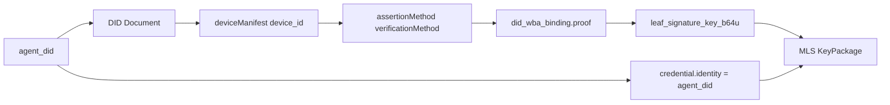
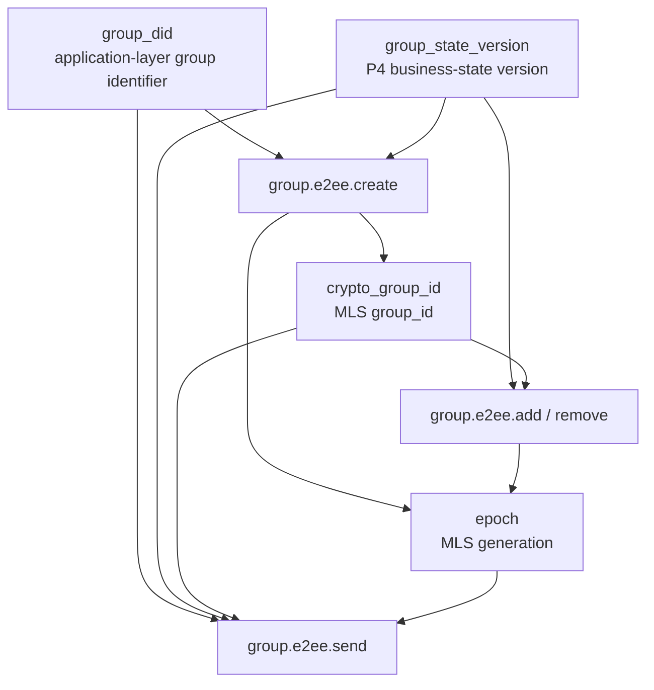
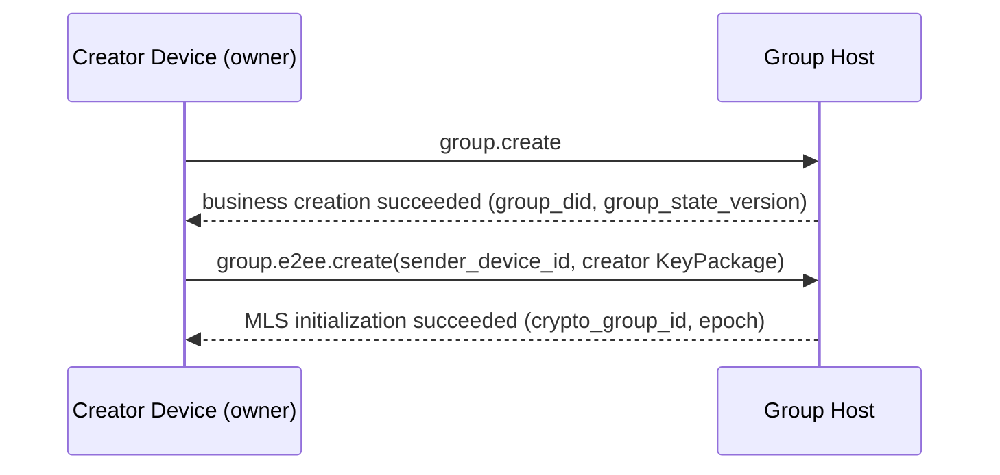
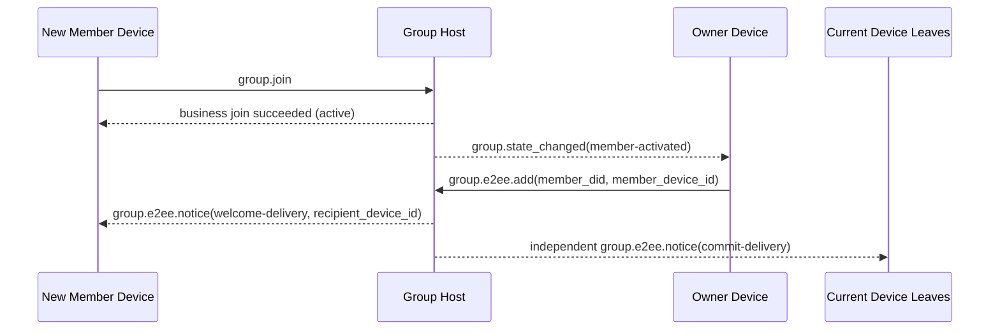
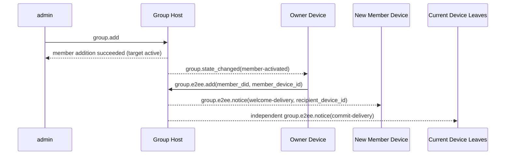
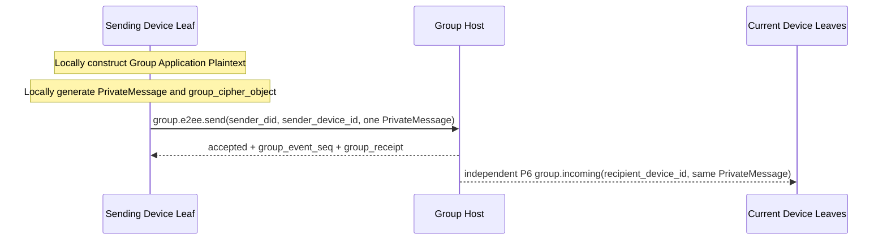
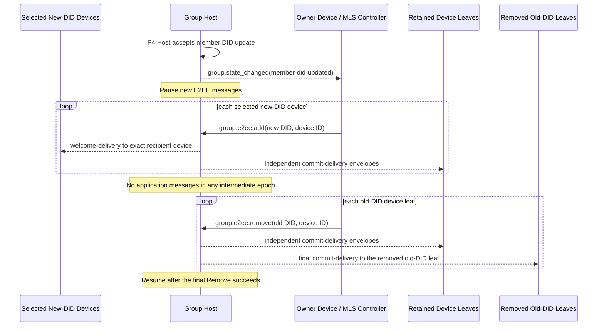

> 日本語参考訳（機械翻訳・未校閲）。規範となるのは原文です。コード例・識別子・規範キーワードは原文を保持しています。
> 原文: [message/06-group-end-to-end-encryption.md](../../message/06-group-end-to-end-encryption.md) / 基準コミット: `0837cfdfaf4ddcf834f0890ddaf34fc4c824e066`

# ANPプロファイル6:グループエンドツーエンド暗号化

- 文書ID: ANP-P6
- タイトル:グループエンドツーエンド暗号化
- ステータス: 候補者; に含まれています 1.2 ドキュメント, 安定した v2 リリース 終了 MLS ExtensionType 登録
- バージョン: 1.2
- 仕様セット: ANP のメッセージング 1.2
- 原文言語: English / このページは日本語参考訳
- プロフィール: `anp.group.e2ee.v2`
- 依存関係: `anp.core.binding.v1`, `anp.identity.discovery.v1`, `anp.group.base.v2`
- 応用性:このプロフィールはグループDIDに基づいてグループのエンドツーエンドの暗号化制御層のために適しています、密接に働くこと `anp.group.base.v2`.

---

## 1. 目的:

このプロファイルは、ANPのグループエンドツーエンド暗号化制御レイヤーを定義します。

1. 結合する方法 `group_did`, `group_state_version`と `group_event_seq` グループ暗号化状態機械に。
2. グループキーの確立、メンバーの変更およびアプリケーションメッセージ保護のための基本的なプロトコルとしてMLSを使用する方法;
3. 方法検証済みのエージェントの DID と 1 つの資格を結合する方法 `device_id` MLSメンバー資格、KeyPackage、およびリーフ署名キーに。
4. 独立したセットを定義する方法 `group.e2ee.*` JSON-RPC メソッドは、MLS の暗号アクションを具体的に運ぶ。
5. 密接に働く方法 `anp.group.base.v2` とりあえず **ステートカップリング** 代わりに「P4メソッドでMLSハンドシェイクオブジェクトを埋め込む」;
6. 対処方法 `epoch`, `Welcome`, `PrivateMessage`, `PublicMessage`, `epoch_authenticator`、フォークの検出および回復。
7. 注文したMLS葉を交換する方法 `group.e2ee.add` とりあえず `group.e2ee.remove` P4 の後の操作はメンバーのための DID の更新を受け入れます;
8. DID は、DID レベルのビジネスメンバーシップを変更することなく複数の独立した MLS デバイス葉を持つことができます。

このプロファイルは定義しません。

- 履歴メッセージを引き受ける。
- オンラインでのステータスを読んでください。
- 製品ローカルデバイス登録、ネーミング、ロール、同期、または内部のレプリカ管理。
- KeyPackage のプライベート素材、リーフプライベートキー、エポックシークレット、または MLS のプライベートな状態をデバイス間で共有する。
- グループ外でのディレクトリ同期の特定の実装。
- グループ以外のシナリオのためのエンドツーエンド暗号化;
- 外的なコミットの本管;
- `group_join_info` とりあえず `group.e2ee.get_join_info`;
- `accept_welcome` プロトコルメソッド;
- 会員ステータスモデルの2セット。
- 失われた歴史MLSのエポック秘密の回復または再配布。

---

## 2. 用語集と定款

### 2.1 仮説キーワード

この記事では、 **MUST**, **MUST NOT**, **REQUIRED**, **SHALL**, **SHALL NOT**, **SHOULD**, **SHOULD NOT**, **RECOMMENDED**, **NOT RECOMMENDED**, **MAY**, **OPTIONAL** 資本金を基準とした規範的な要件として解釈されます。

### 2.2 用語集

- **グループID**: グループのアプリケーションレイヤーグローバル識別子、つまり `group_did`.
- **暗号グループID**: グループの暗号化内部識別子、MLS対応 `group_id`、と異なってもいいです `group_did`.
- **グループホストサービス**: グループ基本ステータスの注文、ポリシーアプリケーション、グループメッセージの入力を担当するサービスです。MLS コントローラではなく、
- **MLSグループの状態**: MLS に基づくグループ暗号化状態を維持
- **エスポック**: MLSグループ状態の世代別進出
- **キーパッケージ**: このプロファイルで使用した材料オブジェクトを追加するMLSは、グループに1つの対象となるデバイスリーフを追加します。
- **おすすめ**: MLS のウェルカムオブジェクトは、グループの状態を初期化するために新しいメンバーを助けるために使われます。
- **プライベートメッセージ**: 会員認証でMLSメッセージを暗号化しました。
- **パブリックメッセージ**: 署名されたものだけで暗号化されていないMLSメッセージ。
- **デバイスリーフ**: 外部に識別される1つのMLSの顧客/葉 `(agent_did, device_id)`. . . 追加のP4ビジネスメンバーではありません。
- **有資格デバイス**: 現在有効なデバイス `anp.group.e2ee.v2` P2 の `deviceManifest`、参照されたキー、サービス機能およびグループ方針。
- **DID 装置結合** (保持されたワイヤー名前 `did_wba_binding`): MLS の葉の署名鍵、メンバーの資格、または KeyPackage を検証可能に結合しました `(agent_did, device_id)` 証拠の目的。
- **MLS のコントローラー**: 一般的なMLSメンバー変更のコントロール操作を担当する。 グループ `owner` v2 のコントローラーは残っています。 セクション9.4と13.4で定義された、非常に認可された同じDIDデバイス残留カウンダは一般的なコントローラーではありません。
- **州のカップリング**: P4とP6はメソッドによるマッピングではなく、ビジネス状態の変化を通した暗号状態の進歩をトリガーするカップリング方法はありません。
- **E2EE 通知**: P6 の自己定義された独立した暗号化通知オブジェクト、などの暗号結果を提供するために使用されます `commit` とりあえず `welcome`.
- **ターミナルリーフ**: グループのMLS会員セットから削除されたデバイスリーフ。 ローカルグループ結合は、アプリケーションメッセージを送信、受信、または復号化しなくなる `group_did`、デバイス自体が現在のP2マニフェストエントリを維持しているかもしれない間。
- **デバイスデリバリーキュー**: 耐久性のあるパー`(recipient_did, recipient_device_id)` グループホストがP6のために守っている配信状態は、それが輸送禁止されていない封筒を包みます。 パブリックメタデータ、保存された公開起源の証拠、不透明の暗号文のみを運ぶため、グループ歴ではありません。
- **フォーク**: 不安定なシーケンス `epoch` / `epoch_authenticator` / 同一メンバーの異なるメンバーがステータスの推移を観察 `group_did`.
- **MLSメンバーIDアップデート**: P4 が同じメンバーの DID 更新を受け入れた後、選択した新しい DID デバイス葉を追加し、注文されたコミットを介してすべての古い DID デバイス リーフを削除します。

---

## 3. デザイン原則

### 3.1 グループアイデンティティと暗号ステータスのストラテジー

このプロフィールは、以下の点を明らかに区別します。

- `group_did`: アプリケーションレイヤーグループグローバル識別子;
- `crypto_group_id`: 暗号化グループ内部識別子;
- `group_state_version`: グループホストが指定したアプリケーションレイヤーグループの状態バージョン。
- `epoch`: MLS ステートマシンが割り当てられたクリプトソロジーグループ生成。

4人で MUST NOT 機械的に等しくなる。しかしそこに MUST それらの間に検証可能な結合である。

### 3.2 1つのエージェントID = 1つの外部グループのメンバー;各デバイス= 1つのMLSの葉

P4会員、役割、方針、会員数は、現在に添付されているまま `agent_did`. . . P4 v2 は、現在の `agent_did` ワイヤメンバーのアイデンティティだけとして、名前、安定したパスフィールド、またはローカルレコード識別子は、MLSでそのDIDを置き換える可能性があります。 `credential.identity`.

プチ6 **MAY** 独立したMLSクライアントや葉と同じDIDの複数のデバイスを表します。 葉が残っている葉は、 `credential.identity = UTF8(agent_did)` 認証されたものから区別される `device_id` セクション6で定義される結合。 同じ DID で複数の葉は、追加の P4 メンバー、ロール、またはメンバーアカウントエントリを作成しません。

各デバイスは、KeyPackageのプライベート素材、リーフプライベートキー、エポックシークレット、およびMLSの状態を独自に生成し、保存します。 それらの値 **MUST NOT** 兄弟のデバイス間でコピーまたは共有されます。 新規デバイスは、独自のAdd,Commit、およびデバイスターゲットのウェルカムを通じてグループに入ります。

`anp.group.e2ee.v1` 独立した相互運用性契約を保ちます。 導入事例 **MUST NOT** v1 のメンバーまたは MLS リーフを v2 デバイス リーフとして再解釈するか、v1 MLS グループの状態を v2 マルチデバイス状態にロードします。 このプロファイルは、v1-to-v2状態のアップグレードを置き換えるものではありません。 移行には、このプロファイルの外側に明示的に定義されたプロセスが必要で、それ以外の場合は、閉じられていない必要があります。

### 3.3 P4は主要なビジネス プロトコルであり、P6は暗号化制御の層です

このプロフィールとの間の関係 `anp.group.base.v2` 以下は、

- P4は、グループにおける経営行動、ビジネス状態、秩序や領収書のセマティクスを定義します。
- P6 は MLS の暗号行為、暗号オブジェクト、結合ルールおよび検証要件を定義します。
- P4は、まだビジネス層の権限です。
- プチ6 **しない** 上記のようなビジネス会員のステータスを赤化 `active / left / removed`;
- P4 ベース操作と通知は DID アドレスを割り当てたまま、 **MUST NOT** P6 装置セレクターを運んで下さい;
- P6は、P4会員を独立して変更することなく、1つのデバイスリーフを一度に追加または削除します。
- P6 は、PS4 メソッド本体に直接 MLS のネイティブオブジェクトを直接実行する必要はありません。

### 3.4 メソッドによるマッピングではなく、ステートカップリング

P4とP6のカップリングは、 **ステート**, "特定のP4メソッドを直接特定のP6メソッドをマッピングする"ではなく、

具体的に:

- P4は、ビジネス用語で何かが有効であるかを決定します。
- P6は、事業状態の変化を観察し、それに応じてMLS状態を進歩させます。

たとえば:

- P4 でグループが正常に作成され、クリエイターは `owner` → 所有者は自動的に実行します `group.e2ee.create`
- 会員が `active` P4 では、対象となるデバイスはまだ MLS 会員セット → オーナーが実行されていない `group.e2ee.add(member DID, device ID)`
- 既にアクティブメンバーは、別の対象となるデバイス → 所有者を追加して、別のデバイスレベルの実行ができます。 `group.e2ee.add` P4会員の変更なし
- 会員が `left` または `removed` P4 → 所有者は、そのDIDのためのすべてのMLSデバイスリーフを削除します
- DIDがアクティブ→所有者のまま、または現在のMLS状態と同等DIDデバイス管理権限を持つライセンスを失っている間、デバイスはP2マニフェストの適格性を失う、デバイスリーフだけを削除
- P4会員が制作する `member-did-updated` P4 → 所有者は、選択した新しい DID デバイス葉を追加し、すべての古い DID デバイスの葉を削除します。

### 3.5 オーナーは MLS コントローラーです。同じ DID デバイス除去は狭い例外です

v2では、所有者のみのDIDは、一般的なMLSコントローラーの役割を想定しています。 一般的な制御リクエストは、必要な現在のMLS状態を所有する資格のある所有者デバイスによって提出されます。別の所有者デバイスの資格は、プライベートな状態を与えません。

オーナーは、以下の責任を負います。

- MLSグループを作成します。
- 実行する `add`;
- 実行する `remove`;
- ユーザIDの更新を、各デバイスごとに順に完了し、削除します。
- 生成する `commit` 会員の変更に対応
- 生成する `welcome` 新規会員の場合
- アドバンス `epoch` 会員変更後。

一つの例外は、呼び出し元のDIDの正確な再発デバイスリーフにのみ適用されます。 デバイスが権威ある同一DIDデバイス管理権限を持つ資格のある現在の葉 **MAY** 投稿フォーム `group.e2ee.remove` ターゲットデバイスが正式に再発または現在のP2の適格性を失った後、同じDIDの異なるデバイスリーフのために。 例外:

- **MUST NOT** コールワーズ独自の葉、アクティブシブルデバイス、別のDIDの葉、またはP4ビジネスメンバーを削除します。
- **MUST NOT** P4 の役割、ステータス、参加時間、またはメンバー数を変更します。
- **MUST** 呼び出し元の現在の MLS ステートを使用して、正確な 1 リーフの削除を生成します。
- **MUST NOT** グループホストがコミットまたはリリースMLSプライベート状態を生成します。

デバイス管理の承認は、新しいP6要求フィールドではなく、信頼できる展開認可事実です。 認証できないグループホスト **MUST** 例外を拒否し、 **MUST NOT** 呼び出し主のアサーションやキャッシュされたプレゼンテーションデータを信頼できます。

P6のコアアイデアは、MLSオブジェクトをP4メソッドボディに置くことはないが、暗号化状態をビジネスの状態と共に進歩させるようにする。 以下の図は、読者が以下の詳細な制約を読む前に方法間の因果関係を理解することができるように、この状態のカップリングを要約します。

```mermaid
flowchart TB
P4[P4 business-state changes<br/>group.create / member active / member left or removed / member DID updated]
OBS[owner observes business state]

CREATE[group.e2ee.create]
ADD[group.e2ee.add(DID + device)]
REMOVE[group.e2ee.remove(DID + device)]
DID_UPDATE_ADD[group.e2ee.add(new DID devices)]
DID_UPDATE_REMOVE[group.e2ee.remove(old DID devices)]

HOST[Group Host]
NOTICE[group.e2ee.notice]

P4 --> OBS
OBS -->|group created and has no crypto_group_id yet| CREATE
OBS -->|eligible device not yet in MLS| ADD
OBS -->|device or DID must leave MLS| REMOVE
OBS -->|P4 member rebound and old leaves remain| DID_UPDATE_ADD

CREATE --> HOST
ADD --> HOST
REMOVE --> HOST
DID_UPDATE_ADD --> HOST
DID_UPDATE_ADD -->|execute after DID update Add is accepted| DID_UPDATE_REMOVE
DID_UPDATE_REMOVE --> HOST

HOST --> NOTICE
```

*図P6-1: P4/P6状態のカップリング(非放射性)の概要。*

この図は、新しいビジネスステートマシンではなくトリガー関係を強調します。P4 は、事業レイヤーの権限を保持し、P6 はそれらの事業結果を観察し、MLS が作成/追加/削除する操作としてそれらを材料化します。

### 3.6 グループ ホストは、注文を担当し、MLS 制御に責任を負わない

グループホストサービスの責任は次のとおりです。

- P4事業の受入・発注
- ソリューション `group_event_seq` 受付けたイベント
- アドバンス `group_state_version`;
- 生成 `group_receipt`;
- グループメッセージとE2EE通知を配信する。
- MLSオブジェクトを復号化または再暗号化することなく、各ターゲットデバイスリーフ用の別の暗号化式封筒を作成します。
- 業務レイヤーでMLS制御結果の実装を一目瞭然。

デフォルトでは、グループホストサービス:

- **SHOULD NOT** MLS のコントローラーとして機能して下さい;
- **SHOULD NOT** MLSグループメンバーとして機能する。
- **SHOULD NOT** グループアプリケーションプレーンテキストの復号化機能を保持します。
- **MUST NOT** デバイス間でMLSプライベート状態またはエポックの秘密をコピーします。

### 3.7 所有者はグループの状態を管理します。, アクティブなメンバーはグループメッセージを管理する

オーナーは、次の操作を行います。

- 会員の変更
- グループ暗号状態の高度化;
- 更新情報 `epoch`.

対象となるデバイスは、 `active` 会員様と現在、MLSの葉は以下にできます。

- 現在のグループの状態を使用して、独自のグループメッセージの暗号文を生成する。
- コールセンター `group.e2ee.send` 独自のグループメッセージを送信する
- 他のメンバーのグループメッセージを復号化します。

このプロファイルは、すべてのグループメッセージが所有者によって暗号化されることを必要としません。

セクション3.5の同じDID例外は、新規作成、追加、会員レベルの削除、DID-update、またはサードパーティのコントロール権限を付与しません。

### 3.8 v2は外部コミットをサポートしていません

v2 で:

- 外部コミットはサポートされていません。
- `group_join_info` 定義されていない;
- `group.e2ee.get_join_info` 定義されていない;
- とりあえず `accept_welcome` プロトコルメソッドは定義されていません。

すべてのグループエントリーパスは、最終的にMLSに統一されます `add` 暗号層の所有者によって開始される。

### 3.9 メッセージ側のみがPrivateMessageに入ります

v2 で:

- アプリケーションのメッセージ内容だけ `group.e2ee.send` MLS を入力してください `PrivateMessage` 暗号化される
- `group.e2ee.create`, `group.e2ee.add`と `group.e2ee.remove` 今後もプレーンテキストJSON-RPCリクエストボディの活用を続けていきます。DIDアップデートオーケストレーションは再利用します `add` とりあえず `remove` 新規リクエストメソッドを定義し、
- オブジェクトなど `commit` とりあえず `welcome` P4ビジネスメソッドボディに埋め込まれる代わりに、メソッドの入力や通知ペイロードとして表示されます。

---

## 4. 依存性、プロファイル識別およびターゲットモデリング

### 4.1 プロフィール名

このプロファイルの標準的な名前は、次のとおりです。

`anp.group.e2ee.v2`

### 4.2 依存関係

プロフィール **MUST** 下記のプロフィールによります。

- `anp.core.binding.v1`
- `anp.identity.discovery.v1`
- `anp.group.base.v2`

### 4.3 セキュリティプロファイル

このページの先頭へ:

- `meta.profile` **MUST** 等しいです `anp.group.e2ee.v2`.
- このプロファイルで定義されたすべてのデバイス起源のP6 **MUST** 含まれるもの `meta.sender_device_id` と現在のP2マニフェストエントリに結合します。 `meta.sender_did`.
- デバイスターゲットのP6通知または暗号化された配信 **MUST** 含まれるもの `meta.recipient_device_id` エージェントのIDをそのまま保存 `meta.target.did`.
- これらのセレクタはP6のみに所属しています。 P4ベース操作と通知 **MUST NOT** それらを継承する。

それらの中で:

- `group.e2ee.publish_key_package`, `group.e2ee.get_key_package`, `group.e2ee.notice` **MUST** 利用条件 `transport-protected`
- `group.e2ee.create`, `group.e2ee.add`, `group.e2ee.remove`, `group.e2ee.send`, P6 と `group.incoming` **MUST** 利用条件 `group-e2ee`

のために `group.e2ee.send`, `group-e2ee` グループE2EE側に属するメッセージのセマティクスを意味します。それは、その外部JSON-RPCリクエストボディが再びグループによって暗号化されるという意味ではありません。

### 4.4 方法ターゲットモデリング

### 4.4.1 サービススコープ

次の方法 **MUST** は、 `service-scoped`:

- `group.e2ee.publish_key_package`
- `group.e2ee.get_key_package`
- `group.e2ee.create`

ルール:

- `meta.target.kind = "service"`
- `meta.target.did` **MUST** 等しいターゲット 公共 `ANPMessageService.serviceDid`

理由はなぜ `group.e2ee.create` サービススコープを使用する:
成功の前の `group.create` 経営層に、グループが持つ事業状態が確立されました。 ですが、 `group_did` 生成された、作成アクション自体はグループホストサービス入り口の暗号化初期化をまだ完了しています。そのため、v2はサービススコープ付きを均一に使用しています。

### 4.4.2 グループアドレス

次の方法 **MUST** は、 `group-addressed`:

- `group.e2ee.add`
- `group.e2ee.remove`
- `group.e2ee.send`

ルール:

- `meta.target.kind = "group"`
- `meta.target.did` **MUST** 等しいターゲット `group_did`

### 4.4.3 エージェントが通知をアドレス指定

下記の通知 **MUST** は、 `agent-addressed`:

- `group.e2ee.notice`
- プチ6 `group.incoming` アプリケーション・暗号文配信のため

ルール:

- `meta.target.kind = "agent"`
- `meta.target.did` **MUST** 通知受信者エージェント DID に等しい
- `meta.recipient_device_id` **MUST** 正確な受信デバイスリーフを選択します。通知 **MUST NOT** 兄弟デバイスにリダイレクトされます。
- このプロファイルは定義しません `target.kind = "device"`.

---

## 5. 暗号メインラインとMTIスイート

### 5.1 主流プロトコル

プロフィールのグループキーの本管 **MUST** MLS 1.0 のセマンティックスに基づいて実装されますが、v2 は制限された使用サブセットのみを固定します。

v2 のメインラインは、少なくとも次のものを含んでいます:

- キーパッケージ
- アクセサリー
- 削除
- コンテンツ
- おすすめ
- プライベートメッセージ
- エッチングの進歩

P4メンバーDIDアップデートでは、新しいP6方法や新MLSのプリミティブも紹介しています。 まずは1つを使用します。 `group.e2ee.add` 選択した新しいDIDデバイスごとにコミットし、その後1つ `group.e2ee.remove` 古いDIDデバイスリーフごとにコミットします。

それらの中で:

- `commit_b64u` **MUST** 完全なMLSの生バイトとして表される `MLSMessage` (`mls-public-message`) TLSによってシリアライズされる;
- `welcome_b64u` **MUST** MLSの生バイトとして表される `Welcome` TLS でシリアライズされたオブジェクト。
- `PrivateMessage` **MUST** グループアプリケーションメッセージの唯一の ciphertext ベアラーオブジェクトとして機能します。

MLSライブラリ **MAY** 標準的な機能も追加でサポート `Update`, 提案のバッチ処理, PSK, そして、ReInit; しかしながら, これらの機能 **所属しない** このプロファイルv2の最小プロトコルメインラインに、v2の相互運用性要件を構成していません。

### 5.2 必須-ツー・イポメンドスイート

最小限の相互運用性を確保するために、このプロファイルに準拠した実装 MUST 以下のMTIパッケージをサポート:

`MLS_128_DHKEMX25519_AES128GCM_SHA256_Ed25519`

### 5.3 追加スイート

導入事例 **MAY** MLS スイートをもっとサポートします。

- 同じグループ内のすべてのメンバー **MUST** 使用されるキットに同意します。
- グループポリシー制限により、パッケージコレクションが許可されている場合、MLS コントローラー **MUST** 方針に満足しないパッケージを拒否します。

### 5.4 DIDアイデンティティとの関係

このプロフィールとDIDのアイデンティティの主な行間の関係は次のとおりです。

- `assertionMethod` DID 文書では、ID の証拠を結合するために使用されます;
- `keyAgreement` **SHOULD** DID ドキュメントには、エージェントが E2EE 機能を持っていることを示す少なくとも 1 つの X25519 エントリが含まれている。
- プチスイム `deviceManifest` 現在のデバイスエントリを識別する、その `signing_key_id`, `e2ee_key_id`と `anp.group.e2ee.v2` 資格;
- MLSグループメンバーの葉署名キー **SHOULD NOT** DID の長期署名キーと直接等しいこと;
- 葉の署名キー **SHOULD** 別々に生成され、境界線を `(agent_did, device_id)` セクション6の結合オブジェクトを介して。

---

## 6. 方法独立型DIDとMLS結合モデル

### 6.1 結合ターゲット

このプロファイルは、次のMLS要素をバインドする必要があります `(agent_did, device_id)`:

1. KeyPackage オーナー;
2. 現在の葉の署名キー;
3. グループメンバーの資格情報におけるアイデンティティ文字列。
4. 結合証拠に使用するP2マニフェストの署名キー参照。

### 6.2 犯罪者ID規則

このページのトップへ `credential.identity` MLSメンバー資格 **MUST** 同じく、その葉の現在のUTF-8バイト文字列 `agent_did`. . . 読みやすい名前、安定した主題パス、またはローカルアイデンティティ **MUST NOT** 書き込むか、または取り替えて下さい `credential.identity`.

導入事例 **MUST NOT** 交換する `credential.identity` ローカルアカウントID、デバイスID、数値ユーザID、その他非DID文字列で。

同じDIDの兄弟葉は、したがって同じを持っている `credential.identity` 明確な認証 `device_id` 値。 頂点は、単独で値ではなく、P6葉を完全ペアで識別します。

### 6.3 `did_wba_binding` オブジェクト

このプロファイルは、 `did_wba_binding` MLS 葉署名キーを 1 つの対象となるデバイスにバインドするために使用されるオブジェクト `agent_did`. . . オブジェクト名やオブジェクト名を無視する `anp_did_wba_device_binding` 拡張子名は DID メソッドを制限します。 `agent_did`.

推奨構造は以下の通りです。

```json
{
  "agent_did": "did:wba:example.com:agents:alice:e1_<fingerprint>",
  "device_id": "dev-a-7N3KQ2",
  "verification_method": "did:wba:example.com:agents:alice:e1_<fingerprint>#dev-a-sign",
  "leaf_signature_key_b64u": "BASE64URL_ED25519_LEAF_PK",
  "issued_at": "2026-03-29T12:00:00Z",
  "expires_at": "2026-04-29T12:00:00Z",
  "proof": {
    "type": "DataIntegrityProof",
    "cryptosuite": "eddsa-jcs-2022",
    "created": "2026-03-29T12:00:00Z",
    "proofPurpose": "assertionMethod",
    "verificationMethod": "did:wba:example.com:agents:alice:e1_<fingerprint>#dev-a-sign",
    "proofValue": "z..."
  }
}
```

`did_wba_binding.proof` **MUST** 共有の再利用 **オブジェクトの証拠のプロフィール** P1 付録 B で定義される。

のために `did_wba_binding`:

- 発行者 DID **MUST** は、 `agent_did`
- 保護された文書 **MUST** 全体として `did_wba_binding` 取除の後の目的 `proof`
- `device_id` **MUST** 対象となる現在のP2マニフェストエントリーを識別する `anp.group.e2ee.v2`
- `verification_method` とりあえず `proof.verificationMethod` **MUST** エントリーの同等 `signing_key_id`, , , **MUST** 認定される `assertionMethod` で、 `agent_did` DID ドキュメント

#### 6.3.1 `anp_did_wba_device_binding` MLS拡張

このドラフトは暫定的なプライベートユースMLSを割り当てます `ExtensionType` `0xF0A1` に へ へ へ へ へ へ へ へ へ へ へ へ へ へ へ へ へ へ へ へ へ `anp_did_wba_device_binding`. . . IANAの譲渡ではありません。 **MUST** 後だけ使用して下さい `anp.group.e2ee.v2` 交渉が進んでいます。 アクセシビリティ **MUST** v2 を解放する前に、安定した登録コードポイントを公開します。このドラフト値を変更すると、ドラフトの修正が行われます。

とりあえず `extension_data` バイトは、完全なUTF-8 RFC 8785 JCSエンコーディングです `did_wba_binding` JSONオブジェクト、を含む `proof`. . . KeyPackage が実施する v2 リーフノード **MUST** このタイプの1つの拡張子を正確に含んだ、およびグループに保持されている認証済みのリーフノード **MUST** 同じ結合を保存します。 リーフノードの `capabilities.extensions` グループコンテキスト `required_capabilities` エクステンション **MUST** リスト `0xF0A1`.

v2 の実装 **MUST** 欠落、重複、誤字、サポートされていない、または拡張機能または機能宣言を衝突させる拒否します。 便利さ `group_key_package.did_wba_binding` 会員名 **MUST** 埋め込まれた拡張機能と同じJCSバイトを持ち、それを置き換えません。

### 6.4 `did_wba_binding` 検証ルール

受取人 MUST KeyPackage、Fリーフノードの更新、または新規メンバーを受け入れる前に、次の検証を完了します。

1. 解決し、現在の検証 `agent_did` ドキュメントの下のDID文書 [P2 メソッド検証](../../message/02-identity-and-discovery.md#method-validation);
2. `device_id` 現行のP2で一度に正確に起こる `deviceManifest` 宣言する `anp.group.e2ee.v2` 依存関係で;
3. `verification_method` エントリーの現在の等しい `signing_key_id` と は によって 承認される `assertionMethod`;
4. `proof` **MUST** P1付録Bの共有オブジェクトプルーフプロファイルが存在し、満足させます。
5. 発行者 DID の `proof` イーグル `agent_did` 証拠の検証パス;
6. 保護された文書は少なくともカバーします `agent_did`, `device_id`, `verification_method`, `leaf_signature_key_b64u`, `issued_at`と `expires_at`;
7. KeyPackage/リーフノードは、セクション6.01の拡張機能と必要な機能宣言を運びます。
8. 埋め込まれた延長および兄弟 `did_wba_binding` 同じ JCS バイトを持っている;
9. 実際の葉署名公鍵は、一貫して一貫性のあるものです。 `leaf_signature_key_b64u`;
10. `credential.identity` MLS のクレデンシャルは一貫して `agent_did`;
11. スイート、グループポリシー、 `issued_at` / `expires_at` ウィンドウが有効です。

P6 は定義します `did_wba_binding` MLS の葉署名キーは DID の長期同一証明鍵と直接一致しないべきではないですので。 次の図は、 `agent_did`, DID ドキュメント, 結合オブジェクト, KeyPackage/ `credential.identity` 読者が確認の順序を理解できるように。



*図P6-2:DID/deviceとMLS結合チェーン(非放射性)。*

検証中に、受信者は内部の MLS 署名が有効であることを確認するだけでなく、 また、このチェーンに従うべきことを確認し、 `credential.identity`, `device_id`、葉の署名キー、現在のマニフェストの記入項目および `agent_did` 完全に境界線です。

### 6.5 DID方法および結合の証拠

- サポートされている DID メソッドの場合、 `did_wba_binding.proof` **MUST** P1付録Bの共有オブジェクトプルーフプロファイルを再使用します。
- 互換性のあるため `k1_` ドイド, `did_wba_binding.proof` **MAY** 明示的な拡張交渉によって定義される代替オブジェクトプルーフプロファイルを使用します。 しかし、明示的なエクステンション交渉がないとき、v2 MTI **しない** ビーコン `k1_` デフォルトでインターワーキング・パスとして証拠;
- MLSグループのためのMTIの葉の署名キーはまだ **MAY** 結合の証拠が保持する限り、DIDのアイデンティティ・カーブに関係なくEd25519を使用して下さい。

---

## 7. コアオブジェクト

### 7.1 `crypto_group_id`

`crypto_group_id` MLSの内部を表します `group_id`.

ルールは以下の通りです。

- `crypto_group_id` **MUST** 不透明バイトとして扱われる;
- JSON では、 **MUST** によって表現される `base64url`フィールド名は、 `crypto_group_id_b64u`;
- `crypto_group_id` **MUST** 検証可能な結合を確立する `group_did`.

### 7.2 `group_state_ref`

このページの先頭へ `group_state_ref` P4の概念は、E2EEグループが少なくとも含まれていることを要求します。

- `group_did`
- `group_state_version`
- `policy_hash` (グループポリシーがハッシュされた場合)

グループE2EEでは、リーダーは異なるレイヤーで4つの識別子/バージョン間で誤った精神モデルを簡単に接続できます。グループID、ビジネスステートバージョン、暗号化内部グループID、およびMLSのEPOC。 以下は、ソースと進歩関係を1つのビューに置きます。



*図P6-3:関係性 `group_did`, `crypto_group_id`, `group_state_version`と `epoch` (非放射性)。*

後続のオブジェクト構造と検証ルールを読むときは、これらの4つの値を異なるレイヤーから座標として扱います。それらはバインドする必要がありますが、互いに交換してはならないため、同じ値として機械的に処理されるべきではありません。

### 7.3 `group_key_package`

このプロファイル定義グループは、材料包装オブジェクトを追加します。

```text
{
  "key_package_id": "kp-001",
  "owner_did": "did:wba:example.com:agents:bob:e1_<fingerprint>",
  "owner_device_id": "dev-b-4M8P1X",
  "suite": "MLS_128_DHKEMX25519_AES128GCM_SHA256_Ed25519",
  "mls_key_package_b64u": "BASE64URL_KEYPACKAGE",
  "did_wba_binding": { ... },
  "expires_at": "2026-04-30T00:00:00Z"
}
```

それらの中で:

- `key_package_id` **MUST** 存在;
- `owner_did` **MUST** 存在;
- `owner_device_id` **MUST** 存在;
- `suite` **MUST** 存在;
- `mls_key_package_b64u` **MUST** 存在;
- `did_wba_binding` **MUST** 存在;
- `expires_at` **SHOULD** 存在;
- `mls_key_package_b64u` **MUST** MLSの生バイトのためのno-padding base64url `KeyPackage` MLS 1.0 TLS によるシリアライズ後のオブジェクト。
- `owner_did` とりあえず `owner_device_id` **MUST** 等しく `did_wba_binding.agent_did` とりあえず `did_wba_binding.device_id`;
- 1つのKeyPackageは正確に1つの装置に属し、 **MUST NOT** 別のデバイスリーフに使用されます。 消費量と展開決定の最後のリゾート再利用はセクション13.2を変更しないようにします。

`group_key_package` 主に所有者が実行するために使用されます `group.e2ee.add`.

### 7.4 `group_cipher_object`

`group_cipher_object` のワイヤー プロトコル メッセージ ボディ オブジェクトです。 `group.e2ee.send`.

推奨構造は以下の通りです。

```json
{
  "crypto_group_id_b64u": "BASE64URL_GROUPID",
  "epoch": "7",
  "private_message_b64u": "BASE64URL_PRIVATEMESSAGE",
  "group_state_ref": {
    "group_did": "did:wba:groups.example:team:dev:e1_<fingerprint>",
    "group_state_version": "42",
    "policy_hash": "sha-256:..."
  },
  "epoch_authenticator": "BASE64URL_AUTH"
}
```

ルール:

- `crypto_group_id_b64u` **MUST** 存在;
- `epoch` **MUST** 存在;
- `private_message_b64u` **MUST** 存在;
- `private_message_b64u` **MUST** MLSの生バイトのためのno-padding base64url `PrivateMessage` MLS 1.0 TLS でシリアル化されたオブジェクト。
- `group_state_ref.group_did` **MUST** 外部ターゲットに等しくなる `group_did`.

### 7.5 `Group Application Plaintext`

グループアプリケーションメッセージが MLS に入る前に `PrivateMessage` 暗号化, **MUST** 次の内文脈オブジェクトに正規化される:

```json
{
  "application_content_type": "text/plain | application/json | application/anp-attachment-manifest+json | ...",
  "thread_id": "thr-001",
  "reply_to_message_id": "msg-0009",
  "annotations": {},
  "text": "...",
  "payload": {},
  "payload_b64u": "..."
}
```

ルール:

- `application_content_type` **MUST** 存在;
- 正確に 1 つ `text`, `payload`, または `payload_b64u` **MUST** プレゼント
- メッセージのセマンティックフィールド `thread_id`, `reply_to_message_id`と `annotations` で P4 **MUST** グループE2EEの下の内部の目的にある;
- 送信者 **MUST** 全体にシリアライズ `Group Application Plaintext` 暗号化前のUTF-8 + RFC 8785 JCSを使用してバイト文字列にオブジェクト; 受信機 **MUST** 復号後に同じルールに従ってオブジェクトを解釈します。

いつか `application_content_type = "application/json"`, `payload` **MUST**
JSON オブジェクトを直接運ぶ。 このプロフィールは、事業の意味を定義しない
そのオブジェクト内のフィールド。

通常のJSONグループアプリケーションプレーンテキスト例:

```json
{
  "application_content_type": "application/json",
  "thread_id": "thr-001",
  "payload": {
    "type": "example",
    "data": {
      "hello": "group"
    }
  }
}
```

### 7.6 `e2ee_notice_object`

P6 は、暗号化結果を提供するために使用される独立した暗号通知オブジェクトを定義します。

推奨構造は以下の通りです。

```text
{
  "notice_id": "en-001",
  "notice_type": "commit-delivery | welcome-delivery",
  "group_did": "did:wba:groups.example:team:dev:e1_<fingerprint>",
  "group_state_ref": {
    "group_did": "did:wba:groups.example:team:dev:e1_<fingerprint>",
    "group_state_version": "43",
    "policy_hash": "sha-256:..."
  },
  "crypto_group_id_b64u": "BASE64URL_GROUPID",
  "epoch": "8",
  "subject_did": "did:wba:b.example:agents:bob:e1_<fingerprint>",
  "subject_device_id": "dev-b-4M8P1X",
  "subject_status": "active | removed",
  "commit_b64u": "BASE64URL_MLSMESSAGE",
  "welcome_b64u": "BASE64URL_WELCOME",
  "ratchet_tree_b64u": "BASE64URL_RATCHET_TREE",
  "epoch_authenticator": "BASE64URL_AUTH",
  "group_receipt": { ... }
}
```

ルール:

- `notice_id` **MUST** 存在します。 **MUST** 同じ封筒の赤みに安定して、 **MUST NOT** 同一の受取装置に送られる異なった論理的な通知のために再使用される。 同じ暗号結果の Per-leaf コピー **MAY** シェア 1 `notice_id`、各デバイスが自分自身に対処された封筒だけを複製するので、 `(group_did, notice_id)`;
- `notice_type` **MUST** 存在;
- `group_did` **MUST** 存在;
- `group_state_ref` **MUST** 存在;
- `crypto_group_id_b64u` **MUST** 存在;
- `epoch` **MUST** 存在;
- `commit_b64u` **MUST** いつか存在している `notice_type = "commit-delivery"` プレゼント
- いつか `notice_type = "welcome-delivery"`, `welcome_b64u` とりあえず `ratchet_tree_b64u` **MUST** 同時に存在します。
- DIDアップデートオーケストレーションによる通知のため、 `group_state_ref` **MUST** 正確に受け入れられたP4を参照して下さい `member-did-updated` P6 で使われるイベントは、P6 を追加して削除します。 受信機 **MUST** 重複したP6連続フィールドではなく、そのP4イベントから以前のDIDと現在のDIDを取得。
- `subject_did`, `subject_device_id`と `subject_status` このP6操作に影響する1つの葉を記述して下さい:加える使用DID/deviceをと加えて下さい `active`、取除きはと取除かれたDID/deviceを使用します `removed`;
- 通知を受信するデバイスは、外部からのみ識別されます `meta.target.did` とりあえず `meta.recipient_device_id`; のために `commit-delivery`被写体とは異なる可能性があります。 削除のために `commit-delivery`, 受取人 **MAY** セクション12.3で指定された1つの最終的な通知を受け取る削除された主題の葉自体である;
- `ratchet_tree_b64u` **MUST** ラチェットツリーのTLSシリアライズのための未加工バイトのno-padding base64urlである;
- `group_receipt` **MAY** 仮想通貨の取引状況をビジネス注文の場所と関連付ける存在です。

---

## 8. KeyPackage 公開と発見方法

### 8.1 `group.e2ee.publish_key_package`

#### 8.1.1 統計学

エージェントが露出したままに公開 `ANPMessageService`、グループ結合に使用できるKeyPackage。

#### 8.1.2 要求の要件

- `method = "group.e2ee.publish_key_package"`
- `meta.profile = "anp.group.e2ee.v2"`
- `meta.security_profile = "transport-protected"`
- `meta.target.kind = "service"`
- `meta.target.did` **MUST** 出版社の公開と等しい `ANPMessageService.serviceDid`
- `meta.sender_did` **MUST** 存在している
- `meta.sender_device_id` **MUST** 存在している
- `body.group_key_package` **MUST** 存在している
- `body.group_key_package.owner_did` **MUST** 等しく `meta.sender_did`
- `body.group_key_package.owner_device_id` とりあえず `body.group_key_package.did_wba_binding.device_id` **MUST** 等しく `meta.sender_device_id`
- 出版サービス **MUST** パッケージを受け入れる前に現在のP2マニフェストのエントリーとセクション6バインディングを検証します。

認証制約:

- このメソッドは、 **サービススコープ** 制御計画方法;
- 呼び出し者 **MUST** 認証されたローカルセッションまたは同等のホップとサービスレベルの認証コンテキストで実行されます。
- v2 は **なし** 追加のビジネスレイヤーが必要です `origin_proof` こんな方法。

#### 8.1.3 成功的な応答

成功する応答 **MUST** 少なくとも:

- `published = true`
- `owner_did`
- `owner_device_id`
- `key_package_id`
- `published_at`

### 8.2 `group.e2ee.get_key_package`

#### 8.2.1 科学

対象となるエージェントの対象エージェントから利用可能なKeyPackageを入手 `ANPMessageService`.

#### 8.2.2 要求の要件

- `meta.profile = "anp.group.e2ee.v2"`
- `meta.security_profile = "transport-protected"`
- `meta.target.kind = "service"`
- `meta.target.did` **MUST** 等しいこと `ANPMessageService.serviceDid` ターゲットエージェントが露出
- `meta.sender_did` **MUST** 存在している
- `meta.sender_device_id` **MUST** 現行のP6-eligibleデバイスを下回る `meta.sender_did`

`body` **MUST** 含まれるもの:

- `target_did`
- `target_device_id`

`body` **MAY** 含まれるもの:

- `preferred_suite`
- `require_fresh`

認証制約:

- このメソッドは、 **サービススコープ** 制御計画方法;
- 認証されたコンテキスト **MUST** 正確に結合する `(meta.sender_did, meta.sender_device_id)` ペアリング、そのデバイス **MUST** 現行のP2マニフェストで有効に。
- v2 最小相互運用性要件は、少なくともホップ/サービスレベルの認証です。
- **KeyPackageの匿名検索はv2 MTIの一部です**.

#### 8.2.3 成功の応答

成功する応答 **MUST** 少なくとも:

- `target_did`
- `target_device_id`
- `group_key_package`

#### 8.2.4 サーバー側の配布ルール

`ANPMessageService` 返還する時 `group_key_package`:

- **SHOULD** 期限が切れていないKeyPackageを返す, 再発されていないと消費されない;
- **MUST** キーパッケージを返す `owner_did` とりあえず `owner_device_id` 要求されたターゲット・ペアを丁度等しくして下さい、 **MUST NOT** 兄弟の装置を代入して下さい;
- **MUST** 戻り前に、現在のP2マニフェストに対してターゲットデバイスを無効化します。
- サーバ **MAY** マークとして `reserved`、または同時再発行を避けるために、返された後の同等のステータスを割り当てる。
- 対応するタイミング `group.e2ee.add`DID 更新オーケストレーションの追加ステップを含む、グループホストと暗号会員変更が正常に受け入れられています。 **MUST** マークとして `consumed` 公開セットから削除するか
- 対応するプロセスが失敗した場合は、キャンセルまたは消去され、予約済みKeyPackageのリリースは展開固有のものですが、 **SHOULD NOT** 同じKeyPackageが2つの成功によって同時再使用されるようにする `group.e2ee.add` 業務;
- コールワーID、レート制限およびアンチユースポリシー **MUST** ホップ/サービスレベルの認証に基づく実装

---

## 9. MLS制御計画法

### 9.1 一般

この章のメソッドは独立系JSON-RPCメソッドです。 P4 のビジネスメソッドに「追加フィールド」ではなく、P6 独自の暗号化制御アクションです。

それらの中で:

- `group.e2ee.create`, `group.e2ee.add`と `group.e2ee.remove` は、 **会員変更の制御方法**
- `group.e2ee.send` は、 **メッセージ送信方法**
- `group.e2ee.create/add/remove` 既存のP4ビジネス状態にバインドされるが、 **新規P4ビジネスメンバーのステートを作成しない**
- `group.e2ee.send` 直接オンライン配達方法として、二次包装なしで使用されます `group.send`

### 9.2 `group.e2ee.create`

#### 9.2.1 科学

新規のMLSグループステートを作成し、初期メンバーとしてオーナーを追加します。

#### 9.2.2 コールア

オーナーのみ。

#### 9.2.3 要求の要件

- `method = "group.e2ee.create"`
- `meta.profile = "anp.group.e2ee.v2"`
- `meta.security_profile = "group-e2ee"`
- `meta.target.kind = "service"`
- `meta.target.did` **MUST** 等しいこと `ANPMessageService.serviceDid` 対象グループホストによる露出
- `meta.sender_did` **MUST** 現在のグループに等しくなる `owner`
- `meta.sender_device_id` **MUST** 必要な現在のMLS状態の対象となる所有者デバイスを識別します
- `auth.origin_proof` **MUST** 存在している

`body` **MUST** 少なくとも:

- `group_did`
- `group_state_ref`
- `suite`
- `creator_key_package`
- `crypto_group_id_b64u`
- `epoch`

ルール:

- `creator_key_package.owner_did` **MUST** 等しく `meta.sender_did`
- `creator_key_package.owner_device_id` **MUST** 等しく `meta.sender_device_id`
- `group_state_ref.group_did` **MUST** 等しく `body.group_did`
- `epoch` 初期グループの状態の場合 **SHOULD** は、 `"0"` または初期値が明示的に実装によって合意された

#### 9.2.4 応答の成功

成功する応答 **MUST** 少なくとも:

- `created = true`
- `group_did`
- `group_state_ref`
- `crypto_group_id_b64u`
- `epoch`
- `accepted_at`

注意:

- `group.e2ee.create` まあ、 **MUST NOT** P4 の新しい事業グループを作成します。
- 実行後のみ実行されます。 `group.create` 営業層の受入れを受けています。
- 新規生成がなくなりました `group_state_version` または `group_event_seq` 独立して。

### 9.3 `group.e2ee.add`

#### 9.3.1 統計

オーナーがMLSを実行 `add` P4の対象となるデバイスリーフを1つ追加する `active` 暗号グループのメンバー。 同じアクティブDIDの2番目のデバイスは、別のAddを使用し、別のP4メンバーを作成していません。

#### 9.3.2 コールア

オーナーのみ。

#### 9.3.3 要求の要件

- `method = "group.e2ee.add"`
- `meta.profile = "anp.group.e2ee.v2"`
- `meta.security_profile = "group-e2ee"`
- `meta.target.kind = "group"`
- `meta.target.did` **MUST** 等しいターゲット `group_did`
- `meta.sender_did` **MUST** 現在のグループに等しくなる `owner`
- `meta.sender_device_id` **MUST** 必要な現在のMLS状態の対象となる所有者デバイスを識別します
- `auth.origin_proof` **MUST** 存在している

`body` **MUST** 少なくとも:

- `member_did`
- `member_device_id`
- `group_state_ref`
- `group_key_package`
- `crypto_group_id_b64u`
- `epoch`
- `commit_b64u`
- `welcome_b64u`
- `ratchet_tree_b64u`

ルール:

- `group_state_ref.group_did` **MUST** 等しい外ターゲット `group_did`
- `group_key_package.owner_did` **MUST** 等しく `member_did`
- `group_key_package.owner_device_id` とりあえず `group_key_package.did_wba_binding.device_id` **MUST** 等しく `member_device_id`
- `commit_b64u` **MUST** 完全なMLSのための no-padding base64url `MLSMessage` TLS によるオブジェクトのシリアル化
- `welcome_b64u` **MUST** MLS の no-padding base64url は、 `Welcome` TLSによるシリアライズ後のオブジェクト
- `ratchet_tree_b64u` **MUST** ラチェットツリーのTLSシリアライズのための未加工バイトの no-padding base64url
- `epoch` **MUST** 新規に表示する `epoch` あとは `add`
- 普通の道に、 `member_did` **MUST** 現行のP4 `active` 会員と正確 `(member_did, member_device_id)` リーフレット **MUST NOT** 既に存在している。同じ DID の別の葉は競合ではありません。
- DID 更新パスで、 `group_state_ref` **MUST** 正確に受け入れられたP4を参照して下さい `member-did-updated` イベント `member_did` **MUST** イベントの事態が等しい `subject_did`と新しいKeyPackage **MUST** 選択した新しいDIDデバイスをバインドします。
- DID 更新パス 選択した新しい DID デバイスに追加 **MUST** 古いDIDデバイスが削除される前に成功します。

#### 9.3.4 応答の成功

成功する応答 **MUST** 少なくとも:

- `accepted = true`
- `group_did`
- `member_did`
- `member_device_id`
- `group_state_ref`
- `crypto_group_id_b64u`
- `epoch`
- `accepted_at`

注意:

- `group.e2ee.add` まあ、 **MUST NOT** 対象となるメンバーのP4ビジネス状態を切り替えて `active`;
- 営業状態 **MUST** P4 によって既に決定されている;
- この方法は、MLS に事業成果を実装するだけ責任があります。

### 9.4 `group.e2ee.remove`

#### 9.4.1 統計

メルマガ `remove` デバイスリーフを1つだけ削除します。 トリガーは、DIDのP4削除、DIDがアクティブのまま、グループポリシー、または承認されたメンバーDID更新オーケストレーション中にデバイスの資格喪失をすることができます。 一般的な除去は、所有者制御を維持します。下にある同じDID例外は、1つの再発された兄弟デバイスに限定されます。

#### 9.4.2 コールア

いずれか:

- 必要な現在のMLSの状態の対象となる所有者デバイス。または
- 認証の同一DIDデバイス管理権限を持つ資格のある現在の葉は、異なる、既に再考または現在独自のDIDの必須デバイスリーフを削除する場合にのみ使用されます。

#### 9.4.3 要求の要件

- `method = "group.e2ee.remove"`
- `meta.profile = "anp.group.e2ee.v2"`
- `meta.security_profile = "group-e2ee"`
- `meta.target.kind = "group"`
- `meta.target.did` **MUST** 等しいターゲット `group_did`
- オーナーの支店の下、 `meta.sender_did` **MUST** 現在のグループを等しくして下さい `owner` とりあえず `meta.sender_device_id` **MUST** 必要な現在のMLSの状態の対象となる所有者デバイスを識別します。
- 同じDIDのブランチの下、 `meta.sender_did` **MUST** 等しく `member_did`、送信者 **MUST** P4 はそのまま `active` 会員および現在のMLSの葉、 `meta.sender_device_id` **MUST NOT** 等しく `member_device_id`グループホスト **MUST** ターゲットデバイスが再発または現在P2に依存している間、送信機デバイスに現在のデバイス管理権限があることを検証します。
- `auth.origin_proof` **MUST** 存在している

`body` **MUST** 少なくとも:

- `member_did`
- `member_device_id`
- `group_state_ref`
- `crypto_group_id_b64u`
- `epoch`
- `commit_b64u`

ルール:

- `commit_b64u` **MUST** 完全なMLSのための no-padding base64url `MLSMessage` TLS によるオブジェクトのシリアル化
- `epoch` **MUST** 新規に表示する `epoch` あとは `remove`
- 正確です `(member_did, member_device_id)` リーフレット **MUST** 現在のMLS状態に存在します。
- P4マークの場合 `member_did` として `removed` または `left`, 所有者 **MUST** 注文された問題 そのDIDのすべての現在のデバイスリーフのために削除します。
- P4 が DID を保っている場合 `active`, 削除は、現在のP2の適格性またはグループポリシーがその葉を取り除きた後に名前付きデバイスのためにのみ許可されます。 兄弟葉とP4会員は変更されません。
- 同じDIDブランチ **MUST** 名前付きターゲット葉を正確に削除し、 **MUST NOT** グループポリシー除去、メンバー削除/リーブ、DID更新オーケストレーション、または別のDIDに使用されます。
- DID 更新パスで、 `member_did` **MUST** 等しく `previous_subject_did` 参照されたP4イベントで、選択した新しいDIDデバイスを追加既に成功しなければならず、所有者はアプリケーションメッセージを再開する前に、すべての古いDIDデバイスリーフを削除しなければなりません。

#### 9.4.4 応答の成功

成功する応答 **MUST** 少なくとも:

- `accepted = true`
- `group_did`
- `member_did`
- `member_device_id`
- `group_state_ref`
- `crypto_group_id_b64u`
- `epoch`
- `accepted_at`

### 9.5 `group.e2ee.send`

#### 9.5.1 統計

直接、MLS暗号化されたグループメッセージをグループに送信します。

#### 9.5.2 コールア

現行の対象となるデバイスリーフ `active` 会員様

#### 9.5.3 要求の要件

コンプライアンス `group.e2ee.send` リクエスト **MUST** 満足する:

1. `method = "group.e2ee.send"`
2. `meta.profile = "anp.group.e2ee.v2"`
3. `meta.security_profile = "group-e2ee"`
4. `meta.target.kind = "group"`
5. `meta.target.did` **MUST** ターゲットになる `group_did`
6. `meta.sender_did` **MUST** 現在の送信者エージェントのIDである
7. `meta.sender_device_id` **MUST** プライベートメッセージを生成する現在の対象となるMLSの葉を識別する
8. `meta.message_id` **MUST** 存在している
9. `meta.operation_id` **MUST** 存在している
10. `meta.content_type` **MUST** 固定される `application/anp-group-cipher+json`
11. `auth.origin_proof` **MUST** 選択されたデバイスの現在のP2署名キーが存在し、使用
12. `body` **MUST** 直接運送 `group_cipher_object`

注意:

- `group.e2ee.send` オンライン送信方法自体です。
- P4 で別のレイヤーをラップしなくなった `group.send`.

#### 9.5.4 応答の成功

成功する応答 **MUST** 少なくとも:

- `accepted = true`
- `group_did`
- `message_id`
- `operation_id`
- `group_event_seq`
- `group_state_version`
- `accepted_at`
- `epoch`
- `group_receipt`

成功のセマティクスは言う:

- グループホストは、MLS 暗号文オブジェクトを承諾し注文しています。
- 会員全員がメッセージの復号化を成功させたことを自動で意味しません。

---

## 10. ステートカップリングルール

### 10.1 全般

P4とP6のカップリングは、 **業務状態の変化**.
このプロファイルは、メソッドによるマッピングテーブルのメンテナンスを必要としません `group.create -> create` とりあえず `group.add -> add`.

オーナー **MUST** 信頼できる状態の観察によって知られている:

- 特定のグループがビジネスレイヤーで作成されました。
- 会員がなってきた `active` 業務レベル
- 会員がなってきた `left` または `removed` 業務レベル
- 対象となるデバイスは、葉や現在の葉のデバイスがP2の適格性を失います。
- P4会員様が制作されました `member-did-updated`.

ステータスの観察方法 **MAY** は:

- 現地およびグループホストの内部のオーケストレーション
- サブスクリプション `group.state_changed`;
- または他の等しく、信頼できる状態の観察メカニズム。

### 10.2 グループ作成のカップリング規則

所有者が次の事業状態が同時に真であることを観察する場合:

- 特定の `group_did` 作成されました。
- クリエイターは自分です。
- ありません `crypto_group_id`sは、まだこのグループに添付

オーナー **MUST** トリガー `group.e2ee.create` 一度。

### 10.3 会員結合ルール

所有者が次の事業状態が同時に真であることを観察する場合:

- 特定の `member_did` 既に会員です。 `active` P4のグループ;
- 選択対象資格 `member_device_id` MLS の葉はまだありません。
- デバイスが利用可能 `group_key_package`

オーナー **MUST** トリガー `group.e2ee.add` 一度そのデバイスのために。 同じアクティブDIDの追加の資格デバイスは、別のP4メンバーシップイベントなしでこのP6ステップを繰り返す。

このルールは、次の規則にも適用されます。

- `group.join`
- `group.add`
- 展開拡張は参加を招待します
- 承認される展開延長

つまり、P4の様々なサービスエントリポイントは最終的にコンバージする `group.e2ee.add` 暗号層で。

葉がこのグループから以前に取り除かれた装置 **MAY** 後続のリンク 上記トリガーは変更されず、十分です。DIDはP4です `active`, 現在、葉がないデバイスがその場で,それを公開している **フレッシュ** `group_key_package`. . . このプロファイルは、別のrejoinメソッドを定義しません。 オーナー様 **MUST NOT** セクション13.2で説明したように消費されたKeyPackageを再利用します。 **MUST NOT** デバイスの前の葉を復元し、 **MUST NOT** 再結合する前に、どのEPOCシークレットをも解放します。 再結合デバイスは、新しいウェルカムから現在およびその後の状態のみを取得しています。

### 10.4 会員の取り外し/転倒のカップリングの規則

いつか `member_did` は、 `removed` または `left` P4 の所有者 **MUST** 注文したトリガー `group.e2ee.remove` 現行のデバイスリーフにDIDが含まれている場合

1つのデバイスだけが現在のマニフェストの適格性を失うとき、そのDIDはP4のまま `active`, 所有者または同じ DID デバイス管理権限を与えられた現在の MLS の状態と兄弟姉妹 **MAY** デバイスリーフだけをすぐに削除しようとします。 グループポリシー除去は、所有者制御を維持します。 隣接するパスはP4メンバーまたはその兄弟の葉を変えます。

P4会員全体が全メンバーになる場合 `removed`/`left`、DIDの更新中、またはホストが孤児/会員の競合を検出したときに、ホスト **MUST** 新規を一時停止 `group.e2ee.send` 必要なMLSが閉じるまで受け入れます。 対照的に、DIDがP4を維持しながら、1つのデバイスのみが権威的に再発またはP2の適格性を失うとき `active`、ホスト **MUST NOT** 休止しないで有給 `group.e2ee.send` デバイスリーフが保留中の除去を残すため、単独で。 でん **MUST** 新規サービスデータを再発デバイスに認証し、配信を停止し、現在のMLSヘッドに対してメッセージを検証し続ける。

このデバイスのみの非ブロック状態は、明示的な可用性/セキュリティトレードオフです。 正確なCommitを削除するまで、revokedリーフは現在のepochの秘密を保持し、サービス配送パス外で得られた暗号文を復号化することがあります。 即時に失敗した試みを削除しても、暗号の取消ではなく、このプロファイルは、クレームタスク、修理通知、耐久性のあるクライアントキュー、またはその試みの自動再試行を必要としません。

デバイスリーフを取除くことは、 **グループスコープ** 暗号作用は、さまざまな状態の機械からあります **アイデンティティスコープ** P2装置取り外し。 葉を取り戻すと、そのDIDからデバイスを削除しない `deviceManifest` 退職しない `device_id`. . . 現在のManifestエントリのままのデバイスは、同じままになります `device_id` 葉が取り除かれ、 **MAY** 後に、同じか他のグループにこのまたは他のグループを再度参加してください。 `device_id` セクション10.3で説明したように、新しいKeyPackageを使って。 逆に、P2マニフェストから削除されたデバイス **MUST** 新規デバイス ID と新しいデバイスキーで再登録 **MUST NOT** 退職した識別子を再利用します。 導入事例 **MUST NOT** 集合の葉除去はグループごとに、再可逆的であり、マニフェストデバイス除去はアイデンティティスコープとパーマスタです。

### 10.5 メンバーのID更新カップリングルール

オーケストラの追加・削除を開始する前に、MLSコントローラー **MUST** P4 の取得と検証 `member-did-updated` イベント・イベント `group_receipt`、独立してP2の移行を検証します `previous_subject_did` に へ へ へ へ へ へ へ へ へ へ へ へ へ へ へ へ へ へ へ へ へ `subject_did`、実際の保証を保持し、P4のロスターが既に含まれていることを確認します `subject_did`, 新しい DID の現在の対象となるデバイスと KeyPackages を解決します。 `provider_asserted` P6の事業方針により受理または拒絶される。それはプロトコル管理上の失敗ではなく、 **MUST NOT** より高い保証として表されます。

所有者がP4を観察するとき `member-did-updated` イベント、イベント `subject_did` 新規IDとその識別 `previous_subject_did` 古い DID を識別します。 古いDIDがMLS会員セットに残っている場合、所有者 **MUST** この順序で既存のメソッドをオーケスト:

1. コールセンター `group.e2ee.add` 選択した各デバイスとそのKeyPackageの1回。
2. 選択したすべての追加が成功した後、呼び出し `group.e2ee.remove` 一度、各古いDIDデバイスリーフのために;
3. 完了します。 暗号 DID 更新 すべての削除が成功した後.

リクエスト **MUST** 同じP4を丁度参照して下さい `member-did-updated` `group_state_ref`. . . 選択されたすべての追加 **MUST** 最初に削除する前に成功します。 削除は、イベントのデバイス葉のみを削除できます `previous_subject_did` とりあえず **MUST NOT** DID の更新ワークフローを使用して、別のメンバーを削除します。

DID更新オーケストレーション中、グループホスト **MUST** P6メンバー変更の制御操作をシリアライズします。 現在のステップの不当な再試行を除き、追加成功直後にマッチするグループホストは、 **MUST NOT** 関係のない受け入れ `group.e2ee.add` または `group.e2ee.remove` DID の更新が完了するまで。

最終削除が成功するまでP4 DIDの更新イベントの受け入れから、グループホスト **MUST** 新規の仮面受け入れ `group.e2ee.send` グループのための操作。 Adds と Removes によって生成される中間のエポック **MUST NOT** アプリケーションのメッセージを運ぶ。 ステップが失敗した場合、実装 **MUST** 一歩足を踏み入れて再試行してください。

P6 の失敗 **MUST NOT** P4 DID の更新をロールバックし、古い DID の P4 権限を復元したり、新しい P6 ビジネス メンバーシップの状態を作成します。 P4会員、ロール、ステータス、参加時間、会員数は、元のDID更新イベントで決定されます。

P4 が受け入れられる場合 `provider_asserted` しかし、P6ポリシーはそれを拒絶します。, P4のロスターは権威を維持し、ロールバックされていません; P6 **MUST** 方針要件が満たされるまでE2EEメッセージ平面をパユースキーに保ちます。

DID の更新対象が所有者の場合、新しい DID で選択した対象となるデバイス **MUST** 独自のデバイス・バウンドを使用する `origin_proof`. . . 移行を追加 **MAY** 古いデバイスリーフの保持されたMLS状態から生成されます。 少なくとも1つの新しい所有者のデバイスリーフが参加した後、その後の古いDIDは削除します **MUST** 対象となる新規所有者のデバイスリーフで現在の状態を生成します。 認定所有者のデバイスが必要な現在の状態を保持または取得しない場合、システム **MUST** E2EEメッセージの飛行機を閉じて保存しても問題ありません。

### 10.6 送信ルール

`group.e2ee.send` は、 **なし** ステートカップリングをトリガーするメソッド。
会員が明示的に開始するオンライン送信方法です。

しかし、そのビジネスの一貫性の要件はまだP4に縛られています:

- 送信者 **MUST** 現会員になる `active`;
- カレンダー **MUST** 会って下さい P4 `group_policy.permissions.send`
- の皮質の `group_event_seq`, `group_state_version`と `group_receipt` 成功するレスポンスでは、P4 のグループメッセージの定義に従ってください。

---


## 11. MLS利用プロファイル(仮称)

### 11.1 一般および外部仕様の参照

この章は、 **制限された使用のサブセットおよび固定構成** このページのトップへ
この章の目的は、MLS 規格をリライトするものではありませんが、以下のものを提供していません。

- MLSのオブジェクトとステートマシンの動作は、v2で使用できるもの。
- これらのオブジェクトはオンラインプロトコルでエンコードされる方法
- オーナー、アクティブメンバー、グループホストのローカルステータスと処理義務はそれぞれに負担する必要がありますか?
- 背後にあるMLSの皮脂質とは何ですか? `group.e2ee.create`, `group.e2ee.add`, `group.e2ee.remove`と `group.e2ee.send`.

導入事例 **MUST NOT** MLS のコアアルゴリズムセマティクスを変更します。ただし、MLS 標準ライブラリの自由度がこのプロファイルの v2 制限されたルールと相関する場合には、 **MUST** 優先する。

### 11.2 MLS サブセット v2 で許可

このプロファイルv2のMLSメインラインは、次のオブジェクトと操作性境界を入力するアクションのみを可能にします。

- `KeyPackage`
- `Add`
- `Remove`
- `Commit`
- `Welcome`
- `PrivateMessage`
- `epoch` アドバンス

このプロフィールv2で:

- `commit_b64u` **MUST** 完全なMLSに対応 `MLSMessage`およびワイヤー フォーマット **MUST** は、 `mls-public-message`
- `welcome_b64u` **MUST** MLS対応 `Welcome`
- `private_message_b64u` **MUST** MLS対応 `PrivateMessage`

プロフィール v2 **しない** 主要な相互運用性ラインに次の機能が含まれています。

- 外部コミット
- `GroupInfo` / `group_join_info`
- `group.e2ee.get_join_info`
- スタンドアロン `accept_welcome` プロトコルメソッド
- 複数のコントローラーによる同時送信
- 所有者以外のメンバーの変更
- `Update` プロトコルレベルのメインラインアクションとして
- 相互運用性の条件としてバッチ処理を提案
- ReInit、PSK、Subgroup、またはカスタムMLSの拡張はセクション6.3.1以外の端末結合拡張はv2 MTIとして

実装で利用するMLSライブラリ **MAY** 上記機能をサポート。ただし、交渉が明示的に延長されていない場合 **MUST NOT** v2 ワイヤープロトコルのインターワーキングに持って下さい。

### 11.3 MTIスイートと固定アルゴリズム

プロフィール v2 **MUST** 以下のMTIスイートを実装します。

`MLS_128_DHKEMX25519_AES128GCM_SHA256_Ed25519`

対応する固定アルゴリズムの設定は、次の通りです。

- ケム/HPKE DH: `DHKEMX25519`
- エイエイド: `AES-128-GCM`
- ハッシュ/KDF ベース: `SHA-256`
- 葉の署名: `Ed25519`

さらに、このプロファイルのすべてのJSONオブジェクトは、証拠、AAD、または内部のプレーンテキスト結合に入る MUST UTF-8 + RFC 8785 JCS を使用してエンコードされます。 この条件は少なくともに適用します:

- 保護されたオブジェクト `did_wba_binding`
- `Group Application Plaintext`
- `group.e2ee.send` のり `authenticated_data`
- 会員変更による認証されたバインディングオブジェクト

### 11.4 MLSの皮質 `group.e2ee.create`

`group.e2ee.create` 実行後のみ `group.create` 営業層の受入れを受けています。

実行時に `group.e2ee.create`, 選択した所有者のローカルMLSランタイム **MUST**:

1. それを検証する `creator_key_package` 正確に所属する `(owner DID, sender_device_id)` ペア;
2. 確認する `did_wba_binding`、セクション6.0.1延長および現在のP2マニフェストの適格性;
3. 新しいMLSグループの状態を作成し、新しいMLSグループを生成します。 `crypto_group_id`;
4. 保持中に最初のMLSリーフとして、その所有者デバイスを追加します。 `credential.identity` 所有者に等しい DID;
5. 初期設定を書かなければならない `epoch`; と
6. ローカルデバイスのみにプライベートなMLS状態を主張します。

`group.e2ee.create` **MUST NOT** 新規P4事業グループを別々に作成します。既存の事業グループで対応する初期のMLS状態のみを作成します。

### 11.5 MLSのセマンティックス `group.e2ee.add`

`group.e2ee.add` v2 の標準的なエントリ暗号化メインラインのみです。

実行時に `group.e2ee.add`オーナーのローカルMLSランタイム **MUST**:

1. 取得する `group_key_package` 正確のため `(member_did, member_device_id)` ペア;
2. KeyPackage、デバイス結合、セクション6.03拡張、および現在のP2マニフェストの適格性を確認します。
3. 対象のDIDがP4のいずれかであることを確認 `active` 普通のパスまたは `subject_did` 参照されたP4で `member-did-updated` イベント
4. この正確な DID/デバイスペアは既に葉ではないことを確認し、同じ DID の兄弟デバイスが競合していないことを確認します。
5. 1つのMLSを実行 `Add`, 新しい生成 `Commit`, 1 つを生成し、 `Welcome` そのデバイスリーフのため;
6. それをキーボードトラップにするために、そのデバイスのために十分なラチェットツリーの材料をエクスポートまたは構築します。
7. アドバンス `epoch` オーナーのローカルデバイスの状態を更新します。

そのため、v2の標準的なグループ暗号化の主な行は次のとおりです。

```text
KeyPackage
→ Add
→ Commit
→ Welcome
→ ratchet_tree
→ new epoch
```

実装の曖昧性を低下させるために、v2は次のように規定します。

- `commit_b64u` **MUST** 完全なMLSのTLSserializedの未加工バイトである `MLSMessage`;
- `welcome_b64u` **MUST** MLSのTLS-serializedの未加工バイトである `Welcome` オブジェクト;
- `ratchet_tree_b64u` **MUST** 新しく会員のみ、明示的に提供されなければならない。
- `welcome-delivery` **MUST NOT** ライブラリレベルのオプションの動作に依存します。 "Welcomeは内部でラチェットツリーを付属しているかもしれません。"

DID 更新オーケストレーションでは、各セクションで追加します。 **MUST** P4 DID 更新イベントの参照 `group_state_ref`, 選択したデバイスリーフを新しいDIDにバインドし、ウェルカムをDID /デバイスペアだけに配信します。 選択したすべての新しいDIDデバイスは、古いDIDデバイスの葉の事前削除を追加します。

### 11.6 MLSのセマンティックス `group.e2ee.remove`

実行時に `group.e2ee.remove`オーナーのローカルMLSランタイム **MUST**:

1. 正確であることを確認する `(member_did, member_device_id)` ペアは現在の葉です。
2. 許可されたトリガーを1つ確認: DIDは `removed` または `left` P4では、名前付きデバイスは、現在のP2マニフェストまたはグループポリシーの下でもはや資格を与えられていないか、ペアは参照されたP4 DID更新イベントの古いDIDリーフです。
3. 1つのMLSを実行 `Remove` その葉のために、新しいものを生成します `Commit`、先立って下さい `epoch`オーナーのローカルデバイスの状態を更新し、;
4. 削除されたデバイスリーフが、その後のメッセージを復号化できないことを確認してください。

P4 が DID を削除または葉を取除いた場合、所有者 **MUST** 現行のDIDの葉を全て繰り返して、この操作を繰り返します。 DIDが残っている場合 P4 `active`、名前付き必須またはポリシー削除されたデバイスリーフのみが削除されます。 P4会員と兄弟の葉は変更されません。

成功した削除は、ターミナルリーフを葉にします。 削除されたデバイスは、このことを学ぶことができます。MLS はバンド内シグナルを除去したメンバーに持ちませんので、グループホスト **MUST** セクション12.3で指定されたように、削除された葉に受け入れられたコミットを最終通知として配信します。 デバイスを退社させない除去 `device_id` セクション 10.3 で後ほど再結合を禁止します。

行のプロトコル出力 `group.e2ee.remove` **MUST** 少なくとも:

- `commit_b64u`
- `crypto_group_id_b64u`
- `epoch`
- `group_state_ref`
- `member_did`
- `member_device_id`

DID 更新オーケストレーションでは、選択したすべての新しい DID デバイスを追加しても同じで成功しているのは、Remove が起動する可能性があります。 `group_state_ref`;各削除は、そのP4イベントによって識別された1つの古いDIDデバイスリーフのみを削除することができます。

### 11.7 暗号化の皮質 `group.e2ee.send`

送信者呼び出し時 `group.e2ee.send`ローカルMLSランタイム **MUST**:

1. DID が現在 P4 であることを確認する `active` 会員名
2. それを検証する `meta.sender_device_id` 現在、MLS の有効リーフを適格かつ対応しています。
3. P4 を満たしていることを確認してください。 `permissions.send`;
4. コンサルティング `Group Application Plaintext` と 第13章 `authenticated_data`;
5. デバイスの現在の MLS 状態を使用して、平文を 1 つの MLS に一度暗号化します。 `PrivateMessage`;
6. コンサルティング `group_cipher_object` とりあえず、それを提出する `body` のり `group.e2ee.send`.

グループホスト **MUST NOT** このアプリケーションメッセージの暗号化または再暗号化を行います。 同じ受諾を配る `group_cipher_object` 独立したP6配達封筒で、セクション12.5で指定される各現在の装置葉のための1つ。

成功への貢献 `group.e2ee.send` 単に意味:

- グループホストは、MLS 暗号文オブジェクトを承諾し注文しています。
- 会員全員がメッセージの復号化を成功させたことを自動で意味しません。

### 11.8 グループメッセージの復号化義務

受信装置が対応する暗号文オブジェクトを受信した後 `group.e2ee.send`, , , , , , , , , , , , , , , , , , , , , , , , , , , , , , , , , , , , , , , , , , , , , , , , , , , , , , , , , , , , , , , , , , , , , , , , , , , , , , , , , , , , , , , , , , , , , , , , , , , , , , , , , , , , , , , , , , , , , , , , , , , , , , , , , , , , , , , , , , , , , , , , , , , , , , , , , , , , , , , , , , , , , , , , , , , , , , , , , , , , , , , , , , , , , , , , , , , , , , , , , , , , , , , , , , , , , , , , , , , , , , , , , , , , , , , , , , , , , , , , , , , , , , , , , , , , , , , , **MUST**:

1. 外部に検証する `meta.target.did` とりあえず `meta.recipient_device_id` 独自の DID/デバイスペアを特定します。
2. このデバイスのローカルMLSグループの状態をここから見つけます `group_did`;それ **MUST NOT** 兄弟のデバイスからコピーされたプライベートな状態を使用します。
3. 検証 `crypto_group_id_b64u` 受け入れられるおよび `epoch` ウィンドウ;
4. 復号化 `private_message_b64u` ローカルデバイスの状態だけを使用して;
5. 検証 `authenticated_data`、を含む `sender_did` とりあえず `sender_device_id`, MLS の送信者リーフマップが同じペアにマップしていることを検証します。
6. 内側をパーズ `Group Application Plaintext` チェックパスがすべて通過した後にのみ配信します。

どのステップでも失敗すれば、受信機 **MUST NOT** 有効なグループメッセージとして、アプリケーションレイヤーにメッセージを届けます。

### 11.9 ローカル処理の義務 `group.e2ee.notice`

#### 11.9.1 `commit-delivery`

受取のとき `notice_type = "commit-delivery"`、受信機のローカルMLSランタイム **MUST**:

1. 外部に検証する `meta.recipient_device_id` ローカルデバイスを識別します。
2. デコード `commit_b64u` 確認・検証 `group_did`, `group_state_ref`, `crypto_group_id_b64u`, `epoch`, 影響を受ける `subject_did` / `subject_device_id` ペア;
3. このデバイスのローカルMLSグループの状態にコミットを適用します。
4. ローカルの現在の更新 `epoch` 必要事項を記入し、記録して下さい `epoch_authenticator` または一貫性のある状態、存在する場合。

削除する `commit-delivery` 誰が `subject_did` とりあえず `subject_device_id` 受信デバイスの独自のペアがデバイスに等しい **決勝** 団体の通知 そのような受信機:

- **MUST** グループに対する通知として拒否するのではなく、受け入れて処理することはもはやメンバーではありません。
- **MUST** 独自のローカルグループ結合を事前にし、ターミナル化するためにのみ適用します。
- **MUST NOT** 新たなエポックの秘密を導き、 **MUST** 新規または後続のEPOCのアプリケーションメッセージを復号化できない。
- **MUST NOT** さらなる投稿 `group.e2ee.send` そのために `group_did` 結合はターミナルを残っている間、それはセクション10.3の下で再結合するまでです。

それに気づくのはMLSです `PublicMessage`なので、削除されたデバイスに新しいエポックの秘密を伝えません。 デバイスが保持された葉を既に保持している同じターミナル結論に達することができるだけ。

最終通知の配信は、第12項に記載された通りに拘束され保証されません。 デバイス **MUST NOT** 端末状態の決定や、それを受け取る上でのみ依存する能力を発揮します。 P4 セクション 8.11 同様に、グループホストが 1 つの最終的な自己スコープを試みる必要があります `member-removed` または `member-left` 被写体DIDへの配信が、その試みも拘束され、到着も保証されていません。 以下各号 **MUST** したがって、同様に権威のあるターミナル信号として扱われ、それらのいずれかが単独で処理される **MUST** 同じターミナルのローカル状態に達するのに十分である:それが到着するとき最終的な通知、P4 `member-removed` または `member-left` 到着時に自分のDIDのイベント、 `group.not_member` 後でのリクエストを拒絶する、 `group.e2ee.leaf_not_current` 後者のグループアドレス指定P6の要求、またはセクション11.9.2の州ルールの拒絶。

リーフのみのため DID が P4 のまま削除します。 `active`P4イベントも、 `group.not_member` 火災:DIDはメンバーであり、デバイスリーフが完全に削除された。 とりあえず `group.e2ee.leaf_not_current` セクション13.3と17で定義された拒絶反応は、その場合に利用可能なままのプル信号です。デバイスの次の正当なグループアドレス指定P6リクエスト — 次の手順を実行します `group.e2ee.send` — **MUST** 方針やペイロード評価前のエラーで拒否し、デバイスを受信する **MUST** 最終通知が到着したかのように、そのグループをターミナルとして扱うローカル結合。 デバイス **SHOULD NOT** 合成アプリケーションメッセージをプローブするだけ、そのメンバーシップをプローブします。積極的なチェックが必要な展開 **MAY** このプロファイルの外側に読み取り専用のステータスメカニズムを提供します。

#### 11.9.2 `welcome-delivery`

受取のとき `notice_type = "welcome-delivery"`, 新しいデバイスのローカル MLS のランタイム **MUST**:

1. 外部に検証する `meta.target.did` とりあえず `meta.recipient_device_id` 等しく `subject_did` とりあえず `subject_device_id` ローカルデバイスを識別し、
2. デコード `welcome_b64u` とりあえず `ratchet_tree_b64u`;
3. 検証 `group_did`, `group_state_ref`, `crypto_group_id_b64u`と `epoch`;
4. ウェルカムは、このデバイス自体が公開された新鮮で不燃なKeyPackageの秘密鍵の下に復号化し、配信されたラチェットツリーがこのデバイス用のKeyPackageのリーフノードを運ぶ1つの葉を正確に含んだことを確認し、KeyPackageが消費したことをマークします。
5. 歓迎とラチェットツリーからこのデバイスの独自のMLSグループの状態を初期化し、永続化します。
6. ローカルにその状態を埋め込む `(group_did, device_id)` ペアリングと、その後のコミットとアプリケーションメッセージ配信の準備。

デバイス **MAY** ローカル MLS の状態を既に保持している `group_did` ウェルカムが到着すると、最も一般的には葉が先ほど削除され、セクション10.3の下に再び結合されているためです。 デバイス **MUST** 次のように衝突を解決します。

- ローカル状態がグループにとってまだ使用可能である場合、ウェルカムの `crypto_group_id_b64u` とりあえず `epoch` マッチして、配信 `welcome_b64u` とりあえず `ratchet_tree_b64u` 既にその結合のために処理される歓迎されたこの装置にバイト識別され、歓迎を不当な繰り返すように扱います **MUST NOT** ローカル状態を破棄します。 場合 `crypto_group_id_b64u` とりあえず `epoch` マッチが、渡されたバイトは、以前に処理したもの、デバイスと異なる **MUST** ローカルの状態を保ち、そして **MUST NOT** 異なるペイロードを処理する。
- それ以外の場合は、ウェルカムが同じ参照する場合 `crypto_group_id_b64u` 厳密に新しい状態で保存された結合として `epoch`、および保存された結合はターミナル リーフまたは配達ラチェットの木です装置によって貯えられたローカル州で記録される厳密な葉ノードが、歓迎からのローカル状態を取り替えないし、 **SHOULD** 置換結合の可聴レコードを保持します。 葉の比較は、デバイスにバインドする葉に対して、保存された葉ノードに対してではなく、 `(agent_did, device_id)` ペア: 配信されたツリーを再び囲むには、デバイスの新しいキーパッケージから新しい葉が含まれているため、新しい葉は保存されたものとしてカウントされません。
- さもと **MUST** 不定休、 **MUST NOT** ローカル状態を破棄します。

これらのブランチは、既存のローカルの状態を置き換えるかどうかだけを決定します。 上記番号付き検証のどれも放棄します。 ターミナルリーフは、したがって、迂回しません `crypto_group_id_b64u` 継続チェックやEPOCの比較、および異なる参照する歓迎 `crypto_group_id_b64u` 同じ下 `group_did` グループの再作成やフォーク回復の移行を定義しないため、すべてのブランチで閉じる失敗。

新しく歓迎されたサポートは、それがそれ自体が要求しなかった機能を与えません。すべてのブランチでは、ウェルカムが再結合のために公開された新しい、不燃のKeyPackageの秘密鍵の下にのみ解読するので、リクエストを受け付けます。 このルールは、機密性ではなく、静止したローカル状態の破壊を管理します。 したがって、デバイス **MUST NOT** 使用可能なローカル状態を取り替え、 **MUST NOT** 直前に最終削除を受信した状態の交換 `commit-delivery` セクション 12.3, その通知は到着することを保証されていないので、.

ようこそ、JSON-RPCプロトコルメソッドではなく、ローカルの動作仕様です。

### 11.10 ローカル永続状態の要件

再起動と通知タイミングの違いを横断して実行可能にしておくため、各参加者 **SHOULD** 少なくとも次の状態を主張します。

#### 11.10.1 オーナー

MLS状態を維持する各所有者デバイス **SHOULD** 少なくとも持続的な:

- `group_did`
- 自社所有 `device_id`
- `crypto_group_id`
- 流れの `epoch`
- 独自の電流 MLS グループ状態
- 現行のビジネスレイヤーのシンクロナイズドメンバーセットビュー
- 最近受け入れられる最も最近への参照 `add/remove` その結果、DIDアップデートオーケストレーションのあらゆる操作を含む

オーナーデバイス **MUST NOT** MLS 秘密鍵、エポックの秘密、またはプライベートツリーの状態をプロトコル状態として同期します。

#### 11.10.2 アクティブメンバー

通常のアクティブメンバーデバイス **SHOULD** 少なくとも持続的な:

- `group_did`
- 自社所有 `device_id`
- `crypto_group_id`
- 現在、MLSグループの状態が使用可能
- 流れの `epoch`
- 最近は正常に適用されて `commit/welcome` リファレンス

各装置は独立した葉および独立した私状態を維持します。 同じ DID の別のデバイスは、この状態をコピーするのではなく、独自の KeyPackage と Welcome に参加します。

#### 11.10.3 グループホスト

グループホスト **SHOULD** 少なくとも持続的な:

- `group_state_version`
- `group_event_seq`
- `group_receipt`
- 外面の結合参照への `crypto_group_id`, `epoch`
- 現在のパブリック `(DID, device_id)`-to-leaf 受入から得られる投影 `create/add/remove` 業務;この投影 **MUST NOT** MLS 秘密鍵やエポックの秘密を含んだ
- セクション12.6は、パブリックメタデータ、保存された公共の起源の証拠、および不透明の暗号に限らず、まだ輸送禁止されていない封筒のためのデバイスデリバリーキュー州
- DID 更新オーケストレーションが追加または削除にあるかどうかを内部の進捗状況。この進行は新しいプロトコルレベルのメンバーシップ状態ではありません

デフォルトでは、グループホストは **必須事項** グループメッセージを復号化できる MLS のプライベートな状態を永続的に行える。

### 11.11 MLS 機能 v2 ではサポートされていません

セクション11.2にリストされている例外に加えて、このプロファイルv2はサポートしていません。

- エクスポーター `Update` 別のプロトコルレベルのアクションとして
- 暗号化されていない結果の配信 `group_state_ref` 連絡方法
- MLSライブラリに適して、不意に復元し、欠落したツリー素材を自動的に復元します
- 所有者以外のメンバーに提出する `Commit` 会員セットの変更
- グループホストは、会員の代表的な最終MLS妥当性判断を完了させます

### 11.12 P4 メンバーのDIDアップデート MLSオーケストレーション

オーナーのローカルMLSランタイム **MUST**:

1. 対応するP4を検証 `member-did-updated` ステートイベントと古いDID、新しいDID、 `group_state_ref`;
2. 現行の古いDIDデバイスリーフと選択した対象の新規DIDデバイスを列挙する。
3. 選択した各々の新規DIDデバイス用の別のKeyPackageとデバイスの結合を完全に確認し、検証します。
4. 1 つを実行します。 `group.e2ee.add` 選択した新しいDIDデバイスごとにコミットし、そのデバイスにのみウェルカムとラチェットツリーを配信します。
5. 選択したすべての追加が成功した後、 1 つを実行します `group.e2ee.remove` 古いDIDデバイスリーフごとにコミットします。
6. 保持されたデバイスリーフに独立して各コミットを配信し、セクション12.3の最終通知として、古いDIDリーフを削除するために、各旧DID削除コミットをさらに配信します。
7. 最終的な削除が成功した後にアプリケーションメッセージを再開します。

コミットを追加して削除する **MUST** 同じP4を結合して下さい `group_state_ref`. . . 中間のEPOCは、DIDの更新を完了するだけで存在します。 **MUST NOT** アプリケーションのメッセージを運ぶ。 新規DIDデバイスは、独自のウェルカムを通じて、現在およびその後の状態のみを取得しています。 このプロファイル **MUST NOT** 失われた歴史のエポック秘密を復元したり、デバイス間でプライベートなMLS状態を共有したりできます。

DID の更新対象が所有者である場合、移行はコミットを追加します **MAY** 対象となる旧所有者のデバイスが現在の状態を保持することで生成されます。 新規所有者のデバイスリーフが参加した後、その後の古いDIDは削除します **MUST** 対象となる新規所有者デバイスで現在の状態を生成します。 認定所有者のデバイスが現在の状態を保持または取得しない場合、実装 **MUST** 不定休 このプロフィールは自動所有者MLSの回復およびグループ ホストを提供しません **MUST NOT** 現行または歴史的なエポックの秘密を解放します。

---

## 12. 独立通知モデル

### 12.1 全般

P6 は 2 つのデバイスターゲット通知パスを定義します。

- `group.e2ee.notice` MLS コミットと歓迎の結果のため。
- プチ6 `group.incoming` アプリケーション ciphertext 用。

ネザーパスはP4の再利用を繰り返します `group.state_changed`. . . プチ4 `group.state_changed` 持ち運びを続けていく **業務状態の変化**.

### 12.2 `group.e2ee.notice`

#### 12.2.1 統計学

グループ暗号化関連の結果オブジェクトを1つのターゲットエージェントデバイスに直接配信します。

#### 12.2.2 通知封筒制約

- `method = "group.e2ee.notice"`
- `meta.profile = "anp.group.e2ee.v2"`
- `meta.security_profile = "transport-protected"`
- `meta.target.kind = "agent"`
- `meta.target.did` **MUST** 現在の通知の受信者を等しい DID
- `meta.recipient_device_id` **MUST** 厳密な現在の通知の受渡装置を等しい
- `meta.sender_did` **SHOULD** 等しいです `group_did`
- `body` **MUST** 直接運送 `e2ee_notice_object`

### 12.3 `notice_type = "commit-delivery"`

現行のMLS会員への配送について:

- `commit_b64u`
- 新着情報 `epoch`
- 新着情報 `epoch_authenticator` (利用可能な場合)

コミットの追加、グループホスト **MUST** 保持されたデバイスリーフごとに独立した通知封筒を1つ放します。

削除コミットのために、グループホスト **MUST** 保持されたデバイスリーフごとに独立した通知封筒を1つ放します **とりあえず** 最終通知は、削除された被写体リーフの完全通知封筒です。 最終的な封筒:

- **MUST** 正確にターゲット `(body.subject_did, body.subject_device_id)` 外側に `meta.target.did` とりあえず `meta.recipient_device_id`;
- **MUST** 同じ受け入れたコミットを運ぶ、 `crypto_group_id_b64u`, `epoch`と `group_state_ref` 保持リーフエンベロープとして、 `body.subject_status = "removed"`; と
- **MUST NOT** 削除された対象の兄弟デバイス、別の削除された葉、または任意のDIDレベルのファンアウトにリダイレクトされます。

MLSは削除されたメンバーが削除したことを学習するためのバンド内方法を提供しないので、最終的な封筒が必要です。 不要で、削除されたデバイスは輸送の故障から除去を区別できず、不明確なアクティブなローカルグループ結合を無期限に保持できます。 コミットはMLSです `PublicMessage`, そのため、この配信は、エポックの秘密を開示し、前方秘密を弱めません;セクション11.9.1は、削除されたデバイスの処理義務を述べています。

葉のDIDとデバイスIDが、一方、各封筒ターゲット `body.subject_did` とりあえず `body.subject_device_id` コミットによって追加または削除された1つの葉を識別します。 受信後、デバイスはセクション11.9.1のローカルMLSランタイムルールに従ってコミットを処理します。

削除された葉のための最後の封筒は、葉がグループのために受け取ることができる最後のP6封筒です。 そのため、その配達は無期限ではなく拘束されます。

- グループホスト **MUST** 明示的、展開決定的な再試行と保持制限を適用します。
- 限界に達したと、グループホスト **MUST** 封筒をその葉のデバイスデリバリーキュー州とともに捨てることができ、 **MUST NOT** ターミナルリーフのデバイスデリバリーの状態を無期限に保持します。
- それを捨てる **MUST NOT** グループが続くエポック、保持された葉の配達、または新しい受け入れをブロックする `group.e2ee.send`.

配達がバインドされるので、受信機 **MUST NOT** この封筒を後で任意のローカル遷移のための保証された前提条件として扱います。セクション11.9.1および11.9.2を参照してください。

### 12.4 `notice_type = "welcome-delivery"`

新規会員への配送を対象とする:

- `welcome_b64u`
- `ratchet_tree_b64u`
- 新着情報 `epoch`
- `group_state_ref`

ルールは以下の通りです。

- `welcome_b64u` **MUST** MLSのTLS-serializedの未加工バイトである `Welcome` オブジェクト;
- `ratchet_tree_b64u` **MUST** ラチェットツリーのTLS-serializedの未加工バイトである;
- 新着情報 **MUST** 正確にターゲット追加 `(subject_did, subject_device_id)` ペアと **MUST NOT** 兄弟の装置に送られて下さい;
- 新規デバイス **MUST** 利用条件 `welcome_b64u + ratchet_tree_b64u` 独自のローカルブーツストラップを完了するには、
- DID アップデートオーケストレーションの追加、対象の DID **MUST** イベントの等しい `subject_did`; 歓迎 **MUST NOT** 送信する `previous_subject_did` または未選択の新DIDデバイスに。

### 12.5 P4通知との関係

- プチ4 `group.state_changed` DIDレベルのビジネスイベントのみを遂行します。
- P4ベース `group.incoming` ノンE2EEグループメッセージとDID/Group-DIDアドレスを格納します。デバイスセレクタはありません。
- プチ6 `group.e2ee.notice` 特定のデバイスにMLSのコミットと歓迎の結果だけを運ぶ。

P6アプリケーション暗号文配信 **MUST** 利用条件 `group.incoming` JSON-RPC 通知として。 P6封筒です。 **MUST** 以下を全て満たします。

- `meta.profile = "anp.group.e2ee.v2"` とりあえず `meta.security_profile = "group-e2ee"`;
- `meta.target.kind = "agent"`, `meta.target.did` 現在の葉のエージェントIDは1つ、 `meta.recipient_device_id` 葉のデバイスIDです。
- `meta.sender_did` とりあえず `meta.sender_device_id` 送信者ペアを承諾したままに `group.e2ee.send`;
- `meta.message_id`, `meta.operation_id`と `meta.content_type` 受諾を保ち、 `group.e2ee.send` 値;
- `params.auth` オリジナルを守ろう `scheme` とりあえず `origin_proof` デバイスデリバリーキューから任意の赤みを含む変更なし、および追加の持ち運び `origin_context` セクション13.6で定義された再構成入力;セクション13.6は、受信機が保存された証拠を検証する方法を定義します。
- `body.group_did` 受け入れられる等しい `group.e2ee.send.meta.target.did` とりあえず `body.group_cipher_object.group_state_ref.group_did`;
- `body.group_state_version`, `body.group_event_seq`, `body.accepted_at`と `body.group_receipt` グループホストの承認された注文結果を保存し、
- `body.group_cipher_object` 受け入れられる変更されていないコピーです `group.e2ee.send` ボディ。

グループホストは、現在のデバイスリーフごとに独立した封筒を1つ放ちます。 そのような封筒はすべて同じ注文フィールド、領収書、およびMLSを運びます `PrivateMessage`; のみ `meta.target.did` とりあえず `meta.recipient_device_id` 葉によって異なる。 ホスト **MUST NOT** 暗号解除または暗号化解除。 この標準 P6 通知は P4 ベースではありません `group.incoming`; P4 定義のときと同じメソッド名を使用します。 `group_event_seq`, `group_state_version`, `group_receipt`、および注文は受け入れられたグループメッセージに引き続き適用します。 最上位レベル `body.group_did` また、P8フェデレーションで必要なグループコータアンカーも提供します。

### 12.6 装置配達キュー

P6通知パスはデバイスアドレスが指定され、その封筒は兄弟のデバイス間で交換できません。 封筒が最初に放出されたときにオフラインでいた装置は、グループホストがMLSのプライベート状態を保持していないため、まだ正確な封筒が必要であり、そのため、そのために1を再暗号化または再生することはできません。

グループホスト **MUST** 従ってキーを付けられた耐久装置配達キューの状態を維持して下さい、 `(recipient_did, recipient_device_id)` グループ内では、両方 `group.e2ee.notice` と P6 `group.incoming`. . . つまり、

1. **MUST** 出された封筒を主張して下さい `meta`, オパク `body`, と, P6用 `group.incoming`、保存される `auth`、ホストが輸送禁止されていないすべての封筒のために;
2. **MUST** 封筒を赤みに交換しないように再現します。 `meta.message_id`, `meta.operation_id`, `meta.content_type`、注文分野、 `group_receipt`保存される `auth` 封筒が1つを運ぶとき、 `body`; 赤い **MUST NOT** デバイスやエポックを横断して、リターゲティング、マージ、分割、再オーダー、または再ナンバーエンベロップ。
3. **MUST** 配達が現在の資格に対して有効化される前に、各配送の試みの前に、その配達は、もはや現在の資格葉でない葉のために停止し、2つの例外:セクション12.3で定義された最終削除通知を取り除き、そしてすでに次の許可として、その葉のために既に満たしました。
4. **MUST NOT** 同じ DID の兄弟装置に渡される、露出されるか、またはファンにされてであって下さい、 **MUST NOT** 兄弟のデバイスの封筒を置換することによって満足される;
5. **MUST** 公開メタデータ、保存されたパブリックオリジンの証拠、不透明暗号文に限ります。 グループホスト **MUST NOT** パーシスト MLS プライベート状態, EPOCTの秘密, このセクションを満たすために、またはプレーンテキスト.

配達確認は運送レベルです。 P6 デリバリーパスは JSON-RPC 通知で、P1 セクション 5.3 の 1 つに残っています。このプロファイルはアプリケーションレベルの認識方法を定義しません。 ホストの輸送が受信者のデバイス認証セッションやエンドポイントに対する完全封筒の書き込みを報告したときに、封筒は輸送確認としてカウントされます。 輸送配達が確認されるので、アプリケーション処理は行いません。 輸送確認後ホスト **MAY** 封筒を解凍し、 **MUST NOT** このプロファイルが定義されていないアプリケーションを承認するためのキューオープン待機を保持します。 輸送確認が処理を証明しないため、受信機 **MUST** プロセスは、浮上する封筒を下回る: `(body.group_did, body.group_event_seq)` 一緒に `meta.message_id` P6 を識別する `group.incoming` 封筒、 `(body.group_did, body.notice_id)` 識別する `group.e2ee.notice` 受取人の装置自身の配達流れの中で、/ `notice_id` セクション7.6の規則。

デバイスのキュー内、P6 `group.incoming` プロモーション **MUST** 配達され、赤字で `group_event_seq` 注文と `commit-delivery` EPochの注文で通知します。 ツイート `welcome-delivery` **MAY** 旧バージョンを継続するのではなく、新しい結合を開始しているため、アプリケーションエンベロップをオーバーテークします。 最終削除通知 **MUST NOT** ホストがまだ配信するつもりであるアプリケーションをオーバーテイク, それが最後のP6エンベロープに滞在するように、 リーフが受け取る, セクション 12.3は要求します. 具体的には、葉の削除が受け入れられた後、ホスト **MUST NOT** 新規アプリケーションがその葉のために封筒を刻み、同じ境界保持内で次の1つを正確に行います。 **SHOULD** 削除された葉は、その葉のために既に使用されていないアプリケーション封筒を配信します。この葉は、暗号化されたエポックキーを保持しています。セクション 12.3の最終通知は、すべて後に配信されます。または、 **MAY**, 宣言された展開方針として, その葉のための残りの封印されたアプリケーション封筒をすべてキャンセルし、すぐに最終的な通知を配信. 最終通知が輸送確認されると、ホスト **MUST NOT** 更に、P6の封筒をその葉に届けます。

注意点 **MUST** 明示的、展開決定的な制限によってバインドされる。 ディスクアワードの結果として、封筒の種類によって異なります。 各回復パスはセクション13.4を尊重する必要があります。現在の葉はまだ追加できません正確なDID /デバイスペアを追加してください:

- 捨てられた `welcome-delivery` デバイスが初期化されていない、受入葉を残します。 オーナー様 **MUST** まず、その葉を取り除きます。ポリシー主導のDIDが残っている間にセクション13.4が許可する `active` — 新鮮なKeyPackageで新しいAddを実行し、新しい歓迎を収穫します。
- 捨てられた `commit-delivery` 保持された葉に、デバイスは、まだ現在の葉であるときに、そのエポックを先立たせられないまま残します。 封筒が保持内で赤字化できない場合、所有者は同様に **MUST** 最初に、デバイスがセクション10.3の下に接する階段葉を削除します。
- 破棄された最終的な削除通知は、追加のホストサイドのアクションを必要としません。葉は既にグループから欠落していますが、デバイスはセクション11.9.1の他の信号を介してターミナルの状態に達し、セクション10.3で直接再結合することができます。
- 捨てられたP6 `group.incoming` envelope は 1 つのメッセージだけを失う; 後で封筒は独立して復号化され、Remove か再結合は必要としません。

これらの回復パスのどれも、このプロファイルが歴史的なエポックシークレットを解放します。 **MUST NOT** リリース

このキューは、グループ履歴ではなく、デリバリー機構です。 P5 Mailbox と同様に、MLS の状態を保有せず、このプロファイルは P6 履歴プル、読み取りレシート、またはデバイス同期方法を定義しません。

展開 **MAY** ローカル履歴や、このプロファイルの外でAPIを再再生する。 このような API は、その一部ではありません。 `anp.group.e2ee.v2` とりあえず **MUST NOT** P6 機能として広告される。 デバイスアドレスの P6 エンベロープを返すと、次のようになります。

- とりあえず **MUST** デリブ `meta.target.did` とりあえず `meta.recipient_device_id` 発信者の認証デバイスプリンシパルから。
- とりあえず **MUST NOT** デバイスが封筒に対処される権限として、発信者支援装置セレクターを受け入れます。 **MUST** 認証されたプリンシパルと競合するセレクタを拒否 `anp.device_binding_invalid`;
- とりあえず **MUST NOT** 認証された発信者の現在の葉ではなく、デバイスにアドレスを付けられた封筒を返します。
- とりあえず **MUST NOT** 呼び出し者の認証が DID レベルのプリンシパルのみを確立したときに、デバイスアドレスの封筒を合成します。

---

## 13. 結合、ADおよび認証の要件

### 13.1 最小結合セット

下記項目 **MUST** 認証された結合スコープを入力してください。

- `group_did`
- `crypto_group_id`
- `group_state_version` (または) `group_state_ref`)
- `policy_hash` (プレゼントの場合)
- `meta.sender_did`
- `meta.sender_device_id` (デバイス開始リクエストとP6アプリケーション配信)
- `meta.message_id` / `meta.operation_id`
- `meta.security_profile = group-e2ee`

各デバイスターゲット `group.e2ee.notice` または P6 `group.incoming` 封筒、外部認証 **MUST** もつれ `meta.target.did` とりあえず `meta.recipient_device_id`. . . 受信者デバイス ID は MLS に差し込みません。 `authenticated_data`同じMLSだから `PrivateMessage` あらゆる流れの葉に渡されます。

### 13.1.1 `authenticated_data` のり `group.e2ee.send`

`group.e2ee.send` MLS の使用時 `PrivateMessage`, , , , , , , , , , , , , , , , , , , , , , , , , , , , , , , , , , , , , , , , , , , , , , , , , , , , , , , , , , , , , , , , , , , , , , , , , , , , , , , , , , , , , , , , , , , , , , , , , , , , , , , , , , , , , , , , , , , , , , , , , , , , , , , , , , , , , , , , , , , , , , , , , , , , , , , , , , , , , , , , , , , , , , , , , , , , , , , , , , , , , , , , , , , , , , , , , , , , , , , , , , , , , , , , , , , , , , , , , , , , , , , , , , , , , , , , , , , , , , , , , , , , , , , , , , , , , , , , `authenticated_data` **MUST** 次のJSONオブジェクトのUTF-8 + RFC 8785 JCSエンコードバイト文字列になります。

```json
{
  "content_type": "application/anp-group-cipher+json",
  "group_did": "<outer meta.target.did>",
  "crypto_group_id_b64u": "<body.crypto_group_id_b64u>",
  "group_state_ref": { "...": "..." },
  "security_profile": "group-e2ee",
  "sender_did": "<outer meta.sender_did>",
  "sender_device_id": "<outer meta.sender_device_id>",
  "message_id": "<outer meta.message_id>",
  "operation_id": "<outer meta.operation_id>"
}
```

ここでは、発信者とは `group.e2ee.send` ターゲットがグループDIDである、エージェントDIDである後続の配信封筒ではない。 受取装置が取得 `group_did` 配達封筒から `body.group_did` とりあえず **MUST** 等しいことを確認し `body.group_cipher_object.group_state_ref.group_did` 認証済み `group_did`;封筒は、送信者ペア、メッセージID、および運用IDを保存します。

### 13.1.2 提出書類の結合 `group.e2ee.add/remove`

所有者が生成するとき `commit_b64u` ローカル `group.e2ee.add/remove`, , , , , , , , , , , , , , , , , , , , , , , , , , , , , , , , , , , , , , , , , , , , , , , , , , , , , , , , , , , , , , , , , , , , , , , , , , , , , , , , , , , , , , , , , , , , , , , , , , , , , , , , , , , , , , , , , , , , , , , , , , , , , , , , , , , , , , , , , , , , , , , , , , , , , , , , , , , , , , , , , , , , , , , , , , , , , , , , , , , , , , , , , , , , , , , , , , , , , , , , , , , , , , , , , , , , , , , , , , , , , , , , , , , , , , , , , , , , , , , , , , , , , , , , , , , , , , , , **SHOULD** 少なくとも次のセマティクスを認証されたバインディングスコープに置きます。例えば、MLS を通して `authenticated_data` または同等のコンテキスト:

```json
{
  "group_did": "<outer meta.target.did>",
  "crypto_group_id_b64u": "<body.crypto_group_id_b64u>",
  "group_state_ref": { "...": "..." },
  "subject_method": "group.e2ee.add | group.e2ee.remove",
  "member_did": "<body.member_did>",
  "member_device_id": "<body.member_device_id>",
  "epoch": "<body.epoch>",
  "security_profile": "group-e2ee",
  "sender_did": "<outer meta.sender_did>",
  "sender_device_id": "<outer meta.sender_device_id>",
  "operation_id": "<outer meta.operation_id>"
}
```

すべてのデフォルトオプションフィールド **MUST** 直接、 **MUST NOT** によって表現される `null`、空の文字列、または別のプレースホルダー。 `member_did` とりあえず `member_device_id` **MUST** 常に実際の追加または削除操作の正確なターゲット葉を識別します。

DID アップデートオーケストレーションのため、すべてのコミット **MUST** 上記結合を使用して、同じP4を参照して下さい `group_state_ref`: 各追加's `member_did` **MUST** イベントの等しい `subject_did`と各Remove's `member_did` **MUST** イベントの等しい `previous_subject_did`. . . P6 リクエストは重複 DID 継続フィールドを追加しません。 `previous_subject_did` とりあえず `subject_did` 参照されたP4イベントで提供されている。

### 13.2 キーパッケージ検証

受信機がグループに加わってKeyPackageを受け入れる前に、 **MUST**:

1. MLS のデコード `KeyPackage`
2. このグループでプロトコルバージョンとスイートが要件を満たしていることを確認してください
3. 期限が切れていないことを確認し、再発され、消費されるようにマークされていないことを確認
4. それを検証する `leaf_node` 有効です `KeyPackage`
5. 確認する `KeyPackage` 公開鍵を使って署名する `leaf_node.credential`
6. 検証 `credential.identity == owner_did`;
7. それを検証する `owner_device_id == did_wba_binding.device_id` ペアが要求された葉にマッチする。
8. 完全な確認 `did_wba_binding` 証拠およびセクション 6.3.1 埋め込まれた延長;
9. デバイスが現在のP2マニフェストで正確に一度起こることを確認し、このプロファイルの対象となり、現在のマニフェスト署名キーを使用します。
10. 葉署名公鍵が一貫していることを確認します。 `did_wba_binding.leaf_signature_key_b64u`.

KeyPackageが正常に使用されている場合 `group.e2ee.add`DID アップデートオーケストレーションの追加ステップ、グループホストによる受諾、実装を含む **MUST NOT** 展開が明示的に最後のリゾート例外を宣言しない限り、再利用可能な有効結合材料として扱います。

### 13.3 `group.e2ee.send` リクエスト検証

受付前に `group.e2ee.send`グループホスト **MUST** 少なくとも確認して下さい:

1. `auth.origin_proof` 法的です
2. `group_did` 現在のホストによって存在し、管理することができます
3. `group_state_ref.group_did` 外部ターゲットと一貫しています
4. `meta.sender_did` 現在 P4 が現在 `active` 会員名
5. `meta.sender_device_id` 現在、主催者のパブリックプロジェクションで現在のリーフにP2マニフェストとマップを送信します。
6. `auth.origin_proof` マニフェストのエントリーのキーを署名し、送信者DID/デバイスペアをバインドすることで作られました。
7. `group_policy.permissions.send` この送信者を許可します。
8. とりあえず `group_cipher_object` フィールドは完了し、正しいフォーマットで。

4 と 5 のチェックは 3 つの状態を区別します。 **MUST** 安定した3つのエラーをマップし、グループホスト **MUST** ポリシーが7をチェックし、ペイロードチェック8をチェックアウトする前に、この順序で解決してください。 `meta.sender_did` 現在 P4 ではありません `active` 会員、P4 `group.not_member` エラーは適用されます。そうでなければ、 `meta.sender_device_id` 送信者のP2マニフェストでは現在資格がありません。P1コアデバイスエラーが適用されます(`anp.device_not_eligible` または `anp.device_state_changed`セクション17で、そうでなければ、対象となるペアが現在の葉にマップされていない場合は、グループホスト **MUST** 安定したエラーで拒否する `group.e2ee.leaf_not_current` セクション17で定義される **MUST NOT** この場合、このケースを倒す `group.not_member`、デバイスエラー、またはポリシーエラー。 この拒絶は、セクション11.9.1の認証端末信号でリーフのみ除去するため、このケースでは異なるまたは不安定なエラーを返すホストが削除されたデバイスの強制能力を破棄します。

グループホストはMLSのプライベート状態を保持しないため、受信MLSランタイムは復号化されたMLS送信者リーフが同じである最終チェックを実行します `(sender_did, sender_device_id)` ペア境界線 `authenticated_data`. . . ミスマッチ **MUST** 拒否します。

### 13.4 `group.e2ee.add/remove` リクエスト検証

グループホストが受け入れる前に `group.e2ee.add` または `group.e2ee.remove`, **MUST** 少なくとも確認して下さい:

1. `auth.origin_proof` 法的です
2. 呼び出し側は、正確に1つの承認ブランチを満足させます。 `meta.sender_did` 現在のグループです `owner` とりあえず `meta.sender_device_id` 必要な状態を持つ資格のある現在の所有者の葉、またはこれは同じDIDの厳密なデバイスです。以下にすべての制限を満たすことを削除します。
3. `group_state_ref.group_did` 外部ターゲットと一貫しています
4. `crypto_group_id` グループの現在の暗号結合と一貫しています
5. `(member_did, member_device_id)` 要求によって影響される厳密な葉と皮直に一貫しています;
6. とりあえず `commit_b64u` (と) `welcome_b64u`, 現時点で)フィールド形式は法的です

加えて:

- 普通の追加 **MUST** ターゲットを現行P4 `active` DIDと、DID/deviceのペアがまだ葉ではない、対象となるマニフェストデバイス。 DID アップデート追加 **MUST** P4 を正確に参照 `member-did-updated`, ターゲット `subject_did`キーパッケージがそのDIDの名称デバイスをバインドしていることを確認し、確認します。
- 普通の削除 **MUST** 既存の葉をターゲットに DID は P4 です `removed` または `left`、または名前付けされたデバイスがマニフェストの適格性を失っているか、DIDが残っている間グループポリシーによって削除されるか `active`. . . DID 更新を解除 **MUST** 同じイベントの下の古いDIDデバイスリーフをターゲットにし、 `group_state_ref`, すべての選択した新しいDIDデバイスを追加した後、成功しました。
- 同じDIDが削除される **MUST** ありがたい `meta.sender_did == member_did`, そのDIDの異なるデバイスをターゲットに, 送信者を現在のデバイス管理権限とMLS電流の葉として検証します。, 再投票または現在P2-inligibleとしてターゲットを確認します。, P4メンバーとすべての兄弟の葉を保存します。, そして、その1つのターゲットリーフ以外の何かを削除Commit deltaを拒否します;
- グループホスト **MUST** DID の更新を拒否する その対応する追加を優先し、 **MUST** DID 更新例外の使用を拒否し、別の削除をします。 `active` 会員名
- DIDの更新中、グループホスト **MUST** 選択したすべての追加とオールドリーフのシリアライズ、関連する追加/削除操作を拒否または拒否します。
- 同じP4 DID更新イベントに、reretriesを追加して削除する **MUST** 不法な皮質薬があります。

グループホストチェック **MUST NOT** 会員MLSランタイムで最終コミットとウェルカム検証を交換します。 それらのランタイム **MUST** コミットデルタが正確に境界を追加または削除することを確認します `(member_did, member_device_id)` 葉。

### 13.5 `group.e2ee.create` リクエスト検証

受付前に `group.e2ee.create`グループホスト **MUST** 少なくとも確認して下さい:

1. `auth.origin_proof` 法的です
2. `meta.sender_did` 現業の経営層のオーナーであり、 `meta.sender_device_id` プロフィールの登録は、現在可能です。
3. `creator_key_package.owner_did` とりあえず `owner_device_id` 等しく `meta.sender_did` とりあえず `meta.sender_device_id`と結合拡張は、現在のP2マニフェストにマッチします。
4. `crypto_group_id_b64u`, `epoch`と `group_state_ref` フィールドは完了です
5. 現在、本グループではMLSの初期状態が認められていない。

### 13.6 配信および償還の確認 `group.incoming` プロモーション

このセクションはP6に適用されます `group.incoming` のみ。 スタンダード `group.e2ee.notice` 運ぶ いいえ `params.auth` 保存された原点の証拠なし:その認証は、グループホスト、セクション12.2から輸送認証チャネルに残り、受信ランタイムが納品されたコミットまたはウェルカム自身内で確認するMLS署名。 導入事例 **MUST NOT** 通知封筒に署名すると思われる証拠を添付し、 **MUST NOT** 下記のルールを通知に適用する。

の P6 `group.incoming` 封筒は、生成された原点の証拠をいつ保存するか `group.e2ee.send` セクション12.5で要求されるように、提出された、修正されていない。 そのため、同じ証拠は、すべてのリーフ配送封筒に提出され、デバイスデリバリーキューから後続的に再配達されます。 鮮度と証拠の妥当性を証明する **MUST** これらの2つのコンテキストで異なる評価される。

起源防止の新鮮さ変数のような `created`, `expires`と `nonce` 制約条件 **投稿フォーム** のみ。 グループホスト **MUST** 受入時にフルフレッシュネスウィンドウとシングルユースノーズチェックを適用します。 `group.e2ee.create`, `group.e2ee.add`, `group.e2ee.remove`と `group.e2ee.send`.

**再構成の入力。** 証拠は、送信者の元の投稿を、配信封筒ではなく署名します。そのため、受信機は、被覆されたコンポーネントを再現することができる必要があります。 P1 付録 A.4 のグローバルマッピングでは、HTTP トランスポートの値ではなく、論理的値です。 `"@method"` 署名されたリクエストオブジェクトです `method`と `"@target-uri"` は、 `anp://{meta.target.kind}/{pct-encoded meta.target.did}`. . . そのため、以下の再構築から完全に派生し、実装 **MUST NOT** 実際のHTTPメソッドやURLをリクエストするなど、 送信のみの値は、受信者が封筒から派生できない唯一の投稿は、投稿の `meta.created_at`, 封筒の独自の納期が上書きされ、このプロファイルは、保存するために封筒を必要としません. 封筒の `auth` ですから、 **MUST** 持ち運び `origin_context` 保存された証拠の横:

```text
"auth": {
  "scheme": "anp-rfc9421-origin-proof-v1",
  "origin_proof": { "...": "preserved unchanged" },
  "origin_context": {
    "created_at": "2026-03-29T16:30:00Z"
  }
}
```

`origin_context.created_at` 投稿の記録 `meta.created_at` 受諾されたSigned Requestオブジェクトが1つ含まれているとき、封筒の所有物 `meta.created_at` 配達タイムスタンプです。 承認されたSigned Request Objectに、このプロファイルが既に保存するために封筒を必要としない他のメタフィールドが含まれていた場合、Group Host **MUST** 変更されていないレコード `origin_context.extra_meta`. `extra_meta` **MUST NOT** 含まれるもの `profile`, `security_profile`, `sender_did`, `sender_device_id`, `target`, `recipient_device_id`, `message_id`, `operation_id`, `content_type`, または `created_at`; ; これらの予約フィールドの1つを見つける受信機 `extra_meta` **MUST** 封筒を未提供として扱い、 **MUST NOT** とりあえず `extra_meta` 値が再構築定義された値を上書きします。 `origin_context` 認証入力は、信頼できるクレームではありません。誤った値が単に消化確認に失敗するので、別の保護を必要としません。 **MUST** 変更を解除する

**再建。** 受信機は、送信の署名リクエストオブジェクトを以下のように再構築します。

- `method` = `"group.e2ee.send"`;
- `meta` = 保存された投稿フィールド `profile`, `security_profile`, `sender_did`, `sender_device_id`, `message_id`, `operation_id`と `content_type`、プラス `target` 再建として `{"kind": "group", "did": <body.group_did>}`、プラス `created_at` から `origin_context.created_at` いつ現在、プラス `origin_context.extra_meta` フィールド。 配送のみの値が除外されます。封筒の1枚のリーフ `meta.target`, `meta.recipient_device_id`, および封筒の所有 `meta.created_at`;
- `body` = `body.group_cipher_object`変更なし

**検証。** 配達または赤字化の有効な受取装置 `group.incoming` 封筒 **MUST** 確認:

1. RFC 8785 JCS の `contentDigest` 再建された署名された要求オブジェクトに再構成された要求オブジェクトは、証拠によって覆われた消化器を等しくします。
2. RFC 9421 署名は、被覆されたコンポーネントに検証し、導出する `"@method"` 再構成されたオブジェクトから `method` (`group.e2ee.send`)と `"@target-uri"` として `anp://group/<pct-encoded body.group_did>` P1 付録 A.4 による、校正法の規定による検証方法 `keyid`、送信者の現在のメソッド検証済み DID 文書から解決したように。
3. 証拠が同じ結合する `(meta.sender_did, meta.sender_device_id)` 封筒で運ばれる組;そして
4. 封筒の注文フィールド、 `group_receipt`と `group_cipher_object` 相互に一貫して、同じに縛られる `group_did`.

P2 文書は履歴キーログではなく、操作後にキーを回転または削除することで、古い証拠が許されないことがあります。 場合の `keyid` 検証方法は、現在の文書から解決できない、受信機 **MUST NOT** 鍛造品として封筒を扱います; それは **MUST** 代わりに、封筒を未提供として扱います。 `auth` 不在だった。 セクション11.8のMLSチェックは、暗号テキスト自体の認証送信者認証を維持します。

受信機 **MUST NOT** 証拠が証明のためにだけ封筒を拒絶して下さい `expires` 渡された、 **MUST NOT** 証拠を扱います `nonce` 元の配達と同じの赤みを繰り返す `(group_did, group_event_seq)` 再プレイ攻撃として。 アプリケーションメッセージのレシーバ側再生保護がキーオン `(group_did, group_event_seq)` とりあえず `meta.message_id` セクション11.8のMLSチェックと組み合わせて; それ **MUST NOT** 原点防止の新鮮さにキーをつけて下さい。

標準 P6 `group.incoming` 欠けている封筒 `auth` リアルタイムまたは赤字であっても、非適合性である:グループホストは提出を承諾したので、セクション12.5が保存する必要があるという証拠とコンテキストを常に保有しています。 省略するオプション `auth` そして、未提供として封筒を表面化することは、証拠の永続性を前提とした保存された行を再再生するときなど、セクション12.6の下に、アウトオブプロファイルのローカル履歴や再生APIのみのために存在します。 持ち運びにない封筒 `auth` **MUST NOT** 原点を証明する処理され、実装が合成、再署名、バックデート、または証拠の修理、または送信者のためのグループホスト自身の署名を代入することができません。

---

## 14. 注文、Epoch、レシートおよびフォーク

### 14.1 注文責任

- P4事業運営・事業展開 `group.e2ee.send` グループホストからグループイベント注文リンクを入力してください。
- `group.e2ee.create/add/remove` 既存のビジネス状態に縛られる暗号制御行為であり、 **MUST NOT** 独立して新しいP4を作成します。 `group_state_version`;
- 関連する暗号結果が、 `group.e2ee.notice`.

### 14.2 `epoch` 加工プロセス

- `epoch` **MUST** 外部オブジェクトの小数文字列として表現される。
- 受信機 **MUST** 公差ウィンドウの外に明らかに古いアプリケーションメッセージを拒否します。
- 実装 **MAY** 遅延メッセージの送信元に存在する古いepochの復号ウィンドウを留保しますが、 **MUST** 上限を設定

### 14.3 `epoch_authenticator`

パッケージが輸出できる場合 `epoch_authenticator` または同等の一貫性トークンを実装 **SHOULD** で:

- `group_cipher_object`
- `group.e2ee.notice`
- `group_receipt` (該当する場合)

一貫性チェックを行うことができるように、この値を公開します。

### 14.4 グループレシート

- `group_receipt` グループホストによって生成される継続
- のために `group.e2ee.send`, `group_receipt` それでも標準的なリターン分野です;
- のために `group.e2ee.add/remove/create`, `group_receipt` **MAY** 追加の情報として表示 `group.e2ee.notice` 対応するビジネス状態に暗号結果をアンカーするため。
- 場合 `group_receipt` ミッション `proof`、証拠の構文、保護された文書および確認のステップ **MUST** P4 セクション 7.9 および P1 付録 B の共有オブジェクトのプルーフプロファイルを再使用します。

### 14.5 フォークの検出

会員が観察する場合:

- 同じ `group_did` 複数個体に不安定に対応 `crypto_group_id`
- パートナー `epoch_authenticator` 同じか隣接した州で
- 異なる有効 `Commit`s は同じコンテキストで

それから実行して下さい **SHOULD** グループをマークする `fork-suspected` ステータスが変更されるまで、グループメッセージの送信を中断します。

---

## 15. フロー図

### 15.1 グループ設立プロセス



### 15.2 セルフサービス結合プロセス(オープンジョイント)



### 15.3 直接追加プロセス(admin-add)



### 15.4 取り外し/プロセスを去ること

```mermaid
sequenceDiagram
    participant X as operator/member
    participant H as Group Host
    participant O as Owner Device
    participant R as Remaining Device Leaves
    participant D as Removed Device Leaf

    X->>H: group.remove / group.leave
    H-->>X: business state changed (removed/left)
    H-->>O: group.state_changed(member-removed/member-left)
    loop each affected device leaf
        O->>H: group.e2ee.remove(member_did, member_device_id)
        H-->>R: independent group.e2ee.notice(commit-delivery)
        H-->>D: final group.e2ee.notice(commit-delivery, subject_status=removed)
    end
    Note over D: terminalize local binding only; no new epoch secret
```

### 15.5 グループメッセージ送信プロセス



### 15.6 P4会員ID更新プロセス



---

## 16. セキュリティとポリシーの要件

### 16.1 ホストは、会員の暗号化権限を交換しません

グループホスト **MUST NOT** 注文を責任で管理しているため、グループプレーンテキストへのアクセス権を持っていると仮定されます。

### 16.2 関係間の `origin_proof` 会員の署名とMLSメンバー

- `auth.origin_proof` DID/device のペアがアプリケーションレイヤーでアクションを要求したことを証明します。このデバイスの現在のマニフェスト署名キーを使用します。
- MLS 署名または送信者データは、デバイス・バウンド MLS リーフが暗号文やコミットを生成したかを証明します。

通常のアクションでは、両方のバインディング **MUST** 同じ DID/device のペアに解決し、 **MUST NOT** それぞれを交換します。 唯一の例外は、セクション10.5と11.12で移行オーナーDIDの更新を追加:Origin Proofは、対象となる現在の新しい所有者デバイスをバインドし、Commitは保持された古い所有者のデバイスリーフによって生成され、両方とも同じ受け入れられたP4 DID更新イベントに拘束されます。

アナウンス `origin_proof` P6で保存 `group.incoming` envelope は参照されたものを提出した者を証明します `group.e2ee.send`. . . 納期、納期、または受取装置の証拠ではなく、その鮮度パラメータは、受信機の受入受容を抑制しません。 セクション13.6は、その分割を定義します。 スタンダード `group.e2ee.notice` 保存された証拠を運ぶこと; コミットとウェルカムペイロードは、MLS署名によって認証されます。

### 16.3 グループポリシーは、純粋な暗号化能力を優先的に受け止めます

会員が「提案/コミット/プライベートメッセージ」の一部を純粋なMLSの視点から生成できる場合でも、アプリケーションレイヤーは実行を許可するかどうか **MUST** P4の決定 `group_policy`.

### 16.4 許可の送信 `group.e2ee.send`

送信者の場合だけ:

- DID は現在 P4 です。 `active` 会員名
- コンセプト `sender_device_id` 現在、Manifest-eligible とアクティブな MLS の送信者リーフにマップされています。
- おすすめ `group_policy.permissions.send`;

グループホストは、ただ受け入れるだけ `group.e2ee.send`.

### 16.5 所有者は一般的なコントローラーとして

複数の制御回路モデルにv2が拡張されていない限り、次のようになります。

- P4所有者のみ DID は許可することができます `group.e2ee.create/add` と一般 `group.e2ee.remove`
- 必要な現在のMLS状態がある場合のみ、その所有者のDIDの対象となるデバイスをDIDがアクションを送信できます。デバイスIDは新しいP4ロールを作成しません
- 現在の同一DIDデバイス管理認証の葉は、直接、完全に再発された兄弟のみを呼び出すことができます `group.e2ee.remove` セクションの例外 9.4 と 13.4
- 管理者は、直接作成/追加を呼び出したり、P4メンバーを削除したり、別のIDを削除したり、DID-update制御を実行したりすることはできません。
- 管理者の業務層の行動はP4ステータスにのみ影響を及ぼし、最終的にはMLSに所有者によって実装されます。

### 16.6 未来の秘密と歴史境界DIDの更新後の

- デバイスリーフの削除Commitが受け入れられた後、そのデバイスリーフ **MUST NOT** 新しくなったエポックや後方からのメッセージを復号化します。
- P4 削除または DID の残留 **MUST** そのDIDのすべての葉を削除することによって収束; 1デバイスの資格の喪失は、その葉が兄弟の葉やP4会員を変更することなく削除されるようにすることができ、その保留除去は、それ以外の有給申請を送るのを一時停止しません。
- 複数のデバイスDID更新中にすべての中間のEPOC **MUST NOT** アプリケーションメッセージの送信
- 選択した各デバイスは、独自のウェルカムを通じて新しいエポックと後日の状態のみを受信します。 プロフィール **MUST NOT** 失われた歴史のエポックの秘密を再配布する。
- 歴史の暗号文、送信者ID、MLSの資格情報、およびレシート **MUST NOT** DID の更新のため、書き換えられます。
- 歴史的な平文回復を必要とするアプリケーションは、このプロファイルの外に明示的に暗号化されたバックアップ機構が必要です。

---

## 17. プロファイル固有のエラー(推奨)

ANPコアの公開エラーモデルを以下に示す前提では、このプロファイルは、次のことを推奨します。 `anp_code`:

| `code` | `anp_code` | 意味する |
|---|---|---|
| 5000 | `group.e2ee.key_package_not_found` | 利用可能なKeyPackageが見つかりません |
| 5001 | `group.e2ee.invalid_key_package` | KeyPackage は無効です |
| 5002 | `group.e2ee.did_binding_invalid` | DID/device-to-MLS の結合検証失敗 |
| 5003 | `group.e2ee.controller_required` | 現在の呼び出し主はMLSコントローラーではありません |
| 5004 | `group.e2ee.state_not_ready` | 対応するビジネス状態はまだ準備が整っていない |
| 5005 | `group.e2ee.epoch_conflict` | epoch の競合 |
| 5006 | `group.e2ee.crypto_group_mismatch` | 結合の `group_did` とりあえず `crypto_group_id` 不整合性 |
| 5007 | `group.e2ee.private_message_invalid` | グループメッセージ ciphertext オブジェクトは無効です |
| 5008 | `group.e2ee.commit_invalid` | コミットオブジェクトは無効です |
| 5009 | `group.e2ee.welcome_invalid` | ウェルカムオブジェクトは無効です |
| 5010 | `group.e2ee.fork_suspected` | 潜在的なフォーク検出 |
| 5011 | `group.e2ee.notice_type_unsupported` | サポートされていないE2EE通知タイプ |
| 5012 | `group.e2ee.key_package_consumed` | KeyPackage は消費され、再使用できません |
| 5013 | `group.e2ee.leaf_not_current` | 送信機装置は、このグループの現在のMLSの葉ではありません。DIDはP4メンバーのままです |

DID 更新オーケストレーションは、専用のエラーコードを定義しません。 状態が準備されていない場合、Commit は無効です。epoch の競合、または発信者はコントローラーではなく、実装再使用 `group.e2ee.state_not_ready`, `group.e2ee.commit_invalid`, `group.e2ee.epoch_conflict`と `group.e2ee.controller_required`,それぞれ.

ミス、無効、または無視できない、またはストールデバイスのバインディングは、P1コアエラーを再使用します `anp.device_binding_required`, `anp.device_binding_invalid`, `anp.device_not_eligible`と `anp.device_state_changed`. . . このプロファイルは、第2のエラー封筒形状を定義したり、コアコードを複製したりしません。

---

## 18. 最小相互運用性要件

このページの先頭へ MUST 少なくともサポート:

1. `MLS_128_DHKEMX25519_AES128GCM_SHA256_Ed25519`
2. MLS 利用プロファイル 制限された 使用サブセットを第11章で定義
3. `group.e2ee.publish_key_package`
4. `group.e2ee.get_key_package`
5. `group.e2ee.create`
6. `group.e2ee.add`
7. `group.e2ee.remove`
8. `group.e2ee.send`
9. P2 マニフェスト バック デバイス検証とセクション 6.3.1 `anp_did_wba_device_binding` MLS拡張
10. サービススコープ対象モデル `group.e2ee.create`
11. グループアドレス対象モデルの `group.e2ee.add/remove/send`
12. DID-and-device-addressed通知モデルの `group.e2ee.notice` と P6 `group.incoming`
13. 所有者は、一般的なMLSコントローラーとして、クローズドの同一DID再発デバイスのみこのプロファイルによって定義された例外を削除します。
14. ドライブ `create/add/remove` P4ビジネスの状態を通した
15. 選択したすべてのドライブ `add(new DID, device)` 続いている全ての操作 `remove(old DID, device)` P4の操作 `member-did-updated`、同じに縛られるあらゆるステップを使って `group_state_ref`
16. 最終削除が完了するまでP4 DIDの更新の受け入れからアプリケーションメッセージを不正にし、メンバー変更のコントロールアクションを全体的にシリアライズします。
17. `group.e2ee.send` 直接、パッケージ化されていない MLS 暗号文を送信します `group.send`
18. `group.e2ee.notice` のために使用される `welcome-delivery` とりあえず `commit-delivery`
19. 迅速な配達 `ratchet_tree_b64u` でん `welcome-delivery`
20. P6 の塗布配達は標準を使用します `group.incoming` 通知と連絡 `meta.profile = "anp.group.e2ee.v2"`、送信者/沈殿物装置結合、P4の発注分野および受取り書および同じ受け入れられる `group_cipher_object`;それはP4の基盤ではないです `group.incoming`
21. メッセージ側のみが入力 `PrivateMessage`
22. 経営の分野 `group_receipt`, `group_state_version`と `group_event_seq` P4 と一貫して
23. 削除されたデバイスリーフが成功した後、将来のメッセージを復号化しないようにする
24. P4 の会員、役割、ステータス、およびメンバーは 1 つの DID のための複数の独立した MLS の葉を許可する間、DID スコープでカウントします
25. 必須条件 `sender_device_id`, `member_device_id`, `owner_device_id`デバイスターゲット `recipient_device_id` このプロファイルが宣言する場所
26. 各デバイスに対して独立したKeyPackages、ウェルカム、プライベートMLSの状態、および暗号化された配信を維持します。 プライベート状態は兄弟デバイス間で共有されません
27. P4 DIDが削除または葉を取消し、単一のrevoked / 必須デバイスは、影響を受ける葉だけをpausingしないで取り除くことができます。
28. 1つのMLSを暗号化する `PrivateMessage` アプリケーションの送信とホストのリ暗号化なしで、現在のデバイスリーフごとの独立したP6封筒にそれを配布
29. 最終決勝を1回まで `commit-delivery` 埋め立てられた再試行と保持限度額の下の、すべての保持された葉に加えて、完全に削除された被写体リーフに封筒を詰めて、新しいエポックの秘密を導き出さずに、最終封筒を処理します
30. 最終の時に同じターミナルローカル状態に到達 `commit-delivery` P4から到着しない `member-removed` または `member-left` 観察される場合のでき事、から `group.not_member` 後者のリクエストの拒否、 `group.e2ee.leaf_not_current` デバイスリーフのみが削除されたとき、またはセクション11.9.2のストール状態ルールから拒絶反応し、再結合のための事前条件としてその封筒を必要としません
31. P4 で以前に削除されたデバイスリーフを再度参照 `active` 状態と新しいKeyPackageと歓迎、再結合方法なし、消費されたKeyPackageを再利用せず、以前のepochの秘密を修復することなく
32. グループ リーフ除去を P2 マニフェスト デバイス 取り外し、同じを保持します。 `device_id` グループリーフ除去と再結合
33. キーをキーで置かれる耐久装置配達キューを維持して下さい `(recipient_did, recipient_device_id)` 未確認の封筒を交換し、各配達の前に葉の適格性を再検証し、兄弟デバイスのエンベロープを代入し、MLSの私的状態または文脈を保存しません
34. 配達または赤外されたP6を検証する `group.incoming` 封筒の保存 `origin_proof` セクション13.6ごとの元の署名された要求オブジェクトを再構築し、P1の付録A.4論理マッピングの下でカバーされたコンポーネントを導き出すことによって、送信の鮮度ウィンドウを適用するか、または繰り返した証拠を再生として扱うことなく、そして決して欠落している証拠を合成しません
35. DID が残っている間、現在の葉がなくなったデバイスからグループアドレスの P6 リクエストを注入します `active` 安定した間違いを使って `group.e2ee.leaf_not_current`、および装置はグループ結合のための権威のあるターミナル信号として拒絶する処理します

このプロファイルv2は **なし** 要求して下さい:

- 外部コミット
- `group_join_info`
- `group.e2ee.get_join_info`
- `accept_welcome`
- スタンドアロン `get_state` メソッド
- `Update` プロトコルレベルのメインラインアクションとして
- 複数のコントローラーによる同時送信
- P6 歴史プル、読み取りレシート、またはデバイス同期方法
- 専用の再ジョイント方式

---

## 19. 事例紹介

### 19.1 `group.e2ee.publish_key_package` 事例紹介

```json
{
  "jsonrpc": "2.0",
  "id": "req-gk-001",
  "method": "group.e2ee.publish_key_package",
  "params": {
    "meta": {
      "profile": "anp.group.e2ee.v2",
      "security_profile": "transport-protected",
      "sender_did": "did:wba:a.example:agents:alice:e1_<fingerprint>",
      "sender_device_id": "dev-a-7N3KQ2",
      "target": {
        "kind": "service",
        "did": "did:wba:a.example"
      },
      "operation_id": "op-gk-001",
      "created_at": "2026-03-29T16:00:00Z"
    },
    "body": {
      "group_key_package": {
        "key_package_id": "kp-001",
        "owner_did": "did:wba:a.example:agents:alice:e1_<fingerprint>",
        "owner_device_id": "dev-a-7N3KQ2",
        "suite": "MLS_128_DHKEMX25519_AES128GCM_SHA256_Ed25519",
        "mls_key_package_b64u": "BASE64URL_KEYPACKAGE",
        "did_wba_binding": {
          "agent_did": "did:wba:a.example:agents:alice:e1_<fingerprint>",
          "device_id": "dev-a-7N3KQ2",
          "verification_method": "did:wba:a.example:agents:alice:e1_<fingerprint>#dev-a-sign",
          "leaf_signature_key_b64u": "BASE64URL_ED25519_LEAF_PK",
          "issued_at": "2026-03-29T16:00:00Z",
          "expires_at": "2026-04-29T16:00:00Z",
          "proof": {
            "type": "DataIntegrityProof",
            "cryptosuite": "eddsa-jcs-2022",
            "created": "2026-03-29T16:00:00Z",
            "proofPurpose": "assertionMethod",
            "verificationMethod": "did:wba:a.example:agents:alice:e1_<fingerprint>#dev-a-sign",
            "proofValue": "z..."
          }
        },
        "expires_at": "2026-04-30T00:00:00Z"
      }
    }
  }
}
```

### 19.2 `group.e2ee.create` 事例紹介

```json
{
  "jsonrpc": "2.0",
  "id": "req-gec-001",
  "method": "group.e2ee.create",
  "params": {
    "meta": {
      "profile": "anp.group.e2ee.v2",
      "security_profile": "group-e2ee",
      "sender_did": "did:wba:a.example:agents:alice:e1_<fingerprint>",
      "sender_device_id": "dev-a-7N3KQ2",
      "target": {
        "kind": "service",
        "did": "did:wba:groups.example"
      },
      "operation_id": "op-gec-001",
      "created_at": "2026-03-29T16:10:00Z"
    },
    "auth": {
      "scheme": "anp-rfc9421-origin-proof-v1",
      "origin_proof": {
        "contentDigest": "sha-256=:BASE64_DIGEST:",
        "signatureInput": "sig1=(\"@method\" \"@target-uri\" \"content-digest\");created=1774797000;expires=1774797060;nonce=\"n-create\";keyid=\"did:wba:a.example:agents:alice:e1_<fingerprint>#dev-a-sign\"",
        "signature": "sig1=:BASE64_SIGNATURE:"
      }
    },
    "body": {
      "group_did": "did:wba:groups.example:team:dev:e1_<fingerprint>",
      "group_state_ref": {
        "group_did": "did:wba:groups.example:team:dev:e1_<fingerprint>",
        "group_state_version": "1",
        "policy_hash": "sha-256:abcd"
      },
      "suite": "MLS_128_DHKEMX25519_AES128GCM_SHA256_Ed25519",
      "creator_key_package": {
        "key_package_id": "kp-owner-001",
        "owner_did": "did:wba:a.example:agents:alice:e1_<fingerprint>",
        "owner_device_id": "dev-a-7N3KQ2",
        "suite": "MLS_128_DHKEMX25519_AES128GCM_SHA256_Ed25519",
        "mls_key_package_b64u": "BASE64URL_KEYPACKAGE",
        "did_wba_binding": {
          "agent_did": "did:wba:a.example:agents:alice:e1_<fingerprint>",
          "device_id": "dev-a-7N3KQ2",
          "verification_method": "did:wba:a.example:agents:alice:e1_<fingerprint>#dev-a-sign"
        }
      },
      "crypto_group_id_b64u": "BASE64URL_GROUPID",
      "epoch": "0"
    }
  }
}
```

### 19.3 `group.e2ee.add` 事例紹介

```json
{
  "jsonrpc": "2.0",
  "id": "req-gea-001",
  "method": "group.e2ee.add",
  "params": {
    "meta": {
      "profile": "anp.group.e2ee.v2",
      "security_profile": "group-e2ee",
      "sender_did": "did:wba:a.example:agents:alice:e1_<fingerprint>",
      "sender_device_id": "dev-a-7N3KQ2",
      "target": {
        "kind": "group",
        "did": "did:wba:groups.example:team:dev:e1_<fingerprint>"
      },
      "operation_id": "op-gea-001",
      "created_at": "2026-03-29T16:20:00Z"
    },
    "auth": {
      "scheme": "anp-rfc9421-origin-proof-v1",
      "origin_proof": {
        "contentDigest": "sha-256=:BASE64_DIGEST:",
        "signatureInput": "sig1=(\"@method\" \"@target-uri\" \"content-digest\");created=1774797600;expires=1774797660;nonce=\"n-add\";keyid=\"did:wba:a.example:agents:alice:e1_<fingerprint>#dev-a-sign\"",
        "signature": "sig1=:BASE64_SIGNATURE:"
      }
    },
    "body": {
      "member_did": "did:wba:b.example:agents:bob:e1_<fingerprint>",
      "member_device_id": "dev-b-4M8P1X",
      "group_state_ref": {
        "group_did": "did:wba:groups.example:team:dev:e1_<fingerprint>",
        "group_state_version": "2",
        "policy_hash": "sha-256:efgh"
      },
      "group_key_package": {
        "key_package_id": "kp-bob-001",
        "owner_did": "did:wba:b.example:agents:bob:e1_<fingerprint>",
        "owner_device_id": "dev-b-4M8P1X",
        "suite": "MLS_128_DHKEMX25519_AES128GCM_SHA256_Ed25519",
        "mls_key_package_b64u": "BASE64URL_KEYPACKAGE",
        "did_wba_binding": {
          "agent_did": "did:wba:b.example:agents:bob:e1_<fingerprint>",
          "device_id": "dev-b-4M8P1X",
          "verification_method": "did:wba:b.example:agents:bob:e1_<fingerprint>#dev-b-sign"
        }
      },
      "crypto_group_id_b64u": "BASE64URL_GROUPID",
      "epoch": "1",
      "commit_b64u": "BASE64URL_MLSMESSAGE_COMMIT",
      "welcome_b64u": "BASE64URL_WELCOME",
      "ratchet_tree_b64u": "BASE64URL_RATCHET_TREE"
    }
  }
}
```

### 19.4 `group.e2ee.send` 事例紹介

```json
{
  "jsonrpc": "2.0",
  "id": "req-ges-001",
  "method": "group.e2ee.send",
  "params": {
    "meta": {
      "profile": "anp.group.e2ee.v2",
      "security_profile": "group-e2ee",
      "sender_did": "did:wba:a.example:agents:alice:e1_<fingerprint>",
      "sender_device_id": "dev-a-7N3KQ2",
      "target": {
        "kind": "group",
        "did": "did:wba:groups.example:team:dev:e1_<fingerprint>"
      },
      "operation_id": "msg-ges-001",
      "message_id": "msg-ges-001",
      "content_type": "application/anp-group-cipher+json",
      "created_at": "2026-03-29T16:30:00Z"
    },
    "auth": {
      "scheme": "anp-rfc9421-origin-proof-v1",
      "origin_proof": {
        "contentDigest": "sha-256=:BASE64_DIGEST:",
        "signatureInput": "sig1=(\"@method\" \"@target-uri\" \"content-digest\");created=1774798200;expires=1774798260;nonce=\"n-send\";keyid=\"did:wba:a.example:agents:alice:e1_<fingerprint>#dev-a-sign\"",
        "signature": "sig1=:BASE64_SIGNATURE:"
      }
    },
    "body": {
      "crypto_group_id_b64u": "BASE64URL_GROUPID",
      "epoch": "1",
      "private_message_b64u": "BASE64URL_PRIVATEMESSAGE",
      "group_state_ref": {
        "group_did": "did:wba:groups.example:team:dev:e1_<fingerprint>",
        "group_state_version": "2",
        "policy_hash": "sha-256:efgh"
      },
      "epoch_authenticator": "BASE64URL_AUTH"
    }
  }
}
```

### 19.5 `group.e2ee.notice` 例(welcome-delivery)

```json
{
  "jsonrpc": "2.0",
  "method": "group.e2ee.notice",
  "params": {
    "meta": {
      "profile": "anp.group.e2ee.v2",
      "security_profile": "transport-protected",
      "sender_did": "did:wba:groups.example:team:dev:e1_<fingerprint>",
      "target": {
        "kind": "agent",
        "did": "did:wba:b.example:agents:bob:e1_<fingerprint>"
      },
      "recipient_device_id": "dev-b-4M8P1X",
      "operation_id": "op-notice-001",
      "created_at": "2026-03-29T16:21:00Z"
    },
    "body": {
      "notice_id": "en-001",
      "notice_type": "welcome-delivery",
      "group_did": "did:wba:groups.example:team:dev:e1_<fingerprint>",
      "group_state_ref": {
        "group_did": "did:wba:groups.example:team:dev:e1_<fingerprint>",
        "group_state_version": "2",
        "policy_hash": "sha-256:efgh"
      },
      "crypto_group_id_b64u": "BASE64URL_GROUPID",
      "epoch": "1",
      "subject_did": "did:wba:b.example:agents:bob:e1_<fingerprint>",
      "subject_device_id": "dev-b-4M8P1X",
      "welcome_b64u": "BASE64URL_WELCOME",
      "ratchet_tree_b64u": "BASE64URL_RATCHET_TREE"
    }
  }
}
```

### 19.6 P4 メンバーID アップデートオーケストレーション例

P4の後 `member-did-updated` 受け入れられ、メッセージ平面がパユースされ、所有者は1つの選択した新しいDIDデバイス(および他の任意の選択デバイスのためにそれを繰り返す)のために次の追加を提出します。

```json
{
  "jsonrpc": "2.0",
  "id": "req-ger-add-001",
  "method": "group.e2ee.add",
  "params": {
    "meta": {
      "profile": "anp.group.e2ee.v2",
      "security_profile": "group-e2ee",
      "sender_did": "did:wba:a.example:agents:alice:e1_<fingerprint>",
      "sender_device_id": "dev-a-7N3KQ2",
      "target": {
        "kind": "group",
        "did": "did:wba:groups.example:team:dev:e1_<fingerprint>"
      },
      "operation_id": "op-ger-add-001",
      "created_at": "2026-03-29T16:25:00Z"
    },
    "auth": {
      "scheme": "anp-rfc9421-origin-proof-v1",
      "origin_proof": {
        "contentDigest": "sha-256=:BASE64_DIGEST:",
        "signatureInput": "sig1=(\"@method\" \"@target-uri\" \"content-digest\");created=1774797900;expires=1774797960;nonce=\"n-did-update-add\";keyid=\"did:wba:a.example:agents:alice:e1_<fingerprint>#dev-a-sign\"",
        "signature": "sig1=:BASE64_SIGNATURE:"
      }
    },
    "body": {
      "member_did": "did:wba:b.example:agents:bob:e1_<new-fingerprint>",
      "member_device_id": "dev-b-new-9R5TLM",
      "group_state_ref": {
        "group_did": "did:wba:groups.example:team:dev:e1_<fingerprint>",
        "group_state_version": "3",
        "policy_hash": "sha-256:efgh"
      },
      "group_key_package": {
        "key_package_id": "kp-bob-002",
        "owner_did": "did:wba:b.example:agents:bob:e1_<new-fingerprint>",
        "owner_device_id": "dev-b-new-9R5TLM",
        "suite": "MLS_128_DHKEMX25519_AES128GCM_SHA256_Ed25519",
        "mls_key_package_b64u": "BASE64URL_NEW_KEYPACKAGE",
        "did_wba_binding": {
          "agent_did": "did:wba:b.example:agents:bob:e1_<new-fingerprint>",
          "device_id": "dev-b-new-9R5TLM",
          "verification_method": "did:wba:b.example:agents:bob:e1_<new-fingerprint>#dev-b-new-sign"
        }
      },
      "crypto_group_id_b64u": "BASE64URL_GROUPID",
      "epoch": "2",
      "commit_b64u": "BASE64URL_ADD_NEW_DID_COMMIT",
      "welcome_b64u": "BASE64URL_NEW_DID_WELCOME",
      "ratchet_tree_b64u": "BASE64URL_RATCHET_TREE"
    }
  }
}
```

選択したすべての追加が受け入れられた後、グループホストはアプリケーションメッセージの再利用を保ち、所有者は1つの古いDIDデバイスリーフ(残りのすべての葉のためにそれを繰り返します)のために次の削除を提出します。 あらゆる用途は、まったく同じリクエストを要求します。 `group_state_ref`:

```json
{
  "jsonrpc": "2.0",
  "id": "req-ger-remove-001",
  "method": "group.e2ee.remove",
  "params": {
    "meta": {
      "profile": "anp.group.e2ee.v2",
      "security_profile": "group-e2ee",
      "sender_did": "did:wba:a.example:agents:alice:e1_<fingerprint>",
      "sender_device_id": "dev-a-7N3KQ2",
      "target": {
        "kind": "group",
        "did": "did:wba:groups.example:team:dev:e1_<fingerprint>"
      },
      "operation_id": "op-ger-remove-001",
      "created_at": "2026-03-29T16:26:00Z"
    },
    "auth": {
      "scheme": "anp-rfc9421-origin-proof-v1",
      "origin_proof": {
        "contentDigest": "sha-256=:BASE64_DIGEST:",
        "signatureInput": "sig1=(\"@method\" \"@target-uri\" \"content-digest\");created=1774797960;expires=1774798020;nonce=\"n-did-update-remove\";keyid=\"did:wba:a.example:agents:alice:e1_<fingerprint>#dev-a-sign\"",
        "signature": "sig1=:BASE64_SIGNATURE:"
      }
    },
    "body": {
      "member_did": "did:wba:b.example:agents:bob:e1_<old-fingerprint>",
      "member_device_id": "dev-b-old-2C6VQ8",
      "group_state_ref": {
        "group_did": "did:wba:groups.example:team:dev:e1_<fingerprint>",
        "group_state_version": "3",
        "policy_hash": "sha-256:efgh"
      },
      "crypto_group_id_b64u": "BASE64URL_GROUPID",
      "epoch": "3",
      "commit_b64u": "BASE64URL_REMOVE_OLD_DID_COMMIT"
    }
  }
}
```

### 19.7 P6の特長 `group.incoming` デバイスデリバリー事例

グループホストは、各現在のデバイスリーフにこの封筒の独立したコピーを送信します。 コピーは、同じ注文フィールド、レシート、および `group_cipher_object`;ターゲットDIDだけおよび `recipient_device_id` 葉によって異なる。 `auth` 送信者の投稿証拠を変更し、セクション13.6を追加して保存します `origin_context`, その `created_at` 投稿のエコーを `meta.created_at` 封筒の所有している間 `meta.created_at` 配達タイムスタンプです。

```json
{
  "jsonrpc": "2.0",
  "method": "group.incoming",
  "params": {
    "meta": {
      "profile": "anp.group.e2ee.v2",
      "security_profile": "group-e2ee",
      "sender_did": "did:wba:a.example:agents:alice:e1_<fingerprint>",
      "sender_device_id": "dev-a-7N3KQ2",
      "target": {
        "kind": "agent",
        "did": "did:wba:b.example:agents:bob:e1_<fingerprint>"
      },
      "recipient_device_id": "dev-b-4M8P1X",
      "operation_id": "msg-ges-001",
      "message_id": "msg-ges-001",
      "content_type": "application/anp-group-cipher+json",
      "created_at": "2026-03-29T16:30:01Z"
    },
    "auth": {
      "scheme": "anp-rfc9421-origin-proof-v1",
      "origin_proof": {
        "contentDigest": "sha-256=:BASE64_DIGEST:",
        "signatureInput": "sig1=(\"@method\" \"@target-uri\" \"content-digest\");created=1774798200;expires=1774798260;nonce=\"n-send\";keyid=\"did:wba:a.example:agents:alice:e1_<fingerprint>#dev-a-sign\"",
        "signature": "sig1=:BASE64_SIGNATURE:"
      },
      "origin_context": {
        "created_at": "2026-03-29T16:30:00Z"
      }
    },
    "body": {
      "group_did": "did:wba:groups.example:team:dev:e1_<fingerprint>",
      "group_state_version": "2",
      "group_event_seq": "128",
      "accepted_at": "2026-03-29T16:30:01Z",
      "group_receipt": { "...": "..." },
      "group_cipher_object": {
        "crypto_group_id_b64u": "BASE64URL_GROUPID",
        "epoch": "1",
        "private_message_b64u": "BASE64URL_PRIVATEMESSAGE",
        "group_state_ref": {
          "group_did": "did:wba:groups.example:team:dev:e1_<fingerprint>",
          "group_state_version": "2",
          "policy_hash": "sha-256:efgh"
        },
        "epoch_authenticator": "BASE64URL_AUTH"
      }
    }
  }
}
```

### 19.8 決勝 `commit-delivery` 削除された葉の例

アフター `group.e2ee.remove` グループホストが1つを出すことを受け入れられます `commit-delivery` 葉と最終封筒を1枚ずつ、葉の葉を取り除きます。 下の最終封筒は、保持リーフコピーと同じコミットとエポックを運ぶ。外側のターゲットだけが削除されたデバイスを識別し、 `subject_status` は、 `removed`. . . 標準的な通知として、それは運ぶことができません `params.auth`: セクション13.6ごとに、COMMIT内部はMLS署名によって認証されます。

```json
{
  "jsonrpc": "2.0",
  "method": "group.e2ee.notice",
  "params": {
    "meta": {
      "profile": "anp.group.e2ee.v2",
      "security_profile": "transport-protected",
      "sender_did": "did:wba:groups.example:team:dev:e1_<fingerprint>",
      "target": {
        "kind": "agent",
        "did": "did:wba:b.example:agents:bob:e1_<fingerprint>"
      },
      "recipient_device_id": "dev-b-4M8P1X",
      "operation_id": "op-notice-009",
      "created_at": "2026-03-29T16:45:00Z"
    },
    "body": {
      "notice_id": "en-009",
      "notice_type": "commit-delivery",
      "group_did": "did:wba:groups.example:team:dev:e1_<fingerprint>",
      "group_state_ref": {
        "group_did": "did:wba:groups.example:team:dev:e1_<fingerprint>",
        "group_state_version": "3",
        "policy_hash": "sha-256:efgh"
      },
      "crypto_group_id_b64u": "BASE64URL_GROUPID",
      "epoch": "2",
      "subject_did": "did:wba:b.example:agents:bob:e1_<fingerprint>",
      "subject_device_id": "dev-b-4M8P1X",
      "subject_status": "removed",
      "commit_b64u": "BASE64URL_MLSMESSAGE",
      "epoch_authenticator": "BASE64URL_AUTH"
    }
  }
}
```

削除されたデバイスは、このコミットを独自のローカルバインディングをターミナル化するためにのみ適用されます。 でん **MUST NOT** EPOCを導き出す `2` 秘密とエポックで任意のアプリケーションメッセージを復号化することはできません `2` またはそれ以降。 この封筒がホストの保持制限内で配信されていない場合、そのデバイスはP4などの別の権限信号から同じ端末の状態に到達します。 `member-removed` 観察される場合のでき事、 `group.not_member` 後者のリクエストの拒否、または `group.e2ee.leaf_not_current` このデバイスリーフのみが削除されたときに拒絶反応は、その後退は受けた結果に依存しません。

---

## 20. レジストリプレースホルダー

この標準のサブシーケントバージョン **SHOULD** 下記のレジストリの登録簿を定める:

1. グループE2EEスイート登録フォーム;
2. DID 装置結合の証拠タイプのレジストリ;
3. `group.e2ee.notice.notice_type` レジストリ;
4. グループ E2EE エラーコードレジストリ;
5. 安定したMLS `ExtensionType` 代入用 `anp_did_wba_device_binding`, ドラフトの個人使用値を置き換える `0xF0A1` v2リリース前の。

---

## 21. 参照実装ノート(非定常)

このプロファイルを実行すると、インストーラは以下のようにみなします。

- 密接に機能するMLS制御層 `anp.group.base.v2`;
- オーナーがメンバー変更管理を担当するグループE2EEモデルと、通常のメッセージの送信に責任を負います。
- ドライブを駆動するコンバージェントスキーム `create/add/remove` 状態の変化による;
- デバイスごとのワークフロー add(新しい DID) コミットは、P4 によって駆動されるパーデバイス除去(古い DID) コミットの順に並べられます。 `member-did-updated` イベント
- 独立した MLS の葉および装置ごとの私用状態、現在の葉ごとの 1 つの暗号化されたdelivery 封筒を使って;
- 配達の `commit` とりあえず `welcome` デバイスターゲットを独立 `group.e2ee.notice` 封筒;
- 保存した封筒を、再構築する歴史サービスではなく、確実に再現する耐久性のあるデバイス配送キュー。
- 別々のライフサイクルを1つのデバイス:削除され、後に再結合されるグループリーフと、除去が永続的であるアイデンティティスコープマニフェストエントリ。

将来のバージョンについては、次の点について検討してください。

- 別のMLSのコントローラーとして管理して下さい;
- 多制御回路のコラボレーション;
- 外部コミットはオプションの拡張子として再導入されます。
- より詳細なフォーク回復メカニズム;
- 後量子の Swarm キット。
