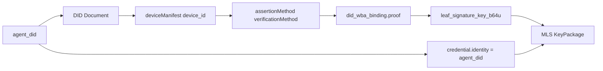
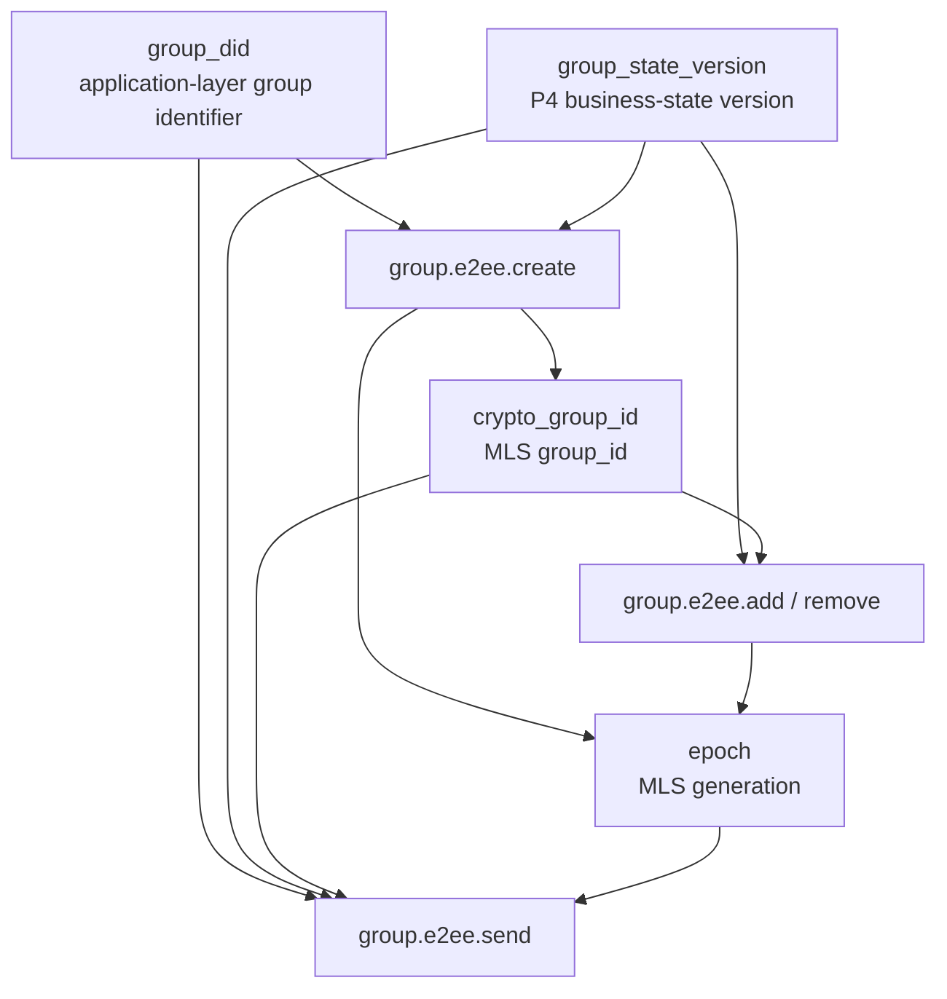
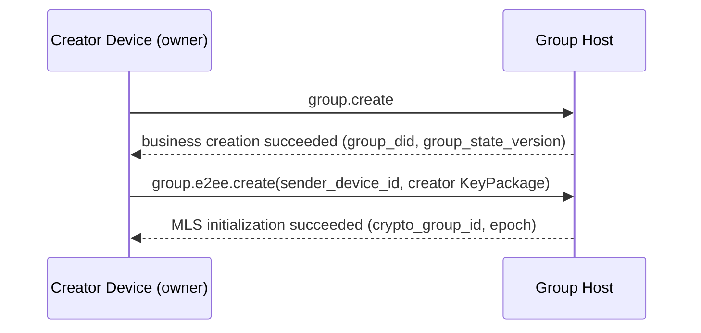
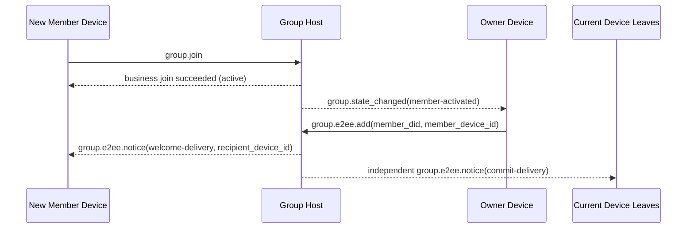
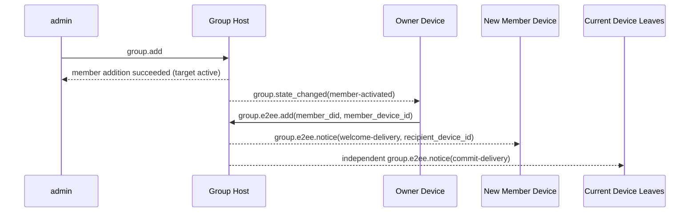
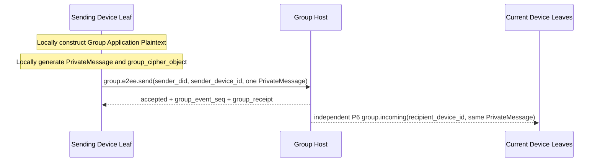
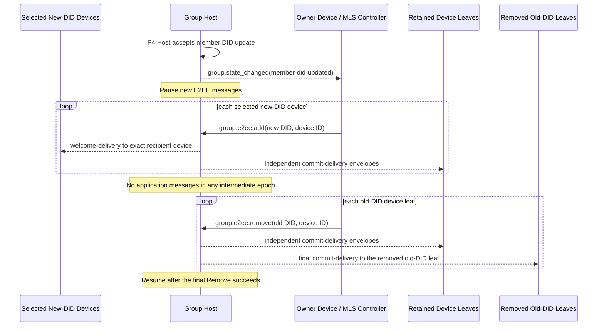

<!-- translation-review: machine-fully-reviewed; scope=full-document-source-lines-1-2479; inventory=japanese/reviews/messaging-overlays-review.json -->
> 日本語参考訳（機械翻訳から全文を意味校閲済み）。規範となるのは原文です。本文・見出し・表・条件・否定を原文と照合し、コード例・識別子・規範キーワードを保持しています。独立した二次校閲や実装適合性の検証は未実施です。
> 原文: [message/06-group-end-to-end-encryption.md](../../message/06-group-end-to-end-encryption.md) / 基準コミット: `0837cfdfaf4ddcf834f0890ddaf34fc4c824e066`

# ANP Profile 6：グループのエンドツーエンド暗号化

- 文書ID：ANP-P6
- タイトル：グループのエンドツーエンド暗号化
- 状態：候補版。1.2の文書に含まれますが、安定したv2のリリースはMLS ExtensionType登録の完了待ちです。
- バージョン：1.2
- 仕様セット：ANP Messaging 1.2
- 原文言語：English
- Profile：`anp.group.e2ee.v2`
- 依存関係：`anp.core.binding.v1`、`anp.identity.discovery.v1`、`anp.group.base.v2`
- 適用範囲：Group DIDに基づくグループのエンドツーエンド暗号化制御層を対象とし、`anp.group.base.v2`と密接に連携します。

---

## 1. 目的

このProfileは、ANPのグループのエンドツーエンド暗号化制御層を定義し、次を規定します。

1. `group_did`、`group_state_version`、`group_event_seq`をグループの暗号状態機械に結び付ける方法。
2. グループ鍵確立、メンバー変更、アプリケーションメッセージ保護の基礎プロトコルとしてMLSを使う方法。
3. メソッドに従って検証したAgent DIDと、適格な`device_id`を一つ、MLSメンバー資格情報、KeyPackage、Leaf署名鍵へ結び付ける方法。
4. MLS暗号操作を専用に運ぶ、独立した`group.e2ee.*` JSON-RPCメソッド群を定義する方法。
5. 「P4メソッドへMLSハンドシェイクオブジェクトを埋め込む」のではなく、**状態の連動**を通じて`anp.group.base.v2`と密接に連携する方法。
6. `epoch`、`Welcome`、`PrivateMessage`、`PublicMessage`、`epoch_authenticator`、フォーク検出、回復の扱い方。
7. P4がメンバーのDID更新を受け入れた後、順序付けられた`group.e2ee.add`と`group.e2ee.remove`操作を通じて、対応するMLS Leafを置換する方法。
8. DID単位の業務メンバーシップを変えずに、一つのP4メンバーDIDが独立した複数のMLSデバイスLeafを持つ方法。

このProfileは次を定義しません。

- 過去のメッセージの取得。
- 既読状態やオンライン状態。
- 製品内のデバイス登録、命名、役割、同期、内部複製管理。
- KeyPackageの秘密素材、Leaf秘密鍵、epoch秘密情報、MLS秘密状態のデバイス間共有。
- グループ外のディレクトリ同期の具体的な実装。
- グループ以外の場面のエンドツーエンド暗号化。
- External Commitの主要経路。
- `group_join_info`と`group.e2ee.get_join_info`。
- `accept_welcome`プロトコルメソッド。
- 第二の業務メンバー状態モデル。
- 失われた過去のMLS epoch秘密情報の回復・再配布。

---

## 2. 用語と規範上の表記

### 2.1 規範キーワード

本書の**MUST**、**MUST NOT**、**REQUIRED**、**SHALL**、**SHALL NOT**、**SHOULD**、**SHOULD NOT**、**RECOMMENDED**、**NOT RECOMMENDED**、**MAY**、**OPTIONAL**は、大文字表記に従って規範的要件として解釈します。

### 2.2 用語

- **Group DID**：グループのアプリケーション層のグローバル識別子。`group_did`です。
- **Crypto Group ID**：グループ暗号処理内部の識別子。MLSの`group_id`に対応し、`group_did`とは異なっていてもかまいません。
- **グループHostサービス（Group Host Service）**：グループの基本状態の順序付け、ポリシー適用、グループメッセージの入口を担当するサービス。MLSコントローラーではありません。
- **MLS Group State**：MLSに基づいて維持するグループの暗号状態。
- **Epoch**：MLSグループ状態が一世代進むこと。
- **KeyPackage**：MLSの追加用素材オブジェクト。このProfileでは、一つの適格なデバイスLeafをグループへ追加するために使います。
- **Welcome**：新しいメンバーがグループ状態を初期化するのを助ける、MLSのWelcomeオブジェクト。
- **PrivateMessage**：メンバー認証を備えた、暗号化されたMLSメッセージ。
- **PublicMessage**：署名のみを行い、暗号化しないMLSメッセージ。
- **Device Leaf**：外部から`(agent_did, device_id)`で識別する、一つのMLSクライアント／Leaf。追加のP4業務メンバーではありません。
- **適格デバイス（Eligible Device）**：現在のP2 `deviceManifest`、参照鍵、サービス機能、グループポリシーの下で、`anp.group.e2ee.v2`に適格なデバイス。
- **DID Device Binding**（維持するwire名は`did_wba_binding`）：MLS Leaf署名鍵、メンバー資格情報、KeyPackageを、検証可能な`(agent_did, device_id)`の証明オブジェクトに結び付けます。
- **MLSコントローラー（MLS Controller）**：一般のMLSメンバー変更制御操作を担当する主体。v2では、引き続きグループの`owner`がコントローラーです。9.4節と13.4節で定義する、同じDIDのデバイス削除を限定的に認可された呼び出し元は、一般のコントローラーではありません。
- **状態の連動（State Coupling）**：P4とP6をメソッドごとに対応させるのではなく、業務状態の変化を通じて暗号状態の進行を起動する連動方式。
- **E2EE Notice**：`commit`や`welcome`などの暗号処理結果を届けるために、P6が独自に定義する独立した暗号処理通知オブジェクト。
- **Terminal Leaf**：グループのMLSメンバー集合から削除されたデバイスLeaf。ローカルのグループバインディングでは、その`group_did`のアプリケーションメッセージを送信・受信・復号できなくなりますが、デバイス自体は現在の適格なP2 Manifestエントリのままであり得ます。
- **Device Delivery Queue**：グループHostが、トランスポートで確認されていないP6エンベロープについて保持する、`(recipient_did, recipient_device_id)`ごとの永続配信状態。公開メタデータ、保持した公開origin proof、不透明な暗号文だけを運び、グループ履歴ではありません。
- **フォーク（Fork）**：同じ`group_did`について、異なるメンバーが、両立できない`epoch`／`epoch_authenticator`／状態進行の列を観測したこと。
- **MLS Member DID Update**：P4が同じメンバーのDID更新を受け入れた後、順序付けたCommitを通じて、選んだ新DIDのデバイスLeafを追加し、その後ですべての旧DIDのデバイスLeafを削除する、暗号処理の編成。

---

## 3. 設計原則

### 3.1 グループアイデンティティと暗号状態の階層化

このProfileは、次を明確に区別します。

- `group_did`：アプリケーション層のグループのグローバル識別子。
- `crypto_group_id`：暗号処理グループ内部の識別子。
- `group_state_version`：グループHostが割り当てるアプリケーション層のグループ状態バージョン。
- `epoch`：MLS状態機械が割り当てる暗号グループの世代。〔訳注：原文の形容詞はCryptozoologicalで、この文脈と不整合です。ここは、同節の他の記述が示す暗号グループの世代として訳しています。〕

四つを機械的に同一視してはなりません（MUST NOT）。ただし、それらの間には、検証可能なバインディングが存在しなければなりません（MUST）。

### 3.2 一つのAgent DIDは一人の外部グループメンバー、各デバイスは一つのMLS Leaf

P4のメンバーシップ、役割、ポリシー、メンバー数は、引き続き現在の`agent_did`に属します。P4 v2は、唯一のwire上のメンバーアイデンティティとして現在の`agent_did`を使います。MLSの`credential.identity`内で、名前、安定したパスのフィールド、ローカル記録識別子をDIDの代わりに使うことはできません。

P6は、同じDIDの複数デバイスを独立したMLSクライアントとLeafとして表してもかまいません（**MAY**）。各Leafは`credential.identity = UTF8(agent_did)`を維持し、6節で定義する、認証された`device_id`バインディングで区別します。同じDIDの複数Leafによって、P4メンバー、役割、メンバー数のエントリが追加されることはありません。

各デバイスは、KeyPackageの秘密素材、Leaf秘密鍵、epoch秘密情報、MLS状態を独立して生成・保存します。同じDIDの別デバイスとの間で、これらの値をコピー・共有してはなりません（**MUST NOT**）。新しいデバイスがグループへ入る経路は、自分用のAdd、Commit、デバイスを指定したWelcomeだけです。

`anp.group.e2ee.v1`は別個の相互運用契約のままです。実装は、v1のメンバーやMLS Leafをv2のDevice Leafに読み替えたり、v1のMLSグループ状態をv2の複数デバイス状態として読み込んだりしてはなりません（**MUST NOT**）。このProfileは、その場でのv1からv2への状態アップグレードを定義しません。移行には、このProfile外で明示的に定義した手順が必要です。それ以外は、安全側で失敗させなければなりません。

### 3.3 P4が主要な業務プロトコル、P6が暗号制御層

このProfileと`anp.group.base.v2`の関係は次のとおりです。

- P4はグループの業務操作、業務状態、順序付けの意味、受領証の意味を定義します。
- P6はMLS暗号操作、暗号オブジェクト、バインディング規則、検証要件を定義します。
- 業務層の権威は、引き続きP4です。
- P6は、`active / left / removed`などの業務メンバー状態を再定義**しません**。
- P4 Baseの操作と通知は、引き続きDIDを宛先とし、P6デバイスセレクターを運んではなりません（**MUST NOT**）。
- P6は、一回に一つのデバイスLeafを追加・削除し、P4メンバーシップを独立して変更しません。
- P6は、P4メソッドのbodyでMLSネイティブオブジェクトを直接運ぶことを要求しません。

### 3.4 メソッドごとの対応ではなく、状態の連動

P4とP6の連動は、「あるP4メソッドがあるP6メソッドに直接対応する」ことではなく、**状態**を通じて実現します。

具体的には次のとおりです。

- P4が、業務上有効かどうかを決めます。
- P6が業務状態の変化を観測し、それに応じてMLS状態を進めます。

例：

- P4でグループを作成でき、作成者が`owner`になった→ownerが`group.e2ee.create`を自動実行する。
- P4でメンバーが`active`になり、適格デバイスがまだMLSメンバー集合に入っていない→ownerが`group.e2ee.add(member DID, device ID)`を実行する。
- 既にactiveなメンバーが別の適格デバイスを追加した→ownerは、P4メンバーシップを変えずに、デバイス単位の`group.e2ee.add`をもう一度実行できる。
- P4でメンバーが`left`または`removed`になった→ownerが、そのDIDのすべてのMLSデバイスLeafを削除する。
- DIDはactiveのまま、デバイスがP2 Manifestの適格性を失った→owner、または現在のMLS状態を持ち、同じDIDのデバイス管理権限を認可された別デバイスが、そのLeafだけを削除する。
- P4メンバーについてP4で`member-did-updated`が発生した→ownerが、選んだ新DIDのデバイスLeafを追加し、その後ですべての旧DIDのデバイスLeafを削除する。

### 3.5 ownerがMLSコントローラー。同じDIDのデバイス削除は限定的な例外

v2で一般のMLSコントローラー役を担うのは、owner DIDだけです。一般の制御要求は、必要な現在のMLS状態を持つ、適格なownerデバイスが送信します。別のownerデバイスが適格でも、その秘密状態が与えられるわけではありません。

ownerの責務：

- MLSグループの作成。
- `add`の実行。
- `remove`の実行。
- デバイスごとに順序付けたAddとRemoveによる、メンバーDID更新の実行。
- メンバー変更に対応する`commit`の生成。
- 新メンバー向けの`welcome`の生成。
- メンバー変更後の`epoch`の進行。

限定的な例外が、呼び出し元自身のDIDの、失効した正確なデバイスLeafだけに適用されます。同じDIDのデバイス管理について信頼できる権限を持つデバイスの、適格な現在のLeafは、宛先デバイスが権威ある情報に基づいて失効した、または現在のP2適格性を失った後で、同じDIDの別のデバイスLeafに対する`group.e2ee.remove`を送信してもかまいません（**MAY**）。この例外では：

- 呼び出し元自身のLeaf、有効な同DIDの別デバイス、他DIDのLeaf、P4業務メンバーを削除してはなりません（**MUST NOT**）。
- P4の役割、状態、参加時刻、メンバー数を変えてはなりません（**MUST NOT**）。
- 呼び出し元自身の現在のMLS状態を使い、正確に一つのLeafを削除するRemove Commitを生成しなければなりません（**MUST**）。かつ、
- グループHostにCommitを生成させたり、MLS秘密状態を開示させたりしてはなりません（**MUST NOT**）。

デバイス管理の認可は、配備環境の信頼された認可事実であり、新しいP6要求フィールドではありません。グループHostがその認可を権威ある情報に基づいて検証できない場合、例外を拒否しなければならず（**MUST**）、呼び出し元の自己申告やキャッシュされた表示データを信頼してはなりません（**MUST NOT**）。

P6の中心的な考え方は、MLSオブジェクトをP4メソッドのbodyへ入れることではなく、業務状態とともに暗号状態を進めることです。次の図はこの状態の連動をまとめ、詳細な制約を読む前にメソッド間の因果関係を理解できるようにします。

```mermaid
flowchart TB
P4[P4 business-state changes<br/>group.create / member active / member left or removed / member DID updated]
OBS[owner observes business state]

CREATE[group.e2ee.create]
ADD[group.e2ee.add(DID + device)]
REMOVE[group.e2ee.remove(DID + device)]
DID_UPDATE_ADD[group.e2ee.add(new DID devices)]
DID_UPDATE_REMOVE[group.e2ee.remove(old DID devices)]

HOST[Group Host]
NOTICE[group.e2ee.notice]

P4 --> OBS
OBS -->|group created and has no crypto_group_id yet| CREATE
OBS -->|eligible device not yet in MLS| ADD
OBS -->|device or DID must leave MLS| REMOVE
OBS -->|P4 member rebound and old leaves remain| DID_UPDATE_ADD

CREATE --> HOST
ADD --> HOST
REMOVE --> HOST
DID_UPDATE_ADD --> HOST
DID_UPDATE_ADD -->|execute after DID update Add is accepted| DID_UPDATE_REMOVE
DID_UPDATE_REMOVE --> HOST

HOST --> NOTICE
```

*図P6-1：P4／P6の状態連動の概観（非規範）。*

この図が強調するのは起動の関係であり、新しい業務状態機械ではありません。P4が引き続き業務層の権威であり、P6はその業務結果を観測し、MLSのcreate／add／remove操作として実体化するだけです。

### 3.6 グループHostは順序付けを担当し、MLS制御は担当しない

グループHostサービスの責務：

- P4業務操作の受信と順序付け。
- 受け入れたイベントへの`group_event_seq`の割り当て。
- `group_state_version`の進行。
- `group_receipt`の生成。
- グループメッセージとE2EE Noticeの配信。
- MLSオブジェクトを復号・再暗号化せず、宛先デバイスLeafごとに別個の暗号化配信エンベロープを作成。
- MLS制御結果の業務層での成立を証明すること。

既定では、グループHostサービスは：

- MLSコントローラーとして動作するべきではありません（**SHOULD NOT**）。
- MLSグループメンバーになるべきではありません（**SHOULD NOT**）。
- グループアプリケーション平文の復号能力を持つべきではありません（**SHOULD NOT**）。
- デバイス間でMLS秘密状態やepoch秘密情報をコピーしてはなりません（**MUST NOT**）。

### 3.7 ownerがグループ状態を管理し、activeなメンバーがグループメッセージを扱う

ownerが制御するもの：

- メンバー変更。
- グループ暗号状態の進行。
- `epoch`の更新。

`active`なメンバーに属し、現在MLS Leafを持つ各適格デバイスは、次を行えます。

- 現在のグループ状態を使い、自分のグループメッセージ暗号文を生成する。
- `group.e2ee.send`を呼び、自分のグループメッセージを送信する。
- 他のメンバーのグループメッセージを復号する。

このProfileは、すべてのグループメッセージをownerが暗号化することを要求しません。

3.5節の同DIDの例外は、作成、追加、メンバー単位の削除、DID更新、第三者に対する制御の権限を与えません。

### 3.8 v2はExternal Commitに対応しない

v2では：

- External Commitに対応しません。
- `group_join_info`を定義しません。
- `group.e2ee.get_join_info`を定義しません。
- `accept_welcome`プロトコルメソッドを定義しません。

すべてのグループ参加経路は、最終的に、暗号層でownerが開始するMLSの`add`へ統一されます。

### 3.9 PrivateMessageに入るのはメッセージ側だけ

v2では：

- `group.e2ee.send`のアプリケーションメッセージ内容だけが、MLSの`PrivateMessage`に入り暗号化されます。
- `group.e2ee.create`、`group.e2ee.add`、`group.e2ee.remove`は、すべて引き続き平文のJSON-RPC要求bodyを使います。DID更新の編成は`add`と`remove`を再利用し、新しい要求メソッドを定義しません。
- `commit`や`welcome`などのオブジェクトは、メソッド入力やNoticeペイロードとして現れ、P4業務メソッドのbodyへ埋め込みません。

---

## 4. 依存関係、Profileの識別、対象モデル

### 4.1 Profile名

このProfileの標準名は次のとおりです。

`anp.group.e2ee.v2`

### 4.2 依存関係

このProfileは、次のProfileに依存しなければなりません（**MUST**）。

- `anp.core.binding.v1`
- `anp.identity.discovery.v1`
- `anp.group.base.v2`

### 4.3 Security Profile

このProfileを使う場合：

- `meta.profile`は`anp.group.e2ee.v2`と等しくなければなりません（**MUST**）。
- このProfileが定義するデバイス起点の各P6要求は、`meta.sender_device_id`を含み、`meta.sender_did`の現在のP2 Manifestエントリに結び付けなければなりません（**MUST**）。
- デバイスを対象とするP6通知や暗号化配信は、`meta.recipient_device_id`を含み、`meta.target.did`内のAgent DIDを維持しなければなりません（**MUST**）。
- これらのセレクターはP6だけに属します。P4 Baseの操作と通知が引き継いではなりません（**MUST NOT**）。

具体的には：

- `group.e2ee.publish_key_package`、`group.e2ee.get_key_package`、`group.e2ee.notice`は、`transport-protected`を使わなければなりません（**MUST**）。
- `group.e2ee.create`、`group.e2ee.add`、`group.e2ee.remove`、`group.e2ee.send`、P6の`group.incoming`は、`group-e2ee`を使わなければなりません（**MUST**）。

`group.e2ee.send`の`group-e2ee`は、運ぶメッセージの意味がグループE2EE側に属することを示します。外側のJSON-RPC要求bodyを、グループによって再び暗号化するという意味ではありません。

### 4.4 メソッドの対象モデル

### 4.4.1 サービスをスコープとするメソッド

次のメソッドは、`service-scoped`でなければなりません（**MUST**）。

- `group.e2ee.publish_key_package`
- `group.e2ee.get_key_package`
- `group.e2ee.create`

規則：

- `meta.target.kind = "service"`
- `meta.target.did`は、宛先の公開`ANPMessageService.serviceDid`と等しくなければなりません（**MUST**）。

`group.e2ee.create`がservice-scopedを使う理由：
業務層の`group.create`の成功前には、グループの業務状態が成立したばかりです。`group_did`は生成済みでも、作成操作自体はグループHostのサービス入口に対する暗号初期化を完了するため、v2ではサービススコープへ統一します。〔訳注：原文は「成功前」と「業務状態が成立したばかり」を同時に記載しています。この時間関係の不整合を、成功後などへ黙って変更していません。〕

### 4.4.2 グループを宛先とするメソッド

次のメソッドは、`group-addressed`でなければなりません（**MUST**）。

- `group.e2ee.add`
- `group.e2ee.remove`
- `group.e2ee.send`

規則：

- `meta.target.kind = "group"`
- `meta.target.did`は、宛先の`group_did`と等しくなければなりません（**MUST**）。

### 4.4.3 エージェントを宛先とする通知

次の通知は、`agent-addressed`でなければなりません（**MUST**）。

- `group.e2ee.notice`
- アプリケーション暗号文配信用のP6 `group.incoming`。

規則：

- `meta.target.kind = "agent"`
- `meta.target.did`は、通知を受け取るAgent DIDと等しくなければなりません（**MUST**）。
- `meta.recipient_device_id`は、正確な受信デバイスLeafを選ばなければなりません（**MUST**）。通知を同じDIDの別デバイスへ振り向けてはなりません（**MUST NOT**）。
- このProfileは`target.kind = "device"`を定義しません。

---

## 5. 暗号処理の主要経路とMTIスイート

### 5.1 主要プロトコル

このProfileのグループ鍵の主要経路は、MLS 1.0の意味に基づいて実装しなければなりません（**MUST**）。ただし、v2が固定するのは、その制限された使用部分集合だけです。

v2の主要経路は、少なくとも次を含みます。

- KeyPackage
- Add
- Remove
- Commit
- Welcome
- PrivateMessage
- Epochの進行

P4メンバーのDID更新は、新しいP6メソッドやMLSプリミティブを導入しません。まず、選んだ新DIDのデバイスごとに一つの`group.e2ee.add` Commitを使い、次に、旧DIDのデバイスLeafごとに一つの`group.e2ee.remove` Commitを使います。

各項目の規則：

- `commit_b64u`は、TLSで直列化した完全なMLS `MLSMessage`（`mls-public-message`）の生バイト列で表現しなければなりません（**MUST**）。
- `welcome_b64u`は、TLSで直列化したMLS `Welcome`オブジェクトの生バイト列で表現しなければなりません（**MUST**）。
- `PrivateMessage`は、グループアプリケーションメッセージの唯一の暗号文運搬オブジェクトでなければなりません（**MUST**）。

MLSライブラリは、`Update`、proposalの一括処理、PSK、ReInitなどの標準機能に追加対応してもかまいません（**MAY**）。ただし、これらはこのProfile v2の最小プロトコルの主要経路に**含まれず**、v2の相互運用要件ではありません。

### 5.2 実装必須スイート

相互運用の最小要件を確保するため、このProfileに適合する実装は、次のMTIスイートに対応しなければなりません（MUST）。

`MLS_128_DHKEMX25519_AES128GCM_SHA256_Ed25519`

### 5.3 追加のスイート

実装は、さらに多くのMLSスイートに対応してもかまいません（**MAY**）。ただし：

- 同じグループの全メンバーは、使うスイートに合意しなければなりません（**MUST**）。
- グループポリシーが許可するスイート集合を制限する場合、MLSコントローラーは、ポリシーを満たさないスイートを拒否しなければなりません（**MUST**）。

### 5.4 DIDアイデンティティとの関係

このProfileの主要経路とDIDアイデンティティの関係は次のとおりです。

- DID文書の`assertionMethod`を、アイデンティティのバインディング証明に使います。
- DID文書の`keyAgreement`には、エージェントがE2EE機能を持つことを示すため、少なくとも一つのX25519エントリを含めるべきです（**SHOULD**）。
- P2の`deviceManifest`は、現在のデバイスエントリ、その`signing_key_id`、`e2ee_key_id`、`anp.group.e2ee.v2`への適格性を識別します。
- MLSグループメンバーのLeaf署名鍵を、DIDの長期アイデンティティ署名鍵と直接同一にするべきではありません（**SHOULD NOT**）。
- Leaf署名鍵は別途生成し、6節のバインディングオブジェクトで`(agent_did, device_id)`に結び付けるべきです（**SHOULD**）。

---

## 6. DIDメソッドに依存しないDIDとMLSのバインディングモデル

### 6.1 バインディングの対象

このProfileは、次のMLS要素を`(agent_did, device_id)`に結び付けることを要求します。

1. KeyPackageの所有者。
2. 現在のLeaf署名鍵。
3. グループメンバー資格情報内のアイデンティティ文字列。
4. バインディング証明で使う、P2 Manifestの署名鍵参照。

### 6.2 資格情報のアイデンティティ規則

このProfileでは、MLSメンバー資格情報の`credential.identity`は、そのLeafの現在の`agent_did`のUTF-8バイト列と等しくなければなりません（**MUST**）。読みやすい名前、安定した主体パス、ローカルアイデンティティを、`credential.identity`へ書き込んだり、その代わりに使ったりしてはなりません（**MUST NOT**）。

実装は、`credential.identity`を、ローカルアカウントID、デバイスID、数値の利用者ID、その他の非DID文字列に置き換えてはなりません（**MUST NOT**）。

したがって、同じDIDの複数Leafは、同じ`credential.identity`を持ちますが、認証された`device_id`値は異なります。検証者は、いずれか一方の値だけでなく、完全な組によってP6 Leafを識別します。

### 6.3 `did_wba_binding`オブジェクト

このProfileは、MLS Leaf署名鍵を、`agent_did`の下の一つの適格デバイスに結び付ける`did_wba_binding`オブジェクトを定義します。このオブジェクト名や拡張名`anp_did_wba_device_binding`は、`agent_did`のDIDメソッドを制限しません。

推奨する構造は次のとおりです。

```json
{
  "agent_did": "did:wba:example.com:agents:alice:e1_<fingerprint>",
  "device_id": "dev-a-7N3KQ2",
  "verification_method": "did:wba:example.com:agents:alice:e1_<fingerprint>#dev-a-sign",
  "leaf_signature_key_b64u": "BASE64URL_ED25519_LEAF_PK",
  "issued_at": "2026-03-29T12:00:00Z",
  "expires_at": "2026-04-29T12:00:00Z",
  "proof": {
    "type": "DataIntegrityProof",
    "cryptosuite": "eddsa-jcs-2022",
    "created": "2026-03-29T12:00:00Z",
    "proofPurpose": "assertionMethod",
    "verificationMethod": "did:wba:example.com:agents:alice:e1_<fingerprint>#dev-a-sign",
    "proofValue": "z..."
  }
}
```

`did_wba_binding.proof`は、P1付録Bの共通の**Object Proof Profile**を再利用しなければなりません（**MUST**）。

`did_wba_binding`について：

- 発行者DIDは`agent_did`でなければなりません（**MUST**）。
- 保護対象文書は、`proof`を削除した`did_wba_binding`オブジェクト全体でなければなりません（**MUST**）。
- `device_id`は、`anp.group.e2ee.v2`に適格な現在のP2 Manifestエントリを識別しなければなりません（**MUST**）。
- `verification_method`と`proof.verificationMethod`は、そのエントリの`signing_key_id`と等しくなければならず（**MUST**）、その鍵は`agent_did`のDID文書の`assertionMethod`で認可されていなければなりません（**MUST**）。

#### 6.3.1 MLS拡張`anp_did_wba_device_binding`

この草案は、`anp_did_wba_device_binding`に、プライベート利用の暫定MLS `ExtensionType`値`0xF0A1`を割り当てます。IANAによる割り当てではなく、`anp.group.e2ee.v2`を明示的に交渉した後にだけ使用しなければなりません（**MUST**）。ANPは、v2をリリースする前に、登録済みの安定したコードポイントを公開しなければなりません（**MUST**）。この草案値を変更する場合、互換性を壊す草案改訂となります。

`extension_data`のバイト列は、`proof`を含む完全な`did_wba_binding` JSONオブジェクトをUTF-8 RFC 8785 JCSで符号化したものです。KeyPackageが運ぶv2 LeafNodeは、この型の拡張を正確に一つ含まなければならず（**MUST**）、グループに保持される認証済みLeafNodeも、同じバインディングを維持しなければなりません（**MUST**）。LeafNodeの`capabilities.extensions`とGroupContextの`required_capabilities`拡張は、`0xF0A1`を列挙しなければなりません（**MUST**）。

v2実装は、拡張や機能宣言の欠落、重複、不正形式、未対応、値の衝突を拒否しなければなりません（**MUST**）。便宜上の`group_key_package.did_wba_binding`メンバーは、埋め込まれた拡張と同じJCSバイト列でなければならず（**MUST**）、拡張の代わりにはなりません。

### 6.4 `did_wba_binding`の検証規則

受信側は、KeyPackage、LeafNode更新、新メンバーを受け入れる前に、次の検証を完了しなければなりません（MUST）。

1. [P2のメソッド検証](../../message/02-identity-and-discovery.md#method-validation)に従って、現在の`agent_did`のDID Documentを解決・検証する。
2. `device_id`が現在のP2 `deviceManifest`に正確に一度現れ、`anp.group.e2ee.v2`とその依存関係を宣言している。
3. `verification_method`が、そのエントリの現在の`signing_key_id`と等しく、`assertionMethod`で認可されている。
4. `proof`が存在し、P1付録Bの共通Object Proof Profileを満たさなければならない（**MUST**）。
5. `proof`の発行者DIDが`agent_did`と等しく、証明検証に合格する。
6. 保護対象文書が、少なくとも`agent_did`、`device_id`、`verification_method`、`leaf_signature_key_b64u`、`issued_at`、`expires_at`を対象としている。
7. KeyPackage／LeafNodeが、6.3.1節の拡張と必須の機能宣言を運ぶ。
8. 埋め込まれた拡張と、同じ階層にある`did_wba_binding`のJCSバイト列が同一。
9. 実際のLeaf署名公開鍵が`leaf_signature_key_b64u`と一致する。
10. MLS資格情報の`credential.identity`が`agent_did`と一致する。
11. スイート、グループポリシー、`issued_at`／`expires_at`の期間が有効。

P6が`did_wba_binding`を定義するのは、MLS Leaf署名鍵をDIDの長期アイデンティティ署名鍵と直接同一視すべきでないためです。次の図は、`agent_did`、DID文書、バインディングオブジェクト、KeyPackage／`credential.identity`を結び、検証順を理解できるようにします。



*図P6-2：DID／デバイスとMLSのバインディング連鎖（非規範）。*

受信側は、内部のMLS署名が有効なことだけを確認するべきではありません。この連鎖に従い、`credential.identity`、`device_id`、Leaf署名鍵、現在のManifestエントリ、`agent_did`が完全に結び付くことも確認するべきです。

### 6.5 DIDメソッドとバインディング証明

- 対応するDIDメソッドでは、`did_wba_binding.proof`はP1付録Bの共通Object Proof Profileを再利用しなければなりません（**MUST**）。
- 互換の`k1_` DIDでは、`did_wba_binding.proof`に、明示的な拡張交渉で定義する代替Object Proof Profileを使ってもかまいません（**MAY**）。ただし、明示的な拡張交渉がない場合、v2 MTIは、`k1_`証明のバインディングを既定の相互接続経路と**しません**。
- DIDのアイデンティティ曲線にかかわらず、バインディング証明が成り立つ限り、MLSグループのMTI Leaf署名鍵にEd25519を使ってもかまいません（**MAY**）。

---

## 7. 中核オブジェクト

### 7.1 `crypto_group_id`

`crypto_group_id`は、MLS内部の`group_id`を表します。

規則は次のとおりです。

- `crypto_group_id`は不透明なバイト列として扱わなければなりません（**MUST**）。
- JSONでは`base64url`で表現しなければなりません（**MUST**）。推奨フィールド名は`crypto_group_id_b64u`です。
- `crypto_group_id`は、`group_did`との検証可能なバインディングを確立しなければなりません（**MUST**）。

### 7.2 `group_state_ref`

このProfileは、P4の`group_state_ref`の概念を再利用し、E2EEグループに少なくとも次を含めることを要求します。

- `group_did`
- `group_state_version`
- `policy_hash`（グループポリシーをハッシュ化している場合）

グループE2EEでは、異なる層にある四つの識別子／バージョン、すなわちGroup DID、業務状態バージョン、暗号処理内部のグループID、MLS epochの関係を誤解しやすくなります。次の図は、それぞれの情報源と進行の関係を一つにまとめます。



*図P6-3：`group_did`、`crypto_group_id`、`group_state_version`、`epoch`の関係（非規範）。*

以降のオブジェクト構造と検証規則では、この四つの値を、異なる層の座標として捉えてください。相互に結び付ける必要はありますが、互いを置き換えることはできず、機械的に同じ値と扱うべきではありません。

### 7.3 `group_key_package`

このProfileは、グループへの追加素材を包む次のオブジェクトを定義します。

```text
{
  "key_package_id": "kp-001",
  "owner_did": "did:wba:example.com:agents:bob:e1_<fingerprint>",
  "owner_device_id": "dev-b-4M8P1X",
  "suite": "MLS_128_DHKEMX25519_AES128GCM_SHA256_Ed25519",
  "mls_key_package_b64u": "BASE64URL_KEYPACKAGE",
  "did_wba_binding": { ... },
  "expires_at": "2026-04-30T00:00:00Z"
}
```

各項目の規則：

- `key_package_id`が存在しなければなりません（**MUST**）。
- `owner_did`が存在しなければなりません（**MUST**）。
- `owner_device_id`が存在しなければなりません（**MUST**）。
- `suite`が存在しなければなりません（**MUST**）。
- `mls_key_package_b64u`が存在しなければなりません（**MUST**）。
- `did_wba_binding`が存在しなければなりません（**MUST**）。
- `expires_at`は存在するべきです（**SHOULD**）。
- `mls_key_package_b64u`は、MLS 1.0 TLSで直列化したMLS `KeyPackage`オブジェクトの生バイト列を、パディングなしのbase64urlで表現しなければなりません（**MUST**）。
- `owner_did`と`owner_device_id`は、それぞれ`did_wba_binding.agent_did`と`did_wba_binding.device_id`に等しくなければなりません（**MUST**）。
- 一つのKeyPackageは正確に一つのデバイスに属し、別デバイスのLeafへ使ってはなりません（**MUST NOT**）。消費と、配備環境が宣言するlast-resort再利用は、変更せず13.2節に従います。

`group_key_package`は、主にownerが後で`group.e2ee.add`を実行するために使います。

### 7.4 `group_cipher_object`

`group_cipher_object`は、`group.e2ee.send`のwireプロトコルのメッセージbodyオブジェクトです。

推奨する構造は次のとおりです。

```json
{
  "crypto_group_id_b64u": "BASE64URL_GROUPID",
  "epoch": "7",
  "private_message_b64u": "BASE64URL_PRIVATEMESSAGE",
  "group_state_ref": {
    "group_did": "did:wba:groups.example:team:dev:e1_<fingerprint>",
    "group_state_version": "42",
    "policy_hash": "sha-256:..."
  },
  "epoch_authenticator": "BASE64URL_AUTH"
}
```

規則：

- `crypto_group_id_b64u`が存在しなければなりません（**MUST**）。
- `epoch`が存在しなければなりません（**MUST**）。
- `private_message_b64u`が存在しなければなりません（**MUST**）。
- `private_message_b64u`は、MLS 1.0 TLSで直列化したMLS `PrivateMessage`オブジェクトの生バイト列を、パディングなしのbase64urlで表現しなければなりません（**MUST**）。
- `group_state_ref.group_did`は、外側の宛先`group_did`と等しくなければなりません（**MUST**）。

### 7.5 `Group Application Plaintext`

グループアプリケーションメッセージをMLSの`PrivateMessage`で暗号化する前に、次の内側の平文オブジェクトへ正規化しなければなりません（**MUST**）。

```json
{
  "application_content_type": "text/plain | application/json | application/anp-attachment-manifest+json | ...",
  "thread_id": "thr-001",
  "reply_to_message_id": "msg-0009",
  "annotations": {},
  "text": "...",
  "payload": {},
  "payload_b64u": "..."
}
```

規則：

- `application_content_type`が存在しなければなりません（**MUST**）。
- `text`、`payload`、`payload_b64u`のうち、正確に一つが存在しなければなりません（**MUST**）。
- P4のメッセージ意味フィールド`thread_id`、`reply_to_message_id`、`annotations`は、グループE2EEでは内側のオブジェクトへ配置しなければなりません（**MUST**）。
- 送信側は、暗号化前に`Group Application Plaintext`オブジェクト全体をUTF-8＋RFC 8785 JCSでバイト列へ直列化しなければならず（**MUST**）、受信側は復号後に同じ規則で解釈しなければなりません（**MUST**）。

`application_content_type = "application/json"`の場合、`payload`はJSONオブジェクトを直接運ばなければなりません（**MUST**）。
このProfileは、そのオブジェクト内部のフィールドの業務上の意味を
定義しません。

通常のJSONグループアプリケーション平文の例：

```json
{
  "application_content_type": "application/json",
  "thread_id": "thr-001",
  "payload": {
    "type": "example",
    "data": {
      "hello": "group"
    }
  }
}
```

### 7.6 `e2ee_notice_object`

P6は、暗号処理結果の配信用に、独立した暗号処理通知オブジェクトを定義します。

推奨する構造は次のとおりです。

```text
{
  "notice_id": "en-001",
  "notice_type": "commit-delivery | welcome-delivery",
  "group_did": "did:wba:groups.example:team:dev:e1_<fingerprint>",
  "group_state_ref": {
    "group_did": "did:wba:groups.example:team:dev:e1_<fingerprint>",
    "group_state_version": "43",
    "policy_hash": "sha-256:..."
  },
  "crypto_group_id_b64u": "BASE64URL_GROUPID",
  "epoch": "8",
  "subject_did": "did:wba:b.example:agents:bob:e1_<fingerprint>",
  "subject_device_id": "dev-b-4M8P1X",
  "subject_status": "active | removed",
  "commit_b64u": "BASE64URL_MLSMESSAGE",
  "welcome_b64u": "BASE64URL_WELCOME",
  "ratchet_tree_b64u": "BASE64URL_RATCHET_TREE",
  "epoch_authenticator": "BASE64URL_AUTH",
  "group_receipt": { ... }
}
```

規則：

- `notice_id`は存在しなければならず（**MUST**）、同じエンベロープの再配信でも安定していなければならず（**MUST**）、同じ受信デバイスへ届ける異なる論理通知で再利用してはなりません（**MUST NOT**）。同じ暗号処理結果のLeafごとのコピーは、一つの`notice_id`を共有してもかまいません（**MAY**）。各デバイスが`(group_did, notice_id)`をキーに、自分宛てのエンベロープだけを重複排除するためです。
- `notice_type`が存在しなければなりません（**MUST**）。
- `group_did`が存在しなければなりません（**MUST**）。
- `group_state_ref`が存在しなければなりません（**MUST**）。
- `crypto_group_id_b64u`が存在しなければなりません（**MUST**）。
- `epoch`が存在しなければなりません（**MUST**）。
- `notice_type = "commit-delivery"`の場合、`commit_b64u`が存在しなければなりません（**MUST**）。
- `notice_type = "welcome-delivery"`の場合、`welcome_b64u`と`ratchet_tree_b64u`が同時に存在しなければなりません（**MUST**）。
- DID更新の編成で生成した通知では、`group_state_ref`は、各P6 AddとRemoveが使った、受け入れ済みのP4 `member-did-updated`イベントを正確に参照しなければなりません（**MUST**）。受信側は、P6に重複する継続性フィールドからではなく、そのP4イベントから旧DIDと現在のDIDを取得しなければなりません（**MUST**）。
- `subject_did`、`subject_device_id`、`subject_status`は、このP6操作で影響する一つのLeafを表します。Addでは追加DID／デバイスと`active`、Removeでは削除DID／デバイスと`removed`を使います。
- 通知を受け取るデバイスは、外側の`meta.target.did`と`meta.recipient_device_id`だけで識別します。`commit-delivery`では、影響対象と受信先が異なる場合があります。Removeの`commit-delivery`では、12.3節のとおり、削除対象のLeaf自身を受信先とし、最後の通知を一度届けてもかまいません（**MAY**）。
- `ratchet_tree_b64u`は、ラチェット木をTLS直列化した生バイト列の、パディングなしbase64urlでなければなりません（**MUST**）。
- `group_receipt`は、暗号処理結果を業務の順序位置に関連付けるために存在してもかまいません（**MAY**）。

---

## 8. KeyPackageの公開と発見のメソッド

### 8.1 `group.e2ee.publish_key_package`

#### 8.1.1 意味

エージェントが、グループ参加に使えるKeyPackageを、自分が公開する`ANPMessageService`へ公開します。

#### 8.1.2 要求の要件

- `method = "group.e2ee.publish_key_package"`
- `meta.profile = "anp.group.e2ee.v2"`
- `meta.security_profile = "transport-protected"`
- `meta.target.kind = "service"`
- `meta.target.did`は、公開者自身の公開`ANPMessageService.serviceDid`と等しくなければなりません（**MUST**）。
- `meta.sender_did`が存在しなければなりません（**MUST**）。
- `meta.sender_device_id`が存在しなければなりません（**MUST**）。
- `body.group_key_package`が存在しなければなりません（**MUST**）。
- `body.group_key_package.owner_did`は`meta.sender_did`と等しくなければなりません（**MUST**）。
- `body.group_key_package.owner_device_id`と`body.group_key_package.did_wba_binding.device_id`は、`meta.sender_device_id`と等しくなければなりません（**MUST**）。
- 公開サービスは、KeyPackageを受け入れる前に、現在のP2 Manifestエントリと6節のバインディングを検証しなければなりません（**MUST**）。

認証上の制約：

- このメソッドは、**サービスをスコープとする**制御プレーンメソッドです。
- 呼び出し元は、認証済みのローカルセッション、または同等のホップ単位・サービス単位の認証コンテキスト内で動作しなければなりません（**MUST**）。
- v2は、このメソッドに追加の業務層`origin_proof`を**要求しません**。

#### 8.1.3 成功応答

成功応答は、少なくとも次を含まなければなりません（**MUST**）。

- `published = true`
- `owner_did`
- `owner_device_id`
- `key_package_id`
- `published_at`

### 8.2 `group.e2ee.get_key_package`

#### 8.2.1 意味

宛先エージェントの`ANPMessageService`を通じて、利用可能なKeyPackageを取得します。

#### 8.2.2 要求の要件

- `meta.profile = "anp.group.e2ee.v2"`
- `meta.security_profile = "transport-protected"`
- `meta.target.kind = "service"`
- `meta.target.did`は、宛先エージェントが公開する`ANPMessageService.serviceDid`と等しくなければなりません（**MUST**）。
- `meta.sender_did`が存在しなければなりません（**MUST**）。
- `meta.sender_device_id`は、`meta.sender_did`の下の、現在P6に適格なデバイスを識別しなければなりません（**MUST**）。

`body`は次を含まなければなりません（**MUST**）。

- `target_did`
- `target_device_id`

`body`は次を含めてもかまいません（**MAY**）。

- `preferred_suite`
- `require_fresh`

認証上の制約：

- このメソッドは、**サービスをスコープとする**制御プレーンメソッドです。
- 認証済みコンテキストは、正確な`(meta.sender_did, meta.sender_device_id)`の組をバインドしなければならず（**MUST**）、そのデバイスは現在のP2 Manifestの下で適格なままでなければなりません（**MUST**）。
- v2の相互運用の最小要件は、少なくともホップ／サービス単位の認証です。
- **KeyPackageの匿名取得はv2 MTIに含まれません**。

#### 8.2.3 成功応答

成功応答は、少なくとも次を含まなければなりません（**MUST**）。

- `target_did`
- `target_device_id`
- `group_key_package`

#### 8.2.4 サーバー側の配布規則

`ANPMessageService`が`group_key_package`を返す場合：

- 期限切れでも、取り消し済みでも、消費済みでもないKeyPackageを返すべきです（**SHOULD**）。
- `owner_did`と`owner_device_id`が、要求された宛先の組と正確に等しいKeyPackageを返さなければならず（**MUST**）、同じDIDの別デバイスへ置き換えてはなりません（**MUST NOT**）。
- 返す前に、宛先デバイスを現在のP2 Manifestに対して再検証しなければなりません（**MUST**）。
- サーバーは、同時の再発行を防ぐため、返却後に`reserved`または同等の状態へ設定してもかまいません（**MAY**）。
- DID更新の編成におけるAdd段階も含め、対応する`group.e2ee.add`がグループHostに受け入れられ、暗号メンバーシップ変更が完了したら、サービスは`consumed`と記録するか、公開集合から削除しなければなりません（**MUST**）。
- 対応する処理が失敗、取消し、タイムアウトになった場合、予約したKeyPackageの解放は配備環境ごとに決めます。ただし、同じKeyPackageを、成功する二つの`group.e2ee.add`操作で同時に再利用させるべきではありません（**SHOULD NOT**）。
- ホップ／サービス単位の認証に基づき、呼び出し元の識別、レート制限、不正利用対策ポリシーを実装しなければなりません（**MUST**）。

---

## 9. MLS制御プレーンのメソッド

### 9.1 全体

この章のメソッドは独立したJSON-RPCメソッドです。P4業務メソッドの「追加フィールド」ではなく、P6自体の暗号制御操作です。

具体的には：

- `group.e2ee.create`、`group.e2ee.add`、`group.e2ee.remove`は、**メンバー変更の制御メソッド**です。
- `group.e2ee.send`は、**メッセージ送信メソッド**です。
- `group.e2ee.create/add/remove`は、既存のP4業務状態に結び付きますが、**新しいP4業務メンバー状態を作成しません**。
- `group.e2ee.send`をwire上の配信メソッドとして直接使い、`group.send`で再び包みません。

### 9.2 `group.e2ee.create`

#### 9.2.1 意味

新しいMLSグループ状態を作成し、ownerを初期メンバーとして追加します。

#### 9.2.2 呼び出し元

ownerのみ。

#### 9.2.3 要求の要件

- `method = "group.e2ee.create"`
- `meta.profile = "anp.group.e2ee.v2"`
- `meta.security_profile = "group-e2ee"`
- `meta.target.kind = "service"`
- `meta.target.did`は、宛先グループHostが公開する`ANPMessageService.serviceDid`と等しくなければなりません（**MUST**）。
- `meta.sender_did`は、現在のグループの`owner`と等しくなければなりません（**MUST**）。
- `meta.sender_device_id`は、必要な現在のMLS状態を持つ、適格なownerデバイスを識別しなければなりません（**MUST**）。
- `auth.origin_proof`が存在しなければなりません（**MUST**）。

`body`は、少なくとも次を含まなければなりません（**MUST**）。

- `group_did`
- `group_state_ref`
- `suite`
- `creator_key_package`
- `crypto_group_id_b64u`
- `epoch`

規則：

- `creator_key_package.owner_did`は`meta.sender_did`と等しくなければなりません（**MUST**）。
- `creator_key_package.owner_device_id`は`meta.sender_device_id`と等しくなければなりません（**MUST**）。
- `group_state_ref.group_did`は`body.group_did`と等しくなければなりません（**MUST**）。
- 初期グループ状態の`epoch`は、`"0"`または実装が明示的に合意した初期値であるべきです（**SHOULD**）。

#### 9.2.4 成功応答

成功応答は、少なくとも次を含まなければなりません（**MUST**）。

- `created = true`
- `group_did`
- `group_state_ref`
- `crypto_group_id_b64u`
- `epoch`
- `accepted_at`

注：

- `group.e2ee.create`自体が、新しいP4業務グループを作成してはなりません（**MUST NOT**）。
- 業務層が`group.create`を受け入れた後でのみ実行します。
- `group_state_version`や`group_event_seq`を新たに独立生成しません。

### 9.3 `group.e2ee.add`

#### 9.3.1 意味

ownerがMLSの`add`を実行し、P4の`active`メンバーの適格デバイスLeafを一つ、暗号グループへ追加します。同じactive DIDの二つ目のデバイスは、別のAddを使い、別のP4メンバーを作成しません。

#### 9.3.2 呼び出し元

ownerのみ。

#### 9.3.3 要求の要件

- `method = "group.e2ee.add"`
- `meta.profile = "anp.group.e2ee.v2"`
- `meta.security_profile = "group-e2ee"`
- `meta.target.kind = "group"`
- `meta.target.did`は、宛先の`group_did`と等しくなければなりません（**MUST**）。
- `meta.sender_did`は、現在のグループの`owner`と等しくなければなりません（**MUST**）。
- `meta.sender_device_id`は、必要な現在のMLS状態を持つ、適格なownerデバイスを識別しなければなりません（**MUST**）。
- `auth.origin_proof`が存在しなければなりません（**MUST**）。

`body`は、少なくとも次を含まなければなりません（**MUST**）。

- `member_did`
- `member_device_id`
- `group_state_ref`
- `group_key_package`
- `crypto_group_id_b64u`
- `epoch`
- `commit_b64u`
- `welcome_b64u`
- `ratchet_tree_b64u`

規則：

- `group_state_ref.group_did`は、外側の宛先`group_did`と等しくなければなりません（**MUST**）。
- `group_key_package.owner_did`は`member_did`と等しくなければなりません（**MUST**）。
- `group_key_package.owner_device_id`と`group_key_package.did_wba_binding.device_id`は、`member_device_id`と等しくなければなりません（**MUST**）。
- `commit_b64u`は、完全なMLS `MLSMessage`オブジェクトをTLSで直列化した、パディングなしbase64urlでなければなりません（**MUST**）。
- `welcome_b64u`は、MLS `Welcome`オブジェクトをTLSで直列化した、パディングなしbase64urlでなければなりません（**MUST**）。
- `ratchet_tree_b64u`は、ラチェット木をTLS直列化した生バイト列の、パディングなしbase64urlでなければなりません（**MUST**）。
- `epoch`は、この`add`の後の新しい`epoch`を示さなければなりません（**MUST**）。
- 通常の経路では、`member_did`が現在のP4 `active`メンバーでなければならず（**MUST**）、正確な`(member_did, member_device_id)`のLeafは、まだ存在していてはなりません（**MUST NOT**）。同じDIDの別Leafの存在は競合ではありません。
- DID更新経路では、`group_state_ref`が受け入れ済みのP4 `member-did-updated`イベントを正確に参照しなければならず（**MUST**）、`member_did`がそのイベントの`subject_did`と等しくなければならず（**MUST**）、新しいKeyPackageが選択した新DIDのデバイスに結び付かなければなりません（**MUST**）。
- DID更新経路では、旧DIDのデバイスLeafを削除する前に、選択した新DIDのデバイスに対するすべてのAddが成功しなければなりません（**MUST**）。

#### 9.3.4 成功応答

成功応答は、少なくとも次を含まなければなりません（**MUST**）。

- `accepted = true`
- `group_did`
- `member_did`
- `member_device_id`
- `group_state_ref`
- `crypto_group_id_b64u`
- `epoch`
- `accepted_at`

注：

- `group.e2ee.add`自体が、宛先メンバーのP4業務状態を`active`へ変えてはなりません（**MUST NOT**）。
- 業務状態は、P4によって既に決定されていなければなりません（**MUST**）。
- このメソッドが担当するのは、業務結果をMLSで実現することだけです。

### 9.4 `group.e2ee.remove`

#### 9.4.1 意味

MLSの`remove`は、正確に一つのデバイスLeafを削除します。起動原因には、P4によるDIDの削除、DIDがactiveのままデバイスが適格性を失うこと、グループポリシー、受け入れたメンバーDID更新の編成があります。一般の削除は引き続きownerが制御し、下記の同DIDの例外は、失効した別デバイス一つに限定します。

#### 9.4.2 呼び出し元

次のいずれか：

- 必要な現在のMLS状態を持つ、適格なownerデバイス。あるいは、
- 権威ある同DIDのデバイス管理権限を持つ、適格な現在のLeaf。ただし、自分のDIDの、別の、既に失効済みまたは現在不適格なデバイスLeafを削除する場合だけ。

#### 9.4.3 要求の要件

- `method = "group.e2ee.remove"`
- `meta.profile = "anp.group.e2ee.v2"`
- `meta.security_profile = "group-e2ee"`
- `meta.target.kind = "group"`
- `meta.target.did`は、宛先の`group_did`と等しくなければなりません（**MUST**）。
- owner経路では、`meta.sender_did`が現在のグループの`owner`と等しくなければならず（**MUST**）、`meta.sender_device_id`が、必要な現在のMLS状態を持つ適格なownerデバイスを識別しなければなりません（**MUST**）。
- 同DID経路では、`meta.sender_did`が`member_did`と等しくなければならず（**MUST**）、送信者はP4の`active`メンバーかつ現在のMLS Leafでなければならず（**MUST**）、`meta.sender_device_id`は`member_device_id`と等しくてはなりません（**MUST NOT**）。グループHostは、送信デバイスに現在のデバイス管理権限があり、宛先デバイスが失効済みまたは現在P2不適格であることを、権威ある情報に基づいて検証しなければなりません（**MUST**）。
- `auth.origin_proof`が存在しなければなりません（**MUST**）。

`body`は、少なくとも次を含まなければなりません（**MUST**）。

- `member_did`
- `member_device_id`
- `group_state_ref`
- `crypto_group_id_b64u`
- `epoch`
- `commit_b64u`

規則：

- `commit_b64u`は、完全なMLS `MLSMessage`オブジェクトをTLSで直列化した、パディングなしbase64urlでなければなりません（**MUST**）。
- `epoch`は、この`remove`の後の新しい`epoch`を示さなければなりません（**MUST**）。
- 正確な`(member_did, member_device_id)`のLeafが、現在のMLS状態に存在しなければなりません（**MUST**）。
- P4が`member_did`を`removed`または`left`と記録した場合、ownerは、そのDIDの現在のすべてのデバイスLeafについて、順序付けたRemoveを発行しなければなりません（**MUST**）。
- P4でDIDを`active`に保つ場合、名前を指定したデバイスが現在のP2適格性を失った後、またはグループポリシーがそのLeafを削除する場合にだけ、そのデバイスの削除を認めます。同DIDの別LeafとP4メンバーシップは変えません。
- 同DID経路では、指定した宛先Leafを正確に一つだけ削除しなければならず（**MUST**）、グループポリシーによる削除、メンバーの削除・離脱、DID更新の編成、別DIDに使ってはなりません（**MUST NOT**）。
- DID更新経路では、`member_did`が、参照するP4イベントの`previous_subject_did`と等しくなければなりません（**MUST**）。選んだ新DIDのデバイスへのAddが既に成功している必要があり、ownerは、アプリケーションメッセージを再開する前に、すべての旧DIDのデバイスLeafを削除する必要があります。

#### 9.4.4 成功応答

成功応答は、少なくとも次を含まなければなりません（**MUST**）。

- `accepted = true`
- `group_did`
- `member_did`
- `member_device_id`
- `group_state_ref`
- `crypto_group_id_b64u`
- `epoch`
- `accepted_at`

### 9.5 `group.e2ee.send`

#### 9.5.1 意味

MLSで暗号化したグループメッセージを、グループへ直接送ります。

#### 9.5.2 呼び出し元

現在の`active`メンバーの、任意の適格なデバイスLeaf。

#### 9.5.3 要求の要件

適合する`group.e2ee.send`要求は、次を満たさなければなりません（**MUST**）。

1. `method = "group.e2ee.send"`
2. `meta.profile = "anp.group.e2ee.v2"`
3. `meta.security_profile = "group-e2ee"`
4. `meta.target.kind = "group"`
5. `meta.target.did`は、宛先の`group_did`でなければなりません（**MUST**）。
6. `meta.sender_did`は、現在の送信側Agent DIDでなければなりません（**MUST**）。
7. `meta.sender_device_id`は、PrivateMessageを生成した、現在適格なMLS Leafを識別しなければなりません（**MUST**）。
8. `meta.message_id`が存在しなければなりません（**MUST**）。
9. `meta.operation_id`が存在しなければなりません（**MUST**）。
10. `meta.content_type`は`application/anp-group-cipher+json`に固定しなければなりません（**MUST**）。
11. `auth.origin_proof`が存在し、選択したデバイスの現在のP2署名鍵を使わなければなりません（**MUST**）。
12. `body`は`group_cipher_object`を直接運ばなければなりません（**MUST**）。

注：

- `group.e2ee.send`自体が、wire上の送信メソッドです。
- P4の`group.send`を通じてもう一層包みません。

#### 9.5.4 成功応答

成功応答は、少なくとも次を含まなければなりません（**MUST**）。

- `accepted = true`
- `group_did`
- `message_id`
- `operation_id`
- `group_event_seq`
- `group_state_version`
- `accepted_at`
- `epoch`
- `group_receipt`

成功が意味すること：

- グループHostが、一つのMLS暗号文オブジェクトを受け入れ、順序付けた。
- 全メンバーがメッセージを正常に復号したことを、自動的に意味するわけではありません。

---

## 10. 状態の連動規則

### 10.1 全体

P4とP6の連動は、**業務状態の変化**を通じて行います。
このProfileは、`group.create -> create`や`group.add -> add`のような、メソッドごとの対応表を維持することを要求しません。

ownerは、信頼できる状態観測を通じて、次を把握しなければなりません（**MUST**）。

- あるグループが業務層で作成された。
- あるメンバーが業務上`active`になった。
- あるメンバーが業務上`left`または`removed`になった。
- 適格なデバイスにLeafが必要になった、または現在のLeafのデバイスがP2適格性を失った。
- P4メンバーについて`member-did-updated`が発生した。

状態観測の方法には次を使ってもかまいません（**MAY**）。

- ローカル側とグループHostの内部での処理編成。
- `group.state_changed`の購読。
- その他の同等で信頼できる状態観測機構。

### 10.2 グループ作成の連動規則

ownerが、次の業務状態が同時に成り立つことを観測した場合：

- ある`group_did`が作成済み。
- 作成者が自分自身。
- まだグループに結び付く`crypto_group_id`がない。

ownerは、一度だけ`group.e2ee.create`を起動しなければなりません（**MUST**）。

### 10.3 メンバー参加の連動規則

ownerが、次の業務状態が同時に成り立つことを観測した場合：

- ある`member_did`が、既にP4でそのグループの`active`メンバー。
- 選択した適格な`member_device_id`が、まだMLS Leafを持たない。
- そのデバイスに利用可能な`group_key_package`がある。

ownerは、そのデバイスについて、一度だけ`group.e2ee.add`を起動しなければなりません（**MUST**）。同じactive DIDの追加の適格デバイスも、別のP4メンバーシップイベントなしに、このP6手順を繰り返します。

この規則は次にも適用されます。

- `group.join`
- `group.add`
- 配備環境の拡張による招待参加。
- 配備環境の拡張による承認。

つまり、P4のさまざまな業務入口は、最終的に暗号層の`group.e2ee.add`へ収束します。

このグループからLeafを削除されたデバイスが、後で再参加してもかまいません（**MAY**）。起動条件は変わらず、それで十分です。DIDがP4で`active`であり、その正確なデバイスに現在Leafがなく、**新しい**`group_key_package`を公開していることです。このProfileは、別個の再参加メソッドを定義しません。ownerは、13.2節のとおり、消費済みKeyPackageを再利用してはならず（**MUST NOT**）、そのデバイスの前のLeafを復元してはならず（**MUST NOT**）、再参加前のepoch秘密情報を開示してはなりません（**MUST NOT**）。再参加デバイスが新しいWelcomeから得るのは、現在とそれ以降の状態だけです。

### 10.4 メンバー削除・離脱の連動規則

P4で`member_did`が`removed`または`left`になったら、ownerは、そのDIDの現在のすべてのデバイスLeafについて、順序付けた`group.e2ee.remove`を一回ずつ起動しなければなりません（**MUST**）。

DIDはP4の`active`のまま、一つのデバイスだけが現在のManifest適格性を失った場合、owner、または現在のMLS状態を持ち、同DIDのデバイス管理権限を認可された別デバイスは、そのLeafだけの削除を直ちに試みてもかまいません（**MAY**）。グループポリシーによる削除は引き続きownerが制御します。どちらの経路も、P4メンバーや同DIDの別Leafを変更しません。

P4メンバー全体が`removed`／`left`になった場合、DID更新中、Hostが孤立Leafやメンバーシップの競合を検出した場合、Hostは、必要なMLS変更が完結するまで、新しい`group.e2ee.send`の受け入れを一時停止しなければなりません（**MUST**）。一方、DIDはP4の`active`のまま、一つのデバイスだけが権威ある情報に基づいて失効、またはP2適格性を失った場合、Hostは、そのLeafが削除待ちであることだけを理由に、他の有効な`group.e2ee.send`を一時停止してはなりません（**MUST NOT**）。Hostは、失効デバイスの認証と新しいサービスデータの配信を止めつつ、現在のMLS先頭状態に対してメッセージ検証を続けなければなりません（**MUST**）。

このデバイスだけを対象とする非ブロッキング状態は、可用性とセキュリティの明示的なトレードオフです。正確なRemove Commitが成功するまで、失効Leafは現在のepoch秘密情報を保持し、サービス配信経路外で入手した暗号文を復号できる場合があります。即時のRemove試行が失敗しても、暗号学的な失効を意味しません。このProfileは、その試行について、claim-task、修復通知、クライアントの永続キュー、自動再試行を要求しません。

デバイスLeafの削除は、**グループをスコープとする**暗号操作であり、**アイデンティティをスコープとする**P2デバイス削除とは別の状態機械です。Leafを削除しても、DIDの`deviceManifest`からデバイスを削除せず、`device_id`を廃止しません。現在の適格Manifestエントリのままのデバイスは、Leaf削除後も同じ`device_id`を維持し、10.3節のとおり、新しいKeyPackageで、同じ`device_id`の下、このグループや他のグループへ再参加してもかまいません（**MAY**）。一方、P2 Manifestから削除されたデバイスは、新しいデバイスIDと鍵で再登録しなければならず（**MUST**）、廃止した識別子を再利用してはなりません（**MUST NOT**）。実装は両者を混同してはなりません（**MUST NOT**）。Leaf削除はグループごとで可逆ですが、Manifestのデバイス削除はアイデンティティ単位で永続的です。

### 10.5 メンバーDID更新の連動規則

Add／Removeの編成を始める前に、MLSコントローラーは、P4の`member-did-updated`イベントと`group_receipt`を取得・検証し、`previous_subject_did`から`subject_did`へのP2移行を独立して検証し、実際のassuranceを保持し、P4のrosterに既に`subject_did`が含まれることを確認し、新DIDの現在の適格デバイスとKeyPackageを解決しなければなりません（**MUST**）。`provider_asserted`を受け入れるかはP6自身の業務ポリシーで決めます。プロトコルで強制する失敗ではなく、より高いassuranceとして表してはなりません（**MUST NOT**）。

ownerがP4の`member-did-updated`イベントを観測したとき、`subject_did`は新DID、`previous_subject_did`は旧DIDを識別します。MLSメンバー集合に旧DIDのLeafが残っていれば、ownerは次の順序で既存メソッドを編成しなければなりません（**MUST**）。

1. 選択した新DIDの各デバイスとそのKeyPackageについて、`group.e2ee.add`を一回ずつ呼ぶ。
2. 選択したすべてのAddが成功したら、旧DIDの各デバイスLeafについて、`group.e2ee.remove`を一回ずつ呼ぶ。
3. すべてのRemoveに成功したら、暗号学的なDID更新を完了する。

すべての要求は、同じP4 `member-did-updated`の`group_state_ref`を正確に参照しなければなりません（**MUST**）。最初のRemoveの前に、選択したすべてのAddが成功しなければなりません（**MUST**）。Removeで削除できるのは、そのイベントの`previous_subject_did`のデバイスLeafだけです。DID更新ワークフローを使って、他のメンバーを削除してはなりません（**MUST NOT**）。

DID更新の編成中、グループHostは、P6メンバー変更制御操作を直列化しなければなりません（**MUST**）。現在の手順の冪等な再試行と、Add成功直後の対応するRemoveを除き、DID更新が完了するまで、無関係な`group.e2ee.add`や`group.e2ee.remove`を受け入れてはなりません（**MUST NOT**）。

P4のDID更新イベントの受け入れから、最後のRemoveの成功まで、グループHostは、グループの新しい`group.e2ee.send`操作の受け入れを一時停止しなければなりません（**MUST**）。AddとRemoveで生じる中間epochで、アプリケーションメッセージを運んではなりません（**MUST NOT**）。手順が失敗したら、実装は一時停止を維持し、その手順を再試行しなければなりません（**MUST**）。

P6の失敗によって、P4のDID更新を巻き戻したり、旧DIDのP4権限を復元したり、新しいP6業務メンバーシップ状態を作成したりしてはなりません（**MUST NOT**）。P4のメンバーシップ、役割、状態、参加時刻、メンバー数は、引き続き元のDID更新イベントが決定します。

P4は`provider_asserted`を受け入れたものの、P6ポリシーが拒否する場合、P4のrosterは引き続き正規の状態で、巻き戻しません。P6は、自身のポリシー要件を満たすまで、E2EEメッセージプレーンを一時停止したままにしなければなりません（**MUST**）。

DID更新対象がownerの場合、新DIDで選ばれた適格デバイスは、自分のデバイスに結び付く`origin_proof`を使わなければなりません（**MUST**）。移行用Add Commitは、旧ownerのデバイスLeafに保持されたMLS状態から生成してもかまいません（**MAY**）。少なくとも一つの新ownerのデバイスLeafが参加した後、後続の旧DIDのRemoveは、現在の状態を持つ適格な新ownerのデバイスLeafが生成しなければなりません（**MUST**）。必要な現在の状態を保持・取得している認可済みownerデバイスがなければ、システムは安全側で失敗させ、E2EEメッセージプレーンの一時停止を維持しなければなりません（**MUST**）。

### 10.6 メッセージ送信規則

`group.e2ee.send`は、状態の連動を起動するメソッドでは**ありません**。
メンバーが明示的に開始する、wire上の送信メソッドです。

ただし、その業務上の整合性要件は、引き続きP4と強く結び付きます。

- 送信者は現在の`active`メンバーでなければなりません（**MUST**）。
- 送信者はP4の`group_policy.permissions.send`を満たさなければなりません（**MUST**）。
- 成功応答の`group_event_seq`、`group_state_version`、`group_receipt`の意味は、P4のグループメッセージの定義に従います。

---


## 11. MLSの使用Profile（規範）

### 11.1 全体と外部仕様の参照

この章は、このProfileによるMLSの**制限された使用部分集合と固定構成**を定義します。
MLS標準を書き直すことではなく、次を示すことが目的です。

- v2で使用を認める、MLSのオブジェクトと状態機械の操作。
- wireプロトコルでの、それらのオブジェクトの符号化方法。
- owner、activeメンバー、グループHostが、それぞれ担うローカル状態と処理義務。
- `group.e2ee.create`、`group.e2ee.add`、`group.e2ee.remove`、`group.e2ee.send`の背後にあるMLS上の意味。

実装は、MLSの中核アルゴリズムの意味を変更してはなりません（**MUST NOT**）。ただし、MLS標準ライブラリの既定の自由度が、このProfileのv2制限規則と競合する場合、このProfileの制限規則を優先しなければなりません（**MUST**）。

### 11.2 v2で認めるMLS部分集合

このProfile v2のMLS主要経路では、相互運用の境界へ入れるオブジェクトと操作を、次だけに限定します。

- `KeyPackage`
- `Add`
- `Remove`
- `Commit`
- `Welcome`
- `PrivateMessage`
- `epoch`の進行

このProfile v2では：

- `commit_b64u`は完全なMLS `MLSMessage`に対応しなければならず（**MUST**）、wire形式は`mls-public-message`でなければなりません（**MUST**）。
- `welcome_b64u`はMLSの`Welcome`に対応しなければなりません（**MUST**）。
- `private_message_b64u`はMLSの`PrivateMessage`に対応しなければなりません（**MUST**）。

このProfile v2は、次の機能を相互運用の主要経路に**含めません**。

- External Commit
- `GroupInfo` / `group_join_info`
- `group.e2ee.get_join_info`
- 独立した`accept_welcome`プロトコルメソッド。
- 複数コントローラーによる同時送信。
- owner以外が開始するメンバー変更。〔訳注：原文のこの一般的な除外とは別に、前の節で、同じDIDの失効デバイス削除の限定例外が規定されています。〕
- プロトコル上の主要操作としての`Update`。
- 相互運用要件としてのproposalの一括処理。
- v2 MTIとしてのReInit、PSK、Subgroup、または6.3.1節のデバイスバインディング拡張以外の独自MLS拡張。

実装のMLSライブラリは、これらの機能に対応してもかまいません（**MAY**）。ただし、明示的な拡張交渉がない場合、v2のwireプロトコル相互接続に持ち込んではなりません（**MUST NOT**）。

### 11.3 MTIスイートと固定アルゴリズム

このProfile v2は、次のMTIスイートを実装しなければなりません（**MUST**）。

`MLS_128_DHKEMX25519_AES128GCM_SHA256_Ed25519`

対応する固定アルゴリズム構成：

- KEM／HPKE DH：`DHKEMX25519`
- AEAD：`AES-128-GCM`
- ハッシュ／KDFの基礎：`SHA-256`
- Leaf署名：`Ed25519`

さらに、このProfileで、証明、AAD、内側の平文のバインディングに入るすべてのJSONオブジェクトを、UTF-8＋RFC 8785 JCSで符号化しなければなりません（MUST）。少なくとも次に適用します。

- `did_wba_binding`の保護対象オブジェクト。
- `Group Application Plaintext`
- `group.e2ee.send`の`authenticated_data`。
- メンバー変更の送信時の、認証されるバインディングオブジェクト。

### 11.4 `group.e2ee.create`のMLS上の意味

`group.e2ee.create`は、業務層が`group.create`を受け入れた後にだけ実行します。

`group.e2ee.create`を実行するとき、選択したownerのローカルMLS実行環境は、次を行わなければなりません（**MUST**）。

1. `creator_key_package`が、正確な`(owner DID, sender_device_id)`の組に属することを検証する。
2. その`did_wba_binding`、6.3.1節の拡張、現在のP2 Manifest適格性を検証する。
3. 新しいMLSグループ状態を作成し、新しい`crypto_group_id`を生成する。
4. `credential.identity`をowner DIDに等しく保ち、そのownerデバイスを最初のMLS Leafとして追加する。
5. 初期の`epoch`を形成する。かつ、
6. そのローカルデバイスだけについて、秘密のMLS状態を永続化する。

`group.e2ee.create`は、新しいP4業務グループを別個に作成してはなりません（**MUST NOT**）。既存の業務グループに対応する初期MLS状態だけを作成します。

### 11.5 `group.e2ee.add`のMLS上の意味

`group.e2ee.add`は、v2で唯一の標準のグループ参加用暗号経路です。

`group.e2ee.add`を実行するとき、ownerのローカルMLS実行環境は、次を行わなければなりません（**MUST**）。

1. 正確な`(member_did, member_device_id)`の組の`group_key_package`を取得する。
2. KeyPackage、デバイスバインディング、6.3.1節の拡張、現在のP2 Manifest適格性を検証する。
3. 宛先DIDが、通常経路ではP4 `active`メンバー、または、参照するP4 `member-did-updated`イベントの`subject_did`であることを検証する。
4. 正確なDID／デバイスの組がまだLeafでないことを検証する。同じDIDの別デバイスは競合ではない。
5. MLSの`Add`を一つ実行し、新しい`Commit`と、そのデバイスLeaf用の`Welcome`を一つ生成する。
6. そのデバイスが初期化するのに十分なラチェット木素材を、出力または構築する。
7. `epoch`を進め、ownerのローカルデバイス状態を更新する。

したがって、v2の標準グループ暗号処理の主要経路は次のとおりです。

```text
KeyPackage
→ Add
→ Commit
→ Welcome
→ ratchet_tree
→ new epoch
```

実装の曖昧さを減らすため、v2は次を規定します。

- `commit_b64u`は、完全なMLS `MLSMessage`をTLS直列化した生バイト列でなければなりません（**MUST**）。
- `welcome_b64u`は、MLS `Welcome`オブジェクトをTLS直列化した生バイト列でなければなりません（**MUST**）。
- `ratchet_tree_b64u`を、新メンバーにだけ明示的に提供しなければなりません（**MUST**）。
- `welcome-delivery`は、「Welcomeが内部にラチェット木を含む場合がある」という、ライブラリの任意動作に依存してはなりません（**MUST NOT**）。

DID更新の編成では、この節の各Addは、P4 DID更新イベントの`group_state_ref`を参照し、新DIDに結び付く選択デバイスLeafを一つ追加し、そのDID／デバイスの組だけへWelcomeを配信しなければなりません（**MUST**）。選んだ新DIDのすべてのデバイスへのAddを、旧DIDのいずれのデバイスLeafの削除よりも先に行います。

### 11.6 `group.e2ee.remove`のMLS上の意味

`group.e2ee.remove`を実行するとき、ownerのローカルMLS実行環境は、次を行わなければなりません（**MUST**）。

1. 正確な`(member_did, member_device_id)`の組が、現在のLeafであることを検証する。
2. 許可された起動原因を一つ検証する。DIDがP4で`removed`または`left`、指定デバイスが現在のP2 Manifestやグループポリシーで不適格、参照するP4 DID更新イベントにおける旧DIDのLeaf、のいずれか。
3. そのLeafに対するMLS `Remove`を一つ実行し、新しい`Commit`を生成し、`epoch`を進め、ownerのローカルデバイス状態を更新する。
4. 削除したデバイスLeafが、以後のメッセージを復号できないことを確保する。

P4でDIDが削除・離脱した場合、ownerは、そのDIDの現在のすべてのLeafについて、この操作を順に繰り返さなければなりません（**MUST**）。DIDがP4の`active`のままなら、指定した不適格またはポリシーで削除対象となったデバイスLeafだけを削除し、P4メンバーシップや同DIDの別Leafは変えません。

Removeが成功すると、そのLeafはTerminal Leafになります。削除デバイスは、削除されたことを知る権利があります。MLSは削除されたメンバーへの帯域内信号を持たないため、グループHostは、12.3節のとおり、受け入れたCommitを最後の通知として削除Leafへ配信しなければなりません（**MUST**）。この削除はデバイスの`device_id`を廃止せず、10.3節に従う後の再参加も妨げません。

`group.e2ee.remove`のwireプロトコルの出力は、少なくとも次を含まなければなりません（**MUST**）。

- `commit_b64u`
- `crypto_group_id_b64u`
- `epoch`
- `group_state_ref`
- `member_did`
- `member_device_id`

DID更新の編成では、同じ`group_state_ref`の下で選択した新DIDのすべてのデバイスへのAddが成功した後でのみRemoveを始められます。各Removeで削除できるのは、そのP4イベントが識別する旧DIDのデバイスLeaf一つだけです。

### 11.7 `group.e2ee.send`の暗号化の意味

送信側が`group.e2ee.send`を呼ぶとき、ローカルMLS実行環境は次を行わなければなりません（**MUST**）。

1. 自分のDIDが現在のP4 `active`メンバーであることを検証する。
2. `meta.sender_device_id`が現在適格で、自分自身のactiveなMLS Leafに対応することを検証する。
3. P4の`permissions.send`を満たすことを検証する。
4. `Group Application Plaintext`と、13章の`authenticated_data`を構築する。
5. そのデバイスの現在のMLS状態を使い、平文を一度だけ暗号化し、一つのMLS `PrivateMessage`とする。
6. `group_cipher_object`を構築し、`group.e2ee.send`の`body`として送信する。

グループHostは、このアプリケーションメッセージを復号・再暗号化してはなりません（**MUST NOT**）。12.5節のとおり、受け入れた同じ`group_cipher_object`を、現在の各デバイスLeafに一つずつ、独立したP6配信エンベロープで配信します。

`group.e2ee.send`の成功が意味するのは、次だけです。

- グループHostが、一つのMLS暗号文オブジェクトを受け入れ、順序付けた。
- 全メンバーがメッセージを正常に復号したことを、自動的に意味するわけではありません。

### 11.8 グループメッセージの復号義務

受信デバイスは、`group.e2ee.send`に対応する暗号文オブジェクトを受け取った後、次を行わなければなりません（**MUST**）。

1. 外側の`meta.target.did`と`meta.recipient_device_id`が、自分自身のDID／デバイスの組を識別することを検証する。
2. `group_did`から、このデバイスのローカルMLSグループ状態を探す。同DIDの別デバイスからコピーした秘密状態を使ってはならない（**MUST NOT**）。
3. `crypto_group_id_b64u`と、許容される`epoch`期間を検証する。
4. そのローカルデバイス状態だけで`private_message_b64u`を復号する。
5. `sender_did`と`sender_device_id`を含む`authenticated_data`を検証し、MLS送信者Leafが同じ組へ対応することを検証する。
6. 内側の`Group Application Plaintext`を解析し、すべての検査に合格してから配信する。

いずれかの手順が失敗した場合、受信側は、有効なグループメッセージとしてアプリケーション層へ渡してはなりません（**MUST NOT**）。

### 11.9 `group.e2ee.notice`のローカル処理義務

#### 11.9.1 `commit-delivery`

`notice_type = "commit-delivery"`を受け取った場合、受信側のローカルMLS実行環境は、次を行わなければなりません（**MUST**）。

1. 外側の`meta.recipient_device_id`がローカルデバイスを識別することを検証する。
2. `commit_b64u`をデコードし、`group_did`、`group_state_ref`、`crypto_group_id_b64u`、`epoch`、影響する`subject_did`／`subject_device_id`の組を検証する。
3. このデバイスのローカルMLSグループ状態にCommitを適用する。
4. ローカルの現在の`epoch`を更新し、存在する場合、必要な`epoch_authenticator`や整合性状態を記録する。

Removeの`commit-delivery`で、`subject_did`と`subject_device_id`が受信デバイス自身の組に等しい場合、それはそのデバイスのグループに対する**最後の**通知です。その受信側は：

- もうメンバーではないグループの通知として拒否せず、受け入れて処理しなければなりません（**MUST**）。
- 自分のローカルグループバインディングを進行・終了させるためだけに適用しなければなりません（**MUST**）。
- 新epochの秘密情報を導出してはならず（**MUST NOT**）、新epochやそれ以後のepochのアプリケーションメッセージを復号できないままでなければなりません（**MUST**）。かつ、
- バインディングが終了状態にある間、すなわち10.3節に従って再参加するまで、その`group_did`へ追加の`group.e2ee.send`を送信してはなりません（**MUST NOT**）。

その通知のCommitはMLSの`PublicMessage`なので、削除デバイスに新epochの秘密情報を伝えません。保持されたLeafが既に持つのと同じ、終了という結論に、そのデバイスも到達できるようにするだけです。

12.3節のとおり、最終通知の配信には上限があり、到着を保証しません。デバイスは、終了状態の判定や再参加能力を、その受信だけに依存させてはなりません（**MUST NOT**）。P4の8.11節も、グループHostに、対象DIDへの最後の自己スコープの`member-removed`または`member-left`配信を一度試みることを要求しますが、その試行にも上限があり、到着を保証しません。したがって、次を等しく権威ある終了信号として扱わなければならず（**MUST**）、どれか一つだけで同じローカル終了状態へ到達できなければなりません（**MUST**）。すなわち、到着した最終通知、自分のDIDのP4 `member-removed`または`member-left`イベント、後の自身の要求に対する`group.not_member`拒否、後の自身のグループ宛てP6要求に対する`group.e2ee.leaf_not_current`拒否、11.9.2節の古い状態に関する規則です。

DIDがP4の`active`のままLeafだけをRemoveする場合、P4イベントも`group.not_member`も発生しません。DIDはまだメンバーで、正確なデバイスLeafだけを削除したためです。13.3節と17章の`group.e2ee.leaf_not_current`拒否は、この場合も利用できるプル型の信号です。次の正当なグループ宛てP6要求、実際には次の`group.e2ee.send`は、ポリシーやペイロードを評価する前に、そのエラーで拒否しなければなりません（**MUST**）。受信したデバイスは、最終通知を受け取った場合と同じように、そのグループのローカルバインディングを終了状態として扱わなければなりません（**MUST**）。メンバーシップを探るためだけに、合成したアプリケーションメッセージを捏造するべきではありません（**SHOULD NOT**）。能動的な確認が必要な配備環境は、このProfile外に読み取り専用の状態確認機構を提供してもかまいません（**MAY**）。

#### 11.9.2 `welcome-delivery`

`notice_type = "welcome-delivery"`を受け取った場合、新デバイスのローカルMLS実行環境は、次を行わなければなりません（**MUST**）。

1. 外側の`meta.target.did`と`meta.recipient_device_id`が、`subject_did`と`subject_device_id`に等しく、このローカルデバイスを識別することを検証する。
2. `welcome_b64u`と`ratchet_tree_b64u`をデコードする。
3. `group_did`、`group_state_ref`、`crypto_group_id_b64u`、`epoch`を検証する。
4. このデバイス自身が公開した新しい未消費KeyPackageの秘密鍵でWelcomeを復号できることを検証し、配信されたラチェット木に、そのKeyPackageのこのデバイスのLeafNodeを持つLeafが正確に一つ含まれることを検証し、KeyPackageを消費済みと記録する。
5. Welcomeとラチェット木から、このデバイス自身のMLSグループ状態を初期化・永続化する。
6. その状態をローカルの`(group_did, device_id)`の組に結び付け、後続のCommitとアプリケーションメッセージ配信に備える。

Welcomeの到着時、デバイスは、その`group_did`のローカルMLS状態を既に持っていてもかまいません（**MAY**）。典型的には、以前Leafを削除され、10.3節に従って再参加する場合です。デバイスは、この衝突を次のように解決しなければなりません（**MUST**）。

- ローカル状態がグループでまだ利用可能で、Welcomeの`crypto_group_id_b64u`と`epoch`が一致し、配信された`welcome_b64u`と`ratchet_tree_b64u`が、このバインディングで既に処理したWelcomeとバイト単位で同一なら、冪等な繰り返しとして扱い、ローカル状態を破棄してはなりません（**MUST NOT**）。`crypto_group_id_b64u`と`epoch`が一致しても、配信バイト列が以前と異なる場合、安全側で失敗させてローカル状態を保持しなければならず（**MUST**）、異なるペイロードを処理してはなりません（**MUST NOT**）。
- それ以外で、Welcomeが保存済みバインディングと同じ`crypto_group_id_b64u`を厳密に新しい`epoch`で参照し、かつ、保存バインディングがTerminal Leafである、または配信ラチェット木にデバイスの保存済みローカル状態の正確なLeafNodeがもう含まれない場合、Welcomeからローカル状態を置き換え、置換したバインディングの監査可能な記録を残すべきです（**SHOULD**）。Leafの比較対象は、保存されたLeafNodeであり、デバイスの`(agent_did, device_id)`の組に結び付く任意のLeafではありません。再参加時の配信木には、新しいKeyPackageから得たデバイスの新Leafが含まれますが、その新Leafを保存済みLeafとはみなしません。
- それ以外は安全側で失敗させなければならず（**MUST**）、ローカル状態を破棄してはなりません（**MUST NOT**）。

これらの分岐が決めるのは、既存ローカル状態を置き換えてよいかだけであり、上記の番号付き検証を免除しません。したがって、Terminal Leafも`crypto_group_id_b64u`の継続性検査やepoch比較を迂回できません。同じ`group_did`の下で、異なる`crypto_group_id_b64u`を参照するWelcomeは、すべての分岐で安全側に失敗します。この版はグループ再作成やフォーク回復の移行を定義しないためです。〔訳注：上記には未消費KeyPackageの検証と消費済みへの変更があり、処理済みWelcomeの冪等再配信分岐との適用関係は明確でありません。この訳では両要件を保持しています。〕

新しいWelcomeを受け入れても、デバイスが自分で要求していない能力は与えません。どの分岐でも、Welcomeを復号できるのは、このデバイス自身が再参加用に公開した新しい未消費KeyPackageの秘密鍵だけだからです。この規則で管理するリスクは機密性ではなく、まだ利用可能なローカル状態の破壊です。したがって、デバイスは、利用可能なローカル状態を置き換えてはならず（**MUST NOT**）、置換を、12.3節の最終Remove `commit-delivery`を以前受け取ったことを条件としてもいけません（**MUST NOT**）。その通知の到着は保証されないためです。

Welcomeの処理は、ローカル動作の仕様であり、新しいJSON-RPCプロトコルメソッドではありません。

### 11.10 ローカル永続状態の要件

再起動や通知時刻の違いがあっても実装できるよう、各参加者は少なくとも次の状態を永続化するべきです（**SHOULD**）。

#### 11.10.1 owner

MLS状態を維持する各ownerデバイスは、少なくとも次を永続化するべきです（**SHOULD**）。

- `group_did`
- 自分自身の`device_id`。
- `crypto_group_id`
- 現在の`epoch`。
- 自分自身の現在のMLSグループ状態。
- 同期された、現在の業務層のメンバー集合の見方。
- DID更新の編成の各操作も含む、最近受け入れられた`add/remove`結果への参照。

ownerデバイスは、MLS秘密鍵、epoch秘密情報、秘密の木状態を、プロトコル状態として同DIDの別デバイスへ同期してはなりません（**MUST NOT**）。

#### 11.10.2 activeメンバー

通常の各activeメンバーデバイスは、少なくとも次を永続化するべきです（**SHOULD**）。

- `group_did`
- 自分自身の`device_id`。
- `crypto_group_id`
- 自分自身の現在利用可能なMLSグループ状態。
- 現在の`epoch`。
- 最近正常に適用した`commit/welcome`への参照。

各デバイスは、独立したLeafと独立した秘密状態を維持します。同じDIDの他デバイスは、この状態をコピーせず、自分のKeyPackageとWelcomeで参加します。

#### 11.10.3 グループHost

グループHostは、少なくとも次を永続化するべきです（**SHOULD**）。

- `group_state_version`
- `group_event_seq`
- `group_receipt`
- `crypto_group_id`、`epoch`への外側のバインディング参照。
- 受け入れ済み`create/add/remove`操作から導いた、現在の公開`(DID, device_id)`からLeafへの対応。この対応に、MLS秘密鍵やepoch秘密情報を含めてはなりません（**MUST NOT**）。
- トランスポートで未確認のエンベロープに関する、12.6節のDevice Delivery Queue状態。公開メタデータ、保持した公開origin proof、不透明な暗号文だけに限定します。
- DID更新の編成がAddとRemoveのどちらの段階かを示す内部進捗。新しいプロトコル上のメンバーシップ状態ではありません。

既定では、グループHostに、グループメッセージを復号できるMLS秘密状態の永続化を**要求しません**。

### 11.11 v2で対応しないMLS機能

11.2節の除外事項に加え、このProfile v2は次に対応しません。

- 独立したプロトコル上の操作としての`Update`の公開。
- `group_state_ref`に結び付かない暗号処理結果のNoticeによる配信。
- 不足した木素材をMLSライブラリが暗黙・自動的に復元することへの依存。
- owner以外のメンバーが、メンバー集合を変える`Commit`を送信すること。〔訳注：前の節には、同じDIDの失効デバイス削除について限定例外も記載されています。〕
- グループHostが、メンバーの代わりにMLSの最終有効性判断を完了すること。

### 11.12 P4メンバーDID更新のMLS処理編成

ownerのローカルMLS実行環境は、次を行わなければなりません（**MUST**）。

1. 対応するP4 `member-did-updated`状態イベントと、その旧DID、新DID、`group_state_ref`を検証する。
2. 現在のすべての旧DIDデバイスLeafと、選択した適格な新DIDデバイスを列挙する。
3. 選択した新DIDの各デバイスについて、別個のKeyPackageとデバイスバインディングを取得して完全に検証する。
4. 選択した新DIDのデバイスごとに、一つの`group.e2ee.add` Commitを実行し、そのデバイスだけへWelcomeとラチェット木を配信する。
5. 選択したすべてのAddが成功したら、旧DIDのデバイスLeafごとに、一つの`group.e2ee.remove` Commitを実行する。
6. 各Commitを、保持するすべてのデバイスLeafへ独立に配信し、各旧DIDのRemove Commitは、12.3節の最後の通知として、その削除する旧DIDのLeafへも追加配信する。
7. 最後のRemoveの成功後にだけ、アプリケーションメッセージを再開する。

すべてのAddとRemove Commitは、同じP4 `group_state_ref`をバインドしなければなりません（**MUST**）。各中間epochは、DID更新を完了するためだけに存在し、アプリケーションメッセージを運んではなりません（**MUST NOT**）。新DIDのデバイスが、それぞれのWelcomeから得るのは、現在とそれ以降の状態だけです。このProfileは、失われた過去のepoch秘密情報を復元したり、デバイス間で秘密のMLS状態を共有したりしてはなりません（**MUST NOT**）。

DID更新対象がownerなら、現在の状態を保持する適格な旧ownerデバイスが、移行用Add Commitを生成してもかまいません（**MAY**）。新ownerデバイスLeafの参加後は、現在の状態を持つ適格な新ownerデバイスが、後続の旧DIDのRemoveを生成しなければなりません（**MUST**）。現在の状態を保持・取得する認可済みownerデバイスがなければ、実装は安全側で失敗させなければなりません（**MUST**）。このProfileはownerのMLS状態の自動回復を提供せず、グループHostは、現在または過去のepoch秘密情報を開示してはなりません（**MUST NOT**）。

---

## 12. 独立した通知モデル

### 12.1 全体

P6は、デバイスを対象とする二つの通知経路を定義します。

- MLS CommitとWelcome結果用の`group.e2ee.notice`。
- アプリケーション暗号文用のP6 `group.incoming`。

どちらも、P4の`group.state_changed`を再利用しません。P4 `group.state_changed`は、引き続き**業務状態の変化**だけを運びます。

### 12.2 `group.e2ee.notice`

#### 12.2.1 意味

グループ暗号処理に関する結果オブジェクトを、一つの宛先エージェントデバイスへ直接配信します。

#### 12.2.2 通知エンベロープの制約

- `method = "group.e2ee.notice"`
- `meta.profile = "anp.group.e2ee.v2"`
- `meta.security_profile = "transport-protected"`
- `meta.target.kind = "agent"`
- `meta.target.did`は、現在の通知受信者DIDと等しくなければなりません（**MUST**）。
- `meta.recipient_device_id`は、正確な現在の通知受信デバイスと等しくなければなりません（**MUST**）。
- `meta.sender_did`は、`group_did`と等しいべきです（**SHOULD**）。
- `body`は、`e2ee_notice_object`を直接運ばなければなりません（**MUST**）。

### 12.3 `notice_type = "commit-delivery"`

現在のMLSメンバーへの配信では：

- `commit_b64u`
- 新しい`epoch`。
- 新しい`epoch_authenticator`（取得できる場合）。

Add Commitでは、グループHostは、保持する各デバイスLeafへ一つずつ、独立した通知エンベロープを出さなければなりません（**MUST**）。

Remove Commitでは、グループHostは、保持する各デバイスLeafへ一つずつ独立した通知エンベロープを出し、**さらに**削除対象の正確なLeafへ最終通知エンベロープを一つ出さなければなりません（**MUST**）。その最終エンベロープは：

- 外側の`meta.target.did`と`meta.recipient_device_id`で、正確に`(body.subject_did, body.subject_device_id)`を宛先としなければなりません（**MUST**）。
- 保持Leaf向けのエンベロープと同じ、受け入れ済みCommit、`crypto_group_id_b64u`、`epoch`、`group_state_ref`を運び、`body.subject_status = "removed"`としなければなりません（**MUST**）。かつ、
- 削除対象と同DIDの別デバイス、別の削除Leaf、DID単位のファンアウトへ振り向けてはなりません（**MUST NOT**）。

この最終エンベロープが必要なのは、MLSが、削除されたメンバー自身に削除を知らせる帯域内の方法を提供しないためです。これがなければ、削除デバイスは削除と通信障害を区別できず、見かけ上activeなローカルグループバインディングを無期限に保持するおそれがあります。CommitはMLSの`PublicMessage`なので、この配信でepoch秘密情報を明かさず、前方秘匿性も弱めません。削除デバイスの処理義務は11.9.1節にあります。

各エンベロープの宛先は、そのLeafのDIDとデバイスIDです。一方、`body.subject_did`と`body.subject_device_id`は、Commitで追加・削除した一つのLeafを識別します。受信デバイスは、11.9.1節のローカルMLS実行環境の規則でCommitを処理します。

削除Leaf向けの最終エンベロープは、そのLeafがグループについて受け取れる最後のP6エンベロープです。したがって、配信は無期限ではなく、上限を設けます。

- グループHostは、配備環境で明示・宣言した再試行と保持の上限を適用しなければなりません（**MUST**）。
- 上限に達したら、グループHostは、そのLeafのDevice Delivery Queue状態とともにエンベロープを破棄できなければならず（**MUST**）、Terminal Leafのデバイスごとの配信状態を無期限に保持してはなりません（**MUST NOT**）。かつ、
- その破棄によって、以後のepoch、保持Leafへの配信、新しい`group.e2ee.send`の受け入れを阻止してはなりません（**MUST NOT**）。

配信には上限があるため、受信側は、このエンベロープを、後のローカル移行の到着保証付きの前提として扱ってはなりません（**MUST NOT**）。11.9.1節と11.9.2節を参照してください。

### 12.4 `notice_type = "welcome-delivery"`

新メンバーを対象とする配信では：

- `welcome_b64u`
- `ratchet_tree_b64u`
- 新しい`epoch`。
- `group_state_ref`

規則は次のとおりです。

- `welcome_b64u`は、MLS `Welcome`オブジェクトをTLS直列化した生バイト列でなければなりません（**MUST**）。
- `ratchet_tree_b64u`は、ラチェット木をTLS直列化した生バイト列でなければなりません（**MUST**）。
- この通知は、追加した正確な`(subject_did, subject_device_id)`の組を宛先としなければならず（**MUST**）、同DIDの別デバイスへ送ってはなりません（**MUST NOT**）。
- 新デバイスは、`welcome_b64u + ratchet_tree_b64u`を使って、自分自身のローカル初期化を完了しなければなりません（**MUST**）。
- DID更新の編成のAddでは、宛先DIDがイベントの`subject_did`と等しくなければなりません（**MUST**）。Welcomeを`previous_subject_did`や、選択していない新DIDのデバイスへ送ってはなりません（**MUST NOT**）。

### 12.5 P4通知との関係

- P4の`group.state_changed`は、DID単位の業務イベントだけを運びます。
- P4 Baseの`group.incoming`は、非E2EEのグループメッセージを運び、引き続きDID／Group DIDを宛先とし、デバイスセレクターを持ちません。
- P6の`group.e2ee.notice`は、特定のデバイスへMLS CommitとWelcome結果だけを運びます。

P6のアプリケーション暗号文配信は、JSON-RPC Notificationとして`group.incoming`を使わなければなりません（**MUST**）。これはP6のエンベロープであり、次をすべて満たさなければなりません（**MUST**）。

- `meta.profile = "anp.group.e2ee.v2"`かつ`meta.security_profile = "group-e2ee"`。
- `meta.target.kind = "agent"`。`meta.target.did`は現在のLeaf一つのAgent DID、`meta.recipient_device_id`はそのLeafのデバイスID。
- `meta.sender_did`と`meta.sender_device_id`は、`group.e2ee.send`で受け入れた送信者の組を保持する。
- `meta.message_id`、`meta.operation_id`、`meta.content_type`は、受け入れた`group.e2ee.send`の値を保持する。
- `params.auth`は、Device Delivery Queueからの再配信も含め、元の`scheme`と`origin_proof`を変更せず保持し、追加で13.6節の`origin_context`再構築入力を運ぶ。保持された証明の受信側検証方法は、13.6節で定義する。
- `body.group_did`は、受け入れた`group.e2ee.send.meta.target.did`と`body.group_cipher_object.group_state_ref.group_did`に等しい。
- `body.group_state_version`、`body.group_event_seq`、`body.accepted_at`、`body.group_receipt`は、グループHostが受け入れた順序付け結果を保持する。かつ、
- `body.group_cipher_object`は、受け入れた`group.e2ee.send`のbodyの、変更のないコピー。

グループHostは、現在の各デバイスLeafへ、独立したエンベロープを一つずつ出します。各エンベロープは同じ順序付けフィールド、受領証、MLS `PrivateMessage`を運び、Leafごとに変わるのは`meta.target.did`と`meta.recipient_device_id`だけです。Hostは、暗号文を復号・再暗号化してはなりません（**MUST NOT**）。この標準P6通知は、P4 Baseの`group.incoming`ではありません。メソッド名は同じですが、受け入れたグループメッセージには、P4の`group_event_seq`、`group_state_version`、`group_receipt`、順序付けの定義が引き続き適用されます。トップレベルの`body.group_did`は、P8連携が要求するグループのcaller anchorにもなります。

### 12.6 Device Delivery Queue

P6の二つの通知経路は、ともにデバイスを宛先とし、同じDIDのデバイス同士でもエンベロープを交換できません。初回発行時にオフラインだったデバイスも、その正確なエンベロープを必要とします。グループHostはMLS秘密状態を持たず、そのデバイス用に再暗号化・再生成できないためです。

したがって、グループHostは、グループ内の`(recipient_did, recipient_device_id)`をキーとする永続的なDevice Delivery Queue状態を、`group.e2ee.notice`とP6の`group.incoming`の両方について維持しなければなりません（**MUST**）。その状態は：

1. Hostがトランスポートで未確認の各エンベロープについて、発行した`meta`、不透明な`body`、P6 `group.incoming`では保持した`auth`を、永続化しなければなりません（**MUST**）。
2. 再配信時は、`meta.message_id`、`meta.operation_id`、`meta.content_type`、順序フィールド、`group_receipt`、存在する場合の保持された`auth`、`body`を含め、エンベロープを変更せず再現しなければなりません（**MUST**）。デバイスやepochをまたいで、宛先変更、統合、分割、並べ替え、番号の付け直しをしてはなりません（**MUST NOT**）。
3. キューに入れる前と各配信試行の前に、現在の適格性を再検証し、現在の適格Leafでなくなった場合は配信を止めなければなりません（**MUST**）。ただし、12.3節の最後のRemove通知と、以下で認める、そのLeaf用に既にキューへ入れたエンベロープは例外です。かつ、
4. 同じDIDの別デバイスへ配信、開示、ファンアウトしてはならず（**MUST NOT**）、その別デバイスのエンベロープで代用してもいけません（**MUST NOT**）。かつ、
5. 公開メタデータ、保持した公開origin proof、不透明な暗号文だけに限定しなければなりません（**MUST**）。この節を満たすために、グループHostがMLS秘密状態、epoch秘密情報、平文を永続化してはなりません（**MUST NOT**）。

配信確認はトランスポート層のものです。両方のP6配信経路はJSON-RPC Notificationであり、P1の5.3節の下で一方向のままです。このProfileは、アプリケーション層の確認応答メソッドを定義しません。Hostのトランスポートが、受信デバイスの認証済みセッションやエンドポイントへ、その正確なエンベロープの書き込み完了を報告した時点で、トランスポート確認済みと数えます。アプリケーション処理ではなく、通信上の配信の確認です。確認後、Hostはエンベロープをキューから外してもかまいません（**MAY**）。このProfileが定義しないアプリケーション確認を待って、キューを開いたままにしてはなりません（**MUST NOT**）。通信確認は処理を証明しないので、受信側は再配信を冪等に処理しなければなりません（**MUST**）。`(body.group_did, body.group_event_seq)`と`meta.message_id`でP6 `group.incoming`を識別し、7.6節の`notice_id`規則に従い、各受信デバイス自身の配信ストリーム内で`(body.group_did, body.notice_id)`により`group.e2ee.notice`を識別します。

一つのデバイスのキュー内では、P6 `group.incoming`を`group_event_seq`順に、`commit-delivery`通知をepoch順に、配信・再配信しなければなりません（**MUST**）。`welcome-delivery`は、旧バインディングの継続ではなく新しいバインディングを始めるため、保留中のアプリケーションエンベロープを追い越してもかまいません（**MAY**）。最後のRemove通知は、12.3節のとおりLeafが最後に受け取るP6エンベロープであるため、Hostがまだ配信する予定のアプリケーションエンベロープを追い越してはなりません（**MUST NOT**）。具体的には、LeafのRemoveを受け入れた後、新しいアプリケーションエンベロープをそのLeafへキューイングしてはなりません（**MUST NOT**）。その後、同じ保持上限内で次のどちらか一方だけを行います。既にキューに入れたアプリケーションエンベロープを順に配信し、その後で12.3節の最終通知を配信するべきです（**SHOULD**）。削除Leafは、それらの暗号化に使ったepoch鍵をまだ持ちます。あるいは、宣言済みの配備ポリシーとして、残るアプリケーションエンベロープをすべて取り消し、直ちに最終通知を配信してもかまいません（**MAY**）。最終通知がトランスポート確認済みになったら、そのLeafへ以後のP6エンベロープを配信してはなりません（**MUST NOT**）。

保持には、配備環境が明示・宣言した上限を設けなければなりません（**MUST**）。破棄の影響はエンベロープの種類で異なります。各回復経路も、現在のLeafである正確なDID／デバイスの組を再びAddできないという、13.4節の前提条件を守る必要があります。

- `welcome-delivery`を破棄すると、受け入れ済みLeafはあるのにデバイスが未初期化となります。ownerは、まずそのLeafをRemoveし、その後で新しいKeyPackageによる新規Addを行い、新しいWelcomeを得なければなりません（**MUST**）。13.4節は、DIDが`active`でも、このポリシー駆動のRemoveを認めます。
- 保持Leaf向け`commit-delivery`を破棄すると、Leafは現在のままなのに、デバイスはそのepochより先へ進めなくなります。保持期間内に再配信できなければ、同じくownerが先に古いLeafをRemoveしなければなりません（**MUST**）。その後、デバイスは10.3節に従って再参加します。
- 最後のRemove通知を破棄しても、Host側に追加操作は不要です。Leafは既にグループから消えており、デバイスは11.9.1節の他の信号で終了状態に達し、10.3節に従って直接再参加できます。
- P6 `group.incoming`を破棄した場合、失われるのはその一通だけです。後続エンベロープは独立して復号でき、Removeや再参加は不要です。

いずれの回復経路も、過去のepoch秘密情報を開示しません。このProfileは、それを開示してはなりません（**MUST NOT**）。

このキューは配信機構であり、グループ履歴ではありません。P5 Mailboxと同じくMLS状態を持たず、このProfileはP6の履歴取得、既読通知、デバイス同期のメソッドを定義しません。

配備環境は、このProfile外でローカル履歴や再生APIを提供してもかまいません（**MAY**）。それは`anp.group.e2ee.v2`の一部ではなく、P6機能として公開してはなりません（**MUST NOT**）。デバイス宛てのP6エンベロープを返すなら：

- `meta.target.did`と`meta.recipient_device_id`を、呼び出し元の認証済みデバイス主体から導かなければなりません（**MUST**）。
- どのデバイス宛てかを決める根拠として、呼び出し元の自己申告デバイスセレクターを受け入れてはなりません（**MUST NOT**）。認証済み主体と競合するセレクターは、`anp.device_binding_invalid`で拒否しなければなりません（**MUST**）。
- 認証済み呼び出し元自身の現在のLeaf以外のデバイス宛てのエンベロープを返してはなりません（**MUST NOT**）。かつ、
- 認証がDID単位の主体だけを確立している場合、デバイス宛てエンベロープを合成してはなりません（**MUST NOT**）。

---

## 13. バインディング、AAD、認証の要件

### 13.1 最小のバインディング集合

次のフィールドを、認証されるバインディング範囲へ含めなければなりません（**MUST**）。

- `group_did`
- `crypto_group_id`
- `group_state_version`（または`group_state_ref`）
- `policy_hash`（存在する場合）
- `meta.sender_did`
- `meta.sender_device_id`（デバイス起点の要求とP6アプリケーション配信）
- `meta.message_id` / `meta.operation_id`
- `meta.security_profile = group-e2ee`

デバイスを対象とする各`group.e2ee.notice`やP6 `group.incoming`では、外側の認証で`meta.target.did`と`meta.recipient_device_id`もバインドしなければなりません（**MUST**）。同じMLS `PrivateMessage`を現在の全Leafへ配るため、受信デバイスIDはMLSの`authenticated_data`に入れません。

### 13.1.1 `group.e2ee.send`の`authenticated_data`

`group.e2ee.send`でMLS `PrivateMessage`を使う場合、`authenticated_data`は、次のJSONオブジェクトをUTF-8＋RFC 8785 JCSで符号化したバイト列でなければなりません（**MUST**）。

```json
{
  "content_type": "application/anp-group-cipher+json",
  "group_did": "<outer meta.target.did>",
  "crypto_group_id_b64u": "<body.crypto_group_id_b64u>",
  "group_state_ref": { "...": "..." },
  "security_profile": "group-e2ee",
  "sender_did": "<outer meta.sender_did>",
  "sender_device_id": "<outer meta.sender_device_id>",
  "message_id": "<outer meta.message_id>",
  "operation_id": "<outer meta.operation_id>"
}
```

ここで「外側」は、Group DIDを宛先とする元の`group.e2ee.send`要求を意味し、後のAgent DID宛てのデバイス別配信エンベロープではありません。受信デバイスは、配信エンベロープの`body.group_did`から`group_did`を取得し、`body.group_cipher_object.group_state_ref.group_did`および認証された`group_did`と等しいことを検証しなければなりません（**MUST**）。エンベロープは、元の送信者の組、メッセージID、操作IDを保持します。

### 13.1.2 `group.e2ee.add/remove`送信時のバインディング

ownerが`group.e2ee.add/remove`用の`commit_b64u`をローカルで生成するとき、例えばMLSの`authenticated_data`や同等のコンテキストを使い、認証されるバインディング範囲へ少なくとも次の意味を入れるべきです（**SHOULD**）。

```json
{
  "group_did": "<outer meta.target.did>",
  "crypto_group_id_b64u": "<body.crypto_group_id_b64u>",
  "group_state_ref": { "...": "..." },
  "subject_method": "group.e2ee.add | group.e2ee.remove",
  "member_did": "<body.member_did>",
  "member_device_id": "<body.member_device_id>",
  "epoch": "<body.epoch>",
  "security_profile": "group-e2ee",
  "sender_did": "<outer meta.sender_did>",
  "sender_device_id": "<outer meta.sender_device_id>",
  "operation_id": "<outer meta.operation_id>"
}
```

既定の任意フィールドは、すべて直接省略しなければならず（**MUST**）、`null`、空文字列、その他のプレースホルダーで表してはなりません（**MUST NOT**）。`member_did`と`member_device_id`は、常に実際のAdd／Remove操作が対象とする正確なLeafを識別しなければなりません（**MUST**）。

DID更新の編成では、すべてのCommitが上のバインディングを使い、同じP4 `group_state_ref`を参照しなければなりません（**MUST**）。各Addの`member_did`はイベントの`subject_did`と等しくなければならず（**MUST**）、各Removeの`member_did`はイベントの`previous_subject_did`と等しくなければなりません（**MUST**）。P6要求は、DID継続性のフィールドを重複追加しません。`previous_subject_did`と`subject_did`は、参照するP4イベントが提供します。

### 13.2 KeyPackageの検証

受信側は、グループ参加用KeyPackageを受け入れる前に、次を行わなければなりません（**MUST**）。

1. MLS `KeyPackage`をデコードする。
2. プロトコル版とスイートがグループの要件を満たすことを検証する。
3. 期限切れでも、取り消し済みでも、消費済みでもないことを検証する。
4. `leaf_node`が`KeyPackage`に対して有効であることを検証する。
5. `leaf_node.credential`内の公開鍵で、`KeyPackage`署名を検証する。
6. `credential.identity == owner_did`を検証する。
7. `owner_device_id == did_wba_binding.device_id`であり、その組が要求したLeafと一致することを検証する。
8. 完全な`did_wba_binding`証明と6.3.1節の埋め込み拡張を検証する。
9. デバイスが現在のP2 Manifestに正確に一度現れ、このProfileに適格で、現在のManifest署名鍵を使うことを検証する。
10. Leaf署名公開鍵が、`did_wba_binding.leaf_signature_key_b64u`と一致することを検証する。

DID更新のAdd段階も含め、KeyPackageを`group.e2ee.add`に使って成功し、グループHostが受け入れた場合、配備環境がlast-resort例外を明示的に宣言していない限り、再利用可能な有効参加素材として扱ってはなりません（**MUST NOT**）。

### 13.3 `group.e2ee.send`要求の検証

グループHostは、`group.e2ee.send`を受け入れる前に、少なくとも次を検証しなければなりません（**MUST**）。

1. `auth.origin_proof`が有効。
2. `group_did`が存在し、現在のHostが管理できる。
3. `group_state_ref.group_did`が外側の宛先と一致。
4. `meta.sender_did`が現在のP4 `active`メンバー。
5. `meta.sender_device_id`が、送信者の現在のP2 Manifestで適格で、Hostの公開対応表の現在のLeafに対応。
6. `auth.origin_proof`を、そのManifestエントリの現在の署名鍵で作成し、送信者DID／デバイスの組にバインドしている。
7. `group_policy.permissions.send`がこの送信者を許可。
8. `group_cipher_object`フィールドが完全で、正しい形式。

検査4と5は三つの状態を区別し、それぞれ異なる安定したエラーへ対応付けなければなりません（**MUST**）。グループHostは、ポリシー検査7やペイロード検査8の前に、次の順で判定しなければなりません（**MUST**）。`meta.sender_did`が現在のP4 `active`メンバーでなければP4の`group.not_member`。それ以外で、`meta.sender_device_id`が送信者の現在のP2 Manifestで不適格なら、17章に従うP1 Coreデバイスエラー（`anp.device_not_eligible`または`anp.device_state_changed`）。それ以外で、適格な組が現在のLeafに対応しなければ、17章の安定したエラー`group.e2ee.leaf_not_current`で拒否しなければならず（**MUST**）、`group.not_member`、デバイスエラー、ポリシーエラーへまとめてはなりません（**MUST NOT**）。この拒否は、Leafのみの削除について11.9.1節が定める権威ある終了信号です。異なる、または不安定なエラーを返すHostは、削除デバイスが状態を収束させる能力を壊します。

グループHostはMLS秘密状態を持たなくてよいため、復号したMLS送信者Leafが、`authenticated_data`にバインドした同じ`(sender_did, sender_device_id)`の組であるかの最終検査は、受信側MLS実行環境が行います。不一致は拒否しなければなりません（**MUST**）。

### 13.4 `group.e2ee.add/remove`要求の検証

グループHostは、`group.e2ee.add`や`group.e2ee.remove`を受け入れる前に、少なくとも次を検証しなければなりません（**MUST**）。

1. `auth.origin_proof`が有効。
2. 呼び出し元が、正確に一つの認可経路を満たす。`meta.sender_did`が現在のグループ`owner`で、`meta.sender_device_id`が必要な状態を持つ適格な現在のowner Leafである、または、下記のすべての制限を満たす同DIDの正確なデバイスRemoveである。
3. `group_state_ref.group_did`が外側の宛先と一致。
4. `crypto_group_id`が、グループの現在の暗号学的バインディングと一致。
5. `(member_did, member_device_id)`が、要求で影響する正確なLeafと意味的に一致。
6. `commit_b64u`と、存在する場合の`welcome_b64u`が有効な形式。

さらに：

- 通常のAddは、現在のP4 `active` DIDと、正確なDID／デバイスの組がまだLeafでない適格Manifestデバイスを宛先としなければなりません（**MUST**）。DID更新のAddは、P4 `member-did-updated`を正確に参照して、その`subject_did`を宛先とし、KeyPackageがそのDIDの指定デバイスに結び付くことを検証しなければなりません（**MUST**）。
- 通常のRemoveは、DIDがP4 `removed`または`left`の既存Leaf、または、DIDは`active`のままで、指定デバイスがManifest適格性を失った、もしくはグループポリシーで削除される既存Leafを対象としなければなりません（**MUST**）。DID更新のRemoveは、選択した新DIDのすべてのデバイスへのAddが成功した後、同じイベントと`group_state_ref`の下の旧DIDデバイスLeafを対象としなければなりません（**MUST**）。
- 同DIDのRemoveでは、`meta.sender_did == member_did`で、同じDIDの別デバイスを対象とし、送信側が現在デバイス管理権限を認可されMLSの最新状態にあるLeafであることと、宛先が失効済みまたは現在P2不適格であることを検証し、P4メンバーと同DIDの全別Leafを保持し、その宛先Leaf以外を削除するCommit差分を拒否しなければなりません（**MUST**）。
- グループHostは、対応するAddより先のDID更新Removeを拒否しなければならず（**MUST**）、DID更新例外を使った、他の`active`メンバーの削除も拒否しなければなりません（**MUST**）。
- DID更新中、グループHostは、選択したすべてのAddと旧Leafの全Removeを直列化し、無関係なAdd／Removeを拒否または保留しなければなりません（**MUST**）。
- 同じP4 DID更新イベントに対するAddとRemoveの再試行は、冪等でなければなりません（**MUST**）。

これらのグループHost検査は、メンバーのMLS実行環境による最終のCommit／Welcome検証を置き換えてはなりません（**MUST NOT**）。それらの実行環境は、Commit差分が、バインドされた正確な`(member_did, member_device_id)`のLeafだけを追加・削除することを検証しなければなりません（**MUST**）。

### 13.5 `group.e2ee.create`要求の検証

グループHostは、`group.e2ee.create`を受け入れる前に、少なくとも次を検証しなければなりません（**MUST**）。

1. `auth.origin_proof`が有効。
2. `meta.sender_did`が現在の業務層ownerで、`meta.sender_device_id`が現在このProfileに適格。
3. `creator_key_package.owner_did`と`owner_device_id`が、それぞれ`meta.sender_did`と`meta.sender_device_id`に等しく、バインディング拡張が現在のP2 Manifestと一致。
4. `crypto_group_id_b64u`、`epoch`、`group_state_ref`のフィールドが完全。
5. 現在、このグループに受け入れ済みMLS初期状態がない。

### 13.6 配信・再配信された`group.incoming`エンベロープの検証

この節はP6の`group.incoming`だけに適用します。標準の`group.e2ee.notice`は、`params.auth`も保持したorigin proofも運びません。その真正性は、グループHostからのトランスポート認証済みチャネル、12.2節のエンベロープバインディング、配信されたCommitやWelcome自体の内側で受信実行環境が検証するMLS署名に基づきます。実装は、通知エンベロープに署名したように見える証明を付けてはならず（**MUST NOT**）、通知に以下の規則を適用してはなりません（**MUST NOT**）。

P6の`group.incoming`エンベロープは、12.5節のとおり、`group.e2ee.send`送信時に作ったorigin proofを変更せず保持します。同じ証明が、送信要求、Leafごとの全配信エンベロープ、Device Delivery Queueからの後の再配信にも現れます。証明の鮮度と有効性は、二つの文脈で異なる評価をしなければなりません（**MUST**）。

origin proofの`created`、`expires`、`nonce`などの鮮度パラメーターが制限するのは、**送信要求の受け入れ**だけです。グループHostは、`group.e2ee.create`、`group.e2ee.add`、`group.e2ee.remove`、`group.e2ee.send`を受け入れる際、完全な鮮度期間と使い捨てnonceの検査を適用しなければなりません（**MUST**）。

**再構築入力。** 証明が署名するのは送信者の元の要求であり、配信エンベロープではないため、受信側は署名対象の構成要素を再現できる必要があります。P1付録A.4の共通マッピングでは、これらはHTTP通信値ではなく論理値です。`"@method"`はSigned Request Objectの`method`、`"@target-uri"`は`anp://{meta.target.kind}/{pct-encoded meta.target.did}`です。どちらも下記の再構築から完全に導け、実装は実際のHTTPメソッドや要求URLで代用してはなりません（**MUST NOT**）。エンベロープから導けない送信値は、配信時刻で上書きされる元要求の`meta.created_at`と、このProfileが保持を要求しない他の元metaフィールドだけです。したがって、エンベロープの`auth`は、保持した証明に加えて`origin_context`を運ばなければなりません（**MUST**）。

```text
"auth": {
  "scheme": "anp-rfc9421-origin-proof-v1",
  "origin_proof": { "...": "preserved unchanged" },
  "origin_context": {
    "created_at": "2026-03-29T16:30:00Z"
  }
}
```

`origin_context.created_at`は、受け入れたSigned Request Objectに`meta.created_at`があった場合、その送信時刻を記録します。エンベロープ自身の`meta.created_at`は配信時刻だからです。受け入れたSigned Request Objectに、このProfileが既に保持を要求しているもの以外のmetaフィールドがあれば、グループHostは、`origin_context.extra_meta`へ変更せず記録しなければなりません（**MUST**）。`extra_meta`に、`profile`、`security_profile`、`sender_did`、`sender_device_id`、`target`、`recipient_device_id`、`message_id`、`operation_id`、`content_type`、`created_at`を含めてはなりません（**MUST NOT**）。受信側がこれらの予約フィールドを`extra_meta`に見つけた場合、エンベロープを未証明として扱わなければならず（**MUST**）、`extra_meta`の値で再構築規定値を上書きさせてはなりません（**MUST NOT**）。`origin_context`は検証入力であり、信頼済みの主張ではありません。誤った値はダイジェスト検証を失敗させるだけなので、個別の保護を要しません。中継は、変更せず転送しなければなりません（**MUST**）。

**再構築。** 受信側は、送信要求のSigned Request Objectを次のように再構築します。

- `method` = `"group.e2ee.send"`;
- `meta`＝保持された送信フィールド`profile`、`security_profile`、`sender_did`、`sender_device_id`、`message_id`、`operation_id`、`content_type`に、`{"kind": "group", "did": <body.group_did>}`として再構築した`target`、存在する場合の`origin_context.created_at`からの`created_at`、`origin_context.extra_meta`の各フィールドを加えたもの。配信専用の値、すなわちLeafごとの`meta.target`、`meta.recipient_device_id`、エンベロープ自身の`meta.created_at`は除きます。
- `body`＝変更のない`body.group_cipher_object`。

**検証。** 配信・再配信された`group.incoming`を検証する受信デバイスは、次を検証しなければなりません（**MUST**）。

1. 再構築したSigned Request Objectに対し再計算したRFC 8785 JCSの`contentDigest`が、証明対象のダイジェストと等しい。
2. P1付録A.4に従い、再構築オブジェクトの`method`（`group.e2ee.send`）から`"@method"`を、`anp://group/<pct-encoded body.group_did>`として`"@target-uri"`を導き、証明の`keyid`が参照する検証メソッドを、送信者の現在のメソッド検証済みDID Documentから解決して使い、対象構成要素のRFC 9421署名検証に合格する。
3. 証明が、エンベロープと同じ`(meta.sender_did, meta.sender_device_id)`の組をバインドする。かつ、
4. エンベロープの順序フィールド、`group_receipt`、`group_cipher_object`が相互に整合し、同じ`group_did`に結び付く。

P2文書は過去の鍵のログではないので、操作後の鍵ローテーションや削除で、古い証明が検証不能になる場合があります。現在の文書から`keyid`の検証メソッドを解決できなくなっても、受信側はエンベロープを偽造と扱ってはなりません（**MUST NOT**）。`auth`がない場合と同じく、未証明として扱わなければなりません（**MUST**）。暗号文自体について、送信者認証の権威ある根拠は引き続き11.8節のMLS検査です。

その受信側は、証明の`expires`が過ぎたことだけでエンベロープを拒否してはならず（**MUST NOT**）、同じ`(group_did, group_event_seq)`の初回配信と再配信で証明の`nonce`が繰り返されたことを、リプレイ攻撃と扱ってはなりません（**MUST NOT**）。アプリケーションメッセージの受信側リプレイ防止のキーは、`(group_did, group_event_seq)`と`meta.message_id`、および11.8節のMLS検査です。origin proofの鮮度をキーにしてはなりません（**MUST NOT**）。

リアルタイムでも再配信でも、`auth`のない標準P6 `group.incoming`は不適合です。グループHostは送信要求を受け入れているので、12.5節で保持を要求する証明とコンテキストを必ず持っているためです。`auth`を省略し未証明のエンベロープとして提示できるのは、12.6節のProfile外のローカル履歴・再生APIだけであり、例えば証明の永続化以前の保存行を再生する場合です。`auth`のないエンベロープを発信元証明済みと扱ってはなりません（**MUST NOT**）。いかなる実装も、証明の合成、再署名、日付の遡及、修復、送信者署名をグループHost自身の署名で代用することをしてはいけません。

---

## 14. 順序付け、Epoch、受領証、フォーク

### 14.1 順序付けの責任

- P4業務操作と`group.e2ee.send`は、グループHostからグループイベント順序付け経路に入ります。
- `group.e2ee.create/add/remove`は既存業務状態に結び付く暗号制御操作であり、新しいP4 `group_state_version`を独立して作成してはなりません（**MUST NOT**）。
- 関連する暗号処理結果を、`group.e2ee.notice`で配信します。

### 14.2 `epoch`の処理

- 外側のオブジェクトの`epoch`は、十進数文字列で表現しなければなりません（**MUST**）。
- 受信側は、明らかに古く、許容期間外のアプリケーションメッセージを拒否しなければなりません（**MUST**）。
- 遅延メッセージ用に、有限の旧epoch復号期間を保持してもかまいません（**MAY**）。ただし、上限を設定しなければなりません（**MUST**）。

### 14.3 `epoch_authenticator`

スイートから`epoch_authenticator`または同等の整合性トークンを出力できる場合、実装は、次の箇所に値を公開するべきです（**SHOULD**）。

- `group_cipher_object`
- `group.e2ee.notice`
- `group_receipt`（該当する場合）

これにより、メンバーが整合性を検査できるようにします。

### 14.4 グループ受領証

- `group_receipt`は引き続きグループHostが生成します。
- `group.e2ee.send`では、`group_receipt`は引き続き標準の戻り値フィールドです。
- `group.e2ee.add/remove/create`では、暗号処理結果を対応する業務状態へ位置付けるため、`group.e2ee.notice`に追加情報として`group_receipt`を含めてもかまいません（**MAY**）。
- `group_receipt`が`proof`を運ぶ場合、その証明構文、保護対象文書、検証手順は、P4の7.9節とP1付録Bの共通Object Proof Profileを再利用しなければなりません（**MUST**）。

### 14.5 フォークの検出

メンバーが次を観測した場合：

- 同じ`group_did`が、複数の両立しない`crypto_group_id`に対応する。
- 同じまたは隣接状態の`epoch_authenticator`が不一致。
- 同じコンテキストに、異なる有効な`Commit`がある。

実装は、グループを`fork-suspected`と記録し、状態を再確認するまで新しいグループメッセージの送信を停止するべきです（**SHOULD**）。

---

## 15. フロー図

### 15.1 グループの確立フロー



### 15.2 自己参加フロー（open-join）



### 15.3 直接追加フロー（admin-add）



### 15.4 削除・離脱フロー

```mermaid
sequenceDiagram
    participant X as operator/member
    participant H as Group Host
    participant O as Owner Device
    participant R as Remaining Device Leaves
    participant D as Removed Device Leaf

    X->>H: group.remove / group.leave
    H-->>X: business state changed (removed/left)
    H-->>O: group.state_changed(member-removed/member-left)
    loop each affected device leaf
        O->>H: group.e2ee.remove(member_did, member_device_id)
        H-->>R: independent group.e2ee.notice(commit-delivery)
        H-->>D: final group.e2ee.notice(commit-delivery, subject_status=removed)
    end
    Note over D: terminalize local binding only; no new epoch secret
```

### 15.5 グループメッセージの送信フロー



### 15.6 P4メンバーDIDの更新フロー



---

## 16. セキュリティとポリシーの要件

### 16.1 Hostはメンバーの暗号化権限を代替しない

グループHostが順序付けを担当するという理由だけで、グループ平文にアクセスできると想定してはなりません（**MUST NOT**）。

### 16.2 `origin_proof`とMLSメンバー署名の関係

- `auth.origin_proof`は、そのデバイスの現在のManifest署名鍵を使い、どのDID／デバイスの組がアプリケーション層の操作を要求したかを証明します。
- MLS署名や送信者データは、どのデバイスに結び付くMLS Leafが暗号文やCommitを生成したかを証明します。

通常の操作では、両バインディングが同じDID／デバイスの組へ解決されなければならず（**MUST**）、互いを置き換えてはなりません（**MUST NOT**）。唯一の例外は、10.5節と11.12節の、owner DID更新時の移行用Addです。Origin Proofは適格な現在の新ownerデバイスに結び付き、Commitは保持された旧ownerデバイスLeafで生成できますが、双方が同じ受け入れ済みP4 DID更新イベントに結び付きます。

P6 `group.incoming`に保持された`origin_proof`は、参照する`group.e2ee.send`を誰が送信したかを証明します。配信時刻、配信順、受信デバイスの証拠ではなく、鮮度パラメーターも、受信側が再配信を受け入れる際の制約ではありません。この区別は13.6節が定義します。標準の`group.e2ee.notice`は保持した証明を運ばず、CommitとWelcomeペイロードをMLS署名で認証します。

### 16.3 グループポリシーは、純粋な暗号能力より優先する

純粋なMLSの観点でメンバーが「ある種のProposal／Commit／PrivateMessageを生成できる」としても、アプリケーション層が実行を認めるかは、P4の`group_policy`で決めなければなりません（**MUST**）。

### 16.4 `group.e2ee.send`の送信権限

送信者が次を満たす場合にだけ：

- DIDが現在のP4 `active`メンバー。
- `sender_device_id`が現在Manifestに適格で、activeなMLS送信者Leafに対応。
- `group_policy.permissions.send`を満たす。

グループHostは、`group.e2ee.send`を受け入れられます。

### 16.5 一般のコントローラーとしてのowner

v2を複数コントローラーモデルへ拡張しない限り：

- P4 owner DIDだけが、`group.e2ee.create/add`と一般の`group.e2ee.remove`を認可できます。
- そのowner DIDの適格デバイスが操作を送信できるのは、必要な現在のMLS状態を持つ場合だけです。デバイスIDで新しいP4役割ができるわけではありません。
- 現在の、同DIDデバイス管理権限を認可されたLeafが直接呼べるのは、9.4節と13.4節の、正確な失効済み別デバイスに対する`group.e2ee.remove`例外だけです。
- adminは、この例外を使い、create／addを直接呼ぶ、P4メンバーを削除する、他DIDを削除する、DID更新を制御することはできません。
- adminの業務層の操作はP4状態だけに影響し、最終的にownerがMLSで実現します。

### 16.6 DID更新後の将来の秘匿性と過去の境界

- デバイスLeafのRemove Commitが受け入れられた後、そのLeafが新epochや以後のepochのメッセージを復号してはなりません（**MUST NOT**）。
- P4でDIDを削除・離脱させた場合、そのDIDの全Leafの削除へ収束させなければなりません（**MUST**）。一つのデバイスの適格性喪失では、同DIDの別LeafやP4メンバーシップを変えず、そのLeafだけを削除できます。その削除待ちで、他の有効なアプリケーション送信は止めません。
- 複数デバイスのDID更新中の各中間epochで、アプリケーションメッセージを運んではなりません（**MUST NOT**）。
- 選択した新DIDの各デバイスが、自分のWelcomeで得るのは新epochとそれ以後の状態だけです。このProfileは、失われた過去のepoch秘密情報を再配布してはなりません（**MUST NOT**）。
- DID更新を理由に、過去の暗号文、送信者DID、MLS資格情報、受領証を書き換えてはなりません（**MUST NOT**）。
- 過去の平文の回復が必要なアプリケーションには、このProfile外の明示的な暗号化バックアップ機構が必要です。

---

## 17. Profile固有のエラー（推奨）

ANP Coreの共通エラーモデルに従うことを前提に、このProfileは次の`anp_code`を推奨します。

| `code` | `anp_code` | 意味 |
|---|---|---|
| 5000 | `group.e2ee.key_package_not_found` | 利用可能なKeyPackageが見つからない |
| 5001 | `group.e2ee.invalid_key_package` | KeyPackageが無効 |
| 5002 | `group.e2ee.did_binding_invalid` | DID／デバイスからMLSへのバインディング検証が失敗 |
| 5003 | `group.e2ee.controller_required` | 現在の呼び出し元がMLSコントローラーではない |
| 5004 | `group.e2ee.state_not_ready` | 対応する業務状態がまだ準備できていない |
| 5005 | `group.e2ee.epoch_conflict` | epochの競合 |
| 5006 | `group.e2ee.crypto_group_mismatch` | `group_did`と`crypto_group_id`のバインディングが不一致 |
| 5007 | `group.e2ee.private_message_invalid` | グループメッセージの暗号文オブジェクトが無効 |
| 5008 | `group.e2ee.commit_invalid` | Commitオブジェクトが無効 |
| 5009 | `group.e2ee.welcome_invalid` | Welcomeオブジェクトが無効 |
| 5010 | `group.e2ee.fork_suspected` | フォークの疑いを検出 |
| 5011 | `group.e2ee.notice_type_unsupported` | 未対応のE2EE Notice型 |
| 5012 | `group.e2ee.key_package_consumed` | KeyPackageが消費済みで、再利用不可 |
| 5013 | `group.e2ee.leaf_not_current` | DIDはP4メンバーのままであり得るが、送信デバイスが、このグループの現在のMLS Leafではない |

DID更新の編成は、専用エラーコードを定義しません。状態の未準備、Commitの無効、epochの競合、呼び出し元がコントローラーでない場合には、それぞれ`group.e2ee.state_not_ready`、`group.e2ee.commit_invalid`、`group.e2ee.epoch_conflict`、`group.e2ee.controller_required`を再利用します。

デバイスバインディングの欠落、無効、不適格、古い状態には、P1 Coreの`anp.device_binding_required`、`anp.device_binding_invalid`、`anp.device_not_eligible`、`anp.device_state_changed`を再利用します。このProfileは、第二のエラーエンベロープ形式や、これらのCoreコードの重複を定義しません。

---

## 18. 相互運用の最小要件

このProfileに適合する実装は、少なくとも次に対応しなければなりません（MUST）。

1. `MLS_128_DHKEMX25519_AES128GCM_SHA256_Ed25519`
2. 11章のMLS Usage Profileで定義する、制限された使用部分集合。
3. `group.e2ee.publish_key_package`
4. `group.e2ee.get_key_package`
5. `group.e2ee.create`
6. `group.e2ee.add`
7. `group.e2ee.remove`
8. `group.e2ee.send`
9. P2 Manifestに基づくデバイス検証と、6.3.1節のMLS拡張`anp_did_wba_device_binding`。
10. `group.e2ee.create`のサービススコープの対象モデル。
11. `group.e2ee.add/remove/send`のグループ宛て対象モデル。
12. `group.e2ee.notice`とP6 `group.incoming`の、DIDとデバイスを宛先とする通知モデル。
13. 一般のMLSコントローラーとしてのownerと、このProfileが定義する閉じた範囲の、同DIDの失効デバイスRemove例外だけ。
14. P4業務状態を通じて`create/add/remove`を駆動する。
15. P4 `member-did-updated`を起点に、選んだすべての`add(new DID, device)`の後ですべての`remove(old DID, device)`を行い、各手順を同じ`group_state_ref`へ結び付ける。
16. P4 DID更新の受け入れから最後のRemove完了まで、アプリケーションメッセージを停止し、その間のメンバー変更制御操作を直列化する。
17. `group.e2ee.send`で、`group.send`に包まずMLS暗号文を直接送る。
18. `welcome-delivery`と`commit-delivery`に`group.e2ee.notice`を使う。
19. `welcome-delivery`で`ratchet_tree_b64u`を明示的に配信する。
20. P6アプリケーション配信では、`meta.profile = "anp.group.e2ee.v2"`、送信・受信デバイスのバインディング、P4の順序フィールドと受領証、受け入れた同じ`group_cipher_object`を持つ、標準の`group.incoming` Notificationを使う。P4 Baseの`group.incoming`ではない。
21. メッセージ側だけを`PrivateMessage`へ入れる。
22. `group_receipt`、`group_state_version`、`group_event_seq`の業務上の意味をP4と一致させる。
23. 各削除デバイスLeafが、Remove成功後の将来のメッセージを復号できないようにする。
24. 一つのDIDの複数の独立したMLS Leafを認めながら、P4の業務メンバーシップ、役割、状態、メンバー数をDID単位に保つ。
25. このProfileが宣言する箇所で、`sender_device_id`、`member_device_id`、`owner_device_id`、デバイス宛ての`recipient_device_id`を必須にする。
26. KeyPackage、Welcome、秘密のMLS状態、暗号化配信をデバイスごとに独立させ、同DIDの別デバイスと秘密状態を共有しない。
27. P4のDIDが削除・離脱したら全Leafを削除する。一つの失効・不適格デバイスでは、他の有効なアプリケーション送信を止めず、影響Leafだけを削除する。
28. アプリケーション送信一回につきMLS `PrivateMessage`を一つ暗号化し、Hostが再暗号化せず、現在の各デバイスLeafへ独立したP6エンベロープを一つずつ配る。
29. 保持する全Leafに加え、削除対象の正確なLeafへ最終`commit-delivery`を一つ出す。再試行と保持に上限を設け、削除デバイスでは新epoch秘密情報を導出せず、その最終エンベロープを処理する。
30. 最終`commit-delivery`が届かなくても、観測したP4 `member-removed`／`member-left`、後の要求の`group.not_member`拒否、デバイスLeafだけの削除の場合の`group.e2ee.leaf_not_current`拒否、11.9.2節の古い状態規則から、同じローカル終了状態へ到達する。最終エンベロープを再参加の前提にしない。
31. 削除済みデバイスLeafの再参加を、P4 `active`状態、新しいKeyPackageとWelcomeで行い、再参加メソッド、消費済みKeyPackageの再利用、過去のepoch秘密情報の復元を使わない。
32. グループLeaf削除をP2 Manifestのデバイス削除と区別し、Leaf削除と再参加の間も同じ`device_id`を維持する。
33. `(recipient_did, recipient_device_id)`をキーに永続的なDevice Delivery Queueを維持し、未確認エンベロープを変更せず再現し、各配信前にLeaf適格性を再検証し、同DIDの別デバイスのエンベロープで代用せず、MLS秘密状態や平文を保存しない。
34. 配信・再配信したP6 `group.incoming`に保持された`origin_proof`を、13.6節の元のSigned Request Object再構築と、P1付録A.4の論理マッピングによる対象構成要素の導出で検証する。送信時の鮮度期間を適用せず、証明nonceの繰り返しをリプレイと扱わず、不足証明を合成しない。
35. DIDは`active`のまま、現在のLeafでなくなったデバイスからのグループ宛てP6要求を、安定した`group.e2ee.leaf_not_current`で拒否し、デバイスでは、その拒否をグループバインディングの権威ある終了信号として扱う。

このProfile v2は、次を**要求しません**。

- External Commit
- `group_join_info`
- `group.e2ee.get_join_info`
- `accept_welcome`
- 独立した`get_state`メソッド。
- プロトコル上の主要操作としての`Update`。
- 複数コントローラーの同時送信。
- P6の履歴取得、既読通知、デバイス同期のメソッド。
- 専用の再参加メソッド。

---

## 19. 例

### 19.1 `group.e2ee.publish_key_package`の例

```json
{
  "jsonrpc": "2.0",
  "id": "req-gk-001",
  "method": "group.e2ee.publish_key_package",
  "params": {
    "meta": {
      "profile": "anp.group.e2ee.v2",
      "security_profile": "transport-protected",
      "sender_did": "did:wba:a.example:agents:alice:e1_<fingerprint>",
      "sender_device_id": "dev-a-7N3KQ2",
      "target": {
        "kind": "service",
        "did": "did:wba:a.example"
      },
      "operation_id": "op-gk-001",
      "created_at": "2026-03-29T16:00:00Z"
    },
    "body": {
      "group_key_package": {
        "key_package_id": "kp-001",
        "owner_did": "did:wba:a.example:agents:alice:e1_<fingerprint>",
        "owner_device_id": "dev-a-7N3KQ2",
        "suite": "MLS_128_DHKEMX25519_AES128GCM_SHA256_Ed25519",
        "mls_key_package_b64u": "BASE64URL_KEYPACKAGE",
        "did_wba_binding": {
          "agent_did": "did:wba:a.example:agents:alice:e1_<fingerprint>",
          "device_id": "dev-a-7N3KQ2",
          "verification_method": "did:wba:a.example:agents:alice:e1_<fingerprint>#dev-a-sign",
          "leaf_signature_key_b64u": "BASE64URL_ED25519_LEAF_PK",
          "issued_at": "2026-03-29T16:00:00Z",
          "expires_at": "2026-04-29T16:00:00Z",
          "proof": {
            "type": "DataIntegrityProof",
            "cryptosuite": "eddsa-jcs-2022",
            "created": "2026-03-29T16:00:00Z",
            "proofPurpose": "assertionMethod",
            "verificationMethod": "did:wba:a.example:agents:alice:e1_<fingerprint>#dev-a-sign",
            "proofValue": "z..."
          }
        },
        "expires_at": "2026-04-30T00:00:00Z"
      }
    }
  }
}
```

### 19.2 `group.e2ee.create`の例

```json
{
  "jsonrpc": "2.0",
  "id": "req-gec-001",
  "method": "group.e2ee.create",
  "params": {
    "meta": {
      "profile": "anp.group.e2ee.v2",
      "security_profile": "group-e2ee",
      "sender_did": "did:wba:a.example:agents:alice:e1_<fingerprint>",
      "sender_device_id": "dev-a-7N3KQ2",
      "target": {
        "kind": "service",
        "did": "did:wba:groups.example"
      },
      "operation_id": "op-gec-001",
      "created_at": "2026-03-29T16:10:00Z"
    },
    "auth": {
      "scheme": "anp-rfc9421-origin-proof-v1",
      "origin_proof": {
        "contentDigest": "sha-256=:BASE64_DIGEST:",
        "signatureInput": "sig1=(\"@method\" \"@target-uri\" \"content-digest\");created=1774797000;expires=1774797060;nonce=\"n-create\";keyid=\"did:wba:a.example:agents:alice:e1_<fingerprint>#dev-a-sign\"",
        "signature": "sig1=:BASE64_SIGNATURE:"
      }
    },
    "body": {
      "group_did": "did:wba:groups.example:team:dev:e1_<fingerprint>",
      "group_state_ref": {
        "group_did": "did:wba:groups.example:team:dev:e1_<fingerprint>",
        "group_state_version": "1",
        "policy_hash": "sha-256:abcd"
      },
      "suite": "MLS_128_DHKEMX25519_AES128GCM_SHA256_Ed25519",
      "creator_key_package": {
        "key_package_id": "kp-owner-001",
        "owner_did": "did:wba:a.example:agents:alice:e1_<fingerprint>",
        "owner_device_id": "dev-a-7N3KQ2",
        "suite": "MLS_128_DHKEMX25519_AES128GCM_SHA256_Ed25519",
        "mls_key_package_b64u": "BASE64URL_KEYPACKAGE",
        "did_wba_binding": {
          "agent_did": "did:wba:a.example:agents:alice:e1_<fingerprint>",
          "device_id": "dev-a-7N3KQ2",
          "verification_method": "did:wba:a.example:agents:alice:e1_<fingerprint>#dev-a-sign"
        }
      },
      "crypto_group_id_b64u": "BASE64URL_GROUPID",
      "epoch": "0"
    }
  }
}
```

### 19.3 `group.e2ee.add`の例

```json
{
  "jsonrpc": "2.0",
  "id": "req-gea-001",
  "method": "group.e2ee.add",
  "params": {
    "meta": {
      "profile": "anp.group.e2ee.v2",
      "security_profile": "group-e2ee",
      "sender_did": "did:wba:a.example:agents:alice:e1_<fingerprint>",
      "sender_device_id": "dev-a-7N3KQ2",
      "target": {
        "kind": "group",
        "did": "did:wba:groups.example:team:dev:e1_<fingerprint>"
      },
      "operation_id": "op-gea-001",
      "created_at": "2026-03-29T16:20:00Z"
    },
    "auth": {
      "scheme": "anp-rfc9421-origin-proof-v1",
      "origin_proof": {
        "contentDigest": "sha-256=:BASE64_DIGEST:",
        "signatureInput": "sig1=(\"@method\" \"@target-uri\" \"content-digest\");created=1774797600;expires=1774797660;nonce=\"n-add\";keyid=\"did:wba:a.example:agents:alice:e1_<fingerprint>#dev-a-sign\"",
        "signature": "sig1=:BASE64_SIGNATURE:"
      }
    },
    "body": {
      "member_did": "did:wba:b.example:agents:bob:e1_<fingerprint>",
      "member_device_id": "dev-b-4M8P1X",
      "group_state_ref": {
        "group_did": "did:wba:groups.example:team:dev:e1_<fingerprint>",
        "group_state_version": "2",
        "policy_hash": "sha-256:efgh"
      },
      "group_key_package": {
        "key_package_id": "kp-bob-001",
        "owner_did": "did:wba:b.example:agents:bob:e1_<fingerprint>",
        "owner_device_id": "dev-b-4M8P1X",
        "suite": "MLS_128_DHKEMX25519_AES128GCM_SHA256_Ed25519",
        "mls_key_package_b64u": "BASE64URL_KEYPACKAGE",
        "did_wba_binding": {
          "agent_did": "did:wba:b.example:agents:bob:e1_<fingerprint>",
          "device_id": "dev-b-4M8P1X",
          "verification_method": "did:wba:b.example:agents:bob:e1_<fingerprint>#dev-b-sign"
        }
      },
      "crypto_group_id_b64u": "BASE64URL_GROUPID",
      "epoch": "1",
      "commit_b64u": "BASE64URL_MLSMESSAGE_COMMIT",
      "welcome_b64u": "BASE64URL_WELCOME",
      "ratchet_tree_b64u": "BASE64URL_RATCHET_TREE"
    }
  }
}
```

### 19.4 `group.e2ee.send`の例

```json
{
  "jsonrpc": "2.0",
  "id": "req-ges-001",
  "method": "group.e2ee.send",
  "params": {
    "meta": {
      "profile": "anp.group.e2ee.v2",
      "security_profile": "group-e2ee",
      "sender_did": "did:wba:a.example:agents:alice:e1_<fingerprint>",
      "sender_device_id": "dev-a-7N3KQ2",
      "target": {
        "kind": "group",
        "did": "did:wba:groups.example:team:dev:e1_<fingerprint>"
      },
      "operation_id": "msg-ges-001",
      "message_id": "msg-ges-001",
      "content_type": "application/anp-group-cipher+json",
      "created_at": "2026-03-29T16:30:00Z"
    },
    "auth": {
      "scheme": "anp-rfc9421-origin-proof-v1",
      "origin_proof": {
        "contentDigest": "sha-256=:BASE64_DIGEST:",
        "signatureInput": "sig1=(\"@method\" \"@target-uri\" \"content-digest\");created=1774798200;expires=1774798260;nonce=\"n-send\";keyid=\"did:wba:a.example:agents:alice:e1_<fingerprint>#dev-a-sign\"",
        "signature": "sig1=:BASE64_SIGNATURE:"
      }
    },
    "body": {
      "crypto_group_id_b64u": "BASE64URL_GROUPID",
      "epoch": "1",
      "private_message_b64u": "BASE64URL_PRIVATEMESSAGE",
      "group_state_ref": {
        "group_did": "did:wba:groups.example:team:dev:e1_<fingerprint>",
        "group_state_version": "2",
        "policy_hash": "sha-256:efgh"
      },
      "epoch_authenticator": "BASE64URL_AUTH"
    }
  }
}
```

### 19.5 `group.e2ee.notice`の例（welcome-delivery）

```json
{
  "jsonrpc": "2.0",
  "method": "group.e2ee.notice",
  "params": {
    "meta": {
      "profile": "anp.group.e2ee.v2",
      "security_profile": "transport-protected",
      "sender_did": "did:wba:groups.example:team:dev:e1_<fingerprint>",
      "target": {
        "kind": "agent",
        "did": "did:wba:b.example:agents:bob:e1_<fingerprint>"
      },
      "recipient_device_id": "dev-b-4M8P1X",
      "operation_id": "op-notice-001",
      "created_at": "2026-03-29T16:21:00Z"
    },
    "body": {
      "notice_id": "en-001",
      "notice_type": "welcome-delivery",
      "group_did": "did:wba:groups.example:team:dev:e1_<fingerprint>",
      "group_state_ref": {
        "group_did": "did:wba:groups.example:team:dev:e1_<fingerprint>",
        "group_state_version": "2",
        "policy_hash": "sha-256:efgh"
      },
      "crypto_group_id_b64u": "BASE64URL_GROUPID",
      "epoch": "1",
      "subject_did": "did:wba:b.example:agents:bob:e1_<fingerprint>",
      "subject_device_id": "dev-b-4M8P1X",
      "welcome_b64u": "BASE64URL_WELCOME",
      "ratchet_tree_b64u": "BASE64URL_RATCHET_TREE"
    }
  }
}
```

### 19.6 P4メンバーDID更新の編成の例

P4 `member-did-updated`を受け入れてメッセージプレーンを停止した後、ownerは、選択した新DIDのデバイス一つに、次のAddを送信します。他の選択デバイスについても繰り返します。

```json
{
  "jsonrpc": "2.0",
  "id": "req-ger-add-001",
  "method": "group.e2ee.add",
  "params": {
    "meta": {
      "profile": "anp.group.e2ee.v2",
      "security_profile": "group-e2ee",
      "sender_did": "did:wba:a.example:agents:alice:e1_<fingerprint>",
      "sender_device_id": "dev-a-7N3KQ2",
      "target": {
        "kind": "group",
        "did": "did:wba:groups.example:team:dev:e1_<fingerprint>"
      },
      "operation_id": "op-ger-add-001",
      "created_at": "2026-03-29T16:25:00Z"
    },
    "auth": {
      "scheme": "anp-rfc9421-origin-proof-v1",
      "origin_proof": {
        "contentDigest": "sha-256=:BASE64_DIGEST:",
        "signatureInput": "sig1=(\"@method\" \"@target-uri\" \"content-digest\");created=1774797900;expires=1774797960;nonce=\"n-did-update-add\";keyid=\"did:wba:a.example:agents:alice:e1_<fingerprint>#dev-a-sign\"",
        "signature": "sig1=:BASE64_SIGNATURE:"
      }
    },
    "body": {
      "member_did": "did:wba:b.example:agents:bob:e1_<new-fingerprint>",
      "member_device_id": "dev-b-new-9R5TLM",
      "group_state_ref": {
        "group_did": "did:wba:groups.example:team:dev:e1_<fingerprint>",
        "group_state_version": "3",
        "policy_hash": "sha-256:efgh"
      },
      "group_key_package": {
        "key_package_id": "kp-bob-002",
        "owner_did": "did:wba:b.example:agents:bob:e1_<new-fingerprint>",
        "owner_device_id": "dev-b-new-9R5TLM",
        "suite": "MLS_128_DHKEMX25519_AES128GCM_SHA256_Ed25519",
        "mls_key_package_b64u": "BASE64URL_NEW_KEYPACKAGE",
        "did_wba_binding": {
          "agent_did": "did:wba:b.example:agents:bob:e1_<new-fingerprint>",
          "device_id": "dev-b-new-9R5TLM",
          "verification_method": "did:wba:b.example:agents:bob:e1_<new-fingerprint>#dev-b-new-sign"
        }
      },
      "crypto_group_id_b64u": "BASE64URL_GROUPID",
      "epoch": "2",
      "commit_b64u": "BASE64URL_ADD_NEW_DID_COMMIT",
      "welcome_b64u": "BASE64URL_NEW_DID_WELCOME",
      "ratchet_tree_b64u": "BASE64URL_RATCHET_TREE"
    }
  }
}
```

選択したすべてのAddの受け入れ後、グループHostはアプリケーションメッセージの停止を保ち、ownerは、旧DIDのデバイスLeaf一つに、次のRemoveを送信します。残る全旧Leafについて繰り返します。各要求は、正確に同じ`group_state_ref`を使います。

```json
{
  "jsonrpc": "2.0",
  "id": "req-ger-remove-001",
  "method": "group.e2ee.remove",
  "params": {
    "meta": {
      "profile": "anp.group.e2ee.v2",
      "security_profile": "group-e2ee",
      "sender_did": "did:wba:a.example:agents:alice:e1_<fingerprint>",
      "sender_device_id": "dev-a-7N3KQ2",
      "target": {
        "kind": "group",
        "did": "did:wba:groups.example:team:dev:e1_<fingerprint>"
      },
      "operation_id": "op-ger-remove-001",
      "created_at": "2026-03-29T16:26:00Z"
    },
    "auth": {
      "scheme": "anp-rfc9421-origin-proof-v1",
      "origin_proof": {
        "contentDigest": "sha-256=:BASE64_DIGEST:",
        "signatureInput": "sig1=(\"@method\" \"@target-uri\" \"content-digest\");created=1774797960;expires=1774798020;nonce=\"n-did-update-remove\";keyid=\"did:wba:a.example:agents:alice:e1_<fingerprint>#dev-a-sign\"",
        "signature": "sig1=:BASE64_SIGNATURE:"
      }
    },
    "body": {
      "member_did": "did:wba:b.example:agents:bob:e1_<old-fingerprint>",
      "member_device_id": "dev-b-old-2C6VQ8",
      "group_state_ref": {
        "group_did": "did:wba:groups.example:team:dev:e1_<fingerprint>",
        "group_state_version": "3",
        "policy_hash": "sha-256:efgh"
      },
      "crypto_group_id_b64u": "BASE64URL_GROUPID",
      "epoch": "3",
      "commit_b64u": "BASE64URL_REMOVE_OLD_DID_COMMIT"
    }
  }
}
```

### 19.7 P6 `group.incoming`のデバイス配信の例

グループHostは、現在の各デバイスLeafへ、このエンベロープの独立したコピーを送ります。各コピーは同じ順序フィールド、受領証、`group_cipher_object`を持ち、Leafごとに違うのは宛先DIDと`recipient_device_id`だけです。`auth`は送信者の送信証明を変更せず保持し、13.6節の`origin_context`を追加します。その`created_at`は元要求の`meta.created_at`を再掲し、エンベロープ自身の`meta.created_at`は配信時刻です。

```json
{
  "jsonrpc": "2.0",
  "method": "group.incoming",
  "params": {
    "meta": {
      "profile": "anp.group.e2ee.v2",
      "security_profile": "group-e2ee",
      "sender_did": "did:wba:a.example:agents:alice:e1_<fingerprint>",
      "sender_device_id": "dev-a-7N3KQ2",
      "target": {
        "kind": "agent",
        "did": "did:wba:b.example:agents:bob:e1_<fingerprint>"
      },
      "recipient_device_id": "dev-b-4M8P1X",
      "operation_id": "msg-ges-001",
      "message_id": "msg-ges-001",
      "content_type": "application/anp-group-cipher+json",
      "created_at": "2026-03-29T16:30:01Z"
    },
    "auth": {
      "scheme": "anp-rfc9421-origin-proof-v1",
      "origin_proof": {
        "contentDigest": "sha-256=:BASE64_DIGEST:",
        "signatureInput": "sig1=(\"@method\" \"@target-uri\" \"content-digest\");created=1774798200;expires=1774798260;nonce=\"n-send\";keyid=\"did:wba:a.example:agents:alice:e1_<fingerprint>#dev-a-sign\"",
        "signature": "sig1=:BASE64_SIGNATURE:"
      },
      "origin_context": {
        "created_at": "2026-03-29T16:30:00Z"
      }
    },
    "body": {
      "group_did": "did:wba:groups.example:team:dev:e1_<fingerprint>",
      "group_state_version": "2",
      "group_event_seq": "128",
      "accepted_at": "2026-03-29T16:30:01Z",
      "group_receipt": { "...": "..." },
      "group_cipher_object": {
        "crypto_group_id_b64u": "BASE64URL_GROUPID",
        "epoch": "1",
        "private_message_b64u": "BASE64URL_PRIVATEMESSAGE",
        "group_state_ref": {
          "group_did": "did:wba:groups.example:team:dev:e1_<fingerprint>",
          "group_state_version": "2",
          "policy_hash": "sha-256:efgh"
        },
        "epoch_authenticator": "BASE64URL_AUTH"
      }
    }
  }
}
```

### 19.8 削除Leafへの最後の`commit-delivery`の例

`group.e2ee.remove`を受け入れた後、グループHostは、保持するLeafごとに一つの`commit-delivery`と、削除Leaf自身への最終エンベロープを出します。下の最終エンベロープは、保持Leafのコピーと同じCommit・epochを持ち、外側の宛先だけが削除デバイスを指し、`subject_status`は`removed`です。標準通知なので`params.auth`を運ばず、13.6節のとおり、内側のCommitをMLS署名で認証します。

```json
{
  "jsonrpc": "2.0",
  "method": "group.e2ee.notice",
  "params": {
    "meta": {
      "profile": "anp.group.e2ee.v2",
      "security_profile": "transport-protected",
      "sender_did": "did:wba:groups.example:team:dev:e1_<fingerprint>",
      "target": {
        "kind": "agent",
        "did": "did:wba:b.example:agents:bob:e1_<fingerprint>"
      },
      "recipient_device_id": "dev-b-4M8P1X",
      "operation_id": "op-notice-009",
      "created_at": "2026-03-29T16:45:00Z"
    },
    "body": {
      "notice_id": "en-009",
      "notice_type": "commit-delivery",
      "group_did": "did:wba:groups.example:team:dev:e1_<fingerprint>",
      "group_state_ref": {
        "group_did": "did:wba:groups.example:team:dev:e1_<fingerprint>",
        "group_state_version": "3",
        "policy_hash": "sha-256:efgh"
      },
      "crypto_group_id_b64u": "BASE64URL_GROUPID",
      "epoch": "2",
      "subject_did": "did:wba:b.example:agents:bob:e1_<fingerprint>",
      "subject_device_id": "dev-b-4M8P1X",
      "subject_status": "removed",
      "commit_b64u": "BASE64URL_MLSMESSAGE",
      "epoch_authenticator": "BASE64URL_AUTH"
    }
  }
}
```

削除デバイスは、このCommitを、自分のローカルバインディングの終了のためだけに適用します。epoch `2`の秘密情報を導出してはならず（**MUST NOT**）、epoch `2`以降のアプリケーションメッセージを復号できないままです。Hostの保持上限内に届かなかった場合、観測したP4 `member-removed`、後の要求の`group.not_member`拒否、このデバイスLeafだけを削除した場合の`group.e2ee.leaf_not_current`拒否など、他の権威ある信号から同じ終了状態へ到達します。後の再参加は、その受信に依存しません。

---

## 20. レジストリの予約枠

この標準の後続版は、次のレジストリを設けるべきです（**SHOULD**）。

1. グループE2EEスイートの登録表。
2. DID Device Bindingの証明型レジストリ。
3. `group.e2ee.notice.notice_type`レジストリ。
4. グループE2EEのエラーコードレジストリ。
5. v2リリース前に、草案のプライベート利用値`0xF0A1`を置き換える、`anp_did_wba_device_binding`の安定したMLS `ExtensionType`割り当て。

---

## 21. 参考実装の注記（非規範）

実装者は、このProfileを次のように捉えるべきです。

- `anp.group.base.v2`と密接に連携するMLS制御層。
- ownerがメンバー変更制御を担当し、メンバーが通常メッセージの送信を担当するグループE2EEモデル。
- 状態変化を通じて`create/add/remove`を駆動する収束方式。
- P4 `member-did-updated`を起点に、デバイスごとのadd(new DID) Commit、その後にデバイスごとのremove(old DID) Commitを行う、順序付きワークフロー。
- デバイスごとの独立したMLS Leafと秘密状態、現在のLeafごとの一つの暗号化配信エンベロープ。
- デバイス宛ての独立した`group.e2ee.notice`での`commit`と`welcome`の配信。
- エンベロープを再構築する履歴サービスではなく、保存した正確なエンベロープを再配信するデバイスごとの永続配信キュー。
- 一つのデバイスに対する二つのライフサイクル。削除後に再参加可能なグループごとのLeafと、削除が永続的なアイデンティティ単位のManifestエントリ。

将来の版では、さらに次を検討できます。

- 代替MLSコントローラーとしてのadmin。
- 複数コントローラーの協働。
- 任意拡張としてのExternal Commitの再導入。
- より詳細なフォーク回復機構。
- 耐量子の群スイート（原文：Post-Quantum Swarm Kit）。
