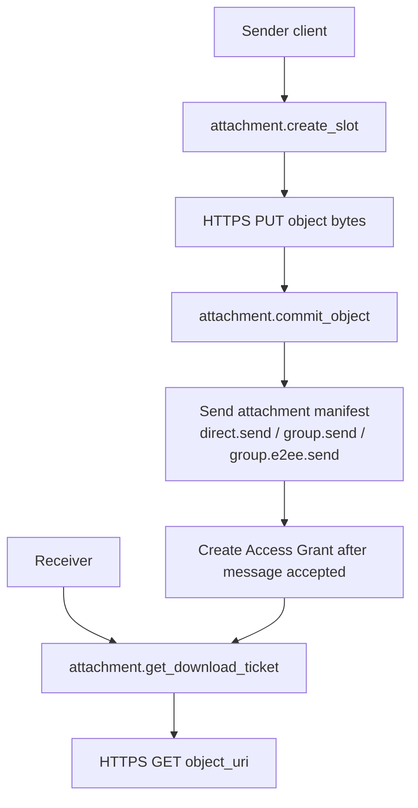
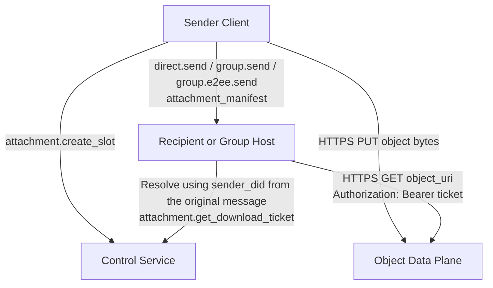
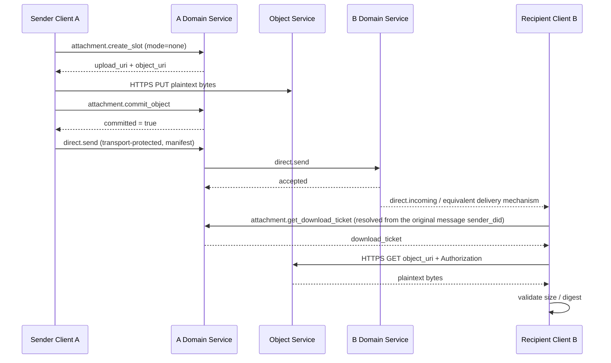
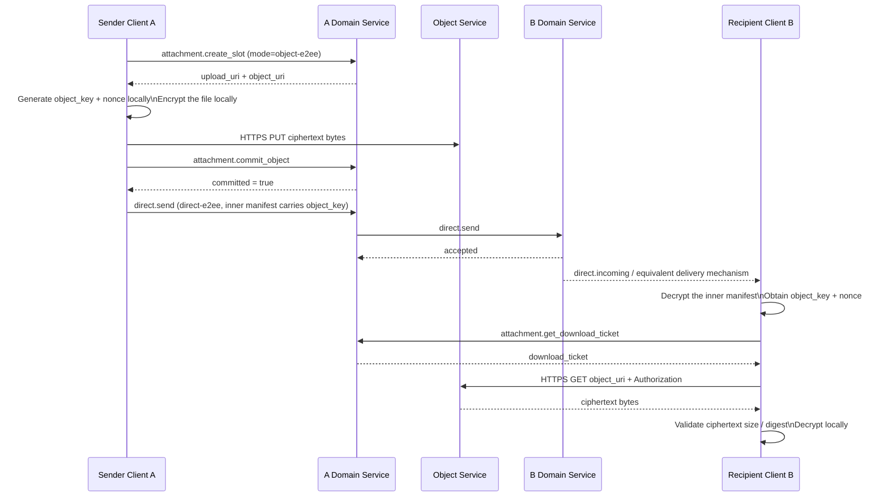
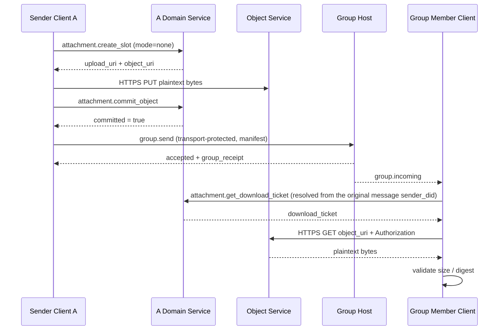
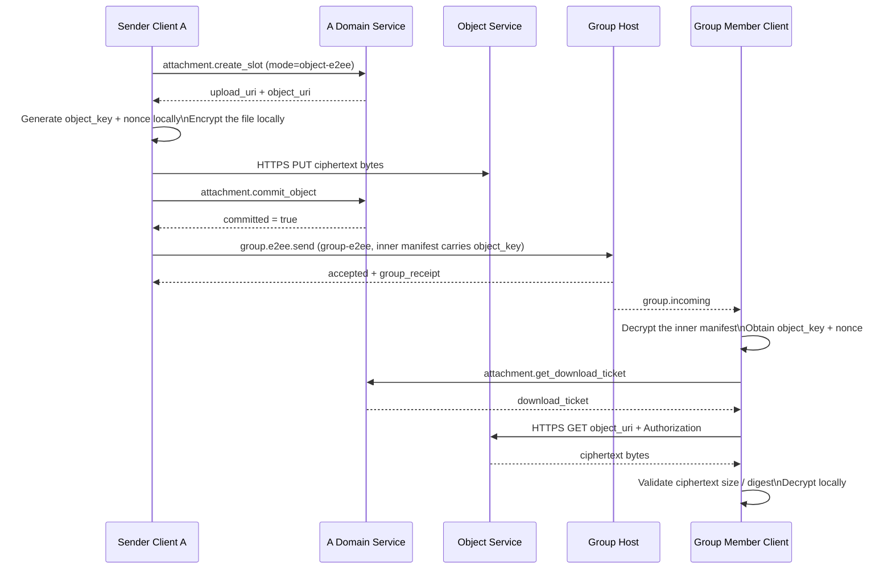
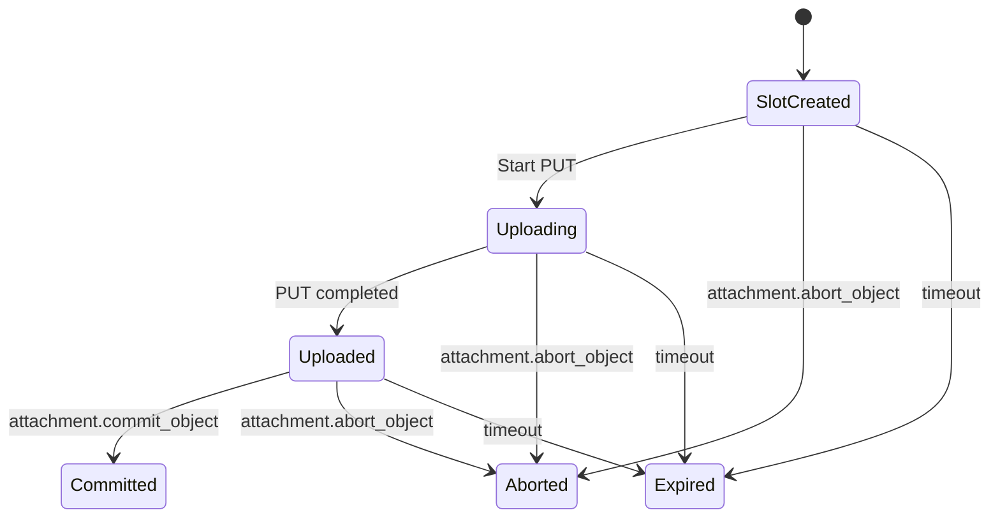

> 日本語参考訳（機械翻訳・未校閲）。規範となるのは原文です。コード例・識別子・規範キーワードは原文を保持しています。
> 原文: [message/07-attachments-and-object-transfer.md](../../message/07-attachments-and-object-transfer.md) / 基準コミット: `0837cfdfaf4ddcf834f0890ddaf34fc4c824e066`

# ANPプロファイル7:添付ファイルとオブジェクト転送

- 文書ID: ANP-P7
- タイトル: 添付ファイルとオブジェクト転送
- ステータス: リリース
- バージョン: 1.2
- 仕様セット: ANP のメッセージング 1.2
- 原文言語: English / このページは日本語参考訳
- 適応性:この仕様は、マルチデバイス境界を定義しながら、v1.1の添付ファイルとオブジェクトのライフサイクルを保存します。通常のアタッチメント操作はDID-スコープを維持し、デバイス上の暗号化された配信はP5またはP6に属します。

---

## 1. 目的:

このプロファイルは、ANPの添付ファイルとオブジェクト転送セマティクスを定義します。

1. 直接メッセージングとグループメッセージで添付ファイルを表現する方法。
2. 統一された持ち運び方法 `attachment_manifest` E2EE と E2EE メッセージ以外のメッセージで
3. 添付送信を3つの層に分割する方法:メッセージ平面、制御面、データ平面;
4. 独立した HTTPS チャネルを使用してオブジェクトのコンテンツをアップロードおよびダウンロードする方法。
5. オブジェクトの場所のURI、短期ダウンロードチケットとオブジェクトレベルの暗号化によるリンク漏れのリスクを減らす方法。
6. オブジェクトコンテンツの完全性検証、アクセス制御、およびオブジェクトレベルの暗号化を実行する方法。
7. 添付オブジェクトとダウンロードチケットは、P5とP6自身のデバイスベースの暗号化された配信中にDID-スコープを維持する方法。
8. v1 ソリューションをクリア、シンプル、実装可能に保つ方法。

このプロファイルは定義しません。

- オブジェクトストレージの内部実装。
- オブジェクトレビューとリスク管理戦略;
- オブジェクトのダウンロードチケット用の特定の暗号化発行形式。
- オブジェクトバイトストリームクロスドメインコールリンクをANPを介して転送します。
- `service-managed` オブジェクトの暗号化モード;
- `wrapped_object_key`、ファイルレベルのキーの一致の議定書、直接リンクのダウンロード、ミラーのURI、インライン ダウンロードの切符および他のフォークされた道;
- 専用のサムネイルサブオブジェクトと専用チャンクリストオブジェクト。
- デバイス固有の添付フィールド、デバイスごとのダウンロードチケット、またはデバイスごとのオブジェクトのライフサイクル。

---

このページの先頭へ `did:wba`, `did:web`ほかの DID メソッドをサポート。 ID の解像度と検証は、 [プチスイム](../../message/02-identity-and-discovery.md#method-validation).

## 2. 用語集と定性キーワード

この記事では、 **MUST**, **MUST NOT**, **REQUIRED**, **SHALL**, **SHALL NOT**, **SHOULD**, **SHOULD NOT**, **RECOMMENDED**, **NOT RECOMMENDED**, **MAY**, **OPTIONAL** 資本金を問わない要件として解釈される。

用語定義:

- **添付ファイル**: ANPメッセージで参照される外部オブジェクトは、そのコンテンツはファイル、イメージ、オーディオ、ビデオ、または任意のバイトストリームであることができます。
- **オブジェクト**: 添付ファイルに対応する実際のバイトコンテンツ。
- **添付メッセージ**: ANP メッセージを 1 つ以上で送信 `attachment_manifest` 第一次ペイロードとして。
- **添付ファイル マニフェスト**: オブジェクトの場所、要約、サイズ、メディアプロパティ、暗号化特性を記述する構造化されたオブジェクト。
- **オブジェクトサービス**: 添付制御平面およびオブジェクトデータ平面のサービスを責任をもって対応可能。
- **コントロールプラン**: 平面のところ `attachment.create_slot`, `attachment.commit_object`, `attachment.abort_object`, `attachment.get_download_ticket` ほかのプロトコルメソッドが配置されています。
- **データプラン**: オブジェクトバイトが独立したHTTPS PUT / GETを介して転送される平面。
- **ご挨拶**: `direct.send`, `group.send`, または `group.e2ee.send` 持ち運び `attachment_manifest` 飛行機。
- **アップロードスロット**: 仮アップロード機能と、送信機が指定したメタデータの場所をアップロードする。
- **コミットされたオブジェクト**: アップロードされたオブジェクトと、メッセージで参照することができます。
- **オブジェクトのURI**: オブジェクトの場所 URI. v1では、公開直接リンクと等しいとは言えない、locatorスタイルのHTTPSリソースアドレスです。
- **チケットダウンロード**: オブジェクトのダウンロード時に利用される一時アクセスチケット。
- **アクセス助成**: 添付ファイルメッセージが正常に送信された後、送信者サービスによって確立されたダウンロード承認レコード。
- **オブジェクトレベルの暗号化**: 輸送層の機密性にのみ頼るよりも、送信者によってローカルで行われるオブジェクトコンテンツの暗号化。
- **オブジェクトキー**: オブジェクトの送信者によって個別に生成されたランダムな対称キー。
- **ノインス**: オブジェクト暗号化で使用されて、v1 MTIの12バイトに固定される長さ。

---

## 3. 設計原則とv1統合決定

### 3.1 3層分離

添付ファイル転送 **MUST** 3面として理解される:

1. **メッセージ側**: 送信する責任のみ `attachment_manifest` 受取人へ
2. **制御平面**: アップロードスロットの申請、オブジェクトの送信、オブジェクトの破棄、ダウンロードチケット発行のみを担当する。
3. **データ平面**: PUT/GET オブジェクトバイトのみの責任を負います。

これら3つの責任 **MUST NOT** 混乱する。 特に:

- コントロール・プランの方法は、添付ファイルを受信者に送信する責任を負わない。
- メッセージ平面は、オブジェクトバイトを中継する責任はありません。
- 業務用メッセージ配信は、データ面が責任を負わない。

### 3.2 v1メインラインパス

標準的な本管道 **MUST** v1 の場合:

1. 送信者コール `attachment.create_slot`;
2. オブジェクトレベルの暗号化が有効になっている場合、送信者は最初にファイルをローカルに暗号化します。
3. 送信者は、オブジェクトを独立 HTTPS を介してアップロードします `PUT`;
4. 送信者コール `attachment.commit_object`;
5. 送信者は添付リストを通します `direct.send`, `group.send`, または `group.e2ee.send`、エンクロージャのプロフィールによって定義されるように;
6. 受信機は公共をパースします `ANPMessageService` 添付リストを運ぶ元のメッセージ送信者のDIDに基づいて、ダウンロードチケットを入手 `attachment.get_download_ticket`;
7. 受信機は独立した HTTPS によって目的をダウンロードします `GET object_uri` チケットを機内に持ち運びます `Authorization` ヘッダー;
8. 受信機は消化器を検証します。オブジェクトが持っている場合 `object-e2ee` 有効化し、復号化と復号化の検証を実行します。

コンクリート制御平面法に入る前に、次の概要はメッセージ平面、制御面、データ平面を接続します。 読者は「オブジェクトが存在する」の3つのステージを区別するのに役立ちます。 「メッセージが送信されました」と、セクション5でシナリオを読むときに「ダウンロードが承認されています」。



*図P7-1: アタッチメント3面フローと承認チェーン(非放射性)の概要。*

この図は、そのことを強調しています `create_slot` / `commit_object` オブジェクトだけを作成します。 実際に受信機にダウンロードできるのは、添付メッセージが受け入れられた後に確立されたアクセス助成金であり、その後のダウンロードチケットの流れです。

### 3.3 2つのオブジェクトモードのみを保持

v1 では、 `encryption_info.mode` **MUST** 以下2つの値のみが許可されます。

- `none`
- `object-e2ee`

`service-managed` **MUST NOT** プロトコルフィールドに表示します。

サーバー側ディスク暗号化、KMS、オブジェクト倉庫静的暗号化など 実装の詳細は、 **MUST NOT** プロトコルの相互運用性モードとしてモデル化します。

### 3.4 メッセージセキュリティとオブジェクトのセキュリティの分離

添付ファイルには2つのセキュリティレベルがあります。

1. **メッセージセキュリティ**: 決定する `transport-protected`, `direct-e2ee`と `group-e2ee` リストを運ぶこと;
2. **オブジェクトセキュリティ**: 決定する `encryption_info.mode`.

v1 のルールは:

- 添付オブジェクト **MUST** 利用条件 `mode = "none"` とりあえず `transport-protected` ホスティング;
- 添付オブジェクト **MAY** 利用条件 `mode = "none"` または `mode = "object-e2ee"` とりあえず `direct-e2ee` または `group-e2ee` ホスティング。

### 3.5 オブジェクトキーは E2EE マニフェストだけを配信

いつか `mode = "object-e2ee"`:

- `object_key_b64u` とりあえず `nonce_b64u` **MUST** 保護された添付ファイルのリストにのみ表示されます `direct-e2ee` または `group-e2ee`;
- `object_key_b64u` とりあえず `nonce_b64u` **MUST NOT** 制御平面の要求で現われて下さい `attachment.create_slot` または `attachment.commit_object`;
- の1 **未定義** 別々のファイルレベルのキー・コンファレンス・プロトコル。

### 3.6 v1 偽造されたパスを明示的に削除

v1 をクリア、シンプル、実装可能に保つためには、次のパスが **なし** プロフィールを入力することができます。

- `service-managed`
- `wrapped_object_key_b64u`
- `key_wrap_alg`
- インラインダウンロードチケット
- カスタムチケット輸送ヘッダー交渉
- 常設の公共直接リンク
- ミラーのURI
- 特化されたチャンクリスト構造
- 専用のサムネイルサブオブジェクト
- ANPビジネスメソッドによるリレーオブジェクトバイト

### 3.7 許可された組合せのマトリックス

| ベアリングモード | `meta.security_profile` | 許可される `encryption_info.mode` | 缶缶缶 `object_key_b64u` リストに表示 |
|---|---|---|---|
| 直接基盤 | `transport-protected` | `none` | ノーザン |
| グループベース | `transport-protected` | `none` | ノーザン |
| 直接E2EE | `direct-e2ee` | `none` / `object-e2ee` | あり あり |
| グループE2EE | `group-e2ee` | `none` / `object-e2ee` | あり あり |

### 3.8 マルチデバイス境界

P7 は既存のオブジェクトとチケットの状態マシンを保持し、デバイスアドレスレイヤーを付加しません。

1. 通常の添付ファイルメッセージ、制御プレーンリクエスト、アクセス付与、ダウンロードチケットは、送信者/リッカーDIDと既存のメッセージ、添付ファイル、オブジェクト、および直接またはグループコンテキストによってスコープ付けられます。 彼らを **MUST NOT** 含まれるもの `sender_device_id`, `recipient_device_id`, `requester_device_id`、または別のデバイスセレクター。
2. 添付ファイルオブジェクトを1つアップロードします。 ドメインローカルマルチデバイスファンアウト **MUST NOT** デバイスごとに標準のP7オブジェクトまたはチケットを作成します。
3. P5は、直接E2EEデバイス選択とデバイスごとの暗号テキスト配信を独占的に定義します。 P6は、MLSデバイスの葉と暗号化された配達のみを定義しています。 P7 は、内部の添付ファイルマニフェストとオブジェクトキーフィールドだけを定義し、デバイス **MUST NOT** Ratchet または MLS プライベートの状態を共有して、それらを配信します。
4. 展開は、認証、ルーティング、または承認のために内部でデバイスコンテキストを使用するかもしれませんが、そのコンテキスト **MUST NOT** P7 ワイヤー分野としてシリアル化される。

---

## 4. プロフィールの同一証明および依存関係

### 4.1 プロフィール名

このプロファイルの標準的な名前は、次のとおりです。

`anp.attachment.v1`

### 4.2 依存関係

プロフィール **MUST** 以下に依存します。

- `anp.core.binding.v1`
- `anp.identity.discovery.v1`

プロフィール **MAY** 次のプロフィールと組み合わせて使用してください。

- `anp.direct.base.v1`
- `anp.group.base.v2`
- `anp.direct.e2ee.v1`
- `anp.direct.e2ee.v2`
- `anp.group.e2ee.v1`
- `anp.group.e2ee.v2`

### 4.3 セキュリティプロファイル

このプロファイル自体は、新しいセキュリティプロファイルを定義しませんが、それを運ぶビジネスプロファイルを再利用します。

- `transport-protected`
- `direct-e2ee`
- `group-e2ee`

---

## 5. 添付ファイル転送フロー図

### 5.1 全体的な階層の流れ図



### 5.2 直接メッセージング/暗号化されていない付属品



### 5.3 直接メッセージング/E2EE の添付ファイル



### 5.4 グループ メッセージング/暗号化されていない添付ファイル



### 5.5 グループ メッセージング/E2EE 添付ファイル



---

## 6. 運送規則:直接メッセージング、グループメッセージング、暗号化、暗号化されていない

### 6.1 直接基地で配られる

添付リストが送信されるとき `anp.direct.base.v1` ビア `direct.send`:

- `meta.profile` **MUST** 等しく `anp.direct.base.v1`
- `meta.security_profile` **MUST** 等しく `transport-protected`
- `meta.content_type` **MUST** 等しく `application/anp-attachment-manifest+json`
- `body.payload` **MUST** 添付メッセージオブジェクト
- `auth.origin_proof` **MUST** 署名された直接ペイロード全体が P3 によって要求されるように存在し、結合します
- それぞれの場所 `attachment_manifest.encryption_info.mode` **MUST** 等しいです `none`

### 6.2 グループベースでキャリー

添付リストが送信されるとき `anp.group.base.v2` ビア `group.send`:

- `meta.profile` **MUST** 等しく `anp.group.base.v2`
- `meta.security_profile` **MUST** 等しく `transport-protected`
- `meta.content_type` **MUST** 等しく `application/anp-attachment-manifest+json`
- `body.payload` **MUST** 添付メッセージオブジェクト
- `auth.origin_proof` **MUST** P4 で要求される署名されたグループペイロード全体に存在し、結合します
- 成功の応答 **SHOULD** 返品 `group_receipt`
- それぞれの場所 `attachment_manifest.encryption_info.mode` **MUST** 等しいです `none`

### 6.3 直接E2EEで運ぶ

添付リストが送信されるとき `anp.direct.e2ee.v1` または `anp.direct.e2ee.v2`:

- セッションの確立後の通常のパスの下、外側 `meta.content_type` **MUST** は、 `application/anp-direct-cipher+json`
- P5で許可されるアプリケーションメッセージパスを最初に運ぶ場合、外部 `meta.content_type` **MAY** は、 `application/anp-direct-init+json`
- 添付ファイルリスト **MUST** 内側のビジネスオブジェクトとして表示されます `Application Plaintext` 暗号化の前に
- 内部の層 `application_content_type` **MUST** 等しく `application/anp-attachment-manifest+json`

### 6.4 グループE2EEで提供

添付リストが送信されるとき `group.e2ee.send` とりあえず `anp.group.e2ee.v1` または `anp.group.e2ee.v2`:

- 外の層 `meta.content_type` **MUST** 固定する `application/anp-group-cipher+json`
- 外の層 `body` **MUST NOT** 直接、クリアテキスト添付リストが表示されます
- 添付ファイルリスト **MUST** 内側のビジネスオブジェクトとして表示されます `Group Application Plaintext` 暗号化の前に
- 内部の層 `application_content_type` **MUST** 等しく `application/anp-attachment-manifest+json`

### 6.5 フィールド所有権

- ダイレクトベースとグループベースの添付メッセージは、プロファイルのDIDまたはグループDIDアドレスを囲むだけを使用します。 P7 はデバイスセレクタを追加しません。
- `attachment_message` とりあえず `attachment_manifest` デバイス識別子は含まないで下さい。
- P5 v2 ダイレクト E2EE エンベロープは、必要な送信者と受信者のデバイスフィールドを運ぶ。P6 v2 MLS のエンベロープは、その必須デバイスの結合を処理します。 外部フィールドはP5やP6のみで解釈されます。 デバイスセレクタはP7で取得しないv1 E2EE封筒。
- `object_key_b64u` とりあえず `nonce_b64u` 暗号化された添付ファイルマニフェストの中に残っています。 P7は、別々のデバイスキーディストリビューションリクエストを導入しません。

---

## 7. `attachment_message` とりあえず `attachment_manifest` オブジェクト

### 7.1 添付ファイル メッセージトップレベル構造

添付メッセージの推奨構造は次のとおりです。

```json
{
  "attachments": [
    {
      "attachment_id": "att-001",
      "filename": "report.pdf",
      "mime_type": "application/pdf",
      "size": "1048576",
      "digest": {
        "alg": "sha-256",
        "value_b64u": "BASE64URL_DIGEST"
      },
      "access_info": {
        "object_uri": "https://objects.example.com/objects/obj-001"
      },
      "encryption_info": {
        "mode": "none"
      }
    }
  ],
  "caption": "Attachment description",
  "primary_attachment_id": "att-001"
}
```

ルール:

- `attachments` **MUST** 存在して空にしない
- `caption` **MAY** 存在している
- `primary_attachment_id` **MAY** 存在;それが存在する場合、 **MUST** 既存のポイント `attachment_id` でん `attachments`

### 7.2 `attachment_id` スコープ

- `attachment_id` **MUST** 単一の添付ファイルメッセージ内で一意に
- `attachment_id` **保証なし** メッセージを一堂に、世界一のユニークであること
- チケットのバインディング、承認レコード、または監査記録をダウンロードします。 **MUST** 利用条件 `(message_id, attachment_id)` または `(object_uri, message_id, attachment_id)`, だけでなく、 `attachment_id`

### 7.3 シングル `attachment_manifest`

とりあえず `attachment_manifest` **MUST** 含まれるもの:

- `attachment_id`
- `mime_type`
- `size`
- `digest`
- `access_info`
- `encryption_info`

とりあえず `attachment_manifest` **MAY** 含まれるもの:

- `filename`
- `media_info`

フィールドの説明:

- `filename`: ファイル名を表示 **MAY**
- `mime_type`: 元のファイルの MIME タイプ; **MUST**
- `size`: オブジェクトバイトサイズ、小文字文字列をアップロードする。 **MUST**
- `digest`: オブジェクトバイトのサマリーをアップロードする。 **MUST**
- `access_info`: オブジェクトのダウンロード位置情報; **MUST**
- `encryption_info`: オブジェクトレベルの暗号化メッセージ; **MUST**
- `media_info`: 写真、オーディオ、ビデオなどのメディアオブジェクトの補足説明。 **MAY**

### 7.4 `digest`

`digest` **MUST** 含まれるもの:

- `alg`
- `value_b64u`

ルール:

- `digest.alg` v1 で **MUST** 固定する `sha-256`
- `digest.value_b64u` **MUST** アップロードオブジェクトバイトのSHA-256ダイジェストになります
- いつか `encryption_info.mode = "none"`、消化器は平文のバイトに相当します
- いつか `encryption_info.mode = "object-e2ee"`、消化は暗号文バイトに相当します

### 7.5 `access_info`

構造の `access_info` 以下は、

```json
{
  "object_uri": "https://objects.example.com/objects/obj-001"
}
```

ルール:

1. `object_uri` **MUST** なるほど `https://` ページの先頭へ
2. `object_uri` v1 のロケータスタイルのオブジェクトアドレスを表します。永久的な公開直接リンクではありません
3. 受信機 **MUST** コール `attachment.get_download_ticket` ダウンロード前に
4. 受信機 **MUST** パブリックを解析する `ANPMessageService` 添付リストを運ぶ元のメッセージ送信者のDIDに基づいて。
5. グループシナリオでは、上記のオリジナルメッセージ送信者DID **MUST** 添付リストを運ぶ元のグループメッセージ送信機から取られる(例: `group.incoming.meta.sender_did`)
6. `attachment.get_download_ticket` **MUST** 送信先へ `serviceDid` 送信者の公開サービスに対応。
7. 受信機のダウンロード時, **MUST** トピックス `GET` に へ へ へ へ へ へ へ へ へ へ へ へ へ へ へ へ へ へ へ へ へ `object_uri` チケットを機内に持ち運びます `Authorization` ヘッダー。
8. 呼び出し者 **MUST NOT** URL ドメイン名に基づいて制御平面サービスが推測されるだけ `object_uri`

### 7.6 `media_info`

`media_info` 映像、音声、動画などのメディアオブジェクトに適しています。 推奨分野:

- `width`
- `height`
- `duration_ms`
- `codec`

数値フィールドが存在する場合、 **MUST** 正規の文字列を使用します。

### 7.7サムネイルとチャンク

v1 は専用のものを定義しません。 `thumbnail` フィールド、または、専用の定義を定義する `chunking_info` フィールド。

サムネイルが必要な場合は、送信者 **SHOULD** サムネイルを通常の添付ファイルとして送信します。

大きいファイルがチャンクにアップロードする必要がある場合、 **SHOULD** HTTPアップロード実装内で内部で行われる。このプロファイルのマニフェスト構造は変更されません。

---

## 8. オブジェクトレベルの暗号化

### 8.1 `encryption_info`

`encryption_info` **MUST** 次の2つの構造の1つになります。

暗号化されていないオブジェクト:

```json
{
  "mode": "none"
}
```

オブジェクトレベルの暗号化オブジェクト:

```json
{
  "mode": "object-e2ee",
  "object_cipher": "chacha20-poly1305",
  "object_key_b64u": "BASE64URL_32_BYTES",
  "nonce_b64u": "BASE64URL_12_BYTES",
  "plaintext_size": "1048576"
}
```

ルール:

1. `mode` **MUST** いずれかの `none` または `object-e2ee`
2. `mode = "none"` 送信者は、オブジェクトコンテンツをローカルに暗号化しなかったことを示します。
3. `mode = "object-e2ee"` つまり、送信者は最初にオブジェクトをローカルに暗号化し、暗号化されたテキストバイトをアップロードすることを意味します。
4. インフォメーション `transport-protected` ホスティング, `mode` **MUST** は、 `none`
5. `object_key_b64u` とりあえず `nonce_b64u` **MUST NOT** 持ち運びする添付ファイルの一覧に表示 `transport-protected`
6. `service-managed`、キーラッピングアルゴリズムとファイルレベルのキー契約は、このプロファイルに所属しません

### 8.2 MTIアルゴリズム `object-e2ee`

とりあえず `object-e2ee` MTIアルゴリズム **MUST** v1 の場合:

- `object_cipher = "chacha20-poly1305"`
- `object_key_b64u`: 32バイトのランダム対称キー
- `nonce_b64u`: 12バイトランダム nonce
- `plaintext_size`: バイト、小数文字列の元のファイル長さ

### 8.3 送信者の暗号化手順(仮)

いつか `encryption_info.mode = "object-e2ee"`、送信者 **MUST** 次の手順を実行します。

1. 元のファイルバイトを、記録したように読みます `P`
2. 新規ランダム32バイトオブジェクトキーを生成する `K`
3. ランダム12バイトのnonceを生成 `N`
4. とりあえず `AAD = empty byte string`
5. 計算:

```text
C = ChaCha20-Poly1305-Encrypt(
      key = K,
      nonce = N,
      aad = "",
      plaintext = P
    )
```

6. オブジェクトは、Object サービスにアップロードされたバイト **MUST** は、 `C`
7. `attachment_manifest.size` **MUST** と等しい非相続文字列である `len(C)`
8. `attachment_manifest.digest` **MUST** 等しく `sha-256(C)`
9. `encryption_info.plaintext_size` **MUST** と等しい非相続文字列である `len(P)`
10. `mime_type` **MUST** 今後も、暗号文オブジェクトMIME型ではなく、元のファイルのMIMEタイプを表現し続けます。

追加要件:

- 各コミットされたオブジェクト **MUST** ランダムに新しい使用 `K`
- カレンダー **MUST NOT** 同じ再利用 `(K, N)` 組み合わせ
- 同じファイルの内容が繰り返し送信される場合でも、送信者 **SHOULD** 新しく再生する `K` とりあえず `N`
- `object_key_b64u` **MUST NOT** P5のラチェットキーから直接取られた、また **MUST NOT** P6のMLS epochの秘密または他のセッションキーから直接取られた

### 8.4 `expected_size` とりあえず `plaintext_size`

インフォメーション `chacha20-poly1305` v1 MTI の場合:

- オブジェクトサイズをアップロード = 元ファイルサイズ + 16バイト認証タグ
- 送信者が記入した場合 `expected_size` でん `attachment.create_slot`, 値 **SHOULD** アップロードオブジェクトのサイズではなく、元のファイルサイズにポイント
- 場合 `mode = "object-e2ee"`、送信者 **SHOULD** 元のファイルサイズをローカルに保存して、 `encryption_info.plaintext_size` 後で書くことができます

### 8.5 受信機の検証と復号化手順(仮)

受信機がオブジェクトバイトを取得するとき:

1. **MUST** ダウンロードしたバイトの長さが等しいことを最初に確認します `attachment_manifest.size`
2. **MUST** 計算 `sha-256(downloaded bytes)` とそれを比較して下さい `attachment_manifest.digest`
3. 場合 `encryption_info.mode = "none"`、それは成功した確認の後で上部の層に渡ることができます。
4. 場合 `encryption_info.mode = "object-e2ee"`、受信機 **MUST** 使用:

```text
P = ChaCha20-Poly1305-Decrypt(
      key = object_key_b64u,
      nonce = nonce_b64u,
      aad = "",
      ciphertext = downloaded_bytes
    )
```

5. 復号が失敗した場合、受取人が **MUST** 添付ファイルを拒否する
6. 復号化が成功すると、受信機 **MUST** かどうかを検証する `len(P)` 等しいです `plaintext_size`
7. 検証を渡すと、受信機は上層ビジネスに平文バイトを渡すことができます

### 8.6 オブジェクトのキー配布ルール

v1 の標準的なオブジェクトキー配布パスは 1 つだけあります。

- 添付メッセージ自体が保護されるとき `direct-e2ee` または `group-e2ee`、送信者 **MAY** 直接入れる `object_key_b64u` とりあえず `nonce_b64u` 内側に `attachment_manifest`
- 受信機がE2EEメッセージからオブジェクトキーを取得した後、制御面でチケットを取得し、データ平面を介して暗号文オブジェクトをダウンロードします。

つまり、

- の1 **必要性無し** 添付ファイル用に別々に複雑なキー合意プロトコルを設計する
- グループシナリオでは、グループメッセージの復号化が可能な人はオブジェクトキーを取得できます。
- の1 **未保証** 権利の遡及的撤退; グループから削除されたメンバーが以前にオブジェクトキーとオブジェクトコンテンツを取得している場合、この仕様は、その後取得した情報を削除することを約束しません。

---

## 9. アクセス許可・ダウンロードチケット

### 9.1 チケット対象

ダウンロードチケットの目的は、正当な受取人が転送を防止するものではありませんが、次のことを目的としています。

1. リストに基づいてオブジェクトを直接ダウンロードするから、第三者を防ぐ
2. 防腐剤 `object_uri` 長期間の公共リンクになるから
3. リクエストとメッセージのコンテキストへのダウンロード権限を制約する
4. 監査の実施、制限率の制限、およびオブジェクトサービスのキャンセルのための開始点を提供

### 9.2 アクセス助成金

`attachment.create_slot` とりあえず `attachment.commit_object` は、 **のみ** オブジェクトの作成に責任があり、任意の受信者にダウンロード権限を付与しません。

送信者メッセージの受信者によるダウンロードのためにオブジェクトが利用可能である場合、 **MUST** アクセス助成金により決定します。

いつか `direct.send`, `group.send`, または `group.e2ee.send` 添付ファイルを取り扱うことは、送信者サービスまたはグループホスト、送信者側システムによって受け入れられます **MUST** 各添付ファイルごとにアクセス付与を行います。

アクセス助成金 少なくとも **MUST** bind:: ディレクティブ

- `message_id`
- `attachment_id`
- `object_uri`
- `message_security_profile`
- `message_target_did` 直接メッセージングのコンテキストで;または `group_did` グループメッセージングのコンテキスト

アクセス・グラントは、対象となるDIDやグループ・コンテクストをローカルデバイスではなく、許可します。 ドメインローカルデバイスデリバリーは、実装の細部を残します。

### 9.3 境界の `intended_target`

`attachment.create_slot.body.intended_target` 送信者のアップロードフェーズのポリシーヒントです。

`intended_target`:

- **MAY** オブジェクトサービスでサイズ、種類、または保持ポリシーの決定を事前に行なうために使用される
- **MUST NOT** ダウンロード許可のベースとしてのみ使用

実際のダウンロード承認ベース **MUST** アクセス助成金を正常に送信しました。

### 9.4 チケットの結合

v1で、チケットをダウンロード **MUST** 少なくとも次のコンテキストをバインドします。

- `attachment_id`
- `object_uri`
- `requester_did`
- `message_id`
- `message_security_profile`
- `message_target_did` 直接メッセージングのコンテキストで;または `group_did` グループメッセージングのコンテキスト
- `expires_at`

標準的な切符の結合 **MUST NOT** 含まれるもの `requester_device_id` または別のデバイスセレクター。 配布は、チケットを発行する前にローカルデバイスの状態を使うかもしれませんが、その状態はP7ワイヤーやチケット結合フィールドになりません。

### 9.5 チケットの生涯と使用

- チケットダウンロード **SHOULD** 短期券は
- デフォルト有効期間 **SHOULD NOT** 超過5分
- 非常に敏感な主題のために **MAY** 使い捨てチケットを使用する
- チケットダウンロード **MUST** 送信する HTTP 経由で `Authorization` ヘッダー
- チケットダウンロード **MUST NOT** URL クエリパラメータで実行

v1 の固定ダウンロード方法は:

```http
GET {object_uri}
Authorization: Bearer {download_ticket}
```

### 9.6 チケット発行の有効化

オブジェクト制御サービスが処理する際 `attachment.get_download_ticket`, **MUST** チェック:

1. `meta.target.kind = "service"`
2. `meta.target.did` **MUST** 公益者と等しい `ANPMessageService.serviceDid` 元の添付ファイルの送信元DIDから解決しました。
3. `requester_did = meta.sender_did`
4. アクセス助成金は、 `(message_id, attachment_id, object_uri)` 存在している
5. `message_security_profile` アクセス助成金と一貫して
6. 直接メッセージングコンテキストが使用されるとき、 `message_target_did` 方針を遵守し、
7. グループメッセージングコンテキストが入力されると、 `group_did` 存在し、 `requester_did` 現在、グループアクセスポリシーに依って依存しています

P7 は、この検証のために、リクエストデバイスセレクタを必要としません。 ローカルデバイス認証は、相互運用可能なリクエストの外に残っています。

### 9.7 クロスサービス同期

の1 **別々に標準化されない** 複数の内部サービス間のアクセスの補助同期プロトコル。

デフォルトv1パスでは、ダウンロードチケットは発行されます `ANPMessageService` 添付メッセージの元の送信者によって露出される。 パブリックサービスエントリーが内部で独立したオブジェクトサービスにルーティングするかどうかは、実装の詳細です。 デプロイメントがオブジェクト制御コンポーネントを内部に分離する場合、実装 **MUST** 外部から公開されたサービスは、ローカルの状態または内部同期からダウンロードチケットを発行するために必要なアクセス付与を取得できるようにします。

### 9.8 メンバー変更後のアクセス境界

の1 **反復的な退会は保証しません**.

つまり、

- オブジェクトサービス **SHOULD** 現在のグループの状態に基づいて削除されたメンバーに新しいダウンロードチケットを発行することを拒否する
- しかし、オブジェクトバイト、オブジェクトキー、またはダウンロードしたコンテンツが以前に正当なメンバーに達した場合、この仕様 **約束しない** 取得したアクセス機能を再考する

P7 のもう一つの重要な境界は、オブジェクトの存在がオブジェクトのダウンロード性を阻害しないということです。 以下の図は、オブジェクトのコミットメント、メッセージの受け入れ、アクセス付与の作成、チケット発行、最終ダウンロードを1つの承認チェーンに接続し、その実装者は正しくアクセス制御を適用できるようにします。

```mermaid
sequenceDiagram
participant S as Sender service
participant O as Object Service
participant M as Message plane
participant R as Receiver

S->>O: create_slot / commit_object
Note over S,O: Only creates the object; does not create download authorization

S->>M: direct.send / group.send / group.e2ee.send attachment manifest
M-->>S: message accepted
S->>S: Create Access Grant for each attachment

R->>S: attachment.get_download_ticket
S->>S: Validate requester_did + message_id + attachment_id + object_uri
S-->>R: download_ticket

R->>O: GET object_uri + Authorization
```

*図P7-2:アクセス付与とダウンロードチケット(非定着)の認可チェーン。*

そのため、承認申請書の承認 `attachment.get_download_ticket` だけでなく、メッセージのコンテキストやアクセスグラントに依存する必要があります。 `object_uri` またはのみ `intended_target` アップロードステージの左から左へ。

### 9.9 エージェントID移行後の履歴アクセス助成

歴史・歴史 `attachment_manifest` オブジェクトとアクセスの助成金 **MUST NOT** エージェント DID が変更されたときに書き換えられます。

直接メッセージアクセス付与名が以前の受信者DIDと現在のリクエスト者が、その成功者DIDを提示した場合、オブジェクトサービス **MAY** 助成金のDIDからP2移行を検証した後にのみ、同じ内部の付与を要求するマップ `requester_did` 保有する事業方針は、返済保証を承諾します。 かわい `provider_asserted` 歴史的添付ファイルへのアクセスを継承するのに十分である。P7は受諾や拒絶を強制しない。

マッピングは内部です。 プッシー **MUST NOT** 過去のマニフェスト、アクセス・グラント、チケット、またはコントロールプレーンリクエストに安定したサブジェクトフィールド、名前、トランジションチェーン、またはデバイスセレクタを追加します。 グループ添付の場合、現在のP4 v2 のロスター、グループポリシー、元のメッセージコンテキストに基づいて承認が残されます。

---

## 10. 制御計画方法

### 10.1 全般

このセクションのメソッドはオブジェクト制御平面に使用されます。 彼らを **なし** 変更点 `direct.send`, `group.send`, または `group.e2ee.send` 成功のセマンティクス。

これらのメソッドはデフォルトで実行します。

- `meta.profile = "anp.attachment.v1"`
- `meta.security_profile = "transport-protected"`

そして次の認証モデルを採用します:

1. `attachment.create_slot`
2. `attachment.commit_object`
3. `attachment.abort_object`
4. `attachment.get_download_ticket`

所属する全ての人 **サービススコープ** 制御計画方法。

したがって:

- `meta.target.kind` **MUST** 等しく `service`
- `meta.target.did` **MUST** 等しいターゲット 公共 `ANPMessageService.serviceDid`
- 外部層認証はP8から提供 `serviceDid + HTTP Message Signatures`
- v1 は **なし** オブジェクトサービスがエンドの受信者を再検証する必要 `origin_proof`

これらのメソッド **MUST NOT** とりあえず `sender_device_id`, `recipient_device_id`, または `requester_device_id` P7ワイヤー モデルに。 内部デバイス認証とルーティングコンテキストは、デプロイにプライベートのままです。

実装者が簡単に見落とす制御平面のディテールは、アップロードスロットとコミュートオブジェクトが同じ状態ではないことです。 以下は、ライフサイクルの生成、アップロード、コミット、中止、および有効期限をいいます。



*図 P7-3: スロット/オブジェクトのライフサイクル(非放射性)をアップロードします。*

実装は「達成する」解釈してはならない `object_uri`「オブジェクトは既にメッセージで参照できる」 オブジェクトが入るのに過ぎてから `Committed` 状態は、添付マニフェストによる法的参照の資格となります。

### 10.2 `attachment.create_slot`

#### 10.2.1 科学

アップロードするオブジェクトのアップロードスロットを適用する。

#### 10.2.2 要求の要件

メソッド **MUST** 使用:

- `meta.target.kind = "service"`
- `meta.target.did = target public ANPMessageService.serviceDid`

`body` **MUST** 含まれるもの:

- `attachment_id`
- `intended_message_security_profile`
- `object_encryption_mode`

`body` **SHOULD** 含まれるもの:

- `expected_size`
- `mime_type`

`body` **MAY** 含まれるもの:

- `filename`
- `expected_digest`
- `intended_target`

フィールドルール:

- `attachment_id`: 文字列
- `intended_message_security_profile`: `transport-protected` / `direct-e2ee` / `group-e2ee`
- `object_encryption_mode`: `none` / `object-e2ee`
- `expected_size`: バイト、小文字の文字列にオブジェクトサイズをアップロードする
- `expected_digest`: アップロードオブジェクトバイトの要約
- `intended_target`: オブジェクト;推奨構造は次のとおりです。

```json
{
  "kind": "agent | group",
  "did": "did:example:..."
}
```

制約:

1. いつか `intended_message_security_profile = "transport-protected"`, `object_encryption_mode` **MUST** は、 `none`
2. いつか `object_encryption_mode = "object-e2ee"`, `expected_size` **SHOULD** 暗号テキストバイトサイズに対応
3. `intended_target` ヒントは、 **MUST NOT** 単独で許可を構成します。

#### 10.2.3 成功の応答

成功する応答 **MUST** 少なくとも:

- `attachment_id`
- `slot_id`
- `upload_uri`
- `object_uri`
- `commit_token`
- `expires_at`

成功する応答 **MAY** 含まれるもの:

- `upload_headers`

送信者がその後に構築したときに `attachment_manifest.access_info`, `object_uri` **SHOULD** 直接から取られる `attachment.create_slot` または `attachment.commit_object`'s Successful Response; ダウンロードする前に、受信機はこのプロフィールの規定に従い、元の添付ファイルメッセージ送信者のDIDに基づいてチケットサービスを発見します。

### 10.3 `attachment.commit_object`

#### 10.3.1 統計学

オブジェクトサービス:オブジェクトがアップロードされ、参照可能なオブジェクトとして送信することができます。

#### 10.3.2 要求の要件

メソッド **MUST** 使用:

- `meta.target.kind = "service"`
- `meta.target.did = target public ANPMessageService.serviceDid`

`body` **MUST** 少なくとも:

- `attachment_id`
- `slot_id`
- `commit_token`
- `size`
- `digest`
- `object_encryption_mode`

`body` **MAY** 含まれるもの:

- `plaintext_size`
- `media_info`

ルール:

1. `digest.alg` **MUST** 等しく `sha-256`
2. いつか `object_encryption_mode = "object-e2ee"`, `plaintext_size` **MUST** 存在している
3. `attachment.commit_object` **MUST NOT** 送信する `object_key_b64u`
4. `attachment.commit_object` **MUST NOT** 送信する `nonce_b64u`
5. `attachment.commit_object` 成功事例 **等しくない** 受信者は、オブジェクトをダウンロードするために許可されています。実際のダウンロード承認は、その後のメッセージが正常に送信された後にアクセス付与に依存します。

#### 10.3.3 成功の応答

成功する応答 **MUST** 少なくとも:

- `committed`
- `attachment_id`
- `object_uri`
- `committed_at`

それらの中で:

- `committed` **MUST** なる `true`

### 10.4 `attachment.abort_object`

#### 10.4.1 科学

不完全または不要のアップロードスロットを除外します。

#### 10.4.2 要求の要件

メソッド **MUST** 使用:

- `meta.target.kind = "service"`
- `meta.target.did = target public ANPMessageService.serviceDid`

`body` **MUST** 少なくとも:

- `attachment_id`
- `slot_id`

#### 10.4.3 成功の応答

成功する応答 **MUST** 少なくとも:

- `aborted`
- `attachment_id`
- `aborted_at`

それらの中で:

- `aborted` **MUST** なる `true`

### 10.5 `attachment.get_download_ticket`

#### 10.5.1 統計学

オブジェクトアクセスがチケットを必要とする場合、このメソッドで一時的にダウンロードチケットを取得できます。

#### 10.5.2 要求の要件

メソッド **MUST** 使用:

- `meta.target.kind = "service"`
- `meta.target.did` **MUST** 公益者と等しい `ANPMessageService.serviceDid` 元の添付ファイルメッセージ送信者DIDから解決

`body` **MUST** 少なくとも:

- `attachment_id`
- `object_uri`
- `requester_did`
- `message_security_profile`
- `message_id`

コンテキストに従って 1 つを追加します。

- 直接メッセージングコンテキスト: `message_target_did`
- グループメッセージングコンテキスト: `group_did`

`body` **MAY** 含まれるもの:

- `one_time`

このメソッドは、何も定義しません `requester_device_id` または同等のデバイスセレクター。

フィールドルール:

- `requester_did` **MUST** 等しく `meta.sender_did`
- `message_security_profile` 添付リストを運ぶメッセージセキュリティプロファイルを参照します。, ないです `meta.security_profile` 今回は制御面で呼びます。
- `message_target_did` 元の直接メッセージングメッセージのターゲットエージェントDIDを参照
- `group_did` 元のグループメッセージが属するグループDIDを参照して下さい
- チケットリクエストを送信する前に、発信者 **MUST** 最初にその公開を主張する `ANPMessageService` 元の添付ファイルメッセージ送信者のDIDに基づいて、グループシナリオでは、DIDは元のグループメッセージ送信者から取られ、 `group_did`

#### 10.5.3 応答の成功

成功する応答 **MUST** 少なくとも:

- `download_ticket_b64u`
- `expires_at`
- `ticket_binding`

`ticket_binding` **MUST** 少なくとも:

- `attachment_id`
- `object_uri`
- `requester_did`
- `message_id`
- `message_security_profile`

コンテキストに従って 1 つを追加します。

- `message_target_did`
- `group_did`

`ticket_binding` **MUST NOT** デバイス識別子を追加します。

---

## 11. データプラン規則

### 11.1 アップロード

送信者 **MUST** トピックス `PUT` に へ へ へ へ へ へ へ へ へ へ へ へ へ へ へ へ へ へ へ へ へ `upload_uri` 別の HTTPS チャネルを使用して。

ルール:

- いつか `object_encryption_mode = "none"`, アップロード プレーンテキストスタンザ
- いつか `object_encryption_mode = "object-e2ee"`, アップロードする ciphertext bytes
- アップロードリクエスト **MAY** 持ち運び `upload_headers`
- オブジェクトバイト **MUST NOT** ANPのJSON-RPCビジネスメッセージに埋め込まれた

### 11.2 ダウンロード

受信機 **MUST** トピックス `GET` に へ へ へ へ へ へ へ へ へ へ へ へ へ へ へ へ へ へ へ へ へ `object_uri` 別の HTTPS チャネルを使用して。

固定形式は以下の通りです。

```http
GET {object_uri}
Authorization: Bearer {download_ticket}
```

オブジェクトバイト **MUST NOT** ANPのクロスドメインサービスの呼び出し経路を定期転送チャネルとして転送します。

標準的なベアラーのダウンロード要求はP7装置セレクターか装置の証拠を持っていません。 デバイスが制約されたチケットスキームは、任意の場合は、別のプロファイルが必要です。

### 11.3 ダウンロード後の検証

ダウンロードが完了したら、受信機 **MUST** 少なくとも次のチェックを実行します。

1. 長期間の検証
2. ダイジェスト検証
3. 場合 `mode = "object-e2ee"`、復号化を実行し、 `plaintext_size` 認証

鍵チェックが失敗すると、受信機:

- **MUST NOT** オブジェクトを高層化したアプリケーションに有効な添付ファイルとして提供
- **SHOULD** ログ診断情報

---

## 12. エラー条件と推奨エラーコード

このプロフィールは固定に割り当てます `6000-6013` 添付ファイルとオブジェクト転送エラーのコードセグメント。 サーバがこのエラーを返すとき、 `error.data.anp_code` **MUST** 存在します。

| `code` | `anp_code` | 意味する |
|---|---|---|
| 6000 | `anp.attachment.slot_not_found` | 利用可能なアップロードスロットが見つかりません。 `slot_id` 現在のコンテキストにマッチしない |
| 6001 | `anp.attachment.slot_expired` | アップロードスロットが期限切れで、アップロード、提出または廃棄することはできません |
| 6002 | `anp.attachment.commit_token_invalid` | 投稿トークンが欠落している、違法、検証に失敗したり、現在のオブジェクトのコンテキストと一致しない |
| 6003 | `anp.attachment.object_too_large` | オブジェクトサイズは、サービス制限、ポリシー制限を超えたり、許可された範囲を超える |
| 6004 | `anp.attachment.unsupported_mime_type` | `mime_type` 現行サービスまたはポリシーにより、受理されない |
| 6005 | `anp.attachment.grant_not_found` | 対応するアクセス付与が見つかりませんでした。または、ダウンロード許可が確立されていないとメッセージが記載されました |
| 6006 | `anp.attachment.unauthorized_requester` | 流れ `requester_did` ダウンロードポリシー、ターゲット制約、またはグループアクセス制限を満たしていない |
| 6007 | `anp.attachment.download_ticket_invalid` | チケットのダウンロードは、違法で、署名を検証できなかったり、解析できないか、無効にされている |
| 6008 | `anp.attachment.ticket_binding_mismatch` | チケットをダウンロード 境界オブジェクト、メッセージ、または要求のコンテキストは実際のリクエストと矛盾しています |
| 6009 | `anp.attachment.ticket_expired` | チケットのダウンロード期限が切れました |
| 6010 | `anp.attachment.digest_mismatch` | アップロードまたはダウンロード後のオブジェクト消化は、予想される消化器と矛盾しています |
| 6011 | `anp.attachment.decrypt_failed` | `object-e2ee` オブジェクトの復号化が失敗しました |
| 6012 | `anp.attachment.object_unavailable` | オブジェクトは、未提出のものではなく、放棄されたもの、清掃されているか、一時的に利用できなくなった |
| 6013 | `anp.attachment.encryption_policy_violation` | オブジェクト暗号化モードとメッセージセキュリティプロファイルの組み合わせは違法です。またはこのプロファイルの制約を侵害します |

デバイス結合エラーはP5またはP6に所属し、 **MUST NOT** 通常のP7リクエストでデバイスセレクタを要求するために使用される。

エラー応答 **SHOULD** 提供場所 `error.data`:

- `attachment_id`
- `slot_id`
- `object_uri`
- `message_id`
- `expected_digest`

## 13. 最小相互運用性要件

このページの先頭へ MUST 少なくともサポート:

1. `attachment.create_slot`
2. `attachment.commit_object`
3. `attachment.abort_object`
4. `attachment.get_download_ticket`
5. `application/anp-attachment-manifest+json`
6. `attachment_message.attachments`
7. `attachment_manifest`'s's の `attachment_id`, `mime_type`, `size`, `digest`, `access_info`, `encryption_info`
8. `access_info.object_uri`
9. 詳しくはこちら `attachment.get_download_ticket` 元の添付ファイルメッセージ送信機DIDに基づくターゲットサービス
10. `digest.alg = sha-256`
11. スタンドアローン HTTPS `PUT upload_uri`
12. スタンドアローン HTTPS `GET object_uri`
13. `Authorization: Bearer {download_ticket}` ダウンロードモード
14. 全て すべて `attachment.*` 制御計画法は、 `target.kind = "service"`
15. ANPビジネスメッセージや、クロスドメインサービスの呼び出しパスを経由してオブジェクトバイトは転送されません
16. `mode = "none"` とりあえず `transport-protected`
17. 通常のP7マニフェスト、制御プレーンリクエスト、アクセスグランス、ダウンロードチケットはデバイスセレクターを必要としません
18. 歴史的アクセス助成金は、過去のワイヤオブジェクトを書き換えることなく、P2移行検証とビジネスポリシーの受諾後だけ成功したDIDにマップすることができます

E2EE 添付ファイルをサポートする実装の要求があった場合、 MUST も:

19. 支援サービス `mode = "object-e2ee"`
20. サポート `chacha20-poly1305` このプロファイルで指定されたオブジェクト暗号化プロセス
21. デリブ `object_key_b64u` とりあえず `nonce_b64u` P5またはP6によって保護されるE2EEの添付ファイルマニフェストの中; デバイス選択は、そのオーバーレイによって所有残されます
22. オブジェクトのダウンロード後に暗号テキストの消化確認とローカルの復号を実行します
23. 「v1」のアクセス境界をクリアに遵守することは、権利の遡及的撤退を保証するものではありません。

---

## 14. 事例紹介

### 14.1 `attachment.create_slot` リクエスト例

```json
{
  "jsonrpc": "2.0",
  "id": "req-70001",
  "method": "attachment.create_slot",
  "params": {
    "meta": {
      "profile": "anp.attachment.v1",
      "security_profile": "transport-protected",
      "sender_did": "did:example:agent-a",
      "target": {
        "kind": "service",
        "did": "did:example:domain-a"
      },
      "operation_id": "op-70001",
      "created_at": "2026-03-29T14:00:00Z"
    },
    "body": {
      "attachment_id": "att-001",
      "expected_size": "1048592",
      "mime_type": "application/pdf",
      "filename": "report.pdf",
      "intended_message_security_profile": "direct-e2ee",
      "intended_target": {
        "kind": "agent",
        "did": "did:example:agent-b"
      },
      "object_encryption_mode": "object-e2ee"
    }
  }
}
```

### 14.2 `attachment.create_slot` 成功事例

```json
{
  "jsonrpc": "2.0",
  "id": "req-70001",
  "result": {
    "attachment_id": "att-001",
    "slot_id": "slot-70001",
    "upload_uri": "https://objects.example.com/upload/slot-70001",
    "upload_headers": {
      "Content-Type": "application/octet-stream"
    },
    "object_uri": "https://objects.example.com/objects/obj-abc",
    "commit_token": "ct-abc-123",
    "expires_at": "2026-03-29T14:15:00Z"
  }
}
```

### 14.3 `attachment.commit_object` リクエスト例

```json
{
  "jsonrpc": "2.0",
  "id": "req-70002",
  "method": "attachment.commit_object",
  "params": {
    "meta": {
      "profile": "anp.attachment.v1",
      "security_profile": "transport-protected",
      "sender_did": "did:example:agent-a",
      "target": {
        "kind": "service",
        "did": "did:example:domain-a"
      },
      "operation_id": "op-70002",
      "created_at": "2026-03-29T14:03:00Z"
    },
    "body": {
      "attachment_id": "att-001",
      "slot_id": "slot-70001",
      "commit_token": "ct-abc-123",
      "size": "1048592",
      "digest": {
        "alg": "sha-256",
        "value_b64u": "BASE64URL_SHA256_OF_CIPHERTEXT"
      },
      "object_encryption_mode": "object-e2ee",
      "plaintext_size": "1048576"
    }
  }
}
```

### 14.4 `attachment.commit_object` 成功事例

```json
{
  "jsonrpc": "2.0",
  "id": "req-70002",
  "result": {
    "committed": true,
    "attachment_id": "att-001",
    "object_uri": "https://objects.example.com/objects/obj-abc",
    "committed_at": "2026-03-29T14:03:05Z"
  }
}
```

### 14.5 `attachment.abort_object` リクエスト例

```json
{
  "jsonrpc": "2.0",
  "id": "req-70003",
  "method": "attachment.abort_object",
  "params": {
    "meta": {
      "profile": "anp.attachment.v1",
      "security_profile": "transport-protected",
      "sender_did": "did:example:agent-a",
      "target": {
        "kind": "service",
        "did": "did:example:domain-a"
      },
      "operation_id": "op-70003",
      "created_at": "2026-03-29T14:04:00Z"
    },
    "body": {
      "attachment_id": "att-abort-001",
      "slot_id": "slot-abort-001"
    }
  }
}
```

### 14.6 `attachment.abort_object` 成功事例

```json
{
  "jsonrpc": "2.0",
  "id": "req-70003",
  "result": {
    "aborted": true,
    "attachment_id": "att-abort-001",
    "aborted_at": "2026-03-29T14:04:01Z"
  }
}
```

### 14.7 `attachment.get_download_ticket` 例(直接メッセージング/E2EE)

```json
{
  "jsonrpc": "2.0",
  "id": "req-70004",
  "method": "attachment.get_download_ticket",
  "params": {
    "meta": {
      "profile": "anp.attachment.v1",
      "security_profile": "transport-protected",
      "sender_did": "did:example:agent-b",
      "target": {
        "kind": "service",
        "did": "did:example:domain-a"
      },
      "operation_id": "op-70004",
      "created_at": "2026-03-29T14:10:00Z"
    },
    "body": {
      "attachment_id": "att-001",
      "object_uri": "https://objects.example.com/objects/obj-abc",
      "requester_did": "did:example:agent-b",
      "message_security_profile": "direct-e2ee",
      "message_id": "msg-70008",
      "message_target_did": "did:example:agent-b",
      "one_time": true
    }
  }
}
```

### 14.8 `attachment.get_download_ticket` 成功事例

```json
{
  "jsonrpc": "2.0",
  "id": "req-70004",
  "result": {
    "download_ticket_b64u": "BASE64URL_TICKET",
    "expires_at": "2026-03-29T14:15:00Z",
    "ticket_binding": {
      "attachment_id": "att-001",
      "object_uri": "https://objects.example.com/objects/obj-abc",
      "requester_did": "did:example:agent-b",
      "message_id": "msg-70008",
      "message_security_profile": "direct-e2ee",
      "message_target_did": "did:example:agent-b"
    }
  }
}
```

### 14.9 HTTPSアップロード例(データプレーン)

```http
PUT /upload/slot-70001 HTTP/1.1
Host: objects.example.com
Content-Type: application/octet-stream
Content-Length: 1048592

<encrypted object bytes>
```

### 14.10 `direct.send` 暗号化されていない添付ファイルリスト(直接ベース)の持ち運び例

```json
{
  "jsonrpc": "2.0",
  "id": "req-70005",
  "method": "direct.send",
  "params": {
    "meta": {
      "profile": "anp.direct.base.v1",
      "security_profile": "transport-protected",
      "sender_did": "did:example:agent-a",
      "target": {
        "kind": "agent",
        "did": "did:example:agent-b"
      },
      "operation_id": "msg-70005",
      "message_id": "msg-70005",
      "created_at": "2026-03-29T14:20:00Z",
      "content_type": "application/anp-attachment-manifest+json"
    },
    "auth": {
      "scheme": "anp-rfc9421-origin-proof-v1",
      "origin_proof": {
        "contentDigest": "sha-256=:BASE64_SHA256_OF_SIGNED_DIRECT_PAYLOAD:",
        "signatureInput": "sig1=(\"@method\" \"@target-uri\" \"content-digest\");created=1774794000;expires=1774794060;nonce=\"n-70005\";keyid=\"did:example:agent-a#key-1\"",
        "signature": "sig1=:BASE64_SIGNATURE:"
      }
    },
    "body": {
      "payload": {
        "attachments": [
          {
            "attachment_id": "att-plain-001",
            "filename": "report.pdf",
            "mime_type": "application/pdf",
            "size": "1048576",
            "digest": {
              "alg": "sha-256",
              "value_b64u": "BASE64URL_SHA256_OF_PLAINTEXT"
            },
            "access_info": {
              "object_uri": "https://objects.example.com/objects/obj-plain-001"
            },
            "encryption_info": {
              "mode": "none"
            }
          }
        ],
        "caption": "Please check the attachment",
        "primary_attachment_id": "att-plain-001"
      }
    }
  }
}
```

### 14.11 `group.send` 暗号化されていない添付ファイルリスト(グループベース)の持ち運び例

```json
{
  "jsonrpc": "2.0",
  "id": "req-70006",
  "method": "group.send",
  "params": {
    "meta": {
      "profile": "anp.group.base.v2",
      "security_profile": "transport-protected",
      "sender_did": "did:example:agent-a",
      "target": {
        "kind": "group",
        "did": "did:example:group-123"
      },
      "operation_id": "msg-70006",
      "message_id": "msg-70006",
      "created_at": "2026-03-29T14:25:00Z",
      "content_type": "application/anp-attachment-manifest+json"
    },
    "auth": {
      "scheme": "anp-rfc9421-origin-proof-v1",
      "origin_proof": {
        "contentDigest": "sha-256=:BASE64_SHA256_OF_SIGNED_GROUP_PAYLOAD:",
        "signatureInput": "sig1=(\"@method\" \"@target-uri\" \"content-digest\");created=1774794300;expires=1774794360;nonce=\"n-70006\";keyid=\"did:example:agent-a#key-1\"",
        "signature": "sig1=:BASE64_SIGNATURE:"
      }
    },
    "body": {
      "payload": {
        "attachments": [
          {
            "attachment_id": "att-group-plain-001",
            "filename": "team-plan.pdf",
            "mime_type": "application/pdf",
            "size": "204800",
            "digest": {
              "alg": "sha-256",
              "value_b64u": "BASE64URL_SHA256_OF_PLAINTEXT"
            },
            "access_info": {
              "object_uri": "https://objects.example.com/objects/obj-group-plain-001"
            },
            "encryption_info": {
              "mode": "none"
            }
          }
        ],
        "caption": "Group file",
        "primary_attachment_id": "att-group-plain-001"
      }
    }
  }
}
```

### 14.12 `direct.send` 外部の暗号文例(直接E2EE)

```json
{
  "jsonrpc": "2.0",
  "id": "req-70008",
  "method": "direct.send",
  "params": {
    "meta": {
      "profile": "anp.direct.e2ee.v2",
      "security_profile": "direct-e2ee",
      "sender_did": "did:example:agent-a",
      "sender_device_id": "dev-a-7N3KQ2",
      "recipient_device_id": "dev-b-4M8P1X",
      "target": {
        "kind": "agent",
        "did": "did:example:agent-b"
      },
      "operation_id": "msg-70008",
      "message_id": "msg-70008",
      "created_at": "2026-03-29T14:30:00Z",
      "content_type": "application/anp-direct-cipher+json"
    },
    "body": {
      "session_id": "BASE64URL_16_BYTES",
      "ratchet_header": {
        "dh_pub_b64u": "BASE64URL_DH_PUB",
        "pn": "12",
        "n": "3"
      },
      "ciphertext_b64u": "BASE64URL_DIRECT_CIPHERTEXT"
    }
  }
}
```

### 14.13 直接 E2EE 内部 `Application Plaintext` 例(アタッチオブジェクトは暗号化されます)

```json
{
  "application_content_type": "application/anp-attachment-manifest+json",
  "payload": {
    "attachments": [
      {
        "attachment_id": "att-001",
        "filename": "report.pdf",
        "mime_type": "application/pdf",
        "size": "1048592",
        "digest": {
          "alg": "sha-256",
          "value_b64u": "BASE64URL_SHA256_OF_CIPHERTEXT"
        },
        "access_info": {
          "object_uri": "https://objects.example.com/objects/obj-abc"
        },
        "encryption_info": {
          "mode": "object-e2ee",
          "object_cipher": "chacha20-poly1305",
          "object_key_b64u": "BASE64URL_32_BYTES_OBJECT_KEY",
          "nonce_b64u": "BASE64URL_12_BYTES_NONCE",
          "plaintext_size": "1048576"
        }
      }
    ],
    "caption": "Please check the attachment",
    "primary_attachment_id": "att-001"
  }
}
```

### 14.14 `group.e2ee.send` 外部の暗号文例(グループE2EE)

```json
{
  "jsonrpc": "2.0",
  "id": "req-70009",
  "method": "group.e2ee.send",
  "params": {
    "meta": {
      "profile": "anp.group.e2ee.v2",
      "security_profile": "group-e2ee",
      "sender_did": "did:example:agent-a",
      "sender_device_id": "dev-a-7N3KQ2",
      "target": {
        "kind": "group",
        "did": "did:example:group-123"
      },
      "operation_id": "msg-70009",
      "message_id": "msg-70009",
      "created_at": "2026-03-29T14:35:00Z",
      "content_type": "application/anp-group-cipher+json"
    },
    "auth": {
      "scheme": "anp-rfc9421-origin-proof-v1",
      "origin_proof": {
        "contentDigest": "sha-256=:BASE64_SHA256_OF_SIGNED_GROUP_PAYLOAD:",
        "signatureInput": "sig1=(\"@method\" \"@target-uri\" \"content-digest\");created=1774794900;expires=1774794960;nonce=\"n-70009\";keyid=\"did:example:agent-a#dev-a-sign\"",
        "signature": "sig1=:BASE64_SIGNATURE:"
      }
    },
    "body": {
      "crypto_group_id_b64u": "BASE64URL_GROUPID",
      "epoch": "8",
      "private_message_b64u": "BASE64URL_PRIVATE_MESSAGE",
      "group_state_ref": {
        "group_did": "did:example:group-123",
        "group_state_version": "43",
        "policy_hash": "sha-256:BASE64URL_POLICY_HASH"
      },
      "epoch_authenticator": "BASE64URL_EPOCH_AUTH"
    }
  }
}
```

### 14.15 グループ E2EE 内部 `Group Application Plaintext` 例(アタッチオブジェクトは暗号化されます)

```json
{
  "application_content_type": "application/anp-attachment-manifest+json",
  "payload": {
    "attachments": [
      {
        "attachment_id": "att-group-e2ee-001",
        "filename": "design.png",
        "mime_type": "image/png",
        "size": "524304",
        "digest": {
          "alg": "sha-256",
          "value_b64u": "BASE64URL_SHA256_OF_CIPHERTEXT"
        },
        "access_info": {
          "object_uri": "https://objects.example.com/objects/obj-group-e2ee-001"
        },
        "encryption_info": {
          "mode": "object-e2ee",
          "object_cipher": "chacha20-poly1305",
          "object_key_b64u": "BASE64URL_32_BYTES_OBJECT_KEY",
          "nonce_b64u": "BASE64URL_12_BYTES_NONCE",
          "plaintext_size": "524288"
        },
        "media_info": {
          "width": "1920",
          "height": "1080"
        }
      }
    ],
    "caption": "Design document",
    "primary_attachment_id": "att-group-e2ee-001"
  }
}
```

### 14.16 HTTPSのダウンロード例(データ平面)

```http
GET /objects/obj-abc HTTP/1.1
Host: objects.example.com
Authorization: Bearer BASE64URL_TICKET
```

---

## 付録A(情報):実装の提言

1. デフォルトは `operation_id = message_id`
2. デフォルトでは、各添付ファイルが実行されます `attachment.get_download_ticket`
3. 各オブジェクトはデフォルトで新しいランダムオブジェクトキーを使用します
4. サムネイルを新しいサブオブジェクトを発明する代わりにデフォルトで独立した添付ファイルとして扱います
5. 複雑なオブジェクト機能が必要な場合は、v1 のメインラインパスを再フォークする代わりに将来のバージョンで個別に定義する必要があります。
