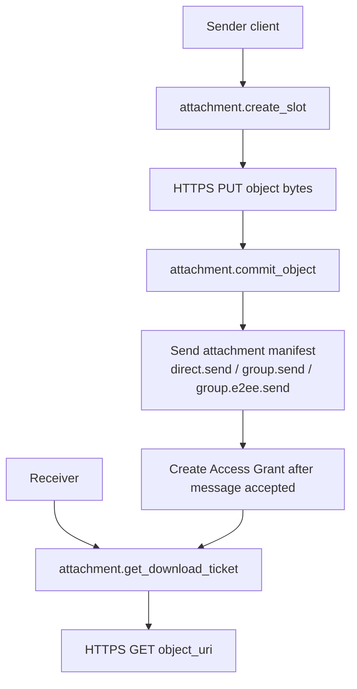
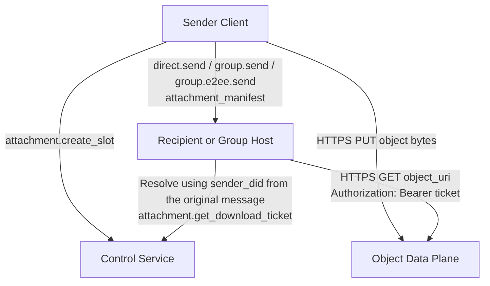
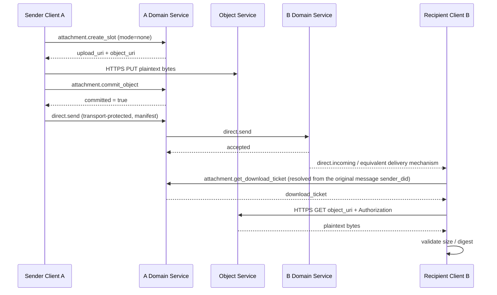
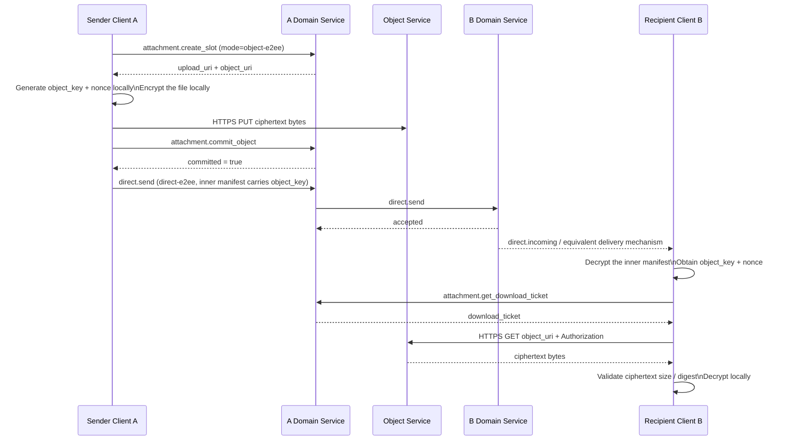
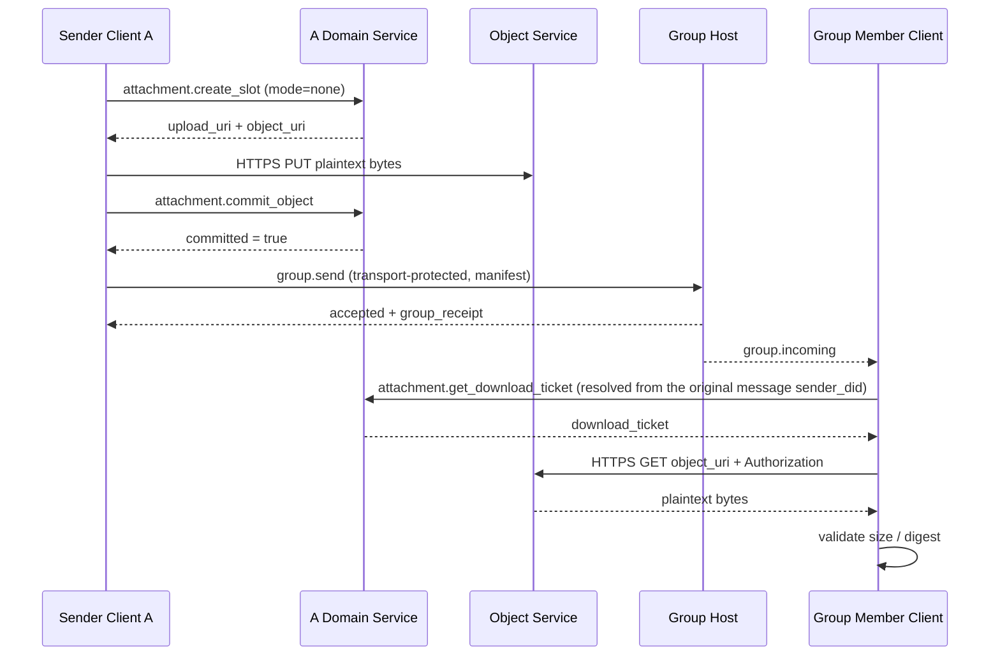
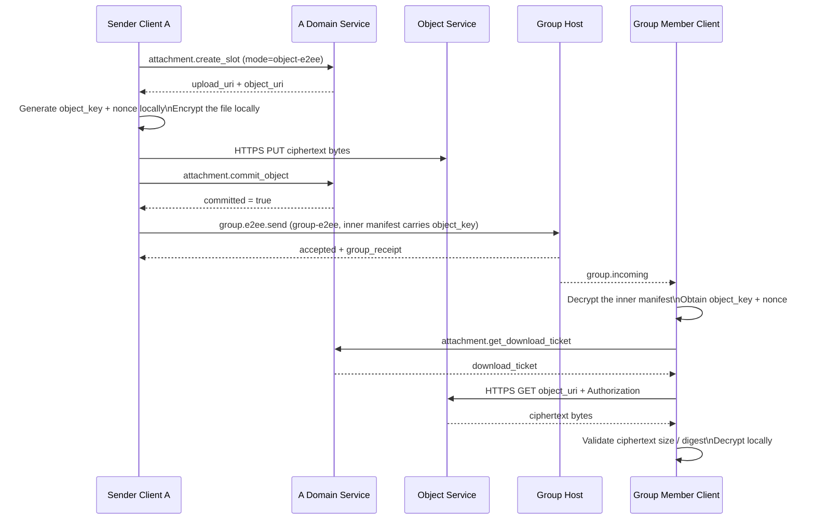
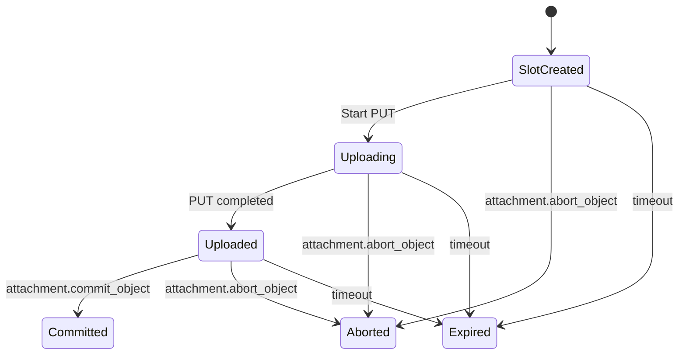

<!-- translation-review: machine-fully-reviewed; scope=source lines 1-1639; inventory=japanese/reviews/core-review.json; full prose compared against source -->
> 日本語参考訳（機械翻訳を原文と全文照合し、意味・用語を校閲済み）。規範となるのは原文です。コード例・識別子・規範キーワードは原文を保持しています。
> 原文: [message/07-attachments-and-object-transfer.md](../../message/07-attachments-and-object-transfer.md) / 基準コミット: `0837cfdfaf4ddcf834f0890ddaf34fc4c824e066`

# ANPプロファイル7:添付ファイルとオブジェクト転送

- 文書ID: ANP-P7
- タイトル: 添付ファイルとオブジェクト転送
- 状態: リリース済み
- バージョン: 1.2
- 仕様セット: ANP のメッセージング 1.2
- 原文言語: English / このページは日本語参考訳
- 適応性:この仕様は、マルチデバイス境界を定義しながら、v1.1の添付ファイルとオブジェクトのライフサイクルを保存します。通常のアタッチメント操作はDID-スコープを維持し、デバイス上の暗号化された配信はP5またはP6に属します。

---

## 1. 目的:

このプロファイルは、ANPの添付ファイルとオブジェクト転送セマティクスを定義します。

1. 直接メッセージングとグループメッセージで添付ファイルを表現する方法。
2. 非E2EEとE2EEの両方で共通の`attachment_manifest`を運ぶ方法。
3. 添付送信を3つの層に分割する方法:メッセージ平面、制御面、データ平面;
4. 独立した HTTPS チャネルを使用してオブジェクトのコンテンツをアップロードおよびダウンロードする方法。
5. オブジェクトの場所のURI、短期ダウンロードチケットとオブジェクトレベルの暗号化によるリンク漏れのリスクを減らす方法。
6. オブジェクトコンテンツの完全性検証、アクセス制御、およびオブジェクトレベルの暗号化を実行する方法。
7. デバイスに結び付く暗号配信をP5/P6が担当し、添付オブジェクトとDownload TicketをDID単位に保つ方法。
8. v1 ソリューションをクリア、シンプル、実装可能に保つ方法。

このプロファイルは定義しません。

- オブジェクトストレージの内部実装。
- オブジェクトレビューとリスク管理戦略;
- オブジェクトのダウンロードチケット用の特定の暗号化発行形式。
- ANPのクロスドメイン呼び出し経路を通じたオブジェクトバイト列の中継。
- `service-managed` オブジェクトの暗号化モード;
- `wrapped_object_key`、ファイル単位の鍵合意、直接リンクのダウンロード、ミラーURI、インラインDownload Ticketなど別系統の経路。
- 専用のサムネイルサブオブジェクトと専用チャンクリストオブジェクト。
- デバイス固有の添付フィールド、デバイスごとのダウンロードチケット、またはデバイスごとのオブジェクトのライフサイクル。

---

本プロファイルは`did:wba`、`did:web`、その他対応DIDメソッドに適用します。本人性の解決・検証は[P2](02-identity-and-discovery.md#method-validation)に従います。

## 2. 用語と規範キーワード

本書の**MUST**、**MUST NOT**、**REQUIRED**、**SHALL**、**SHALL NOT**、**SHOULD**、**SHOULD NOT**、**RECOMMENDED**、**NOT RECOMMENDED**、**MAY**、**OPTIONAL**は、大文字表記で規範要件を表します。

用語定義:

- **添付ファイル**: ANPメッセージで参照される外部オブジェクトは、そのコンテンツはファイル、イメージ、オーディオ、ビデオ、または任意のバイトストリームであることができます。
- **オブジェクト**: 添付ファイルに対応する実際のバイトコンテンツ。
- **Attachment Message**: 1つ以上の`attachment_manifest`を主ペイロードとして持つANPメッセージ。
- **Attachment Manifest**: オブジェクトの場所、ダイジェスト、サイズ、メディア属性、暗号化属性を記述する構造化オブジェクト。
- **Object Service**: 添付の制御プレーンとオブジェクトのデータプレーンを担うサービス。
- **Control Plane**: `attachment.create_slot`、`attachment.commit_object`、`attachment.abort_object`、`attachment.get_download_ticket`などのプロトコルメソッドを扱う制御プレーン。
- **Data Plane**: 独立したHTTPS PUT/GETでオブジェクトのバイト列を転送するデータプレーン。
- **Message Plane**: `direct.send`、`group.send`、`group.e2ee.send`で`attachment_manifest`を運ぶメッセージプレーン。
- **Upload Slot**: オブジェクトのアップロード用に送信者が申請する、一時的なアップロード機能とメタデータ領域。
- **Committed Object**: アップロード済みでメッセージから参照できるオブジェクト。
- **オブジェクトのURI**: オブジェクトの場所 URI. v1では、公開直接リンクと等しいとは言えない、locatorスタイルのHTTPSリソースアドレスです。
- **Download Ticket**: オブジェクトを取得するときの一時アクセス券。
- **Access Grant**: 添付メッセージの送信成功後、送信者サービスが添付に対して作るダウンロード認可記録。
- **オブジェクトレベルの暗号化**: 輸送層の機密性にのみ頼るよりも、送信者によってローカルで行われるオブジェクトコンテンツの暗号化。
- **オブジェクトキー**: オブジェクトの送信者によって個別に生成されたランダムな対称キー。
- **Nonce**: オブジェクト暗号化用nonce。v1の実装必須方式では12バイト固定。

---

## 3. 設計原則とv1統合決定

### 3.1 3層分離

添付転送は次の3プレーンとして理解しなければなりません（**MUST**）。

1. **メッセージプレーン**: `attachment_manifest`を受信者へ送ることだけを担当します。
2. **制御プレーン**: アップロードスロットの申請、オブジェクトの確定・破棄、Download Ticketの発行だけを担当します。
3. **データ平面**: PUT/GET オブジェクトバイトのみの責任を負います。

この3つの責務を混同してはいけません（**MUST NOT**）。特に:

- コントロール・プランの方法は、添付ファイルを受信者に送信する責任を負わない。
- メッセージ平面は、オブジェクトバイトを中継する責任はありません。
- 業務用メッセージ配信は、データ面が責任を負わない。

### 3.2 v1メインラインパス

v1の標準経路は次でなければなりません（**MUST**）。

1. 送信者が`attachment.create_slot`を呼びます。
2. オブジェクトレベルの暗号化が有効になっている場合、送信者は最初にファイルをローカルに暗号化します。
3. 送信者が独立のHTTPS `PUT`でオブジェクトのバイト列をアップロードします。
4. 送信者が`attachment.commit_object`を呼びます。
5. そのメッセージを包むプロファイルの定義に従い、`direct.send`、`group.send`、`group.e2ee.send`で添付一覧を送ります。
6. 受信者が添付一覧を運んだ元メッセージの送信者DIDから公開`ANPMessageService`を解決し、`attachment.get_download_ticket`でDownload Ticketを得ます。
7. 受信者が独立のHTTPS `GET object_uri`で取得し、`Authorization`ヘッダーにTicketを付けます。
8. ダイジェストを検証し、`object-e2ee`なら復号と復号後の検証を行います。

具体的な制御メソッドに入る前に、次の全体図でメッセージ・制御・データの3プレーンを結び付けます。第5章の各場面で「オブジェクトが存在する」「メッセージを送信した」「取得が認可された」を区別する助けになります。



*図P7-1: 添付の3プレーンの流れと認可の連鎖（規範ではありません）。*

`create_slot` / `commit_object`はオブジェクトを作るだけです。受信者が取得できるようにするのは、添付メッセージ受理後のAccess Grantと、それに続くDownload Ticketの処理です。

### 3.3 2つのオブジェクトモードのみを保持

v1では`encryption_info.mode`に次の2値だけを許可しなければなりません（**MUST**）。

- `none`
- `object-e2ee`

`service-managed`をプロトコルフィールドに含めてはいけません（**MUST NOT**）。

サーバーのディスク暗号化、KMS、オブジェクトストレージの保存時暗号化は実装の詳細であり、プロトコル相互運用モードとしてモデル化してはいけません（**MUST NOT**）。

### 3.4 メッセージセキュリティとオブジェクトのセキュリティの分離

添付ファイルには2つのセキュリティレベルがあります。

1. **メッセージの安全性**: 一覧を運ぶ`transport-protected`、`direct-e2ee`、`group-e2ee`によって決まります。
2. **オブジェクトの安全性**: `encryption_info.mode`で決まります。

v1 のルールは:

- `transport-protected`で運ぶ添付は`mode = "none"`を使わなければなりません（**MUST**）。
- `direct-e2ee`または`group-e2ee`で運ぶ添付は`mode = "none"`または`mode = "object-e2ee"`を使ってかまいません（**MAY**）。

### 3.5 オブジェクトキーは E2EE マニフェストだけを配信

いつか `mode = "object-e2ee"`:

- `object_key_b64u`と`nonce_b64u`は、`direct-e2ee`または`group-e2ee`で保護された添付一覧だけに含めなければなりません（**MUST**）。
- `attachment.create_slot`や`attachment.commit_object`の制御要求に`object_key_b64u`と`nonce_b64u`を含めてはいけません（**MUST NOT**）。
- v1は別のファイル単位の鍵合意プロトコルを**定義しません**。

### 3.6 v1で明示的に除外する分岐経路

v1を明確・簡潔・実装可能に保つため、以下の経路を本プロファイルに含めることは**認めません**。

- `service-managed`
- `wrapped_object_key_b64u`
- `key_wrap_alg`
- インラインダウンロードチケット
- カスタムチケット輸送ヘッダー交渉
- 常設の公共直接リンク
- ミラーのURI
- 特化されたチャンクリスト構造
- 専用のサムネイルサブオブジェクト
- ANPビジネスメソッドによるリレーオブジェクトバイト

### 3.7 許可された組合せのマトリックス

| 搬送モード | `meta.security_profile` | 許可する`encryption_info.mode` | 一覧に`object_key_b64u`を含められるか |
|---|---|---|---|
| Direct Base | `transport-protected` | `none` | 不可 |
| Group Base | `transport-protected` | `none` | 不可 |
| Direct E2EE | `direct-e2ee` | `none` / `object-e2ee` | 可 |
| Group E2EE | `group-e2ee` | `none` / `object-e2ee` | 可 |

### 3.8 マルチデバイス境界

P7 は既存のオブジェクトとチケットの状態マシンを保持し、デバイスアドレスレイヤーを付加しません。

1. 通常の添付メッセージ、制御要求、Access Grant、Download Ticketの範囲は、送信者・要求者DIDと既存のメッセージ、添付、オブジェクト、Direct/Group文脈で定まります。`sender_device_id`、`recipient_device_id`、`requester_device_id`や他のデバイスセレクターを含めてはいけません（**MUST NOT**）。
2. 1つの添付オブジェクトは1回アップロードします。ドメイン内の複数デバイス配信でデバイスごとに標準P7オブジェクトやTicketを作ってはいけません（**MUST NOT**）。
3. Direct E2EEのデバイス選択とデバイス別暗号文配信はP5、MLSのデバイスリーフと暗号配信はP6だけが定義します。P7は内側の添付Manifestとオブジェクト鍵フィールドだけを定めます。配信のためにデバイス間でRatchetやMLSの秘密状態を共有してはいけません（**MUST NOT**）。
4. 認証、経路、認可に内部のデバイス文脈を使うことはできますが、P7の通信フィールドにシリアライズしてはいけません（**MUST NOT**）。

---

## 4. プロファイル識別と依存関係

### 4.1 プロフィール名

このプロファイルの標準的な名前は、次のとおりです。

`anp.attachment.v1`

### 4.2 依存関係

本プロファイルは次に依存しなければなりません（**MUST**）。

- `anp.core.binding.v1`
- `anp.identity.discovery.v1`

次のプロファイルと組み合わせて使ってもかまいません（**MAY**）。

- `anp.direct.base.v1`
- `anp.group.base.v2`
- `anp.direct.e2ee.v1`
- `anp.direct.e2ee.v2`
- `anp.group.e2ee.v1`
- `anp.group.e2ee.v2`

### 4.3 セキュリティプロファイル

このプロファイル自体は、新しいセキュリティプロファイルを定義しませんが、それを運ぶビジネスプロファイルを再利用します。

- `transport-protected`
- `direct-e2ee`
- `group-e2ee`

---

## 5. 添付ファイル転送フロー図

### 5.1 全体的な階層の流れ図



### 5.2 直接メッセージング/暗号化されていない付属品



### 5.3 直接メッセージング/E2EE の添付ファイル



### 5.4 グループ メッセージング/暗号化されていない添付ファイル



### 5.5 グループ メッセージング/E2EE 添付ファイル



---

## 6. 搬送規則：直接メッセージング、グループメッセージング、暗号化あり／なし

### 6.1 Direct Baseでの搬送

添付ファイル一覧を `anp.direct.base.v1` の `direct.send` で送信する場合：

- `meta.profile` は `anp.direct.base.v1` と等しくなければならない（**MUST**）。
- `meta.security_profile` は `transport-protected` と等しくなければならない（**MUST**）。
- `meta.content_type` は `application/anp-attachment-manifest+json` と等しくなければならない（**MUST**）。
- `body.payload` はAttachment Messageオブジェクトでなければならない（**MUST**）。
- `auth.origin_proof` が存在し、P3の要件に従ってSigned Direct Payload全体を束縛しなければならない（**MUST**）。
- 各 `attachment_manifest.encryption_info.mode` は `none` と等しくなければならない（**MUST**）。

### 6.2 Group Baseでの搬送

添付ファイル一覧を `anp.group.base.v2` の `group.send` で送信する場合：

- `meta.profile` は `anp.group.base.v2` と等しくなければならない（**MUST**）。
- `meta.security_profile` は `transport-protected` と等しくなければならない（**MUST**）。
- `meta.content_type` は `application/anp-attachment-manifest+json` と等しくなければならない（**MUST**）。
- `body.payload` はAttachment Messageオブジェクトでなければならない（**MUST**）。
- `auth.origin_proof` が存在し、P4の要件に従ってSigned Group Payload全体を束縛しなければならない（**MUST**）。
- 成功応答は `group_receipt` を返すことが望ましい（**SHOULD**）。
- 各 `attachment_manifest.encryption_info.mode` は `none` と等しくなければならない（**MUST**）。

### 6.3 Direct E2EEでの搬送

添付ファイル一覧を `anp.direct.e2ee.v1` または `anp.direct.e2ee.v2` で送信する場合：

- セッション確立後の通常経路では、外側の `meta.content_type` は `application/anp-direct-cipher+json` でなければならない（**MUST**）。
- P5が認める、最初のinitにアプリケーションメッセージを載せる経路を使う場合、外側の `meta.content_type` は `application/anp-direct-init+json` でもよい（**MAY**）。
- 添付ファイル一覧は、暗号化前の `Application Plaintext` の内部業務オブジェクトとして含まれなければならない（**MUST**）。
- 内側の `application_content_type` は `application/anp-attachment-manifest+json` と等しくなければならない（**MUST**）。

### 6.4 Group E2EEでの搬送

添付ファイル一覧を `anp.group.e2ee.v1` または `anp.group.e2ee.v2` の `group.e2ee.send` で送信する場合：

- 外側の `meta.content_type` は `application/anp-group-cipher+json` に固定しなければならない（**MUST**）。
- 外側の `body` に平文の添付ファイル一覧を直接含めてはならない（**MUST NOT**）。
- 添付ファイル一覧は、暗号化前の `Group Application Plaintext` の内部業務オブジェクトとして含まれなければならない（**MUST**）。
- 内側の `application_content_type` は `application/anp-attachment-manifest+json` と等しくなければならない（**MUST**）。

### 6.5 フィールドの所管

- Direct BaseとGroup Baseの添付ファイルメッセージは、それを包むProfileのDIDまたはGroup DIDによるアドレッシングだけを使う。P7はデバイス選択子を追加しない。
- `attachment_message` と `attachment_manifest` はデバイス識別子を含まない。
- P5 v2のDirect E2EEエンベロープは、必須の送信元および受信先デバイスフィールドを持つ。P6 v2のMLSエンベロープは、必須のデバイス束縛を持つ。これらの外側のフィールドはP5またはP6だけが解釈する。v1のE2EEエンベロープに、P7を通じてデバイス選択子が追加されることはない。
- `object_key_b64u` と `nonce_b64u` は暗号化された添付ファイルマニフェストの内部に置く。P7はデバイスごとの別個の鍵配布要求を導入しない。

---

## 7. `attachment_message` と `attachment_manifest` オブジェクト

### 7.1 添付ファイル メッセージトップレベル構造

添付メッセージの推奨構造は次のとおりです。

```json
{
  "attachments": [
    {
      "attachment_id": "att-001",
      "filename": "report.pdf",
      "mime_type": "application/pdf",
      "size": "1048576",
      "digest": {
        "alg": "sha-256",
        "value_b64u": "BASE64URL_DIGEST"
      },
      "access_info": {
        "object_uri": "https://objects.example.com/objects/obj-001"
      },
      "encryption_info": {
        "mode": "none"
      }
    }
  ],
  "caption": "Attachment description",
  "primary_attachment_id": "att-001"
}
```

ルール:

- `attachments` は存在し、空であってはならない（**MUST**）。
- `caption` は存在してもよい（**MAY**）。
- `primary_attachment_id` は存在してもよい（**MAY**）。存在する場合、`attachments` 内に存在する `attachment_id` を指さなければならない（**MUST**）。

### 7.2 `attachment_id` スコープ

- `attachment_id` は、単一のAttachment Message内で一意でなければならない（**MUST**）。
- `attachment_id` は、メッセージをまたいで大域的に一意であることは**保証されない**。
- Download Ticketの束縛、認可記録、監査記録では、`attachment_id` だけでなく、`(message_id, attachment_id)` または `(object_uri, message_id, attachment_id)` を使わなければならない（**MUST**）。

### 7.3 個々の `attachment_manifest`

各 `attachment_manifest` は、次のフィールドを含まなければならない（**MUST**）。

- `attachment_id`
- `mime_type`
- `size`
- `digest`
- `access_info`
- `encryption_info`

各 `attachment_manifest` は、次のフィールドを含んでもよい（**MAY**）。

- `filename`
- `media_info`

フィールドの説明:

- `filename`：表示用ファイル名。任意（**MAY**）。
- `mime_type`：元のファイルのMIMEタイプ。必須（**MUST**）。
- `size`：アップロードするオブジェクトのバイト数を表す10進文字列。必須（**MUST**）。
- `digest`：アップロードするオブジェクトのバイト列のダイジェスト。必須（**MUST**）。
- `access_info`：オブジェクトのダウンロード先を特定する情報。必須（**MUST**）。
- `encryption_info`：オブジェクト単位の暗号化情報。必須（**MUST**）。
- `media_info`：画像、音声、動画などのメディアオブジェクトの補足情報。任意（**MAY**）。

### 7.4 `digest`

`digest` は次を含まなければならない（**MUST**）。

- `alg`
- `value_b64u`

ルール:

- v1では `digest.alg` を `sha-256` に固定しなければならない（**MUST**）。
- `digest.value_b64u` は、アップロードするオブジェクトのバイト列のSHA-256ダイジェストでなければならない（**MUST**）。
- `encryption_info.mode = "none"` の場合、ダイジェストは平文のバイト列に対応する。
- `encryption_info.mode = "object-e2ee"` の場合、ダイジェストは暗号文のバイト列に対応する。

### 7.5 `access_info`

`access_info` の構造は次のとおり。

```json
{
  "object_uri": "https://objects.example.com/objects/obj-001"
}
```

ルール:

1. `object_uri` は `https://` のURLでなければならない（**MUST**）。
2. `object_uri` v1 のロケータスタイルのオブジェクトアドレスを表します。永久的な公開直接リンクではありません
3. 受信者は、ダウンロード前に `attachment.get_download_ticket` を呼び出さなければならない（**MUST**）。
4. 受信者は、添付ファイル一覧を載せた元のメッセージの送信者DIDに基づき、その公開 `ANPMessageService` を解決しなければならない（**MUST**）。
5. グループの場合、上記の元の送信者DIDは、添付ファイル一覧を載せた元のグループメッセージの送信者（例：`group.incoming.meta.sender_did`）から取得しなければならない（**MUST**）。
6. `attachment.get_download_ticket` は、送信者の公開サービスに対応する `serviceDid` に送信しなければならない（**MUST**）。
7. 受信者は、ダウンロード時に `object_uri` に対して `GET` を行い、`Authorization` ヘッダーにチケットを含めなければならない（**MUST**）。
8. 呼び出し側は、`object_uri` のURLドメイン名だけから制御プレーンのサービスを推測してはならない（**MUST NOT**）。

### 7.6 `media_info`

`media_info` は、画像、音声、動画などのメディアオブジェクトに適している。推奨フィールド：

- `width`
- `height`
- `duration_ms`
- `codec`

数値フィールドが存在する場合、10進文字列を使わなければならない（**MUST**）。

### 7.7サムネイルとチャンク

v1は、専用の `thumbnail` フィールドも、専用の `chunking_info` フィールドも定義しない。

サムネイルが必要な場合、送信者は通常の添付ファイルとして送信することが望ましい（**SHOULD**）。

大きなファイルを分割アップロードする必要がある場合、HTTPアップロード実装の内部で処理することが望ましい（**SHOULD**）。このProfileのマニフェスト構造は変わらない。

---

## 8. オブジェクトレベルの暗号化

### 8.1 `encryption_info`

`encryption_info` は、次の2つの構造のいずれかでなければならない（**MUST**）。

暗号化されていないオブジェクト:

```json
{
  "mode": "none"
}
```

オブジェクトレベルの暗号化オブジェクト:

```json
{
  "mode": "object-e2ee",
  "object_cipher": "chacha20-poly1305",
  "object_key_b64u": "BASE64URL_32_BYTES",
  "nonce_b64u": "BASE64URL_12_BYTES",
  "plaintext_size": "1048576"
}
```

ルール:

1. `mode` は `none` または `object-e2ee` のいずれかでなければならない（**MUST**）。
2. `mode = "none"` 送信者は、オブジェクトコンテンツをローカルに暗号化しなかったことを示します。
3. `mode = "object-e2ee"` は、送信者がまずローカルでオブジェクトを暗号化し、その暗号文のバイト列をアップロードすることを意味する。
4. `transport-protected` で搬送する場合、`mode` は `none` でなければならない（**MUST**）。
5. `transport-protected` で搬送する添付ファイル一覧に、`object_key_b64u` と `nonce_b64u` を含めてはならない（**MUST NOT**）。
6. `service-managed`、鍵ラッピングアルゴリズム、ファイル単位の鍵合意は、このProfileの範囲外である。

### 8.2 MTIアルゴリズム `object-e2ee`

v1で実装必須の `object-e2ee` アルゴリズムは、次のとおりである（**MUST**）。

- `object_cipher = "chacha20-poly1305"`
- `object_key_b64u`: 32バイトのランダム対称キー
- `nonce_b64u`: 12バイトランダム nonce
- `plaintext_size`：元のファイルのバイト長を表す10進文字列。

### 8.3 送信者の暗号化手順（規範）

`encryption_info.mode = "object-e2ee"` の場合、送信者は次の手順を実行しなければならない（**MUST**）。

1. 元のファイルのバイト列を読み取り、`P` とする。
2. 新しいランダムな32バイトのオブジェクト鍵 `K` を生成する。
3. 新しいランダムな12バイトのnonce `N` を生成する。
4. `AAD = empty byte string` とする。
5. 計算:

```text
C = ChaCha20-Poly1305-Encrypt(
      key = K,
      nonce = N,
      aad = "",
      plaintext = P
    )
```

6. Object Serviceにアップロードするオブジェクトのバイト列は `C` でなければならない（**MUST**）。
7. `attachment_manifest.size` は `len(C)` と等しい10進文字列でなければならない（**MUST**）。
8. `attachment_manifest.digest` は `sha-256(C)` と等しくなければならない（**MUST**）。
9. `encryption_info.plaintext_size` は `len(P)` と等しい10進文字列でなければならない（**MUST**）。
10. `mime_type` は、暗号文オブジェクトではなく元のファイルのMIMEタイプを引き続き表さなければならない（**MUST**）。

追加要件:

- コミットする各オブジェクトは、新しいランダムな `K` を使わなければならない（**MUST**）。
- 送信者は、同じ `(K, N)` の組み合わせを再利用してはならない（**MUST NOT**）。
- 同じファイル内容を繰り返し送信する場合でも、送信者は新しい `K` と `N` を生成し直すことが望ましい（**SHOULD**）。
- `object_key_b64u` をP5のラチェット鍵から直接取得してはならず（**MUST NOT**）、P6のMLS epoch secretや他のセッション鍵から直接取得してもならない（**MUST NOT**）。

### 8.4 `expected_size` と `plaintext_size`

v1の実装必須アルゴリズム `chacha20-poly1305` では：

- オブジェクトサイズをアップロード = 元ファイルサイズ + 16バイト認証タグ
- 送信者が `attachment.create_slot` の `expected_size` を設定する場合、その値は元のファイルサイズではなく、アップロードするオブジェクトのサイズを指すことが望ましい（**SHOULD**）。
- `mode = "object-e2ee"` の場合、送信者は後で `encryption_info.plaintext_size` を記入できるよう、元のファイルサイズもローカルに保存することが望ましい（**SHOULD**）。

### 8.5 受信者の検証および復号手順（規範）

受信者がオブジェクトのバイト列を取得した際は：

1. まず、ダウンロードしたバイト列の長さが `attachment_manifest.size` と等しいことを検証しなければならない（**MUST**）。
2. `sha-256(downloaded bytes)` を計算し、`attachment_manifest.digest` と比較しなければならない（**MUST**）。
3. 場合 `encryption_info.mode = "none"`、それは成功した確認の後で上部の層に渡ることができます。
4. `encryption_info.mode = "object-e2ee"` の場合、受信者は次を使わなければならない（**MUST**）。

```text
P = ChaCha20-Poly1305-Decrypt(
      key = object_key_b64u,
      nonce = nonce_b64u,
      aad = "",
      ciphertext = downloaded_bytes
    )
```

5. 復号に失敗した場合、受信者は添付ファイルを拒否しなければならない（**MUST**）。
6. 復号に成功した場合、受信者は `len(P)` が `plaintext_size` と等しいことを検証しなければならない（**MUST**）。
7. 検証に成功した後、受信者は平文のバイト列を上位の業務処理に渡すことができる。

### 8.6 オブジェクトのキー配布ルール

v1 の標準的なオブジェクトキー配布パスは 1 つだけあります。

- 添付ファイルメッセージ自体が `direct-e2ee` または `group-e2ee` で保護されている場合、送信者は `object_key_b64u` と `nonce_b64u` を内側の `attachment_manifest` に直接入れてもよい（**MAY**）。
- 受信機がE2EEメッセージからオブジェクトキーを取得した後、制御面でチケットを取得し、データ平面を介して暗号文オブジェクトをダウンロードします。

つまり、

- v1では、添付ファイル用に複雑な鍵合意プロトコルを別途設計する**必要はない**。
- グループシナリオでは、グループメッセージの復号化が可能な人はオブジェクトキーを取得できます。
- v1は**権限の遡及的な撤回を保証しない**。グループから削除されたメンバーが、それ以前にオブジェクト鍵とオブジェクト内容を取得済みである場合、この仕様は、その取得済み情報を後から消去することを約束しない。

---

## 9. アクセス許可・ダウンロードチケット

### 9.1 チケット対象

Download Ticketの目的は、正当な受信者による転送を完全に阻止することではなく、次を実現することにある。

1. 第三者が一覧だけを使ってオブジェクトを直接ダウンロードすることを防ぐ。
2. `object_uri` が長期間有効な公開リンクになることを防ぐ。
3. ダウンロード認可を、明確な要求者とメッセージのコンテキストに限定する。
4. オブジェクトサービスの監査、レート制限、認可の取消しを実装するための基盤を提供する。

### 9.2 Access Grantの意味

`attachment.create_slot` と `attachment.commit_object` が担うのは、オブジェクトの作成**だけ**であり、どの受信者にもダウンロード権限を付与しない。

メッセージの受信者がオブジェクトをダウンロードできる時点は、Access Grantによって決定しなければならない（**MUST**）。

添付ファイルを載せた `direct.send`、`group.send`、または `group.e2ee.send` が送信者サービスまたはGroup Hostに受理された時点で、送信者側のシステムは各添付ファイルについてAccess Grantを作成しなければならない（**MUST**）。

Access Grantは、少なくとも次を束縛しなければならない（**MUST**）。

- `message_id`
- `attachment_id`
- `object_uri`
- `message_security_profile`
- 直接メッセージの場合は `message_target_did`、グループメッセージの場合は `group_did`。

Access Grantは、対象DIDまたはGroupのコンテキストを認可するものであり、1台のローカルデバイスを認可するものではない。ドメイン内のデバイスへの配信は、実装の詳細にとどまる。

### 9.3 境界の `intended_target`

`attachment.create_slot.body.intended_target` は、送信者のアップロード段階におけるポリシーのヒントにすぎない。

`intended_target`:

- Object Serviceがサイズ、種類、保持ポリシーを事前に判断するために使ってもよい（**MAY**）。
- ダウンロード認可の唯一の根拠として使ってはならない（**MUST NOT**）。

実際のダウンロード認可の根拠は、送信成功に伴うAccess Grantから得なければならない（**MUST**）。

### 9.4 チケットの束縛

v1のDownload Ticketは、少なくとも次のコンテキストを束縛しなければならない（**MUST**）。

- `attachment_id`
- `object_uri`
- `requester_did`
- `message_id`
- `message_security_profile`
- 直接メッセージの場合は `message_target_did`、グループメッセージの場合は `group_did`。
- `expires_at`

標準のチケット束縛に、`requester_device_id` や他のデバイス選択子を含めてはならない（**MUST NOT**）。デプロイ環境ではチケット発行前にローカルデバイスの状態を利用できるが、その状態はP7の通信上のフィールドにも、チケット束縛のフィールドにもならない。

### 9.5 チケットの有効期間と利用

- Download Ticketは短期間有効なチケットとすることが望ましい（**SHOULD**）。
- デフォルトの有効期間は5分を超えないことが望ましい（**SHOULD NOT**）。
- 機密性が特に高い対象では、使い捨てチケットを使ってもよい（**MAY**）。
- Download TicketはHTTPの `Authorization` ヘッダーで送信しなければならない（**MUST**）。
- Download TicketをURLのクエリパラメータで送信してはならない（**MUST NOT**）。

v1 の固定ダウンロード方法は:

```http
GET {object_uri}
Authorization: Bearer {download_ticket}
```

### 9.6 チケット発行時の検証

オブジェクト制御サービスは、`attachment.get_download_ticket` を処理する際、次を検証しなければならない（**MUST**）。

1. `meta.target.kind = "service"`
2. `meta.target.did` は、元の添付ファイルメッセージの送信者DIDから解決した公開 `ANPMessageService.serviceDid` と等しくなければならない（**MUST**）。
3. `requester_did = meta.sender_did`
4. `(message_id, attachment_id, object_uri)` に対応するAccess Grantが存在すること。
5. `message_security_profile` がAccess Grantと一致すること。
6. 直接メッセージのコンテキストでは、`message_target_did` が存在し、ポリシーに適合すること。
7. グループメッセージのコンテキストでは、`group_did` が存在し、`requester_did` が現在もグループのアクセスポリシーに適合していること。

P7は、この検証で要求者のデバイス選択子を要求しない。ローカルデバイスの認証は、相互運用する要求の範囲外である。

### 9.7 クロスサービス同期

v1は、複数の内部サービス間でAccess Grantを同期するプロトコルを**別途標準化しない**。

v1のデフォルト経路では、添付ファイルメッセージの元の送信者が公開する `ANPMessageService` がDownload Ticketを発行する。その公開サービス入口が内部で独立したObject Serviceにルーティングするかどうかは実装の詳細である。オブジェクト制御コンポーネントを内部で分離する場合、実装は、外部公開サービスがチケット発行に必要なAccess Grantをローカル状態または内部同期から取得できるようにしなければならない（**MUST**）。

### 9.8 メンバー変更後のアクセス境界

v1は**権限の遡及的な撤回を保証しない**。

つまり、

- Object Serviceは、現在のグループ状態に基づき、削除されたメンバーへの新しいDownload Ticketの発行を拒否することが望ましい（**SHOULD**）。
- ただし、オブジェクトのバイト列、オブジェクト鍵、またはダウンロード済み内容が以前に正当なメンバーに届いている場合、本仕様は、その取得済みアクセス能力を後から取り消すことを**約束しない**。

P7のもう1つの重要な境界は、オブジェクトが存在しても、そのオブジェクトをダウンロードできるとは限らないことである。次の図は、オブジェクトのコミット、メッセージの受理、Access Grantの作成、チケットの発行、最終的なダウンロードを1つの認可の連鎖として結び付け、実装者がアクセス制御を正しく適用できるようにする。

```mermaid
sequenceDiagram
participant S as Sender service
participant O as Object Service
participant M as Message plane
participant R as Receiver

S->>O: create_slot / commit_object
Note over S,O: Only creates the object; does not create download authorization

S->>M: direct.send / group.send / group.e2ee.send attachment manifest
M-->>S: message accepted
S->>S: Create Access Grant for each attachment

R->>S: attachment.get_download_ticket
S->>S: Validate requester_did + message_id + attachment_id + object_uri
S-->>R: download_ticket

R->>O: GET object_uri + Authorization
```

*図P7-2：Access GrantとDownload Ticketによる認可の連鎖（非規範）。*

したがって、`attachment.get_download_ticket` の認可は、`object_uri` だけ、またはアップロード段階で残された `intended_target` だけに基づけず、メッセージのコンテキストとAccess Grantに基づくべきである。

### 9.9 Agent DID移行後の過去のAccess Grant

Agent DIDが変わっても、過去の `attachment_manifest` オブジェクトとAccess Grantを書き換えてはならない（**MUST NOT**）。

直接メッセージのAccess Grantが以前の受信者DIDを指定し、現在の要求者がその後継DIDを提示する場合、Object Serviceは、GrantのDIDから `requester_did` へのP2移行を検証し、所管する業務ポリシーが返された保証レベルを受け入れた後に限り、要求を同じ内部Grantに対応付けてもよい（**MAY**）。`provider_asserted` が過去の添付ファイルへのアクセス継承に十分かどうかは業務上の判断であり、P7は受け入れも拒否も強制しない。

この対応付けは内部処理である。P7は、過去のマニフェスト、Access Grant、Ticket、制御プレーンの要求に、安定した主体を表すフィールド、名前、移行チェーン、デバイス選択子を追加してはならない（**MUST NOT**）。グループの添付ファイルでは、現在のP4 v2のメンバー一覧、グループポリシー、元のメッセージコンテキストに基づいて引き続き認可する。

---

## 10. 制御プレーンのメソッド

### 10.1 全般

この節のメソッドはオブジェクト制御プレーンで使う。これらは、`direct.send`、`group.send`、`group.e2ee.send` の成功の意味を**変更しない**。

これらのメソッドでは、デフォルトで次を使う。

- `meta.profile = "anp.attachment.v1"`
- `meta.security_profile = "transport-protected"`

そして次の認証モデルを採用します:

1. `attachment.create_slot`
2. `attachment.commit_object`
3. `attachment.abort_object`
4. `attachment.get_download_ticket`

上記はすべて**サービススコープ**の制御プレーンメソッドである。

したがって:

- `meta.target.kind` は `service` と等しくなければならない（**MUST**）。
- `meta.target.did` は、対象の公開 `ANPMessageService.serviceDid` と等しくなければならない（**MUST**）。
- ドメイン間の外側の層の認証は、P8が `serviceDid + HTTP Message Signatures` によって提供する。
- v1は、Object Serviceに最終受信者の `origin_proof` を再検証することを要求**しない**。

これらのメソッドは、`sender_device_id`、`recipient_device_id`、`requester_device_id` をP7の通信モデルに追加してはならない（**MUST NOT**）。内部のデバイス認証とルーティングのコンテキストは、デプロイ環境の非公開の詳細にとどまる。

実装者が見落としやすい制御プレーンの詳細として、Upload SlotとCommitted Objectは同じ状態ではない。次の図は、作成、アップロード、コミット、中止、期限切れを1つのライフサイクルにまとめている。



*図P7-3：Upload Slot／Objectのライフサイクル（非規範）。*

実装は「`object_uri` を取得した」ことを「そのオブジェクトをすでにメッセージから参照できる」と解釈すべきではない。オブジェクトが `Committed` 状態に入って初めて、添付ファイルマニフェストから正当に参照できる。

### 10.2 `attachment.create_slot`

#### 10.2.1 意味

アップロード予定のオブジェクト用に、Upload Slotを申請する。

#### 10.2.2 要求の要件

このメソッドは次を使わなければならない（**MUST**）。

- `meta.target.kind = "service"`
- `meta.target.did = target public ANPMessageService.serviceDid`

`body` は次を含まなければならない（**MUST**）。

- `attachment_id`
- `intended_message_security_profile`
- `object_encryption_mode`

`body` は次を含むことが望ましい（**SHOULD**）。

- `expected_size`
- `mime_type`

`body` は次を含んでもよい（**MAY**）。

- `filename`
- `expected_digest`
- `intended_target`

フィールドルール:

- `attachment_id`: 文字列
- `intended_message_security_profile`: `transport-protected` / `direct-e2ee` / `group-e2ee`
- `object_encryption_mode`: `none` / `object-e2ee`
- `expected_size`：アップロードするオブジェクトのバイト数を表す10進文字列。
- `expected_digest`：アップロードするオブジェクトのバイト列のダイジェスト。
- `intended_target`: オブジェクト;推奨構造は次のとおりです。

```json
{
  "kind": "agent | group",
  "did": "did:example:..."
}
```

制約:

1. `intended_message_security_profile = "transport-protected"` の場合、`object_encryption_mode` は `none` でなければならない（**MUST**）。
2. `object_encryption_mode = "object-e2ee"` の場合、`expected_size` は暗号文のバイト数に対応することが望ましい（**SHOULD**）。
3. `intended_target` はヒントにすぎず、それだけで認可が成立してはならない（**MUST NOT**）。

#### 10.2.3 成功の応答

成功応答は、少なくとも次を含まなければならない（**MUST**）。

- `attachment_id`
- `slot_id`
- `upload_uri`
- `object_uri`
- `commit_token`
- `expires_at`

成功応答は、次を含んでもよい（**MAY**）。

- `upload_headers`

送信者が後で `attachment_manifest.access_info` を構築する際、`object_uri` は `attachment.create_slot` または `attachment.commit_object` の成功応答から直接取得することが望ましい（**SHOULD**）。受信者はダウンロード前に、このProfileの規定に従い、元の添付ファイルメッセージの送信者DIDに基づいてチケットサービスを発見する。

### 10.3 `attachment.commit_object`

#### 10.3.1 意味

オブジェクトがアップロード済みであり、参照可能なオブジェクトとしてコミットできることをObject Serviceに通知する。

#### 10.3.2 要求の要件

このメソッドは次を使わなければならない（**MUST**）。

- `meta.target.kind = "service"`
- `meta.target.did = target public ANPMessageService.serviceDid`

`body` は、少なくとも次を含まなければならない（**MUST**）。

- `attachment_id`
- `slot_id`
- `commit_token`
- `size`
- `digest`
- `object_encryption_mode`

`body` は次を含んでもよい（**MAY**）。

- `plaintext_size`
- `media_info`

ルール:

1. `digest.alg` は `sha-256` と等しくなければならない（**MUST**）。
2. `object_encryption_mode = "object-e2ee"` の場合、`plaintext_size` が存在しなければならない（**MUST**）。
3. `attachment.commit_object` は `object_key_b64u` を送信してはならない（**MUST NOT**）。
4. `attachment.commit_object` は `nonce_b64u` を送信してはならない（**MUST NOT**）。
5. `attachment.commit_object` の成功は、受信者にオブジェクトのダウンロードが認可されたことと**同義ではない**。実際のダウンロード認可は、その後のメッセージ送信成功後のAccess Grantに依存する。

#### 10.3.3 成功の応答

成功応答は、少なくとも次を含まなければならない（**MUST**）。

- `committed`
- `attachment_id`
- `object_uri`
- `committed_at`

それらの中で:

- `committed` は `true` でなければならない（**MUST**）。

### 10.4 `attachment.abort_object`

#### 10.4.1 意味

未完了または不要になったUpload Slotを終了する。

#### 10.4.2 要求の要件

このメソッドは次を使わなければならない（**MUST**）。

- `meta.target.kind = "service"`
- `meta.target.did = target public ANPMessageService.serviceDid`

`body` は、少なくとも次を含まなければならない（**MUST**）。

- `attachment_id`
- `slot_id`

#### 10.4.3 成功の応答

成功応答は、少なくとも次を含まなければならない（**MUST**）。

- `aborted`
- `attachment_id`
- `aborted_at`

それらの中で:

- `aborted` は `true` でなければならない（**MUST**）。

### 10.5 `attachment.get_download_ticket`

#### 10.5.1 意味

オブジェクトへのアクセスにチケットが必要な場合、受信者はこのメソッドで一時的なDownload Ticketを取得する。

#### 10.5.2 要求の要件

このメソッドは次を使わなければならない（**MUST**）。

- `meta.target.kind = "service"`
- `meta.target.did` は、元の添付ファイルメッセージの送信者DIDから解決した公開 `ANPMessageService.serviceDid` と等しくなければならない（**MUST**）。

`body` は、少なくとも次を含まなければならない（**MUST**）。

- `attachment_id`
- `object_uri`
- `requester_did`
- `message_security_profile`
- `message_id`

コンテキストに従って 1 つを追加します。

- 直接メッセージングコンテキスト: `message_target_did`
- グループメッセージングコンテキスト: `group_did`

`body` は次を含んでもよい（**MAY**）。

- `one_time`

このメソッドは、`requester_device_id` や同等のデバイス選択子を定義しない。

フィールドルール:

- `requester_did` は `meta.sender_did` と等しくなければならない（**MUST**）。
- `message_security_profile` は、添付ファイル一覧を載せたメッセージのセキュリティProfileを指し、今回の制御プレーン呼び出しの `meta.security_profile` を指すものではない。
- `message_target_did` 元の直接メッセージングメッセージのターゲットエージェントDIDを参照
- `group_did` 元のグループメッセージが属するグループDIDを参照して下さい
- 呼び出し側は、チケット要求を送信する前に、元の添付ファイルメッセージの送信者DIDに基づき、その公開 `ANPMessageService` を解決しなければならない（**MUST**）。グループの場合、このDIDは元のグループメッセージの送信者から取得し、`group_did` からは取得しない。

#### 10.5.3 応答の成功

成功応答は、少なくとも次を含まなければならない（**MUST**）。

- `download_ticket_b64u`
- `expires_at`
- `ticket_binding`

`ticket_binding` は、少なくとも次を含まなければならない（**MUST**）。

- `attachment_id`
- `object_uri`
- `requester_did`
- `message_id`
- `message_security_profile`

コンテキストに従って 1 つを追加します。

- `message_target_did`
- `group_did`

`ticket_binding` にデバイス識別子を追加してはならない（**MUST NOT**）。

---

## 11. データプレーンの規則

### 11.1 アップロード

送信者は、独立したHTTPSチャネルを使って `upload_uri` に対する `PUT` を開始しなければならない（**MUST**）。

ルール:

- `object_encryption_mode = "none"` の場合、平文のデータをアップロードする。
- `object_encryption_mode = "object-e2ee"` の場合、暗号文のバイト列をアップロードする。
- アップロード要求は `upload_headers` を含んでもよい（**MAY**）。
- オブジェクトのバイト列を、ANPのJSON-RPC業務メッセージに埋め込んではならない（**MUST NOT**）。

### 11.2 ダウンロード

受信者は、独立したHTTPSチャネルを使って `object_uri` に対する `GET` を開始しなければならない（**MUST**）。

固定形式は以下の通りです。

```http
GET {object_uri}
Authorization: Bearer {download_ticket}
```

オブジェクトのバイト列を、ANPのドメイン間サービス呼び出し経路を通常の転送チャネルとして使って転送してはならない（**MUST NOT**）。

標準のBearerダウンロード要求には、P7のデバイス選択子もデバイス証明もない。デバイスに制約したチケット方式を設ける場合は、別のProfileを必要とする。

### 11.3 ダウンロード後の検証

ダウンロード完了後、受信者は少なくとも次を検証しなければならない（**MUST**）。

1. 長さの検証。
2. ダイジェスト検証
3. `mode = "object-e2ee"` の場合、復号と `plaintext_size` の検証。

重要な検証のいずれかに失敗した場合、受信者は：

- オブジェクトを有効な添付ファイルとして上位アプリケーションに渡してはならない（**MUST NOT**）。
- 診断情報をログに記録することが望ましい（**SHOULD**）。

---

## 12. エラー条件と推奨エラーコード

このProfileは、添付ファイルとオブジェクト転送のエラーに `6000-6013` のコード範囲を固定で割り当てる。サーバーがこのエラーを返す場合、`error.data.anp_code` が存在しなければならない（**MUST**）。

| `code` | `anp_code` | 意味 |
|---|---|---|
| 6000 | `anp.attachment.slot_not_found` | 利用可能なUpload Slotが見つからない、または `slot_id` が現在のコンテキストと一致しない |
| 6001 | `anp.attachment.slot_expired` | Upload Slotが期限切れで、アップロード、コミット、中止ができない |
| 6002 | `anp.attachment.commit_token_invalid` | コミットトークンが欠落、不正、検証失敗、または現在のオブジェクトコンテキストと不一致 |
| 6003 | `anp.attachment.object_too_large` | オブジェクトサイズは、サービス制限、ポリシー制限を超えたり、許可された範囲を超える |
| 6004 | `anp.attachment.unsupported_mime_type` | `mime_type` 現行サービスまたはポリシーにより、受理されない |
| 6005 | `anp.attachment.grant_not_found` | 対応するAccess Grantが見つからない、またはメッセージのダウンロード認可が未成立 |
| 6006 | `anp.attachment.unauthorized_requester` | 現在の `requester_did` がダウンロードポリシー、対象の制約、グループアクセスの制約を満たさない |
| 6007 | `anp.attachment.download_ticket_invalid` | Download Ticketが欠落、不正、署名検証失敗、解析不能、または無効化済み |
| 6008 | `anp.attachment.ticket_binding_mismatch` | Download Ticketが束縛するオブジェクト、メッセージ、要求者のコンテキストが実際の要求と一致しない |
| 6009 | `anp.attachment.ticket_expired` | Download Ticketが期限切れ |
| 6010 | `anp.attachment.digest_mismatch` | アップロード後またはダウンロード後のオブジェクトのダイジェストが期待値と一致しない |
| 6011 | `anp.attachment.decrypt_failed` | `object-e2ee` オブジェクトの復号化が失敗しました |
| 6012 | `anp.attachment.object_unavailable` | オブジェクトが未コミット、中止済み、削除済み、または一時的に利用不能 |
| 6013 | `anp.attachment.encryption_policy_violation` | オブジェクト暗号化モードとメッセージセキュリティプロファイルの組み合わせは違法です。またはこのプロファイルの制約を侵害します |

デバイス束縛エラーはP5またはP6の所管であり、通常のP7要求にデバイス選択子を要求するために使ってはならない（**MUST NOT**）。

エラー応答は、次を `error.data` に含めることが望ましい（**SHOULD**）。

- `attachment_id`
- `slot_id`
- `object_uri`
- `message_id`
- `expected_digest`

## 13. 最小相互運用性要件

このProfileに適合する実装は、少なくとも次をサポートしなければならない（MUST）。

1. `attachment.create_slot`
2. `attachment.commit_object`
3. `attachment.abort_object`
4. `attachment.get_download_ticket`
5. `application/anp-attachment-manifest+json`
6. `attachment_message.attachments`
7. `attachment_manifest` の `attachment_id`、`mime_type`、`size`、`digest`、`access_info`、`encryption_info`。
8. `access_info.object_uri`
9. 元の添付ファイルメッセージの送信者DIDに基づく、`attachment.get_download_ticket` の対象サービスの発見。
10. `digest.alg = sha-256`
11. スタンドアローン HTTPS `PUT upload_uri`
12. スタンドアローン HTTPS `GET object_uri`
13. `Authorization: Bearer {download_ticket}` ダウンロードモード
14. すべての `attachment.*` 制御プレーンメソッドでの `target.kind = "service"` の使用。
15. オブジェクトのバイト列を、ANP業務メッセージやドメイン間サービス呼び出し経路で転送しないこと。
16. `transport-protected` の場合の `mode = "none"`。
17. 通常のP7マニフェスト、制御プレーン要求、Access Grant、Download Ticketは、デバイス選択子を要求せず、公開もしないこと。
18. 過去のAccess Grantを後継DIDに対応付けるのは、P2移行の検証と業務ポリシーによる受け入れ後に限り、過去の通信オブジェクトを書き換えないこと。

E2EE添付ファイルへの対応を表明する実装は、さらに次を行わなければならない（MUST）。

19. `mode = "object-e2ee"` をサポートする。
20. このProfileで定める `chacha20-poly1305` によるオブジェクト暗号化手順をサポートする。
21. P5またはP6で保護されたE2EE添付ファイルマニフェストの内部で、`object_key_b64u` と `nonce_b64u` を配布する。デバイス選択は、そのオーバーレイが引き続き所管する。
22. オブジェクトのダウンロード後、暗号文のダイジェスト検証とローカルでの復号を実行する。
23. 「v1は権限の遡及的な撤回を保証しない」というアクセス境界を明確に守る。

---

## 14. 例

### 14.1 `attachment.create_slot` リクエスト例

```json
{
  "jsonrpc": "2.0",
  "id": "req-70001",
  "method": "attachment.create_slot",
  "params": {
    "meta": {
      "profile": "anp.attachment.v1",
      "security_profile": "transport-protected",
      "sender_did": "did:example:agent-a",
      "target": {
        "kind": "service",
        "did": "did:example:domain-a"
      },
      "operation_id": "op-70001",
      "created_at": "2026-03-29T14:00:00Z"
    },
    "body": {
      "attachment_id": "att-001",
      "expected_size": "1048592",
      "mime_type": "application/pdf",
      "filename": "report.pdf",
      "intended_message_security_profile": "direct-e2ee",
      "intended_target": {
        "kind": "agent",
        "did": "did:example:agent-b"
      },
      "object_encryption_mode": "object-e2ee"
    }
  }
}
```

### 14.2 `attachment.create_slot` 成功応答の例

```json
{
  "jsonrpc": "2.0",
  "id": "req-70001",
  "result": {
    "attachment_id": "att-001",
    "slot_id": "slot-70001",
    "upload_uri": "https://objects.example.com/upload/slot-70001",
    "upload_headers": {
      "Content-Type": "application/octet-stream"
    },
    "object_uri": "https://objects.example.com/objects/obj-abc",
    "commit_token": "ct-abc-123",
    "expires_at": "2026-03-29T14:15:00Z"
  }
}
```

### 14.3 `attachment.commit_object` リクエスト例

```json
{
  "jsonrpc": "2.0",
  "id": "req-70002",
  "method": "attachment.commit_object",
  "params": {
    "meta": {
      "profile": "anp.attachment.v1",
      "security_profile": "transport-protected",
      "sender_did": "did:example:agent-a",
      "target": {
        "kind": "service",
        "did": "did:example:domain-a"
      },
      "operation_id": "op-70002",
      "created_at": "2026-03-29T14:03:00Z"
    },
    "body": {
      "attachment_id": "att-001",
      "slot_id": "slot-70001",
      "commit_token": "ct-abc-123",
      "size": "1048592",
      "digest": {
        "alg": "sha-256",
        "value_b64u": "BASE64URL_SHA256_OF_CIPHERTEXT"
      },
      "object_encryption_mode": "object-e2ee",
      "plaintext_size": "1048576"
    }
  }
}
```

### 14.4 `attachment.commit_object` 成功応答の例

```json
{
  "jsonrpc": "2.0",
  "id": "req-70002",
  "result": {
    "committed": true,
    "attachment_id": "att-001",
    "object_uri": "https://objects.example.com/objects/obj-abc",
    "committed_at": "2026-03-29T14:03:05Z"
  }
}
```

### 14.5 `attachment.abort_object` リクエスト例

```json
{
  "jsonrpc": "2.0",
  "id": "req-70003",
  "method": "attachment.abort_object",
  "params": {
    "meta": {
      "profile": "anp.attachment.v1",
      "security_profile": "transport-protected",
      "sender_did": "did:example:agent-a",
      "target": {
        "kind": "service",
        "did": "did:example:domain-a"
      },
      "operation_id": "op-70003",
      "created_at": "2026-03-29T14:04:00Z"
    },
    "body": {
      "attachment_id": "att-abort-001",
      "slot_id": "slot-abort-001"
    }
  }
}
```

### 14.6 `attachment.abort_object` 成功応答の例

```json
{
  "jsonrpc": "2.0",
  "id": "req-70003",
  "result": {
    "aborted": true,
    "attachment_id": "att-abort-001",
    "aborted_at": "2026-03-29T14:04:01Z"
  }
}
```

### 14.7 `attachment.get_download_ticket` 要求の例（直接メッセージング／E2EE）

```json
{
  "jsonrpc": "2.0",
  "id": "req-70004",
  "method": "attachment.get_download_ticket",
  "params": {
    "meta": {
      "profile": "anp.attachment.v1",
      "security_profile": "transport-protected",
      "sender_did": "did:example:agent-b",
      "target": {
        "kind": "service",
        "did": "did:example:domain-a"
      },
      "operation_id": "op-70004",
      "created_at": "2026-03-29T14:10:00Z"
    },
    "body": {
      "attachment_id": "att-001",
      "object_uri": "https://objects.example.com/objects/obj-abc",
      "requester_did": "did:example:agent-b",
      "message_security_profile": "direct-e2ee",
      "message_id": "msg-70008",
      "message_target_did": "did:example:agent-b",
      "one_time": true
    }
  }
}
```

### 14.8 `attachment.get_download_ticket` 成功応答の例

```json
{
  "jsonrpc": "2.0",
  "id": "req-70004",
  "result": {
    "download_ticket_b64u": "BASE64URL_TICKET",
    "expires_at": "2026-03-29T14:15:00Z",
    "ticket_binding": {
      "attachment_id": "att-001",
      "object_uri": "https://objects.example.com/objects/obj-abc",
      "requester_did": "did:example:agent-b",
      "message_id": "msg-70008",
      "message_security_profile": "direct-e2ee",
      "message_target_did": "did:example:agent-b"
    }
  }
}
```

### 14.9 HTTPSアップロード例(データプレーン)

```http
PUT /upload/slot-70001 HTTP/1.1
Host: objects.example.com
Content-Type: application/octet-stream
Content-Length: 1048592

<encrypted object bytes>
```

### 14.10 `direct.send` で暗号化されていない添付ファイル一覧を搬送する例（Direct Base）

```json
{
  "jsonrpc": "2.0",
  "id": "req-70005",
  "method": "direct.send",
  "params": {
    "meta": {
      "profile": "anp.direct.base.v1",
      "security_profile": "transport-protected",
      "sender_did": "did:example:agent-a",
      "target": {
        "kind": "agent",
        "did": "did:example:agent-b"
      },
      "operation_id": "msg-70005",
      "message_id": "msg-70005",
      "created_at": "2026-03-29T14:20:00Z",
      "content_type": "application/anp-attachment-manifest+json"
    },
    "auth": {
      "scheme": "anp-rfc9421-origin-proof-v1",
      "origin_proof": {
        "contentDigest": "sha-256=:BASE64_SHA256_OF_SIGNED_DIRECT_PAYLOAD:",
        "signatureInput": "sig1=(\"@method\" \"@target-uri\" \"content-digest\");created=1774794000;expires=1774794060;nonce=\"n-70005\";keyid=\"did:example:agent-a#key-1\"",
        "signature": "sig1=:BASE64_SIGNATURE:"
      }
    },
    "body": {
      "payload": {
        "attachments": [
          {
            "attachment_id": "att-plain-001",
            "filename": "report.pdf",
            "mime_type": "application/pdf",
            "size": "1048576",
            "digest": {
              "alg": "sha-256",
              "value_b64u": "BASE64URL_SHA256_OF_PLAINTEXT"
            },
            "access_info": {
              "object_uri": "https://objects.example.com/objects/obj-plain-001"
            },
            "encryption_info": {
              "mode": "none"
            }
          }
        ],
        "caption": "Please check the attachment",
        "primary_attachment_id": "att-plain-001"
      }
    }
  }
}
```

### 14.11 `group.send` で暗号化されていない添付ファイル一覧を搬送する例（Group Base）

```json
{
  "jsonrpc": "2.0",
  "id": "req-70006",
  "method": "group.send",
  "params": {
    "meta": {
      "profile": "anp.group.base.v2",
      "security_profile": "transport-protected",
      "sender_did": "did:example:agent-a",
      "target": {
        "kind": "group",
        "did": "did:example:group-123"
      },
      "operation_id": "msg-70006",
      "message_id": "msg-70006",
      "created_at": "2026-03-29T14:25:00Z",
      "content_type": "application/anp-attachment-manifest+json"
    },
    "auth": {
      "scheme": "anp-rfc9421-origin-proof-v1",
      "origin_proof": {
        "contentDigest": "sha-256=:BASE64_SHA256_OF_SIGNED_GROUP_PAYLOAD:",
        "signatureInput": "sig1=(\"@method\" \"@target-uri\" \"content-digest\");created=1774794300;expires=1774794360;nonce=\"n-70006\";keyid=\"did:example:agent-a#key-1\"",
        "signature": "sig1=:BASE64_SIGNATURE:"
      }
    },
    "body": {
      "payload": {
        "attachments": [
          {
            "attachment_id": "att-group-plain-001",
            "filename": "team-plan.pdf",
            "mime_type": "application/pdf",
            "size": "204800",
            "digest": {
              "alg": "sha-256",
              "value_b64u": "BASE64URL_SHA256_OF_PLAINTEXT"
            },
            "access_info": {
              "object_uri": "https://objects.example.com/objects/obj-group-plain-001"
            },
            "encryption_info": {
              "mode": "none"
            }
          }
        ],
        "caption": "Group file",
        "primary_attachment_id": "att-group-plain-001"
      }
    }
  }
}
```

### 14.12 `direct.send` の外側の暗号文の例（Direct E2EE）

```json
{
  "jsonrpc": "2.0",
  "id": "req-70008",
  "method": "direct.send",
  "params": {
    "meta": {
      "profile": "anp.direct.e2ee.v2",
      "security_profile": "direct-e2ee",
      "sender_did": "did:example:agent-a",
      "sender_device_id": "dev-a-7N3KQ2",
      "recipient_device_id": "dev-b-4M8P1X",
      "target": {
        "kind": "agent",
        "did": "did:example:agent-b"
      },
      "operation_id": "msg-70008",
      "message_id": "msg-70008",
      "created_at": "2026-03-29T14:30:00Z",
      "content_type": "application/anp-direct-cipher+json"
    },
    "body": {
      "session_id": "BASE64URL_16_BYTES",
      "ratchet_header": {
        "dh_pub_b64u": "BASE64URL_DH_PUB",
        "pn": "12",
        "n": "3"
      },
      "ciphertext_b64u": "BASE64URL_DIRECT_CIPHERTEXT"
    }
  }
}
```

### 14.13 Direct E2EEの内側の `Application Plaintext` の例（添付ファイルオブジェクトは暗号化済み）

```json
{
  "application_content_type": "application/anp-attachment-manifest+json",
  "payload": {
    "attachments": [
      {
        "attachment_id": "att-001",
        "filename": "report.pdf",
        "mime_type": "application/pdf",
        "size": "1048592",
        "digest": {
          "alg": "sha-256",
          "value_b64u": "BASE64URL_SHA256_OF_CIPHERTEXT"
        },
        "access_info": {
          "object_uri": "https://objects.example.com/objects/obj-abc"
        },
        "encryption_info": {
          "mode": "object-e2ee",
          "object_cipher": "chacha20-poly1305",
          "object_key_b64u": "BASE64URL_32_BYTES_OBJECT_KEY",
          "nonce_b64u": "BASE64URL_12_BYTES_NONCE",
          "plaintext_size": "1048576"
        }
      }
    ],
    "caption": "Please check the attachment",
    "primary_attachment_id": "att-001"
  }
}
```

### 14.14 `group.e2ee.send` の外側の暗号文の例（Group E2EE）

```json
{
  "jsonrpc": "2.0",
  "id": "req-70009",
  "method": "group.e2ee.send",
  "params": {
    "meta": {
      "profile": "anp.group.e2ee.v2",
      "security_profile": "group-e2ee",
      "sender_did": "did:example:agent-a",
      "sender_device_id": "dev-a-7N3KQ2",
      "target": {
        "kind": "group",
        "did": "did:example:group-123"
      },
      "operation_id": "msg-70009",
      "message_id": "msg-70009",
      "created_at": "2026-03-29T14:35:00Z",
      "content_type": "application/anp-group-cipher+json"
    },
    "auth": {
      "scheme": "anp-rfc9421-origin-proof-v1",
      "origin_proof": {
        "contentDigest": "sha-256=:BASE64_SHA256_OF_SIGNED_GROUP_PAYLOAD:",
        "signatureInput": "sig1=(\"@method\" \"@target-uri\" \"content-digest\");created=1774794900;expires=1774794960;nonce=\"n-70009\";keyid=\"did:example:agent-a#dev-a-sign\"",
        "signature": "sig1=:BASE64_SIGNATURE:"
      }
    },
    "body": {
      "crypto_group_id_b64u": "BASE64URL_GROUPID",
      "epoch": "8",
      "private_message_b64u": "BASE64URL_PRIVATE_MESSAGE",
      "group_state_ref": {
        "group_did": "did:example:group-123",
        "group_state_version": "43",
        "policy_hash": "sha-256:BASE64URL_POLICY_HASH"
      },
      "epoch_authenticator": "BASE64URL_EPOCH_AUTH"
    }
  }
}
```

### 14.15 Group E2EEの内側の `Group Application Plaintext` の例（添付ファイルオブジェクトは暗号化済み）

```json
{
  "application_content_type": "application/anp-attachment-manifest+json",
  "payload": {
    "attachments": [
      {
        "attachment_id": "att-group-e2ee-001",
        "filename": "design.png",
        "mime_type": "image/png",
        "size": "524304",
        "digest": {
          "alg": "sha-256",
          "value_b64u": "BASE64URL_SHA256_OF_CIPHERTEXT"
        },
        "access_info": {
          "object_uri": "https://objects.example.com/objects/obj-group-e2ee-001"
        },
        "encryption_info": {
          "mode": "object-e2ee",
          "object_cipher": "chacha20-poly1305",
          "object_key_b64u": "BASE64URL_32_BYTES_OBJECT_KEY",
          "nonce_b64u": "BASE64URL_12_BYTES_NONCE",
          "plaintext_size": "524288"
        },
        "media_info": {
          "width": "1920",
          "height": "1080"
        }
      }
    ],
    "caption": "Design document",
    "primary_attachment_id": "att-group-e2ee-001"
  }
}
```

### 14.16 HTTPSダウンロードの例（データプレーン）

```http
GET /objects/obj-abc HTTP/1.1
Host: objects.example.com
Authorization: Bearer BASE64URL_TICKET
```

---

## 付録A（参考）：実装上の推奨事項

1. デフォルトは `operation_id = message_id`
2. デフォルトでは、添付ファイルごとに `attachment.get_download_ticket` を実行する。
3. 各オブジェクトはデフォルトで新しいランダムオブジェクトキーを使用します
4. サムネイルを新しいサブオブジェクトを発明する代わりにデフォルトで独立した添付ファイルとして扱います
5. 複雑なオブジェクト機能が必要な場合は、v1 のメインラインパスを再フォークする代わりに将来のバージョンで個別に定義する必要があります。
