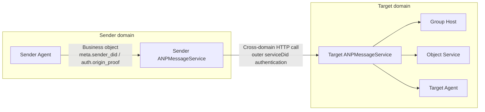
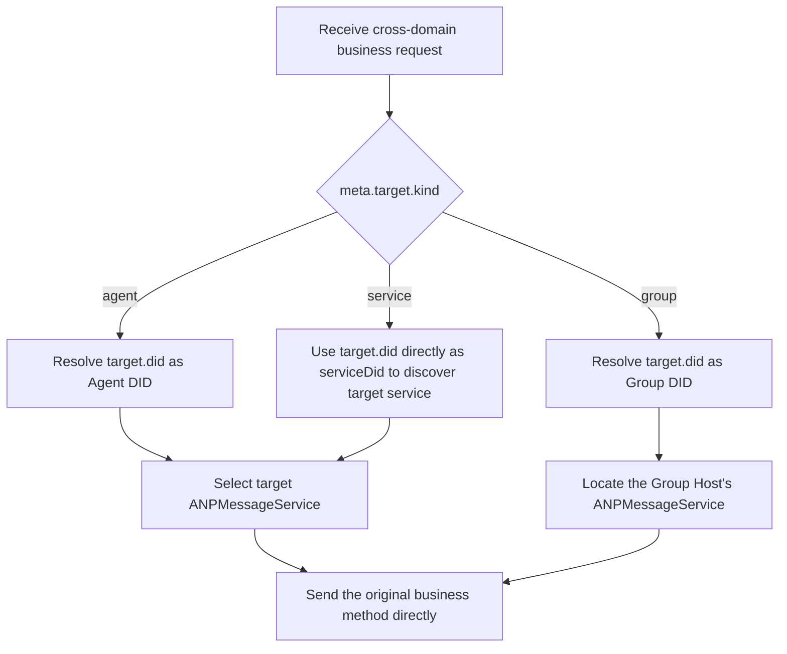
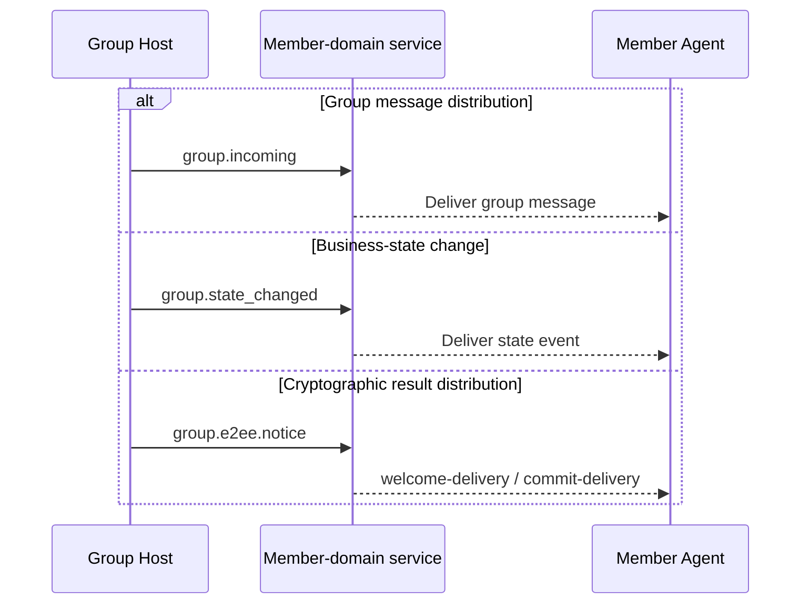
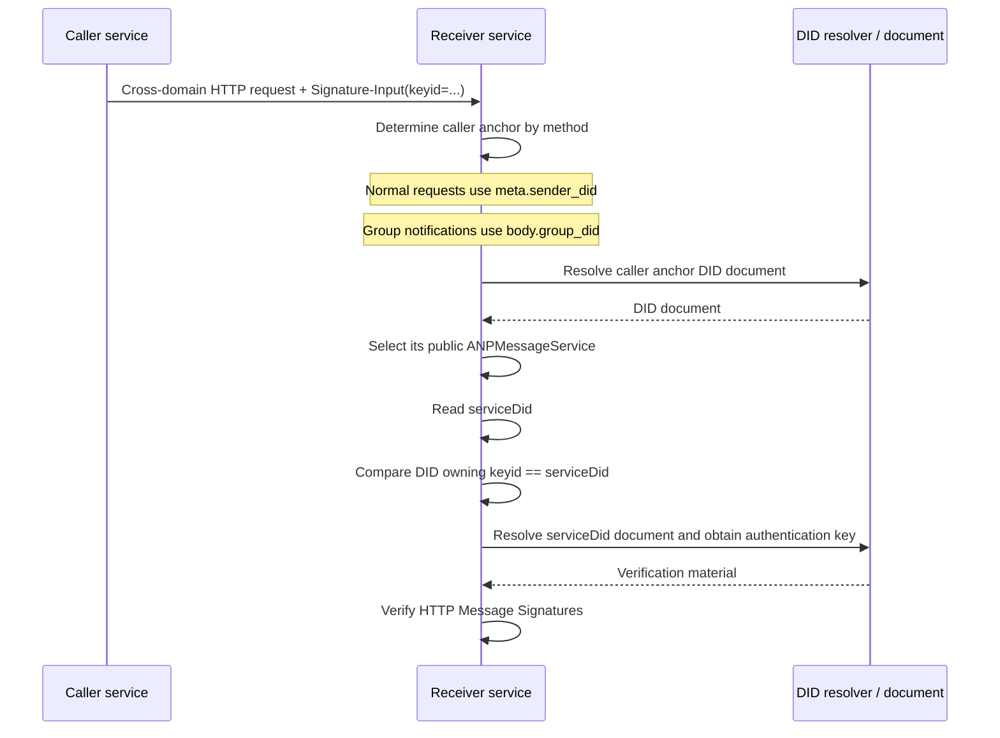
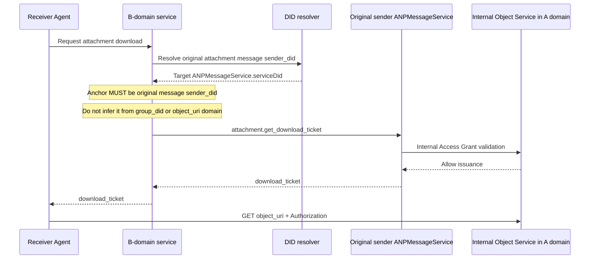

<!-- translation-review: machine-fully-reviewed; scope=full-document-source-lines-1-671; inventory=japanese/reviews/messaging-overlays-review.json -->
> 日本語参考訳（機械翻訳から全文を意味校閲済み）。規範となるのは原文です。本文・見出し・表・条件・否定を原文と照合し、コード例・識別子・規範キーワードを保持しています。独立した二次校閲や実装適合性の検証は未実施です。
> 原文: [message/08-federation-and-cross-domain.md](../../message/08-federation-and-cross-domain.md) / 基準コミット: `0837cfdfaf4ddcf834f0890ddaf34fc4c824e066`

# ANP Profile 8：連携とドメイン間通信

- 文書ID：ANP-P8
- タイトル：連携とドメイン間通信
- 状態：リリース済み
- バージョン：1.2
- 仕様セット：ANP Messaging 1.2
- 原文言語：English
- Profile：`anp.federation.relay.v1`
- 依存関係：`anp.core.binding.v1`、`anp.identity.discovery.v1`、`anp.direct.base.v1`、`anp.group.base.v2`
- 適用範囲：ANPのドメイン間サービス発見、サービス間呼び出し、グループイベントの配信、オブジェクト制御プレーンのドメイン間呼び出しに適用されます。

---

## 1. 目的

このProfileが説明するのは、**ドメインをまたぐ場面で、異なるサービス間の接続をどのように確立し、どのように呼び出し、どの原則に従うか**だけです。

このProfileが重点を置く事項は次のとおりです。

1. あるドメインが、リモートのエージェント向けの要求を、相手ドメインの公開するANPサービス入口へ送る方法。
2. あるドメインが、リモートのグループ向けの操作を、そのグループのHostがあるドメインへ送る方法。
3. グループHostが、順序付けられたグループイベントをメンバーの所属ドメインへ配信する方法。
4. オブジェクト制御プレーンをドメイン間で呼び出す方法（オブジェクトのバイトストリームは対象外）。
5. `attachment.get_download_ticket`のドメイン間呼び出しを実装する方法。
6. ドメイン間サービス呼び出しの外側のHTTP認証に使うべきDID。
7. ドメイン間サービス呼び出しのセキュリティ、冪等性、再試行、成功の意味。

このProfileは次の内容を繰り返し定義**しません**。これらは他のProfileに従います。

- `direct.send`、`group.send`、`group.add`、`group.remove`などの業務メソッド自体。
- E2EEペイロードの構造と暗号処理の意味。
- 添付オブジェクトの構造、チケット形式、オブジェクト検証規則。
- DID文書で定義するサービスの種類と基本的な発見規則。
- ドメイン内ルーティングの実装、履歴同期、既読通知、プレゼンス。
- 中継、CDN、オブジェクトストレージによるオブジェクトのバイト列の内部処理。

---

## 2. 用語と規範上の表記

### 2.1 規範キーワード

本書の**MUST**、**MUST NOT**、**REQUIRED**、**SHALL**、**SHALL NOT**、**SHOULD**、**SHOULD NOT**、**RECOMMENDED**、**NOT RECOMMENDED**、**MAY**、**OPTIONAL**は、すべて大文字で示された場合、規範的要件として解釈します。

### 2.2 用語

- **送信元ドメインサービス（Sender domain service）**：送信者のドメインでローカル要求を受け入れ、ドメイン間サービス呼び出しの開始を担当するサービス。通常、そのドメインの外部向け`ANPMessageService`です。
- **宛先ドメインサービス（Target Domain Service）**：宛先DIDが公開し、ドメイン間要求の受信を担当するサービスエンドポイント。
- **連携サービスDID（Federated Service DID）**：ドメインが、ドメイン間のサービス間HTTP認証に使うDID。通常、送信側の`ANPMessageService.serviceDid`で宣言し、元の業務送信者ではなく、ドメイン間呼び出しを開始するサービスを識別します。`did:web`と`did:wba`では、パスを持たないドメインのみのDIDを推奨します（RECOMMENDED）。
- **グループHostサービス（Group Host Service）**：ある`group_did`の順序付けとグループ状態の進行を担当するサービス。
- **オブジェクトサービス（Object Service）**：添付オブジェクトのアップロード、ダウンロード、チケット発行、アクセス制御を担当するサービス。
- **順序付け済みグループイベント（Ordered Group Event）**：グループHostに受け入れられ、`group_event_seq`を割り当てられたグループイベント。
- **最終受け入れ（Final Acceptance）**：ドメイン間操作が、プロトコル上の最終責任エンドポイントに到達し、受け入れられること。

---

## 3. 設計原則

### 3.1 ドメイン間でも元のメソッドを直接使う

ドメインをまたぐ場面では、送信元ドメインサービスは、中継専用のJSON-RPCメソッドを追加する代わりに、元の業務メソッドまたは制御メソッドを直接使って宛先ドメインサービスとやり取りするべきです（**SHOULD**）。具体的には次のとおりです。

- 個別メッセージングは、ドメイン間で`direct.send`を使います。
- Group Baseは、ドメイン間で`group.create`、`group.get_info`、`group.join`、`group.add`、`group.remove`、`group.leave`、`group.update_profile`、`group.update_policy`、`group.send`を使います。
- Group E2EEは、ドメイン間で`group.e2ee.publish_key_package`、`group.e2ee.get_key_package`、`group.e2ee.create`、`group.e2ee.add`、`group.e2ee.remove`、`group.e2ee.send`を使います。
- オブジェクト制御プレーンは、ドメイン間で`attachment.create_slot`、`attachment.commit_object`、`attachment.abort_object`、`attachment.get_download_ticket`を使います。

### 3.2 宛先サービスを先に発見し、その後でドメイン間呼び出しを確立する

ドメイン間呼び出しの前に、送信元ドメインサービスは、まずDID文書またはそれと等価なキャッシュ結果から宛先サービスの場所を特定し、その後でサービス間呼び出しを開始しなければなりません（**MUST**）。DID文書の解釈とサービス発見の規則はP2が定義しており、このProfileでは繰り返しません。

### 3.3 グループの順序付けはグループHostが管理する

同じ`group_did`のグループ状態や`group_event_seq`を変える操作は、対応するグループHostサービスで処理し、最終的に線形な順序を付けなければなりません（**MUST**）。ドメイン間呼び出しでこれらの要求を送れるのはグループHostだけです。Hostを迂回して、`group_event_seq`や`group_state_version`を独自に割り当てることはできません。

### 3.4 オブジェクトのバイトストリームはドメイン間サービス呼び出し経路を使わない

オブジェクトのバイト列を、一般的な転送チャネルとしてANPのドメイン間サービス呼び出し経路に通してはなりません（**MUST NOT**）。具体的には次のとおりです。

- サービス間呼び出しで、ファイル、画像、音声・映像のバイト列を転送してはなりません（**MUST NOT**）。
- オブジェクトのバイト列は、別のHTTP(S)チャネルでオブジェクトサービスから直接ダウンロードしなければなりません（**MUST**）。
- ドメイン間サービス層が参加するのは、最大でもオブジェクト取得の制御プレーンまでであり、オブジェクトのバイト列自体を運ぶデータプレーンには参加しません。

### 3.5 E2EEペイロードの内容を中間サービスは解釈しない

ドメイン間呼び出しが`direct-e2ee`または`group-e2ee`の業務メッセージを運ぶ場合、中間サービスやドメインゲートウェイは、そのペイロードを不透明なバイト列またはオブジェクトとして扱わなければなりません（MUST）。このProfileがルーティング、冪等性、宛先検証のために明示的に要求する外側のメタデータを除き、変更してはなりません（MUST NOT）。

### 3.6 外側のサービスアイデンティティと業務主体のアイデンティティの分離

ドメインをまたぐサービス間呼び出しの外側のHTTP認証では、元の業務メッセージの`meta.sender_did`、`group_did`、その他のアプリケーション層の主体DIDではなく、送信元ドメインサービス自身の連携サービスDIDを使わなければなりません（MUST）。

言い換えると、次のとおりです。

- 外側のHTTP認証は、「どのドメインサービスが私を呼び出しているか」に答えます。
- `meta.sender_did`と`auth.origin_proof`は、「**どの業務主体がこの操作を開始したか**」に答えます。
- 二つの階層のアイデンティティは関連し得ますが、意味上混同してはなりません（**MUST NOT**）。

### 3.7 Profileが宣言するデバイスセレクターだけを維持する

連携は、元の業務Profileのアドレス指定モデルを変更しません。P5またはP6がデバイスセレクターを明示的に宣言する場合、連携の各ホップはそれを変更せず保持しなければならず（**MUST**）、最終サービスはP2と、それを管理するセキュリティOverlayに従って検証しなければなりません（**MUST**）。ゲートウェイは、そのセレクターを削除、置換、推論してはなりません（**MUST NOT**）。

P3、P4、通常のP7 Base操作は、引き続きDIDまたはGroup DIDを宛先とします。P8は、DID文書、ローカルデバイス状態、受信側ドメインでのファンアウトから、それらのデバイスセレクターを合成してはなりません（**MUST NOT**）。

P8は業務プロトコルを再定義せず、既存の業務オブジェクトが、ドメインをまたいでサービス間をどのように流れるかを説明します。次の概観図は、業務主体、外側のサービスアイデンティティ、グループHost、オブジェクトサービスを一つにまとめています。

*図P8-1：連携とドメイン間通信の概観（非規範）。*

以降の節では、この図をP8の前提として捉えてください。業務オブジェクトは既存のメソッドでドメイン間を運ばれ、外側のHTTP認証が証明するのは、どの公開サービス入口が現在の一段の呼び出しを行っているかだけです。

---

## 4. Profileの識別と依存関係

### 4.1 Profile名

このProfileの標準名は次のとおりです。

`anp.federation.relay.v1`

> 注：Messaging 1.2は、リリース済みの識別子`anp.federation.relay.v1`を維持します。この仕様は、v1の中継がデバイス宛てE2EE v2とどのように組み合わされるかを明確化するだけです。

### 4.2 依存関係

このProfileは、次のProfileに依存しなければなりません（**MUST**）。

- `anp.core.binding.v1`
- `anp.identity.discovery.v1`
- `anp.direct.base.v1`
- `anp.group.base.v2`

このProfileは、次のOverlay／拡張と組み合わせて使ってもかまいません（**MAY**）。

- `anp.direct.e2ee.v1`
- `anp.direct.e2ee.v2`
- `anp.group.e2ee.v1`
- `anp.group.e2ee.v2`
- `anp.attachment.v1`

### 4.3 Security Profile

ドメイン間のサービス間呼び出しは、`transport-protected`モードで動作しなければなりません（**MUST**）。

直接送る業務要求の`meta.security_profile`には、次の値を使ってもかまいません（**MAY**）。

- `transport-protected`
- `direct-e2ee`
- `group-e2ee`

ドメイン間の呼び出し元は、元の業務要求の`meta.security_profile`を無断で変更してはなりません（**MUST NOT**）。

---

## 5. ドメイン間接続の方法

ドメイン間実装の最初の課題は署名ではなく、要求がどの宛先サービス分類に到達すべきかを決めることです。次の図は、`agent`、`group`、`service`の対象モデルごとのルーティング判断をまとめています。

*図P8-2：ドメイン間ルーティングの判断（非規範）。*

要点は「元の業務メソッドを直接送る」ことです。P8は、それを別の中継メソッドで包むことを推奨しません。送信者はまず最終的な公開サービスを発見し、元の要求を、業務責任を持つ正しいエンドポイントへ送ります。

### 5.1 エージェント間

`meta.target.kind = "agent"`の場合、送信元ドメインサービスは次を行わなければなりません（**MUST**）。

1. 宛先の`agent_did`を解決する。
2. DID文書または機能交渉に基づいて、宛先の`ANPMessageService`を選ぶ。
3. 元の`direct.send`を、その宛先サービスへ直接送る。

つまり、ドメインをまたぐ個別メッセージングでは、送信元ドメインサービスは「外向きのサービス呼び出し元」として動作し、新たな中継プロトコル層を追加定義しません。

### 5.2 Group DIDを対象とする場合

`meta.target.kind = "group"`の場合、送信元ドメインサービスは次を行わなければなりません（**MUST**）。

1. 宛先の`group_did`を解決する。
2. Group DID文書またはキャッシュされたグループ状態の参照から、グループHostサービスに対応する`ANPMessageService`を特定する。
3. 元のグループ操作要求を、グループHostサービスへ直接送る。

適用するメソッドには次が含まれますが、これらに限定されません。

- `group.get_info`
- `group.join`
- `group.add`
- `group.remove`
- `group.leave`
- `group.update_profile`
- `group.update_policy`
- `group.send`
- `group.e2ee.add`
- `group.e2ee.remove`
- `group.e2ee.send`

現在のP4 v2コアの`group.join`と`group.add`では、ドメイン間の成功の意味はグループHostの返す業務結果に従います。成功とは、対応する業務メンバー状態が成立したことを意味します。配備者が追加の帯域外資格情報、承認フロー、その他のガバナンス上の中間状態を導入する場合、それは拡張経路であり、P4 v2コアの成功の意味には含まれません。

### 5.3 オブジェクトサービスを対象とする場合

ドメインをまたぐオブジェクト制御操作では、呼び出し元は、元のオブジェクト制御プレーンのメソッドを直接使って宛先オブジェクトサービスとやり取りしなければなりません（**MUST**）。適用するメソッドは次のとおりです。

- `attachment.create_slot`
- `attachment.commit_object`
- `attachment.abort_object`
- `attachment.get_download_ticket`

`attachment.get_download_ticket`では、呼び出し元は、元の添付メッセージ送信者のDIDに基づいてその公開`ANPMessageService`を先に発見し、そのサービスへドメイン間呼び出しを開始しなければなりません（**MUST**）。グループの場合も、`group_did`ではなく、元のグループメッセージの送信者DIDを使います。

### 5.3.1 E2EE素材メソッドのドメイン間ルーティング

P5/P6と組み合わせて実装する場合、次のサービスをスコープとする取得／素材メソッドは、ドメイン間通信で、独自の中継に新しいプロトコル層を重ねるのではなく、最終的な公開`ANPMessageService`へ直接ルーティングしなければなりません（MUST）。

- `direct.e2ee.get_prekey_bundle`
  1. `body.target_did`を解決する。
  2. P5の要件に従って`body.target_device_id`を保持・検証する。
  3. 宛先エージェントが公開する`ANPMessageService`を探す。
  4. 別のデバイスへ置き換えず、そのサービスを直接呼び出す。

- `group.e2ee.get_key_package`
  1. `body.target_did`を解決する。
  2. P6の要件に従って`body.target_device_id`を保持・検証する。
  3. 宛先エージェントが公開する`ANPMessageService`を探す。
  4. 別のデバイスへ置き換えず、そのサービスを直接呼び出す。

これらのメソッドは、v1の相互運用の最小基準で匿名アクセスを前提としません。ホップ単位とサービス単位の認証により、呼び出し元の識別、レート制限、不正利用対策を適用しなければなりません（**MUST**）。

グループE2EEへの参加開始に必要な`welcome`／`ratchet_tree`などの暗号処理結果は、`group.e2ee.notice`で配信します。v1は、独立した`group.e2ee.get_join_info`の標準ドメイン間ルーティングを定義しません。

### 5.4 グループイベントの配信

グループHostが、順序付け済みのグループイベントをメンバードメインへ能動的に配信する場合、独立した中継専用ラッパーを定義する代わりに、既存のグループ通知メソッド、または同等の意味を持つ配備環境の仕組みを直接使うべきです（**SHOULD**）。

- グループメッセージの配信には、`group.incoming`を使うべきです（**SHOULD**）。
- グループ状態変更の配信には、`group.state_changed`を使うべきです（**SHOULD**）。
- グループE2EEの暗号処理結果の配信には、`group.e2ee.notice`を使うべきです（**SHOULD**）。
- 配備者が同等の仕組みを採用する場合、その仕組みは、元のグループの意味を保ち、少なくとも`group_did`、`group_event_seq`、`group_state_version`と対応するイベントペイロードを運ばなければなりません（**MUST**）。

`group.e2ee.notice`は、MLSの初期化をまだ完了していない宛先エージェントへ`welcome-delivery`を配信したり、既存メンバーへ`commit-delivery`を配信したりできます。これはP4のグループメンバーへの一斉通知ではなく、P6の暗号処理結果の配信です。帯域外の招待資格情報や、その他の非メンバー向けガバナンスメッセージがある場合、それらは配備環境の拡張であり、v1の標準ドメイン間経路ではありません。

P4の`group.incoming`と`group.state_changed`は、引き続きメンバーDIDを宛先とし、連携中にデバイスセレクターを付け加えてはなりません（**MUST NOT**）。P6の暗号化配信と`group.e2ee.notice`は、P6が要求する正確な受信デバイスセレクターを保持し、一つのデバイスに結び付いた暗号処理結果を同じDIDの他のデバイスへ一斉配信してはなりません（**MUST NOT**）。

P8は、グループHostにグループイベント用の新プロトコルを設計することを要求しません。既存の通知メソッドの直接再利用を推奨します。次の図は、メッセージ配信、業務状態変更、暗号処理結果の配信という三つの経路を並べ、意味上の境界を区別できるように示しています。

*図P8-3：グループイベントのドメイン間配信（非規範）。*

実装が同等の仕組みを使う場合も、これら三つの経路の意味の分離を維持し、業務イベント、グループメッセージ、暗号処理通知を同じ通知オブジェクトへ混在させるべきではありません。

---

## 6. サービス間のセキュリティ要件

### 6.1 安全なチャネル

すべてのサービス間呼び出しは、相互認証または同等の相手認証を備えた安全なチャネル上で行わなければなりません（**MUST**）。

### 6.2 発信元の識別可能性

各サービス間呼び出しでは、受信側が発信元サービスを識別できなければなりません（**MUST**）。DIDに基づく配備では、発信元サービスのアイデンティティを、外側のHTTP Message Signaturesの`Signature-Input`／`keyid`パラメーターで表現しなければならず（**MUST**）、この`keyid`の所属DIDは、送信側の`ANPMessageService.serviceDid`と一致しなければなりません（MUST**）。〔訳注：原文でこの規範語の強調記法が崩れていますが、要件を変更せず保持しています。〕

HTTP Message Signatures認証は[ANP-02](../../02-anp-did-authentication-protocol-specification.md#http-binding)に従います。

#### 6.2.1 連携サービスDIDの選択規則

ドメインをまたぐサービス間HTTP要求では、次に従います。

1. 送信側のドメイン間呼び出し用`ANPMessageService`エントリは、`serviceDid`を宣言しなければなりません（**MUST**）。
2. 送信元ドメインが`did:web`を使う場合、`serviceDid`には`did:web:alice.com`などのドメインのみのDIDを使うべきです（**SHOULD**）。
3. 送信元ドメインが`did:wba`を使う場合、`serviceDid`には`did:wba:alice.com`などのドメインのみのDIDを使うべきです（**SHOULD**）。
4. `Signature-Input`の`keyid`は完全なDID URLであり、`serviceDid`文書の`authentication`関係によって認可された検証メソッドを指さなければなりません（**MUST**）。
5. 受信側は、ANP-02と適用されるメソッドのバインディングに従って、文書検証、認証用途の厳密な確認、実際のHTTP要求の認証を完了しなければなりません（**MUST**）。

例えば、`alice.com`では、次のDIDがドメイン単位の連携サービスDIDになります。

- `did:web:alice.com`
- `did:wba:alice.com`

このうち、`did:wba:alice.com:agents:relay:e1_<fingerprint-a>`はパス型DIDです。通常のエージェントやサブアイデンティティのDIDにはできますが、既定では、このProfileが定めるドメイン単位の連携サービスDIDとして使うべきではありません（SHOULD NOT）。

caller anchorのDIDと、それが宣言する`serviceDid`は、対応する異なるDIDメソッドを使ってもかまいません。その関連は6.2.2節に従って検証します。

#### 6.2.2 `serviceDid`に基づく検証処理

サービスAがサービスBへドメイン間要求を送る場合、サービスBは、メソッドの種類に基づき、呼び出し元の`serviceDid`を導く業務上のアンカー（caller anchor）を先に特定し、その後でサービスアイデンティティを検証しなければなりません（**MUST**）。

caller anchorの規則は次のとおりです。

- 次を含む、通常のドメイン間要求では：
  - `direct.send`
  - `group.create`
  - `group.get_info`
  - `group.join`
  - `group.add`
  - `group.remove`
  - `group.leave`
  - `group.update_profile`
  - `group.update_policy`
  - `group.send`
  - `direct.e2ee.*`
  - `group.e2ee.publish_key_package`
  - `group.e2ee.get_key_package`
  - `group.e2ee.create`
  - `group.e2ee.add`
  - `group.e2ee.remove`
  - `group.e2ee.send`
  - `attachment.*`

  caller anchorには`meta.sender_did`を使わなければなりません（**MUST**）。

- `group.incoming`、`group.state_changed`、`group.e2ee.notice`では：

  caller anchorには`body.group_did`を使わなければなりません（**MUST**）。

その後、受信側は、次の順序で送信側サービスのアイデンティティを検証しなければなりません（**MUST**）。

1. 上の規則に従ってcaller anchorを特定する。
2. P2のメソッド規則に従って、現在のcaller anchor文書を解決・検証する。
3. P2のサービス選択規則に従って、そのDIDに対応する公開`ANPMessageService`を選ぶ。
4. 選んだサービスエントリが宣言する`serviceDid`を読み取る。
5. 外側のHTTPの`Signature-Input`から`keyid`を抽出し、その所属DIDを取得する。
6. `keyid`の所属DIDが、手順4の`serviceDid`と完全に一致することを検証する。
7. ANP-02とそのメソッドのバインディングに従って、現在の`serviceDid`文書を解決・検証する。
8. `serviceDid`文書の`authentication`関係で認可された公開鍵を使って、外側のHTTP要求の署名を検証する。

手順3で選んだ`ANPMessageService`が`serviceDid`を宣言していない、または手順6の照合が一致しない場合、受信側は、ドメイン間サービスのアイデンティティ認証が失敗したものとして扱わなければなりません（**MUST**）。

受信側は、呼び出し元の`serviceDid`を常に`meta.sender_did`から導いてはなりません（**MUST NOT**）。グループ通知でそうすると、元の業務送信者を現在のドメイン間呼び出し元と誤認します。

メソッドの種類でcaller anchorを決める部分は、P8で特に実装を誤りやすい箇所です。次のシーケンス図は、caller anchor、`ANPMessageService.serviceDid`、外側のHTTPの`keyid`の間の検証順を明示します。

*図P8-4：caller anchorと`serviceDid`の検証（非規範）。*

受信側は、呼び出し元の`serviceDid`を常に`meta.sender_did`から導くべきではありません。`group.incoming`、`group.state_changed`、`group.e2ee.notice`などのグループ通知では、業務アンカーを`body.group_did`へ切り替えるべきです。

#### 6.2.3 ドメインのみのDIDを使う際の規則

ドメインがドメイン間サービスのアイデンティティ認証に`did:wba`を使う場合、配備者は、ドメイン単位の連携サービスDIDとしてドメインのみのDIDを使うべきであり（**SHOULD**）、そのドメイン単位のアイデンティティを通常のエージェントDID、Group DID、その他のパス型DIDで代用するべきではありません（**SHOULD NOT**）。

実装者は、同じドメインのみのDID文書に、`authentication`に使える検証メソッドを複数保持してもかまいません（**MAY**）。これにより、異なるサービスインスタンス、異なる鍵の世代、滑らかなローテーションを支えられます。個々のサービス間認証にどの検証メソッドを使うかは、配備ポリシーで決めます。

### 6.3 元の業務オブジェクトを維持する

サービス間呼び出しを行う場合、元の業務要求の`method`、`params.meta`、`params.body`は、宛先ドメインサービスが受信するものと等価であるべきです（**SHOULD**）。直列化やゲートウェイ変換のためにJSONを再符号化する必要があっても、オブジェクトの意味を変えてはなりません（**MUST**）。

これには、元のP5/P6メソッドが宣言する場合に限ってデバイスセレクターを保持することも含みます。Base操作で等価であるとは、セレクターを追加しないことです。

### 6.4 Origin Proofを保持する

元の業務要求が`auth.origin_proof`を運ぶ場合、ドメイン間の送信側は、証明オブジェクトを変更せず保持して要求とともに送らなければなりません（**MUST**）。宛先ドメインサービスは、それぞれの業務profileの要件に従って、この証明を独立して検証しなければなりません（**MUST**）。

連携サービスDIDの外側のHTTP認証で、このorigin proofを置き換えてはなりません（**MUST NOT**）。送信元ドメインサービスも、`auth.origin_proof`を自身の連携サービスDIDへ書き換えてはなりません（**MUST NOT**）。

現在のP7 v1本流の`attachment.*`制御プレーンメソッドでは、末端サービスの`auth.origin_proof`は通常存在しません。外側の`serviceDid`のホップ認証を、そのサービスのorigin proofと誤認してはなりません（**MUST NOT**）。

### 6.5 外側の可視性を最小化する

ドメイン間で送る業務要求について、中間サービスから見え、ルーティング／冪等性のために利用を認めるフィールドは、次に限られます。

- `meta.profile`
- `meta.security_profile`
- `meta.sender_did`
- `meta.target`
- `meta.operation_id`
- `meta.message_id`（存在する場合）。
- `meta.content_type`
- `meta.sender_device_id`と`meta.recipient_device_id`。ただし、内包側のP5/P6 Profileが宣言する場合だけ。

中間サービスは、その他のフィールド、特にE2EEで保護された業務内容に、無断で依拠したり、変更・書き換えを行ったりしてはなりません（**MUST NOT**）。

### 6.6 暗黙のダウングレードを禁止する

ドメイン間呼び出し経路のいずれの当事者も、明示的な交渉なしに、元の要求を高いsecurity profileから低いものへ暗黙にダウングレードしてはなりません（**MUST NOT**）。

### 6.7 DID移行のエラーと書き換えの禁止

JSON-RPCのアプリケーション処理前に失効済みDIDを検出した場合、ANP-02のメソッドバインディングは、規定するHTTP応答（例：WBAのHTTP `409`）を返すことがあります。ANPメソッドがアプリケーション処理に入り、ルーティング、body、保存状態内のDIDが置換済みの場合、最終業務サービスがP1の`anp.did_superseded`を返します。一つの要求で両方の層のエラーを返してはなりません（**MUST NOT**）。

連携サービスは、最終サービスのDID移行エラーを保持しなければならず（**MUST**）、`currentDid`や`current_did`を信頼済みのリダイレクトとして扱ってはなりません。元の呼び出し元が移行を検証し、影響する要求フィールドと認証コンテキストをすべて再構築して、再署名・再試行します。

中間サービスは、`meta.sender_did`、`meta.target.did`、P4の`body.member_did`、P5/P6のDIDまたはデバイスのバインディング、メンションペイロード、暗号化されたAAD、元の`auth.origin_proof`を書き換えてはなりません（**MUST NOT**）。P4がメンバーDID更新を受け入れた後、グループHostが現在のDID宛てに新しい`group.incoming`や`group.state_changed`通知を生成することは可能です。Host自身がその通知の発信元なので、これは中継による書き換えではありません。

連携サービスは、置換済み応答、署名失敗、エンドポイント失敗、失効、機能の競合があった後、DID文書とサービス選択のキャッシュを更新するべきです（**SHOULD**）。

---

## 7. 冪等性と再試行

### 7.1 業務の冪等性を優先する

ドメイン間サービス呼び出しは、元の業務メソッドが定義する冪等性の意味を再利用しなければなりません（**MUST**）。具体的には次のとおりです。

- `direct.send`は、引き続き元の`sender_did + target.did + method + operation_id`の規則を使います。
- `group.*`は、引き続き各グループメソッドが定義する冪等性と重複排除の規則を使います。
- `attachment.*`は、引き続き各オブジェクト制御プレーンメソッドが定義する冪等性と重複排除の規則を使います。

### 7.2 再試行の要件

ネットワーク障害、タイムアウト、結果が確定しない状態では、送信元ドメインサービスは再試行してもかまいません（**MAY**）。ただし、再試行時は次に従います。

- 元の`operation_id`を変更してはなりません（**MUST**）。
- メッセージの意味がある場合、元の`message_id`を変更せず維持しなければなりません（**MUST**）。
- オブジェクト制御の呼び出しでは、元の`attachment_id`と関連コンテキストを変更せず維持するべきです（**SHOULD**）。
- 業務ペイロードは意味的に等価なままでなければなりません（**MUST**）。
- P5/P6操作では、宣言された各デバイスセレクターを変更せず維持しなければなりません（**MUST**）。Baseの再試行のスコープは、引き続きDID単位です。

受け入れられたDID移行によって送信者や宛先のDIDが変わる場合、中間サービスではなく呼び出し元が、新しい認証済み要求を作成します。管理元Profileの要件に従って論理的な`message_id`／`operation_id`を維持しつつ、DIDに結び付く署名、ダイジェスト、暗号文、AADを再構築します。

### 7.3 実装内部の追跡フィールド

配備者は、トレースID、試行回数、経路ヒントなどのフィールドを実装内部に保持してもかまいません（**MAY**）。ただし、これらはこのProfileが定義する標準のドメイン間要求オブジェクトの一部ではありません。元の業務profileの冪等性キーを置き換えてはなりません（**MUST NOT**）。

### 7.4 冪等な応答

受信側が、正常に処理済みの元の業務要求を識別した場合、業務要求を繰り返すのではなく、初回の正常処理と等価な応答を返すべきです（**SHOULD**）。

---

## 8. ドメイン間の成功の意味

### 8.1 `direct.send`

ドメイン間の`direct.send`では：

- 最終宛先ドメインサービスがメッセージを受け入れた時点で、送信元ドメインサービスは、ローカルの呼び出し元へ成功を返してもかまいません（**MAY**）。
- 以後の宛先エージェントをドメイン内でどのように処理、キューイング、ルーティングするかは、このProfileの成功の意味の範囲外です。

### 8.2 P4のグループ制御操作

`group.join`、`group.add`、`group.remove`、`group.update_profile`、`group.update_policy`などのP4制御操作では：

- 最終グループHostサービスが順序付けを受け入れた時点で、送信元ドメインサービスは、ローカルの呼び出し元へ成功を返してもかまいません（**MAY**）。
- 現在のP4 v2コアでは、`group.join`／`group.add`の成功は、対応する業務メンバー状態が成立したことを意味します。
- メンバードメインへの同期とP6による暗号処理の実現は、後続の非同期段階です。

### 8.3 P6の暗号制御操作

`group.e2ee.create`、`group.e2ee.add`、`group.e2ee.remove`では：

- 最終グループHostサービスが暗号制御操作を受け入れ、成功結果を返した時点で、送信元ドメインサービスは、ローカルの呼び出し元へ成功を返してもかまいません（**MAY**）。
- この成功は、関連するMLS制御結果が宛先Hostに受け入れられ、既存の業務状態と対応付けられたことを示します。
- 別個の新しいP4業務メンバー状態を作成したと解釈してはなりません（**MUST NOT**）。

### 8.4 `group.send`

ドメイン間の`group.send`では：

- グループHostサービスが受け入れ、`group_event_seq`を割り当てた時点で、ドメイン間処理は成功とみなせます。
- メンバードメインがそのイベントを受け取る時点は、後続のイベント配信機構によって決まります。

### 8.5 `group.e2ee.send`

ドメイン間の`group.e2ee.send`では：

- グループHostサービスがMLS暗号文オブジェクトを受け入れて順序付け、対応する`group_event_seq`、`group_state_version`、`group_receipt`を返した時点で、ドメイン間処理は成功とみなせます。
- この成功は、HostがグループE2EE暗号文を一つ受け入れて順序付けたことを意味します。
- 各メンバーが受け取る時点と、正常に復号できるかどうかは、後続の配信とローカルのMLS状態によるため、ドメイン間の成功の意味には含まれません。

### 8.6 `attachment.get_download_ticket`

ドメイン間の`attachment.get_download_ticket`では：

- 最終オブジェクトサービスが有効なチケットを返す、または明示的に拒否した時点で、ドメイン間処理は成功とみなせます。〔訳注：原文は、明示的な拒否もドメイン間の成功に含めています。チケット発行の成功やダウンロードの成功とは区別してください。〕
- チケットの返却は、ダウンロード成功と**同じではありません**。
- オブジェクトのダウンロードとダイジェスト検証は、引き続き後続の独立したHTTPSデータプレーンの手順です。

## 9. 添付ファイルとダウンロードチケットのドメイン間の考慮事項

### 9.1 最終処理エンドポイント

`attachment.get_download_ticket`のプロトコル上の最終宛先は、元の添付メッセージ送信者DIDが公開する`ANPMessageService`でなければなりません（MUST）。この公開サービス入口から、実際にオブジェクト制御を処理するオブジェクトサービスへ内部で転送することは可能ですが、それは実装の詳細です。

したがって、標準の相互運用の意味での「最終処理エンドポイント」は次のとおりです。

- プロトコル上：元の添付メッセージ送信者DIDに対応する公開`ANPMessageService`。
- 実装上：そのサービスの背後にある内部のオブジェクトサービス（任意）。

グループの場合、呼び出し元は、発見のアンカーとして`group_did`ではなく元のグループメッセージ送信者のDIDを使わなければなりません（**MUST**）。`object_uri`のURLドメイン名だけから制御プレーンサービスを推測してはなりません（**MUST NOT**）。

### 9.2 チケット要求を開始するのは誰か

v1の標準相互接続経路は、「ドメインサービスの代理モード」を主経路にしなければなりません（**MUST**）。

#### モードA：ドメインサービスの代理モード（v1標準経路）

要求元のエージェントは、ローカルの`ANPMessageService`または同等のドメインサービスへ`attachment.get_download_ticket`を送信します。そのサービスが外向きの代理としてドメイン間要求を開始します。

このモードは次の場合に適しています。

- ドメイン単位の監査を統一する必要がある。
- サービス間のアイデンティティ認証を統一する必要がある。
- エージェント自身が、ドメイン間サービス呼び出しのすべての詳細を直接扱わない。

このモードでは、ローカルのドメインサービスは、元の添付メッセージの送信者DIDに基づいてその公開`ANPMessageService`を解決し、そのサービスへ`attachment.get_download_ticket`を送らなければなりません（**MUST**）。

#### モードB：エージェントによる直接モード（配備環境の拡張）

要求元エージェントが、元の添付メッセージ送信者DIDを直接解決し、その公開`ANPMessageService`を呼び出します。

このモードは**v1のMTIに含まれません**。配備環境で有効にする場合、次を独自に解決する必要があります。

- エージェントが、元の添付メッセージ送信者DIDに基づき、宛先の`serviceDid`を取得・検証する方法。
- クライアントが外側のサービス認証を行う方法。
- クライアントがレート制限、再試行、監査ポリシーを統一的に扱う方法。

添付ダウンロードチケットのドメイン間エンドポイントは、`object_uri`のドメインや`group_did`と誤認されやすい点です。次の図は標準経路を示し、制御プレーンでの発見アンカーが、添付メッセージの元の送信者DIDでなければならないことを強調します。

*図P8-5：ドメイン間の`attachment.get_download_ticket`フロー（非規範）。*

この図は、プロトコルと実装の境界も示します。外部と相互運用するプロトコルエンドポイントは公開`ANPMessageService`です。内部で別のオブジェクトサービスへルーティングするかどうかは、実装の詳細です。

### 9.3 ダウンロード操作

チケット取得後、要求元は、独立したHTTPSチャネルを使ってオブジェクトサービスへのダウンロードを開始しなければなりません（**MUST**）。

- チケットは`Authorization`ヘッダーまたは指定した独自ヘッダーに入れるべきです（**SHOULD**）。
- チケットをURLのクエリパラメーターへ入れるべきではありません（**SHOULD NOT**）。
- ダウンロード成功後、要求元はP7に従ってオブジェクトのダイジェストを検証しなければなりません（**MUST**）。
- オブジェクトが`object-e2ee`を使う場合、オブジェクト単位の復号と復号後の検証も実行しなければなりません（**MUST**）。

標準経路でオブジェクト制御サービスがチケットを発行する場合、次の二層のコンテキストに基づいて認可を判断しなければなりません（**MUST**）。

1. 外側の呼び出し元の`serviceDid`がHTTP Message Signaturesの検証を通過していること。
2. 要求body内の`requester_did`、`security_profile`、`target_did`／`group_did`、`message_id`などのコンテキストが、オブジェクトサービスのポリシーを満たすこと。

既定では、オブジェクト制御サービスは、エンドユーザーの独立した業務証明を直接検証することを要求しません。

## 10. 相互運用の最小要件

このProfileに適合する実装は、少なくとも次に対応しなければなりません（MUST）。

1. `agent_did`と`group_did`に対するサービス発見を行う。
2. ドメインをまたぐ際、元の業務メソッドを直接使って宛先サービスとやり取りする。
3. 元の`security_profile`、`operation_id`、関連するorigin proofを変更せず維持する。
4. グループ状態や`group_event_seq`を変えるすべての操作を、最終グループHostサービスへ送る。
5. `group.join`、`group.add`、`group.remove`、`group.leave`、`group.update_profile`、`group.update_policy`、`group.send`を最終グループHostサービスへ直接ルーティングできる。
6. P6と組み合わせる場合、`group.e2ee.create`、`group.e2ee.add`、`group.e2ee.remove`、`group.e2ee.send`の正しいドメイン間到達先に対応する。
7. P5/P6と組み合わせる場合、`direct.e2ee.get_prekey_bundle`と`group.e2ee.get_key_package`のドメイン間ルーティングに対応する。
8. `attachment.get_download_ticket`を、元の添付メッセージ送信者DIDが公開する`ANPMessageService`へ送る。
9. ドメイン間サービス呼び出し経路で、オブジェクトのバイト列を通常の転送対象にすることを明示的に禁止する。
10. 順序付け済みグループイベントをメンバードメインへ配信する仕組みを、少なくとも一つ用意する。P6と組み合わせる場合、`group.e2ee.notice`のドメイン間配信に対応しなければならない（**MUST**）。
11. ドメイン間呼び出しに参加する`ANPMessageService`に`serviceDid`を宣言し、メソッドに応じたcaller anchorに従って外側のHTTP Message Signaturesを検証する。
12. `did:wba`配備で、ドメイン単位の連携サービスDIDとしてドメインのみのDIDを使うことに対応する。
13. デバイスセレクターは、それを宣言するP5/P6操作でだけ保持・検証し、P3/P4/P7 Base操作のために合成しない。
14. HTTP `409`とJSON-RPCの`anp.did_superseded`の層の区別を維持し、最終サービスのエラーを変更せず転送する。
15. 中継中に、DIDに結び付いた署名済みまたは暗号化された業務フィールドを書き換えない。
16. 移行、署名、エンドポイント、失効、機能の競合に応じて、DIDとサービスのキャッシュを更新する。

## 11. 参考実装の注記（非規範）

実装者は、このProfileを次のように捉えるべきです。

- ドメインをまたぐ場面におけるProfile 1〜7の補足的な連携原則。
- サービス間の直接呼び出しに対する制約層。
- サービス間の外側のDID認証における選択規則。
- グループHostによる順序付けと、グループイベントの非同期配信の原則の説明。
- オブジェクト制御プレーンのドメイン間配置規則と、それに伴うダウンロード責任の境界。

つまり、このProfileは、別の業務プロトコル群を再定義するのではなく、ドメイン間での**接続方法、送信方法、成功の判定方法**を定めます。
