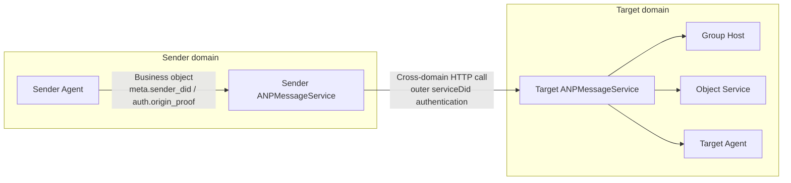
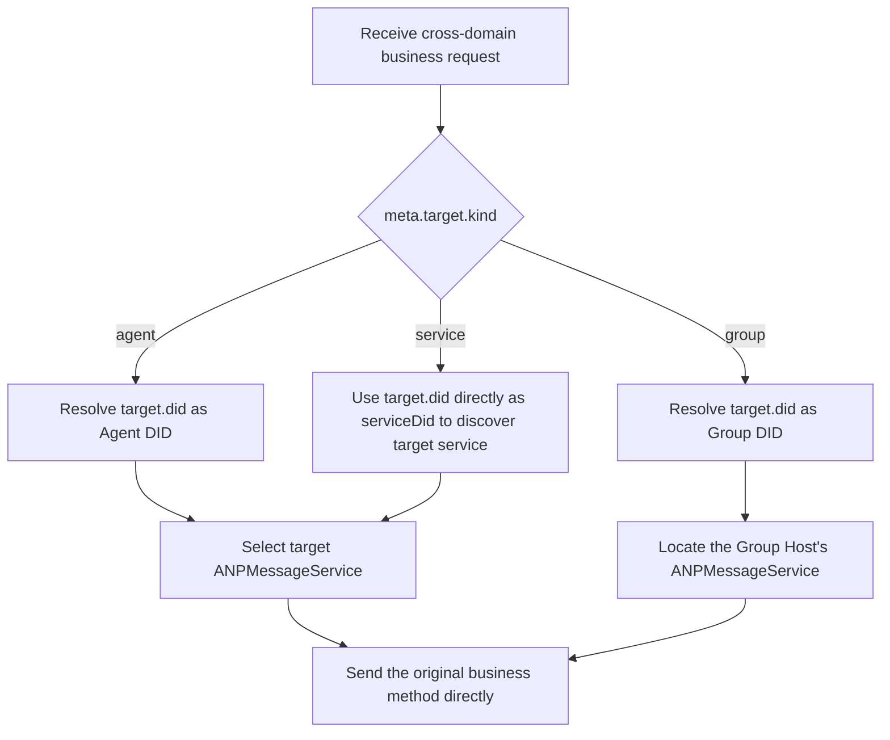
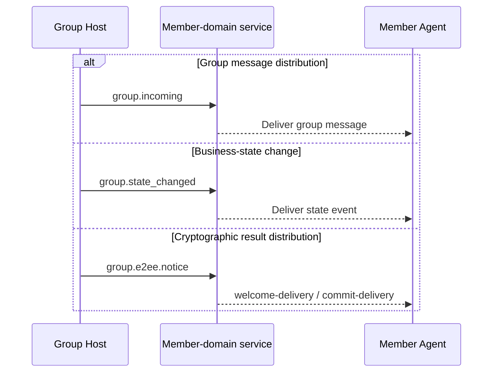
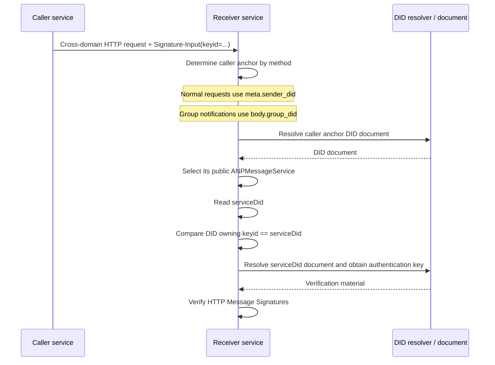
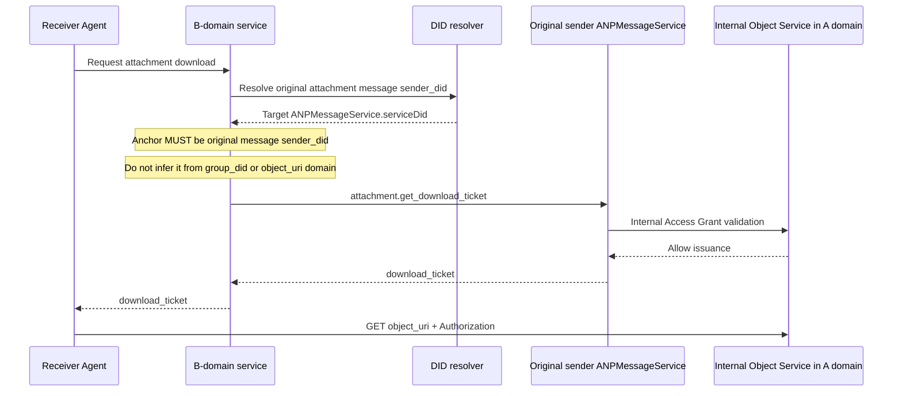

> 日本語参考訳（機械翻訳・未校閲）。規範となるのは原文です。コード例・識別子・規範キーワードは原文を保持しています。
> 原文: [message/08-federation-and-cross-domain.md](../../message/08-federation-and-cross-domain.md) / 基準コミット: `0837cfdfaf4ddcf834f0890ddaf34fc4c824e066`

# ANPプロフィール8:連合およびクロスドメイン

- 文書ID: ANP-P8
- タイトル:連盟とクロスドメイン
- ステータス: リリース
- バージョン: 1.2
- 仕様セット: ANP のメッセージング 1.2
- 原文言語: English / このページは日本語参考訳
- プロフィール: `anp.federation.relay.v1`
- 依存関係: `anp.core.binding.v1`, `anp.identity.discovery.v1`, `anp.direct.base.v1`, `anp.group.base.v2`
- 応用性:このプロファイルは、ANPクロスドメインサービス検出、サービスツーサービスの呼び出し、グループイベントの配布、およびオブジェクト制御平面のクロスドメイン呼び出しに適用されます。

---

## 1. 目的:

このページは、このプロフィールのみが説明するものです。 **さまざまなサービス間での接続をクロスドメインのシナリオで確立する方法、それらを呼び出す方法、そしてどのような原則に従うべきか**.

このプロフィールの焦点は:

1. リモートエージェントが他のドメインで公開されている ANP サービス入口にリクエストを送信するドメインは 1 つ
2. ドメインがグループホストが配置されているドメインにリモートグループのための操作を送信する方法。
3. グループホストが、グループイベントを注文したドメインに配布する方法
4. ドメイン間でオブジェクトコントロールプレーン(オブジェクトバイトストリームではなく)を呼び出す方法
5. 横断通話の実装方法 `attachment.get_download_ticket`;
6. どの DID が、クロスドメインサービスコールの外部 HTTP 認証で使用すべきか
7. セキュリティー、優位性、回復力、クロスドメインサービスの成功のセマンティクス。

プロフィール **しない** 繰り返し次の内容を定義します。他のプロファイルの対象となります。

- `direct.send`, `group.send`, `group.add`, `group.remove` ほかのビジネスメソッドも、
- E2EEペイロード構造と暗号セマティクス;
- 添付オブジェクト構造、チケット形式、オブジェクト検証ルール;
- DID 文書で定義されるサービスの種類と基本的な検出ルール。
- 初期のルーティング実装、歴史同期、読み取りレシート、プレゼンス。
- リレー、CDN、オブジェクトストレージによるオブジェクトバイトの内部処理。

---

## 2. 用語集と定款

### 2.1 仮説キーワード

このドキュメントでは、 **MUST**, **MUST NOT**, **REQUIRED**, **SHALL**, **SHALL NOT**, **SHOULD**, **SHOULD NOT**, **RECOMMENDED**, **NOT RECOMMENDED**, **MAY**と **OPTIONAL** すべての資本金に示されるとき、規範的な要件として解釈される必要があります。

### 2.2 用語集

- **ドメインサービス**: ローカルリクエストを受け入れる送信者のドメイン内のサービスで、クロスドメインサービスの呼び出しを開始するための責任があります。通常は外部 `ANPMessageService` ドメインの
- **ターゲットドメインサービス**: 対象となるDIDでサービスエンドポイントを露出し、クロスドメインリクエストを受信する責任があります。
- **受託サービス DID**: ドメインがクロスドメインサービスからサービスへHTTP認証を行うDIDです。 通常は送信者の宣言 `ANPMessageService.serviceDid` フィールドと元業務送信者ではなく、クロスドメイン呼び出しを開始したサービスを特定します。 のために `did:web` とりあえず `did:wba`, ベアドメインの DID は RECOMMENDED.
- **グループホストサービス**: 注文およびグループ状態の進歩に責任があるサービス `group_did`.
- **オブジェクトサービス**: 添付オブジェクトのアップロード、ダウンロード、チケット発行およびアクセス制御を担当するサービス。
- **オーダーグループイベント**: グループイベント `group_event_seq` グループホストが承諾し、割り当てられました。
- **最終受入**: 十字オリジン操作は最終的なプロトコルの責任エンドポイントに達し、受け入れられます。

---

## 3. デザイン原則

### 3.1 ドメイン間で直接オリジナルメソッドを使用する

横断的なシナリオでは、送信者ドメインサービス **SHOULD** 追加のリレー固有のJSON-RPCメソッドを導入するのではなく、ターゲットドメインサービスと直接やり取りするときに元のビジネス方法または制御方法を使用します。 具体的に:

- ダイレクトメッセージング用途 `direct.send` ドメイン全体;
- グループベース使用 `group.create`, `group.get_info`, `group.join`, `group.add`, `group.remove`, `group.leave`, `group.update_profile`, `group.update_policy`と `group.send` ドメイン全体;
- グループE2EE利用 `group.e2ee.publish_key_package`, `group.e2ee.get_key_package`, `group.e2ee.create`, `group.e2ee.add`, `group.e2ee.remove`と `group.e2ee.send` ドメイン全体;
- オブジェクト制御平面は、 `attachment.create_slot`, `attachment.commit_object`, `attachment.abort_object`と `attachment.get_download_ticket` ドメイン全体で。

### 3.2 ターゲットサービスファーストを発見し、その後、クロスドメインコールを確立

横断電話を作る前に、送信者ドメインサービス **MUST** 最初に、DID ドキュメントまたは同等のキャッシュ結果から対象サービスの場所を決定し、サービスツーサービスの呼び出しを開始します。 DID-document の解釈とサービスディスカバリルールは P2 で定義されており、このプロファイルでは繰り返されることはありません。

### 3.3 グループ注文は、グループホストによって管理されます

グループの状態またはグループ状態を変更する操作 `group_event_seq` 同じのため `group_did` **MUST** 最終線形命令のための対応するグループ・ホスト サービスによって処理されるため。 当社グループのホストにのみ、このようなリクエストを送信できるクロスドメイン呼び出し。グループホストを迂回し、割り当てることはできません `group_event_seq` または `group_state_version` 独立して。

### 3.4 オブジェクトバイトストリームは、クロスドメインサービスの呼び出しリンクを使用しないでください

オブジェクトバイト **MUST NOT** ANPのクロスドメインサービスの呼び出し経路を一般的な転送チャネルとして通過します。 具体的に:

- サービスtoサービス呼び出し **MUST NOT** ファイルのバイト、画像バイト、またはオーディオ/ビデオバイトを転送する。
- オブジェクトバイト **MUST** オブジェクトサービスから直接別のHTTP(S)チャネルでダウンロードします。
- 十字ドメインサービスレイヤーは、オブジェクトを取得するための制御面で、オブジェクトを運ぶためのデータ平面に参加しません。

### 3.5 E2EEペイロードは、中間サービスに透明です

十字ドメインの呼び出しが運ぶとき `direct-e2ee` または `group-e2ee` 業務メッセージ、中間サービスまたはドメインゲートウェイ MUST 不透明バイトや不透明なオブジェクトとして、そのペイロードを扱います。 MUST NOT ルーティング、暗証番号、または宛先認証のためにこのプロファイルによって明示的に要求される外部メタデータを除き、変更します。

### 3.6 外部サービス ID と事業主体のアイデンティティの分離

ドメインサービスからサービスの呼び出しまで、外部のHTTP認証 MUST 送信者のドメインサービス独自のフェデレーションサービスDIDではなく、 `meta.sender_did`, `group_did`元のビジネス メッセージの、または他の適用層の原物の DID。

つまり、

- 外部のHTTP認証は「ドメインサービスが呼び出される」と回答します。
- `meta.sender_did` とりあえず `auth.origin_proof` 回答「**企業がこの行動を開始した事業体**";
- アイデンティティの2つのレベルは関連することができますが、意味的に **MUST NOT** 混乱する。

### 3.7 プロファイルデクラッドデバイスセレクターのみ保存

オリジナルの事業プロファイルのアドレス変更は行いません。 P5 または P6 がデバイスセレクタを明示的に宣言する場合、フェデレーションされたホップ **MUST** 変更されていないまま保存し、最終サービス **MUST** P2 および独自のセキュリティオーバーレイで検証します。 ゲートウェイ **MUST NOT** セレクターを取り外し、交換、または差し込みます。

P3、P4、通常のP7ベース操作はDIDまたはグループ-DID-アドレスが残っています。 プチ8 **MUST NOT** DID ドキュメント、ローカルデバイスの状態、または受信ドメインのファンアウトからデバイスセレクタを合成します。

P8 は、ビジネスプロトコルを赤くしない。 代わりに、既存のビジネスオブジェクトがドメイン間でサービス間で流れているかを説明します。 業務上の課題、外部サービス・アイデンティティ、グループ・ホスト、およびオブジェクト・サービスの1つのビューを以下に示します。

*図 P8-1: 連合とクロスドメインの概要(非放射性)。*

その後のセクションを読むと、この図をP8の前提として扱います。既存のメソッドでビジネスオブジェクトがドメイン間で実行されます。ただし、外部HTTP認証はパブリックサービスエントリが現在の1ホップコールを実行しているかのみ証明します。

---

## 4. プロフィールの同一証明および依存関係

### 4.1 プロフィール名

このプロファイルの標準的な名前は、次のとおりです。

`anp.federation.relay.v1`

> 注: メッセージを送信する 1.2 は解放されたまま保ちます `anp.federation.relay.v1` 識別子; この仕様は、v1 リレーがデバイスアドレス E2EE v2 でどのように構成するかを明らかにするだけです。

### 4.2 依存関係

プロフィール **MUST** 下記のプロフィールによります。

- `anp.core.binding.v1`
- `anp.identity.discovery.v1`
- `anp.direct.base.v1`
- `anp.group.base.v2`

プロフィール **MAY** 以下にオーバーレイ/拡張機能を使用する:

- `anp.direct.e2ee.v1`
- `anp.direct.e2ee.v2`
- `anp.group.e2ee.v1`
- `anp.group.e2ee.v2`
- `anp.attachment.v1`

### 4.3 セキュリティプロファイル

クロスドメインサービス-toサービス呼び出し **MUST** 実行中 `transport-protected` モード。

とりあえず `meta.security_profile` **MAY** 直接送信されたビジネスリクエストの次のようになります。

- `transport-protected`
- `direct-e2ee`
- `group-e2ee`

十字ドメインの発信者 **MUST NOT** 変更点 `meta.security_profile` 許可なく、オリジナルビジネスリクエストで。

---

## 5. 相互ドメイン接続方法

横断実装の最初のタスクは署名していませんが、要求の対象となるサービスカテゴリが到達すべきかどうかを決定します。 次の図は、ルーティング決定を連結します `agent`, `group`と `service` ターゲットモデリングモード。

*図P8-2: 十字ドメインルーティング決定(非暫定的)。*

重要なポイントは「直接元のビジネスメソッドを送信します」です。P8では、追加のリレーメソッドでそれを包みます。 代わりに、送信者は最初に最終公共サービスを発見し、その後、正しいビジネス責任のエンドポイントに元の要求を送信します。

### 5.1 エージェントからエージェントへ

いつか `meta.target.kind = "agent"`、送信者のドメイン サービス **MUST**:

1. パーズターゲット `agent_did`;
2. ターゲットを選択 `ANPMessageService` DID 文書または機能交渉に基づく;
3. オリジナルを送ろう `direct.send` ターゲットサービスに直接。

言い換えれば、ドメインを直接メッセージングする際、送信元ドメインサービスは新しいリレープロトコルの追加レイヤーを定義する代わりに「アウトバウンドサービスコール」として機能します。

### 5.2 グループIDのため

いつか `meta.target.kind = "group"`、送信者のドメイン サービス **MUST**:

1. パーズターゲット `group_did`;
2. 決定する `ANPMessageService` グループ DID 文書またはキャッシュされたグループステート参照からグループ ホスト サービスに対応する。
3. グループホストサービスに直接グループ操作リクエストを送信します。

適用されるメソッドは以下に限定されません。

- `group.get_info`
- `group.join`
- `group.add`
- `group.remove`
- `group.leave`
- `group.update_profile`
- `group.update_policy`
- `group.send`
- `group.e2ee.add`
- `group.e2ee.remove`
- `group.e2ee.send`

のために `group.join` とりあえず `group.add` 現在のP4 v2コアでは、クロスドメインの成功セマティクスは、グループホストが返した事業成果の対象となります。 成功とは、対応するビジネスメンバーの状態が確立されたことを意味します。 デプロイメントが追加のアウトオブバンド認証、承認フロー、またはその他のガバナンスの中間状態を導入する場合、それは拡張パスであり、P4 v2コアの成功セマティクスに属していません。

### 5.3 オブジェクトサービスの場合

対物オブジェクト制御操作の場合、呼び出し側 **MUST** 対象オブジェクトサービスと直接やり取りする際に、元のオブジェクト制御プレーンメソッドを使用します。 適当な方法は次のとおりです:

- `attachment.create_slot`
- `attachment.commit_object`
- `attachment.abort_object`
- `attachment.get_download_ticket`

のために `attachment.get_download_ticket`, 呼び出し **MUST** 初めて、その公共を発見 `ANPMessageService` 元の添付ファイルメッセージ送信者のDIDに基づいて、サービスへのクロスドメイン呼び出しを開始します。 グループシナリオでは、元のグループメッセージ送信者のDIDがまだ使用されていません `group_did`.

### 5.3.1 E2EE材料方法のクロスドメインルーティング

P5/P6 と組み合わせて実装する際には、以下のサービススコープドゲッタ/材料方法 MUST 最終公告に直接ルーティングされる `ANPMessageService` ドメインを横断するときは、プライベートリレーを介して新しいプロトコルのレイヤーをラップするのではなく:

- `direct.e2ee.get_prekey_bundle`
  1. パーズ `body.target_did`
  2. 保存と検証 `body.target_device_id` P5で要求されるように
  3. 探す `ANPMessageService` ターゲットエージェントが露出
  4. 別のデバイスを置換することなく、直接サービスを呼び出す

- `group.e2ee.get_key_package`
  1. パーズ `body.target_did`
  2. 保存と検証 `body.target_device_id` P6で要求される
  3. 探す `ANPMessageService` ターゲットエージェントが露出
  4. 別のデバイスを置換することなく、直接サービスを呼び出す

これらの方法は、v1の最小相互運用性ベースラインで匿名アクセスを想定しません。 発信者ID、レート制限、およびアンチアブラスコントロール **MUST** ホップとサービスレベルの認証を使って強制的に実施します。

などの暗号結果 `welcome` / `ratchet_tree` グループE2EEのオンボーディングで必要 `group.e2ee.notice`; v1 は独立した定義しません `group.e2ee.get_join_info` 標準的な十字ドメイン ルーティング。

### 5.4 グループイベントの配布

グループホストが、注文したグループイベントをメンバードメインに積極的に配布する場合、 **SHOULD** 既存のグループ通知メソッドを直接、または独立したリレー固有のラッパーを定義するのではなく、同等のセマティクスを持つデプロイメントメカニズムを使用してください。

- グループメッセージの配布のため、 **SHOULD** 利用条件 `group.incoming`;
- グループステート変更分布のため、 **SHOULD** 利用条件 `group.state_changed`;
- 暗号結果のグループE2EEへの分布のため、 **SHOULD** 利用条件 `group.e2ee.notice`;
- デプロイメントが等しいメカニズムを採用する場合、機構 **MUST** オリジナルのグループセマティクスを保持し、少なくとも持ち運びます `group_did`, `group_event_seq`, `group_state_version` 対応するイベントのペイロード。

`group.e2ee.notice` 提供できる `welcome-delivery` まだMLSのブートストラップを完成していない、または配信されていないエージェントをターゲットに `commit-delivery` 既存のメンバーに、P4のグループメンバーの放送ではなく、P6の暗号結果分布に属しています。 帯域外招待資格情報または他の非会員のガバナンスメッセージ、現時点では展開拡張であり、v1標準のクロスドメインパスを構成するものではありません。

プチ4 `group.incoming` とりあえず `group.state_changed` 会員IDに引き続き登録 **MUST NOT** フェデレーション中にデバイスセレクタを獲得します。 P6 暗号化された配達および `group.e2ee.notice` P6 で必要な正確な受信デバイスセレクターを保存し、 **MUST NOT** デバイスをブロードキャストする1つのデバイス・バウンドの暗号結果が、デバイスのシブリングにつながります。

グループイベントの新規プロトコルを設計するために、グループホストを必要としません。 代わりに、既存の通知メソッドの直接再利用を促します。 以下は、メッセージの配布、ビジネスステートの変更、および暗号化結果の配信側を横に示す3つのパスで示します。これにより、読者はその意味合いを区別することができます。

*図P8-3:グループイベントのクロスドメイン分布(非放射性)。*

実装が等しいメカニズムを使用している場合は、これらの3つのパス間での分離を維持し、ビジネスイベント、グループメッセージ、および暗号化通知を同じ通知オブジェクトに混入すべきではありません。

---

## 6. サービス・ツー・サービスセキュリティ要件

### 6.1 セキュアチャンネル

サービスの呼び出しにすべてのサービス **MUST** 相互認証または同等のピア認証でセキュアなチャネルを上回ります。

### 6.2 ソースの識別性

サービスの呼び出しにサービスされる各サービス **MUST** 受取人が受取人から出金者を受給者に識別できる。 DID ベースの展開では、元サービス ID **MUST** 通し、表現する `Signature-Input` / `keyid` 外部の HTTP メッセージ署名のパラメーターと、この DID がこれに `keyid` 所属部署 MUST** 送信者と一貫して `ANPMessageService.serviceDid`.

HTTPメッセージ署名認証は以下のとおりです。 [アクア・アミューズメント・アミューズメント・アミューズメント・アミューズメント・アミューズメント・アミューズメント・アミューズメント・アミューズメント・アミューズメント・アミューズメント・アミューズメント・アミューズメント・アミューズメント・アミューズメント・アミューズメント・アミューズメント・アミューズメント・アミューズメント・アミューズメント・アミューズメント・アミューズメント・アミューズメント・アレイ・アワーズメント・アミューズメント・アミューズメント・アミューズメント・アミューズメント・アミューズメント・アベイ](../../02-anp-did-authentication-protocol-specification.md#http-binding).

#### 6.2.1 提供サービスIDの選定ルール

サービスのHTTPリクエストをクロスオリジンサービスで処理します。

1. 送信者 `ANPMessageService` 通話のクロスドメインへの参加 **MUST** 宣言 `serviceDid`;
2. 送信者ドメインが使用している場合 `did:web`, それから `serviceDid` **SHOULD** のようなbareドメインのDIDを使用して下さい、 `did:web:alice.com`;
3. 送信者ドメインが使用している場合 `did:wba`, それから `serviceDid` **SHOULD** のようなbareドメインのDIDを使用して下さい、 `did:wba:alice.com`;
4. `keyid` **MUST** でん `Signature-Input` 認証された認証方法のDID URLとポイントは完了です。 `authentication` 関係の内にある `serviceDid` ドキュメント;
5. 受信機 **MUST** ANP-02 および適用可能な方法結合の下の文書検証、厳密な認証目的の点検および実際の HTTP 要求の証明を完了して下さい。

例えば、 `alice.com`、次の DID はドメインレベルのフェデレーション サービス DID です:

- `did:web:alice.com`
- `did:wba:alice.com`

それらの中で、 `did:wba:alice.com:agents:relay:e1_<fingerprint-a>` パス型 DID です。一般的なエージェントやサブアイデンティティ DID のどちらでもよいですが、 SHOULD NOT デフォルトでこのプロファイルによって指定されたドメインレベルのフェデレーションサービスDIDとして使用されます。

呼び出し主 - アンカー DID とその宣言 `serviceDid` 異なるサポートされている DID メソッドを使用する場合があります。その協会は、セクション 6.2.2 で検証されています。

#### 6.2.2 検証プロセスに基づく `serviceDid`

サービスAがBのサービスBにクロスドメインリクエストを送信する場合、サービスB **MUST** 最初に、呼び出し主のビジネスアンカーを決定 `serviceDid` メソッドタイプに基づいて、派生(「ハッカーアンカー」)をし、サービス識別性検証を行います。

呼び出し主アンカールールは以下の通りです。

- 一般的なクロスドメインリクエストには、以下を含む:
  - `direct.send`
  - `group.create`
  - `group.get_info`
  - `group.join`
  - `group.add`
  - `group.remove`
  - `group.leave`
  - `group.update_profile`
  - `group.update_policy`
  - `group.send`
  - `direct.e2ee.*`
  - `group.e2ee.publish_key_package`
  - `group.e2ee.get_key_package`
  - `group.e2ee.create`
  - `group.e2ee.add`
  - `group.e2ee.remove`
  - `group.e2ee.send`
  - `attachment.*`

  呼び出し主アンカー **MUST** テイクアウト `meta.sender_did`

- のために `group.incoming`, `group.state_changed` とりあえず `group.e2ee.notice`:

  呼び出し主アンカー **MUST** テイクアウト `body.group_did`

続いて、受信機 **MUST** 送信者のサービスの ID を次の順序で確認します。

1. 上記規則に従って呼び出し主アンカーを決定します。
2. P2 メソッドルールの下の呼び出し元アンカー文書を解決し、検証します。
3. P2のサービス選択規則に従って、パブリックを選択して下さい `ANPMessageService` DID に対応する。
4. 読みます `serviceDid` 選択したサービスエントリで宣言された。
5. エキストラ `keyid` 外部の HTTP から `Signature-Input` 所属するDIDを取得する
6. DID がどの DID にするか確認 `keyid` 所属は完全に一致しています `serviceDid` ステップ4;
7. 解決し、現在の検証 `serviceDid` ANP-02 およびその方法結合の文書;
8. 認証された公開鍵を使用して、外部のHTTPリクエストシグネチャを検証します。 `authentication` 関係の内にある `serviceDid` ドキュメント。

場合の `ANPMessageService` ステップ3で選択されたが宣言されていない `serviceDid`、またはステップ6の比較は矛盾している、受信機です **MUST** サービスのID認証を失敗したままに処理します。

受信機 **MUST NOT** 常に呼び出し主の導き `serviceDid` から `meta.sender_did`; グループ通知のために、そうするので、現在のクロスドメインの発信者として元のビジネス送信者に誤って扱います。

方式の型でコータアンカーを決定することは、誤って実装するためにP8の最も簡単な部分の一つです。 次のシーケンス図は、呼び出し主アンカーの中で検証注文を行います。 `ANPMessageService.serviceDid`および外部 HTTP `keyid` 明示的。

*図 P8-4: ケーパーアンカーと `serviceDid` 検証(非定着)。*

受信機は、常に呼び出し者を導き出すべきではありません `serviceDid` から `meta.sender_did`. . . 団体の通知等のため `group.incoming`, `group.state_changed`と `group.e2ee.notice`、ビジネス アンカーはに転換しますべきです `body.group_did`.

#### 6.2.3 ベアドメインIDの使用法条約

ドメインが利用する場合 `did:wba` ドメインサービス ID 認証のため、デプロイダ **SHOULD** ドメインレベルのフェデレーションサービスDIDとして、そのベアドメインDIDを使用して、 **SHOULD NOT** ドメインレベルの ID を置換するために、通常の Agent DID、グループ DID、またはその他のパス タイプ DID を使用します。

実装者 **MAY** 複数の検証方法を維持できる `authentication` 同じベアドメイン DID ドキュメントでは、異なるサービスインスタンス、異なるキー生成またはスムーズな回転をサポートするため、特定のサービスツーサービスの認証に参加する特定の検証方法の特定の選択は、デプロイメント戦略によって決定されます。

### 6.3 元のビジネスオブジェクトをキープ

サービスtoサービス呼び出しが適用される場合、 `method`, `params.meta`と `params.body` オリジナルサービスのリクエスト **SHOULD** 対象ドメインサービスで受けたものと同じまま。 実装がシリアライズまたはゲートウェイ変換のためにJSONを再エンコードする必要がある場合、オブジェクトのセマティクス **MUST** 変更が無くなりません。

元のP5/P6メソッドが宣言した時にのみ、デバイスセレクタを保存します。 ベース操作では、式化はセレクタが追加されていないことを意味します。

### 6.4 起源の証拠を予約して下さい

原業依頼が受ける場合 `auth.origin_proof`、十字ドメイン送信機 **MUST** 校正オブジェクトを変更し、リクエストで送信してください。 ターゲットドメインサービス **MUST** 各事業プロファイルで必要な証拠を独立して検証します。

フェデレーションサービスDIDの外部HTTP認証 **MUST NOT** この原産証拠を取り替えて下さい; 送信のドメイン サービスはまた **MUST NOT** 再書き込み `auth.origin_proof` 独自のフェデレーションサービスDIDに。

のために `attachment.*` 現在のP7 v1メインライン、ターミナルサービスの下にあるコントロール・プラウト法 `auth.origin_proof` 通常は存在しません。外側 `serviceDid` ホップ認証 **MUST NOT** サービスの起源の証拠のために間違いあり。

### 6.5 外層の最小視認性

ドメイン間で送信されたビジネスリクエストは、中間サービスに表示されているフィールドとルーティング/インポテンスが制限される:

- `meta.profile`
- `meta.security_profile`
- `meta.sender_did`
- `meta.target`
- `meta.operation_id`
- `meta.message_id` (プレゼントの場合)
- `meta.content_type`
- `meta.sender_device_id` とりあえず `meta.recipient_device_id` エンクロージャー P5/P6 プロフィールによって宣言されるときだけ

他の分野、特にE2EE保護されたビジネス内容、その仲介サービス **MUST NOT** 許可なく、変更、書き換え、または書き直しをします。

### 6.6 サイレントダウングレードを無効にする

交差オリジンのコールリンクにあるパーティー **MUST NOT** 明示的な交渉なしでより高いセキュリティプロファイルから低セキュリティプロファイルへの元の要求を静かにダウングレードします。

### 6.7 DID-transitionエラーと禁止を再書き込み

JSON-RPC アプリケーション処理の前に非アクティブ化 DID が検出されると、ANP-02 メソッドのバインディングは、定義された HTTP レスポンス(WBA HTTP など)を返すことがあります。 `409`).. ANP法がアプリケーション処理とルーティング、ボディ、保存状態のDIDを入力した時、最終業務サービスがP1を返す `anp.did_superseded`. . . 1つの要求 **MUST NOT** エラーのレイヤーを両方返します。

受託サービス **MUST** 最終サービスの DID 移行エラーを保存し、処理しない `currentDid` または `current_did` 信頼できるリダイレクトとして。 元の呼び出し元は、影響を受けたリクエストフィールドと認証されたコンテキストを移し、再び署名し、また、検索を行います。

仲介者 **MUST NOT** 再書き込み `meta.sender_did`, `meta.target.did`, P4 `body.member_did`、P5/P6 DIDか装置結合、Menttionのペイロード、暗号化されたAD、または元の `auth.origin_proof`. . . P4 が会員 DID の更新を承諾した後、グループホストは新しいものを生成できます `group.incoming` または `group.state_changed` ホストが通知の発信元であるため、現在のDIDにアドレスを付けられた通知。これは再書き込みを中継しません。

受託サービス **SHOULD** 優先応答、シグネチャの失敗、エンドポイントの故障、非アクティブ化、または機能の競合後、DID文書とサービス選択キャッシュをリフレッシュします。

---

## 7. 免責と再試行

### 7.1 ビジネスの免除の第一

クロスドメインサービスコール **MUST** 元のビジネスメソッドで定義された、下位のセマノティックを再利用します。 具体的に:

- `direct.send` オリジナルの使い続け `sender_did + target.did + method + operation_id` ルール;
- `group.*` グループメソッドで定義されている idempotence と deduplication ルールをそれぞれ使用し続けます。
- `attachment.*` オブジェクトコントロールプランメソッドで定義された、それぞれ、下位と重複排除ルールを引き続き使用しています。

### 7.2 再試金の条件

ネットワーク障害、タイムアウト、または結果のインデメンテが発生したとき、ドメインサービスの送信 **MAY** 再試行; しかし、それが取り戻すとき:

- **MUST** オリジナルを離れる `operation_id` 変更なし;
- メッセージのセマティクスが存在する場合、 **MUST** オリジナルを保ちましょう `message_id` 変更なし;
- オブジェクト制御のために呼び出されると、 **SHOULD** オリジナルを保ちましょう `attachment_id` 関係するコンテキストは変更されません。
- 業務用ペイロード **MUST** 意味的に等しいまま。
- P5/P6 操作の場合、宣言されたデバイスセレクター **MUST** 変更されていないまま、ベースレトリーはDID-scopedのままです。

受入した DID 移行が送信者またはターゲット DID を変更すると、発信者は仲介業者ではなく、新しい認証リクエストを生成します。 論理を保ちます `message_id` / `operation_id` 独自のプロファイルで要求されるが、DID を結合する署名、消化器、暗号文、または AAD を再構築します。

### 7.3 実装内部追跡フィールド

デプロイメント **MAY** 実装内のトレースID、試行番号、ルートヒントなどのフィールドを維持しますが、これらのフィールドはこのプロファイルで定義された標準のクロスドメインリクエストオブジェクトの一部ではありません。 彼らを **MUST NOT** 元のビジネス プロフィールの不動態キーを取り替えて下さい。

### 7.4 イオン応答

受信機が正常に処理された元のビジネス要求を識別する場合、 **SHOULD** 業務依頼を繰り返すのではなく、最初の処理に相当する応答を返します。

---

## 8. 横断的な成功のセマティクス

### 8.1 `direct.send`

クロスドメインの場合 `direct.send`:

- 最終ターゲットドメインサービスがメッセージを受信すると、送信元ドメインサービス **MAY** ローカルの呼び出し者への成功を返す。
- ドメイン内の後続のターゲットエージェントを処理する方法、キュー、およびルートは、このプロファイルの成功セマンティクスの範囲内で落ちません。

### 8.2 P4グループ制御操作

P4制御操作など `group.join`, `group.add`, `group.remove`, `group.update_profile`, `group.update_policy`:

- 最終グループホストサービスが注文を受け付けた場合、送信者ドメインサービス **MAY** ローカルの呼び出し者への成功を返す。
- 現在のP4 v2コアの場合、成功の成功 `group.join`/`group.add` 対応するビジネスメンバーのステータスが確立されたことを意味する。
- P6 でメンバードメイン同期と暗号化実装が非同期段階となります。

### 8.3 P6暗号化制御操作

のために `group.e2ee.create`, `group.e2ee.add`, `group.e2ee.remove`:

- 最終グループホストサービスが暗号化制御アクションを受け入れ、成功した結果を返すとき、送信者ドメインサービス **MAY** ローカルの呼び出し者への成功を返す。
- この成功は、関連するMLS制御結果がターゲットホストによって受け入れられ、既存のビジネス状態と固定されていることを示しています。
- でん **MUST NOT** 別途新規P4ビジネスメンバーの状態を作成するように解釈されます。

### 8.4 `group.send`

クロスドメインの場合 `group.send`:

- グループホストサービスが承諾し、割り当てるとき `group_event_seq` それに、クロスドメインは成功と見なすことができます。
- 会員ドメインが受信した場合には、その後のイベント配布メカニズムにより決定されます。

### 8.5 `group.e2ee.send`

クロスドメインの場合 `group.e2ee.send`:

- グループホストサービスがMLS 暗号文オブジェクトを承諾し、注文する場合、対応するを返します。 `group_event_seq`, `group_state_version`と `group_receipt`、十字ドメインは成功と見なすことができます;
- この成功は、ホストがグループE2EEの暗号文を受け入れ、注文していることを意味します。
- 各メンバーが受け取るとき、それが正常に復号化できるかどうかは、その後の配布とローカルMLSステータスに依存します。それはクロスドメイン成功論に属していません。

### 8.6 `attachment.get_download_ticket`

クロスドメインの場合 `attachment.get_download_ticket`:

- 最終オブジェクトサービスが成功したチケットを返すか、明示的に拒否すると、クロスドメインの成功とみなされる;
- チケットの返却 **等しくない** ダウンロード成功;
- オブジェクトのダウンロードとダイジェスト検証は、依然として独立したHTTPSデータ平面のステップです。

## 9. 添付ファイルとダウンロードチケットのクロスドメイン検討

### 9.1最終処理エンドポイント

プロトコルレベルの最終目的地 `attachment.get_download_ticket` MUST は、 `ANPMessageService` 元の添付ファイルメッセージ送信者DIDで露出したように。 実際にオブジェクト制御ロジックを処理するオブジェクトサービスに内部で再ルートできるパブリックサービスエントリですが、これは実装の詳細です。

そのため、標準の相互運用性セマティクスにおける「最終処理エンドポイント」は次の通りです。

- プロトコルレベル: 公正 `ANPMessageService` 元の添付ファイルメッセージ送信者DIDに対応
- 導入レベル:サービス裏にある内部オブジェクトサービス(オプション)

グループシナリオでは、呼び出し側 **MUST** ではなく、元のグループメッセージ送信者のDIDを発見アンカーとして使用して下さい `group_did`. . . 呼び出し者 **MUST NOT** コントロールプレーンサービスはURLドメイン名からのみ対応可能 `object_uri`.

### 9.2 リクエストチケットを始めたのは誰ですか?

v1標準の相互作業経路 **MUST** 主要な行として「ドメイン サービスプロキシモード」をとって下さい:

#### モードA:ドメインサービスプロキシモード(v1標準パス)

代理人の依頼は、 `attachment.get_download_ticket` 現地へ `ANPMessageService` または同等のドメインサービス、クロスドメインリクエストを開始するためのアウトバウンドプロキシとして機能します。

このモードは、次の機能に適しています。

- ドメインレベルの監査を統一する必要があります。
- ユニファイドサービス・ツー・サービスのID認証が必要です。
- エージェント自体は、直接すべてのクロスドメインサービスコールの詳細を処理することはありません。

このモードでは、ローカルドメインサービス **MUST** 元の添付ファイルメッセージの公開を解決する `ANPMessageService` 送信者IDに基づいて、送信者IDと送信 `attachment.get_download_ticket` サービスの案内

#### モードB:エージェント直接モード(ドプロメントエクステンション)

エージェントは、元の添付ファイルメッセージ送信者DIDを直接解析し、その公開を呼び出します `ANPMessageService`.

このモード **は、v1 MTI の一部ではありません**; デプロイメントで有効にされている場合は、自分で解決する必要があります。

- エージェントがターゲットを獲得し、検証する方法 `serviceDid` 元の添付ファイルメッセージ送信者DIDに基づく
- クライアントが外部サービス認証を実行する方法
- クライアントが率制限、再試行および監査戦略を統一された方法で処理する方法

添付ダウンロードチケットのクロスドメインエンドポイントは、ドメインとして簡単に誤認されます `object_uri`またはとして `group_did`. . . 次の図は、標準パスを示し、制御平面の検出アンカーが添付メッセージの元の送信者DIDである必要があることを強調します。

*図 P8-5: 十字ドメイン `attachment.get_download_ticket` 流れ(非放射性)。*

この図は、プロトコルと実装の境界線も示します。外部に相互運用可能なプロトコルエンドポイントは公開です `ANPMessageService`;内部でオブジェクトサービスにルーティングするかどうかは、実装の詳細です。

### 9.3 ダウンロードアクション

チケットを受け取り、リクエスト **MUST** 独立した HTTPS チャネルを使用して、オブジェクト サービスへのダウンロードを開始します。

- チケット **SHOULD** 配置される `Authorization` ヘッダーまたはカスタムヘッダを指定します。
- チケット **SHOULD NOT** URL クエリパラメータに置かれます。
- ダウンロードが成功した後、リクエスト **MUST** オブジェクトの消化を確認するためにP7に従ってください。
- オブジェクトが使用すると `object-e2ee`、オブジェクトレベルの復号化とポスト復号化検証も **MUST** 行なった。

オブジェクトコントロールサービスがチケットを発行する場合、標準パスの下 **MUST** 下記の2つの文脈に基づく認可判断を下します。

1. 外部の呼び出し器 `serviceDid` HTTPメッセージ署名認証を通過しました。
2. などのコンテキスト `requester_did`, `security_profile`, `target_did` / `group_did`と `message_id` ボディリクエストでは、オブジェクトサービスポリシーを満足させます。

デフォルトでは、オブジェクトコントロールサービスは必須ではありません** エンドユーザーの独立したビジネスの証拠を直接確認するため。

## 10. 最小相互運用性要件

このページの先頭へ MUST 少なくともサポート:

1. サービスの発見を実践する `agent_did` とりあえず `group_did`;
2. ドメインを横断するときに、元のビジネスメソッドを使用してターゲットサービスと直接やり取りします。
3. オリジナルをキープ `security_profile`, `operation_id` および関連した起源の証拠は変更しません;
4. グループの状態を変更するすべての操作を送信したり、 `group_event_seq` 最終グループホストサービスへ
5. サポート直接ルーティング `group.join`, `group.add`, `group.remove`, `group.leave`, `group.update_profile`, `group.update_policy` とりあえず `group.send` 最終グループホストサービスへ
6. P6と組み合わせて使用した場合、正しいクロスドメインのランディングポイントをサポート `group.e2ee.create`, `group.e2ee.add`, `group.e2ee.remove`と `group.e2ee.send`;
7. P5/P6 と組み合わせて使用した場合、サポートの横断面のrouting `direct.e2ee.get_prekey_bundle` とりあえず `group.e2ee.get_key_package`;
8. 送信する `attachment.get_download_ticket` に へ へ へ へ へ へ へ へ へ へ へ へ へ へ へ へ へ へ へ へ へ `ANPMessageService` 元の添付ファイルメッセージ送信者のDIDによって開示される;
9. 明示的に、クロスドメインサービスの呼び出し経路を介してオブジェクトバイトの定期的な転送を禁止します。
10. グループイベントをメンバードメインに配信する仕組みは、少なくとも1つをサポート。P6と組み合わせて使用した場合、 **MUST** 相互ドメイン分布をサポート `group.e2ee.notice`;
11. デコレーション `serviceDid` のり `ANPMessageService` 横断通話に参加し、メソッドレベルの呼び出し主アンカーに従って外部HTTPメッセージ署名を検証します。
12. のために `did:wba` 展開、ドメインレベルのフェデレーションサービスDIDとしてbare-domain DIDを使用したサポート
13. デバイスセレクタをP5/P6操作のみ保存し、検証します。また、P3/P4/P7ベース操作のセレクターを合成しません。
14. HTTP の保存 `409` 対 JSON-RPC `anp.did_superseded` 最終サービスのエラーをレイヤー化し、転送する。
15. リレー中にDID-boundの署名または暗号化されたビジネスフィールドを再書き込みしないでください。
16. 移行、シグネチャ、エンドポイント、非アクティブ化、または機能の競合に関するDIDおよびサービスキャッシュをリフレッシュします。

## 11. 参照実装ノート(非定常)

このプロファイルを実行すると、インストーラは以下のようにみなします。

- プロファイル1〜7の補間フェデレーション原則をクロスドメインシナリオで。
- 直接サービスへのコールのための制約層;
- サービス・ツー・サービス・アウターID認証の選定ルール
- グループホストの発注とグループイベントの非同期分布の原則の説明。
- オブジェクト制御平面と関連するダウンロード責任の境界のためのクロスドメイン配置ルール。

つまり、このプロファイルは指定します **接続方法、送信方法、成功の決定方法** ドメイン全体で、別の一連のビジネスプロトコルを再定義するのではなく。
