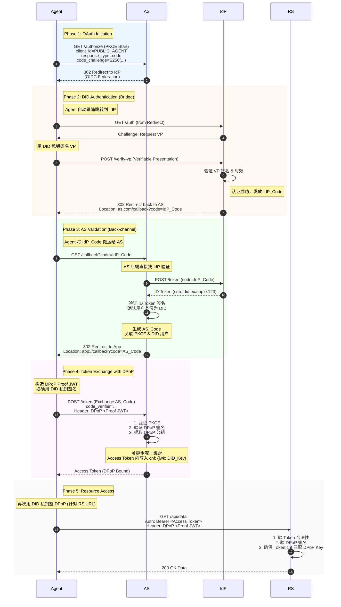

> 日本語参考訳（機械翻訳・未校閲）。規範となるのは原文です。コード例・識別子・規範キーワードは原文を保持しています。
> 原文: [standard/W3C-proposal/DID-OAuth-Compatibility Discussion-cn.md](../../../standard/W3C-proposal/DID-OAuth-Compatibility Discussion-cn.md) / 基準コミット: `0837cfdfaf4ddcf834f0890ddaf34fc4c824e066`

# DID-OAuth 互換性ディスカッションペーパー(公式版)

## i. Oouthの性質:AuthnとAuthzのストラテライズモデル
Oouth のコアは、2 つの論理レイヤーに分けられます。

### 1. Authn (認定レベル)

「誰が被写体であるか」を識別するための責任。

Outlook は、それ自体で認証を定義しません, しかし、に依存します:

- パスワード
- テキストメッセージ
- スキャン
- エスエムピーエス
- オリエンテーション
- 待たせます。

### 2. Authz (認証レベル)

責任:

> 「認証結果をトークンとして保持し、リソースにアクセスする際には、そのクライトが提示され、リソースサーバーによって検証されます。」

Authz の重要な質問は、トークンの安全な所持とプレゼンテーションです。そのため、OAuth は次のように開発しました:

- トークン有効期間
- トークンをリフレッシュ
- プクセ
- DPoP(長所長)
- RAR(構造化承認)
- UMA(ユーザーマネジメントアクセスポリシー)

**認証モードではなく、OAuthの認可作品です。**

## II. DIDのポジショニング:Authnの強化、Authzを置き換えない

DD/VCの本質は:

- **ダイド**: 認証
- **VC の**: 検証可能な属性/権限ベース
- **VP(VP)**ワンタイム認証証明書(統合可能)

そのため、主に南層を強化します。

- より強い被験者認識を提供
- 認可(VC)の検証可能な基盤を提供
- グループの動的クレジット構築(VP)を提供

**ただし、DID は OAuth のトークンベースの認可モデルを置き換えません。**

## III. AMP DID-Auth のスムーズな互換性

AMP の DID-Auth は、Authn のみで動作する場合に基本的に同じです。

> 「OAuth は DID 認証ページへリダイレクトする」

プロセスは十分に一貫しています:

1. Outlook AS にリダイレクト DID-auth
2. DID-Auth 完全認証 (DD + VC + パーソナビリティ)
3. DID-Auth は VP を返します。
4. OAuth 認証VP
5. スタンダード・プロセス・トークンが発行するOutlook AS
6. RS標準Outlook検証トークン(DIDを理解していない)

**OAuth 認可レベルは、変更をまったく必要としません。**

## IV. OAuth対応のクラストの事前調整

OAuth セキュリティーモデルには、次のものが必要です。

- ??? は事前登録をしなければならない `client_id`
- 信じられないほど。

### ソリューション: DID-auth のクラストの事前登録情報を参照

DID-auth は、次のようになります。

- DID(サブジェクト)
- VC(不動産)
- パーソナルフードVC(オプション)
- クライアント_id (事前登録)
- クライアントメタデータ(redirect)_UR、DPOPのキー等。

オートアウト AS は、

- DIID-authの主要情報
- 事前登録情報

一緒に結び、トークンを標準の OAuth プロセスとして発行します。

### 結果発表

- DI-Auth ♪ OAuthトークン発行
- ??? Oaut RSは、DIDを理解していない
- ??アウトASは、AuthnステージでVPを理解する必要があります
- ??? Clint は OAuth クライアントのまま
- DIDは「ユーザーが認証される方法」の代替品です。

## V. 正式なマーメイドシーケンスチャート(DD-auth?? Oouth Token??RS)




## VI. DPOP/RAR/UMAの統合方法論

### 1. DPoP: ティエトークンとクライアントキー

**DPoPアドレス:**

- 盗難後、トークンは再生できません。
- クライアントのキーにバインドされたトークン

**DI-authで:**

- cilentは直接DPoPの公共のキーを提供します
- Outlook AS はトークンを書いた `cnf.jwk`
- RS認証 DPoP 証拠

**DIDは、DDが鍵システムであるため、DPoPと自然に互換性があります。**

### 2. RAR:構造化された公認の包装

**RRの解決:**

- スコープが太く
- 複雑な能力を表現できません。
- 監査不能

**ANP で:**

- DID-Auth は、VC/Relationship に基づく RAR テンプレートを生成することができます。
- Outlook ASはRARトークンを書いた `authorization_details`
- RS の精密RRの許可

**RARはAMPの能力モデルを運ぶための最良の方法です。**

### 3. UMA: ユーザー管理アクセスポリシー

**UMAの解決:**

- ユーザーが管理するリソースの認可
- クロスドメインリソース共有
- 微粒子サイズ方針

**ANP で:**

- VC リソースの所有権を明示
- パーソナルフードVCは、被写体の正当な表現をすることができます
- UMAポリシーはDD/VCとして引用することができます

**UMAはDID-VCの自然な位置です。**

## ゼロの自信シナリオ:DID-VCの動的ビルドアップ容量

ゼロ信任の条件:

> 「各訪問にはリスクの動的評価が必要で、より強力な認定が必要である」

### DD-VCの利点:

#### 1. 自動化されたレター受容機構

- パスワード不要
- 追加のジャンプはありません。
- 複数のVCをグループ化
- 認証強度を必要に応じて高める(KYC、人件費、機器認証など)

#### 2. 複数のVCを1つのVPに結合することができます

たとえば:

- ダイド・アイデンティティVC
- フードVC
- デバイスタイVC
- 関係VC
- リスク評価VC

VP を 1 つにすべて結合して下さい:

```javascript
VP = { DID, VC1, VC2, VC3, ... }
```

**OAuth として:**

- 一度確認するだけです。
- 各VCフォーマットを理解していない
- DID を理解しない
- 署名チェーンを検証するだけ
- 地図トークンライン/RAR/UMA

**これにより、信頼性ゼロの高自動化による動的増加が実現しました。**

## viii. ANP(ドラフト)用RAR型システム

### RARの基本構造:

```json
{
  "authorization_details": [
    {
      "type": "anp.<capability>",
      "subject": "did:example:123",
      "resource": "...",
      "actions": [...],
      "constraints": {...},
      "evidence": {...}
    }
  ]
}
```

### 1. 社会招聘_グラフ_インフォメーション

```json
{
  "type": "anp.social_graph_discovery",
  "subject": "did:example:user123",
  "resource": "social-graph",
  "actions": ["query", "distance", "neighbors"],
  "constraints": {
    "max_depth": 3,
    "max_nodes": 500,
    "relationship_types": ["friend", "colleague"]
  },
  "evidence": {
    "vp": "<embedded VP>",
    "personhood": true
  }
}
```

### 2. フィードバック_距離_インフォメーション

```json
{
  "type": "anp.long_distance_intro",
  "subject": "did:example:agentA",
  "resource": "introduction",
  "actions": ["request", "forward"],
  "constraints": {
    "max_hops": 6,
    "trust_threshold": 0.7
  },
  "evidence": {
    "vp": "<embedded VP>",
    "relationship_proof": true
  }
}
```

### 3. フィードバック_ソリューション

```json
{
  "type": "anp.knowledge_query",
  "subject": "did:example:agentA",
  "resource": "knowledge-base",
  "actions": ["query"],
  "constraints": {
    "max_tokens": 2000,
    "domains": ["tech", "science"]
  },
  "evidence": {
    "vp": "<embedded VP>"
  }
}
```

### 4. アナプア_タスク_実行結果

```json
{
  "type": "anp.agent_task_execution",
  "subject": "did:example:agentA",
  "resource": "task",
  "actions": ["execute"],
  "constraints": {
    "max_duration": "10m",
    "max_cost": 5
  },
  "evidence": {
    "vp": "<embedded VP>",
    "device_binding": true
  }
}
```

### 5. リソース_アクセス

```json
{
  "type": "anp.resource_access",
  "subject": "did:example:agentA",
  "resource": "https://api.example.com/data",
  "actions": ["read", "write"],
  "constraints": {
    "rate_limit": "10/min",
    "valid_for": "300s"
  },
  "evidence": {
    "vp": "<embedded VP>"
  }
}
```

## IX. 概要

### コア要素

1. **Authn, OAuth の担当者は、Authz の担当です。**
2. **AMP DID-Auth は、OAuth 認証ページを完全に置き換えることができ、OAuth のトークン配布プロセスにシームレスに接続できます。**
3. **クライアントの事前登録は、DID-Auth で引用できます。そのため、OAuth セキュリティーモデルを変更せずに維持することができます。**
4. **DPoP、RAR、UMAは、トークンセキュリティと機能表現を強化するために、当然の認可レベルに統合することができます。**
5. **DID-VC(パーソナリティバウを含む)は、ゼロの自信環境で動的クレジットレイヤーとして使用できます。複数のドキュメントを単一のVPに集約し、DD-Authによって一度検証して、OAuthの認証サーバーに統一された認証結果として送信できます。**
6. **ANP RAR型システムは、クロスドメインの社会化、知識、タスクの実行などのスキルを標準化した式を提供します。**

### 主な調査結果

| 寸法: | オリエンテーション | ダイド | ANP統合プログラム |
|------|-------|-----|-------------|
| **認証方法** | 各種(暗号・ODS等) | DID/VC/VP(ディディディファイブ) | Authn プラグインとして DID-Auth を |
| **認証トークン** | スコープベース | - | RAR ベース + DPoP バウンド |
| **トークン結合** | なし | - | DIDキーペアに境界するDPoP |
| **資源戦略** | 粗粒度 | - | UMA + VC/DD条件 |
| **動的文字** | 難易度 | ズームマルチVCグループ | オートメーションVPの集計 |
| **クライアントのアイデンティティ** | クライアント_id事前登録 | - | クライアント_id + DPoP キー事前登録 |

---

**?? OAuth Auth レイヤーの完全置換として DID-Auth を**

**?? OAuth 認可プロセスの変更はありません**

**??? Clint、RSは既存のOouthと完全互換性**

**??? VPをASで理解するだけです**

**RR + DPOP + UMAは、細くて動的で可聴性の認証を達成するために**

**???? DIID/VC 自然化ゼロトラストシステム**