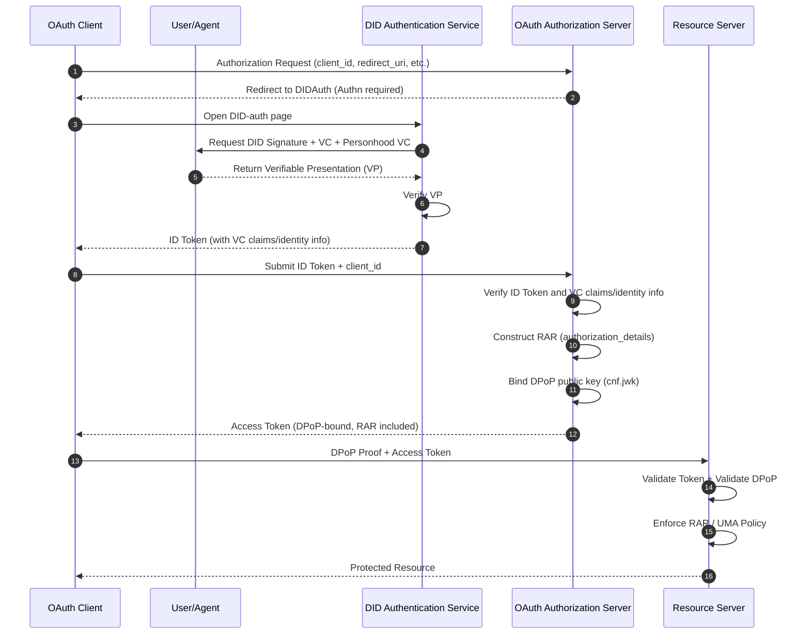

<!-- translation-review: full; source=standard/W3C-proposal/DID-OAuth-Compatibility Discussion.md; basis=entire original read and manually compared paragraph by paragraph; original examples retained exactly -->
> 日本語参考訳（原文全文を照合し、誤訳を修正済み）。この提案資料の主張を訳したもので、現在のANP-05の規範や実装適合性を示すものではありません。原文の技術的主張や例の不整合は修正していません。
> 原文: [standard/W3C-proposal/DID-OAuth-Compatibility Discussion.md](../../../standard/W3C-proposal/DID-OAuth-Compatibility Discussion.md) / 基準コミット: `0837cfdfaf4ddcf834f0890ddaf34fc4c824e066`

# DID–OAuthの互換性に関する議論（正式提案版）

## 1. OAuthの本質：AuthnとAuthzの層構造

OAuthの中核は、2つの論理的な層に分けられます。

### 1. Authn（認証層）

「主体が誰か」を確認します。

OAuth自体は認証方法を定義せず、次のような方法に依存します。

- パスワード
- SMS
- QRコードの読み取り
- SAML
- OIDC
- その他

### 2. Authz（認可層）

次の役割を担います。

> 「認可結果をトークンにまとめ、クライアントがリソースへアクセスするときに提示し、リソースサーバーが検証できるようにすること。」

Authzの重要な課題は、トークンの安全な保持と提示です。このため、OAuthのエコシステムには次の仕組みが発展してきました。

- トークンの有効期限
- リフレッシュトークン
- PKCE
- DPoP（Proof-of-Possession）
- RAR（Rich Authorization Requests）
- UMA（User-Managed Access）

**これらはすべてOAuthの認可を実現する上での課題であり、認証方法からは独立しています。**

## 2. DIDの位置付け：Authnを強化し、Authzを置き換えない

DID/VCの本質は次のとおりです。

- **DID**：検証可能な識別子
- **VC**：検証可能な属性・認可の根拠
- **VP**：一度の検証可能な提示。複数の資格情報を組み合わせられます

したがって、DIDが主に強化するのはAuthn層です。

- より強い主体の識別を提供する
- 検証可能な認可の根拠（VC）を提供する
- 組み合わせ可能な、動的に信頼を強化する機能（VP）を提供する

**ただし、DIDはOAuthのトークンに基づく認可モデルを置き換えません。**

## 3. ANPのDID-authとOAuthの円滑な互換性

ANPのDID-authがAuthnだけを担う場合、その本質は次の処理に相当します。

> 「OAuthがDID認証ページへリダイレクトする。」

処理の流れは完全に整合します。

1. OAuth ASがDID-authへリダイレクトする。
2. DID-authが認証（DID＋VC＋personhood）を完了する。
3. DID-authがVPを返す。
4. OAuth ASがVPを検証する。
5. OAuth ASが標準の流れに従ってトークンを発行する。
6. RSは、DIDを理解する必要なく、標準のOAuthに従ってトークンを検証する。

**OAuthの認可層を変更する必要は全くありません。**

## 4. OAuthのクライアント事前登録との互換性

OAuthのセキュリティモデルは、次のことを要求します。

- ⚠️ クライアントは事前に`client_id`を登録しなければならない。
- この要件を迂回することはできない。

### 解決策：DID-authでクライアントの事前登録情報を参照する

DID-authの完了後、次を返します。

- DID（主体）
- VC（属性）
- personhood VC（人であることの資格情報。任意）
- client_id（事前登録済み）
- クライアントメタデータ（redirect_uri、DPoP鍵など）

OAuth ASは、次の情報を結び付けられます。

- DID-authから得た主体の情報
- クライアントの事前登録情報

その後、標準のOAuthフローに従ってトークンを発行します。

### 結果

- ✅ DID-authからOAuthのトークン発行へ、切れ目なくつながる。
- ✅ OAuth RSはDIDを理解する必要がない。
- ✅ OAuth ASは、Authn段階でだけVPを理解すればよい。
- ✅ クライアントは引き続きOAuthクライアントである。
- ✅ DIDが置き換えるのは「利用者をどのように認証するか」だけである。

## 5. 正式なMermaidシーケンス図（DID-auth → OAuth Token → RS）



## 6. DPoP・RAR・UMAの統合方法

### 1. DPoP：トークンとクライアントの鍵を結び付ける

**DPoPが解決すること：**

- トークンが盗まれてもリプレイできないようにする。
- トークンをクライアントの鍵に結び付ける。

**DID-authでは：**

- クライアントはDPoPの公開鍵を直接提示できる。
- OAuth ASが、その鍵をトークンの`cnf.jwk`に記載する。
- RSがDPoP Proofを検証する。

**DID自体が鍵の体系であるため、DIDとDPoPは自然に組み合わせられます。**

### 2. RAR：構造化された認可の入れ物

**RARが解決すること：**

- scopeの粒度が粗すぎる。
- 複雑な機能を表現できない。
- 監査できない。

**ANPでは：**

- DID-authがVCや関係性に基づいてRARのテンプレートを生成できる。
- OAuth ASがRARをトークンの`authorization_details`に記載する。
- RSがRARに基づいて細かな認可を行う。

**RARは、ANPの機能モデルを運ぶ最適な方法です。**

### 3. UMA：利用者が管理するアクセス方針

**UMAが解決すること：**

- 利用者が制御できるリソースへの認可
- ドメインをまたいだリソース共有
- 細かな方針

**ANPでは：**

- VCがリソースの所有権を表現できる。
- personhood VCが主体の正当性を表現できる。
- UMAの方針がDID/VCを条件として参照できる。

**UMAは、DID-VCの自然な適用先です。**

## 7. ゼロトラスト：DID-VCによる動的な信頼の強化

ゼロトラストでは、次を要求します。

> 「アクセスのたびに動的なリスク評価を行い、必要に応じて、より強い認証を要求する。」

### DID-VCの利点

#### 1. 高度に自動化された信頼強化の仕組み

- パスワードが不要。
- 追加のリダイレクトが不要。
- 複数のVCを自動的に組み合わせられる。
- 必要に応じて認証の強度を高められる（KYC、personhood、デバイス証明など）。

#### 2. 複数のVCを1つのVPにまとめられる

例えば、次のものがあります。

- DIDの識別に関するVC
- personhood VC
- デバイスバインディングのVC
- 関係性のVC
- リスク評価のVC

これらを1つのVPにまとめます。

```javascript
VP = { DID, VC1, VC2, VC3, ... }
```

**OAuth ASは：**

- VPを1回検証すればよい。
- 個々のVCの形式を理解する必要はない。
- DIDを理解する必要はない。
- 署名の連鎖を検証すればよい。
- その後、トークンのclaim・RAR・UMAに対応付ける。

**これにより、ゼロトラストにおける動的な信頼強化を高度に自動化できます。**

## 8. ANPのRAR型体系（ドラフト）

### RARの基本構造

```json
{
  "authorization_details": [
    {
      "type": "anp.<capability>",
      "subject": "did:example:123",
      "resource": "...",
      "actions": [...],
      "constraints": {...},
      "evidence": {...}
    }
  ]
}
```

### 1. anp.social_graph_discovery

```json
{
  "type": "anp.social_graph_discovery",
  "subject": "did:example:user123",
  "resource": "social-graph",
  "actions": ["query", "distance", "neighbors"],
  "constraints": {
    "max_depth": 3,
    "max_nodes": 500,
    "relationship_types": ["friend", "colleague"]
  },
  "evidence": {
    "vp": "<embedded VP>",
    "personhood": true
  }
}
```

### 2. anp.long_distance_intro

```json
{
  "type": "anp.long_distance_intro",
  "subject": "did:example:agentA",
  "resource": "introduction",
  "actions": ["request", "forward"],
  "constraints": {
    "max_hops": 6,
    "trust_threshold": 0.7
  },
  "evidence": {
    "vp": "<embedded VP>",
    "relationship_proof": true
  }
}
```

### 3. anp.knowledge_query

```json
{
  "type": "anp.knowledge_query",
  "subject": "did:example:agentA",
  "resource": "knowledge-base",
  "actions": ["query"],
  "constraints": {
    "max_tokens": 2000,
    "domains": ["tech", "science"]
  },
  "evidence": {
    "vp": "<embedded VP>"
  }
}
```

### 4. anp.agent_task_execution

```json
{
  "type": "anp.agent_task_execution",
  "subject": "did:example:agentA",
  "resource": "task",
  "actions": ["execute"],
  "constraints": {
    "max_duration": "10m",
    "max_cost": 5
  },
  "evidence": {
    "vp": "<embedded VP>",
    "device_binding": true
  }
}
```

### 5. anp.resource_access

```json
{
  "type": "anp.resource_access",
  "subject": "did:example:agentA",
  "resource": "https://api.example.com/data",
  "actions": ["read", "write"],
  "constraints": {
    "rate_limit": "10/min",
    "valid_for": "300s"
  },
  "evidence": {
    "vp": "<embedded VP>"
  }
}
```

## 9. まとめ

### 中心となる点

1. **DIDがAuthnを担い、OAuthがAuthzを担います。**
2. **ANPのDID-authはOAuthの認証ページを完全に置き換え、OAuthのトークン発行フローと切れ目なく接続できます。**
3. **DID-authでクライアントの事前登録情報を参照することで、OAuthのセキュリティモデルを変更せずに維持できます。**
4. **DPoP、RAR、UMAは認可層に自然に統合でき、トークンの安全性と機能の表現を強化できます。**
5. **DID-VCは、personhood資格情報を含め、ゼロトラスト環境における動的な信頼強化の層として使えます。複数の資格情報を1つのVPにまとめ、DID-Authで一度検証した後、統一した認証結果としてID Tokenに入れてOAuth認可サーバーへ伝えられます。**
6. **ANPのRAR型体系は、ドメインをまたいだ社会的つながり、知識、タスク実行などの機能を標準化された形で表現します。**

### 主要な結論

| 観点 | OAuth | DID | ANPの統合案 |
| --- | --- | --- | --- |
| **認証方法** | 複数（パスワード、OIDCなど） | DID/VC/VP | DID-authをAuthnプラグインとして使う |
| **認可トークン** | scope-based | - | RAR-based＋DPoP-bound |
| **トークンのバインディング** | なし | - | DPoPをDID鍵ペアに結び付ける |
| **リソースの方針** | 粗い粒度 | - | UMA＋VC/DID条件 |
| **動的な信頼強化** | 難しい | ✓ 複数VCの組み合わせ | VPの自動集約 |
| **クライアントの識別** | client_idの事前登録 | - | client_id＋DPoP鍵の事前登録 |

---

**✅ DID-authはOAuthのAuthn層を完全に置き換えられます。**

**✅ OAuthの認可フローを変更する必要はありません。**

**✅ クライアントとRSは既存のOAuthと完全に互換です。**

**✅ ASではVP検証を理解すればよいだけです。**

**✅ RAR＋DPoP＋UMAが、細かく、動的で、監査可能な認可を実現します。**

**✅ DID/VCの信頼強化機能は、ゼロトラストのアーキテクチャへ自然に統合できます。**
