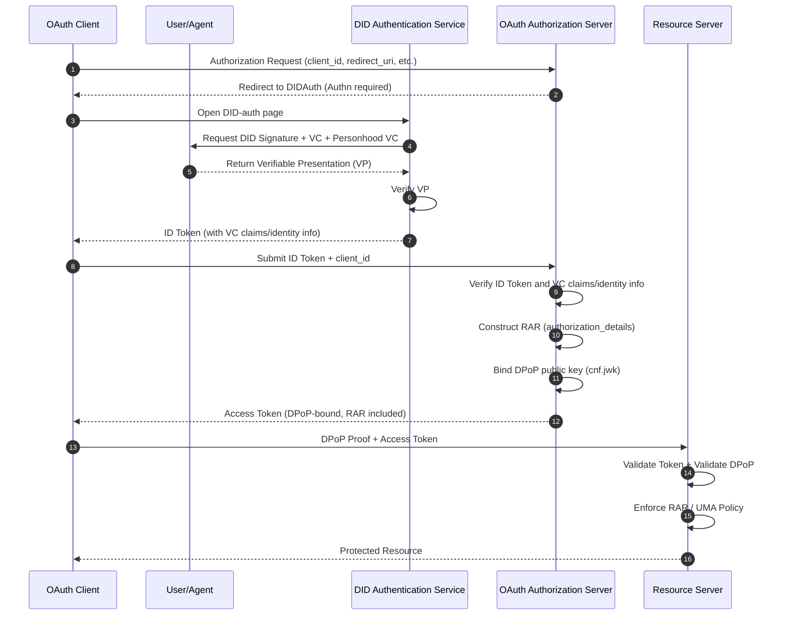

> 日本語参考訳（機械翻訳・未校閲）。規範となるのは原文です。コード例・識別子・規範キーワードは原文を保持しています。
> 原文: [standard/W3C-proposal/DID-OAuth-Compatibility Discussion.md](../../../standard/W3C-proposal/DID-OAuth-Compatibility Discussion.md) / 基準コミット: `0837cfdfaf4ddcf834f0890ddaf34fc4c824e066`

# DID-OAuth 互換協議(公式提案版)

## 1. OAuth の Essence: Authn と Authz のレイヤードモデル

OAuth のコアは、2つの論理レイヤーに分解できます。

### 1. Authn (認証レイヤー)

「被写体が誰であるか」を確かめる責任

OAuth 自体は認証方法を定義しませんが、以下に依存します。

- パスワード
- 電子メール
- QRコードスキャン
- エスエムピーエス
- オリエンテーション
- など。

### 2. Authz (認可レイヤー)

責任:

> 「認証結果をトークンにカプセル化し、リソースにアクセスする際にクライアントが提示できるようにします。これは、リソースサーバーによって検証されます。」

Authz の重要な問題は、OAuth エコシステムが開発した理由であるトークンの安全な所持と提示です。

- トークンの有効期限
- トークンをリフレッシュ
- プクセ
- DPoP(長所長)
- RAR(リッチ正規化リクエスト)
- UMA(ユーザー管理アクセス)

**これらは、認証方法の独立性、すべてのOAuth認可エンジニアリングの問題です。**

## 2. DID のポジショニング:Authn の強化、Authz の置き換え

DID/VCの本質は:

- **ダイド**: 確認可能なアイデンティティ
- **VC の**: 検証可能な属性/権限ベース
- **VP(VP)**: ワンタイムで検証可能なプレゼンテーション(提案可能)

そのため、DIDは主にAuthnレイヤーを強化します。

- より強い被写体識別を提供
- 検証可能な認証基準(VC)を提供
- 互換性のある動的信頼の強化機能(VP)を提供

**しかし、DIDはOAuthのトークンベースの認可モデルを置き換えません。**

## 3. ANPのDID-authとOAuthとのスムーズな互換性

ANP の DID-auth が Authn のみを扱う場合、それは基本的には以下のようにします。

> 「OAuth は DID 認証ページへリダイレクトします」

流れは完全に一貫しています:

1. OAuth AS は DID-auth にリダイレクト
2. DID-auth は認証(DID + VC + パーソナビリティ)を完了します。
3. DID-auth は VP を返します
4. OAuth VP を検証する
5. OAuth 標準的な流れに続く問題トークンとして
6. RS は標準 OAuth を追ってトークンを検証します(DID を理解していない)

**OAuth の認可層は、まったく変更する必要はありません。**

## 4. OAuth のクライアント事前登録と互換性

OAuth のセキュリティモデルには、以下のものが必要です。

- クライアントは事前登録が必要です `client_id`
- 迂回できません

### ソリューション: DID-auth のクライアントの事前登録情報を参照

DID-auth 完了後、次のようになります。

- DID(サブジェクト)
- VC(アトリビュート)
- パーソナルVC(オプション)
- クライアント_id (事前登録済み)
- クライアントメタデータ(リダイレクト)_uri、DPoPのキー等。

OAuth AS は、以下のとおりです。

- DID-auth の主題情報
- クライアントの事前登録情報

一緒に、標準の OAuth フローに続くトークンを発行します。

### 結果発表

- ✅ DID-auth → OAuthトークン発行は完全にシームレスに
- ✅ OAuth RSは DID を理解していない
- ✅ OAuthは、Authnフェーズ中にVPを理解する必要があるためだけ
- ✅ クライアントは OAuth クライアントのまま
- ✅ DIDは「ユーザが認証される方法」のみに置き換えられます。

## 5. 公式のマーメイドシーケンス図(DID-auth → OAuth Token → RS)



## 6. DPoP/RAR/UMA の統合方法

### 1. DPoP: クライアントキーにトークンを結合する

**DPoP は解決します:**

- 盗難後、トークンは再生できません
- トークンはクライアントのキーにバインドされます

**did-authで:**

- クライアントは直接DPoPの公共鍵を提供できます
- OAuth AS はトークンの記述に書いています `cnf.jwk`
- RS は DPoP の証拠を検証します

**DID と DPoP は、DID 自体がキーシステムであるので、自然に互換性があります。**

### 2. RAR:構造化された承認容器

**RARは解決します:**

- スコープの粒度は粗すぎる
- 複雑な機能が表現できない
- 監査できません

**ANP で:**

- DID-auth は、VC/relationships に基づいて RAR テンプレートを生成することができます。
- OAuth AS は、RAR をトークンに書き込む `authorization_details`
- RSはRARに基づく細粒認証を実行します

**RARは、ANPの能力モデルを運ぶための最良の方法です。**

### 3. UMA: ユーザー管理アクセスポリシー

**UMAは解決します:**

- ユーザー制御可能なリソースの承認
- クロスドメインリソース共有
- 細粒された方針

**ANP で:**

- VCはリソースの所有権を表現することができます
- パーフードVCは、被写体を表現することができます
- UMAポリシーは、DID/VCを条件として参照することができます

**UMAはDID-VCの自然な着陸ポイントです。**

## 7. ゼロトラストシナリオ:DID-VCのダイナミック・トラストの強化機能

ゼロ信頼は要求します:

> 「アクセスが動的リスク評価を必要とし、より強力な認証が必要」

### DID-VCの利点:

#### 1. 高度自動信託強化機構

- パスワード不要
- 追加のリダイレクトは必要ありません
- 複数のVCを自動で結合できます
- 必要に応じて認証強度を上げることができます(KYC、人件費、デバイス証明書など)

#### 2. 複数のVCは1つのVPにマージすることができます

たとえば:

- DID アイデンティティ VC
- フードVC
- デバイスバインディングVC
- 関係VC
- リスク評価VC

VP に統合される:

```javascript
VP = { DID, VC1, VC2, VC3, ... }
```

**OAuth として:**

- VPを一度確認する必要があるだけ
- 各VCのフォーマットを理解していない
- DID を理解していない
- 署名チェーンを検証するだけ
- トークンクレーム/RAR/UMA にマップ

**これにより、ゼロトラストシナリオの動的信頼向上が実現します。**

## 8. ANPのRAR型システム(ドラフト)

### RARの基本構造:

```json
{
  "authorization_details": [
    {
      "type": "anp.<capability>",
      "subject": "did:example:123",
      "resource": "...",
      "actions": [...],
      "constraints": {...},
      "evidence": {...}
    }
  ]
}
```

### 1. 社会招聘_グラフ_インフォメーション

```json
{
  "type": "anp.social_graph_discovery",
  "subject": "did:example:user123",
  "resource": "social-graph",
  "actions": ["query", "distance", "neighbors"],
  "constraints": {
    "max_depth": 3,
    "max_nodes": 500,
    "relationship_types": ["friend", "colleague"]
  },
  "evidence": {
    "vp": "<embedded VP>",
    "personhood": true
  }
}
```

### 2. フィードバック_距離_インフォメーション

```json
{
  "type": "anp.long_distance_intro",
  "subject": "did:example:agentA",
  "resource": "introduction",
  "actions": ["request", "forward"],
  "constraints": {
    "max_hops": 6,
    "trust_threshold": 0.7
  },
  "evidence": {
    "vp": "<embedded VP>",
    "relationship_proof": true
  }
}
```

### 3. フィードバック_ソリューション

```json
{
  "type": "anp.knowledge_query",
  "subject": "did:example:agentA",
  "resource": "knowledge-base",
  "actions": ["query"],
  "constraints": {
    "max_tokens": 2000,
    "domains": ["tech", "science"]
  },
  "evidence": {
    "vp": "<embedded VP>"
  }
}
```

### 4. アナプア_タスク_実行結果

```json
{
  "type": "anp.agent_task_execution",
  "subject": "did:example:agentA",
  "resource": "task",
  "actions": ["execute"],
  "constraints": {
    "max_duration": "10m",
    "max_cost": 5
  },
  "evidence": {
    "vp": "<embedded VP>",
    "device_binding": true
  }
}
```

### 5. リソース_アクセス

```json
{
  "type": "anp.resource_access",
  "subject": "did:example:agentA",
  "resource": "https://api.example.com/data",
  "actions": ["read", "write"],
  "constraints": {
    "rate_limit": "10/min",
    "valid_for": "300s"
  },
  "evidence": {
    "vp": "<embedded VP>"
  }
}
```

## 9. インフォメーション

### コアポイント

1. **DID は Authn, OAuth が Authz を扱う。**
2. **ANPのDID-authは、OAuthの認証ページを完全に置き換えて、OAuthのトークン発行フローとシームレスに統合できます。**
3. **クライアント事前登録は、DID-auth で参照できます。OAuth のセキュリティモデルを変更せずに維持します。**
4. **DPoP、RAR、UMAは、トークンセキュリティと機能表現を強化し、認証レイヤーに自然に統合できます。**
5. **「DID‐VC(人件名を含む)」は、ゼロ・トラスト環境における動的信頼度層として機能することができます。 複数の資格情報は、DID‐Auth で一度検証し、認証済みの認証結果として ID トークンに OAuth 認可サーバーに渡って伝えられます。**
6. **ANPのRAR型システムは、クロスドメインの社会的、知識、タスク実行などの機能に関する標準化式を提供します。**

### 主構成

| 寸法: | オリエンテーション | ダイド | ANP統合ソリューション |
|-----------|-------|-----|--------------------------|
| **認証方法** | 複数(パスワード、OIDC等) | DID/VC/VP(ディディディファイブ) | Authn プラグインとして DID-auth を |
| **認証トークン** | スコープベース | - | RAR ベース + DPoP バウンド |
| **トークン結合** | なし | - | DIDキーペアに境界するDPoP |
| **資源政策** | 粗挽き | - | UMA + VC/DID条件 |
| **ダイナミック・トラストの強化** | 難易度 | ✓ 複数のVC構成 | 自動VP集計 |
| **クライアントのアイデンティティ** | クライアント_id事前登録 | - | クライアント_id + DPoP キー事前登録 |

---

**✅ DID-authはOAuth Authn層の完全置換として役立つことができます**

**✅ OAuth 認可フローを変更する必要はありません**

**✅ クライアントとRSは、既存のOAuthと完全に互換性があります**

**✅ ASでVP認証を理解する必要があるだけ**

**✅ RAR + DPoP + UMAは、細分光、動的、可聴性の承認を達成します**

**✅ DID/VCの信頼の強化機能はゼロの信頼の建築と自然に統合します**
