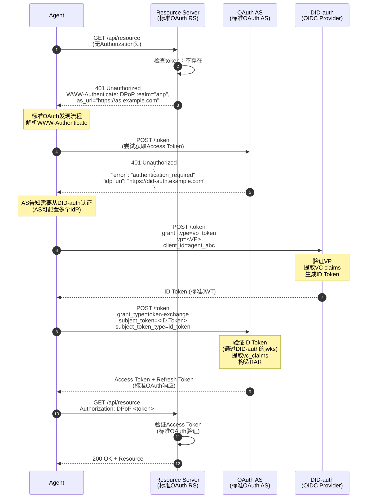
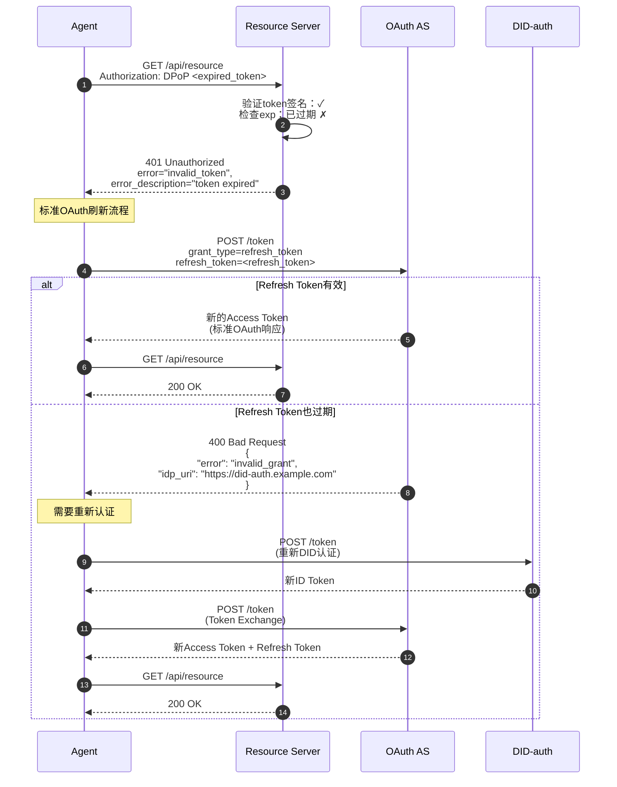
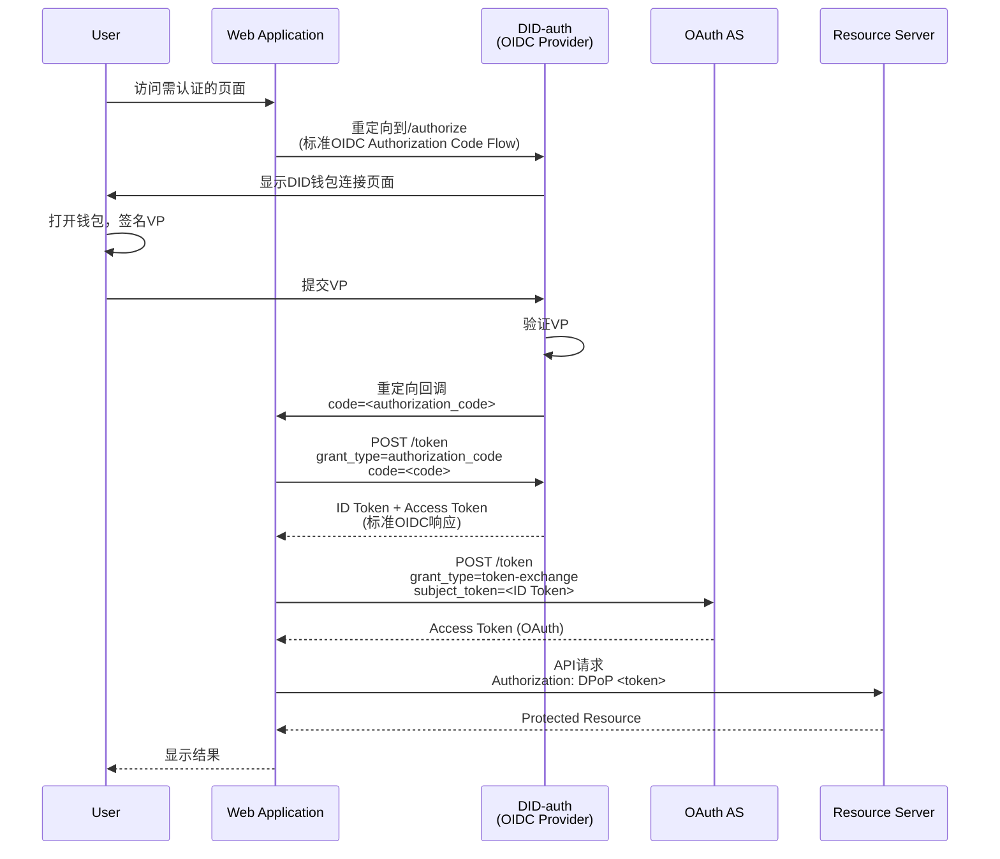
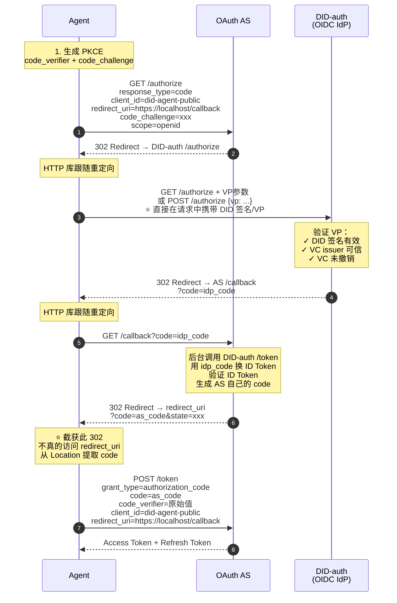
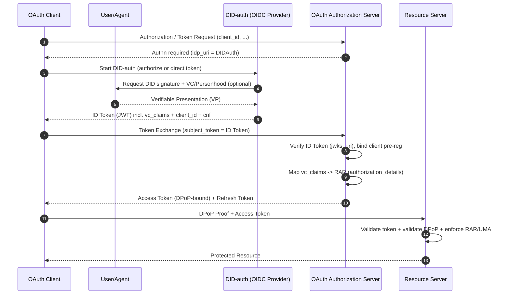

> 日本語参考訳（機械翻訳・未校閲）。規範となるのは原文です。コード例・識別子・規範キーワードは原文を保持しています。
> 原文: [standard/W3C-proposal/DID-OAuth-Integration-Solution-cn.md](../../../standard/W3C-proposal/DID-OAuth-Integration-Solution-cn.md) / 基準コミット: `0837cfdfaf4ddcf834f0890ddaf34fc4c824e066`

# DID-OAuth 連携プログラム

## コアコンセプト

**WBA DIDプログラム OAuthアーキテクチャへの影響ゼロ、単一ポイント Auth サービスデリバリーによるOAuthシステムへのシームレスな統合**

```
┌─────────────────────────────────────────────────────────┐
│                    OAuth 生态                            │
│  ┌──────────────┐  ┌──────────────┐  ┌──────────────┐  │
│  │   Client     │  │     AS       │  │     RS       │  │
│  │  (不变)      │  │  (不变)      │  │  (不变)      │  │
│  └──────────────┘  └──────────────┘  └──────────────┘  │
│         │                 │                  │           │
│         │                 │                  │           │
│         │          ┌──────▼──────┐           │           │
│         │          │   Authn层   │           │           │
│         └─────────►│  (可插拔)   │           │           │
│                    └──────────────┘           │           │
│                          │                    │           │
│                    ┌─────▼──────┐             │           │
│                    │ DID-auth   │             │           │
│                    │ (OIDC IdP) │             │           │
│                    └────────────┘             │           │
└─────────────────────────────────────────────────────────┘

关键：DID-auth是OAuth认证层的一个可选实现，不改变OAuth的授权架构
```

---

## I. OAuthのストラテライズモデルとDIDの位置

### 1.1 OAuth の 2 層構造

```
┌─────────────────────────────────────────┐
│         Authn Layer (认证层)             │
│  职责：确认"主体是谁"                     │
│  实现：密码/OIDC/SAML/DID-auth          │
│  输出：认证凭证（如ID Token）            │
└─────────────────────────────────────────┘
                    ↓
┌─────────────────────────────────────────┐
│         Authz Layer (授权层)             │
│  职责：决定"主体能做什么"                 │
│  实现：OAuth AS (token颁发)              │
│  输出：Access Token + Refresh Token      │
└─────────────────────────────────────────┘
                    ↓
┌─────────────────────────────────────────┐
│      Resource Access (资源访问)          │
│  职责：执行访问控制                       │
│  实现：Resource Server                   │
│  验证：Access Token + 策略               │
└─────────────────────────────────────────┘
```

### 1.2 DIDのポジション

**DID/VC/VP は、Authn レイヤーにより強化されます。**：

| コンポーネント | 役割・役割 | 利点 |
|------|------|------|
| **ダイド** | 中央に行き、IDを取得してください。 | 集中型アイデンティティプロバイダの必要性無し |
| **VC の** | 一時的なフォルダを閉じることができません: %s | 第三者機関による承認 |
| **VP(VP)** | 検証可能なプレゼンテーション | ポートフォリオ、再設計、監査可能 |

**重要な洞察**：
- ? DID はAuthn レイヤーを強化 (認証強化)
- ?? DID は Authz の代わりにはありません。
- DIDはリソースアクセスレイヤー(RSはまだアクセストークンを認証)に影響しません。

---

## II. 十字の指定を要求して下さい: A2AおよびA2R

計画は、設計と実証のための2つのリンクに「認証/承認」要件を破るために提案します。

- **A2A(エージェント・ツー・エージェント)**: エージェント間のポイントツーポイント/マルチポイント通信とコラボレーション、リクエストの受信者自身がエージェント(またはエージェントゲートウェイ)である。
- **A2R(エージェント・ツー・リソース)**:agent は既存の Resource Server(RS) へのアクセス、OAuth リソース保護と確立されたエコロジーの互換性のある基準が必要です。

この分割の値は、次のとおりです。**A2Aは、集中圧力を削減するためにDIDポイントツーポイント検証モデルを採用することができます。 A2Rは既存のRS互換レイヤーとしてOAuthトークンを使用します**。

### 2.1 A2A(エージェント・ツー・エージェント): 予言されたID

A2A シナリオでは、通信関係者は DD/VC/VP を理解し、集中管理された権限のあるサーバーを導入する必要はありません。

**利点**：
- ✅ **Oouth の南組織サーバーのための必要性無し**: 両当事者は、直接、相互認証と情報の保護のためにDID/VPを使用する場合があります。
- ✅ **シングルポイントボトルネック/単一ポイント圧力なし**: ASトークンの高周波経路では、将来のM2M/Agentと呼び出しを伴うリクエストは不要。
- ✅ **信頼とコミッションのさらなる自然なポイント。**: VC/VP式「エージェントの所属、資格、コミッションチェーン、ステップアップ証拠」

> 結論: A2Aは通常、「強力なネットワーク」または「アガントツーアgain」のコンテキストで OAuth よりも直接認証のために DID を使用する可能性が低いです。

### 2.2 A2R(エージェント・ツー・リソース):利用可能なリソースとの互換性は、OAuth認定訪問を継続する必要があります

A2Rのキー制約は次のとおりです。**既存のRSの多くは、OAuthアクセストークン(JWT/DPoP/MTLSなど)のみを理解しています。**DID/VP は理解しません。

そのため、互換性とエンジニアリングコストの観点から:
- ♪ 通過する **展望の認可** 交通アクセス **アクセストークン** 訪問RS
- ??RSメンテナンスの既存:DIDを理解しずにトークン(およびDPoP/Tactical)のみが検証されます

> 結論: A2Rは、リソースアクセスの「最小共通分数」として OAuth トークンを維持する必要があります。

### 2.3 Authn ノードの標準的な DID-Authn デプロイメント基準のみ

A2Rリンクでは、推奨される慣行は引き続き行われます。

1. AS 側で 1 つを構成する **OAuth 標準対応 DID-Authn (OIDC プロジェクター)**。
2. DID-authn は、DID 認証の完了と DID 関連の発行の VP/VC の検証を担当しています。 **IDトークン**(JWT)。
3. エージェントは、 **IDトークン** パス **トークン交換(RFC 8693)** 用途として **アクセストークン**、RS を再度アクセスして下さい。

これは明確な境界を維持します。
- DID-authn: 「誰が対象/何が検証可能か」 (Authn) に対処
- AS:「特権、トークン」(Authz) を扱う
- RS: トークンは検証とポリシーの実行のみ

### 2.4 エージェントの側に文書化されたフォーム: トークンストレージと DID/キーを CleanCredential として

エージェントの「ライフタイム」の視点から、2種類のランディング(組み合わせることができる)が理解されています。

- **方法A:Outlookトークンの直接記憶そして使用**
  - エージェントストレージアクセストークン/トークンをリフレッシュ
  - 利点: 単純性を達成して下さい、十分にOAuthのエコロジーを押して下さい
  - リスク:トークンリークに焦点を当てる(DPoP/短期トークン/更新ポリシーと組み合わせて)

- **モードB:クライアント認証用のDIDのパブリックキーとプライベートキー機能を使用する**
  - ダイドとは違います。 `client_id`, トークンのエンドポイントを「Pkey」のクラスト・オース(作業が近い)で完了させるようにしましょう `private_key_jwt` / mTLS-type の
  - 利点:長期操作の1つの洗剤の例のためにより適切およびテナントごとの良いキャンセル/回転

> 注: DD 秘密鍵証明書は OAuth の分岐法で推奨される 2 つのシステムです。`private_key_jwt`/mTLS/DPoP; DIDシステムは、被験者本人および証拠(VC/VP)に用いられる。

### 2.5 末端の標準の両立性の条件: cent_id事前登録/動的登録はDIDではなく、エージェントはサポートしなければなりません

の観点から "エンドツーエンド標準互換" エージェント訪問 Outlook AS/RS 通常、有効なオーアウトアイデンティティを必要とする:

- **静的事前登録(Cliter事前登録)**: 輸送・保守者事前作成 `client_id` メタデータを結合する
- **ダイナミック登録(RFC 7591クリーン開発登録)**:agent(または制御)は、登録終了を呼び出してアクセスします `client_id`(証拠可能)

重要なポイント:
- これら2つの登録パターンは、次のとおりです。 **OAuthクライアント・ガバナンスメカニズム**DID自体は関係ありません。
- 「テナントごとのインスタンス」のエージェントでは、スケール分布に動的登録が用いられることが多い `client_id`; しかし、エンドポイントの登録は、強力な権利(初期アクセストークン/mTLS/またはVCベースのアクセス)を持っている必要があります。

### 2.6 連結結論:A2A ネイティブID、A2R ゴー・オウト + DID-authn

将来のM2M/agent HFトレンドの組み合わせ:
- **A2A(アット・アット・アット・アット・アット・アット・アット・ア・ア・ア・ア・ア・ア・ア・ア・ア・ア・ア・ア・ア・ア・ア・ア・ア・ア・ア・ア・ア・ア・ア・ア・ア・ア・ア・ア・ア・ア・ア・ア・ア・ア・ア・ア・ア・ア・ア・ア・ア・ア・ア・ア・ア・ア・ア・ア・ア・ア・ア・ア・ア・ア・ア・ア・ア・ア・ア・ア・ア・ア・ア・ア・ア・ア・ア・ア・ア・ア・ア・ア・ア・ア・ア・ア・ア・ア・ア・ア・ア・ア・ア・ア・ア・ア・ア・ア・ア・ア・ア・ア・ア・ア・ア・ア・ア・ア・ア・ア・ア・ア・ア・ア・ア・ア・ア・ア・ア・ア・ア・ア・ア・ア・ア・ア・ア・ア・ア・ア・ア・ア・ア・ア・ア・ア・ア・ア・ア・ア・ア・ア・ア・ア・ア・ア・ア・ア・ア・ア・ア・ア・ア・ア・ア・ア・ア・ア・ア・ア・ア・ア・ア・ア・ア・ア・ア・ア・ア・ア・ア・ア・ア・ア・ア・ア・ア・ア・ア・ア・ア・ア・ア・ア・ア・ア・ア・ア・ア・ア・ア・ア・ア・ア・ア・ア・ア・ア・ア・ア・ア・ア・ア・ア・ア・ア・ア・ア・ア・ア・ア・ア・ア・ア・ア・ア・ア・ア・ア・ア・ア・ア・ア・ア・ア・ア・ア・ア・ア・ア・ア・ア・ア・ア・ア・ア・ア・ア・ア・ア・ア・ア・ア・ア・ア・ア・ア・ア・ア・ア・ア・ア・ア・ア**_:優先 **オリジナルID** 認証(照明、単点圧なし)
- **A2Rの特長**: ホールド **OAuthアクセス制御**、ASの側面で導入することによって **ダイド・アウスン(OIDC IdP)** 認証方法として、IDトークンで既存のRSにアクセスできますか? トークン交換? アクセストークン。

---

## II. DID-Auth をシングルAuthn サービスとして

### 2.1 構造位置決め

**DID-auth = 標準 ODS プロジェクト + DID/VC/VP 認証機能**

```
┌────────────────────────────────────────────────────┐
│              DID-auth (OIDC Provider)              │
│                                                    │
│  ┌──────────────────────────────────────────────┐ │
│  │  标准OIDC端点                                 │ │
│  │  ├── /.well-known/openid-configuration       │ │
│  │  ├── /token (ID Token颁发)                   │ │
│  │  ├── /jwks (公钥端点)                        │ │
│  │  └── /authorize (浏览器场景)                 │ │
│  └──────────────────────────────────────────────┘ │
│                                                    │
│  ┌──────────────────────────────────────────────┐ │
│  │  DID/VC/VP验证能力                           │ │
│  │  ├── DID解析                                 │ │
│  │  ├── VP签名验证                              │ │
│  │  ├── VC签名验证                              │ │
│  │  ├── Personhood VC验证                       │ │
│  │  └── VC撤销检查                              │ │
│  └──────────────────────────────────────────────┘ │
│                                                    │
│  输出：标准ID Token (JWT)                          │
│        包含vc_claims (已验证的VC内容)              │
└────────────────────────────────────────────────────┘
```

### 2.2 OAuthエコロジーへの影響

| OAuth コンポーネント | 変更するかどうか | 注釈 |
|-----------|-------------|------|
| **クライアント** | 必要ありません。 | それでも標準の OAuth クライアント、ODS をサポート |
| **とりあえず** | 最小限の修正 | IDトークンのID-AuthをIdPとして信頼する必要があります |
| **ツイート** | 必要ありません。 | 全くDIDのセンスはありません。アクセストークンを認証するだけです |
| **トークン形式** | 必要ありません。 | 静止標準JWTアクセストークン |
| **権限プロセスの委任** | 必要ありません。 | 静止標準 OAuth 2.0 プロセス |

**コンテンツ**: OAuth アーキテクチャにゼロの破壊的な影響を及ぼす、生存するAuthn サービスとして DID-Auth 。

---

## III. リアル・トラフティング・サイド

### 3.1 エージェントシーン: 最初は (トークンなし)



**重要なポイント**：
- RS および AS は標準 OAuth プロトコルを使用する
- ODSProviderとして信頼されるDID-Auth
- エージェントは標準 OAuth アクセストークンを取得

---

### 3.2 エージェントシーン:トークンが期限切れ



**主メカニズム**：
- リフレッシュトークンを優先(標準 OAuth)
- DIDを再認定できなかったリフレッシュ。
- プロセス全体がRSに透明です

---

### 3.3 ブラウザーシーン:従来の再オリエンテーションプロセス



**主特徴**：
- 標準の ODS 組織コード・フローを使用する
- インタラクティブなユーザーページ(DDIDウォレット接続)
- 再指示されたエコー
- WebAppアクセストークン

---

### 3.4 エージェントシーン:オートレーションコードフローのシミュレーション(最大互換性プログラム)
AS がトークン交換(RFC 8693)をサポートしていない場合、エージェントは HTTP ライブラリシミュレーション コードフローを通して最大の互換性を得ることができます。
#### 3.4.1 プログラムの概要
```
┌─────────────────────────────────────────────────────────┐
│                                                         │
│  核心思路：                                              │
│                                                         │
│  • Agent 用 HTTP 库处理 302 重定向（模拟浏览器）        │
│  • IdP (DID-auth) 支持在请求中直接接受 VP 认证          │
│  • Agent 截获最终重定向，从 URL 提取 code               │
│  • 使用标准 Authorization Code 换取 Access Token        │
│                                                         │
│  优势：                                                  │
│  ✅ 兼容性最强（几乎所有 AS 都支持 Auth Code Flow）     │
│  ✅ 不需要 AS 支持 Token Exchange                       │
│  ✅ 安全性由 IdP 的 DID/VC 验证保证                    │
│                                                         │
└─────────────────────────────────────────────────────────┘
```
#### 3.4.2 完了プロセス

#### 3.4.3 主実現の細部
**1. . PKCEサポート(クリニックは必須)**
```python
import hashlib
import base64
import secrets
# 生成 PKCE
code_verifier = secrets.token_urlsafe(32)
code_challenge = base64.urlsafe_b64encode(
hashlib.sha256(code_verifier.encode()).digest()
).decode().rstrip('=')
# 在 /authorize 请求中携带
params = {
"response_type": "code",
"client_id": "did-agent-public",
"redirect_uri": "https://localhost/callback",
"code_challenge": code_challenge,
"code_challenge_method": "S256",
"scope": "openid",
"state": secrets.token_urlsafe(16)
}
# 在 /token 请求中携带 code_verifier
token_data = {
"grant_type": "authorization_code",
"code": as_code,
"client_id": "did-agent-public",
"redirect_uri": "https://localhost/callback",
"code_verifier": code_verifier  # 必须
}
```
**2. . DID-auth は API 認証をサポートしています (HTML ページを返さない)**
```
┌─────────────────────────────────────────────────────────┐
│                                                         │
│  DID-auth /authorize 端点需要支持：                      │
│                                                         │
│  方式 A：GET 请求带 VP 参数                             │
│  GET /authorize?                                        │
│    response_type=code&                                  │
│    client_id=xxx&                                       │
│    vp_token=<base64url编码的VP>&                       │
│    redirect_uri=...                                     │
│                                                         │
│  方式 B：POST 请求带 JSON body                          │
│  POST /authorize                                        │
│  Content-Type: application/json                         │
│  {                                                      │
│    "response_type": "code",                            │
│    "client_id": "xxx",                                 │
│    "vp": { ... VP内容 ... },                           │
│    "redirect_uri": "..."                               │
│  }                                                      │
│                                                         │
│  验证通过后直接返回 302，不返回 HTML                    │
│                                                         │
└─────────────────────────────────────────────────────────┘
```
**3. . インターセプションファイナル302、リダクション。**
```python
import httpx
from urllib.parse import urlparse, parse_qs
# 配置 HTTP 客户端
client = httpx.Client(follow_redirects=False)  # 不自动跟随最后一个重定向
# 手动处理重定向链
response = client.get(authorize_url, params=params)
while response.status_code in (301, 302, 303, 307, 308):
location = response.headers["location"]
# 检查是否是最终重定向（到 redirect_uri）
if location.startswith("https://localhost/callback"):
# 截获！从 URL 提取 code
parsed = urlparse(location)
query = parse_qs(parsed.query)
as_code = query["code"][0]
break
# 如果是到 DID-auth，需要附带 VP
if "did-auth.example.com" in location:
response = client.post(
location,
json={"vp": vp_object},
follow_redirects=False
)
else:
response = client.get(location, follow_redirects=False)
# 用 code 换 token
token_response = client.post(
"https://as.example.com/token",
data=token_data
)
access_token = token_response.json()["access_token"]
```
**4. . リダイレクト_uri 設定(バーチャルアドレス)**
```json
{
"client_id": "did-agent-public",
"client_name": "DID Agent Public Client",
"token_endpoint_auth_method": "none",
"redirect_uris": [
"https://localhost/callback",
"http://localhost:8080/callback",
"app://callback"
],
"grant_types": ["authorization_code", "refresh_token"],
"response_types": ["code"]
}
```
#### 3.4.4 セキュリティモデル解析
```
┌─────────────────────────────────────────────────────────┐
│                                                         │
│  安全屏障转移：                                          │
│                                                         │
│  传统 OAuth：                                           │
│    安全依赖 → AS 的 client 注册 + client_secret        │
│                                                         │
│  本方案：                                                │
│    安全依赖 → IdP 的 DID/VC 验证                       │
│                                                         │
│  client_id 的作用降级为：                               │
│    • 满足 AS 形式要求                                   │
│    • 绑定 redirect_uri（AS 验证用）                    │
│    • 配置 PKCE 要求                                     │
│                                                         │
│  真正的身份验证：                                        │
│    ✓ DID 私钥签名（密码学不可伪造）                    │
│    ✓ VC 颁发方验证（权威机构背书）                     │
│    ✓ VC 撤销检查（动态准入控制）                       │
│                                                         │
└─────────────────────────────────────────────────────────┘
```
**攻撃シーン保護。**：
| 攻撃シーン | 保護メカニズム |
|---------|---------|
| 不安定な知見、信用。_id の | ID/VC で確認できない |
| 不安定な知見、リダイレクト。_ユウリ | VP、コードなし |
| 不安定な人は、DID、VCがない。 | 信頼できるリストにないVC発行者、拒否 |
| 攻撃者インターセプト、コード。 | PKCE は、コードを保護しません_改行はトークンを交換できません |
#### 3.4.5 トークン交換との比較
| 寸法: | トークン交換 | Auth コードフローのシミュレーション |
|------|---------------|-------------------|
| **リクエスト** | RFC 8693をサポートする必要がある | スタンダードAuthコードをサポート |
| **互換性** | 部分 AS サポート | ほぼすべてのASサポート |
| **プロセス複雑化** | シンプル(2 POST) | より複雑な(直方向) |
| **IdPリクエスト** | 標準/トークンエンドポイント | API認証をサポートする必要があります |
| **セキュリティー** | エクアドル | 等状(DDID/VC認証) |
**おすすめ商品を選択**：
```
┌─────────────────────────────────────────────────────────┐
│                                                         │
│  优先使用 Token Exchange：                               │
│    AS 支持 RFC 8693 时                                  │
│    流程更简单，代码更少                                  │
│                                                         │
│  使用模拟 Auth Code Flow：                              │
│    AS 不支持 Token Exchange 时                          │
│    需要最大兼容性时                                      │
│    如 AWS Cognito 等受限环境                           │
│                                                         │
└─────────────────────────────────────────────────────────┘
```

---

## IV. 主なインタラクティブなメカニズム

### 4.1 WWW-Authentity メカニズム (RS ?? Clint)

**標準Outlook 2.0ベアラートークンエラー応答**：

```http
HTTP/1.1 401 Unauthorized
WWW-Authenticate: DPoP realm="anp-resource-server",
  as_uri="https://as.example.com",
  error="invalid_token",
  error_description="The access token expired"
```

**クライアントはそれを解読し、それを得ました。**：
- トークンの種類要件(DPoP)
- オートレーションサーバーの位置
- エラー理由

**スタンダードベース**:RFC 6750 (ベアラートークン使用)

---

### 4.2 認証要件への対応(AS??Clarent)

**クライアントが認証を欠くとき**：

```http
HTTP/1.1 401 Unauthorized
Content-Type: application/json

{
  "error": "authentication_required",
  "error_description": "Authentication with identity provider required",
  "idp_uri": "https://did-auth.example.com",
  "idp_metadata_uri": "https://did-auth.example.com/.well-known/openid-configuration"
}
```

**クライアントの行動。**：
1. IdPからメタデータを取得する
2. centタイプとAS機能に基づいて認証プロセスを選択します。
   - **代理店(トークン交換可)**: 直接POST/トークン?トークン交換(予備)
   - **代理店(トークン交換は不可)**: Auth コードフローのシミュレーション GET/authorize
   - **ブラウザ**: 従来の再方向性プロセスをリダイレクト/承認

---

### 4.3 インタラクティブな DID 認証 (Clint ?? DID-auth)

#### モードA:直接トークンエンドポイント(トークン交換時)

**エージェントシーン(ダイレクトAPI)**：

```http
POST /token HTTP/1.1
Host: did-auth.example.com
Content-Type: application/json
DPoP: <dpop_proof>

{
  "grant_type": "vp_token",
  "vp": {
    "type": "VerifiablePresentation",
    "verifiableCredential": [...],
    "proof": {
      "type": "Ed25519Signature2020",
      "challenge": "<nonce>",
      "proofValue": "..."
    }
  },
  "client_id": "agent_abc"
}
```

**ソリューション**：

```json
{
  "id_token": "eyJhbGc...",
  "token_type": "Bearer",
  "expires_in": 300
}
```

**IDトークンコンテンツ**：

```json
{
  "iss": "https://did-auth.example.com",
  "sub": "did:web:example.com:user:alice",
  "aud": "agent_abc",
  "exp": 1735804800,
  "iat": 1735801200,
  
  "vc_claims": {
    "personhood": {
      "verified": true,
      "level": "high",
      "issuer": "did:web:trusted-issuer.example"
    },
    "kyc": {
      "verified": true,
      "level": 2
    }
  },
  
  "cnf": {
    "jkt": "<dpop_public_key_thumbprint>"
  }
}
```

**主要分野**：
- `vc_claims`: VC の内容を検証(express、crdible)
- `cnf`: DPoP 結合(トークンステル)

---

#### モードB:エンドポイントを自動化(オートレーションコードフローと組み合わせて)

**エージェントシーン(API認証、HTMLページなし)**：

```http
POST /authorize HTTP/1.1
Host: did-auth.example.com
Content-Type: application/json

{
  "response_type": "code",
  "client_id": "did-agent-public",
  "redirect_uri": "https://localhost/callback",
  "state": "xyz123",
  "code_challenge": "...",
  "code_challenge_method": "S256",
  "vp": {
    "type": "VerifiablePresentation",
    "verifiableCredential": [...],
    "proof": {
      "type": "Ed25519Signature2020",
      "challenge": "<nonce>",
      "proofValue": "..."
    }
  }
}
```

**ソリューション**(VPの証明):

```http
HTTP/1.1 302 Found
Location: https://as.example.com/callback?code=SplxlOBeZQQYbYS6WxSbIA&state=xyz123
```

**シーンを使う**：
- トークン交換(RFC 8693)をサポートしていないため
- 最大の互換性が必要
- エージェントは、HTTP 再方向チェーンを処理できます。

**セキュリティポイント**：
- PKCE と組み合わせて使用する必要があります。
- VP認証は、従来のパスワード認証の代替として
- エージェントは302リダイレクト、抽出コードで終わる。

> 詳細なプロセスについては、セクションを参照してください。 3.4

---

### 4.4トークン交換(クライアント→AS)

**• 推奨フォーム**AS が RFC 8693 を支える時

**RFC 8693の標準を使用して下さい**：

```http
POST /token HTTP/1.1
Host: as.example.com
Content-Type: application/x-www-form-urlencoded
DPoP: <dpop_proof>

grant_type=urn:ietf:params:oauth:grant-type:token-exchange
&subject_token=<ID Token>
&subject_token_type=urn:ietf:params:oauth:token-type:id_token
&client_id=agent_abc
&scope=anp:social_graph
```

**プロセスとして**：

1. **認証IDトークン** - DID-Auth から署名する jwks を取得する
2. **リッピングvc_クレーム** - 確認済みのVCコンテンツを入手
3. **構造体 RAR** - vc に従って。_クレーム 動的生成のパーミッション
4. **ティエ DPoP** - パブリックキープリントをアクセストークンに書き込む

**ソリューション**：

```json
{
  "access_token": "eyJhbGc...",
  "token_type": "DPoP",
  "expires_in": 3600,
  "refresh_token": "8xLOxBtZp8...",
  "authorization_details": [
    {
      "type": "anp.social_graph_discovery",
      "actions": ["query", "distance"],
      "constraints": {"max_depth": 3},
      "evidence": {"personhood_level": "high"}
    }
  ]
}
```

---

## V.V.C. ライムスからRARマッピングメカニズム

### 5.1 なぜVCクレームが必要なのですか?

**伝統的なオウトの限界**：

```
传统OAuth只知道"谁"：
用户登录 → AS只知道sub="alice"
         → 授予固定scope="read write"
         → 无法根据用户属性动态调整权限
```

**VCクレームの値は**：

```
有了VC Claims，AS知道"谁的什么属性"：
用户提交VP → DID-auth验证VC
           → 提取：personhood=verified, kyc_level=2
           → 这些信息进入ID Token
           → AS根据这些可信属性构造RAR
           → 动态授予细粒度权限
```

**重要な洞察**：
- VCクラスは**認証された可燃性試料**(DD-Auth認証署名)
- できる限り。**安全に使用**これらの主張は決定を下します。
- 異なるVCの組み合わせ?異なる権限レベル

---

### 5.2 マッピングルールの例

**シナリオ1:一般ユーザー(特別VCなし)**

```
ID Token: {"vc_claims": {}}
↓
RAR: {
  "actions": ["query"],
  "constraints": {"max_depth": 1, "rate_limit": "10/hour"}
}
```

**シーン2:検証されたパーソナビリティ**

```
ID Token: {"vc_claims": {"personhood": {"verified": true}}}
↓
RAR: {
  "actions": ["query", "distance", "neighbors"],
  "constraints": {"max_depth": 3, "rate_limit": "100/hour"},
  "evidence": {"personhood_level": "high"}
}
```

**シーン3:ハイKYC +人件**

```
ID Token: {
  "vc_claims": {
    "personhood": {"verified": true},
    "kyc": {"level": 3}
  }
}
↓
RAR: {
  "actions": ["query", "distance", "neighbors", "introduce"],
  "constraints": {"max_depth": 5, "rate_limit": "500/hour"},
  "evidence": {"personhood_level": "high", "kyc_level": 3}
}
```

**マッピングメカニズムのまとめ**：

| VCクレーム | 助成対象アクション | マックス_深さ: | レート_制限なし |
|-----------|--------------|-----------|------------|
| なし | ソリューション | 1 | 10時間/時間 |
| スタッフ | 問い合わせ、距離、隣人 | 3 | 100/時間 |
| フード + KYC | 問い合わせ、距離、隣人、導入 | 5 | 500/時間 |

---

## VI. OAUSEの電子工学との完了

### 6.1 Authn/Authz セキュアな境界: DID が OAuth を「破壊しない」理由

OAuth は 2 つの層の注目に値する。

- **Authn (認定レベル)**: 「誰が対象なのか」と答えます。OAuthは認証を規定するものではありません。通常、パスワード、テキストメッセージ、SAML、ODSなどで動作します。
- **Authz (認証レベル)**: 「被験者ができること」に答え、承認の結果を次のようにカプセル化 **アクセストークン/トークンを新たにして下さい**, Clint によって保持し、RS 訪問で提示, 唯一の検証し、標準に従って戦略を実行します。.

したがって、トークンセキュリティと認証に関するOAuthエコロジーで開発された仕組み(例:**トークン、PKCE、DPoP、RAR、UMAをリフレッシュ**みんなが...**認定プロジェクト**認証モード(Authn)でデカップリングします。

**DID/VC/VP のポジショニング**Authn の側には厳密にも構いません。
- DID は、検証可能なサブジェクター ID を提供します。
- VC は検証可能な属性/エンドアワーを提供します
- VPは、ワンタイム、グループ化可能、監査可能な認証を提供します

> 結論: DID-Auth は、単に ID/VP 検証で「認証方法」を置き換えるだけです。 Oouth のトークンの問題、リフレッシュ、リソースアクセス制御は変更されません。

### 6.2 Outlookの事前調整:保持されるべき保証仮定

OAuth セキュリティーモデルには、次のものが必要です。**クライアントは事前登録(clint)_id、redirect_(米国)**それ以外の場合は、再方向性を制限したり、リコールやトークンの問題を保護したりすることはできません。

#### 6.2.1 このプログラムの下の落札の事前登録処理

プログラムは、この要件を維持しますが、**セキュリティ障壁が転換されています。**：

```
┌─────────────────────────────────────────────────────────┐
│                                                         │
│  传统OAuth的安全模型：                                   │
│    client_id + client_secret（或mTLS）                 │
│    → 防止未授权client获取token                          │
│                                                         │
│  DID-OAuth集成方案的安全模型：                           │
│    client_id（形式要求）+ DID/VC验证（实质安全）        │
│    → 安全重心从client凭据转移到主体身份验证              │
│                                                         │
└─────────────────────────────────────────────────────────┘
```

#### 6.2.2 クライアント_id ロールの変更

| 寸法: | 伝統オーフ | DID-OAuthプログラム |
|------|----------|-------------|
| **セキュリティの役割** | 中心のセキュリティ障壁 | フォームの遵守要件 |
| **リダイレクト_ゆりば** | ???再方向攻撃の防止 | ジッパーは、この機能を維持します |
| **PKCE リクエスト** | 任意(公衆クリニックが必要) | • 必要 (プログラム 3.4) |
| **実認証** | クライアント_秘密/mTLS | ??? DID プライベートキー署名+ VC認証 |
| **動的登録** | サポート(RFC 7591) | サポート(VCで利用できるアクセス制御) |

#### 6.2.3 DID-Auth 認証出力

認証後DID-Auth**クライトから運送/参照事前登録情報**続いてトークンの問題で AS をバインドするために:

- DID-auth認証出力(認証可能):
  - `sub`: 演題DID(VP)
  - `vc_claims`: VC コンテンツの検証(またはその概要/参照)
  - `client_id`: 事前登録済みのクライアント識別(フォーム要件)
  - `azp`(認証パーティ):認証クライアントの実際の起動
  - オプション:`redirect_uri` / `client_metadata`リファレンス
  - オプション:`cnf`(DPoP/PoP 結合)

とりあえず**対象情報(DDID認証)** + **集約(フォームバインディング)の事前登録に関する情報**「結合、アクセストークン/リフレッシュトークンは標準の OAuth プロセスに従って発行されます。

#### 6.2.4 公衆クリニックの構成例

**プログラム 3.4 (シミュレーションのオートレーション コードの流れ)**：

```json
{
  "client_id": "did-agent-public",
  "client_name": "DID Agent Public Client",
  "client_type": "public",
  "token_endpoint_auth_method": "none",
  "redirect_uris": [
    "https://localhost/callback",
    "http://localhost:8080/callback",
    "app://callback"
  ],
  "grant_types": ["authorization_code", "refresh_token"],
  "response_types": ["code"],
  "require_pkce": true,
  "require_pushed_authorization_requests": false,
  
  "_comment": "安全说明",
  "_security_model": "DID/VC verification at IdP, not client_secret"
}
```

**重要なポイント**：
- `token_endpoint_auth_method: "none"`: チャンネルは使用しないでください_秘密の秘境
- `require_pkce: true`: 強制PKCEコード交換を保護する
- DVD-auth VP によるセキュリティが保証されます。

### 6.3ユニバーサル互換性シーケンスチャート(DD-auth?? Oouthトークン??RS)

> Note: 次の図は、ブラウザ/エージェントとの間の区別しない抽象的なプライマリリンクを与えます。 特定のトリガーパターンは、3章で2つのタイプのタイムシリーズ、エージェント、およびブラウザで見つけることができます。



### 6.4 標準互換性解析

| OAuth 規格 | 互換性 | 注釈 |
|-----------|--------|------|
| **RFC 6749の特長** (OAuth 2.0) | ズームレンズ、十分に互換性がある。 | 標準トークンエンドポイントとプロセスを使用する |
| **RFC 6750の** (ベアラートークン) | ズームレンズ、十分に互換性がある。 | 支持規格 WW-Authentity |
| **RFC 7519の特長** (JWT) | ズームレンズ、十分に互換性がある。 | アクセストークンは標準的なJWTを使用します |
| **RFC 7636の特長** (PKCE) | ズームレンズ、十分に互換性がある。 | プログラム 3.4 は PKCE を使用する必要があります。 |
| **RFC 8693の特長** (トークン交換) | ズームレンズ、十分に互換性がある。 | アクセストークンのIDトークン(オプション3.1優先) |
| **RFC 9068の特長** (JWTアクセストークン) | ズームレンズ、十分に互換性がある。 | 標準JWTアクセストークンフォーマット |
| **RFC 9449の特長** (DPoP) | ズームレンズ、十分に互換性がある。 | トークンはキーにバインド |
| **OIDCコア** | ズームレンズ、十分に互換性がある。 | DID-Auth の達成基準 |
| **RAR(RFC 9396)** | ズームレンズ、十分に互換性がある。 | 認証_細部 標準 |

**コンテンツ**: DID-Auth プログラムは、既存の OAuth/OIDC 規格にのみ基づいて、新規契約の作成を必要としません。

---

### 6.5 DPoP/RAR/UMA: 承認されたレベルの自然な場所

プログラムは、責任の明確な行を持っています。

- **DPoP(RFC 9449)**: 「盗難後にトークンを再再生することができます」の問題の解決。
  - DID-auth 側: Clinent は、DPoP パブリックキー (またはそのサムネイル) と ID トークンの DID-auth リターンを提供できます。`cnf.jkt`/`cnf.jwk`。
  - 側:アクセストークンにPoPの境界情報を書き込む`cnf`トークン交換/発行時に一貫性を強化します。
  - RS 側: DPoP の証拠およびトークンの標準検証`cnf`マッチ。

- **RAR(RFC 9396)**・「スコープが太く、監査が難しく、複雑な能力を表現しにくい」という問題に対処します。
  - did-auth 側: 信頼性を提供`vc_claims`(または証拠が引用) 有効化の決定のための入力を提供する。
  - AS 側: 意志`vc_claims -> authorization_details`(AR) 建設用エンジンとして認定
  - RS側: 解析し、実行するだけ`authorization_details`DID/VC では理解する必要はありません。

- **UMA(ユーザー管理権限)**: 「ユーザー制御、クロスドメイン共有、微小粒子サイズ戦略」の問題に対処します。
  - VCは、リソースの所有権、対象の正当な権利(例えば人件)を表現でき、UMAポリシーはこれらの条件を挙げることができます。
  - 着陸: ASが発行するトークンはRAR(またはUMA関連の宣言)を運び、RSは戦略の点で実行します。

### 6.6ゼロトラストの視点:DID-VC(ステップアップAuthn)の動的レター

Zero Trustは、「各訪問のリスクの動的評価が必須であり、より強力な認証を必要とする可能性がある」と強調しています。 DID/VC/VPは、自動追加メール入力に自然に収まる:

- VPは、リスクレベル(DID IDVC、パーソナフードVC、機器結合VC、リレーションVC、リスクアセスメントVCなど)により複数のVCの単一タイムグループで形成することができます。
- 唯一の署名チェーンは、AS側で検証され、結果は、トークンライン/ RAR / UMA条件をマップされます。

> これは、複数のインタラクティブ/マルチパーティのIdPココーディネートに「鑑賞の動的文字」から1つのVP投稿+ 1つの検証+ 1つの承認マップへの移行をもたらしました。

### 6.7 OAuth の生態統合を主張する

**主流 OAuth AS との統合**：

```
┌─────────────────────────────────────────┐
│      现有OAuth AS (如Keycloak)         │
│  ┌───────────────────────────────────┐  │
│  │  Identity Provider配置            │  │
│  │  ├── Google (OIDC)                │  │
│  │  ├── Azure AD (OIDC)              │  │
│  │  ├── SAML IdP                     │  │
│  │  └── DID-auth (OIDC) ← 新增      │  │
│  └───────────────────────────────────┘  │
│                                         │
│  配置方式：                              │
│  - 添加OIDC Provider                    │
│  - 配置issuer URL                       │
│  - 配置jwks_uri                         │
│  - 映射vc_claims到用户属性              │
└─────────────────────────────────────────┘
```

**変更不要**：
- クライアントアプリケーションコード
- リソースサーバーの検証ロジック
- トークン形式
- API ピア

**設定するだけ**：
- 信頼できるIDPとしてDID-AuthをASに追加
- vc の設定_RARへのクレームのマッピングルール

---

## VII. 課題

### 7.1 DID-Auth が達成される

**標準ODSエンドポイント**：
- [ ] おすすめ `/.well-known/openid-configuration` (サービスディスカバリー)
- [ ] おすすめ `/jwks` (公開鍵エンドポイント)
- [ ] ポスト `/token` (IDトークン発行)
- [ ] おすすめ `/authorize` (ブラウザシーン)
- [ ] ポスト `/authorize` (エージェントAPI認証シーン)

**エージェント API 認証サポート(/承認エンドポイント)**：
- [ ] GETリクエストの受け付けのためのvp_トークンの引数
- [ ] POSTリクエストを受け入れるVP JSONボディ
- [ ] VPは検証後302(HTMLを返さない)直接返します
- [ ] 標準ODS組織コードフローと互換性

**DID/VC/VP認証**：
- [ ] DIDの解像度(did:webなどのサポート)
- [ ] VP シグネチャー認証
- [ ] VC シグネチャー認証
- [ ] VC認証のパーソホールド
- [ ] VC 再建検査
- [ ] チャレンジ/ノnce管理

**セキュリティメカニズム**：
- [ ] クライアント_id ホワイトリスト管理
- [ ] DPoP認証
- [ ] レート制限

---

### 7.2 OAuth 達成される必要性として

**クライアント事前登録とバインディング(OAuthセキュリティモデルのメンテナンス)**：
- [ ] 単位の事前登録の制御(%)`client_id`、`redirect_uri`(e) 認定の商品、DPoP 要件など)
- [ ] トークン交換ステージで検証`client_id`IDトークン/認証コンテキストで一貫性のある
- [ ] centメタデータ(リダイレクトなど)を結合_uri, DPoPリクエスト, トークン_課題の解決は、意思決定プロセスに含まれています。


**OIDC の統合**：
- [ ] 信頼できるIdPとしてDID-Authを構成
- [ ] DID-Auth から ID トークンの jwks を取得する
- [ ] トークン交換サポート(RFC 8693)

**VCクレーム処理**：
- [ ] IDトークンからのvc_クレーム
- [ ] サインイン_RARへのクレームのマップロジック
- [ ] RARの建設エンジン

**トークン管理**：
- [ ] アクセストークンへのDPoP結合
- [ ] トークン管理をリフレッシュ
- [ ] トークンは引き落としされます。

---

### 7.3 リソースサーバーが達成される

**標準 OAuth 認証**：
- [ ] アクセストークンの署名認証
- [ ] トークン有効期限チェック
- [ ] DPoP認証

**RARの執行**：
- [ ] 認可のパーシング_インフォメーション
- [ ] アクションが許可されているかどうかチェック
- [ ] 制約が満たされているかどうかチェック
- [ ] 証拠の要求を確認してください。

**行かない。**：
- DID パーシング
- VP認証
- VC認証

---

## インフォメーション

### 8.1 中心の結論

**OAuth アーキテクチャの DID-auth の影響: 0**

```
┌─────────────────────────────────────────┐
│  DID-auth = 标准OIDC Provider           │
│           + DID/VC/VP验证能力           │
│                                         │
│  定位：OAuth认证层的可插拔实现           │
│  输出：标准ID Token                     │
│  集成：通过OIDC标准协议                  │
└─────────────────────────────────────────┘
```

**主力強さ**：

1. **完全な標準化** - ODS、OAuth 2.0、トークン交換などの成熟した基準に基づく
2. **ゼロ破壊的。** -Clint、RSは変更を必要としません。最低構成として
3. **明確な義務** - Authn に DID-auth 焦点を合わせる、Authz に焦点を合わせる
4. **柔軟な拡張** - VCのマンデートは動的に基礎を提供します
5. **セキュリティの強化** - DPoP 結合、VP の再配置および完全な署名の鎖

---

### 8.2 伝統的なプログラムとの比較

| 寸法: | 伝統オーフ | DID-OAuth 統合プログラム |
|------|----------|------------------|
| **組織図** | パスワード/SMS/クラス | DID 署名 + VP |
| **アイデンティティプロバイダ** | 集中型IdP | DID-Auth の中央へ |
| **属性の証明** | IdPはそれ自体を発表しました | 第三者VCは支持を支持しました |
| **認可のバシス** | 固定スコープ | ダイナミックRAR(VCアクションに基づく) |
| **トークンは安全です。** | ベアアートークン | DPoP の結合 |
| **監査責任** | 限定商品 | 完全な署名チェーン+証拠 |
| **標準的な両立性** | ✓ | ジルコニウム(十分に互換性がある) |

---

### 8.3 該当シーン

**エージェントのシーン**(推奨):
- ジッパー、ブラウザのやり取りなし
- 認証プロセスの自動化
- ???自動的にキーを署名
- ?? M2M通信

**トークンを取得するエージェントの2つの方法**：
| 変更方法 | トークン交換 | Auth コードフローのシミュレーション |
|------|---------------|-------------------|
| **リクエスト** | RFC 8693のサポート | 標準 Auth コード |
| **シーンを適用する** | モダン AS (Keyclak, Auth0) | ASBA伝統AS、制限された環境 |
| **複雑化を実現** | 低いです | メディス |
| **推奨レベル** | ??? 選択前の | 互換性プログラム |

**ブラウザのシーン**(互換性):
- 標準 ODS 再方向プロセス
- DIDウォレットの統合
- • ユーザ体験がフレンドリー

**営業シーン**：
- 既存の OAuth AS との統合
- ???マルチIdP共存のためのサポート
- • 進行中の移行

---

### 8.4 拡張のための将来の方向

1. **ドメインIDトークンの再利用** - 複数のASへのアクセスのための1つのIDトークン。
2. **VC はリアルタイムチェックを解除します** - 統合型VCステータスリスト
3. **知識のゼロ証拠** - VC行動の選択的開示
4. **ASの中心に行きます。** - DID ベースの分散委任サービス
5. **UMA の統合** - ユーザー管理の細かい粒子サイズリソースの認可

---

### 8.5 キー要素

**建築設計者のため。**：
- DID-Auth は OAuth 用の Authn プラグインで、代替品ではなく
- 既存の OAuth インフラストラクチャとシームレスな統合です。
- 全面的な再設計のための必要性なしで増分採用のためのサポート

**開発者向け**：
- クリントコードは変更する必要はありません (標準のOutlook).
- RSコードは変更する必要はありません(標準トークン認証)
- 信頼できるIDPとしてDID-Authを構成するだけとして

**セキュリティチームのため。**：
- 監査される完全な印の鎖
- トークン盗難からDPoP保護
- VC クレームは、属性の検証を可能とする
- ゼロ信頼構造の原則と互換性がある

---

## 付録:参考のための基準

- **RFC 6749の特長** - OAuth 2.0 認可フレームワーク
- **RFC 6750の** - OAuth 2.0ベアラートークン使用
- **RFC 7519の特長** - JSON Web トークン (JWT)
- **RFC 8693の特長** - OAuth 2.0 トークン交換
- **RFC 9068の特長** - OAuth 2.0 アクセストークンのJSON Web Token (JWT) プロファイル
- **RFC 9396の特長** - OAuth 2.0 豊富な認証リクエスト (RAR)
- **RFC 9449の特長** - OAuth 2.0 所有物(DPoP)の実証
- **OIDCコア** - OpenID は中心 1.0 を接続します
- **W3C DID の中心** - 分散型識別子(DID)v1.0
- **W3C VC データモデル** - 検証可能な認証データモデルv1.1

