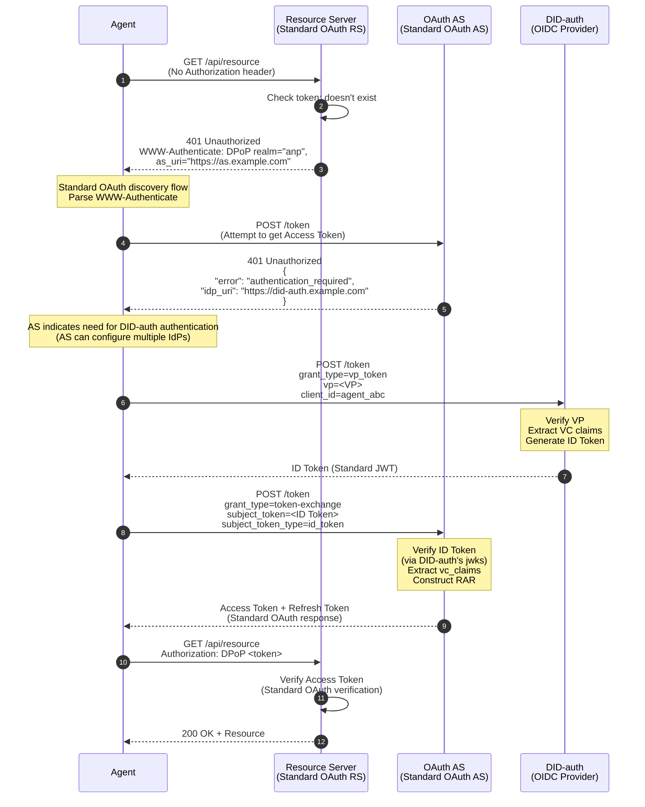
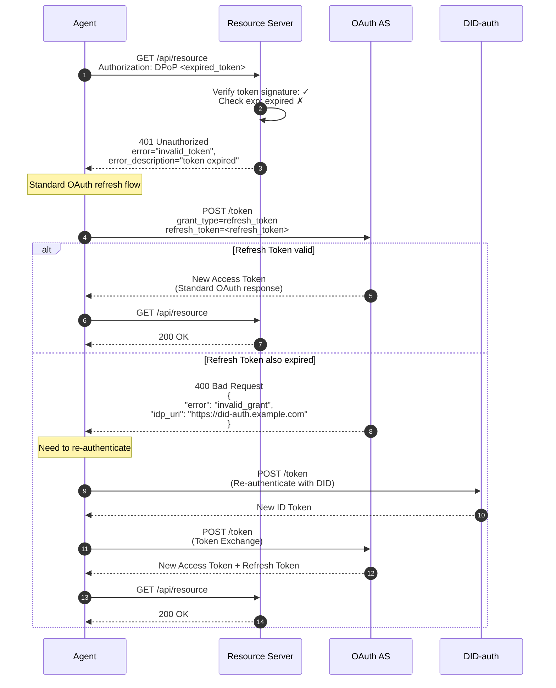
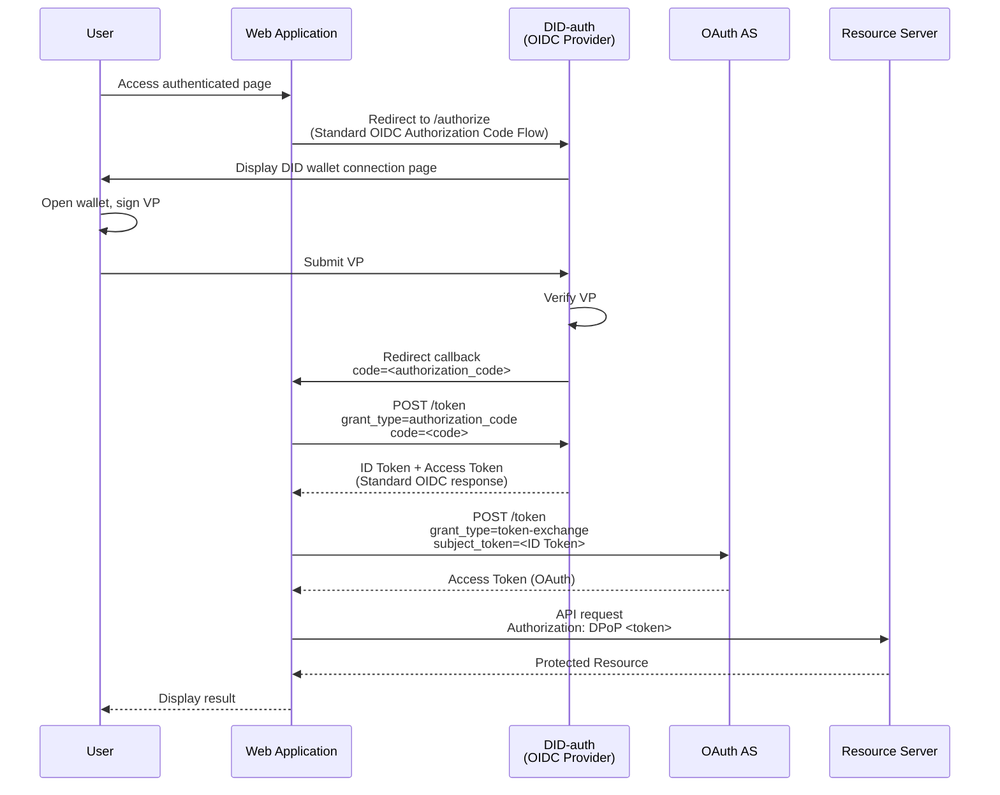
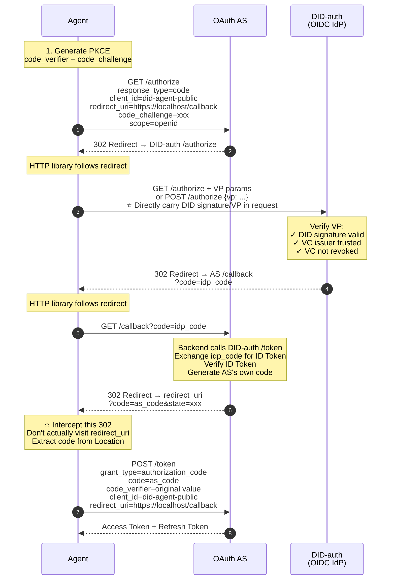
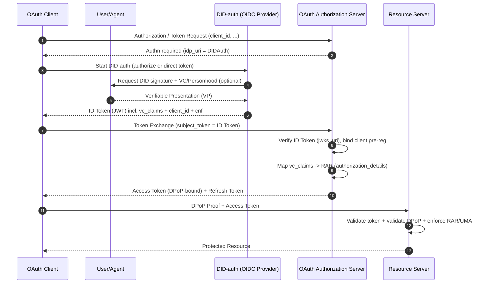

> 日本語参考訳（機械翻訳・未校閲）。規範となるのは原文です。コード例・識別子・規範キーワードは原文を保持しています。
> 原文: [standard/W3C-proposal/DID-OAuth-Integration-Solution.md](../../../standard/W3C-proposal/DID-OAuth-Integration-Solution.md) / 基準コミット: `0837cfdfaf4ddcf834f0890ddaf34fc4c824e066`

# DID-OAuth 統合ソリューション

## コアコンセプト

**WBA DIDソリューションは、OAuthアーキテクチャにゼロの影響を及ぼすことなく、単一ポイントのAuthnサービスを提供することで、OAuthエコシステムにシームレスに統合**

```
┌─────────────────────────────────────────────────────────┐
│                    OAuth Ecosystem                       │
│  ┌──────────────┐  ┌──────────────┐  ┌──────────────┐  │
│  │   Client     │  │     AS       │  │     RS       │  │
│  │  (unchanged) │  │  (unchanged) │  │  (unchanged) │  │
│  └──────────────┘  └──────────────┘  └──────────────┘  │
│         │                 │                  │           │
│         │                 │                  │           │
│         │          ┌──────▼──────┐           │           │
│         │          │   Authn     │           │           │
│         └─────────►│  (pluggable)│           │           │
│                    └──────────────┘           │           │
│                          │                    │           │
│                    ┌─────▼──────┐             │           │
│                    │ DID-auth   │             │           │
│                    │ (OIDC IdP) │             │           │
│                    └────────────┘             │           │
└─────────────────────────────────────────────────────────┘

Key: DID-auth is an optional implementation of OAuth's authentication layer,
     not changing OAuth's authorization architecture
```

---

## ... OAuth のレイヤーモデルと DID のポジショニング

### 1.1 OAuthの2層アーキテクチャ

```
┌─────────────────────────────────────────┐
│         Authn Layer (Authentication)     │
│  Responsibility: Confirm "who is the     │
│                  subject"                │
│  Implementation: Password/OIDC/SAML/     │
│                  DID-auth                │
│  Output: Authentication credentials      │
│          (e.g., ID Token)                │
└─────────────────────────────────────────┘
                    ↓
┌─────────────────────────────────────────┐
│         Authz Layer (Authorization)      │
│  Responsibility: Decide "what the        │
│                  subject can do"         │
│  Implementation: OAuth AS (token         │
│                  issuance)               │
│  Output: Access Token + Refresh Token    │
└─────────────────────────────────────────┘
                    ↓
┌─────────────────────────────────────────┐
│      Resource Access                     │
│  Responsibility: Execute access control  │
│  Implementation: Resource Server         │
│  Verification: Access Token + Policy     │
└─────────────────────────────────────────┘
```

### 1.2 DIDのポジショニング

**DID/VC/VP は、Authn レイヤーの実装を強化**:

| コンポーネント | 役割・役割 | メリット |
|------|------|---------|
| **ダイド** | 分散型アイデンティティ識別子 | 集中型アイデンティティプロバイダ不要 |
| **VC の** | 検証可能な資格 | 第三者機関の承認 |
| **VP(VP)** | 検証可能なプレゼンテーション | 可聴性、再生抵抗力がある、監査可能 |

**主要インサイト**:
- ✅ DIDはAuthnレイヤーを強化(より強いアイデンティティ検証)
- ✅ DIDはAuthzレイヤーを置き換えません(SterにはOAuthのトークンメカニズムが必要です)
- ✅ DIDはリソースアクセスレイヤーに影響を与えません(RSはまだアクセストークンを検証します)

---

## II. . 認証シナリオの故障: A2A 対 A2R

このソリューションは、設計と検証のための2つのチェーンに「認証/認可」要件を分割することを推奨します。

- **A2A(エージェント・ツー・エージェント)**: リクエストレシーバーがエージェント(またはエージェントゲートウェイ)であるエージェント間でポイントツーポイント/マルチポイント通信とコラボレーション。
- **A2R(エージェント・ツー・リソース)**: 既存のリソースサーバ(RS)にアクセスするエージェント、標準の OAuth リソース保護と既存のエコシステムとの互換性が必要です。

この分割値: **A2Aは、集中化圧力を削減するためにDIDのポイントツーポイント認証モデルをネイティブに採用することができます。 A2Rは、既存のRS用の互換性レイヤーとしてOAuthトークンを使用します**.

### 2.1 A2A(エージェント・ツー・エージェント):ネイティブID認証の利点

A2A シナリオでは、通信の当事者は DID/VC/VP を理解し、集中認証サーバーを導入する必要がないことが多いです。

**利点**:
- ✅ **OAuth 認可サーバー不要**: 両当事者は、相互認証とメッセージの完全性保護のために直接DIDシグネチャ/VPを使用することができます。
- ✅ **単一ポイントのネック/圧力無し**: トークンを交換するために、すべてのリクエストが最初に AS に行わなければならない高周波パスはなく、将来の M2M/Agent 高通貨コールに適した。
- ✅ **より自然なポイントツーポイントの信頼と委任式**: VC/VP を使用して、エージェントの所有権、資格、委任チェーン、ステップアップ証拠を表現します。

> 結論:「ネイティブエージェントネットワーク」または「タイトなエージェントコラボレーション」シナリオでは、認証用DIDを直接使用したA2Aは通常OAuthよりも軽微です。

### 2.2 A2R(エージェント・ツー・リソース):既存のリソースと互換性があり、OAuth認証アクセスをまだ使用する必要があります

A2Rのキー制約は次のとおりです。 **多くの既存のRSはOAuthアクセストークン(JWT/DPoP/MTLSなど)のみを理解しています。** DID/VP は理解できません。

そのため、互換性とエンジニアリングコストの観点から:
- ✅ エージェントは取得する必要があります **アクセストークン** とりあえず **OAuth 認可** 接続RS
- ✅ RSは既存の実装を維持します。トークン(およびDPoP/policy)を検証するだけで、DIDを理解しなくてもよいです。

> 結論: A2Rは、リソースアクセスのための「最も低い一般的なデノミネーター」としてOAuthトークンを維持する必要があります。

### 2.3 標準の DID-authn (OIDC IdP) を Authn Node でのみデプロイする

A2Rチェーンでは、推奨されるアプローチは引き続きあります。

1. 設定する **標準 OAuth 互換 DID-authn (OIDC プロバイダー)** AS側
2. DID-authn は、DID 認証の完了、および発行の VP/VC の確認を義務付けています。 **IDトークン** (JWT) DIDに対応した。
3. エージェントは、この **IDトークン** 申し込み **アクセストークン** ASから **トークン交換(RFC 8693)**, その後、RSにアクセスします。.

これは明確な境界を維持します。
- DID-authn: ソルブ「誰が被験者/何が検証可能な証拠」 (Authn)
- AS: 「与えるためにどのような権限を付与するか、発行するトークン」を解決します(Authz)
- RS:トークンを検証し、ポリシーを実行します

### 2.4 エージェント側認証フォーム: トークンストレージとDID/キーをクライアントの認証として

エージェントの「ランタイムクレデンシャル」の観点から、実装方法は2つのタイプ(共存者)として理解できます。

- **方法A:OAuthトークンを直接保存して使用**
  - エージェントストアアクセストークン/トークンをリフレッシュ
  - 利点: 簡単な実装、完全にOAuthエコシステムに従う
  - リスク:トークンの漏洩を防ぐことに重点を置く必要があります(DPoP/ショートライブトークン/リフレッシュ戦略付き)

- **方法B:クライアントの資格情報(クライアント認証)にDIDパブリック/プライベートキー機能を使用する**
  - DID をそのまま使用しない `client_id`、しかし代理店がトークンエンドポイントでクライアントのauthを完了するのに「プライベートキープ」を使用するようにすることを可能にします(エンジンを握り、より近いです) `private_key_jwt` / mTLSパターン
  - 利点: 長期操作および細粒された取消/回転のためにより適したテナントごとの1つの代理店のインスタンス

> 注:「DID秘密鍵の証拠」とOAuthのクライアント認証は2つのシステムです。 OAuth標準の方法でそれを運ぶことをお勧めします(`private_key_jwt`/mTLS/DPoP; DIDシステムは、被験者本人と証拠(VC/VP)の方が優れています。

### 2.5ターミナル標準の両立性の条件: 顧客_id 事前参加登録 / DID の動的登録独立者, しかし、エージェントはサポートしなければなりません

「エンドツーエンドの標準的な互換性」の観点から、OAuth AS/RS にアクセスするエージェントは、通常、正規の OAuth クライアント ID を持つ必要があります。

- **静的事前登録(クライアント事前登録)**: オペレーション/コンソール作成 `client_id` 事前にメタデータを制約し、メタデータが削除される
- **ダイナミック登録(RFC 7591クライアント・ダイナミック登録)**: エージェント(またはその制御面)は、登録エンドポイントを呼び出して取得します。 `client_id` (そしておそらく資格情報)

重要なポイント:
- これらの2つの登録モードは **OAuth クライアント・ガバナンスの仕組み**、DID自体の独立。
- 「テナント当たりの1つのエージェントインスタンス」では、動的登録は一般的にスケールアップに使用されます `client_id` 配布;しかし、登録エンドポイントは、強力な認証(初期アクセストークン/mTLS/またはVCベースの入学)を持っている必要があります。

### 2.6 包括的な結論: A2A ネイティブ DID, A2R は OAuth + DID-authn を使用します。

今後のM2M/agentの高周波トレンドを包括的に検討:
- **A2A(アット・アット・アット・アット・アット・アット・アット・ア・ア・ア・ア・ア・ア・ア・ア・ア・ア・ア・ア・ア・ア・ア・ア・ア・ア・ア・ア・ア・ア・ア・ア・ア・ア・ア・ア・ア・ア・ア・ア・ア・ア・ア・ア・ア・ア・ア・ア・ア・ア・ア・ア・ア・ア・ア・ア・ア・ア・ア・ア・ア・ア・ア・ア・ア・ア・ア・ア・ア・ア・ア・ア・ア・ア・ア・ア・ア・ア・ア・ア・ア・ア・ア・ア・ア・ア・ア・ア・ア・ア・ア・ア・ア・ア・ア・ア・ア・ア・ア・ア・ア・ア・ア・ア・ア・ア・ア・ア・ア・ア・ア・ア・ア・ア・ア・ア・ア・ア・ア・ア・ア・ア・ア・ア・ア・ア・ア・ア・ア・ア・ア・ア・ア・ア・ア・ア・ア・ア・ア・ア・ア・ア・ア・ア・ア・ア・ア・ア・ア・ア・ア・ア・ア・ア・ア・ア・ア・ア・ア・ア・ア・ア・ア・ア・ア・ア・ア・ア・ア・ア・ア・ア・ア・ア・ア・ア・ア・ア・ア・ア・ア・ア・ア・ア・ア・ア・ア・ア・ア・ア・ア・ア・ア・ア・ア・ア・ア・ア・ア・ア・ア・ア・ア・ア・ア・ア・ア・ア・ア・ア・ア・ア・ア・ア・ア・ア・ア・ア・ア・ア・ア・ア・ア・ア・ア・ア・ア・ア・ア・ア・ア・ア・ア・ア・ア・ア・ア・ア・ア・ア・ア・ア・ア・ア・ア・ア・ア・ア・ア・ア・ア・ア**:優先順位 **ネイティブID** 認証(照明、単点圧力なし)
- **A2Rの特長**: 維持して下さい **OAuthアクセス制御**, 導入することにより **ドウスン(OIDC IdP)** 認証方法として AS 側で、エージェントが ID トークン → トークン交換 → アクセストークンを介して既存の RS にアクセスできるようにします。

---

## II. . シングルポイントAuthnサービスとしてのDID-auth

### 2.1 建築位置決め

**DID-auth = 標準 OIDC プロバイダー + DID/VC/VP 検証機能**

```
┌────────────────────────────────────────────────────┐
│              DID-auth (OIDC Provider)              │
│                                                    │
│  ┌──────────────────────────────────────────────┐ │
│  │  Standard OIDC Endpoints                     │ │
│  │  ├── /.well-known/openid-configuration       │ │
│  │  ├── /token (ID Token issuance)              │ │
│  │  ├── /jwks (public key endpoint)             │ │
│  │  └── /authorize (browser scenario)           │ │
│  └──────────────────────────────────────────────┘ │
│                                                    │
│  ┌──────────────────────────────────────────────┐ │
│  │  DID/VC/VP Verification Capability           │ │
│  │  ├── DID resolution                          │ │
│  │  ├── VP signature verification               │ │
│  │  ├── VC signature verification               │ │
│  │  ├── Personhood VC verification              │ │
│  │  └── VC revocation check                     │ │
│  └──────────────────────────────────────────────┘ │
│                                                    │
│  Output: Standard ID Token (JWT)                   │
│          Contains vc_claims (verified VC content)  │
└────────────────────────────────────────────────────┘
```

### 2.2 OAuthエコシステムへの影響

| OAuth コンポーネント | ニーズの修正 | コンテンツ |
|-----------|-------------|------|
| **クライアント** | なし× | それでも標準の OAuth クライアントは、OIDC サポートだけを必要としています |
| **とりあえず** | ✨ 最小限 | ID トークンを IdP として信頼する必要がある場合、ID トークンの認証 |
| **ツイート** | なし× | DID の完全無用、アクセストークンのみを検証 |
| **トークン形式** | なし× | 静止標準JWTアクセストークン |
| **認証フロー** | なし× | 静止標準 OAuth 2.0 フロー |

**コンテンツ**: プラグイン可能なAuthnサービスとしてDID-authは、OAuthアーキテクチャに破壊的な影響がゼロである。

---

## . . リアルトリガーシナリオ

### 3.1 エージェントシナリオ: 最初のアクセス (トークンなし)



**主要ポイント**:
- RS および AS は標準 OAuth プロトコルを使用しました
- 当社が信頼するOIDCプロバイダとしてDID-authが機能
- エージェントは、標準の OAuth アクセストークンを取得

---

### 3.2 エージェントシナリオ: トークンの有効期限



**主メカニズム**:
- リフレッシュトークン(標準 OAuth フロー)の使用優先
- リフレッシュ時にDIDで再認証のみが失敗します
- 流入はRSに透明です

---

### 3.3 ブラウザーシナリオ: 従来のリダイレクトフロー



**主な特長**:
- 標準の OIDC 認可コードフローを使用する
- ユーザーインタラクションページ(DIDウォレット接続)
- コールバックをリダイレクトする
- WebApp は標準 OAuth アクセストークンを取得

---

### 3.4 エージェントシナリオ: 認証コードフローのシミュレーション (最大互換性ソリューション)

AS がトークン交換(RFC 8693)をサポートしていない場合、エージェントはHTTPライブラリを使用してブラウザの認可コードフローをシミュレートして、最大互換性を発揮できます。

#### 3.4.1 ソリューション概要

```
┌─────────────────────────────────────────────────────────┐
│                                                         │
│  Core Idea:                                             │
│                                                         │
│  • Agent uses HTTP library to handle 302 redirects     │
│    (simulating browser)                                 │
│  • IdP (DID-auth) supports accepting VP authentication │
│    directly in request                                  │
│  • Agent intercepts final redirect, extracts code      │
│    from URL                                             │
│  • Uses standard Authorization Code to exchange for    │
│    Access Token                                         │
│                                                         │
│  Advantages:                                            │
│  ✅ Strongest compatibility (almost all AS support     │
│     Auth Code Flow)                                     │
│  ✅ Doesn't require AS to support Token Exchange       │
│  ✅ Security guaranteed by IdP's DID/VC verification   │
│                                                         │
└─────────────────────────────────────────────────────────┘
```

#### 3.4.2 完全な流れ



#### 3.4.3 主実装の詳細

**1. . PKCEサポート(一般のお客様)**

```python
import hashlib
import base64
import secrets

# Generate PKCE
code_verifier = secrets.token_urlsafe(32)
code_challenge = base64.urlsafe_b64encode(
    hashlib.sha256(code_verifier.encode()).digest()
).decode().rstrip('=')

# Carry in /authorize request
params = {
    "response_type": "code",
    "client_id": "did-agent-public",
    "redirect_uri": "https://localhost/callback",
    "code_challenge": code_challenge,
    "code_challenge_method": "S256",
    "scope": "openid",
    "state": secrets.token_urlsafe(16)
}

# Carry code_verifier in /token request
token_data = {
    "grant_type": "authorization_code",
    "code": as_code,
    "client_id": "did-agent-public",
    "redirect_uri": "https://localhost/callback",
    "code_verifier": code_verifier  # Required
}
```

**2. . DID-auth API 認証をサポート(HTML Page Returnなし)**

```
┌─────────────────────────────────────────────────────────┐
│                                                         │
│  DID-auth /authorize endpoint needs to support:        │
│                                                         │
│  Method A: GET request with VP parameter               │
│  GET /authorize?                                        │
│    response_type=code&                                  │
│    client_id=xxx&                                       │
│    vp_token=<base64url encoded VP>&                    │
│    redirect_uri=...                                     │
│                                                         │
│  Method B: POST request with JSON body                 │
│  POST /authorize                                        │
│  Content-Type: application/json                         │
│  {                                                      │
│    "response_type": "code",                            │
│    "client_id": "xxx",                                 │
│    "vp": { ... VP content ... },                       │
│    "redirect_uri": "..."                               │
│  }                                                      │
│                                                         │
│  After verification, directly return 302, no HTML      │
│                                                         │
└─────────────────────────────────────────────────────────┘
```

**3. . 最終302リダイレクトの受入**

```python
import httpx
from urllib.parse import urlparse, parse_qs

# Configure HTTP client
client = httpx.Client(follow_redirects=False)  # Don't auto-follow last redirect

# Manually handle redirect chain
response = client.get(authorize_url, params=params)
while response.status_code in (301, 302, 303, 307, 308):
    location = response.headers["location"]

    # Check if this is final redirect (to redirect_uri)
    if location.startswith("https://localhost/callback"):
        # Intercepted! Extract code from URL
        parsed = urlparse(location)
        query = parse_qs(parsed.query)
        as_code = query["code"][0]
        break

    # If redirecting to DID-auth, need to attach VP
    if "did-auth.example.com" in location:
        response = client.post(
            location,
            json={"vp": vp_object},
            follow_redirects=False
        )
    else:
        response = client.get(location, follow_redirects=False)

# Exchange code for token
token_response = client.post(
    "https://as.example.com/token",
    data=token_data
)
access_token = token_response.json()["access_token"]
```

**4. . リダイレクト_uri 設定(バーチャルアドレス)**

```json
{
  "client_id": "did-agent-public",
  "client_name": "DID Agent Public Client",
  "token_endpoint_auth_method": "none",
  "redirect_uris": [
    "https://localhost/callback",
    "http://localhost:8080/callback",
    "app://callback"
  ],
  "grant_types": ["authorization_code", "refresh_token"],
  "response_types": ["code"]
}
```

#### 3.4.4 セキュリティモデル解析

```
┌─────────────────────────────────────────────────────────┐
│                                                         │
│  Security Barrier Transfer:                            │
│                                                         │
│  Traditional OAuth:                                     │
│    Security relies on → AS's client registration +     │
│                         client_secret                   │
│                                                         │
│  This Solution:                                         │
│    Security relies on → IdP's DID/VC verification      │
│                                                         │
│  client_id's role downgraded to:                       │
│    • Satisfy AS formal requirements                    │
│    • Bind redirect_uri (for AS verification)           │
│    • Configure PKCE requirements                       │
│                                                         │
│  Real identity verification:                           │
│    ✓ DID private key signature (cryptographically      │
│      unforgeable)                                       │
│    ✓ VC issuer verification (authority endorsement)    │
│    ✓ VC revocation check (dynamic admission control)   │
│                                                         │
└─────────────────────────────────────────────────────────┘
```

**攻撃シナリオ保護**:

| 攻撃シナリオ | 保護メカニズム |
|-----------------|---------------------|
| 攻撃者はクライアントを知っている_id の | IdPのDID/VC認証を渡すことはできません |
| 攻撃者はリダイレクトを知っている_ユウリ | 有効なVPは、コードを取得できません |
| 攻撃者はDIDがVCがない | 信頼リストにないVC発行者、拒否 |
| 攻撃者はコードを解釈します | PKCE保護、コードなしでトークンを交換することはできません_検証 |

#### 3.4.5 トークン交換ソリューションとの比較

| 寸法: | トークン交換 | Auth コードフローのシミュレート |
|-----------|---------------|-------------------------|
| **要求として** | ニーズRFC 8693サポート | 標準 Auth コードだけ |
| **互換性** | パートナ AS サポート | ほぼすべてのASサポート |
| **フローコンプレックス** | シンプル(2つのPOST) | より複雑な(複数のリダイレクト) |
| **IdP の要件** | 標準/トークンエンドポイント | API認証サポートが必要 |
| **セキュリティー** | 等価 | 同等性(DID/VC検証) |

**選択の推薦**:

```
┌─────────────────────────────────────────────────────────┐
│                                                         │
│  Prioritize Token Exchange:                            │
│    When AS supports RFC 8693                           │
│    Simpler flow, less code                             │
│                                                         │
│  Use Simulated Auth Code Flow:                         │
│    When AS doesn't support Token Exchange              │
│    When maximum compatibility needed                   │
│    E.g., AWS Cognito and other restricted environments │
│                                                         │
└─────────────────────────────────────────────────────────┘
```

---

## IV. . 主インタラクション機構

### 4.1 WWW-Authenticate メカニズム(RS → Client)

**標準 OAuth 2.0 ベアラートークンエラー応答**:

```http
HTTP/1.1 401 Unauthorized
WWW-Authenticate: DPoP realm="anp-resource-server",
  as_uri="https://as.example.com",
  error="invalid_token",
  error_description="The access token expired"
```

**クライアントは、パース後に取得します**:
- トークン型要件(DPoP)
- 認証サーバーの場所
- エラーの理由

**スタンダード・バシス**: RFC 6750 (ベアラートークン使用)

---

### 4.2認証要件対応(AS → Client)

**クライアントが認証資格を欠いているとき**:

```http
HTTP/1.1 401 Unauthorized
Content-Type: application/json

{
  "error": "authentication_required",
  "error_description": "Authentication with identity provider required",
  "idp_uri": "https://did-auth.example.com",
  "idp_metadata_uri": "https://did-auth.example.com/.well-known/openid-configuration"
}
```

**クライアント行動**:
1. IdPのメタデータ(OIDC Discovery)を取得する
2. クライアントタイプとAS機能に基づく認証フローの選択
   - **代理店(トークン交換可)**: 直接POST /トークン → トークン交換(優先)
   - **代理店(トークン交換不可)**: Auth コードフローのシミュレーション → GET /authorize (互換性スキーム)
   - **ブラウザ**: /authorize → 従来のリダイレクトフローにリダイレクト

---

### 4.3 DID認証インタラクション(クライアント→DID-auth)

#### 方法A:直接トークンエンドポイント(トークン交換でペアリング)

**エージェントのシナリオ(ダイレクトAPI)**:

```http
POST /token HTTP/1.1
Host: did-auth.example.com
Content-Type: application/json
DPoP: <dpop_proof>

{
  "grant_type": "vp_token",
  "vp": {
    "type": "VerifiablePresentation",
    "verifiableCredential": [...],
    "proof": {
      "type": "Ed25519Signature2020",
      "challenge": "<nonce>",
      "proofValue": "..."
    }
  },
  "client_id": "agent_abc"
}
```

**ソリューション**:

```json
{
  "id_token": "eyJhbGc...",
  "token_type": "Bearer",
  "expires_in": 300
}
```

**IDトークンコンテンツ**:

```json
{
  "iss": "https://did-auth.example.com",
  "sub": "did:web:example.com:user:alice",
  "aud": "agent_abc",
  "exp": 1735804800,
  "iat": 1735801200,
  
  "vc_claims": {
    "personhood": {
      "verified": true,
      "level": "high",
      "issuer": "did:web:trusted-issuer.example"
    },
    "kyc": {
      "verified": true,
      "level": 2
    }
  },
  
  "cnf": {
    "jkt": "<dpop_public_key_thumbprint>"
  }
}
```

**主要分野**:
- `vc_claims`: VC コンテンツの検証(プレーンテキスト、信頼できる)
- `cnf`: DPoP 結合(トークン盗難防止)

---

#### 方法B:エンドポイントの承認(認証コードフローでペアリング)

**エージェントのシナリオ(API認証、HTMLページなし)**:

```http
POST /authorize HTTP/1.1
Host: did-auth.example.com
Content-Type: application/json

{
  "response_type": "code",
  "client_id": "did-agent-public",
  "redirect_uri": "https://localhost/callback",
  "state": "xyz123",
  "code_challenge": "...",
  "code_challenge_method": "S256",
  "vp": {
    "type": "VerifiablePresentation",
    "verifiableCredential": [...],
    "proof": {
      "type": "Ed25519Signature2020",
      "challenge": "<nonce>",
      "proofValue": "..."
    }
  }
}
```

**ソリューション** (VPの証明は渡しました):

```http
HTTP/1.1 302 Found
Location: https://as.example.com/callback?code=SplxlOBeZQQYbYS6WxSbIA&state=xyz123
```

**使用法 スケーナリオス**:
- トークン交換(RFC 8693)をサポートしていないため
- 必要な最大互換性
- エージェントは HTTP リダイレクトチェーンを処理できます。

**セキュリティキーポイント**:
- PKCE で使用する必要があります。
- VP の検証は従来のユーザー/パスワード認証を取り替えます
- エージェントは最終302リダイレクトと抽出コードをインターセプトします

> セクション3.4を参照する詳細なフロー

---

### 4.4トークン交換(クライアント→AS)

**◀ おすすめのメソッド** (RFC 8693) を支える時

**RFC 8693の標準を使用して**:

```http
POST /token HTTP/1.1
Host: as.example.com
Content-Type: application/x-www-form-urlencoded
DPoP: <dpop_proof>

grant_type=urn:ietf:params:oauth:grant-type:token-exchange
&subject_token=<ID Token>
&subject_token_type=urn:ietf:params:oauth:token-type:id_token
&client_id=agent_abc
&scope=anp:social_graph
```

**加工の流れとして**:
1. **IDトークンを検証** - 署名を確認するDID-authからjwksをフェッチ
2. **エキスのvc_クレーム** - 確認済みのVCコンテンツを入手
3. **構造体 RAR** - vc に基づく権限を動的に生成_クレーム
4. **ビンドDPoP** - パブリックキーの指紋をアクセストークンに書き込む

**ソリューション**:

```json
{
  "access_token": "eyJhbGc...",
  "token_type": "DPoP",
  "expires_in": 3600,
  "refresh_token": "8xLOxBtZp8...",
  "authorization_details": [
    {
      "type": "anp.social_graph_discovery",
      "actions": ["query", "distance"],
      "constraints": {"max_depth": 3},
      "evidence": {"personhood_level": "high"}
    }
  ]
}
```

---

## ツイート VC クレームを RARマッピング機構へ

### 5.1 なぜVCクレームが必要なのか?

**従来の OAuth 制限**:

```
Traditional OAuth only knows "who":
User login → AS only knows sub="alice"
          → Grants fixed scope="read write"
          → Cannot dynamically adjust permissions based on user attributes
```

**VCクレームの値は**:

```
With VC Claims, AS knows "who's what attributes":
User submits VP → DID-auth verifies VC
           → Extracts: personhood=verified, kyc_level=2
           → This information enters ID Token
           → AS constructs RAR based on these trusted attributes
           → Dynamically grants fine-grained permissions
```

**主要インサイト**:
- VC のクレームは **信頼できる平文を確認** (DID-auth は署名を検証しました)
- できる限り **安全に使用** 承認決定のためのこれらの主張
- 異なるVCの組み合わせ → 別の権限レベル

---

### 5.2 ルール例のマッピング

**シナリオ1:普通ユーザー(特別VCなし)**

```
ID Token: {"vc_claims": {}}
↓
RAR: {
  "actions": ["query"],
  "constraints": {"max_depth": 1, "rate_limit": "10/hour"}
}
```

**シナリオ2: 特定人**

```
ID Token: {"vc_claims": {"personhood": {"verified": true}}}
↓
RAR: {
  "actions": ["query", "distance", "neighbors"],
  "constraints": {"max_depth": 3, "rate_limit": "100/hour"},
  "evidence": {"personhood_level": "high"}
}
```

**シナリオ3:高いKYC +人件**

```
ID Token: {
  "vc_claims": {
    "personhood": {"verified": true},
    "kyc": {"level": 3}
  }
}
↓
RAR: {
  "actions": ["query", "distance", "neighbors", "introduce"],
  "constraints": {"max_depth": 5, "rate_limit": "500/hour"},
  "evidence": {"personhood_level": "high", "kyc_level": 3}
}
```

**マッピング機構の概要**:

VCクレーム | 助成された行動 | マックス_深さ: | レート_制限なし |
|-----------|--------------|-----------|------------|
なし | ソリューション | 1 | 10時間/時間 |
スタッフ | 問い合わせ、距離、隣人 | 3 | 100/時間 |
フード + KYC | 問い合わせ、距離、隣人、導入 | 5 | 500/時間 |

---

## ヴィ. OAuthエコシステムとの互換性

### 6.1 Authn/Authz セキュリティ境界: DID Won't "Break" OAuth がなぜなのか

OAuth は、懸念の 2 つの層に抽象化できます。

- **Authn (認証レイヤー)**: 「誰が被写体であるか」と答えます。 OAuth自体は認証方法を指定しません。実際にはパスワード、SMS、SAML、OIDC等で実装されています。
- **Authz (認可レイヤー)**: 「被験者が何をできるか」と答え、承認結果をカプセル化 **アクセストークン/トークンを新たにして下さい**クライアントが保有し、アクセス時にRSに提示されたRSは、標準でポリシーを検証し実行するだけです。

そのため、OAuthエコシステム(例えば、)でトークンセキュリティと認可表現を中心に開発された仕組み **トークン、PKCE、DPoP、RAR、UMAを新たにして下さい**) は本質的に **認可工学**認証方法(Authn)からデコルドアップ

**DID/VC/VP のポジショニングは、Authn 側でも厳密に行う必要があります。**:
- DID は、検証可能なサブジェクタ ID を提供します。
- VCは検証可能な属性/保証を提供します
- VPは1回限り、可聴性、可聴性の証拠を提供します

> 結論:DID-authは、DID/VP検証で「認証方法」を置き換えるだけです。 OAuthのトークン発行、更新、リソースアクセス制御は変更されません。

### 6.2 OAuthクライアント事前登録: 保持する必須セキュリティの前提

OAuth のセキュリティモデルには、以下のものが必要です。 **クライアントは事前登録が必要です(クライアント)_id, リダイレクト_うり、等)**, それ以外の場合は、確実にリダイレクトを制約することはできません, 安全なコールバック, そしてトークン発行目標.

#### 6.2.1 クライアントの事前登録処理

このソリューションは、この要件を変更しないようにしますが、 **セキュリティ障壁がシフトしました**:

```
Traditional OAuth Security Model:
  client_id + client_secret (or mTLS)
  → Prevents unauthorized clients from obtaining tokens

DID-OAuth Integration Solution Security Model:
  client_id (formal requirement) + DID/VC verification (substantive security)
  → Security focus shifts from client credentials to subject identity verification
```

#### 6.2.2 クライアントの変更_id ロール

寸法: | 伝統OAuth | DID-OAuth ソリューション |
|-----------|-------------------|-------------------|
**セキュリティの役割** | 日の出のコアセキュリティ障壁 | ◀ フォームのコンプライアンス要件 |
**リダイレクト_尿の禁忌** | ✅ リダイレクト攻撃を防止 | ✅ この関数を保持する |
**PKCE の条件** | オプション(パブリッククライアントの必須) | ✅ 必須 (化学 3.4) |
**認証の真正** | クライアント_秘密/mTLS | 休日の日は、DID の秘密鍵署名 + VC 認証 |
**動的登録** | 対応(RFC 7591) | 対応(入場制御用VC) |

#### 6.2.3 did-authの認証出力

認証完了後、DID-auth **クライアントの事前登録情報を運ぶ/参照** 続いてトークン発行時に結合するAS:

- DID-auth認証出力(AS により検証可能):
  - `sub`: 演題DID(VP経由の検証)
  - `vc_claims`: VC コンテンツの検証(または概要/参照)
  - `client_id`: 事前登録済みのクライアント識別子(形式要件)
  - `azp` (認証パーティ): 認証開始の実際のクライアント
  - オプション: `redirect_uri` / `client_metadata` リファレンス
  - オプション: `cnf` (DPoP/PoP 結合)

AS は "**対象情報(DID検証済み)** + **クライアント事前登録情報(フォームバインディング)**「、標準的な OAuth フローごとにアクセストークン/リフレッシュトークンを発行します。

#### 6.2.4 パブリッククライアント構成例

**スキーム3.4(暫定認証コードフロー)**:

```json
{
  "client_id": "did-agent-public",
  "client_name": "DID Agent Public Client",
  "client_type": "public",
  "token_endpoint_auth_method": "none",
  "redirect_uris": [
    "https://localhost/callback",
    "http://localhost:8080/callback",
    "app://callback"
  ],
  "grant_types": ["authorization_code", "refresh_token"],
  "response_types": ["code"],
  "require_pkce": true,
  "require_pushed_authorization_requests": false,
  
  "_comment": "Security Note",
  "_security_model": "DID/VC verification at IdP, not client_secret"
}
```

**主要ポイント**:
- `token_endpoint_auth_method: "none"`: クライアントなし_使用される秘密
- `require_pkce: true`: コード交換保護のためのPKCEを強化
- DID-authのVP検証で保証された真のセキュリティ

### 6.3 一般互換性シーケンス図(DID-auth → OAuth Token → RS)

> Note: 下記の図は、ブラウザ/エージェントを区別することなく抽象的な主流を与えます。特定のトリガーフォームは、第3章の Agent とブラウザーシーケンス図を参照してください。



### 6.4 標準互換性分析

OAuth 規格 | 互換性 | コンテンツ |
|----------------|---------------|-------------|
**RFC 6749の特長** (OAuth 2.0) | ✅ 完全互換 | 標準トークンエンドポイントとフローを使用する |
**RFC 6750の** (ベアラートークン) | ✅ 完全互換 | 標準WWW-Authenticateをサポート |
**RFC 7519の特長** (JWT) | ✅ 完全互換 | アクセストークンは標準的なJWTを使用します |
**RFC 7636の特長** (PKCE) | ✅ 完全互換 | スキームの必須事項 3.4 |
**RFC 8693の特長** (トークン交換) | ✅ 完全互換 | アクセストークンのIDトークン交換(スキーム3.1で優先) |
**RFC 9068の特長** (JWTアクセストークン) | ✅ 完全互換 | 標準JWTアクセストークンフォーマット |
**RFC 9449の特長** (DPoP) | ✅ 完全互換 | トークンはキーにバインド |
**OIDCコア** | ✅ 完全互換 | DID-auth は、標準 OIDC プロバイダーを実装しています。 |
**RAR(RFC 9396)** | ✅ 完全互換 | 標準的な承認_インフォメーション |

**コンテンツ**: DID-auth ソリューションは、既存の OAuth/OIDC 規格に基づいており、新しいプロトコルは必要ありません。

---

### 6.5 DPoP / RAR / UMA:認可層の自然着陸

このソリューションでは、三つの責任を明確に拘束します。

- **DPoP (RFC 9449)**: 「盗まれた再生可能」問題の解決
  - DID-auth 側:クライアントは、DPoP 公開鍵(またはサムネイル)、DID-auth のリターンを提供できます `cnf.jkt`/`cnf.jwk` IDトークンで。
  - AS 側:アクセストークンに PoP 結合情報を書きます `cnf`トークン交換/発行中に一貫性を強化します。
  - RS 側: DPoP の証拠はトークンにマッチします `cnf` スタンダード

- **RAR(RFC 9396)**: 「スコープの粗すぎる、監査が難しい、複雑な機能を表現するのが難しかった」という問題に解決します。
  - DID-auth 側: 信頼できるを提供して下さい `vc_claims` (または証拠参照) 承認決定書の入力として.
  - AS の側面: `vc_claims -> authorization_details` (RAR) 認可の建設エンジンとして。
  - RS 側: パーシスのみで実行 `authorization_details`DID/VC を理解してはいけない

- **UMA(ユーザー管理承認)**: 「ユーザー制御可能で、クロスドメイン共有、細かいグラインドポリシー」の問題を解決します。
  - VCは、リソースの所有権、対象の正当な権利(例えば、パーソナビリティ)を表現できます。 UMAポリシーは、これらの条件を参照することができます。
  - 実施: AS-issuedトークンはRAR(またはUMA関連のクレーム)を、RSはポリシーポイントで実行します。

### 6.6ゼロトラスト・パースペクティブ:DID-VC ダイナミックアシュアランス(ステップアップAuthn)

ゼロ信頼は、「あらゆるアクセスに対して、より強力な認証を必要とするリスク評価」を強調しています。 DID/VC/VP は、自動保証入力に適しています。

- 複数のVCは、リスクレベル(DIDアイデンティティVC、パーソナリティVC、デバイスバインディングVC、リレーションVC、リスクアセスメントVCなど)に基づいて1つのVPに組み込むことができます。
- 一方、署名チェーンを一度だけ検証し、マップはトークンクレーム/ RAR / UMA条件に相当します。

> 複数のインタラクション/マルチIDPのコオリンジから1つのVP投稿+ 1つの認証+ 1つの承認マッピングに「動的保証」が変わります。

### 6.7 OAuthエコシステム実証による統合

**主流 OAuth AS との統合**:

```
Existing OAuth AS (e.g., Keycloak)
 ┌───────────────────────────────────┐
 │  Identity Provider Configuration  │
 │  ├── Google (OIDC)                │
 │  ├── Azure AD (OIDC)              │
 │  ├── SAML IdP                     │
 │  └── DID-auth (OIDC) ← New        │
 └───────────────────────────────────┘
                                     
 Configuration:
 - Add OIDC Provider
 - Configure issuer URL
 - Configure jwks_uri
 - Map vc_claims to user attributes
```

**変更無し 必要**:
- クライアントアプリケーションコード
- リソースサーバー検証ロジック
- トークン形式
- APIエンドポイント

**必要なだけ構成**:
- 信頼できるIDPとしてDID-authをASで加えて下さい
- vc の設定_RARマッピングルールへのクレーム

---

## ヴィニオ 実装チェックリスト

### 7.1 DID-auth 実装の必要性

**標準 OIDC エンドポイント**:
- [ ] おすすめ `/.well-known/openid-configuration` (サービスディスカバリー)
- [ ] おすすめ `/jwks` (公鍵エンドポイント)
- [ ] ポスト `/token` (IDトークン発行)
- [ ] おすすめ `/authorize` (ブラウザのシナリオ)
- [ ] ポスト `/authorize` (エージェントAPI認証シナリオ) ← 新規

**エージェント API 認証サポート(/承認エンドポイント)**:
- [ ] 受け入れ vp_GETリクエストのトークンパラメータ
- [ ] POSTリクエストでVP JSONボディを受け付けます
- [ ] VP認証後302の直接返送(HTMLなし)
- [ ] 標準OIDC認証コードフローに対応

**DID/VC/VP 検証**:
- [ ] DIDの解像度(サポートは:webなど)
- [ ] VP署名検証
- [ ] VC署名検証
- [ ] VC検証のパーソナビリティ
- [ ] VCの取消チェック
- [ ] チャレンジ/ノnce管理

**セキュリティメカニズム**:
- [ ] クライアント_id ホワイトリスト管理
- [ ] DPoP検証
- [ ] レート制限

---

### 7.2 OAuth 実装が必要な

**クライアント事前登録と結合(OAuth Security Model の保持)**:
- [ ] クライアント事前登録管理()`client_id`, `redirect_uri`、auth方法、DPoPの条件、等。)
- [ ] 検証 `client_id` トークン交換中にIDトークン/authコンテキストと一貫性
- [ ] クライアントメタデータ制約を組み込む(例、リダイレクト)_uri, DPoP req, トークン_方針) 発行決定

**OIDC の統合**:
- [ ] 信頼できるIDPとしてDID-authを構成します
- [ ] DID-auth から ID トークンを検証するjwks を取得する
- [ ] トークン交換サポート(RFC 8693)

**VCクレーム処理**:
- [ ] エキスのvc_IDトークンからのクレーム
- [ ] サインイン_RARマッピングロジックへのクレーム
- [ ] RARの建設エンジン

**トークン管理**:
- [ ] アクセストークンへのDPoP結合
- [ ] トークン管理をリフレッシュ
- [ ] トークンの取消

---

### 7.3 リソースサーバの実装が必要

**標準 OAuth 検証**:
- [ ] アクセストークンの署名検証
- [ ] トークンの有効期限チェック
- [ ] DPoP検証

**RARの執行**:
- [ ] パース認証_インフォメーション
- [ ] アクションが許可されているかどうかチェック
- [ ] 制約が満たされたかどうかチェック
- [ ] 証拠の要件をチェックする

**導入不要**:
- × DID解像度
- 〇 VP 検証
- 〇VC検証

---

## .VIII. インフォメーション

### 8.1 中心の結論

**OAuth アーキテクチャに関する DID-auth の影響:ゼロ**

```
DID-auth = Standard OIDC Provider
         + DID/VC/VP Verification Capability

Positioning: Pluggable implementation of OAuth authentication layer
Output: Standard ID Token
Integration: Via OIDC standard protocol
```

**主利点**:

1. **完全標準化** - OIDC、OAuth 2.0、トークン交換などの成熟した基準に基づく
2. **ゼロ破壊的** - クライアント/RS の変更は、最小限にAS config 変更しません
3. **明確な責任** - DID-auth は Authn, AS に Authz をフォーカス
4. **柔軟な拡張** - VC クレームは、属性ベースの動的認可を有効にします
5. **セキュリティの強化** - DPoP 結合、VP の再生の保護、完全な署名された鎖

---

### 8.2 従来のソリューションとの比較

寸法: | 伝統OAuth | DID-OAuth 統合ソリューション |
|-----------|-------------------|-------------------------------|
**アイデンティティ検証** | パスワード/SMS/QRコード | DID 署名 + VP |
**アイデンティティプロバイダ** | 集中型IdP | 分散型DID-auth |
**属性証拠** | IdP自己宣言 | サードパーティのVCの承認 |
**認可ベース** | 固定スコープ | ダイナミックRAR(VCクレームに基づく) |
**トークンセキュリティ** | ベアアートークン | DPoP の結合 |
**監査責任** | 限定商品 | 完全なシグネチャチェーン+証拠 |
**標準的な両立性** | ✓ | ✓ (十分に互換性があります) |

---

### 8.3 適当なシナリオ

**エージェント・シナリオ** (推奨):
- ✅ ブラウザのやり取りは必要ありません
- ✅ 自動認証フロー
- ✅ 自動キー署名
- ✅ M2M通信に適しています

**エージェントトークン取得方法**:

方法 | トークン交換 | Auth コードフローの同時化 |
|--------|----------------|--------------------------|
**要求として** | RFC 8693 のサポート | 標準 Auth コード 十分 |
**適当な場面** | モダン AS (Keycloak、Auth0) | 伝統AS、制限付き封筒 |
**導入の複雑さ** | 低いです | メディス |
**おすすめ商品** | 太陽の好まれた | プレイの互換性 |

**ブラウザのシナリオ** (互換性あり):
- ✅ 標準 OIDC リダイレクトフロー
- ✅ DIDウォレットの統合
- ✅ ユーザーフレンドリー体験

**エンタープライズシナリオ**:
- ✅既存の OAuth AS と統合
- ✅ サポート複数の IdPs の共存
- ✅ プログレッシブマイグレーション

---

### 8.4 将来の拡張方向

1. **十字ドメインIDトークン再利用** - 複数の AS からのアクセストークンのための 1 つの ID トークン交換
2. **リアルタイムVCの取消チェック** - VCステータスリストを統合
3. **ゼロ知識の証拠** - VCクレームの選択開示
4. **分散型AS** - DID ベースの分散認証サービス
5. **UMAインテグレーション** - ユーザー管理された罰金を科される資源の承認

---

### 8.5 キーのテイクアウト

**建築設計者向け**:
- DID-auth は OAuth 用の Authn プラグインで、代替品ではありません。
- 既存の OAuth インフラとシームレスに統合
- 進歩的な採用を支えて下さい、必要な十分にrefactor無し

**開発者向け**:
- クライアントコード変更なし (標準 OAuth クライアント)
- RSコード変更なし(標準トークン検証)
- 信頼できるIDPとしてDID-authを構成するだけとして

**セキュリティチーム向け**:
- 完全なシグネチャチェーンの監査可能
- DPoP はトークン盗難を防ぐ
- VC クレームは、検証可能な属性の証拠を提供します
- 信頼アーキテクチャの原則ゼロに合わせる

---

## 付録:参照の標準

- **RFC 6749の特長** - OAuth 2.0 認可フレームワーク
- **RFC 6750の** - OAuth 2.0ベアラートークン使用
- **RFC 7519の特長** - JSON Web トークン (JWT)
- **RFC 8693の特長** - OAuth 2.0 トークン交換
- **RFC 9068の特長** - OAuth 2.0 アクセストークンのJSON Web Token (JWT) プロファイル
- **RFC 9396の特長** - OAuth 2.0 豊富な認証リクエスト (RAR)
- **RFC 9449の特長** - OAuth 2.0 所有物(DPoP)の実証
- **OIDCコア** - OpenID は中心 1.0 を接続します
- **W3C DID の中心** - 分散型識別子(DID)v1.0
- **W3C VC データモデル** - 検証可能な認証データモデルv1.1
