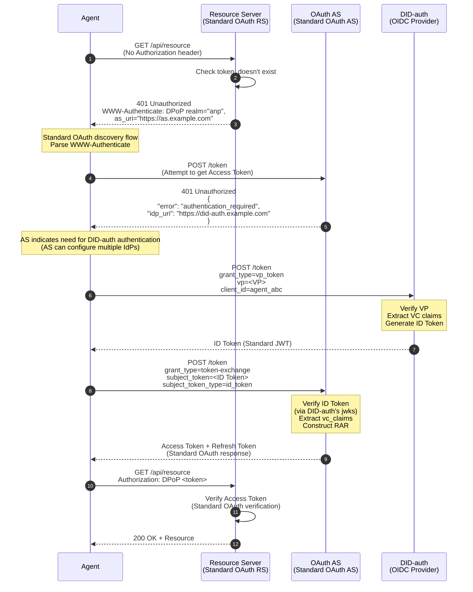
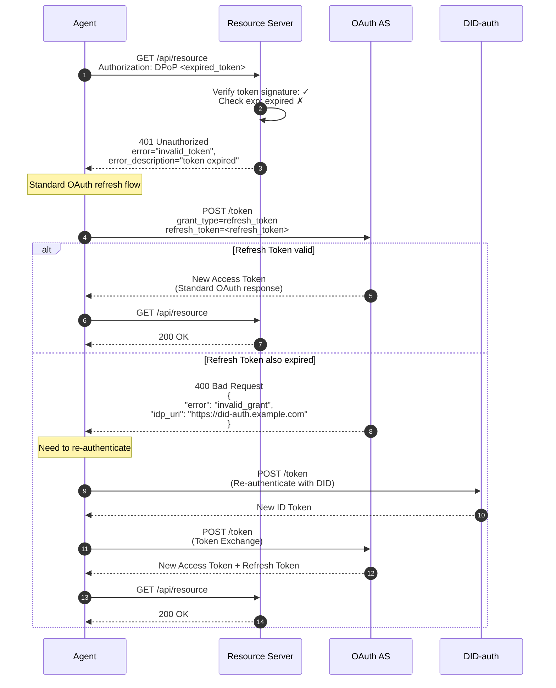
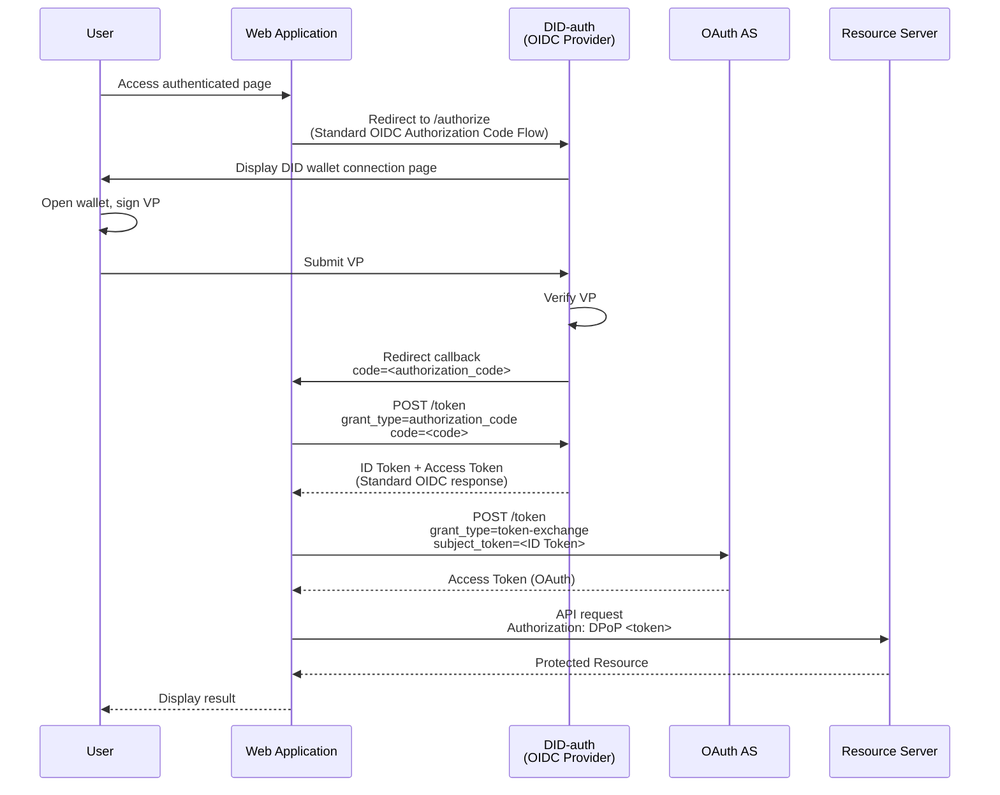
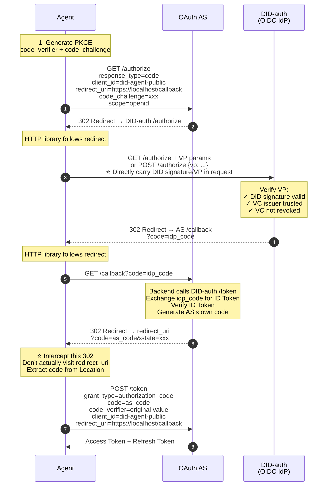
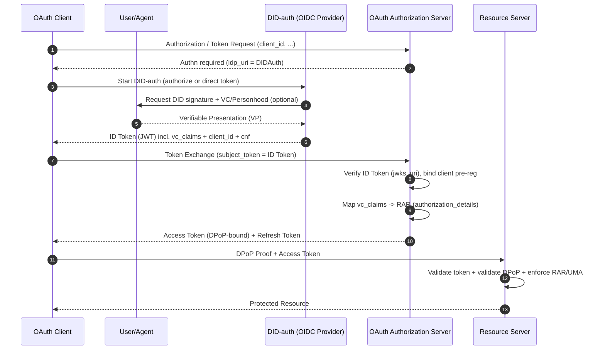

<!-- translation-review: full; source=standard/W3C-proposal/DID-OAuth-Integration-Solution.md; method=full-original-to-translation-semantic-comparison -->
> 日本語参考訳（原文全体を段落ごとに意味照合済み）。本書は歴史的な設計提案です。「完全互換」「影響ゼロ」などは提案者の主張の翻訳であり、現行ANP-05への適合性や実装の安全性を検証したものではありません。規範となるのは原文です。
> 原文: [standard/W3C-proposal/DID-OAuth-Integration-Solution.md](../../../standard/W3C-proposal/DID-OAuth-Integration-Solution.md) / 基準コミット: `0837cfdfaf4ddcf834f0890ddaf34fc4c824e066`

# DID-OAuthの完全統合案

## 中心となる考え方

**WBA DID方式は、単一の認証（Authn）サービスを提供することにより、OAuthのアーキテクチャに影響を与えず、そのエコシステムへ円滑に統合できます。**

```
┌─────────────────────────────────────────────────────────┐
│                    OAuth Ecosystem                       │
│  ┌──────────────┐  ┌──────────────┐  ┌──────────────┐  │
│  │   Client     │  │     AS       │  │     RS       │  │
│  │  (unchanged) │  │  (unchanged) │  │  (unchanged) │  │
│  └──────────────┘  └──────────────┘  └──────────────┘  │
│         │                 │                  │           │
│         │                 │                  │           │
│         │          ┌──────▼──────┐           │           │
│         │          │   Authn     │           │           │
│         └─────────►│  (pluggable)│           │           │
│                    └──────────────┘           │           │
│                          │                    │           │
│                    ┌─────▼──────┐             │           │
│                    │ DID-auth   │             │           │
│                    │ (OIDC IdP) │             │           │
│                    └────────────┘             │           │
└─────────────────────────────────────────────────────────┘

Key: DID-auth is an optional implementation of OAuth's authentication layer,
     not changing OAuth's authorization architecture
```

---

## I. OAuthの階層モデルとDIDの位置付け

### 1.1 OAuthの2層アーキテクチャ

```
┌─────────────────────────────────────────┐
│         Authn Layer (Authentication)     │
│  Responsibility: Confirm "who is the     │
│                  subject"                │
│  Implementation: Password/OIDC/SAML/     │
│                  DID-auth                │
│  Output: Authentication credentials      │
│          (e.g., ID Token)                │
└─────────────────────────────────────────┘
                    ↓
┌─────────────────────────────────────────┐
│         Authz Layer (Authorization)      │
│  Responsibility: Decide "what the        │
│                  subject can do"         │
│  Implementation: OAuth AS (token         │
│                  issuance)               │
│  Output: Access Token + Refresh Token    │
└─────────────────────────────────────────┘
                    ↓
┌─────────────────────────────────────────┐
│      Resource Access                     │
│  Responsibility: Execute access control  │
│  Implementation: Resource Server         │
│  Verification: Access Token + Policy     │
└─────────────────────────────────────────┘
```

### 1.2 DIDの位置付け

**DID/VC/VPは認証層を強化する実装です。**

| 要素 | 役割 | 利点 |
|------|------|---------|
| **DID** | 分散型のID識別子 | 集中型のIDプロバイダーが不要 |
| **VC** | 検証可能な資格情報 | 第三者の権威ある機関による裏付け |
| **VP** | 検証可能な提示 | 組み合わせ可能、リプレイ耐性、監査可能 |

**重要な点**：
- ✅ DIDは認証層を強化します（より強力なID検証）。
- ✅ DIDは認可層を置き換えません（OAuthのトークンの仕組みが引き続き必要）。
- ✅ DIDはリソースアクセス層に影響しません（RSは引き続きAccess Tokenを検証）。

---

## II. 認証場面の分類：A2AとA2R

本案では、設計と検証にあたり「認証／認可」の要件を2種類の経路に分けることを推奨します。

- **A2A（Agent-to-Agent）**：エージェント間のポイントツーポイントまたは多者間の通信・協調です。要求を受ける相手自身がエージェントまたはエージェントゲートウェイです。
- **A2R（Agent-to-Resource）**：エージェントが既存のリソースサーバー（RS）へアクセスします。標準のOAuthによるリソース保護と既存のエコシステムとの互換性が必要です。

分類の意義は、**A2AではDIDの当事者間認証を直接採用して集中化の負担を減らせる一方、A2RではOAuthトークンを既存RSとの互換層として使う**ことです。

### 2.1 A2A（Agent-to-Agent）：DIDを直接用いる認証の利点

A2Aでは通信する双方がDID/VC/VPを理解できることが多く、集中型の認可サーバーを必ずしも導入する必要はありません。

**利点**：
- ✅ **OAuth認可サーバーが不要**：双方がDID署名やVPを直接用いて相互認証し、メッセージの完全性を保護できます。
- ✅ **一か所への集中によるボトルネックや負荷がない**：すべての要求が先にASへトークン交換に行く頻繁な処理経路がなく、将来のM2M・エージェントの高並行呼び出しに適しています。
- ✅ **当事者間の信頼や委任を自然に表現**：VC/VPによって、エージェントの所属、資格、委任チェーン、追加認証の証拠を表現します。

> 結論：「エージェントを主体とするネットワーク」や「密接に連携するエージェント」の場面では、A2AでDIDを認証へ直接使う方が、通常はOAuthより軽量です。

### 2.2 A2R（Agent-to-Resource）：既存リソースとの互換性のため、引き続きOAuthの認可を通じてアクセス

A2Rの重要な制約は、**既存RSの多くがOAuthのアクセストークン（JWT/DPoP/MTLSなど）のみを理解し**、DID/VPを理解しないことです。

そのため、互換性と実装コストの観点から、次のようにします。
- ✅ エージェントは**OAuth認可**を通じて**Access Token**を取得し、RSへアクセスすることが望まれます。
- ✅ RSは既存実装を維持し、トークンとDPoP・ポリシーを検証します。DIDを理解する必要はありません。

> 結論：A2Rでは、リソースアクセスに共通して使える最小限の方式として、OAuthトークンを維持することが望まれます。

### 2.3 認証ノードだけに標準DID-authn（OIDC IdP）を配置

A2Rの経路では、引き続き次の方法を推奨します。

1. AS側に、**標準OAuthと互換性のあるDID-authn（OIDC Provider）**を設定します。
2. DID-authnがVP/VCの検証とDID認証を行い、そのDIDに対応する**ID Token**（JWT）を発行します。
3. エージェントはその**ID Token**を用い、**Token Exchange（RFC 8693）**を通じてASへ**Access Token**を要求した後、RSへアクセスします。

この構成では責任の境界が明確です。
- DID-authn：「主体は誰か、どのような検証可能な証拠があるか」を解決します（Authn）。
- AS：「どの権限を与え、どのトークンを発行するか」を解決します（Authz）。
- RS：トークンの検証とポリシーの適用だけを行います。

### 2.4 エージェント側の資格情報：トークンの保存と、クライアント資格情報としてのDID・鍵

実行時にエージェントが持つ資格情報という観点では、実装を次の2種類として捉えられます。両者は併用できます。

- **方式A：OAuthトークンを直接保存・使用**
  - エージェントがAccess TokenとRefresh Tokenを保存します。
  - 利点：実装が簡単で、OAuthの仕組みに完全に従います。
  - リスク：DPoP、短命なトークン、更新方針などで、トークンの漏えいを防ぐ必要があります。

- **方式B：DIDの公開鍵・秘密鍵の機能をクライアント資格情報に利用（クライアント認証）**
  - DIDを`client_id`にするのではなく、秘密鍵の所持証明を用いてトークンエンドポイントでクライアント認証を行わせます。実装上は`private_key_jwt`やmTLSに近い方式です。
  - 利点：テナントごとに1つのエージェントインスタンスを長期運用し、細かな失効・鍵のローテーションを行う場合に適しています。

> 注：ここでのDID秘密鍵の証明とOAuthのクライアント認証は別の仕組みです。OAuthの標準的な方式（`private_key_jwt`/mTLS/DPoP）で運ぶことを推奨します。DIDの仕組みは主に主体のIDと証拠（VC/VP）を担います。

### 2.5 エンド側の標準互換要件：client_idの事前登録・動的登録はDIDと独立だが、エージェント側の対応は必要

エンドツーエンドの標準互換性という観点では、OAuth AS/RSへアクセスするエージェントは、通常、正規のOAuthクライアントIDを持つ必要があります。

- **静的な事前登録**：運用側や管理画面で、あらかじめ`client_id`を作成し、メタデータを制約します。
- **動的登録（RFC 7591）**：エージェントまたはその制御プレーンが登録エンドポイントを呼び、`client_id`と、必要に応じて資格情報を取得します。

重要な点：
- これらは**OAuthクライアントの管理の仕組み**であり、DIDそのものとは独立しています。
- テナントごとに1つのエージェントインスタンスを持つ場合、大規模な`client_id`配布には動的登録をよく使います。ただし、登録エンドポイントには、初期アクセストークン、mTLS、VCに基づく受け入れ審査などの強い認証が必要です。

### 2.6 総合的な結論：A2AはDIDを直接使用し、A2RはOAuthとDID-authnを使用

将来のM2M・エージェントによる高頻度通信を総合的に考えると、次のようになります。
- **A2A**：**DIDを直接使う認証**を優先します。軽量で、ASへの負荷集中がありません。
- **A2R**：**OAuthによるアクセス制御**を維持します。AS側に認証方式として**DID-authn（OIDC IdP）**を導入し、ID Token → Token Exchange → Access Tokenという経路で既存RSへアクセスさせます。

---

## II. 単一の認証サービスとしてのDID-auth

### 2.1 アーキテクチャ上の位置付け

**DID-auth = 標準OIDC Provider + DID/VC/VP検証機能**

```
┌────────────────────────────────────────────────────┐
│              DID-auth (OIDC Provider)              │
│                                                    │
│  ┌──────────────────────────────────────────────┐ │
│  │  Standard OIDC Endpoints                     │ │
│  │  ├── /.well-known/openid-configuration       │ │
│  │  ├── /token (ID Token issuance)              │ │
│  │  ├── /jwks (public key endpoint)             │ │
│  │  └── /authorize (browser scenario)           │ │
│  └──────────────────────────────────────────────┘ │
│                                                    │
│  ┌──────────────────────────────────────────────┐ │
│  │  DID/VC/VP Verification Capability           │ │
│  │  ├── DID resolution                          │ │
│  │  ├── VP signature verification               │ │
│  │  ├── VC signature verification               │ │
│  │  ├── Personhood VC verification              │ │
│  │  └── VC revocation check                     │ │
│  └──────────────────────────────────────────────┘ │
│                                                    │
│  Output: Standard ID Token (JWT)                   │
│          Contains vc_claims (verified VC content)  │
└────────────────────────────────────────────────────┘
```

### 2.2 OAuthのエコシステムへの影響

| OAuthの要素 | 修正の必要性 | 説明 |
|-----------|-------------|------|
| **Client** | ❌ なし | 標準OAuthクライアントのまま。OIDC対応だけが必要 |
| **AS** | ⚠️ 最小限 | DID-authをIdPとして信頼し、ID Tokenを検証する必要あり |
| **RS** | ❌ なし | DIDを意識せず、Access Tokenだけを検証 |
| **トークン形式** | ❌ なし | 標準JWT Access Tokenのまま |
| **認可フロー** | ❌ なし | 標準OAuth 2.0フローのまま |

**結論**：差し替え可能な認証サービスとしてのDID-authは、OAuthのアーキテクチャに破壊的な影響を与えません。

---

## III. 実際に処理が始まる場面

### 3.1 エージェント：初回アクセス（トークンなし）



**重要な点**：
- RSとASは標準OAuthプロトコルを使います。
- DID-authは、ASが信頼するOIDC Providerとして機能します。
- エージェントは標準OAuth Access Tokenを取得します。

---

### 3.2 エージェント：トークンの期限切れ



**主要な仕組み**：
- Refresh Tokenの使用を優先します（標準OAuthフロー）。
- 更新に失敗したときだけ、DIDで再認証します。
- RSは一連の処理を意識しません。

---

### 3.3 ブラウザー：従来のリダイレクトフロー



**特徴**：
- 標準OIDC Authorization Code Flowを使用します。
- ユーザー操作画面があります（DIDウォレットへの接続）。
- リダイレクトによるコールバックがあります。
- ウェブアプリは標準OAuth Access Tokenを取得します。

---

### 3.4 エージェント：Authorization Code Flowの模擬（互換性を最大化する案）

ASがToken Exchange（RFC 8693）に対応しない場合、エージェントはHTTPライブラリでブラウザーのAuthorization Code Flowを模擬し、互換性を最大化できます。

#### 3.4.1 方式の概要

```
┌─────────────────────────────────────────────────────────┐
│                                                         │
│  Core Idea:                                             │
│                                                         │
│  • Agent uses HTTP library to handle 302 redirects     │
│    (simulating browser)                                 │
│  • IdP (DID-auth) supports accepting VP authentication │
│    directly in request                                  │
│  • Agent intercepts final redirect, extracts code      │
│    from URL                                             │
│  • Uses standard Authorization Code to exchange for    │
│    Access Token                                         │
│                                                         │
│  Advantages:                                            │
│  ✅ Strongest compatibility (almost all AS support     │
│     Auth Code Flow)                                     │
│  ✅ Doesn't require AS to support Token Exchange       │
│  ✅ Security guaranteed by IdP's DID/VC verification   │
│                                                         │
└─────────────────────────────────────────────────────────┘
```

#### 3.4.2 全体のフロー



#### 3.4.3 実装上の要点

**1. PKCE対応（Public Clientでは必須）**

```python
import hashlib
import base64
import secrets

# Generate PKCE
code_verifier = secrets.token_urlsafe(32)
code_challenge = base64.urlsafe_b64encode(
    hashlib.sha256(code_verifier.encode()).digest()
).decode().rstrip('=')

# Carry in /authorize request
params = {
    "response_type": "code",
    "client_id": "did-agent-public",
    "redirect_uri": "https://localhost/callback",
    "code_challenge": code_challenge,
    "code_challenge_method": "S256",
    "scope": "openid",
    "state": secrets.token_urlsafe(16)
}

# Carry code_verifier in /token request
token_data = {
    "grant_type": "authorization_code",
    "code": as_code,
    "client_id": "did-agent-public",
    "redirect_uri": "https://localhost/callback",
    "code_verifier": code_verifier  # Required
}
```

**2. DID-authによるAPI認証への対応（HTML画面を返さない）**

```
┌─────────────────────────────────────────────────────────┐
│                                                         │
│  DID-auth /authorize endpoint needs to support:        │
│                                                         │
│  Method A: GET request with VP parameter               │
│  GET /authorize?                                        │
│    response_type=code&                                  │
│    client_id=xxx&                                       │
│    vp_token=<base64url encoded VP>&                    │
│    redirect_uri=...                                     │
│                                                         │
│  Method B: POST request with JSON body                 │
│  POST /authorize                                        │
│  Content-Type: application/json                         │
│  {                                                      │
│    "response_type": "code",                            │
│    "client_id": "xxx",                                 │
│    "vp": { ... VP content ... },                       │
│    "redirect_uri": "..."                               │
│  }                                                      │
│                                                         │
│  After verification, directly return 302, no HTML      │
│                                                         │
└─────────────────────────────────────────────────────────┘
```

**3. 最後の302リダイレクトを捕捉**

```python
import httpx
from urllib.parse import urlparse, parse_qs

# Configure HTTP client
client = httpx.Client(follow_redirects=False)  # Don't auto-follow last redirect

# Manually handle redirect chain
response = client.get(authorize_url, params=params)
while response.status_code in (301, 302, 303, 307, 308):
    location = response.headers["location"]

    # Check if this is final redirect (to redirect_uri)
    if location.startswith("https://localhost/callback"):
        # Intercepted! Extract code from URL
        parsed = urlparse(location)
        query = parse_qs(parsed.query)
        as_code = query["code"][0]
        break

    # If redirecting to DID-auth, need to attach VP
    if "did-auth.example.com" in location:
        response = client.post(
            location,
            json={"vp": vp_object},
            follow_redirects=False
        )
    else:
        response = client.get(location, follow_redirects=False)

# Exchange code for token
token_response = client.post(
    "https://as.example.com/token",
    data=token_data
)
access_token = token_response.json()["access_token"]
```

**4. redirect_uriの設定（仮想アドレス）**

```json
{
  "client_id": "did-agent-public",
  "client_name": "DID Agent Public Client",
  "token_endpoint_auth_method": "none",
  "redirect_uris": [
    "https://localhost/callback",
    "http://localhost:8080/callback",
    "app://callback"
  ],
  "grant_types": ["authorization_code", "refresh_token"],
  "response_types": ["code"]
}
```

#### 3.4.4 セキュリティモデルの分析

```
┌─────────────────────────────────────────────────────────┐
│                                                         │
│  Security Barrier Transfer:                            │
│                                                         │
│  Traditional OAuth:                                     │
│    Security relies on → AS's client registration +     │
│                         client_secret                   │
│                                                         │
│  This Solution:                                         │
│    Security relies on → IdP's DID/VC verification      │
│                                                         │
│  client_id's role downgraded to:                       │
│    • Satisfy AS formal requirements                    │
│    • Bind redirect_uri (for AS verification)           │
│    • Configure PKCE requirements                       │
│                                                         │
│  Real identity verification:                           │
│    ✓ DID private key signature (cryptographically      │
│      unforgeable)                                       │
│    ✓ VC issuer verification (authority endorsement)    │
│    ✓ VC revocation check (dynamic admission control)   │
│                                                         │
└─────────────────────────────────────────────────────────┘
```

**攻撃場面への対策**：

| 攻撃場面 | 防御の仕組み |
|-----------------|---------------------|
| 攻撃者がclient_idを知っている | IdPのDID/VC検証を通過できない |
| 攻撃者がredirect_uriを知っている | 有効なVPがないためcodeを取得できない |
| 攻撃者にDIDはあるがVCがない | VC発行者が信頼一覧にないため拒否 |
| 攻撃者がcodeを傍受 | PKCEにより、code_verifierがなければトークン交換不可 |

#### 3.4.5 Token Exchangeとの比較

| 観点 | Token Exchange | Authorization Code Flowの模擬 |
|-----------|---------------|-------------------------|
| **ASの要件** | RFC 8693への対応が必要 | 標準Authorization Codeだけでよい |
| **互換性** | 一部のASが対応 | ほぼすべてのASが対応 |
| **フローの複雑さ** | 単純（POSTを2回） | 複雑（複数回のリダイレクト） |
| **IdPの要件** | 標準/tokenエンドポイント | API認証への対応が必要 |
| **安全性** | 同等 | 同等（DID/VC検証） |

**選択の推奨**：

```
┌─────────────────────────────────────────────────────────┐
│                                                         │
│  Prioritize Token Exchange:                            │
│    When AS supports RFC 8693                           │
│    Simpler flow, less code                             │
│                                                         │
│  Use Simulated Auth Code Flow:                         │
│    When AS doesn't support Token Exchange              │
│    When maximum compatibility needed                   │
│    E.g., AWS Cognito and other restricted environments │
│                                                         │
└─────────────────────────────────────────────────────────┘
```

---

## IV. 主要なやり取りの仕組み

### 4.1 WWW-Authenticateの仕組み（RS → Client）

**標準OAuth 2.0 Bearer Tokenのエラー応答**：

```http
HTTP/1.1 401 Unauthorized
WWW-Authenticate: DPoP realm="anp-resource-server",
  as_uri="https://as.example.com",
  error="invalid_token",
  error_description="The access token expired"
```

**クライアントが解析によって得る情報**：
- 必要なトークンの種類（DPoP）
- 認可サーバーの場所
- エラーの理由

**根拠となる標準**：RFC 6750（Bearer Token Usage）

---

### 4.2 認証要件の応答（AS → Client）

**クライアントが認証用の資格情報を持たない場合**：

```http
HTTP/1.1 401 Unauthorized
Content-Type: application/json

{
  "error": "authentication_required",
  "error_description": "Authentication with identity provider required",
  "idp_uri": "https://did-auth.example.com",
  "idp_metadata_uri": "https://did-auth.example.com/.well-known/openid-configuration"
}
```

**クライアントの動作**：
1. IdPのメタデータを取得します（OIDC Discovery）。
2. クライアントの種類とASの機能に応じて認証フローを選びます。
   - **エージェント（Token Exchangeあり）**：POST /tokenを直接実行 → Token Exchange（優先）。
   - **エージェント（Token Exchangeなし）**：Authorization Code Flowを模擬 → GET /authorize（互換方式）。
   - **ブラウザー**：/authorizeへリダイレクト → 従来のリダイレクトフロー。

---

### 4.3 DID認証のやり取り（Client → DID-auth）

#### 方式A：トークンエンドポイントへ直接アクセス（Token Exchangeと組み合わせ）

**エージェントの場面（APIを直接使用）**：

```http
POST /token HTTP/1.1
Host: did-auth.example.com
Content-Type: application/json
DPoP: <dpop_proof>

{
  "grant_type": "vp_token",
  "vp": {
    "type": "VerifiablePresentation",
    "verifiableCredential": [...],
    "proof": {
      "type": "Ed25519Signature2020",
      "challenge": "<nonce>",
      "proofValue": "..."
    }
  },
  "client_id": "agent_abc"
}
```

**応答**：

```json
{
  "id_token": "eyJhbGc...",
  "token_type": "Bearer",
  "expires_in": 300
}
```

**ID Tokenの内容**：

```json
{
  "iss": "https://did-auth.example.com",
  "sub": "did:web:example.com:user:alice",
  "aud": "agent_abc",
  "exp": 1735804800,
  "iat": 1735801200,
  
  "vc_claims": {
    "personhood": {
      "verified": true,
      "level": "high",
      "issuer": "did:web:trusted-issuer.example"
    },
    "kyc": {
      "verified": true,
      "level": 2
    }
  },
  
  "cnf": {
    "jkt": "<dpop_public_key_thumbprint>"
  }
}
```

**主要なフィールド**：
- `vc_claims`：検証済みのVCの内容（平文、信頼可能）。
- `cnf`：DPoPへのバインド（トークンの盗用を防止）。

---

#### 方式B：Authorizeエンドポイント（Authorization Code Flowと組み合わせ）

**エージェントの場面（API認証、HTML画面なし）**：

```http
POST /authorize HTTP/1.1
Host: did-auth.example.com
Content-Type: application/json

{
  "response_type": "code",
  "client_id": "did-agent-public",
  "redirect_uri": "https://localhost/callback",
  "state": "xyz123",
  "code_challenge": "...",
  "code_challenge_method": "S256",
  "vp": {
    "type": "VerifiablePresentation",
    "verifiableCredential": [...],
    "proof": {
      "type": "Ed25519Signature2020",
      "challenge": "<nonce>",
      "proofValue": "..."
    }
  }
}
```

**応答**（VP検証に成功した場合）：

```http
HTTP/1.1 302 Found
Location: https://as.example.com/callback?code=SplxlOBeZQQYbYS6WxSbIA&state=xyz123
```

**利用場面**：
- ASがToken Exchange（RFC 8693）に非対応。
- 最大限の互換性が必要。
- エージェントがHTTPリダイレクトの連鎖を処理可能。

**安全性の要点**：
- 必ずPKCEを併用します。
- VP検証が、従来のユーザー名・パスワード認証に代わります。
- エージェントが最後の302リダイレクトを捕捉し、codeを取り出します。

> 詳細なフローは第3.4節を参照してください。

---

### 4.4 Token Exchange（Client → AS）

**⭐ 推奨方式**（ASがRFC 8693に対応する場合）

**標準RFC 8693を使用**：

```http
POST /token HTTP/1.1
Host: as.example.com
Content-Type: application/x-www-form-urlencoded
DPoP: <dpop_proof>

grant_type=urn:ietf:params:oauth:grant-type:token-exchange
&subject_token=<ID Token>
&subject_token_type=urn:ietf:params:oauth:token-type:id_token
&client_id=agent_abc
&scope=anp:social_graph
```

**ASの処理フロー**：
1. **ID Tokenの検証**：DID-authからjwksを取得し、署名を検証します。
2. **vc_claimsの抽出**：検証済みのVCの内容を取得します。
3. **RARの構築**：vc_claimsに基づいて権限を動的に生成します。
4. **DPoPへのバインド**：Access Tokenへ公開鍵のフィンガープリントを書き込みます。

**応答**：

```json
{
  "access_token": "eyJhbGc...",
  "token_type": "DPoP",
  "expires_in": 3600,
  "refresh_token": "8xLOxBtZp8...",
  "authorization_details": [
    {
      "type": "anp.social_graph_discovery",
      "actions": ["query", "distance"],
      "constraints": {"max_depth": 3},
      "evidence": {"personhood_level": "high"}
    }
  ]
}
```

---

## V. VC ClaimsからRARへの対応付け

### 5.1 VC Claimsが必要な理由

**従来のOAuthの制限**：

```
Traditional OAuth only knows "who":
User login → AS only knows sub="alice"
          → Grants fixed scope="read write"
          → Cannot dynamically adjust permissions based on user attributes
```

**VC Claimsの価値**：

```
With VC Claims, AS knows "who's what attributes":
User submits VP → DID-auth verifies VC
           → Extracts: personhood=verified, kyc_level=2
           → This information enters ID Token
           → AS constructs RAR based on these trusted attributes
           → Dynamically grants fine-grained permissions
```

**重要な点**：
- VCのクレームは、**検証済みで信頼可能な平文**です（DID-authが署名を検証済み）。
- ASは、これらのクレームを**安全に利用して**認可を判断できます。
- VCの組み合わせが異なれば、権限のレベルも異なります。

---

### 5.2 対応付け規則の例

**場面1：一般ユーザー（特別なVCなし）**

```
ID Token: {"vc_claims": {}}
↓
RAR: {
  "actions": ["query"],
  "constraints": {"max_depth": 1, "rate_limit": "10/hour"}
}
```

**場面2：人間であることを検証済み**

```
ID Token: {"vc_claims": {"personhood": {"verified": true}}}
↓
RAR: {
  "actions": ["query", "distance", "neighbors"],
  "constraints": {"max_depth": 3, "rate_limit": "100/hour"},
  "evidence": {"personhood_level": "high"}
}
```

**場面3：高水準のKYCと、人間であることの証明**

```
ID Token: {
  "vc_claims": {
    "personhood": {"verified": true},
    "kyc": {"level": 3}
  }
}
↓
RAR: {
  "actions": ["query", "distance", "neighbors", "introduce"],
  "constraints": {"max_depth": 5, "rate_limit": "500/hour"},
  "evidence": {"personhood_level": "high", "kyc_level": 3}
}
```

**対応付けのまとめ**：

VC Claims | 許可するactions | max_depth | rate_limit |
|-----------|--------------|-----------|------------|
なし | query | 1 | 10/時 |
personhood | query, distance, neighbors | 3 | 100/時 |
personhood + KYC | query, distance, neighbors, introduce | 5 | 500/時 |

---

## VI. OAuthのエコシステムとの互換性

### 6.1 認証と認可の安全性の境界：DIDがOAuthを「壊さない」理由

OAuthは、次の2つの関心事の層に抽象化できます。

- **Authn（認証層）**：「主体は誰か」に答えます。OAuth自体は認証方法を定めず、実際にはパスワード、SMS、SAML、OIDCなどを使います。
- **Authz（認可層）**：「主体は何ができるか」に答えます。認可の結果を**Access Token / Refresh Token**に格納し、クライアントが保持してRSへのアクセス時に提示します。RSは標準に従い検証し、ポリシーを適用します。

したがって、OAuthにおけるトークンの安全性や認可表現の仕組み（**Refresh Token、PKCE、DPoP、RAR、UMA**など）は、本質的に**認可の実装技術**であり、認証方法から分離されています。

**DID/VC/VPも、厳密に認証側へ位置付けることが望まれます。**
- DIDは検証可能な主体識別子を提供します。
- VCは検証可能な属性や裏付けを提供します。
- VPは一度限りで、組み合わせ可能かつ監査可能な証明を提供します。

> 結論：DID-authは、認証方法をDID/VP検証に置き換えるだけです。OAuthのトークン発行、更新、リソースアクセス制御は変わりません。

### 6.2 OAuthクライアントの事前登録：維持すべき安全性の前提

OAuthのセキュリティモデルでは、**client_id、redirect_uriなどを含むクライアントの事前登録が必要**です。それがなければ、リダイレクト、安全なコールバック、トークンの発行先を確実に制約できません。

#### 6.2.1 本案でのクライアント事前登録の扱い

本案はこの要件を維持しますが、**安全性を担う障壁の位置が変わります。**

```
Traditional OAuth Security Model:
  client_id + client_secret (or mTLS)
  → Prevents unauthorized clients from obtaining tokens

DID-OAuth Integration Solution Security Model:
  client_id (formal requirement) + DID/VC verification (substantive security)
  → Security focus shifts from client credentials to subject identity verification
```

#### 6.2.2 client_idの役割の変化

観点 | 従来のOAuth | DID-OAuth案 |
|-----------|-------------------|-------------------|
**安全性上の役割** | ⭐⭐⭐ 中核となる障壁 | ⭐ 形式的な適合要件 |
**redirect_uriの制約** | ✅ リダイレクト攻撃を防止 | ✅ その機能を維持 |
**PKCEの要件** | 任意（Public Clientでは必須） | ✅ 必須（方式3.4） |
**実際の認証** | client_secret / mTLS | ⭐⭐⭐ DID秘密鍵による署名とVC検証 |
**動的登録** | 対応（RFC 7591） | 対応（受け入れ制御にVCを使用） |

#### 6.2.3 DID-authの認証結果

認証完了後、DID-authは**クライアントの事前登録情報を含めるか参照**し、ASが後続のトークン発行で関連付けられるようにします。

- DID-authの認証結果（ASが検証可能）：
  - `sub`：主体のDID（VPで検証済み）。
  - `vc_claims`：検証済みのVCの内容、または要約・参照。
  - `client_id`：事前登録したクライアント識別子（形式上の要件）。
  - `azp`（Authorized Party）：実際に認証を開始したクライアント。
  - 任意：`redirect_uri` / `client_metadata`への参照。
  - 任意：`cnf`（DPoP/PoPへのバインド）。

ASは、**検証済みDIDによる主体情報**と**形式的な関連付けであるクライアント事前登録情報**を組み合わせ、標準OAuthフローでAccess TokenとRefresh Tokenを発行します。

#### 6.2.4 Public Clientの設定例

**方式3.4（Authorization Code Flowの模擬）の場合**：

```json
{
  "client_id": "did-agent-public",
  "client_name": "DID Agent Public Client",
  "client_type": "public",
  "token_endpoint_auth_method": "none",
  "redirect_uris": [
    "https://localhost/callback",
    "http://localhost:8080/callback",
    "app://callback"
  ],
  "grant_types": ["authorization_code", "refresh_token"],
  "response_types": ["code"],
  "require_pkce": true,
  "require_pushed_authorization_requests": false,
  
  "_comment": "Security Note",
  "_security_model": "DID/VC verification at IdP, not client_secret"
}
```

**重要な点**：
- `token_endpoint_auth_method: "none"`：client_secretを使いません。
- `require_pkce: true`：codeの交換を保護するため、PKCEを強制します。
- 実質的な安全性は、DID-authのVP検証によって確保します。

### 6.3 一般的な互換フローのシーケンス図（DID-auth → OAuth Token → RS）

> 注：次の図は、ブラウザーとエージェントを区別しない抽象的な主要フローです。具体的な開始の仕方は、第3章のエージェントとブラウザーのシーケンス図を参照してください。



### 6.4 標準との互換性の分析

OAuthの標準 | 互換性 | 説明 |
|----------------|---------------|-------------|
**RFC 6749**（OAuth 2.0） | ✅ 完全互換 | 標準のトークンエンドポイントとフローを使用 |
**RFC 6750**（Bearer Token） | ✅ 完全互換 | 標準WWW-Authenticateに対応 |
**RFC 7519**（JWT） | ✅ 完全互換 | Access Tokenに標準JWTを使用 |
**RFC 7636**（PKCE） | ✅ 完全互換 | 方式3.4では必須 |
**RFC 8693**（Token Exchange） | ✅ 完全互換 | ID TokenをAccess Tokenに交換（方式3.1では優先） |
**RFC 9068**（JWT Access Token） | ✅ 完全互換 | 標準JWT Access Token形式 |
**RFC 9449**（DPoP） | ✅ 完全互換 | トークンを鍵にバインド |
**OIDC Core** | ✅ 完全互換 | DID-authが標準OIDC Providerを実装 |
**RAR（RFC 9396）** | ✅ 完全互換 | 標準authorization_details |

**結論**：DID-auth案は既存のOAuth/OIDC標準だけに基づいており、新しいプロトコルを必要としません。

---

### 6.5 DPoP / RAR / UMA：認可層での位置付け

本案では、この3つの責任を明確に分けます。

- **DPoP（RFC 9449）**：トークンを盗んで再利用できてしまう問題に対処します。
  - DID-auth側：クライアントはDPoP公開鍵またはそのサムプリントを提示でき、DID-authはID Tokenの`cnf.jkt`/`cnf.jwk`を返します。
  - AS側：Access Tokenの`cnf`へPoPのバインド情報を書き込み、トークン交換・発行時の一貫性を強制します。
  - RS側：標準に従い、DPoP proofがトークンの`cnf`と一致することを検証します。

- **RAR（RFC 9396）**：scopeが粗すぎる、監査しにくい、複雑な能力を表現しにくいという問題に対処します。
  - DID-auth側：信頼可能な`vc_claims`または証拠参照を、認可判断の入力として提供します。
  - AS側：`vc_claims -> authorization_details`（RAR）が認可構築エンジンとなります。
  - RS側：`authorization_details`の解析と適用だけを行い、DID/VCを理解する必要はありません。

- **UMA（User-Managed Authorization）**：ユーザーが制御できる、ドメインをまたぐ共有や細かなポリシーという課題に対処します。
  - VCはリソースの所有権や主体の正当性（人間であることなど）を表現でき、UMAポリシーはそれらの条件を参照できます。
  - 実装：ASが発行するトークンにRARまたはUMA関連のクレームを含め、RSがポリシー適用点で実施します。

### 6.6 ゼロトラストの観点：DID-VCによる動的な保証の強化（追加認証）

ゼロトラストでは、アクセスごとに動的にリスクを評価し、必要ならより強い認証を求めます。DID/VC/VPは、保証を高めるための自動化された入力に適しています。

- リスクに応じ、DIDのID、personhood、端末へのバインド、関係性、リスク評価などの複数のVCを1つのVPへ組み合わせられます。
- AS側は署名チェーンを1回検証し、その結果をトークンのクレームやRAR・UMAの条件へ対応付けます。

> これにより動的な保証の強化を、複数回の対話や複数IdPの調整から、VPの提出1回、検証1回、認可への対応付け1回に変えられます。

### 6.7 既存のOAuthエコシステムへの統合

**主要なOAuth ASとの統合**：

```
Existing OAuth AS (e.g., Keycloak)
 ┌───────────────────────────────────┐
 │  Identity Provider Configuration  │
 │  ├── Google (OIDC)                │
 │  ├── Azure AD (OIDC)              │
 │  ├── SAML IdP                     │
 │  └── DID-auth (OIDC) ← New        │
 └───────────────────────────────────┘
                                     
 Configuration:
 - Add OIDC Provider
 - Configure issuer URL
 - Configure jwks_uri
 - Map vc_claims to user attributes
```

**修正が不要なもの**：
- クライアントのアプリケーションコード
- リソースサーバーの検証ロジック
- トークン形式
- APIエンドポイント

**設定だけが必要なもの**：
- ASに、信頼するIdPとしてDID-authを追加
- vc_claimsからRARへの対応付け規則を設定

---

## VII. 実装チェックリスト

### 7.1 DID-authが実装するもの

**標準OIDCエンドポイント**：
- [ ] GET `/.well-known/openid-configuration`（サービス発見）
- [ ] GET `/jwks`（公開鍵エンドポイント）
- [ ] POST `/token`（ID Tokenの発行）
- [ ] GET `/authorize`（ブラウザーの場面）
- [ ] POST `/authorize`（エージェントのAPI認証）← 新規

**エージェントのAPI認証対応（/authorizeエンドポイント）**：
- [ ] GET要求でvp_tokenパラメーターを受け付ける
- [ ] POST要求でVPのJSON本文を受け付ける
- [ ] VP検証後に302を直接返す（HTMLなし）
- [ ] 標準OIDC Authorization Code Flowと互換にする

**DID/VC/VPの検証**：
- [ ] DIDの解決（did:webなどに対応）
- [ ] VP署名の検証
- [ ] VC署名の検証
- [ ] 人間であることを示すVCの検証
- [ ] VCの失効確認
- [ ] challenge/nonceの管理

**セキュリティの仕組み**：
- [ ] client_idの許可一覧の管理
- [ ] DPoPの検証
- [ ] レート制限

---

### 7.2 OAuth ASが実装するもの

**クライアントの事前登録と関連付け（OAuthのセキュリティモデルを維持）**：
- [ ] クライアントの事前登録の管理（`client_id`、`redirect_uri`、認証方式、DPoP要件など）
- [ ] Token Exchange中に、`client_id`とID Token・認証コンテキストの一貫性を検証
- [ ] redirect_uri、DPoP要件、token_policyなどのクライアントメタデータの制約を発行判断に反映

**OIDC統合**：
- [ ] DID-authを信頼するIdPとして設定
- [ ] DID-authからjwksを取得し、ID Tokenを検証
- [ ] Token Exchange対応（RFC 8693）

**VC Claimsの処理**：
- [ ] ID Tokenからvc_claimsを抽出
- [ ] vc_claimsからRARへの対応付けロジック
- [ ] RAR構築エンジン

**トークン管理**：
- [ ] Access TokenへのDPoPバインド
- [ ] Refresh Tokenの管理
- [ ] トークンの失効

---

### 7.3 リソースサーバーが実装するもの

**標準OAuthの検証**：
- [ ] Access Token署名の検証
- [ ] トークンの有効期限の確認
- [ ] DPoPの検証

**RARの適用**：
- [ ] authorization_detailsの解析
- [ ] actionsが許可されているか確認
- [ ] 制約を満たすか確認
- [ ] 証拠の要件を確認

**実装が不要なもの**：
- ❌ DID解決
- ❌ VP検証
- ❌ VC検証

---

## VIII. まとめ

### 8.1 中心となる結論

**DID-authがOAuthのアーキテクチャに与える影響：ゼロ**

```
DID-auth = Standard OIDC Provider
         + DID/VC/VP Verification Capability

Positioning: Pluggable implementation of OAuth authentication layer
Output: Standard ID Token
Integration: Via OIDC standard protocol
```

**主な利点**：

1. **完全に標準に基づく**：OIDC、OAuth 2.0、Token Exchangeなどの成熟した標準を使用。
2. **破壊的な変更がない**：Client/RSの変更がなく、ASの設定も最小限。
3. **責任が明確**：DID-authは認証、ASは認可に集中。
4. **柔軟な拡張**：VCのクレームで、属性に基づく動的な認可を実現。
5. **安全性の強化**：DPoPバインド、VPのリプレイ保護、完全な署名チェーン。

---

### 8.2 従来方式との比較

観点 | 従来のOAuth | DID-OAuth統合案 |
|-----------|-------------------|-------------------------------|
**IDの検証** | パスワード・SMS・QRコード | DID署名とVP |
**IDプロバイダー** | 集中型IdP | 分散型DID-auth |
**属性の証明** | IdPによる自己宣言 | 第三者のVCによる裏付け |
**認可の根拠** | 固定scope | 動的RAR（VCのクレームに基づく） |
**トークンの安全性** | Bearer Token | DPoPバインド |
**監査可能性** | 限定的 | 完全な署名チェーンと証拠 |
**標準との互換性** | ✓ | ✓（完全互換） |

---

### 8.3 適用場面

**エージェントの場面**（推奨）：
- ✅ ブラウザー操作が不要
- ✅ 自動化された認証フロー
- ✅ 鍵による自動署名
- ✅ M2M通信に適する

**エージェントのトークン取得方法**：

方式 | Token Exchange | Authorization Code Flowの模擬 |
|--------|----------------|--------------------------|
**ASの要件** | RFC 8693に対応 | 標準Authorization Codeで十分 |
**適用場面** | 現代的なAS（Keycloak、Auth0） | 従来のASや制約のある環境 |
**実装の複雑さ** | 低い | 中程度 |
**推奨度** | ⭐⭐⭐ 優先 | ⭐⭐ 互換性重視 |

**ブラウザーの場面**（互換）：
- ✅ 標準OIDCリダイレクトフロー
- ✅ DIDウォレットとの統合
- ✅ ユーザーが利用しやすい体験

**企業の場面**：
- ✅ 既存OAuth ASへの統合
- ✅ 複数IdPの共存に対応
- ✅ 段階的な移行

---

### 8.4 将来の拡張の方向

1. **ドメイン間のID Token再利用**：1つのID Tokenを、複数ASのAccess Tokenへ交換。
2. **VCのリアルタイム失効確認**：VC状態リストを統合。
3. **ゼロ知識証明**：VCのクレームを選択的に開示。
4. **分散型AS**：DIDに基づく分散認可サービス。
5. **UMA統合**：ユーザーが管理する細かなリソース認可。

---

### 8.5 要点

**アーキテクト向け**：
- DID-authはOAuthの認証プラグインであり、OAuthを置き換えるものではありません。
- 既存のOAuth基盤へ円滑に統合できます。
- 段階的な導入ができ、全面的な作り直しは不要です。

**開発者向け**：
- クライアントコードは変更不要です（標準OAuthクライアント）。
- RSのコードは変更不要です（標準トークン検証）。
- ASでは、DID-authを信頼するIdPとして設定するだけです。

**セキュリティ担当者向け**：
- 完全な署名チェーンを監査できます。
- DPoPによってトークンの盗用を防ぎます。
- VCのクレームによって、検証可能な属性の証明を提供します。
- ゼロトラストアーキテクチャの原則に従います。

---

## 付録：参照標準

- **RFC 6749**：OAuth 2.0認可フレームワーク
- **RFC 6750**：OAuth 2.0 Bearer Tokenの利用
- **RFC 7519**：JSON Web Token（JWT）
- **RFC 8693**：OAuth 2.0 Token Exchange
- **RFC 9068**：OAuth 2.0 Access Token用のJWTプロファイル
- **RFC 9396**：OAuth 2.0 Rich Authorization Requests（RAR）
- **RFC 9449**：OAuth 2.0 Demonstrating Proof of Possession（DPoP）
- **OIDC Core**：OpenID Connect Core 1.0
- **W3C DID Core**：分散型識別子（DID）v1.0
- **W3C VC Data Model**：検証可能な資格情報のデータモデルv1.1
