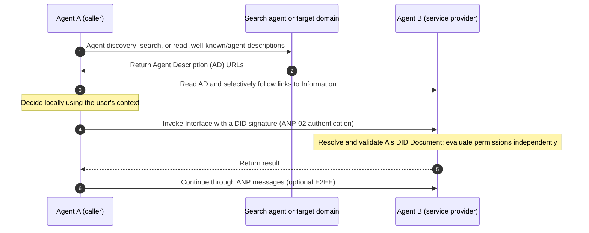
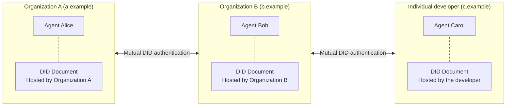
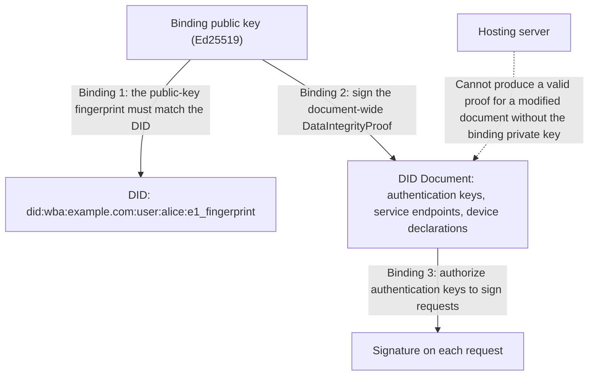
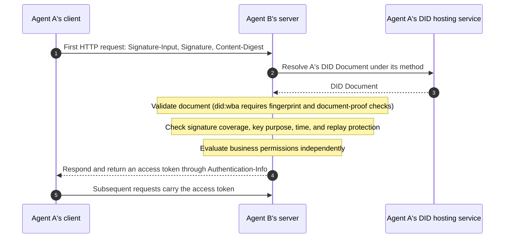
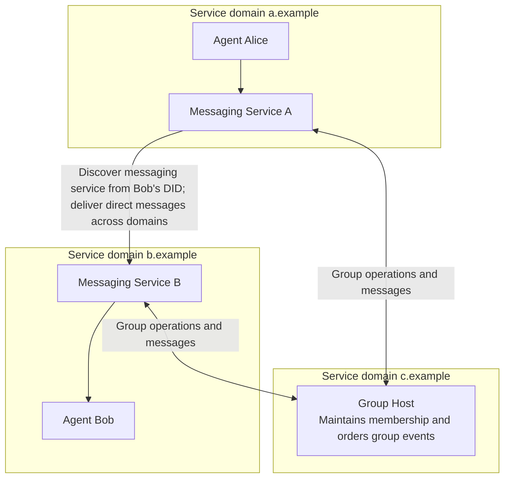
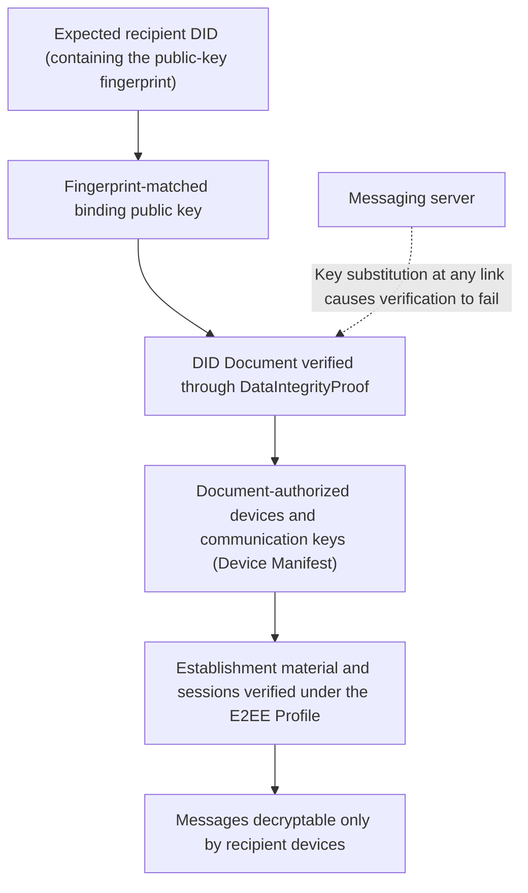
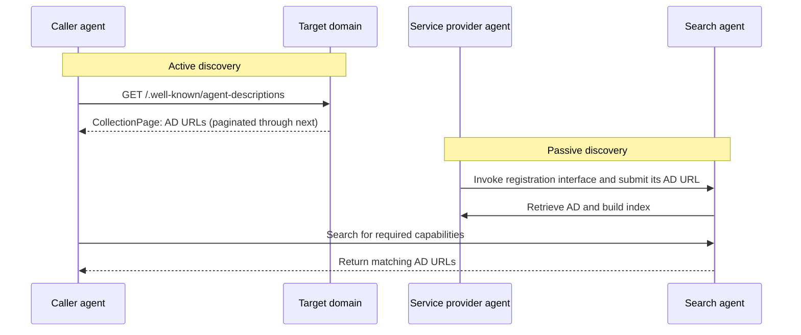
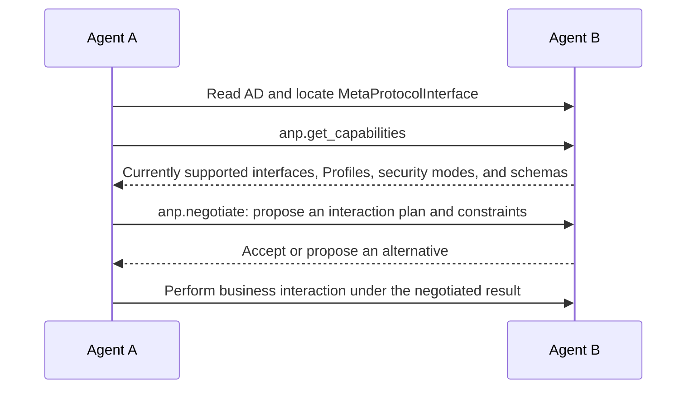
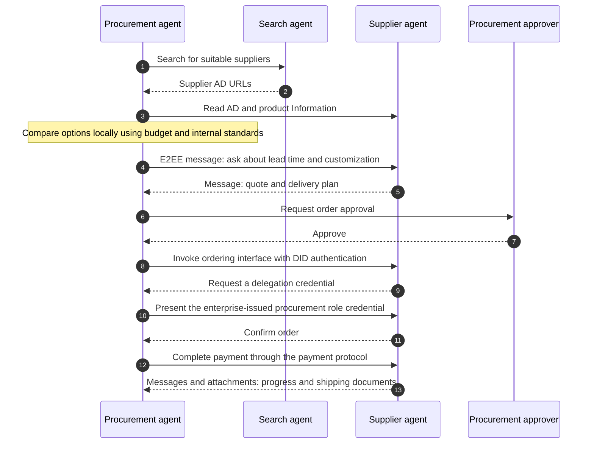

> 日本語参考訳（機械翻訳・未校閲）。規範となるのは原文です。コード例・識別子・規範キーワードは原文を保持しています。
> 原文: [vnext/01-agentnetworkprotocol-technical-white-paper.md](../../vnext/01-agentnetworkprotocol-technical-white-paper.md) / 基準コミット: `0837cfdfaf4ddcf834f0890ddaf34fc4c824e066`

# 代理店ネットワークの議定書の技術の白いペーパー

## オープンソースのWebサイトへのID、コミュニケーション、および機能接続

- 文書ID: ANP-01
- ステータス: ドラフト/未発売
- バージョン: 1.2
- リリースベースライン: [ANP-01 v1.2 の仕様](../01-agentnetworkprotocol-technical-white-paper.md)
- 改定日: 2026-09-27
- 原文言語: English / このページは日本語参考訳
- 中国語版: [代理店ネットワークの生産の技術の白いペーパー](chinese/01-AgentNetworkProtocol技术白皮书.md)

> このページでは、ANPのビジョン、アーキテクチャ、およびキーデザイントレードオフについて説明します。 規範的な要件は導入しません。 ワイヤーフォーマット、アルゴリズム、検証手順、相互運用性要件は、独自の仕様で定義されています。 本稿はANP1.2の仕様書をベースとしています。ANP-06メタプロトコルはドラフトのままで、Messaging P6 Group E2EEは候補であり、ANP-10は決済適応草案です。 付録 レコード仕様のステータス。

## アブストラクト

インターネットでエージェントが新規参加者になる 従来のソフトウェアとは異なり、その値はユーザーの許可の範囲内で代わってユーザーに対して決定と行動をとっています。 グッド決定は、完全なコンテキストを必要とします。行動を取るには、さまざまな組織間で分散されたサービスへのアクセスが必要です。 プラットフォーム境界に関するデータやサービスを整理する今日のインターネット。 人間がプライマリユーザーだったとき、この構造は調整コストを削減しましたが、エージェントの能力を個々のプラットフォームに混同します。 わたしたちは、 **エージェントのウェブは、必然的に開いてしまう**: より多くの完全な経験、接続コストを削減し、コラボレーション効率がプラットフォーム中心のアレンジからプロトコル中心のものへの接続を促進します。

エージェントネットワークプロトコル(ANP)は、オープンなエージェントWeb用に設計された通信プロトコルです。 既存のインターネットインフラ(HTTP、DNS、TLSなど)をネットワークを再構築するのではなく、共通機能の2つのレイヤーを整理します。アイデンティティと暗号化された通信層は「誰が私ですか?」と「どのようにして安全に通信できるのか」に答えます。アプリケーションプロトコルレイヤーは、「あなたが提供するもの、どのように私はあなたとやり取りすることができますか?」と「あなたを見つけることができる」と答えます。

アイデンティティーのために、ANPはW3C DIDをWebと組み合わせるフェデレーションされたアプローチを採用しています。 DIDは、現在入手可能な最も強力な相互運用性を持つアイデンティティモデルを提供します。Webは、10億件、あるいは数百億件ものエージェントをサポートする展開と配布機能を提供します。 アクセシビリティ `did:wba` DID に公開鍵の指紋を埋め込む方法と、DID 文書が関連する秘密鍵で署名された証拠を運ぶように要求し、ユーザーは自分のアイデンティティをコントロールし、ホスティング サーバーが ID 文書を無形に変更することを防ぎます。 一方、ANP-02は、ネイティブを可能にする特定のDIDメソッドから要求認証をデコルドプルします `did:web` ほか、W3C DID仕様に準拠した方法も参加できます。

コミュニケーションのために、ANPは中心機能としてメッセージングを扱います。 自然言語のメッセージングは、エージェント間のコミュニケーションと交渉ニーズの大半に対処できます。 ANP Messagingは十字ドメイン直接メッセージ、グループ、付属品および証明された配達を、保障可能なエンドツーエンドの暗号化で固定される支えます `did:wba` 指紋の識別。

アプリケーションプロトコルレイヤーでは、リンクされたデータからエージェントの説明を整理するようになりました。外部に利用可能なコンテンツは、2つのファーストクラスのコンセプト、情報およびインターフェイスに抽象化され、選択した方法で探索できるネットワークに接続されます。 アクティブでパッシブなディスカバリーがエージェントを発見 メタプロトコルは、インタラクションメソッドの動的交渉をドラフトとして探索します。 決済、承認、および垂直アプリケーションでは、ANPは既存のエコシステムと統合を支持し、アイデンティティ認証と接続機能の根本的な提供を行っています。

ANPは、共通の接続ルールのセットを確立しようとします。 **本人確認、コミュニケーションを保護し、機能が発見され構成することができます。また、利用者やサービス提供者は許可の責任を保持します。**

## 読書ガイド

[1. . コアビジョン](../../vnext/01-agentnetworkprotocol-technical-white-paper.md#vision) · [2. . 建築設計](../../vnext/01-agentnetworkprotocol-technical-white-paper.md#architecture) · [3. . エージェントのアイデンティティ](../../vnext/01-agentnetworkprotocol-technical-white-paper.md#identity) · [4. . エージェントのメッセージング](../../vnext/01-agentnetworkprotocol-technical-white-paper.md#messaging) · [5. . エージェントの説明](../../vnext/01-agentnetworkprotocol-technical-white-paper.md#description) · [6. . エージェントの発見](../../vnext/01-agentnetworkprotocol-technical-white-paper.md#discovery) · [7. . メタプロトコル](../../vnext/01-agentnetworkprotocol-technical-white-paper.md#meta-protocol) · [8. . アプリケーションプロトコルとエコシステム](../../vnext/01-agentnetworkprotocol-technical-white-paper.md#applications) · [9. . セキュリティと信頼](../../vnext/01-agentnetworkprotocol-technical-white-paper.md#security) · [日 時 導入事例](../../vnext/01-agentnetworkprotocol-technical-white-paper.md#adoption) · [11.11.11 未来展望](../../vnext/01-agentnetworkprotocol-technical-white-paper.md#outlook) · [おすすめ商品](../../vnext/01-agentnetworkprotocol-technical-white-paper.md#specifications)

<a id="vision"></a>
## 1. コアビジョン:エージェントのオープンインターネット

<p align="center">
  
</p>

*図1:エージェントのオープンインターネット。 各エージェントは、情報やサービスを消費し、提供することができます。*

### 1.1 インターネットを利用したエージェントの変更

インターネットの知見以来、人間は第一次者となっています。 ユーザは、さまざまなアプリケーションを開き、インターフェイスを解釈し、システム間で情報を移動する、そして決定して行動する、人間の読書、選択および操作の周りに設計されているWebページ、アプリケーション、およびプラットフォーム。

エージェントは、基本的変化を導入しています。 従来のソフトウェアは、人的能力を拡張するツールであり、判断と操作は人々と一緒に残っています。 エージェントは、ユーザー定義の目標と権限内で判断および実行を行います。情報収集、オプション比較、サービス呼び出し、結果のフォローアップ、重要なポイントでの確認リクエストなど。 ユーザーが「明日上海へフライトを予約」と言ったとき、航空券はフライトのリストではなく、予約したチケットが期待されます。

これらは2つの機能を必要とします。 **決定は完全なコンテキストを必要とします**: 予算、好み、スケジュール、履歴レコードはシステム全体に分散され、より完全な情報はより良い判断につながる。 **行動は、請求書サービスが必要です**: 決定を下すが、それらを実行できないエージェントは、顧問のままである。予約、支払い、カレンダー、その他のサービスを直接使用できるようにする必要があります。

エージェントが参加者に重要なやり取りを行うネットワークを呼び出し、標準プロトコルはアクションで情報を接続し、オープンコラボレーションは、Agentic Webの基本的な動作モデルです。 エージェントは、データ交換とプロトコルによるタスク実行中に、エンターテインメント、ソーシャルインタラクション、エクスペリエンスのインターフェイスを引き続き使用しています。 人のために設計されているインターフェイスは視覚指導を要求します;機械のために設計されている議定書は構造されたデータおよび決定的なセマンティクスを要求します。 コンピューター使用やブラウザ利用を通じて、人間がウェブサイト上でクリックするのは、移行的なアプローチであることができますが、それは遅く、壊れやすく、スケールが困難で、プライマリな方法のエージェントが世界に接続されることはできません。

### 1.2 プラットフォームの価値と相互運用性コスト

エージェントのウェブで必要なオープン性を理解するには、インターネットの開発とプラットフォーム全体の相互運用性の実用的なコストで果たしている役割プラットフォームを理解しています。

世界ワイドウェブはオープンネットワークとしてスタートしました。 既存のネットワークインフラ上に構築されたシンプルでオープン、パーミッションレスで、情報の生産と流通を解放するという事で成功しました。 インターネットが拡大したように、情報過負荷、関係管理、取引マッチングのコストは急速に増加しました。 プラットフォームは、検索、社会的な関係、取引を一元的に整理することで、人間協調コストを大幅に削減しました。 時代の技術的およびビジネス上の条件下では、プラットフォーム化はより効率的なサービスとより良いユーザーエクスペリエンスへの重要なパスでした。

プラットフォームの成長は、経済とエンジニアリングの基礎を持っています。 ソフトウェアのマージンコストはゼロに近づいています。100万人のユーザーと100人のユーザーが、スケールの違いよりもはるかに小さいのに費やす差がゼロです。 ユーザ番号が成長するにつれて、データとサービスが蓄積され、アルゴリズム、製品体験、および運用効率を継続的に改善することができます。 一般的なアカウント、インターフェイス、およびサービスルールは、セキュリティ、品質、安定性を維持するのに役立ちます。 プラットフォームは、技術、セキュリティ、および商業的なアレンジをコーディネートする際のクロスプラットフォーム相互運用性を作る独自のサービスシステムを開発しています。

相互プラットフォームの相互運用性は、実用的なエンジニアリングコストも持っています。 電子メール、電話、SMSは比較的よく定義されたビジネス規模の内で成熟した相互運用性を確立しました。 より複雑なサービスは、実装とプロトコルのアップグレードの調整、および継続的な統合テスト間の互換性を処理する必要があります。 プラットフォーム間でのソーシャルネットワーキング、決済、コンテンツ、およびミニアプリを接続するには、より多くのデータモデル、ビジネスルール、インターフェイス契約の調整が必要です。 Semantic Web の手動アノテーションの費用とユーザー インターフェイスおよび Web3 のスケーリングの経験はまた相互運用性メカニズムが公正、導入コストおよびユーザー エクスペリエンスのバランスをとる必要があることを示します。

そのため、当社の判断は **プラットフォーム化は、人間のインターネット利用の協調コストを効果的に削減しました**. . . エージェントは、必要に応じて異なるプラットフォームから共通のプロトコルを介して機能を接続しながら、新しいニーズを導入します。

### 1.3 十字プラットフォームの代理店の協同で2つの主要な問題

エージェントが重要なインターネットユーザーになるにつれて、タスクは複数のプラットフォームに及ぶことが多い。 情報とサービスを接続するには、コンテキストとインボイスサービスの2つの重要な問題に対処する必要があります。

最初の問題は **分散コンテキスト**. . . 利用者と友人は、メッセージングアプリケーションで旅行先やタイミング、予算に同意するかもしれませんが、旅行アプリのアシスタントは、直接その議論を取らないため、再び尋ねる必要があるかもしれません。 別のプラットフォームでレストランレビューをしても、他の人に推奨するアシスタントに利用できないことがあります。 ユーザーの許可を得て、この情報を接続することで、エージェントがより詳細な決定を下すのに役立ちます。

第2の問題は **サービスの呼び出しを適応させる**. . . 多くの現在のエージェントは、レストランを推薦したり、旅程を生成したりすることができます。予約とその後の操作はまだ手動のアクションが必要です。 アクションへのアドバイスをオンにするには、機械指向のインターフェイスと明確な認証、承認、およびビジネスルールが必要です。 既存のサービスインターフェイスは主に人のために設計され、模倣されたかちりと言う音は効率および信頼性の限界を備えています。 外部のエージェントに機能を公開するプラットフォームは、セキュリティ、プライバシー、サービス品質、ビジネスモデルを検討する必要があります。 一般的なプロトコルは、繰り返しの適応を削減し、これらの接続を実装および維持しやすいようにすることができます。

上海への出張を考えてみよう。 接続されたクロスプラットフォームのコラボレーションなしでワークフローでは、フライト、ホテル、マップ、および費用システム間のユーザースイッチがオンになり、同じタイミング、場所、予算を繰り返し入力します。 各プラットフォームのアシスタントは、主に独自のサービス内での手順を処理します。 プロトコルがサポートされ、必要な承認が得られる場合、ユーザーの個人エージェントはスケジュールと設定を読み取り、航空会社、ホテル、および企業費のエージェントに直接通信し、やり取りし、別の手順を連続したワークフローに接続し、支払いなどの重要なポイントでユーザー確認を要求することができます。

エージェントは、能力を補う必要があります。 パーソナルアシスタントは、すべてのサービス自体を提供する必要はありませんが、異なる企業や個々の開発者に属する専門エージェントを発見し接続することができる必要があります。 **共通の接続ルールは、異なるプラットフォームとサービスから構成される機能を簡単にします。**

### 1.4 どうしても開放性が現れます

技術の進化とビジネスシナリオで、オープンな相互運用性が向上する必要性。 経験、費用、効率性が、オープンネスに向けてのエージェントWebを駆動するという確信があります。

**体験する** 必要な認証により、複数のプラットフォームから情報やサービスを組み合わせるエージェントは、ユーザーのタスクをより完全にサポートできます。 利用者は、アプリケーションスイッチや繰り返し説明を必要とし、アドバイスから完了までの移動を行なう。 プラットフォームやサービスプロバイダは、これらの接続を使用して、より継続的なエクスペリエンスを提供することもできます。

**コスト。** 完全な、正確なデータ モデルおよびインターフェイスで事前に合意するために必要なシステムの各組が高価だったので、開放性は高価でした。 大きい言語モデルはこれを変更します:代理店は自然な言葉を理解し、機械読みやすい記述を読むことができます。 個別化・ロングテールの多いニーズは、自然言語コミュニケーションを通して対応できます。決定的な実行を必要とする操作のみが構造化されたインターフェイスを必要とします。 一般的なプロトコルは、オープンコラボレーションのマージンコストを大幅に削減する、アイデンティティ、コミュニケーション、および必要な構造のみを処理する必要があります。 **エージェント時代におけるオープンコラボレーションを拡大するための重要な技術基盤です。**

**効率。** 一般的なプロトコルによるサービス機能を公開することで、専門化されたサービスは異なるプラットフォームとオープンネットワークで発見され、使用できるようになります。 プラットフォーム、サービスプロバイダ、個々の開発者は、すべての参加して、そのサービスの用途を拡大することができます。 手動操作を繰り返すと、対応するサービスのスペースを拡大し、全体的なコラボレーション効率を向上させることができます。

オープンソースのオープン・インターオペラビリティを促進するには、プラットフォーム、サービスプロバイダー、および開発者が一緒に参加する必要があります。 それぞれが、セキュリティ、プライバシー、サービス品質、および商用要件に合わせてオープンプロトコルを増分的に採用し、エージェントが発見し、コンポーズするのを簡単にする機能を実現します。 **オープンソースは、すべての規模の参加者とコラボレーションのための共通の基盤を提供し、既存のプラットフォームの新しいサービスと接続機会を作成します。**

### 1.5 わたしたちが公正な姿勢で意味するもの

ANP のオープンネスは最初に意味します **プロトコルを開く**: プラットフォームの許可なく、誰でも独自に実装・展開できるパブリック仕様。 意味する **接続を開く**: 異なる組織やドメインのエージェントは、単一のプラットフォームの単国間制御に依存しない、相互に関係ルールを根ざして、互いに認証、発見、通信することができます。

公正なデータや、他の参加者が互いに信頼するデータを要求しないため、開放性は必要ありません。 エンタープライズシステム、プライベートサービス、商用プラットフォームを含むオープンネットワーク 各参加者は、受諾するアイデンティティと助成金への許可を決定する。 **接続が無条件のアクセスを暗黙にせず、本人確認は共有権限を阻害しません。** これは、フェデレーションされた電子メールに似ています。各組織は独自のサービスを実行し、一般的なプロトコルを介して外部に相互運用します。

### 1.6 ビジョンからプロトコルへ

オープンソースのWeb化には、次の3つの問題が解決する必要があります。

- **相互運用性**: 異なるプラットフォームやドメインのエージェントが認証、検索、および別のプラットフォームと通信する方法
- **ネイティブインターフェイス**: エージェントが、人的ウェブサイトの使用を模倣するのではなく、機械で読みやすく、コール可能なフォームに情報と機能を公開する方法。
- **効率的なコラボレーション**: エージェントは、必要に応じて、柔軟な交渉と効率的な決定構造の相互作用に切り替えるために自然言語を使用する方法。

ANPのアーキテクチャとモジュールは、これらの3つの問題を回避するように設計されています。

<a id="architecture"></a>
## 2. ANPアーキテクチャ

### 2.1 再構築ではなくインターネットを再利用

ANPの第一号設計は、既存のインターネット上で構築することです。 HTTP、DNS、TLS、証明書インフラ、CDN、検索エンジンは10年以上検証され、グローバル・アドレス作成、輸送、ホスティング、および配布を提供します。 エージェントのWebは、エージェントのアイデンティティ、コミュニケーション、および機能接続を必要とする追加のルールです。

<p align="center">
  
</p>

*図2: ANPプロトコルアーキテクチャ。*

ANPのアーキテクチャは、下部から上部まで4つの部品で構成されています。

**インターネットインフラをオープン** HTTP、CA、DNS、CDN、Search、TLSなどの既存施設では、アドレス指定、輸送、安全なチャネル、ホスティング、および配布を行っています。 ANPは、ネットワークインフラの新規化を要求することなく再利用します。

**アイデンティティと暗号化された通信レイヤー。** エージェントの相互接続のためのこの基盤は、W3C DIDを共通のアイデンティティモデルとして使用し、2つのコアモジュールが含まれています。エージェントのアイデンティティは、クロスプラットフォームの識別と認証を提供し、「誰が私ですか?」と答えています。エンドツーエンドのメッセージングは、クロスドメイン通信およびコンテンツ保護を供給します。

**アプリケーションプロトコルレイヤー。** エージェントの能力を理解しやすく、発見できる、そして使いやすさを生むレイヤーです。 エージェントの説明は、機械で読みやすい形で情報とインターフェイスを公開します。エージェントのディスカバリーは、エージェントがロキャナブルになります。エージェントアプリケーションプロトコルは、これらの基礎に関する具体的な相互作用を整理します。

**ドメインアプリケーションプロトコル。** 支払い、承認、認証、取引、およびアプリケーションプロトコルレイヤー上に構築された垂直プロトコル。 それぞれのエコシステムが、ANPコアにすべてのプロトコルを組み込むことなく、独自に設計・進化することができます。

メタプロトコル、ANP-06、ドラフトは残します。 オプションの記述に基づく交渉を提供し、リリースされたアーキテクチャでは必須ではありません。 セクション7では別途紹介しています。

### 2.2 モジュールが一緒に動作する方法

各モジュールには、本人が参加する人物を確立するという明確な責任があります。メッセージングは意図的、交渉的、結果をもたらします。説明では、利用可能な情報とインターフェイスを説明しています。発見は共同作業者を見つけるのに役立ちます。ドメインプロトコルはビジネスオブジェクトとルールを定義します。

固定パイプラインを形成するのではなく、必要に応じて構成できます。 典型的な最初のコラボレーションは、次のようになります。



*図3: コラボレーション(schematic)で、発見、説明、認証、呼び出し、メッセージングの仕組みを一緒に作成する方法。*

実際の相互作用は単純にすることができます:既に連絡先が直接メッセージを送ることができるエージェント;既知のインターフェイスは直接呼び出されることができます。公的な情報は認証なしで読むことができます。そして十分な既存のインタフェースはメタプロトコル交渉を必要としません。 レイヤリングは、ANPメッセージングサービスを通過するために、すべての高レベルのデータを必要としません。

### 2.3 デザイン原則

**AIネイティブ** ANPはエージェント間の直接やり取りのために設計されています。 構造化されたデータ、意味論、自然言語を組み合わせることで、エージェントは人的操作をシミュレートすることなく理解し、発見し、コラボレーションすることができます。

**Web 再利用** ANPは、成熟したWebインフラストラクチャと標準インターフェイスを優先します。 アイデンティティの出版物、代理店記述の検索およびメッセージはすべての既存のWebサービスで展開され、採用障壁を下げることができます。

**互換性。** アイデンティティ認証、メッセージング、説明、および発見は独立または組み合わせることができます。 既存の HTTP API は DID 認証単独で導入できます。情報サービスは、説明を単独で公開することができます。参加者は ANP の増分を実装できます。

**構造的な表現と自然言語。** 自然言語は、オープンエンドの意図、個別化された要件、および予見できない状況を処理します。構造化されたプロトコルは、検証可能な、反復可能で高頻度な実行をします。 お互いを補完する2つ。

**最小限の信頼と最低限の開示。** 認証、認可、コンテンツ検証、ビジネス判断は別々に保たれています。 エージェントは、情報のみを開示し、タスクに必要な権限のみを付与します。 外部コンテンツは、信頼できる指示ではなくデータとして扱われます。

### 2.4 MCPとA2Aとの関係

MCP は、主にツールやデータソースにモデルを接続し、エージェントの内部機能の拡張を行います。 A2Aはタスクの委任とタスクの周りのエージェント間の結果の交換を整理します。 アイデンティティでは、デプロイメント演算子で管理されているOAuthやAPIキーなどの一般的な再利用機構も同様に再利用できます。

ANPは、オープンインターネット上の異なる組織のエージェント間の相互接続に焦点を当てています。 W3C DIDは、任意のプラットフォームとは独立したクロスドメインの識別情報を提供します。 偽造メッセージングは、永続的なクロスドメイン通信を提供します。 情報とインターフェイスは、卓越した機能ネットワークを整理します。 3つのプロトコルは異なるレイヤーをアドレスし、別のレイヤーを補完できます。 ANP認証は、MCPサービスやタスクデリゲーションインターフェイスがエージェントの説明のインターフェースとして公開される一方で、他のプロトコルにクロスプラットフォームIDを供給することができます。

<a id="identity"></a>
## 3. エージェントのアイデンティティ:あなた、誰が私ですか?

### 3.1 アイデンティティは、エージェントの相互接続で最初の問題です

異なるプラットフォームからの2つのエージェントが出会うと、最初の質問は: **誰ですか? 誰ですか?**

文を理解すると、そのことを言ったエージェントに伝えない。 引用符、ファイル、または操作リクエストを受信する際には、その主題がそれを生成したキーかどうか、および既存の関係と一致しているかどうかにかかわらず、受信者はそれがどこから来たかを確立する必要があります。 確認のない場合、参加者は連絡先を立ち上げたり、グループメンバーを決定したり、権限を付与したり、正しい受取人のために暗号化したり、その後監査したりすることはできません。 **接続ごとに開始点は、**

ヒューマンインターネットでは、プラットフォーム内でのアイデンティティは完全に分離されています。 プラットフォーム上のアカウントは、別のプラットフォームで使用することはできません。クロスプラットフォームのインタラクションでは、ユーザーはすべてのサービスでアカウントを登録し、キーを取得し、承認を完了する必要があります。 人にとっては既に面倒で、多くのサービスの中で自由に動く必要があるエージェントの規模を制限することはできません。 新規のエージェント接続が手動登録や設定が必要な場合は、エージェントはユーザーの負担を軽減する目的で達成できません。

ANPの目標は、 **エージェントは、同一のアイデンティティを使用して、ANPをサポートするサービス自体を証明することができます。すべての接続に対する独自の認証関係を確立することなく、** 各サービスは、エージェントを認めるかどうか、付与する権限を独立して決定しますが、「誰ですか?」と一般的な答えがあります。

ANP は、DID が対象を特定し、URL はリソースとサービスを見つけ、承認ポリシーは許可された操作を決定します。 名称とアバターのサポートプレゼンテーションが、暗号化検証を交換することはできません。 要求を転送するプラットフォームは必ずしもそのビジネスイニシアムではありません。

### 3.2 既存のアプローチが不十分である理由

ANPのアイデンティティ・アプローチの設計にあたっては、既にインターネット上で利用している主要なアイデンティティ技術を比較しました。

**OAuth と OpenID の接続** シングルサインオンおよび委任された承認のために広く使用されています。 彼らの設計目標は、既設のシステム間の直接的なアイデンティティ相互運用性ではなく、確立された信頼フレームワーク内の認証と認可に焦点を当てています。 **APIキー** 単純に、各サービスは独自のキー、マニュアルアプリケーション、構成を必要とし、「誰が呼び出されるのか」というアイデンティティのセマンティクスを表現できません。 **電子メール** 私たちが求める、分散型構造を持っていますが、電子メールサービスのために設計され、Webエコシステムを汎用的なアイデンティティシステムとして直接再利用することはできません。 **ブロックチェーンベースのアイデンティティがアプローチ** 分散性が高くなりますが、スケーラビリティ、パフォーマンス、コストの課題に直面しています。10億人でも毎日の使用をサポートし難しくなっています。

相互プラットフォームの相互運用性、事前登録要件、IDのユーザー管理、インターネットスケールでの展開を同時に提供するアイデンティティアプローチが必要です。

### 3.3 なぜW3C DID:最も強い相互運用性を持つアイデンティティ規格

W3C分散型識別子(DID)が2022年にW3Cの推奨値となった。 彼らの設計目標は、アイデンティティの集中化と相互運用性を、密接に一致させる代理店の相互接続のニーズに対処します。 既存のアイデンティティ技術を分析した後、DIDは、今日のエージェントに適したアイデンティティ規格を最も適していると考えます。新しいアイデンティティ標準の設計は、それを改善することは異なっていません。

**DIDは、最も強力な相互運用性で共通のアイデンティティモデルを提供します。** DID Core は、共通識別子の構文、DID ドキュメントモデル、検証関係を定義します。 異なるアイデンティティシステムは、このモデルを通じて身元情報を交換し、検証することができます。 DID の解決は、公鍵が認証に使用できる DID ドキュメント宣言を返し、これによってキーの合意のためにどのサービスエンドポイントが利用できるかを返します。 どんなコンフィグの頂点でも同じ方法で理解できます。

**DIDは、基礎インフラからデコルドされます。** DID Coreは、ブロックチェーンや特定のインフラを必要としません。 個々の DID メソッドは、識別子が作成、解決、更新、および非アクティブ化する方法を定義します。 これにより、異なるアプローチから共通のモデルを介した相互運用をすることで、エージェントに最適な実装方法を選択できます。

**DIDは既存のアイデンティティシステムを橋渡しできます。** 集中化されたアカウントシステムとフェデレーションされたIDシステムを既存の設定することで、現在のアレンジを維持できます。 外部連携に参加する対象のDIDを作成することで、他のシステムと相互運用し、採用コストを大幅に削減できます。

<p align="center">
  
</p>

*図4:DIDは、集中化、フェデレーション、およびネイティブの分散型アイデンティティ間の相互運用性を確立します。*

**DID は、ユーザのアイデンティティをコントロールします。** コントロールは、アプリケーションアカウントのデータベースではなく、プライベートキーから来ます。 特定のアプリケーションインターフェイスからIDを分離し、ユーザーは同じアイデンティティをサービス全体に運ぶことができます。

DIDは「誰ですか?」と答えています。DIDは、それ自体、完全なログイン、承認、または評判システムではなく、応答しません。 共通のアイデンティティモデルは、一貫した解像度、検証、および要求認証ルールと組み合わせたときだけ実用的な相互運用性を生成します。 ANP-02 と `did:wba` アドレス

### 3.4 なぜ、Webはブロックチェーンではなく

DIDには複数の実装アプローチがあり、多くのDIDメソッドはブロックチェーンを使用します。 ANPは、エージェントのアイデンティティのための主要な基盤としてWebを選定します。 **スケーラビリティ**.

エージェントは、非常に頻繁なアイデンティティ作成、更新、およびキーの回転で、遠くに人員を数えるようになります。 ブロックチェーンベースのメソッドは、通常、コンセンサスとトランザクションを通じてアイデンティティの状態を書きます。 経理、確認遅延、取引手数料は10億人以上で頻繁に利用するサポートが困難であり、通常の開発者にとって新しいインフラ依存性を導入しています。 ウェブベースのアプローチは、HTTPS、DNS、およびCDNを直接使用しています。 DID文書の公開と解決は、Webページにアクセスするほど軽量で、グローバルディストリビューションやキャッシュ機能が既に利用可能になっています。 ドメインとWebサービスを持つ組織は、直ちにそのエージェントの識別情報を提供することができます。

ANP は、 **Webベースのフェデレーションされたアイデンティティアプローチ**. . . 各組織は、独自のドメインの下でエージェントのアイデンティティを独立してホストし、運営しています。内部アカウントと管理のアレンジを保持することができます。 外部では、組織は共通のDID解像度と認証ルールで互いに確認します。 参加者全員が信頼する1つのアイデンティティ・プロバイダのネットワーク全体に同一のアイデンティティ・センターおよび要件はありません。



*図5: 偽造されたアイデンティティ。 組織は、独自のドメインのエージェントの識別情報をホストし、ネットワーク全体に拠点を置くことなく、共通のDID解像度と認証ルールを通じて互いに確認します。*

この選択肢は、規模や運用コストの取引による依存関係、展開、およびブロックチェーンのアイデンティティの価値を否定しない取引オフです。 Web アプローチは DNS、HTTPS 証明書、および可用性のホスティングに依存し、フェデレーションだけでは、自動的にドメイン オペレータが ID 文書を管理するのを削除しません。 **サーバではなく、ユーザを配信し、Webホスティングを維持しながらアイデンティティの本当の制御** ANPの先頭点は `did:wba` デザイン。 オンチェーンDIDメソッドは、別々の適応によりANPの共通認証フレームワークを入力することもできます。

ブロックチェーンの価値を否定しません。 エージェントの DID 変更レコードと改ざん抵抗が必要なエージェント間の取引のレシートを保存し、高信頼の設定でエージェントの識別性のための検証可能な履歴や監査証拠を提供できる価値があります。

### 3.5 は:wba: ユーザに自分のアイデンティティの実制御を与える

WebベースのDIDは、サーバー上でDID文書がホストされている基本的な問題を示します。 サーバがドキュメントの公開鍵を任意に置き換えることができる場合、サーバーはIDを制御します。 ネイティブ `did:web` ドメインとホスティング業者にドキュメントの修正を頼ります。 組織ドメインが信頼のルートである場合、これは合理的ですが、ユーザーが自分のアイデンティティとエンドツーエンド暗号化の制御を必要とする不十分です。

ANP設計 `did:wba` (Web-Based Agent) メソッドでこのアドレスを処理します。 一方、Web展開の利便性はすべて保持されます。 **DID 自体で公開鍵の指紋を埋め込む**. . . デフォルトパスタイプの場合 `e1_` スキーム、DIDの最終パスセグメントは、Ed25519結合公鍵の指紋です()`<fingerprint>` プレースホルダーです。

```text
did:wba:example.com:user:alice:e1_<fingerprint>
```

今回の財団について `did:wba` 3つの連結の結合を使用して、完全な検証チェーンを形成します。

**まず、DID をパブリックキーにバインドします。** 検証者は、DID文書から公開鍵の指紋を結合してDIDで指紋に一致させる必要があります。 パブリックキーの交換は、同じDIDを保持しながら、不可能な境界キーのサイレント置換をすることで、DIDを変更します。

**第二に、公開鍵を文書に結合します。** アクティブ `e1_` DIDは文書全体が必要です `DataIntegrityProof`、結合のキーを使用して署名される `eddsa-jcs-2022`. . . 検証者は、ドキュメントに署名したDIDに秘密鍵が拘束されることを、単にその中の盗用可能な公開鍵を見つけることではなく確立します。 サービスエンドポイント、認証キー、およびデバイス宣言は、したがって、完全性のために保護されます。

**第三に、プライベートキー制御へのリクエストをバインドします。** 文書が承認した認証キーで、リクエストを生成した秘密鍵ホルダーが署名されます。



*図6: の3つの結合 `did:wba`.*

各バインディングには、期待するパブリックキーが確立され、文書のプルーフは文書の承認された署名を確立し、要求のシグネチャは特定のリクエストのために秘密鍵の使用を確立します。 共に、二つの重要な結果をもたらします。

- **ユーザーは、本人の制御を認めることができます。** 結合の秘密鍵のホールダーだけは有効な文書証拠および有効な要求署名を作り出すことができます。
- **ホスティングサーバは、DID文書を非公式に変更することはできません。** 想定されるDID、妥協しない秘密鍵、および正しい検証を提示すると、サーバーは不正な修正文書の検証を通過する証拠を生成できません。

これは、コアセキュリティの改善です。 `did:wba` オーバーオーバー `did:web`: **アイデンティティ管理は文書のホスティングから分離されます**. . . サーバはホストを置き、配布します。ユーザ制御です。 ホストは、サービスを拒否したり、古い文書を返したり、最初のアイデンティティプレゼンテーションに影響を及ぼしたりすることができますが、有効な新しいドキュメントを偽装することはできません。 このプロパティは、ANPエンドツーエンド暗号化(セクション4を参照してください)検証可能なANPをアンダーピンします。

取引オフは、バインディングキーを変更することで新しいDIDを作成します。 `did:wba` 安定的な主題パスを定義します。指紋前のパスは、キーの回転中に変更されず、継続的参照として機能します。 また、検証可能な移行証拠を定義しているため、検証者は以前に信頼されたDIDから始まり、新しいDIDが正当な直後的成功者であるかを確立することができます。 WNS(セクション3参照)で安定した読みやすい名前が提供されます。

### 3.6 開いた両立性:複数のW3C DIDの合わせ方をサポート

`did:wba` ANPの推奨IDメソッドですが、ANPはすべてのアイデンティティを移行する必要はありません。 `did:wba`. . . DID メソッドは、特定の設定において独自の利点を持っています。

`did:web` 組織のドメインとWeb管理がアイデンティティの信頼を得られる状況に適します。 DID パスは特定の公開鍵に縛られていないため、DID が同じままにドキュメントキーを変更できるので、確立されたドメインの信頼で企業サービスのためのより簡単なライフサイクルを提供できます。 `did:webvh` 検証可能な履歴ログをWebアプローチに追加し、アイデンティティの進化の完全な監査を必要とする設定に適しています。 ブロックチェーンやインフラに基づく方法も、適切なエコシステムを持っています。

| 方法 | 信頼のベース | 適したシナリオ | ANP1.2のステータス |
| --- | --- | --- | --- |
| `did:wba` | ドメインホスティング、公開鍵の指紋、および文書の証拠 | ホストの改ざん、E2EEに対するユーザー ヘルド キー、保護 | リリース;完全にサポート |
| `did:web` | ドメインおよびそのWeb管理 | 信頼の根として組織ドメイン; DIDを変更することなくキーの回転 | ANP-02 認証バインディング定義 |
| `did:webvh` | ウェブと検証可能な履歴ログ | 監査可能なアイデンティティ履歴 | 情報統合の指導;進歩の適応 |
| その他の方法 | 各メソッドで定義 | それぞれの生態系 | 必要に応じて適応に開く |

これらのメソッドに対応するために、ANP-02 は、特定の DID メソッドから一般的なリクエスト認証をデカップリングします。 認証は、メソッドのルールでDID文書を解決し、検証することに依存します。残りのフローはすべてのメソッドと同じです。 **原則、W3C DID-conformingメソッドは、その解像度と状態検証ルール、検証方法の種類、署名アルゴリズムが指定されている場合、ANPと統合できます。** ネイティブ `did:web` 変換する必要はありません `did:wba` または採用を強制的に `did:wba` 指紋と移行ルール。 既存のIDのアイデンティティは、ANPネットワークに直接参加できます。

異なる方法により、さまざまなセキュリティ保証が提供されます。 DIDコアコンフォーマンスは共通基盤ですが、全ての実装が自動的にすべてのメソッドをサポートしたり、継承したりするという意味ではありません。 `did:wba` 指紋の保証。 実装は、サポートされたメソッドを正確に宣言する必要があります。

### 3.7 ANP-02:クロスプラットフォームのアイデンティティ認証

ANP-02 は DID メソッドの独立で要求認証を定義します。 IETF規格HTTPメッセージ署名(RFC 9421)とコンテンツダイジェスト(RFC 9530)を使用して、リクエスト者のDID IDを直接確認するために任意のHTTPサービスが許可されます。



*図7: ANP-02 のクロスプラットフォーム認証*

クライアントは、DID ドキュメントが承認した認証キーで署名し、任意のリクエストボディをダイジェストを介して結合します。 サーバは、DID文書をその方法で解決し、検証します。カバーされたコンポーネント、キーの目的、署名時刻、および再生条件をチェックし、その後、独立してビジネス権限を評価します。 アクセストークンを通して返すことができる `Authentication-Info` 以降のリクエストの場合。 サーバがサーバー発行された nonce 上でシグネチャを必要とする場合、最初に戻すことができます `401` チャレンジ、インフルエンザの裁量で1つのやり取りを追加します。

重要な特徴は3つあります。 まずは、 **事前登録なし**: エージェントは、最初のリクエストで検証可能なアイデンティティを供給し、サービスにはアカウントやキーを事前に割り当てる必要はありません。 第二、 **独立した採用**: 通常のHTTP APIは、メッセージングやネーミング、その他のANPモジュールを実装せずに、ANP-02とDIDのみを必要とします。 第三、 **補完的な許可**: OAuth やその他認可メカニズムが「何をできるか」と答える一方で、DID 認証は「誰ですか?」と答えています。ANP は OAuth を置き換えません。2 はそれぞれの責任において一緒に作業できます。

現在の一般的なHTTPフローでは、クライアントはTLSを介してサーバーのドメインを検証します。サーバーはDID署名でクライアントを検証します。 サーバがクライアントにその DID アイデンティティを証明する相互認証は、将来の拡張のための方向です。

### 3.8 身近なアイデンティティと永続的なアイデンティティ

アイデンティティは、検証可能で使用可能なものでなければなりません。 指紋ベアリングDIDは機械検証に適していますが、人を覚えておくのが難しいです。 WNS (ANP-04) は、DID に読みやすいハンドルを解決します。 完全なIDは、認証とアドレス処理の責任を負います。

エージェントのリレーションは、キーが回転してデバイスが変化する間、数か月経過または年経過することがあります。 `did:wba` 異なる強みの継続証拠を区別します。元の結合キー、以前に承認された回復キーからの証明、認証されたホスティング・プロファイダクターアサーション、および無差別なヒントと署名した移行証拠。 企業が、関係が続く可能性があるかを判断するために、実際の保証を使用する必要があります。 名前マッピングやその他のヒントは、古いIDと新しいIDの間の等価性を確立したり、権限相続を承認することはできません。

### 3.9 認可とプライバシー

**認証は承認されず、人間認可も認められません。** 署名は、個人キーホルダーが要求を生成したことを証明します。, ユーザーのレビューと特定の操作を承認されていません. ANPは、公的な情報の取得など、認可ポリシー内で、エージェントが低リスクの操作を自律的に実行することができます。 決済や機密データ開示などの高リスク処理のために、インターフェイスは宣言することができます `humanAuthorization: true` エージェントの説明 該当するビジネスプロトコルは、承認のオブジェクト、スコープ、および有効性を検証します。 DID Documents は、専用の人格認証関係を定義しません。人間認可のセマティクスは、より高いレベルの承認ポリシーに属しています。 セクション8.3は、エージェントがOAuthのそれぞれの役割や検証可能な資格情報を含む認可を取得する方法について説明します。

**複数のDIDは相関リスクを低減します。** サービスの1つのDIDを再利用することで、関係を維持できますが、より簡単に行動を把握することができます。 ユーザーは、別の DID とキーを異なるコンテキストに使用できます。永続的な社会的関係のために 1 つずつ、定期的に DID を交換して買い物や食品の注文をします。 プロトコルは、これらの DID を自動的に関連付けたり、それらの間に権限の継承を作成したりしません。 パブリックマッピング、ネットワーク特性、ビジネスデータが再接続でき、プロトコルは匿名性を保証するものではありません。

<a id="messaging"></a>
## 4. エージェント・メッセージング:オープンコラボレーションのための一般媒体

### 4.1 なぜメッセージングの問題

アイデンティティがエージェントの相互接続の基礎である場合、メッセージングはエージェントコラボレーションのための主要なチャネルです。

通常のインターフェースとして、オープンネットワークでのほとんどのコラボレーションは事前に指定できません。 要件を明確にし、オプションについて議論したり、条件を変更したり、進捗状況を報告したり、例外を処理するには、コンテキストの繰り返し交換が必要です。 人々はこれらの取引所の言語を使う。エージェントのウェブでは、エージェントは自然言語を理解し、生成することを可能にします。 **自然言語のメッセージングは、エージェント間のコミュニケーションと交渉ニーズの大半に対処できます。** 統合されていない2つのエージェントは、要件を説明し、条件を議論し、最初に専用のインターフェイスを開発することなく、メッセージを通して合意に到達することができます。 コアモジュールとしてメッセージングを処理する理由です。

メッセージを送信することは、その持続性にも価値があります。 インターフェイスの呼び出しは、メッセージが永続的な連絡先、マルチパーティのコラボレーション、非同期的な作業関係を維持できるときに終了します。 タスクが終了したら、後続のニーズについて話し続けられるようになり、複数のエージェントはグループを形成して複雑なタスクを一緒に進めることができます。 今後も進化するコラボレーションネットワークを創造します。

### 4.2 自然言語交渉と構造化実行

自然言語は、分割送出や不動期限の限られた予算などの複雑な条件を表現することができますが、単独では、量、価格、および実行範囲の同一の理解を保証することはできません。 ANP は、メッセージとインターフェイスの補完的な役割を割り当てます。メッセージを通して要件を議論し、構造化されたパラメーターで重要なポイントを確認し、ビジネスインターフェイスを通じて実行し、メッセージを介して進捗状況や例外を報告します。 構造化されたインターフェイスは、繰り返し、高周波、または厳密に検証された操作に適しています。自然言語は、既存のインタフェースの外部に個別のニーズやケースを補完します。 自然言語と構造のインターフェイスの両方をサポートするエージェントの説明(セクション5を参照してください。)と一貫性があります。

返信メッセージを受信すると、業務の遂行が完了したか、ユーザーが決済やデータ開示を承認したことを意味するものではありません。 輸送のセマティクスおよびドメイン固有の完了条件は別々に残ります。

### 4.3 偽造されたメッセージングアーキテクチャ

ANP Messaging (ANP-09) はフェデレーションされたアーキテクチャを使用します。 各サービスドメインは、各組織が独自のメールサーバを運営する限り、自社のエージェントをホストしています。 単一のネットワーク全体のメッセージングセンターなしで、サービスドメイン間でメッセージを配信します。 デバイスやサービスの過半数に関係なく、常にエージェントのDIDまたはグループDIDを使用するビジネス。



*図8: 偽造されたメッセージングアーキテクチャ。 サービスドメインは、共通のプロトコルを介してドメイン間で独立して操作し、メッセージを配信します。*

直接メッセージングのために、ターゲットエージェントのサービスドメインがメッセージを承諾したときにクロスドメイン配信が成功します。 グループでは、グループホストは会員、注文イベント、および検証可能な問題を維持しています。 `group_receipt` グループ操作やメッセージの受け入れ、グループの状態で記録されたことを改善します。 リレーは、アプリケーションコンテンツを再解釈したり、すべてのビジネス関係のセンターになったりすることなくメッセージを配信します。

ANP Messaging 1.2はプロフィールに機能を整理します。 ベースビジネスのセマティクス、セキュリティメカニズム、オブジェクト転送、およびフェデレーションルールは、同じ外部結合を共有しながら独立して進化することができます。

| プロフィール | 機能の能力 |
| --- | --- |
| P1コア結合 | 一般的なJSON-RPC 2.0メッセージングバインディング、機能交渉、出欠性、エラーモデル |
| P2 アイデンティティとディスカバリー | DIDからメッセージングサービスを発見する。デバイスアドレスのE2EEに必要なデバイスを宣言 |
| P3 直流基地のセマティクス | 送信、コンテンツモデル、および1対1メッセージの受入セマティクス |
| P4グループベースセマティクス | DIDベースの会員、グループライフサイクル、ポリシー、イベントの注文 |
| P5 直接 E2EE | デバイス間の非同期の確立と浸透保護 |
| P6グループE2EE | MLSベースのグループ暗号化(有効期限) |
| P7 添付ファイルとオブジェクト転送 | 添付マニフェストを運ぶメッセージ。オブジェクトは別のHTTP(S)チャンネルを使用し、個別に暗号化される場合があります |
| P8 の連合および十字ドメイン配達 | サービスドメインを横断して、ディスカバリー、転送、および配信 |
| P9 メッセージの言及 | メッセージの言及延長 |

添付ファイルでは、メッセージ内で実行されるマニフェストと独立してオブジェクトを転送し、メッセージ中継パスから大きなファイルを保存します。 機密性が必要な場所、オブジェクトは個別に暗号化され、保護されたメッセージによって伝えられたキーが使用できます。 各々は、明示的に要求されると、そのセキュリティモードを宣言します。 `security_profile`. . . ベースメッセージは、輸送保護を単独で使用したり、E2EEを追加したりすることができます。 実装は、サポートされたモードを正確に宣伝し、サイレントなダウングレードの暗号化失敗をプレーンテキストや弱いモードにしてはいけません。

### 4.4 検証可能なエンドツーエンド暗号化

エンドツーエンドの暗号化問題の課題 **暗号化されたコンテンツを受信する**暗号化された方法と同様に、

ほとんどのインスタンスメッセージングシステムでは、サーバーはユーザーの公開鍵を配布します。 サーバ、またはそれを妥協する攻撃者の場合、受信者の公開鍵を自分で置き換えると、メッセージの復号化や、パーティーの通知なしに配信のための実際のキーでそれらを再暗号化することができます。 マンイン・ザ・ミドル攻撃です。 ユーザーは、サーバーを信頼するか、オフラインチャネルを介して手動でセキュリティコードを比較する必要があります。 これらのシステムにおけるエンドツーエンド暗号化の有効性は、ユーザーが確認できないサーバー動作に依存します。

ANP接続 `did:wba` 指紋のアイデンティティをエンドツーエンド暗号化で作成 **検証可能**. . . アクティブに `e1_` 本人確認チェーンは、以下のとおりです。



*図9:DIDから暗号化されたセッションへの検証チェーン。*

送信者は、DID指紋がバインディングパブリックキーを識別するすべてのリンクを独立して検証することができます。その鍵によって署名された文書の証拠は、デバイスの宣言と通信キーの完全性を保護します。E2EEプロファイルは、セッションで実際の暗号エンドポイントを検証します。 サーバはメッセージが配信されますが、リンクを占有することはできません。 **送信者は、正しい受信者DIDを付与すると、送信者が承認したデバイスのみがメッセージを復号化できるという暗号化が可能です。** ANP E2EE は、サーバー内の信頼の独立した検証可能なメカニズムとなります。

ダイレクトE2EE(P5)は、X3DHのような非同期の確立と二重ラチェットのような1枚のメッセージ保護を使用し、送信者は受信者がオンラインで来ることを待ってからセッションを確立し、このような転送秘密などのプロパティを提供できるようにします。 グループ E2EE (P6) は、IETF MLS 標準 (RFC 9420) を使用し、DID とデバイスを結合し、MLS 暗号グループの状態にアプリケーショングループ状態を結びつけます。 グループホストはイベントを注文し、デフォルトではプレーンテキストグループメッセージを保持しません。 P6は候補者を残します。安定したリリースは、関連するMLS拡張タイプの正式な登録に依存しています。

ネイティブ `did:web` E2EE プロファイルで構成することもできますが、Web メソッドのルールでそのアイデンティティ材料を検証します。 主要な信頼は供給される改ざんに対する保護なしでドメインホスティングに依存しています `did:wba` 指紋。

### 4.5 複数のデバイスと暗号化境界

多くの場合、ビジネスアイデンティティは、電話、コンピュータ、クラウドランタイムインスタンスの複数のデバイスに及ぶ。 ANPは、暗号化エンドポイントからビジネスアイデンティティを分離します。 デバイスアドレス E2EE の場合、DID ドキュメントの Device Manifest は現在のデバイスとキーリファレンスを宣言します。 ダイレクトメッセージングは、コンクリートデバイスペアのセッションを確立します。グループでは、メンバーDIDに属する複数のデバイスに別のMLS葉を維持しています。 デバイスは秘密鍵やセッション状態を共有しません。そのため、デバイスを妥協することは他のデバイスのセッションを直接公開しません。 通常の暗号化されていないメッセージは、DID-addressedままであり、デバイスカウントは連絡先やグループメンバーのカウントを変更しません。

E2EEは、メッセージコンテンツを転送および保存に保護します。 受信者は、プレーンテキストの転送や、既に侵害されたエンドポイントの保護、または通信関係やタイミングなどのメタデータを自動で非表示にすることはできません。 エージェントが解読したコンテンツをリモートモデルサービスに送信する場合、そのデータは独自の保護を必要とする別の境界線に入ります。

<a id="description"></a>
## 5. エージェントの説明:情報とインターフェイスのネットワーク

### 5.1コアのアイデア:リンクされたデータ

世界ワイドウェブは、URLやハイパーリンクを通じて世界中の文書を分散させることで成功しました。 誰でも、ページを独立して公開したり、他のコンテンツへのリンクしたり、読者が必要な情報へのリンクに従うことができます。 Tim Berners-Lee の Linked Data は、このアイデアをデータに拡張します。各リソースにはアクセス可能な URL があり、エクスプレスな関係をリンクし、ユーザーは必要に応じて関連コンテンツを取得します。

ANPのエージェント・説明プロトコル(ANP-07)は、外部に利用可能なコンテンツを整理するためにこのアプローチを使用します。 エージェントの説明(AD)は、エージェントの外部エントリポイントで、ウェブサイトのホームページに類似しています。 エージェントが誰であるかを説明します。これは、その情報とインターフェイス、およびURLを介して詳細なリソースへのリンクに関するセキュリティ要件に属しています。 **エージェントの説明では、静的機能カードではなく、探索可能なリソースネットワークを整理します。**

現在のANP-07は、そのフィールドに自然言語の説明をJSONでエージェントの説明を表現しています。 完全なRDFまたはOWLのSemantic Webスタックを要求することなく、リンクされたデータのリソースとリンク組織に描画されます。 これにより、Semantic Webからレッスンが反映されます。マニュアルアノテーションはコストがかかりますが、大きな言語モデルは直接自然言語の説明を理解し、あらゆるコンテンツの排気オントロジーの必要性を取り除きます。

### 5.2 2つの一流の概念:情報およびインターフェイス

ANPは、エージェントが外部から2つのファーストクラスの概念に露出するすべてのものを抽象化します。

**インフォメーション** 外部に利用できる情報リソースを意味します。テキスト、構造データ、製品仕様、サービスの説明、画像、音声、ビデオなど。 「このエージェントから読み取れるもの」と答えています。

**インターフェース** 外部のやり取りエントリ ポイントを意味します。 **構造化されたインターフェイス** OpenRPCやJSON-RPCなどの明示的なプロトコルとフォーマットを使用し、決定的で高頻度で厳密に検証された操作に適します。 **自然言語インターフェイス** コールワーカーは、自然言語の要件を表現し、個別化、オープンエンドタスクに適します。 インターフェイスは「このエージェントとどのようにやり取りできますか?」と答えています。構造化されたインタフェースがカバーできないときに使用される自然言語の相互作用で、ニーズに合った構造化されたインターフェースが優先されるはずです。

A2Aのタスク中心モデルとは、基本的には抽象的な違いがあります。 A2Aは、タスクを完了するためにカウンターパートを尋ねることに焦点を当てています。呼び出し側はタスクを説明し、リモートエージェントが実行し、結果を返します。 ANPは、利用可能な情報とインターフェイスに焦点を当てています。 発信者は情報を読み込み、独自の環境で決定し、インターフェースを選択するか、タスクを委任するかどうかを決定します。 タスクの委任は、インターフェイスとして公開することができます。 **ANPでは、意思決定は呼び出し側で残っています。**

情報/インターフェイスの区別は、読みと演技の間の境界も保存します。製品の説明を取得することは注文を配置しません。予約インターフェースを見つけることは、それを呼び出すための許可を付与しません。そして、インターフェイスの自然言語記述は、そのパラメータ、エラー、および状態契約を置き換えません。

### 5.3 URLを介してエージェントのデータネットワークを接続する

情報とインターフェイスは、エージェントの説明のURLを介してリンクされます。 情報リソースは、AD のエントリ ポイントとして、進行可能なネットワークを形成し、より詳細なリソースや関連インターフェイスへのリンクをすることができます。

<p align="center">
  
</p>

*図10: エージェントはエージェントの説明から始まり、URLリンクをドキュメント、画像、ビデオ、インターフェイスにフォローします。*

サプライヤーエージェントの記述は、製品カタログ、アフターフォローのご案内、構造化された見積りと注文インターフェイス、および自然言語の問い合わせインターフェースへの情報リンクのみを提供することができます。 各カタログ製品には、その技術仕様や納期情報へのリンクが掲載されています。 調達業者は、サプライヤーが提供するすべてのものをダウンロードすることなく意思決定に必要な情報を得るために、タスク関連リンクのみをフォローします。

エージェントが情報やインターフェイスをこのように公開し、リンクを介してそれらをクロスリファレンスするとき、彼らは集約的にエージェントのためのデータネットワークを形成します。

<p align="center">
  
</p>

*図11:AIネイティブデータネットワーク 個人的な検索、サービスエージェントは、既存のWebインフラストラクチャの説明とリンクを介して接続します。*

エージェントは、検索エンジンのクローラーアクセスページとして、このネットワークと相互作用します。ADから始まり、選択的にタスクに関連するリンクにアクセスし、十分な情報が利用可能なまでさらにリンクをフォローし、ローカルに統合し、戦略を形成し、実行するためのインターフェイスを選択します。 ヒューマンインターネットは、読み書き用に設計されたページネットワークです。これはエージェントが理解し、呼び出されるように設計されているデータネットワークです。

### 5.4 このデザインのメリット

**階層的、選択的な検索。** エージェントは、一度にすべてのカウンターパーツをダウンロードする必要はありません。 ルートの説明は概要を提供し、呼び出し主はタスク関連リンクをステップバイステップでフォローし、帯域幅使用とモデルコンテキストの関連性のないコンテンツを回避します。 膨大な数の製品や文書を配したサービスは、同じ軽量エントリーポイントでそれらを露出することができます。

**ローカルの決定とプライバシー。** コールワーナーは、選択した信頼できる環境で予算や好み、内部制約などのプライベートなコンテキストを組み合わせて、インタラクションに必要な情報だけを提出します。 タスク全体と全てのコンテキストをリモートエージェントに渡すことで、ビジネスの対向への開示を大幅に削減します。

**自然分散化。** リソースは、ドメインとサーバー間で配布することができます。, 独立して異なる組織によって公開され、維持されます。, そして、中央ディレクトリなしでリンクを介してクロスリファレンス. これにより、Webが許可なく成長できるようにするという同じ原則に従う。

**Webエコシステムが再利用できます。** パブリックリソースは、HTTPキャッシュ、CDNアクセラレーション、検索エンジンインデックスなどの一般的なWebリソースで、低出版物とメンテナンスコストで使用できます。

**説明と実装は、独立して進化します。** 情報とインターフェイスは別々に更新することができ、複数のエントリポイントは重複したメンテナンスなしで同じリソースを参照することができます。 インターフェイスは異なるプロトコルを使用できます。新しいインタフェースタイプは時間とともに追加できます。

**呼び出し側はインタラクションパスを選択します。** 構造化されたインターフェイスを読んだり、自然言語を通して伝達し合い、またはタスクを委任したりするだけかもしれません。 リンクは、これらのパスを単一のワークフローを記述することなく1つの機能ネットワークに配置します。

これらの利点は、追加の要求、ネットワークレイテンシ、および情報鮮度に対してバランスを取る必要があります。 コールワーダーは、トラバース深さ、サイズ、時間、リソースの種類と実績を確認し、独自の指示をオーバーライドするコマンドではなく、外部コンテンツを扱う必要があります。

<a id="discovery"></a>
## 6. エージェントディスカバリー:ネットワーク上でのコラビエーターを探す

組織やドメイン間でオープンネットワーク上のエージェントが配布されます。 プラットフォームごとに登録することなく、よく見つけられる方法が必要です。 エージェントディスカバリー(ANP-08)は、両方のResert Description URL の 2 つの補完的なメカニズムを定義します。



*図12:アクティブでパッシブな発見。*

**アクティブ・ディスカバリー** Web の使い方 `.well-known` 大会。 ドメインがアクセスできるエージェント `https://{domain}/.well-known/agent-descriptions` ドメインの公開広告リストを取得する リストはJSON-LD CollectionPageとページを経由して使用 `next` 様々なエージェントをサポート アクティブディスカバリーは、DNSとWebの分散構造と一貫性のあるドメイン間でカタログを配布します。

**パッシブ・ディスカバリー** サイトの検索エンジンにサイトを投稿するのが好きです。 サーチサービスエージェントは、自分の説明で登録インターフェイスを公開します。 その他のエージェントは、AD URL を提出するためにそれを呼び出します。検索エージェントは定期的に説明を取得し、それらをインデックス化し、検索を提供しています。 ANPは、グローバル検索サービスを必要としません。 プロバイダーは、ランキング、充電、品質評価を独立して決定し、異なる検索エージェントが競争することができます。

メカニズムは互いに補完します: アクティブディスカバリーは、分散ドメインカタログに依存していますが、パッシブディスカバリーは、検索エージェントを使用してインデックスを集計します。 新規参加エージェントは、新しい情報サイロになるのではなく、説明を出版または登録することにより、他のネットワークノードによって見つけることができます。 既存の連絡先、組織のディレクトリ、またはその他の信頼できるチャネルからAD URLを取得することもできます。

**ディスカバリーは信頼できません。** 発見されたことでは、信頼を確立せず、説明のURLはアクセスを許可しません。 ディスカバリーは、エントリーポイントを調達し、本人確認が信頼を確立し、承認により許可を決定します。 制限されたネットワークは、公開ディスカバリーポイントを露出しなくてもよい。

<a id="meta-protocol"></a>
## 7. メタ・プロトコール: 必要に応じて、ネゴティエートの相互作用方法(ドラフト)

### 7.1 なぜメタプロトコルが必要か

アイデンティティ、メッセージング、説明、および発見はすでにほとんどの相互作用をサポートしています。 オープンソースのネットワークでは、インタラクションメソッド自体は交渉が必要である: 1つのインテントは複数のインタフェースに対応し、参加者は異なるセキュリティモード、データフォーマット、またはプロファイルをサポートし、実際のランタイム機能は静的な説明とは異なる可能性があります。

メタプロトコルは「このやり取りが行われるべきか」と位置づけています。必要に応じて、エージェントは自然言語の柔軟性を組み合わせて構造化された機能宣言を組み合わせることで、相互にサポートされたインターフェイス、プロファイル、セキュリティモード、または効率的な決定的なビジネスインタラクションの前にスキーマを交渉します。 自然言語の柔軟性を構造化したプロトコル効率で融合するアゴラなどの研究に取り組む方向性。

### 7.2 代理店の説明に基づく交渉

現在の ANP-06 ドラフトは、説明ベースのセマンティックな交渉レイヤーとしてメタプロトコルを位置付けます。 呼び出し側は交渉のエントリ ポイントをスルー `MetaProtocolInterface` AD では、ランタイム機能が実行中のパフォーマンスを検証します。 `anp.get_capabilities`, そして、その後の相互作用を貫通して決定します `anp.negotiate`.



*図13:説明ベースのメタプロトコル交渉(案)。*

ドラフトは、別のアイデンティティ、暗号化、または輸送システムを導入することなく、ANPの既存の認証および輸送メカニズムを再使用します。 自動コード生成、リモートコードの読み込み、または実行可能交換を必要としません。

### 7.3 交渉境界

メタプロトコルはオプションです:十分な既存のインターフェイスには、交渉は必要ありません。 自然言語の議論は意図を表明し、メタプロトコルは相互作用方法に同意し、承認は許可された行動を決定します。 これらの役割は、別のものには代用できません。 成功する交渉はアクセストークンを発行し、人間の承認を証明するか、または利用できるunimplemented機能を作ることができません。 有効条件が保持されている間、結果を再使用することができます。機能、ポリシー、またはセキュリティの変更は更新された確認を必要とします。 ANP-06は、ドラフトを残し、実装のフィードバックで進化し続ける。

<a id="applications"></a>
## 8. 応用プロトコルとエコシステム

### 8.1 あらゆるビジネスのためのモデルではなく共通の基礎

ANPは、エージェントの相互接続に必要な共有機能だけを定義するコアを小さく保ちます。アイデンティティ、メッセージング、説明、および発見。 アプリケーションプロトコルは、決済、注文、承認、取引、個々の業界を含む多くのドメインをカバーしており、複雑なビジネスルールと既存のまたは新興専門プロトコルが頻繁にあります。 ANP の好意 **交換ではなく統合**: ドメインプロトコルは、ANPのアイデンティティを使用して、参加者を認証したり、インターフェイスを公開したり、サービスを見つけるための発見や必要に応じてメッセージングを行うことができます。 これらの機能は、ANP 認証されたビジネスインターフェースが ANP メッセージのすべてのデータをラップしなくても、独立して採用することができます。

### 8.2 支払い:既存のプロトコルとの統合

お支払いには、参加者の識別情報、注文、支払い承認、支払い処理、および結果確認が含まれます。 ANPは、同一の決済システムを定義するのではなく、AP2やx402などの決済プロトコルと統合します。これにより、識別情報を認証し、メッセージを伝えることができるからです。 ANPは、支払いプロトコルが認証資格と取引フローを定義している間、参加者のDIDのアイデンティティ、説明、および通信を供給します。 このリポジトリのANP-10は、安定した相互運用性基準ではなくAP2の決済適応草案です。

### 8.3 認可: OAuth と検証可能な資格

認証は「誰があなたですか?」と答えています。一方、承認は「誰が何をできるか」に答えます。エージェントの認可は、どのリソースをどのリソースで実行するか、制限の下で、その許可が終わるかを確立する必要があります。 ANP は DID アイデンティティを 2 つの成熟したメカニズム、OAuth および W3C 検証可能な認証 (VC) に接続します。 対応する仕様書であるANP-05 DID-Based Authorization Protocolは、現在 ANP 1.2リリーススコープの外部に vNext ドラフトです。

メカニズムは異なる質問に答えます。 **OAuth は「リソース側でこのエージェントがこのリソースにアクセスできるようになりましたか?」と答えています。** リソース側が信頼する認可サーバーは、いつでも取り消すことができる短命の単一リソース許可を発行します。 ANP-05 では、エージェントは DID を標準の CIMD HTTPS URL と関連付け、その URL を OAuth クライアント ID として使用し、選択した DID 認証キーを JWKS として公開します。 互換性のある認可サーバーは、既存のCIMDとOAuthフローをDIDを解決することなく再利用することができます。ポリシー制御された最初の連絡先は事前登録を回避できますが、検証済みDIDバインディングは明示的にサポートされる強化です。 **VCは「このエージェントについて何か声明をしたの?」と答えています。** 認可のソース — ユーザー、企業、または資格の権限 — DID でステートメントを発行します。 エージェントはそれを保有し、発行者を信頼する任意のカウンターに提示することができます。 検証は、当事者のDIDを解決し、取消状態をチェックする必要があります。 検証者は、事前に発行者と統合する必要はありません。

| 寸法: | OAuthアクセストークン | 検証可能な資格 |
| --- | --- | --- |
| 発行者 | リソース側から信頼される認可サーバー | 認証のソース: ユーザー、企業、または資格の権限 |
| 認証決定 | トークン発行前の認可サーバーによって作られる | クレデンシャルが提示されるとき、各検証者によって作られる |
| 利用範囲 | 単一のリソース | 認証済みのスコープ、複数のサービスに潜在的に |
| 再発 | 短命トークン。認可サーバーはいつでも発行を停止できます | キャッシュ遅延でステータスリストによる取消 |

OAuth は、サービスによってホストされているリソースに適し、アカウントシステムを通じて管理します。例えば、ドキュメントサービスのユーザーのファイルを読み込み、カレンダーに書き込みます。ユーザーサインと同意があり、そのサービスは完全な承認記録を保持しています。 VCは、承認ベースがリソース側外から来る場合に適しています。同じ認可は、相互統合なしで複数のサービスに提示する必要があります。または、認証サーバーなしで別のエージェントです。 ANP-05 の初回リリースでは、OAuth と VC を 2 つの独立したパスとして定義します。OAuth はリソース・サイドのアクセス許可を提供します。VC はエージェントがサポートする受信者に直接提示され、それ自体の決定を下します。 最初のリリースでは、VC/VP を OAuth アクセストークンに交換するためのフローを定義しません。コンポジションは、その後の独立した拡張として研究されます。 最初のリリースでは、委任と組織規則の資格情報に関する直接的なプレゼンテーションを定義します。 その他の資格または属性の資格情報は、別途合意された追加の証拠のみであり、明示的に検証者に要求されます。

**組織の代理業務** 重要なシナリオは、人事エージェントがバカニを出版し、インタビューのスケジュールをスケジュールする機能を実行するエージェントを任命する企業です。調達担当者は見積り依頼や注文場所を要求します。 採用プラットフォーム、サプライヤー、およびカウンターパートエージェントは、そのエージェントと事前の関係がない場合が多く、将来の取引パートナーをリストすることはできません。 会社は、許可されたビジネスの行動と過渡限を記述する役割の資格の記述を発行するためにそのDIDを使用することができます。 カウンターパートは、同社が未修正の資格を発行し、プレゼンターが識別されたエージェントであることを確認し、独自の顧客レビュープロセスを通じてそれを承諾するかどうかを決定します。 役割の資格情報には明確な境界があります:彼らは、会社が保持しない権利を付与することはできません。サードパーティの個人データへのアクセスは、リソース側がロール資格者単独に依存するよりも、有効認可基準を確立する必要があります。サプライヤー全体で予算を集計するには、会社の独自の制御が必要です。そして契約署名や雇用発行などの高リスク行動は、トランザクション固有の人間の承認を必要とします。

どの機構が使用されるか、クレデンシャル・一人では直接許可を付与しません。 リソース側またはベリファイアは、要求やクレデンシャルテキストを継承する大規模な言語モデルを可能にするのではなく、決定的なポリシーを介して動作を許可するかを決定します。

### 8.4 垂直シナリオ: ANP 上に構築されたドメインプロトコル

一部の垂直シナリオでは、共有データオブジェクト、状態遷移、配信証拠、または運用制約が必要です。 自然言語は、要件を説明することができますが、ドメインルールは決定的な行動を必要とするが、専用のプロトコルから利益を得ることができます。

このようなシナリオはプロトコルが必要ですが、これらはANPの一部ではありません。 ドメイン参加者は、ANPの基盤上にプロトコルを独自に設計、管理、バージョンアップし、認証とオプション接続機能の根本的な使用が可能です。 ANPのコアは、安定した小さなままにし、各ドメインが自分のペースで進化し、プロトコルは共通のクロスプラットフォームのアイデンティティ基盤を共有します。 そのため、図2はアプリケーションプロトコルレイヤーの上のドメインアプリケーションプロトコルをダッシュボックスに配置します。

**ANP を使用して、ANP 仕様セットに所属する異なる関係があります。** サードパーティプロトコルは、保守者、バージョン、依存関係、相互運用性証拠を識別する必要があります。 ANP を使用するため、製品の内部プロトコルは標準に自動的にはありません。

<a id="security"></a>
## 9. セキュリティと信頼

初期のセクションでは、アイデンティティ、メッセージング、説明のためのセキュリティデザインについて説明します。 ANPの信頼関係全般をまとめたセクションです。

**信頼できるエントリーポイントから検証を開始。** 暗号認証は、署名されたコンテンツが重要なかどうかを、実際の組織やDIDが表している人物に定義します。 `did:wba` 指紋認証は、特に予想されるDIDをチェックすることに依存します。攻撃者が最初の連絡先でDID全体を交換する場合、攻撃者の自身のキーに対する検証は自然に成功します。 信頼できるディレクトリ、確認された連絡先、およびその他のビジネス証拠は、この初期の関連付けを確立することができます。

**認証、承認、人的承認を分離します。** 署名は、プライベートキーホルダーが要求を生成したことを要求します。承認ポリシーは、そのアイデンティティが何をするかを決定します。該当するビジネスプロトコルは、高リスク操作のための人間の承認を検証します。 これらは、別のものを代替することはできません。

**キーと状態を管理します。** キーベースの制御は本物の保護に依存します。 高リスクの操作のためのキーは、機密署名のための監査記録と、安全なハードウェアまたは保護された鍵管理システムに保存されるべきです。 ホスティングサービスもプライベートキーを保持している展開では、ホストがユーザーの代わりにサインインできないと主張できません。 DID 文書やデバイスの状態は、タイムリーな更新と検証が必要である。キャッシュされたデータは、現在の状態を無期限に置き換えることができない。

**外部コンテンツを安全に管理し、処理する** エージェントはタスク必須情報のみを送信し、E2EE を使用して機密コンテンツを使用します。 外部の説明、メッセージ、リンクされたコンテンツは、信頼できない入力です。 実装は、プロンプトの注射、無許可の呼び出し、および内部ネットワークへの制限されていないアクセスをアドレスする必要があります。 開放性は、信頼される実行元として、各新しい接続を処理することなく、異なる参加者とつながりを認めます。

仕様は、暗号化設計と相互運用性ルールを記述します。 それらは、すべての実装が正しいか、セキュリティ監査とデプロイメント検証を置き換える証明しません。

<a id="adoption"></a>
## 10. 接続からコラボレーションまで:例と課題の採択

### 10.1 組織化の調達例

以下は、完成したサードパーティの統合や生産展開ではなく、建築図です。

企業調達の代理店は特定の技術的な条件を満たす装置を必要とします。



*図14:モジュールが組織化の調達(機械)でどのように連携するか*

調達代理店は、検索エージェントおよび既知のサプライヤードメインからサプライヤーのADを取得します。 関連する製品素材のみを読み、企業独自の環境で予算、配送場所、内部基準を組み合わせて候補の選択肢を形成します。 社内予算は、すべてのサプライヤーに開示する必要はありません。

標準材料が不十分な場合、それはリードタイムおよびカスタム化に関するサプライヤーの代理店にメッセージを送ります。 パーティは、DIDを使用して別のものを認証し、E2EEを通じて機密性の高いビジネスコンテンツを保護します。 条件が明確であると、調達代理店は注文インターフェイスを記述する製造者の呼びます。 同一のDIDをすべてのサプライヤーと使用でき、それぞれが入学および許可を独立して評価することができます。 サプライヤーはエージェントがわからないので、エージェントが会社を代表し、その金額が承認された制限の範囲内で落ちるという確立のために、企業発行の調達ロール資格を要求します。 確認後、サプライヤーは、自社の顧客レビュープロセス(セクション8.3参照)を通じて会社の注文を受け入れるかどうかを決定します。 注文がクレデンシャルの限界を超えたり、人間の承認を必要とする場合、注文が提出される前に、調達は最初にビジネスプロセスを通して承認します。 支払いは、該当する支払プロトコルを使用します。メッセージング交渉は、支払いを承認しません。

締約国は、メッセージや発送書類を添付ファイルとして交換することで進捗状況を追跡し続けます。 団体は、複数のパーティーの仕事をサポートすることができます。 コラボレーションは、デバイスの追加と取消およびキーの回転がDID文書の更新と検証可能な移行証拠によって処理される期間、去年可能性があります。 暗号化されたセッションは新しいアイデンティティに直接コピーされていないが、ビジネス関係は続行できます。

### 10.2 一度にすべてのプロトコルではなく、必要なものを採用

ANP のモジュールは、増分的に採用できます。

| 採用目標 | 必須機能 | 同時に必要とされない |
| --- | --- | --- |
| 既存の API にクロスプラットフォームの ID 認証を追加 | ANP-02と1つのDIDメソッド | 、命名するメッセージングメタプロトコル |
| 発見可能な情報とインターフェイスを公開する | ANP-07 および ANP-08;保護されたインターフェイスのための ANP-02 | 直接メッセージング、グループ、支払い |
| 継続的なクロスドメインコラボレーションを確立 | ANP-09 メッセージングプロファイルと必要なセキュリティモード | 関係のないドメインプロトコル |

実装は、サポートされた DID メソッド、インターフェイス、およびプロファイルを正確に宣伝する必要があります。 仕様のステータス、アルゴリズム制約、バージョン要件は各機能に適用し続けます。

<a id="outlook"></a>
## 11. 未来の展望:接続を通じてオープンネットワークをリシャピング

インターネットの歴史は、コアの原則を強力に示しています。 「Connection is Power」。 本当にオープンで相互接続されたネットワークでは、ノード間のフリーな相互作用は、イノベーションの可能性を最大限に引き出し、大きな価値を生み出します。 情報整理、ユーザー同士の接続、サービスの提供により、今日のインターネットプラットフォームは豊かなデジタルエコシステムを構築しています。 プラットフォーム間でのエージェント間のコラボレーションが増加するにつれて、これらのエコシステム全体でのデータとサービスもよりオープンで便利な接続が必要です。

エージェントのウェブ到着は、プラットフォーム間で接続とコラボレーションの可能性を拡大する歴史的な機会を提供しています。 既存のインターネットエコシステムの基礎に関するオープンプロトコルにより、データとサービス間の相互運用性を拡張するという目標です。 エージェントの将来的なインターネットでは、すべてのエージェントは情報消費量とサービスプロバイダの両方になります。 ノードは、各パーティの認可とポリシーの下で他のノードを発見、接続、および相互作用することができるはずです。 ネットワーク全体相互接続のこのビジョンは、情報の流れとコラボレーションに障壁を下げます。これにより、ユーザー、エージェント、開発者、およびプラットフォームがつながりやコラボレーションの選択肢が増えます。

重要なシフト:クローズド、プラットフォーム中心のエコシステムからオープン、プロトコル中心の生態系。 そのようなネットワークでは、ユーザー、エージェント、開発者、サービスプロバイダは、一般的なプロトコルを介して接続し、必要に応じて組織間で分散された情報と機能を統合することができます。 質の高いサービス、特徴的な機能、持続的な貢献により価値を増大させることは、ネットワークにつながります。 オープンプロトコルは、あらゆる規模の参加者間でコラボレーションのための共通の基盤を提供し、接続とコラボレーションへの障壁を下げる、アプリケーションレイヤーでより多くのイノベーションと競争を可能にし、集団的な努力を通じて、有能なWebの開発を推進します。

エージェントのインターネットの構築は、幅広いコラボレーションと集団的な努力を必要とする野心的な取り組みであり、オープンソースが重要な力として機能します。 基礎的なオープンソース通信プロトコルとして、ANPの成功は、開発コミュニティからの採用、実装、および持続可能な貢献に依存します。 エージェント技術に興味を持つ研究者、開発者、企業、組織、およびオープンインターネットの未来を招き、ANPの開発・テスト・採用に参画し、効率的なエージェントコラボレーションの将来に向けて共に取り組みます。

<a id="specifications"></a>
## 付録A:仕様指数とステータス

| ドキュメント | 責任の責任 | ステータス |
| --- | --- | --- |
| アクア・アミューズメント・アミューズメント・アミューズメント・アミューズメント・アミューズメント・アミューズメント・アミューズメント・アミューズメント・アミューズメント・アミューズメント・アミューズメント・アミューズメント・アミューズメント・アミューズメント・アミューズメント・アミューズメント・アミューズメント・アミューズメント・アミューズメント・アミューズメント・アミューズメント・アミューズメント・アレイ・アミューズメント・アベイト・アミューズメント・アミューズメント・アミューズメント・アミューズメント・アミューズメント・アミューズメント・アレイ・アレイ・アワーズメント・アミューズメント・アレイ・アレイ・アレイ・アレイ・アカ | ビジョン、建築、設計トレードオフ | 情報的な白書;文書版1.2 |
| [アクア・アミューズメント・アミューズメント・アミューズメント・アミューズメント・アミューズメント・アミューズメント・アミューズメント・アミューズメント・アミューズメント・アミューズメント・アミューズメント・アミューズメント・アミューズメント・アミューズメント・アミューズメント・アミューズメント・アミューズメント・アミューズメント・アミューズメント・アミューズメント・アミューズメント・アミューズメント・アレイ・アワーズメント・アミューズメント・アミューズメント・アミューズメント・アミューズメント・アミューズメント・アベイ](../02-anp-did-authentication-protocol-specification.md) | DID-method-independent リクエスト認証 | 1.2 を解放しました; `did:wba` ネイティブ `did:web` 定義されるバインディング |
| [ANP-03の特長](../03-did-wba-method-design-specification.md) | `did:wba` 方法、文書の証拠および転移 | リリース 1.2 |
| [ANP-04(アヌプ)](../04-anp-did-wba-name-space-specification.md) | WNS のネーミングと解像度 | リリース 1.2 |
| [アクア・アミューズメント・アミューズメント・アミューズメント・アミューズメント・アミューズメント・アミューズメント・アミューズメント・アミューズメント・アミューズメント・アミューズメント・アミューズメント・アミューズメント・アミューズメント・アミューズメント・アミューズメント・アミューズメント・アミューズメント・アミューズメント・アミューズメント・アミューズメント・アミューズメント・アミューズメント・アレイ・アワーズメント・アミューズメント・アミューズメント・アミューズメント・アミューズメント・アミューズメント・アミューズメント・アミューズメント・アレイ・アレイ・アレイ・アレイ・アレイ・アレイ・アレイ・アレイ・アレイ・アレイ・アレイ・アレイ・アレイ・アレイ・アレイ・アレイ・アレイ・アレイ・アレイ・アレイ・アレイ・アレイ・アレイ・アレイ・アレイ・アレイ・アレイ・アレイ・アレイ・アレイ・アレイ・アレイ・アレイ・アレイ・アレイ・アレイ・アレイ・アレイ・アレイ・アレイ・アレイ・アレイ・アレイ・アレイ・アレイ・アレイ・アレイ・アレイ・アレイ・アレイ・アレイ・アレイ・アレイ・アレイ・アレイ・アレイ・アレイ・アレイ・アレイ・アレイ・アレイ・アレイ・アレイ・アレイ・アレイ・アレイ・アレイ・アレイ・アレイ・アレイ・アレイ・アレイ・アレイ・アレイ・アレイ・アレイ・アレイ・アレイ・アレイ・アレイ・アレイ・アレイ・アレイ・アレイ・アレイ・アレイ・アレイ・アレイ・アレイ・アレイ・アレイ・アレイ・アレイ・アレイ・アレイ・アレイ・アレイ・アレイ・アレイ・アレイ・アレイ・アレイ・アレイ・アレイ・アレイ・アレイ・アレイ・アレイ・アレイ・アレイ・アレイ・アレイ・アレイ・アレイ・アレイ・アレイ・アレイ・アレイ・アレイ](../06-anp-agent-communication-meta-protocol-specification.md) | オプションのセマンティック交渉 | ドラフト; 文書バージョン1.2 |
| [アクア・アミューズメント](../07-anp-agent-description-protocol-specification.md) | AD、情報およびインターフェイス | リリース 1.2 |
| [名称: ANP-08](../08-ANP-Agent-Discovery-Protocol-Specification.md) | アクティブでパッシブな発見 | リリース 1.2 |
| [トピックス](../09-ANP-end-to-end-instant-messaging-protocol-specification.md) | 経理の概要とプロファイルのインデックス | 1.2 公開カタログ; P6 は候補のまま |
| [ANP-10(アヌプ)](../application/10-anp-agent-payment-protocol-specification.md) | AP2 決済適応 | 独立版の草案 |

Messaging 1.2 は混合された版を使用します: P1、P2、P3、P7、P8、および P9 結合の使用 v1; P4、P5、および P6 は v2 を使用します。 P9は独立したなしで結合延長です `meta.profile`. . . 安定版 P6 リリースは、MLS の正式な登録に依存します `ExtensionType`;暫定値 `0xF0A1` 完全登録を構成しない。 DID の互換性については、参照してください [付録A::wba `k1_` 互換性の延長](../appendix-a-did-wba-k1-compatibility-extension.md) とりあえず [Appendix B: ネイティブとの互換性がなかった:web](../appendix-b-compatibility-with-native-did-web.md). . . 情報統合の誘導 `did:webvh` 認証の有効化を構成しない他の方法。

## 付録B:用語集

| 用語集 | 意味する |
| --- | --- |
| ダイド | 分散型識別子; DID メソッドで解決および検証されたサブジェクト ID の |
| DID ドキュメント | 認証方法、目的の関係、サービスエンドポイントを記述するアイデンティティ材料 |
| DIDメソッド | そのようなDIDの作成、解決、更新、および非アクティブ化のための規則 |
| 供給ネットワーク | 独立して運営するサービスドメインは、一般的なプロトコルを介した相互運用 |
| ハンドル/WNS | 読みやすい名前-DIDの解像度、DID検証の代替ではありません |
| 安定した被写体パス | 前の道 `did:wba` 指紋は、キー回転の継続参照として使用される |
| 広告 | エージェントの説明;エージェントの外部エントリ文書 |
| インフォメーション | 外部に利用できる情報リソースを収集できる |
| インターフェース | 構造化されたまたは自然言語の相互作用の記入項目ポイント |
| プロフィール | 特定の機能、結合および相互運用性ルールの仕様 |
| イージー・エスピー | 指定された暗号エンドポイント間のエンドツーエンド暗号化 |
| デバイスマニフェスト | DID 文書の装置エンドポイントとキーを宣言する構造 |
| MLSリーフ | 営業グループのメンバーではなく、MLS暗号グループの状態のエンドポイント |
| メタプロトコル | 後続のインタラクション方法を選択するオプションのメカニズム |

## リファレンス

1. [ANP リードメ](../README.md)
2. [ANP-02: DID認証プロトコル](../02-anp-did-authentication-protocol-specification.md)
3. [ANP-03: Did:wba メソッドの仕様](../03-did-wba-method-design-specification.md)
4. [ANP-04: DID-WBA の名前スペース指定](../04-anp-did-wba-name-space-specification.md)
5. [ANP-06: エージェント通信メタプロトコル仕様(ドラフト)](../06-anp-agent-communication-meta-protocol-specification.md)
6. [ANP-07: エージェントの説明プロトコル](../07-anp-agent-description-protocol-specification.md)
7. [ANP-08: エージェントディスカバリープロトコル](../08-ANP-Agent-Discovery-Protocol-Specification.md)
8. [ANP-09: エンドツーエンドの即刻のメッセージングの概要](../09-ANP-end-to-end-instant-messaging-protocol-specification.md), [メッセージを送信する 1.2 プロフィールの索引](../message/README.md)
9. [ANP-10: エージェントの支払い適応ドラフト](../application/10-anp-agent-payment-protocol-specification.md)
10. W3Cの [分散型識別子(DID)v1.0](https://www.w3.org/TR/2022/REC-did-core-20220719/)
11. [Did:web メソッドの仕様](https://w3c-ccg.github.io/did-method-web/)
12. ダイフ [行なった:webvh DID メソッド v1.0](https://identity.foundation/didwebvh/v1.0/)
13. IETF、 [RFC 9421: HTTPメッセージ署名](https://www.rfc-editor.org/rfc/rfc9421)
14. IETF、 [RFC 9530: 消化器分野](https://www.rfc-editor.org/rfc/rfc9530)
15. IETF、 [RFC 9420:メッセージング層の安全性(MLS)の議定書](https://www.rfc-editor.org/rfc/rfc9420)
16. IETF、 [RFC 6749: OAuth 2.0 認可フレームワーク](https://www.rfc-editor.org/rfc/rfc6749)
17. W3Cの [検証可能な認証データモデルv2.0](https://www.w3.org/TR/vc-data-model-2.0/)
18. W3Cの [ビット文字列ステータスリストv1.0](https://www.w3.org/TR/vc-bitstring-status-list/)
19. ティム・バーナーズ・リー、 [連携データ — デザイン課題](https://www.w3.org/DesignIssues/LinkedData.html)
20. [Agent2エージェントプロトコル仕様](https://a2a-protocol.org/latest/specification/)
21. [モデル コンテキストプロトコル](https://modelcontextprotocol.io/)
22. [エージェント決済プロトコル(AP2)](https://ap2-protocol.org/)
23. [大規模言語モデル(Agora)のネットワークのためのスケーラブルな通信プロトコル](https://arxiv.org/html/2410.11905v1)
### さらなる読書

- [エージェント・ウェブ:テン・トーク(シリーズ)](../../blogs/cn/Agentic-Web十日谈)
- [エージェントのアイデンティティの3つの重要な問題:相互運用性、人間認証およびプライバシー保護](../blogs/three-key-issues-of-agent-identity-interoperability-human-authorization-and-privacy-protection.md) (歴史の通り) `humanAuthorization` フィールド設計は、現在のANP-02によって超えていました。
- [OpenID Connect と API Keys の比較:wba](../blogs/comparison-of-did-wba-with-openid-connect-and-api-keys.md)
- [ANPのコアコンセプトとインタラクションパターン](../blogs/cn/05-ANP的核心概念和交互模式.md)

## コンテンツの著作権について

社会貢献活動の推進に関する基本方針 _ ANPコミュニティ

このファイルは、以下のとおりです。 [Apache ライセンス 2.0](../../LICENSE). . . 無料で利用・変更は可能ですが、この著作権表示を保ちましょう。
