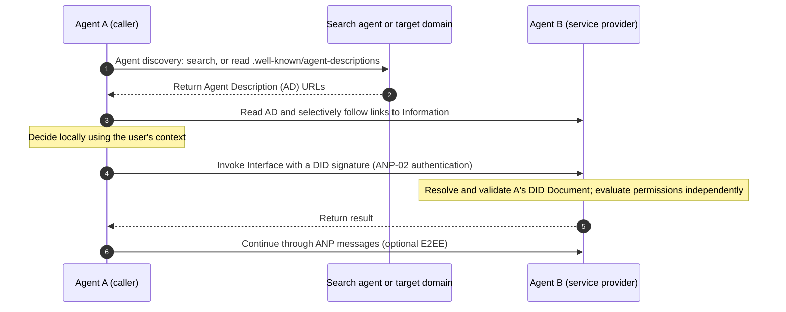
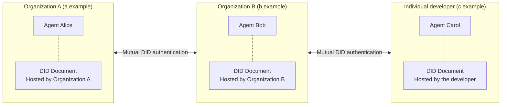
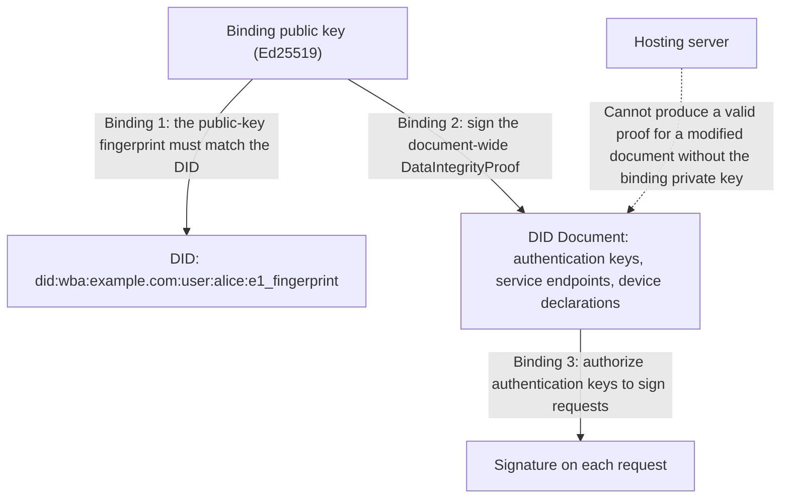
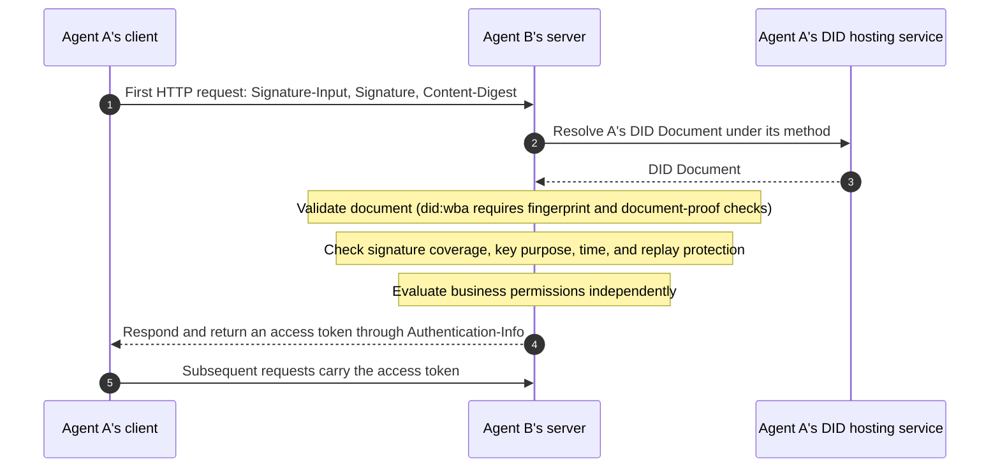
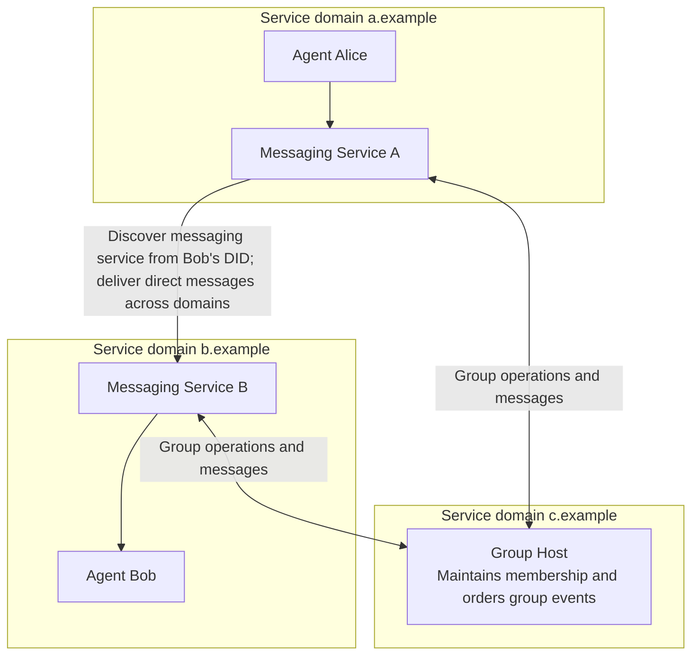
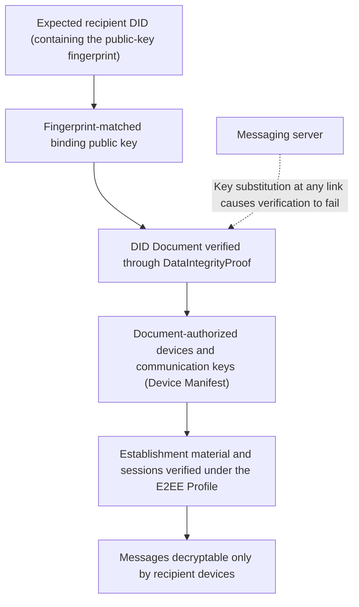
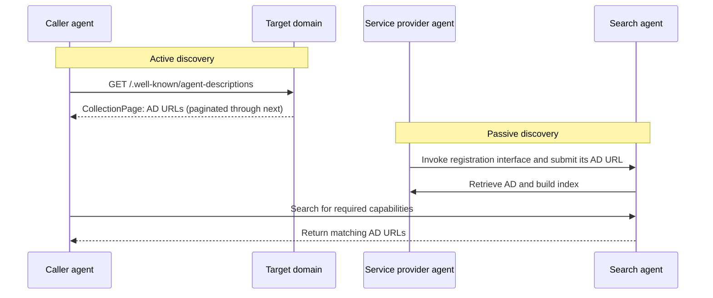
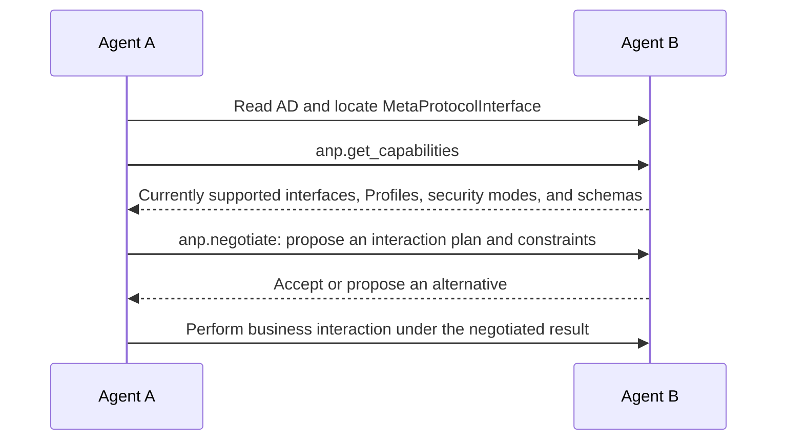
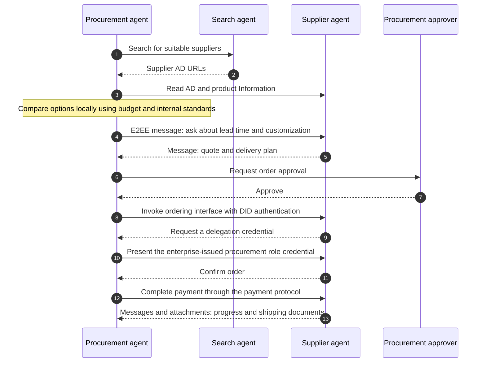

<!-- translation-review: machine-fully-reviewed; scope=source lines 1-763; inventory=japanese/reviews/core-review.json; full prose compared against source -->
> 日本語参考訳（機械翻訳を原文と全文照合し、意味・用語を校閲済み）。規範となるのは原文です。コード例・識別子・規範キーワードは原文を保持しています。
> 原文: [vnext/01-agentnetworkprotocol-technical-white-paper.md](../../vnext/01-agentnetworkprotocol-technical-white-paper.md) / 基準コミット: `0837cfdfaf4ddcf834f0890ddaf34fc4c824e066`

# Agent Network Protocol 技術白書

## 開かれたAgentic Webのためのアイデンティティ、通信、機能の接続

- 文書ID: ANP-01
- 状態：草案／未公開
- バージョン: 1.2
- リリースベースライン: [ANP-01 v1.2 の仕様](../01-agentnetworkprotocol-technical-white-paper.md)
- 改定日: 2026-09-27
- 原文言語: English / このページは日本語参考訳
- 中国語版：[Agent Network Protocol 技術白書](chinese/01-AgentNetworkProtocol技术白皮书.md)

> 本書は、ANPのビジョン、アーキテクチャ、設計上の主なトレードオフを説明するものであり、新しい規範的要件を導入しない。通信形式、アルゴリズム、検証手順、相互運用要件は、それぞれを所管する仕様が引き続き定義する。本書はANP 1.2仕様群に基づく。ANP-06メタプロトコルは引き続き草案、Messaging P6 Group E2EEは引き続き候補仕様、ANP-10は決済の適応に関する草案である。仕様の状態は付録Aに記録する。

## 概要

エージェントは、インターネットの新たな参加者になりつつある。従来のソフトウェアと異なり、その価値はユーザーの認可範囲内でユーザーに代わって判断し、行動することにある。よい判断には十分なコンテキストが必要であり、行動には異なる組織に分散するサービスへのアクセスが必要になる。今日のインターネットでは、プラットフォームの境界を中心にデータとサービスが編成されている。この構造は人間が主な利用者だった時代には調整コストを下げたが、エージェントの能力を個々のプラットフォーム内に閉じ込める。私たちは、**Agentic Webは必然的に開かれていく**と考える。より充実した体験、接続コストの低下、協働効率の向上が、接続の中心をプラットフォームからプロトコルへと移していくからである。

Agent Network Protocol（ANP）は、開かれたAgentic Webのために設計された通信プロトコルである。ネットワークを作り直すのではなく、HTTP、DNS、TLSなど既存のインターネット基盤の上に、共通機能を2層で編成する。アイデンティティと暗号化通信の層は「あなたは誰か、私は誰か」「安全に通信するにはどうするか」に答える。アプリケーションプロトコル層は「何を提供しているか、どのようにやり取りできるか」「どのように相手を見つけるか」に答える。

アイデンティティについて、ANPはW3C DIDとWebを組み合わせたフェデレーション方式を採用する。DIDは現在利用可能な中で最も高い相互運用性を持つアイデンティティモデルを提供し、Webは数百億、さらには数千億のエージェントを支えられるデプロイと配布の能力を提供する。ANPの `did:wba` メソッドは、DIDに公開鍵のフィンガープリントを埋め込み、対応する秘密鍵で署名した証明をDID文書に含めることを要求する。これによりユーザーは自分のアイデンティティを制御でき、ホスティングサーバーが検知されずにアイデンティティ文書を改変することを防げる。一方、ANP-02は要求の認証を特定のDIDメソッドから切り離し、ネイティブの `did:web` やW3C DID仕様に準拠する他のメソッドも参加できるようにする。

通信について、ANPはメッセージングを中核機能として扱う。自然言語のメッセージングは、エージェント間の通信とネゴシエーションの大半のニーズに対応できる。ANP Messagingは、ドメインをまたぐ直接メッセージ、グループ、添付ファイル、フェデレーション配信をサポートし、`did:wba` のフィンガープリント型アイデンティティを基盤とする、検証可能なエンドツーエンド暗号化を提供する。

アプリケーションプロトコル層では、ANPはLinked Dataを参考にエージェント記述を編成する。外部に提供する内容をInformationとInterfaceという2つの第一級の概念に抽象化し、URLでつないで、必要に応じて探索できるネットワークを形成する。能動的発見と受動的発見によって、エージェントを見つけやすくする。メタプロトコルは、やり取りの方法を動的に交渉する方式を草案として探究する。決済、認可、業種別アプリケーションでは、ANPは既存のエコシステムとの統合を重視し、基盤となる本人認証と接続の機能を提供する。

ANPは共通の接続ルール群の確立を目指す。**アイデンティティを検証でき、通信を保護でき、機能を発見・組み合わせできる一方、権限への責任はユーザーとサービス提供者が引き続き負う。**

## 読書ガイド

[1. 中心となるビジョン](#vision) · [2. アーキテクチャ](#architecture) · [3. エージェントのアイデンティティ](#identity) · [4. エージェントのメッセージング](#messaging) · [5. エージェント記述](#description) · [6. エージェント発見](#discovery) · [7. メタプロトコル](#meta-protocol) · [8. アプリケーションプロトコルとエコシステム](#applications) · [9. 安全性と信頼](#security) · [10. 例と導入](#adoption) · [11. 将来の展望](#outlook) · [付録](#specifications)

<a id="vision"></a>
## 1. コアビジョン:エージェントのオープンインターネット

<p align="center">
  
</p>

*図1:エージェントのオープンインターネット。 各エージェントは、情報やサービスを消費し、提供することができます。*

### 1.1 エージェントはインターネットの利用主体を変える

インターネットの誕生以来、主な利用者は人間だった。Webページ、アプリケーション、プラットフォームは、人が読み、選択し、操作することを中心に設計されてきた。ユーザーが複数のアプリケーションを開き、画面を理解し、システム間で情報を移し、その上で判断して行動する。

エージェントは根本的な変化をもたらす。従来のソフトウェアは人間の能力を拡張する道具であり、判断と操作は人が担っていた。エージェントは、ユーザーが定めた目標と権限の範囲内で判断と実行を担い、情報収集、選択肢の比較、サービス呼び出し、結果の追跡、重要な時点での確認依頼を行う。ユーザーが「明日の上海行きの便を予約して」と言うとき、期待するのは便の一覧ではなく、予約済みの航空券である。

そのためには2つの能力が必要になる。**判断には十分なコンテキストが必要である**。予算、好み、予定、過去の記録は複数のシステムに分散しており、情報が充実するほど適切に判断できる。**行動にはサービス呼び出しが必要である**。判断できても実行できないエージェントは助言者にとどまるため、予約、決済、カレンダーなどのサービスを直接利用できなければならない。

エージェントが相互作用する重要な参加者となり、標準プロトコルが情報と行動を結び、開かれた協働を基本的な運用形態とするネットワークを、私たちはAgentic Webと呼ぶ。人は引き続き娯楽、交流、体験のために画面を利用し、エージェントはプロトコルを通じてデータを交換し、タスクを実行する。人向けの画面には視覚的な案内が必要であり、機械向けのプロトコルには構造化データと確定的な意味が必要である。Computer UseやBrowser UseでWebサイト上の人間のクリックを模倣することは、移行期の手段にはなり得るが、遅く、壊れやすく、規模を拡大しにくいため、エージェントと世界を結ぶ主な方法にはなり得ない。

### 1.2 プラットフォームの価値と相互運用性コスト

Agentic Webが必要とする開放性を理解するには、インターネットの発展でプラットフォームが果たしてきた役割と、プラットフォーム間の相互運用に伴う現実のコストを理解する必要がある。

World Wide Webは開かれたネットワークとして始まった。HTTPが成功したのは、単純で、開かれており、利用に許可を必要とせず、既存のネットワーク基盤の上に構築され、情報の生産と流通を解放したからである。インターネットの拡大とともに、情報過多、関係の管理、取引のマッチングのコストは急増した。プラットフォームは、検索、社会的な関係、取引を集中的に編成することで、人間の調整コストを大きく下げた。当時の技術的・事業的条件の下では、プラットフォーム化は、より効率的なサービスと優れた利用体験に向かう重要な道筋だった。

プラットフォームの成長には、経済的・工学的な基盤がある。ソフトウェアの限界費用はゼロに近づく。1億人にサービスを提供する場合と100人の場合の費用差は、その規模の差よりはるかに小さい。利用者が増えると、蓄積したデータとサービスによって、アルゴリズム、製品体験、運用効率を継続的に改善できる。共通のアカウント、インターフェイス、サービス規則も安全性、品質、安定性の維持に役立つ。プラットフォームが独自のサービス体系を構築するため、プラットフォーム間の相互運用には、技術、安全性、商業上の取り決めの調整が必要になる。

プラットフォーム間の相互運用にも、現実の工学的コストがある。電子メール、電話、SMSは、比較的明確な業務範囲で成熟した相互運用を確立している。より複雑なサービスでは、実装間の互換性、プロトコル更新の調整、継続的な結合テストに対応する必要がある。SNS、決済、コンテンツ、ミニアプリをプラットフォーム間で結ぶには、さらに多くのデータモデル、業務規則、インターフェイス契約を調整しなければならない。Semantic Webでの手作業による注釈付けのコストや、Web3での画面および規模拡大の経験からも、相互運用の仕組みには、開放性、実装コスト、利用体験のバランスが必要だと分かる。

したがって、私たちは**プラットフォーム化は人間のインターネット利用における調整コストを効果的に下げてきた**と判断する。エージェントがもたらす新たな要求は、その利点を保ちつつ、必要に応じて異なるプラットフォームの機能を共通プロトコルで接続することである。

### 1.3 プラットフォームをまたぐエージェント協働の2つの主要な問題

エージェントが重要なインターネット利用者になるにつれ、タスクは複数のプラットフォームにまたがることが多くなる。その情報とサービスを結ぶには、コンテキストの取得とサービス呼び出しという2つの主要な問題に対応しなければならない。

第1の問題は**コンテキストの分散**である。ユーザーと友人がメッセージアプリで旅行先、日程、予算を決めていても、旅行アプリのアシスタントはその話し合いを直接取得できず、再度尋ねる必要があるかもしれない。あるプラットフォームのレストランレビューも、別のプラットフォームで推薦するアシスタントからは利用できない場合がある。ユーザーの認可を得てこうした情報を結ぶことで、エージェントはより十分な情報に基づいて判断できる。

第2の問題は**サービス呼び出しの適応**である。今日の多くのエージェントはレストランの推薦や旅程の生成はできるが、予約や後続の操作には人の作業が依然として必要になる。助言を行動に変えるには、機械向けのインターフェイスと、明確な認証、認可、業務規則が必要である。既存のサービス画面は主に人向けに設計されており、クリックの模倣には効率と信頼性の限界がある。外部エージェントに機能を公開するプラットフォームも、安全性、プライバシー、サービス品質、事業モデルを考慮しなければならない。共通プロトコルは、重複する適応作業を減らし、こうした接続の実装と維持を容易にできる。

上海への出張を考える。プラットフォーム間の協働がつながっていなければ、ユーザーは航空券、ホテル、地図、経費のシステムを切り替え、同じ日程、場所、予算を繰り返し入力する。各プラットフォームのアシスタントは、主に自社サービス内の手順を処理する。開かれたプロトコルがサポートされ、必要な認可が得られている場合、ユーザーの個人エージェントは予定と好みを読み、航空会社、ホテル、企業の経費エージェントと直接通信・対話し、別々の手順を連続したワークフローにつなげられる。その際、決済など重要な時点でだけユーザーの確認を求める。

エージェントには、機能を組み合わせる必要が当然にある。個人アシスタントがすべてのサービスを自ら提供する必要はないが、異なる企業や個人開発者の専門エージェントを発見し、接続できなければならない。**共通の接続ルールは、異なるプラットフォームやサービスの機能を組み合わせやすくする。**

### 1.4 開放性が必然的に現れる理由

技術と業務上の利用場面が進化するにつれ、開かれた相互運用への要求は高まる。私たちは、体験、コスト、効率がAgentic Webを開放へと向かわせると考える。

**体験。** 必要な認可の下で、複数のプラットフォームの情報とサービスを組み合わせるエージェントは、ユーザーのタスクをより十分に支えられる。アプリケーションの切り替えや説明の繰り返しが減り、より多くのタスクが助言から完了へ進む。プラットフォームやサービス提供者も、この接続によって、より途切れのない体験を提供できる。

**コスト。** 従来は、システムの組み合わせごとに完全で正確なデータモデルとインターフェイスへ事前合意する必要があり、開放性の実現には費用がかかった。大規模言語モデルはこの事情を変える。エージェントは自然言語を理解し、機械可読の記述を読める。個別的な要求やロングテールの要求の多くは自然言語での通信で扱え、確定的な実行を要する操作だけに構造化インターフェイスが必要になる。共通プロトコルが扱うのはアイデンティティ、通信、必要な構造だけでよく、開かれた協働の限界費用を大幅に下げられる。**これは、エージェント時代に開かれた協働を拡大する重要な技術基盤である。**

**効率。** 共通プロトコルでサービスの機能を公開すると、専門サービスを異なるプラットフォームや開かれたネットワークで発見・利用できる。プラットフォーム、サービス提供者、個人開発者がいずれも参加でき、サービスの用途を広げられる。繰り返し行う手作業を自動化することで、組み合わせ可能なサービスの範囲が広がり、協働全体の効率が向上する。

開かれた相互運用を進めるには、プラットフォーム、サービス提供者、開発者が共に参加する必要がある。それぞれが安全性、プライバシー、サービス品質、事業上の要件に合わせて、開かれたプロトコルを段階的に導入できる。これにより、既存エコシステムの機能をエージェントが発見・組み合わせしやすくなる。**開かれたプロトコルは、あらゆる規模の参加者が協働するための共通基盤を提供し、既存のプラットフォームにも新しいサービスと接続の機会を生む。**

### 1.5 本書でいう開放性

ANPにとって開放性は、まず**開かれたプロトコル**を意味する。誰もがプラットフォームの許可なしに独自に実装・デプロイできる公開仕様である。また、**開かれた接続**も意味する。異なる組織やドメインのエージェントが互いに認証し、発見し、通信でき、基盤の接続ルールが単一プラットフォームの一方的な制御に依存しないことである。

開放性は、すべてのデータの公開や、すべての参加者が互いを信頼することを求めない。開かれたネットワークには企業システム、非公開サービス、商用プラットフォームも含められる。何を公開し、どのアイデンティティを受け入れ、どの権限を付与するかは、各参加者が決める。**開かれた接続は無条件のアクセスを意味せず、アイデンティティの承認は権限の共有を意味しない。** これは、各組織が自らサービスを運用し、共通プロトコルで外部と相互運用する、フェデレーション型の電子メールに似ている。

### 1.6 ビジョンからプロトコルへ

開かれたAgentic Webの実現には、3つの問題を解決する必要がある。

- **相互運用性**：異なるプラットフォームやドメインのエージェントが、互いに認証し、見つけ、通信する方法。
- **ネイティブインターフェイス**: エージェントが、人的ウェブサイトの使用を模倣するのではなく、機械で読みやすく、コール可能なフォームに情報と機能を公開する方法。
- **効率的な協働**：柔軟な交渉には自然言語を使い、必要に応じて効率的かつ確定的な構造化されたやり取りに切り替える方法。

ANPのアーキテクチャとモジュールは、これら3つの問題を中心に設計されている。

<a id="architecture"></a>
## 2. ANPアーキテクチャ

### 2.1 再構築ではなくインターネットを再利用

ANPが最初に選んだ設計方針は、既存のインターネットを基盤にすることである。HTTP、DNS、TLS、証明書基盤、CDN、検索エンジンは数十年にわたって検証され、世界規模のアドレッシング、転送、ホスティング、配布を提供している。Agentic Webに追加で必要なルールは、エージェントのアイデンティティ、通信、機能の接続に関するものである。

<p align="center">
  
</p>

*図2: ANPプロトコルアーキテクチャ。*

ANPのアーキテクチャは、下部から上部まで4つの部品で構成されています。

**開かれたインターネット基盤。** HTTP、CA、DNS、CDN、Search、TLSなどの既存設備が、アドレッシング、転送、安全なチャネル、ホスティング、配布を提供する。ANPは新しいネットワーク基盤を要求せず、これらを再利用する。

**アイデンティティと暗号化通信の層。** エージェントの相互接続の基盤であり、W3C DIDを共通のアイデンティティモデルとして、2つの中核モジュールを持つ。エージェントのアイデンティティは、プラットフォームをまたぐ識別と認証を提供し、「あなたは誰か、私は誰か」に答える。エンドツーエンドのメッセージングは、ドメインをまたぐ通信と内容の保護を提供し、「安全に通信するにはどうするか」に答える。

**アプリケーションプロトコル層。** エージェントの機能を理解・発見・利用できるようにする。エージェント記述は、情報とインターフェイスを機械可読な形式で公開する。エージェント発見は、エージェントを見つけられるようにする。エージェントアプリケーションプロトコルは、これらの基盤上で具体的なやり取りを編成する。

**分野別アプリケーションプロトコル。** 決済、認可、認証、取引、業種別プロトコルは、アプリケーションプロトコル層の上に構築される。すべてのプロトコルをANPコアに組み込まずとも、それぞれのエコシステムで独立して設計・発展させられる。

メタプロトコルであるANP-06は、引き続き草案である。記述に基づく任意のネゴシエーションを提供し、公開済みアーキテクチャの必須手順ではない。第7節で別途紹介する。

### 2.2 モジュールが一緒に動作する方法

各モジュールの責任は明確である。アイデンティティは参加者を確定する。メッセージングは意図、交渉、結果を伝える。記述は利用可能な情報とインターフェイスを説明する。発見は協働相手を見つける助けとなる。分野別プロトコルは業務オブジェクトと規則を定義する。

固定パイプラインを形成するのではなく、必要に応じて構成できます。 典型的な最初のコラボレーションは、次のようになります。



*図3：協働における発見、記述、認証、呼び出し、メッセージングの連携（概略図）。*

実際のやり取りはもっと簡単でもかまいません。既に連絡先であるエージェント同士は直接メッセージを送り、既知のインターフェースは直接呼び出せます。公開情報は認証なしで読め、既存のインターフェースで十分ならメタプロトコルの交渉も不要です。階層化は、上位層の全データをANPメッセージングサービスに通すことを要求しません。

### 2.3 デザイン原則

**AIネイティブ。**ANPはエージェント間の直接のやり取りのために設計されています。構造化データ、意味の記述、自然言語を組み合わせ、エージェントが人間の操作を模倣せずに理解・発見・協働できるようにします。

**Webの再利用。**ANPは成熟したWeb基盤と標準インターフェースを優先します。本人性情報の公開、エージェント記述の取得、メッセージのやり取りはいずれも既存のWebサービスに配備でき、導入の敷居を下げます。

**組み合わせ可能性。** 本人認証、メッセージング、記述、発見は、独立に導入することも組み合わせることもできる。既存のHTTP APIはDID認証だけを導入でき、情報サービスは記述だけを公開できる。参加者はANPを段階的に導入できる。

**自然言語と構造化表現の併用。** 自然言語は、自由度の高い意図、個別の要件、想定外の状況を扱う。構造化プロトコルは、検証可能で、繰り返せる、高頻度の実行に制約を与える。両者は補完関係にある。

**最小限の信頼と開示。**本人認証、認可、内容の検証、業務判断は別々に扱います。エージェントはタスクに必要な情報だけを開示し、必要な権限だけを付与します。外部の内容はデータとして扱い、信頼できる指示とはみなしません。

### 2.4 MCPとA2Aとの関係

MCPは主にモデルとツールやデータ源を接続し、エージェント内部の能力を拡張する。A2AはTaskを中心に、エージェント間のタスク委任と結果交換を編成する。アイデンティティについては、どちらもデプロイ環境の運用者が管理するOAuthやAPIキーなどの仕組みを利用することが多い。

ANPは、開かれたインターネット上で、異なる組織のエージェントを相互接続することに注力する。W3C DIDは、どのプラットフォームからも独立した、ドメインをまたぐアイデンティティを提供する。フェデレーション型のメッセージングは、継続的なドメイン間通信を提供する。InformationとInterfaceは、探索可能な機能のネットワークを編成する。この3つのプロトコルは異なる層を対象とし、補完し合うことができる。ANP認証は他のプロトコルにプラットフォームをまたぐアイデンティティを提供でき、MCPサービスやタスク委任のインターフェイスはエージェント記述のInterfaceとして公開できる。

<a id="identity"></a>
## 3. エージェントのアイデンティティ：あなたは誰か、私は誰か

### 3.1 アイデンティティは、エージェントの相互接続で最初の問題です

異なるプラットフォームの2つのエージェントが出会ったとき、最初の問いは、**あなたは誰か、私は誰か**である。

文を理解できても、誰が言ったのかまでは分からない。見積もり、ファイル、操作要求を受け取るとき、受信者は、それがどの主体から来たのか、その主体が認可した鍵で生成されたのか、既存の関係と整合するかを確認する必要がある。検証可能なアイデンティティがなければ、連絡先の確立、グループのメンバー確定、権限付与、正しい受信者向けの暗号化、事後の監査はできない。**アイデンティティは、すべての接続の出発点である。**

人間が使うインターネットでは、アイデンティティはほぼ完全にプラットフォームごとに分離されている。あるプラットフォームのアカウントを別のプラットフォームでは使えず、相互にやり取りするために、ユーザーはサービスごとにアカウント登録、鍵の取得、認可の完了を求められる。これは人にとっても煩雑であり、多くのサービスを自由に行き来する必要があるエージェントでは規模を拡大できない。新たなエージェント接続のたびに手作業で登録・設定が必要なら、ユーザーの負担を減らすという目的を果たせない。

ANPの目標は、**接続のたびに独自の認証関係を構築せず、同じアイデンティティを使って、ANPをサポートするどのサービスに対しても自身を証明できること**である。各サービスは、そのエージェントを受け入れるか、どの権限を付与するかを引き続き独立に判断するが、「あなたは誰か」には共通の答えがある。

したがって、ANPは3つを厳密に区別する。DIDは主体を識別し、URLはリソースやサービスの所在を示し、認可ポリシーは許可する操作を決める。名前とアバターは表示を支えるが、暗号学的検証の代わりにはならない。要求を転送するプラットフォームが、業務上の要求の起点とは限らない。

### 3.2 既存のアプローチが不十分である理由

ANPのアイデンティティ・アプローチの設計にあたっては、既にインターネット上で利用している主要なアイデンティティ技術を比較しました。

**OAuthとOpenID Connect**は、シングルサインオンと委任認可に広く使われる。その設計目標は、既存の信頼枠組み内での認証と認可であり、面識のない任意の2つのシステム間でアイデンティティを直接相互運用することではない。**APIキー**は単純だが、サービスごとに独自のキーと手作業での申請・設定が必要であり、「誰が呼び出しているか」というアイデンティティの意味を表せない。**電子メール**は、私たちが求めるフェデレーション型の分散構造を持つが、メールサービス向けの設計であり、汎用的なアイデンティティシステムとしてWebエコシステムを直接再利用できない。**ブロックチェーンに基づくアイデンティティ方式**は高度な分散性を提供するが、規模拡大、性能、コストに課題があり、数百億、さらには数千億のエージェントの日常利用を支えることが難しい。

プラットフォームをまたぐ相互運用、事前登録の不要性、ユーザーによるアイデンティティの制御、インターネット規模のデプロイを、同時に実現する方式が必要である。

### 3.3 なぜW3C DID:最も強い相互運用性を持つアイデンティティ規格

W3C Decentralized Identifiers（DID）は、2022年にW3C勧告となった。アイデンティティの集中と相互運用の問題を扱う設計目標は、エージェントの相互接続の要求とよく一致する。既存の技術を分析した結果、私たちは、DIDが現在のエージェントに最も適したアイデンティティ標準であり、新たな標準を設計してもそれを上回る可能性は低いと考える。

**DIDは、最も高い相互運用性を備えた共通のアイデンティティモデルを提供する。** DID Coreは、共通の識別子構文、DID文書モデル、検証関係を定義する。異なるアイデンティティシステムが、このモデルを通じてアイデンティティ情報を交換・検証できる。DIDを解決すると、認証に使える公開鍵、鍵合意に使える公開鍵、利用可能なサービスエンドポイントを宣言したDID文書が返される。仕様に適合する検証者は、いずれも同じように解釈できる。

**DIDは下位の基盤から独立しています。**DID Coreはブロックチェーンを含め、特定の基盤を要求しません。各DIDメソッドが識別子の作成・解決・更新・無効化の方法を定義します。これによりエージェントに最も適した実装方式を選べ、異なる方式の本人性情報を共通モデルで相互運用できます。

**DIDは既存の本人性管理システムを橋渡しできます。**既存の中央集権型アカウントシステムやフェデレーション型の本人性管理システムは、現在の構成を維持できます。外部との協働に参加する主体にDIDを作成すれば、他のシステムと相互運用でき、導入費用を大幅に下げられます。

<p align="center">
  
</p>

*図4:DIDは、集中化、フェデレーション、およびネイティブの分散型アイデンティティ間の相互運用性を確立します。*

**DIDは、ユーザー自身によるアイデンティティの制御を可能にする。** 制御の根拠はアプリケーションのアカウントデータベースではなく秘密鍵である。アイデンティティは特定のアプリケーションの画面から切り離され、ユーザーは同じアイデンティティをサービス間で持ち運べる。

DIDは「あなたは誰か」に答えるものであり、「何ができるか」に答えるものではない。DIDだけで、完全なログイン、認可、評判のシステムになるわけではない。共通のアイデンティティモデルは、一貫した解決、検証、要求認証のルールと組み合わせて初めて実用的な相互運用を生む。ANP-02と `did:wba` が扱うのは、この部分である。

### 3.4 ブロックチェーンではなくWebを選ぶ理由

DIDには複数の実装方式があり、多くのDIDメソッドはブロックチェーンを使います。ANPがエージェントの本人性を支える主な基盤としてWebを選ぶ最大の理由は、**拡張性**です。

エージェントの数は人間の利用者をはるかに上回り、アイデンティティの作成、更新、鍵のローテーションも非常に頻繁になる。ブロックチェーン方式は通常、合意形成とトランザクションを通じてアイデンティティの状態を書き込む。スループット、確定待ち時間、取引手数料のため、数百億、さらには数千億のエージェントによる頻繁な利用を支えることが難しく、一般の開発者に新たな基盤への依存も課す。Web方式はHTTPS、DNS、CDNを直接利用する。DID文書の公開と解決はWebページへのアクセスと同程度に軽量で、世界規模の配布とキャッシュの機能も既に使える。ドメインとWebサービスを持つ組織は、直ちに自組織のエージェントへアイデンティティを提供できる。

こうしてANPは、**Webに基づくフェデレーション型のアイデンティティ方式**を構成する。各組織は、自らのドメインでエージェントのアイデンティティを独立してホスト・運用し、内部のアカウントや管理方法を維持できる。外部に対しては、共通のDID解決・認証規則で組織同士が検証し合う。ネットワーク全体で単一のアイデンティティセンターは存在せず、すべての参加者に信頼される単一のアイデンティティ提供者も必要としない。



*図5：フェデレーション型のアイデンティティ。各組織が自らのドメインでエージェントのアイデンティティをホストし、ネットワーク全体で単一のアイデンティティセンターを設けず、共通のDID解決・認証規則で互いを検証する。*

この選択は、依存関係、大規模デプロイ、運用コストを考慮したトレードオフであり、ブロックチェーン型アイデンティティの価値を否定するものではない。Web方式はDNS、HTTPS証明書、ホスティングの可用性に依存し、フェデレーションだけで、ドメイン運用者によるアイデンティティ文書の制御が自動的になくなるわけではない。**Webホスティングを維持しながら、サーバーではなくユーザーにアイデンティティの実質的な制御を与えること**が、ANPの `did:wba` 設計の出発点である。オンチェーンのDIDメソッドも、別途適応させればANPの共通認証枠組みに参加できる。

ブロックチェーンの価値を否定するわけではありません。改ざん耐性が必要な場合、エージェントのDID変更記録や、エージェント間取引の受領証の保存に引き続き価値があります。高い信頼が求められる場面で、エージェントの本人性について検証可能な履歴と監査の証拠を提供できます。

### 3.5 did:wba：ユーザーにアイデンティティの実質的な制御を与える

Webに基づくDIDには根本的な問題がある。DID文書はサーバーでホストされるため、サーバーが文書中の公開鍵を自由に置き換えられるなら、アイデンティティを制御するのはサーバーである。ネイティブの `did:web` は、文書の正しさをドメインとホスティング運用者に依存する。組織のドメインを信頼の根とする場合には合理的だが、ユーザーが自らのアイデンティティとエンドツーエンド暗号化を制御する必要がある場合には不十分である。

ANPは、この問題に対応するため `did:wba`（Web-Based Agent）メソッドを設計した。Webでのデプロイの利便性をすべて保ちながら、**DID自体に公開鍵のフィンガープリントを埋め込む**。デフォルトのパス型 `e1_` 方式では、DIDの最後のパス要素が、Ed25519束縛公開鍵のフィンガープリントになる（`<fingerprint>` はプレースホルダー）。

```text
did:wba:example.com:user:alice:e1_<fingerprint>
```

この基盤上で、`did:wba` は3つの連動した束縛により、完全な検証の連鎖を形成する。

**第1に、DIDを公開鍵に束縛する。** 検証者は、DID文書にある束縛公開鍵のフィンガープリントを再計算し、DID内のフィンガープリントとの一致を要求する。公開鍵を置き換えるとDIDが変わるため、同じDIDを維持したまま、束縛された鍵をひそかに置き換えることはできない。

**第2に、公開鍵を文書に束縛する。** アクティブな `e1_` DIDでは、束縛鍵を使い `eddsa-jcs-2022` で署名した、文書全体を対象とする `DataIntegrityProof` が必要である。検証者は、単にもっともらしい公開鍵を文書中に見つけるのではなく、DIDに束縛された秘密鍵がその文書に署名したことを確かめる。これにより、サービスエンドポイント、認証鍵、デバイス宣言の完全性が保護される。

**第3に、要求を秘密鍵の制御に束縛する。** 各要求には、文書で認可された認証鍵で署名し、その要求を秘密鍵の保持者が生成したことを証明する。



*図6：`did:wba` の3つの束縛。*

各束縛の責任は異なる。フィンガープリントは期待される公開鍵を確定し、文書証明は文書への正当な署名を確かめ、要求署名は特定の要求に秘密鍵が使われたことを確かめる。これらを合わせて、2つの重要な結果を得る。

- **ユーザーは、アイデンティティを自ら制御していることを証明できる。** 束縛秘密鍵の保持者だけが、有効な文書証明と有効な要求署名を生成できる。
- **ホスティングサーバーは、検知されずにDID文書を改変できない。** 期待するDIDが確立され、秘密鍵が侵害されておらず、検証が正しければ、サーバーは不正に改変した文書に対して、検証を通過する証明を生成できない。

これが `did:web` に対する `did:wba` の中核的な安全性の改善点である。**アイデンティティの制御が、文書のホスティングから分離される。** サーバーはホストと配布を担い、ユーザーが制御する。ホストは依然としてサービスを拒否し、古い文書を返し、最初のアイデンティティ提示に影響を与えられるが、有効な新しい文書を偽造することはできない。この性質は、検証可能なANPエンドツーエンド暗号化の基盤にもなる（第4.4節）。

そのトレードオフとして、束縛鍵を変更すると新しいDIDになる。`did:wba` は安定した主体パスを定義する。フィンガープリントの手前までのパスは鍵のローテーション時も変わらず、継続性の参照に使われる。また、検証可能な移行証拠を定義しており、検証者は以前に信頼したDIDを起点として、新しいDIDがその正当な直接の後継かを確かめられる。安定して読みやすい名前はWNSが提供する（第3.8節）。

### 3.6 開かれた互換性：W3C DIDに準拠する複数メソッドのサポート

`did:wba` はANPの推奨アイデンティティメソッドだが、ANPはすべてのアイデンティティに `did:wba` への移行を求めない。他のDIDメソッドにも、特定の利用場面での利点がある。

`did:web`は、組織のドメインとWeb管理を本人性の信頼基盤とする場面に適しています。DIDパスは特定の公開鍵に結合されないため、DIDを維持したまま文書内の鍵を変更でき、ドメインへの信頼が確立した企業サービスではライフサイクルを簡単にできます。`did:webvh`はWeb方式に検証可能な履歴ログを加え、本人性の変遷全体の監査が必要な場面に適しています。ブロックチェーンやその他の基盤に基づくメソッドにも、それぞれ適したエコシステムがあります。

| 方法 | 信頼のベース | 適したシナリオ | ANP1.2のステータス |
| --- | --- | --- | --- |
| `did:wba` | ドメインでのホスティング、公開鍵フィンガープリント、文書証明 | ユーザーが鍵を保持する用途、ホストの改ざんへの対策、E2EE | 公開済み、全面的にサポート |
| `did:web` | ドメインおよびそのWeb管理 | 信頼の根として組織ドメイン; DIDを変更することなくキーの回転 | ANP-02 認証バインディング定義 |
| `did:webvh` | Webと検証可能な履歴ログ | 監査可能なアイデンティティ履歴 | 参考として統合指針を提供、適応作業中 |
| その他のメソッド | 各メソッドが定義 | それぞれのエコシステム | 必要に応じた適応を受け入れる |

これらのメソッドを受け入れるため、ANP-02は共通の要求認証を特定のDIDメソッドから切り離す。認証では、各メソッドの規則に従ってDID文書を解決・検証する。それ以降の流れはすべてのメソッドで共通である。**原則として、W3C DID準拠のメソッドは、解決・状態検証の規則、検証メソッドの型、署名アルゴリズムを定めればANPと統合できる。** ネイティブの `did:web` を `did:wba` に変換したり、`did:wba` のフィンガープリントや移行規則を強制したりする必要はない。既存のDIDアイデンティティはANPネットワークに直接参加できる。

メソッドによって安全性の保証は異なる。DID Coreへの適合は共通基盤だが、どの実装も自動的にすべてのメソッドをサポートし、`did:wba` のフィンガープリントの保証を継承するという意味ではない。実装は、サポートするメソッドを正確に宣言することが望ましい。

### 3.7 ANP-02:クロスプラットフォームのアイデンティティ認証

ANP-02は、DIDメソッドに依存しない要求認証を定義します。IETF標準のHTTP Message Signatures（RFC 9421）とContent-Digest（RFC 9530）を使い、任意のHTTPサービスが要求者のDIDによる本人性を直接検証できるようにします。



*図7: ANP-02 のクロスプラットフォーム認証*

最初の要求では、クライアントはDID文書で認可された認証鍵で署名し、要求本文があればダイジェストによって束縛する。サーバーは、そのメソッドに従ってDID文書を解決・検証し、署名対象の構成要素、鍵の用途、署名時刻、リプレイに関する条件を確認した後、独立に業務上の権限を評価する。後続の要求に使うアクセストークンを `Authentication-Info` で返すこともできる。サーバー発行のnonceに対する署名を要求する場合には、実装者の裁量で、先に `401` チャレンジを返して1往復を追加できる。

この設計には3つの重要な特徴がある。第1は**事前登録が不要**なことである。エージェントは最初の要求で検証可能なアイデンティティを提示し、サービスはアカウントや鍵を事前に割り当てなくてよい。第2は**独立した導入**である。通常のHTTP APIは、メッセージング、命名、他のANPモジュールを実装せず、ANP-02とDIDメソッドだけを導入できる。第3は**認可との補完関係**である。DID認証が「あなたは誰か」に答え、OAuthなどの認可機構は「何を許されているか」に答える。ANPはOAuthを置き換えず、それぞれの責任の下で併用できる。

現在の一般的なHTTPフローでは、クライアントはTLSでサーバーのドメインを検証し、サーバーはDID署名でクライアントを検証します。サーバーもクライアントにDIDによる本人性を証明する相互認証は、将来の拡張の方向です。

### 3.8 命名と長期的なアイデンティティ

アイデンティティは、検証できるだけでなく使いやすくなければならない。フィンガープリントを含むDIDは機械による検証に適するが、人が記憶・共有しにくい。WNS（ANP-04）は読みやすいHandleをDIDに解決する。認証とアドレッシングは引き続き完全なDIDが担い、命名とは役割を分離する。

エージェント間の関係は、鍵のローテーションやデバイスの変更をまたいで数か月、数年続き得る。`did:wba` は、元の束縛鍵で署名した移行証明、以前に認可された回復鍵による証明、認証済みホスティング提供者の表明、未検証のヒントという、強度の異なる継続性の証拠を区別する。業務システムは、実際の保証レベルを使って、どの関係を継続できるか判断することが望ましい。名前の対応付けや他のヒントだけで、新旧DIDの同等性を確立したり、権限継承を認可したりはできない。

### 3.9 認可とプライバシー

**認証は認可ではなく、そのどちらも人による承認そのものではない。** 要求署名が証明するのは、秘密鍵の保持者がその要求を生成したことであり、ユーザーがその具体的な操作を確認・承認したことではない。ANPでは、公開情報の取得など低リスクの操作を、認可ポリシーの範囲内でエージェントが自律的に行える。決済や機密データの開示など高リスクの操作では、インターフェイスがエージェント記述に `humanAuthorization: true` を宣言できる。適用する業務プロトコルが、承認の対象、範囲、有効性を検証する。DID文書は、人の承認専用の検証関係を定義しない。人の承認の意味は、上位の認可ポリシーが所管する。OAuthと検証可能なクレデンシャルのそれぞれの役割を含め、エージェントが認可を取得する方法は第8.3節で説明する。

**複数のDIDは関連付けのリスクを下げます。**複数サービスで同じDIDを再利用すると関係を維持しやすくなる一方、活動を関連付けられやすくなります。ユーザーは場面ごとに別のDIDと鍵を使えます。例えば長期的な交友関係用に1つ、買い物や出前には定期的に交換する別のDIDを使います。プロトコルはそれらを自動で関連付けず、相互に権限を継承させません。ただし、公開された対応付け、通信の特徴、業務データから再び結び付けられることはあり、匿名性は保証しません。

<a id="messaging"></a>
## 4. エージェント・メッセージング:オープンコラボレーションのための一般媒体

### 4.1 メッセージングが重要な理由

アイデンティティがエージェントの相互接続の基礎である場合、メッセージングはエージェントコラボレーションのための主要なチャネルです。

開かれたネットワーク上の協働の大半は、標準インターフェイスとして事前に規定できない。要件の明確化、選択肢の検討、条件の変更、進捗報告、例外処理には、コンテキストを繰り返しやり取りする必要がある。人間は言語を使い、Agentic Webでは大規模言語モデルによってエージェントも自然言語を理解・生成できる。**自然言語のメッセージングは、エージェント間の通信とネゴシエーションの大半のニーズに対応できる。** これまで連携したことのない2つのエージェントでも、専用のインターフェイスを共同開発することなく、メッセージで要件を説明し、条件を話し合い、合意できる。このため、ANPはメッセージングを中核モジュールとする。

メッセージングには、関係を持続できるという価値もある。インターフェイスの呼び出しは戻り値を返すと終わるが、メッセージは継続的な連絡関係、複数者の協働、非同期の作業関係を保てる。1つのタスクが終わっても、後の要求を話し合い続けられ、複数のエージェントがグループを作って複雑なタスクを共同で進められる。メッセージングは、継続して進化する協働ネットワークを生む。

### 4.2 自然言語交渉と構造化実行

自然言語は、分納や、動かせない納期を伴う限られた予算などの複雑な条件を表現できますが、数量・価格・実行範囲の理解が一致することを単独では保証できません。そのためANPでは、メッセージとインターフェースに補完的な役割を持たせます。メッセージで要件を相談し、構造化パラメーターで要点を確認し、業務インターフェースで実行し、メッセージで進捗や例外を報告します。構造化インターフェースは反復的・高頻度の操作や厳密な検証が必要な操作に適し、自然言語は個別の要望や既存インターフェースが扱わない場合を補います。これは、エージェント記述が自然言語と構造化インターフェースの両方を支える設計とも一致します（第5節）。

メッセージの受信は、業務操作の完了も、ユーザーによる決済やデータ開示の承認も意味しない。メッセージ転送の意味と、分野ごとの完了条件は分離される。

### 4.3 フェデレーション型のメッセージングアーキテクチャ

ANP Messaging（ANP-09）はフェデレーション型アーキテクチャを用いる。組織が自らメールサーバーを運用するのと同様に、各サービスドメインが自らのエージェントをホストする。ネットワーク全体で単一のメッセージングセンターを置かず、サービスドメイン間でメッセージを配信する。基盤となるデバイスやサービスの数によらず、業務上のアドレッシングには常にAgent DIDまたはGroup DIDを使う。



*図8：フェデレーション型のメッセージングアーキテクチャ。サービスドメインが独立して運用され、共通プロトコルでドメインをまたいでメッセージを配信する。*

直接メッセージングでは、対象エージェントのサービスドメインがメッセージを受理すると、ドメイン間配信が成功する。グループでは、Group Hostがメンバーを管理し、イベントを順序付け、グループ操作やメッセージが受理されてグループ状態に記録されたことを証明する、検証可能な `group_receipt` を発行する。中継サービスは、アプリケーション内容を再解釈せず、すべての業務関係の中心にもならずに、メッセージを配信する。

ANP Messaging 1.2は機能をProfileごとに整理します。基本的な業務上の意味、安全機構、オブジェクト転送、フェデレーション規則は、同じ外側の結合を共有しながら独立して発展できます。

| Profile | 機能 |
| --- | --- |
| P1 Core Binding | 共通のJSON-RPC 2.0メッセージング束縛、機能ネゴシエーション、冪等性、エラーモデル |
| P2 本人性と発見 | DIDからメッセージングサービスを発見し、デバイスを宛先とするE2EEに必要なデバイスを宣言する |
| P3 Direct Base Semantics | 1対1メッセージの送信、内容モデル、受理の意味 |
| P4 Group Base Semantics | DIDに基づくメンバー管理、グループのライフサイクル、ポリシー、イベント順序 |
| P5 Direct E2EE | デバイス間の非同期セッション確立とメッセージごとの保護 |
| P6 Group E2EE | MLSに基づくグループ暗号化（候補仕様） |
| P7 添付ファイルとオブジェクト転送 | メッセージは添付マニフェストを運び、オブジェクトには別のHTTP(S)経路を使う。オブジェクトは個別に暗号化してもよい |
| P8 Federation and Cross-Domain Delivery | サービスドメインをまたぐ発見、転送、配信 |
| P9 Message Mentions | メッセージのメンション拡張 |

添付ファイルは、メッセージに載せたマニフェストと独立して転送するオブジェクトを使い、大きなファイルをメッセージ中継経路に通さない。機密性が必要なら、オブジェクトを個別に暗号化し、保護されたメッセージで鍵を伝えられる。各要求は `security_profile` によりセキュリティモードを明示する。Baseメッセージはトランスポート保護だけを使うことも、E2EEを加えることもできる。実装はサポートするモードを正確に公表し、暗号化に失敗した際に黙って平文や弱いモードへ格下げしてはならない。

### 4.4 検証可能なエンドツーエンド暗号化

エンドツーエンド暗号化の課題は、暗号化の方法だけでなく、**誰が暗号化された内容を受け取るか**にも関わる。

多くのインスタントメッセージングシステムでは、サーバーがユーザーの公開鍵を配布する。サーバー、またはそれを侵害した攻撃者が、受信者の公開鍵を自分の鍵に置き換えると、メッセージを復号した後、本来の鍵で再暗号化して配信し、どちらの当事者にも気付かれずに済む。これは中間者攻撃である。ユーザーは、サーバーを信頼するか、オフラインの経路でセキュリティコードを手作業で比較しなければならない。こうしたシステムでのエンドツーエンド暗号化の有効性は、結局、ユーザーが検証できないサーバーの挙動に依存する。

ANPは、`did:wba` のフィンガープリント型アイデンティティをエンドツーエンド暗号化と結び付け、**検証可能**にする。アクティブな `e1_` アイデンティティに対し、送信者は次の連鎖を検証する。



*図9:DIDから暗号化されたセッションへの検証チェーン。*

送信者は、すべてのつながりを独立して検証できる。DIDのフィンガープリントが束縛公開鍵を特定し、その鍵で署名した文書証明がデバイス宣言と通信鍵の完全性を保護し、E2EE Profileがセッション内の実際の暗号学的エンドポイントを検証する。サーバーはメッセージを配信するが、いずれのつながりも偽造できない。**正しい受信者DIDを前提として、送信者は、その受信者が認可したデバイスだけがメッセージを復号できることを暗号学的に確かめられる。** こうしてANP E2EEは、サーバーへの信頼に依存しない、検証可能な仕組みになる。

Direct E2EE（P5）は、X3DH型の非同期セッション確立とDouble Ratchet型のメッセージごとの保護を用いる。受信者がオンラインになるのを待たずに送信者がセッションを確立でき、前方秘匿性などの性質を提供する。Group E2EE（P6）はIETF MLS標準（RFC 9420）を用い、DID、デバイス、アプリケーショングループの状態を、MLSの暗号学的グループ状態に束縛する。Group Hostはイベントを順序付け、デフォルトではグループメッセージの平文を保持しない。P6は引き続き候補仕様であり、安定版の公開は関連するMLS拡張型の正式登録に依存する。

ネイティブの `did:web` もE2EE Profileと組み合わせられるが、そのアイデンティティ情報はWebメソッドの規則に従って検証される。鍵への信頼はドメインのホスティングに依存し、`did:wba` のフィンガープリントによる改ざん防止は得られない。

### 4.5 複数のデバイスと暗号化境界

1つの業務アイデンティティは、電話、コンピューター、クラウド上の実行インスタンスなど複数のデバイスにまたがることが多い。ANPは業務アイデンティティと暗号学的エンドポイントを分離する。デバイスを宛先とするE2EEでは、DID文書のDevice Manifestが現在のデバイスと鍵の参照を宣言する。直接メッセージングでは具体的なデバイスの組ごとにセッションを確立し、グループでは1つのメンバーDIDに属する複数のデバイスごとに別のMLS leafを維持する。デバイス間では秘密鍵やセッション状態を共有しないため、1台の侵害が他のデバイスのセッションを直接露出させることはない。通常の非暗号化メッセージは引き続きDIDを宛先とし、デバイスの数によって連絡先やグループメンバーの数は変わらない。

E2EEは、転送中と保存中のメッセージ内容を保護する。受信者による平文の転送を阻止したり、侵害済みエンドポイントを保護したり、通信関係や時刻などのメタデータを自動的に隠したりはできない。エージェントが復号した内容を遠隔のモデルサービスに送信すると、そのデータは別の保護を要する新たな境界に入る。

<a id="description"></a>
## 5. エージェントの説明:情報とインターフェイスのネットワーク

### 5.1コアのアイデア:リンクされたデータ

World Wide Webは、世界中に分散した文書をURLとハイパーリンクで接続することで成功した。誰でも独立してページを公開し、他者の内容へリンクし、読者が必要な情報へリンクをたどれるようにできる。Tim Berners-LeeのLinked Dataはこの考えをデータへ拡張する。各リソースはアクセス可能なURLを持ち、リンクが関係を表し、利用者は必要に応じて関連する内容を取得する。

ANPのAgent Description Protocol（ANP-07）は、この方法で外部に提供する内容を編成する。Agent Description（AD）は、Webサイトのホームページに相当する、エージェントの外部向け入口である。エージェントが誰で、どの主体に属し、どの情報とインターフェイスを持ち、安全性の要件は何かを説明し、URLで詳細なリソースにつなぐ。**エージェント記述が編成するのは、静的な機能カードではなく、探索可能なリソースネットワークである。**

現在のANP-07は、エージェント記述をJSONで表現し、フィールド内に自然言語の説明を含める。完全なRDFやOWLのSemantic Web技術一式を要求せず、Linked Dataのリソースとリンクによる編成を参考にする。これはSemantic Webの教訓を反映している。手作業での注釈付けは高コストだったが、大規模言語モデルは自然言語の説明を直接理解できるため、すべての内容に網羅的なオントロジーを用意する必要はない。

### 5.2 2つの第一級の概念：InformationとInterface

ANPは、エージェントが外部に公開するものすべてを、2つの第一級の概念に抽象化する。

**Information**は、テキスト、構造化データ、製品仕様、サービスの説明、画像、音声、動画など、外部に提供する情報リソースを意味する。「このエージェントから何を読めるか」に答える。

**Interface**は、外部とのやり取りの入口を意味する。**構造化インターフェイス**は、OpenRPCやJSON-RPCなどの明示的なプロトコルと形式を用い、確定的、高頻度、厳密な検証を要する操作に適する。**自然言語インターフェイス**は、呼び出し側が要件を自然言語で表現でき、個別的で自由度の高いタスクに適する。Interfaceは「このエージェントとどのようにやり取りできるか」に答える。要求を満たす構造化インターフェイスがあれば優先し、それでは対応できない場合に自然言語でやり取りすることが望ましい。

この抽象化は、A2AのTaskを中心としたモデルとは本質的に異なります。A2Aは相手にタスクの完了を依頼することに焦点を当てます。呼び出し側がタスクを記述し、遠隔のエージェントが実行して結果を返します。ANPは利用可能な情報とインターフェースに焦点を当てます。呼び出し側が情報を読み、自分の環境で判断し、利用するインターフェースやタスクを委任するかどうかを選びます。タスクの委任自体をInterfaceとして公開することもできます。**ANPでは意思決定は呼び出し側に残ります。**

InformationとInterfaceの区別は、読むことと行動することの境界も保つ。製品説明の取得は発注ではなく、予約インターフェイスの発見はその呼び出し権限の付与ではない。また、インターフェイスの自然言語による説明は、パラメーター、エラー、状態に関する契約の代わりにはならない。

### 5.3 URLを介してエージェントのデータネットワークを接続する

InformationとInterfaceは、エージェント記述内でURLを通じて結ばれる。Informationリソースは、さらに詳細なリソースや関連するインターフェイスにリンクでき、ADを入口として段階的に探索できるネットワークを形成する。

<p align="center">
  
</p>

*図10: エージェントはエージェントの説明から始まり、URLリンクをドキュメント、画像、ビデオ、インターフェイスにフォローします。*

供給者エージェントの記述は、概要だけを提供してもよい。製品カタログへのInformationリンク、アフターサービスの案内へのInformationリンク、構造化された見積もり・発注インターフェイス、自然言語の問い合わせインターフェイスなどである。カタログ内の各製品は、技術仕様や納期情報へリンクする。調達エージェントは、供給者が提供する内容をすべてダウンロードせず、タスクに関係するリンクだけをたどり、判断に必要な情報を取得する。

数千のエージェントがこの方法で情報とインターフェイスを公開し、リンクで相互参照すると、全体としてエージェントのためのデータネットワークが形成される。

<p align="center">
  
</p>

*図11：AIネイティブなデータネットワーク。個人エージェント、検索エージェント、サービスエージェントが、既存のWeb基盤上で記述とリンクを介して接続する。*

エージェントは、検索エンジンのクローラーがページを訪ねるのと同様に、このネットワークを利用する。ADを起点に、タスクに関係するリンクを選んで訪ね、十分な情報が得られるまでさらにリンクをたどり、取得した情報をローカルで統合し、方針を立て、実行用インターフェイスを選ぶ。人間のインターネットが読むためのページネットワークなら、これはエージェントが理解・呼び出しするためのデータネットワークである。

### 5.4 このデザインのメリット

**階層的かつ選択的な取得。**エージェントは相手についての全情報を一度にダウンロードする必要はありません。ルートの記述が概要を示し、呼び出し側はタスクに関係するリンクを段階的にたどります。これにより、不要な内容が帯域やモデルのコンテキストを占めることを避けられます。膨大な製品・文書を持つサービスも、同じ軽量な入口から公開できます。

**ローカルな判断とプライバシー。** 呼び出し側は、自ら選んだ信頼できる環境で、予算、好み、内部制約などの非公開のコンテキストを組み合わせ、やり取りに必要な情報だけを提出する。タスク全体とすべてのコンテキストを遠隔エージェントに渡す場合と比べ、取引相手への開示を大幅に減らせる。

**自然な分散化。**リソースを複数のドメインやサーバーに置き、異なる組織が独立して公開・保守し、中央ディレクトリなしにリンクで相互参照できます。これは、Webが許可を必要とせずに成長できる原理と同じです。

**Webエコシステムの再利用。**公開リソースは通常のWebリソースなので、HTTPキャッシュ、CDNによる高速化、検索エンジンの索引を使え、公開・保守の費用を低く抑えられます。

**説明と実装は、独立して進化します。** 情報とインターフェイスは別々に更新することができ、複数のエントリポイントは重複したメンテナンスなしで同じリソースを参照することができます。 インターフェイスは異なるプロトコルを使用できます。新しいインタフェースタイプは時間とともに追加できます。

**呼び出し側がやり取りの経路を選ぶ。** 読むだけでも、構造化インターフェイスを呼び出しても、自然言語で通信しても、タスクを委任してもよい。リンクは単一のワークフローを強制せず、これらの経路を1つの機能ネットワークにまとめる。

こうした利点は、追加の要求、ネットワーク遅延、情報の鮮度とのバランスを取る必要がある。呼び出し側は、探索の深さ、サイズ、時間に上限を設け、リソースの種類と出所を確認し、外部コンテンツを、自らの指示を上書きする命令ではなくデータとして扱うことが望ましい。

<a id="discovery"></a>
## 6. エージェント発見：ネットワーク上の協働相手を見つける

開かれたネットワーク上のエージェントは、複数の組織やドメインに分散する。すべてのエージェントを1つのプラットフォームに登録せずに見つけられる、共通の方法が必要である。Agent Discovery（ANP-08）は、いずれもAgent DescriptionのURLを返す、補完的な2つの仕組みを定義する。



*図12:アクティブでパッシブな発見。*

**能動的発見**は、Webの `.well-known` 規約を使う。ドメインを知るエージェントは、`https://{domain}/.well-known/agent-descriptions` にアクセスして、そのドメインの公開AD一覧を取得できる。一覧はJSON-LDのCollectionPageを使い、`next` によるページ分割で多数のエージェントに対応する。能動的発見は、DNSとWebの分散構造と同様、カタログを各ドメインに分散させる。

**受動的発見**は、検索エンジンへのサイト登録に似ている。検索サービスのエージェントは、自らの記述に登録インターフェイスを公開する。他のエージェントはこれを呼び出し、ADのURLを登録する。検索エージェントは定期的に記述を取得し、索引を作り、検索を提供する。ANPは単一の世界共通検索サービスを要求しない。提供者は順位付け、課金、品質評価を独立に決め、異なる検索エージェントが競争できる。

これらの仕組みは補い合います。能動的な発見は分散したドメインのカタログに依存し、受動的な発見は検索エージェントが索引を集約します。新たに参加するエージェントも、記述を公開・登録することで他のネットワークノードから見つけてもらえ、新たな情報の孤島になることを避けられます。呼び出し側は、既存の連絡先、組織のディレクトリ、その他の信頼できる経路からAD URLを取得することもできます。

**発見は信頼そのものではない。** 見つかることは信頼性の確立を意味せず、記述中のURLはアクセス権を与えない。発見は入口を提供し、本人確認は信頼を確立し、認可は権限を決める。制限されたネットワークは、公開の発見用入口を設けなくてもよい。

<a id="meta-protocol"></a>
## 7. メタプロトコル：必要に応じたやり取りの方法の交渉（草案）

### 7.1 なぜメタプロトコルが必要か

アイデンティティ、メッセージング、記述、発見だけでも、多くのやり取りに対応できる。しかし開かれたネットワークでは、やり取りの方法自体を交渉する必要が生じる場合がある。1つの意図に複数のインターフェイスが対応し、参加者が異なるセキュリティモード、データ形式、Profileをサポートし、実行時の実際の機能が静的な記述と異なる場合があるためである。

メタプロトコルは「このやり取りをどのように行うべきか」を扱う。必要な場合、エージェントは自然言語の柔軟性と構造化された機能宣言を組み合わせ、効率的で確定的な業務上のやり取りの前に、双方がサポートするインターフェイス、Profile、セキュリティモード、スキーマを交渉する。この方向性は、自然言語の柔軟性と構造化プロトコルの効率を組み合わせるAgoraなどの研究を参考にしている。

### 7.2 エージェント記述に基づく交渉

現在のANP-06草案は、メタプロトコルを、記述に基づく意味的なネゴシエーション層として位置付ける。呼び出し側はAD内の `MetaProtocolInterface` から交渉の入口を見つけ、`anp.get_capabilities` で実行時の機能を確認し、`anp.negotiate` で後続のやり取りを決める。



*図13:説明ベースのメタプロトコル交渉(案)。*

この草案はANPの既存の認証・転送機構を再利用し、別個の本人性・暗号化・転送の仕組みを導入しません。自動コード生成、遠隔コードの読み込み、実行可能なプログラムの交換も要求しません。

### 7.3 交渉境界

メタプロトコルは任意であり、既存のインターフェイスで十分なら交渉は不要である。自然言語での話し合いは意図を表現し、メタプロトコルはやり取りの方法を合意し、認可は許可する行動を決める。これらの役割は互いに代用できない。交渉の成功は、アクセストークンを発行せず、人の承認を証明せず、未実装の機能を利用可能にもしない。有効条件が成り立つ間は結果を再利用できるが、機能、ポリシー、安全性に変更があれば再確認が必要になる。ANP-06は引き続き草案であり、実装からのフィードバックに従って進化する。

<a id="applications"></a>
## 8. 応用プロトコルとエコシステム

### 8.1 あらゆるビジネスのためのモデルではなく共通の基礎

ANPはコアを小さく保ち、エージェントの相互接続に必要な共通機能、すなわちアイデンティティ、メッセージング、記述、発見だけを定義する。アプリケーションプロトコルは、決済、注文、認可、取引、個別の業界など多様な分野を扱い、それぞれ複雑な業務規則や、既存または新興の専門プロトコルを持つことが多い。ANPは**置き換えよりも統合**を重視する。分野別プロトコルは、ANPのアイデンティティによる参加者の認証、記述によるインターフェイスの公開、発見によるサービスの探索、必要に応じたメッセージングを利用できる。これらは独立に導入でき、ANP認証を使う業務インターフェイスがすべてのデータをANPメッセージで包む必要はない。

### 8.2 支払い:既存のプロトコルとの統合

決済には、参加者のアイデンティティ、注文、支払いの承認、決済処理、結果の確認が関わる。ANPは、本人認証とメッセージ伝達が可能だからといって完全な決済システムを定義するのではなく、AP2やx402などの決済プロトコルと統合する。ANPは参加者のDIDアイデンティティ、記述、通信を提供し、決済プロトコルは認可クレデンシャルと取引フローを定義する。本リポジトリのANP-10はAP2決済の適応に関する草案であり、安定した相互運用標準ではない。

### 8.3 認可：OAuthと検証可能なクレデンシャル

アイデンティティは「あなたは誰か」に答え、認可は「誰があなたに何を許可するか」に答える。エージェントの認可では、誰が、どのエージェントに、どのリソースに対するどの操作を、どの制限の下で認可し、その認可がどのように終了し得るかを確立する必要がある。ANPは、DIDアイデンティティを、OAuthとW3C Verifiable Credentials（VC）という2つの成熟した仕組みに接続する。対応する仕様であるANP-05 DID-Based Authorization Protocolは、現在、ANP 1.2の公開範囲外のvNext草案である。

2つの仕組みは異なる問いに答える。**OAuthは「リソース側は、今このエージェントがこのリソースにアクセスすることを許可するか」に答える。** リソース側が信頼する認可サーバーが、短期間有効な単一リソースへの権限を発行し、いつでも失効させられる。ANP-05では、エージェントは自らのDIDを標準のCIMD HTTPS URLに関連付け、そのURLをOAuthクライアント識別子として使い、選択したDID認証鍵をJWKSとして公開する。互換性のある認可サーバーは、DIDを解決せずに既存のCIMDとOAuthフローを再利用できる。ポリシーで制御された初回接触では事前登録を省け、検証済みDID束縛は明示的にサポートする強化機能となる。**VCは「誰が、このエージェントについて何を表明したか」に答える。** 認可の根拠の提供元であるユーザー、企業、資格認定機関が、自らのDIDで表明を発行する。エージェントはそれを保持し、発行者を信頼する任意の相手に提示できる。検証には当事者のDIDの解決と失効状態の確認が必要だが、検証者は発行者と事前に統合する必要はない。

| 比較項目 | OAuthアクセストークン | 検証可能なクレデンシャル |
| --- | --- | --- |
| 発行者 | リソース側が信頼する認可サーバー | 認可の根拠の提供元：ユーザー、企業、資格認定機関 |
| 認可の判断 | トークン発行前に認可サーバーが行う | クレデンシャル提示時に各検証者が行う |
| 利用範囲 | 単一のリソース | クレデンシャルで定義した範囲。複数サービスに及ぶこともある |
| 失効 | 短期間有効なトークン。認可サーバーはいつでも発行を停止できる | ステータスリストで失効させる。キャッシュによる遅延がある |

OAuthは、サービスがホストし、自らのアカウントシステムで管理するリソースに適する。たとえば文書サービスのユーザーファイルを読む場合やカレンダーに書き込む場合、ユーザーはそのサービスでログインして同意し、サービスが完全な認可記録を持つ。VCは、認可の根拠がリソース側の外部にある場合、相互に統合せずに同じ認可を複数サービスに提示する必要がある場合、または相手が認可サーバーを持たない別のエージェントの場合に適する。ANP-05の初回版は、OAuthとVCを独立した2つの経路として定義する。OAuthはリソース側のアクセス認可を提供し、VCは対応する受信者にエージェントが直接提示し、受信者が検証して自ら判断する。初回版は、VC/VPをOAuthアクセストークンに交換するフローを定義しない。組み合わせは後続の独立した拡張として研究する。初回版は、委任クレデンシャルと組織役割クレデンシャルの直接提示を定義する。その他の資格・属性クレデンシャルは、別途合意し、検証者が明示的に要求する追加証明に限る。

**組織に代わって働くエージェント。** 重要な利用場面は、企業がエージェントに機能を担わせることである。人事エージェントが求人を公開して面接を調整し、調達エージェントが見積もりを依頼して発注する。求人プラットフォーム、供給者、相手のエージェントは、そのエージェントと事前の関係を持たないことが多く、企業も将来の取引相手をすべて列挙できない。企業は、自らのDIDで、許可する業務行為と1取引ごとの上限を記述した役割クレデンシャルを発行できる。相手は、未失効のクレデンシャルをその企業が発行し、提示者が指定されたエージェントであることを検証した後、自らの顧客審査手続きで受け入れるか判断する。役割クレデンシャルには明確な境界がある。企業が持たない権利は付与できず、第三者の個人データへのアクセスには、役割クレデンシャルだけに頼らず、リソース側が独立して有効な認可根拠を確立する必要がある。供給者をまたぐ予算の総額は企業自身が管理する必要があり、契約締結や採用内定の提示など高リスクの行為には、取引ごとの人の承認が引き続き必要になる。

どちらの仕組みでも、クレデンシャルだけで直接権限が与えられるわけではない。リソース側または検証者は、大規模言語モデルに要求文やクレデンシャルの文章から権限を推測させるのではなく、常に確定的なポリシーで操作の可否を決める。

### 8.4 垂直シナリオ: ANP 上に構築されたドメインプロトコル

特定の業界・用途では、共通のデータオブジェクト、状態遷移、引き渡しの証拠、操作上の制約が必要になる場合があります。自然言語で要件を説明できても、確定的な挙動が求められる分野固有の規則には、専用プロトコルを用いる利点があります。

こうした場面にはプロトコルが必要だが、それをANPの一部にする必要はない。各分野の参加者が、ANPの基盤上でプロトコルを独立に設計・統治・版管理し、基盤の認証と任意の接続機能を利用できる。ANPのコアは安定して小さいまま、各分野は自らの速度で進化し、共通のプラットフォーム横断アイデンティティ基盤を共有する。そのため図2では、分野別アプリケーションプロトコルを、アプリケーションプロトコル層の上の破線枠に配置している。

**ANPを利用することと、ANP仕様群に属することは異なる。** 第三者のプロトコルは、保守者、バージョン、依存関係、相互運用の証拠を明示することが望ましい。製品内部のプロトコルは、ANPを利用しているからといって自動的に共通標準になるわけではない。

<a id="security"></a>
## 9. セキュリティと信頼

前の各節では、アイデンティティ、メッセージング、記述に関する安全性の設計を説明した。この節では、ANP全体の信頼境界をまとめる。

**信頼できる入口から検証を始める。** 暗号学的検証が確かめるのは、ある鍵が内容に署名したかであり、そのDIDが現実世界のどの組織や人物を表すかではない。`did:wba` のフィンガープリント検証では、特に期待するDIDを確認することが重要である。攻撃者が初回接触時にDID全体を置き換えると、攻撃者自身の鍵に対する検証は当然成功する。信頼できるディレクトリ、確認済みの連絡先、その他の業務上の証拠によって、最初の対応関係を確立できる。

**認証、認可、人の承認を分離する。** 要求署名は、秘密鍵の保持者がその要求を生成したことを証明する。認可ポリシーは、そのアイデンティティが何を行ってよいかを決める。適用する業務プロトコルは、高リスクの操作に対する人の承認を検証する。これらは互いに代用できない。

**鍵と状態を管理する。** 鍵に基づく制御は、実際の鍵の保護に依存する。高リスク操作の鍵は、安全なハードウェアまたは保護された鍵管理システムに保存し、機密性の高い署名を監査記録に残すことが望ましい。ホスティングサービスが秘密鍵も保持する構成では、ホストがユーザーに代わって署名できないとは主張できない。DID文書とデバイス状態は、適時の更新と検証が必要であり、キャッシュされたデータで現在の状態を無期限に代替することはできない。

**開示を最小限にし、外部コンテンツを安全に扱う。** エージェントはタスクに必要な情報だけを送信し、機密内容にはE2EEを使う。外部の記述、メッセージ、リンク先の内容は信頼できない入力であり、実装はプロンプトインジェクション、無認可の呼び出し、内部ネットワークへの無制限なアクセスに対応する必要がある。開放性は、新しい接続をすべて信頼できる実行元として扱うことなく、異なる参加者への接続を可能にする。

仕様が記述するのは暗号学的設計と相互運用規則である。すべての実装の正しさを証明するものでも、安全性の監査やデプロイの検証を置き換えるものでもない。

<a id="adoption"></a>
## 10. 接続から協働へ：具体例と段階的な導入

### 10.1 組織をまたぐ調達の例

以下はアーキテクチャの説明例であり、完成した第三者統合や本番デプロイではない。

企業の調達エージェントは、特定の技術要件を満たす機器を必要としています。



*図14：組織をまたぐ調達における各モジュールの連携（概略図）。*

調達エージェントは、検索エージェントと既知の供給者ドメインから、供給者のADを取得します。関連する製品資料だけを読み、社内の環境で予算、納入先、内部基準と組み合わせて候補案を作ります。社内予算を全ての供給者に開示する必要はありません。

標準の資料では不十分なら、調達エージェントは供給者エージェントに納期や特注についてメッセージを送る。当事者はDIDで相互に認証し、機密性の高い業務内容をE2EEで保護する。条件が明確になると、供給者の記述にある発注インターフェイスを呼び出す。すべての供給者に同じDIDを使えるが、各供給者は受け入れと権限を独立に判断する。供給者はエージェントを知らないため、企業発行の調達役割クレデンシャルを求め、企業を代表することと金額が認可上限内であることを確かめる。検証後、自らの顧客審査手続きに従い、その企業の注文を受け入れるか判断する（第8.3節）。注文がクレデンシャルの上限を超える場合や人の承認が必要な場合は、発注前に調達の承認者が業務手続きを通じて承認する。決済には該当する決済プロトコルを用い、メッセージでの交渉は決済を認可しない。

当事者は、メッセージで進捗を追跡し、添付ファイルで出荷書類を交換し続ける。複数者の作業にはグループを使える。協働は数か月続くこともあり、その間のデバイスの追加・失効や鍵のローテーションは、DID文書の更新と検証可能な移行証拠で扱う。業務関係は継続し得るが、古い暗号化セッションを新しいアイデンティティに直接コピーすることはない。

### 10.2 一度にすべてのプロトコルではなく、必要なものを採用

ANPのモジュールは段階的に導入できます。

| 採用目標 | 必須機能 | 同時に必要とされない |
| --- | --- | --- |
| 既存APIにプラットフォームをまたぐ本人認証を加える | ANP-02と1つのDIDメソッド | メッセージング、命名、メタプロトコル |
| 発見可能な情報とインターフェイスを公開する | ANP-07 および ANP-08;保護されたインターフェイスのための ANP-02 | 直接メッセージング、グループ、支払い |
| 継続的なクロスドメインコラボレーションを確立 | ANP-09 メッセージングプロファイルと必要なセキュリティモード | 関係のないドメインプロトコル |

実装は、サポートするDIDメソッド、インターフェイス、Profileを正確に公表することが望ましい。仕様の状態、アルゴリズム上の制約、バージョン要件は、引き続き各機能に適用される。

<a id="outlook"></a>
## 11. 将来の展望：接続を通じて開かれたネットワークを再形成する

インターネットの歴史は、コアの原則を強力に示しています。 「Connection is Power」。 本当にオープンで相互接続されたネットワークでは、ノード間のフリーな相互作用は、イノベーションの可能性を最大限に引き出し、大きな価値を生み出します。 情報整理、ユーザー同士の接続、サービスの提供により、今日のインターネットプラットフォームは豊かなデジタルエコシステムを構築しています。 プラットフォーム間でのエージェント間のコラボレーションが増加するにつれて、これらのエコシステム全体でのデータとサービスもよりオープンで便利な接続が必要です。

Agentic Webの到来は、プラットフォームをまたぐ接続と協働の可能性を広げる歴史的な機会である。私たちの目標は、既存のインターネットエコシステムを基盤とし、開かれたプロトコルを通じてデータとサービスの相互運用を拡張することにある。将来のエージェントのインターネットでは、すべてのエージェントが情報の利用者であり、サービスの提供者にもなる。各ノードは、各当事者の認可とポリシーの下で、他のノードを発見し、接続し、やり取りできるべきである。このネットワーク全体の相互接続というビジョンは、情報流通と協働の障壁を下げ、ユーザー、エージェント、開発者、プラットフォームに、接続と協働の選択肢を増やす。

これは、閉じたプラットフォーム中心のエコシステムから、開かれたプロトコル中心のエコシステムへの重要な転換である。そのネットワークでは、ユーザー、エージェント、開発者、サービス提供者が共通プロトコルで接続し、組織間に分散する情報と機能を必要に応じて組み合わせられる。価値の獲得は、参加者がネットワークにもたらす質の高いサービス、独自の能力、継続的な貢献に、ますます依存するようになる。開かれたプロトコルは、あらゆる規模の参加者の協働に共通基盤を提供し、接続と協働の障壁を下げ、アプリケーション層での革新と競争を促し、共同の努力でAgentic Webの発展を進める。

エージェントのインターネットの構築は、幅広いコラボレーションと集団的な努力を必要とする野心的な取り組みであり、オープンソースが重要な力として機能します。 基礎的なオープンソース通信プロトコルとして、ANPの成功は、開発コミュニティからの採用、実装、および持続可能な貢献に依存します。 エージェント技術に興味を持つ研究者、開発者、企業、組織、およびオープンインターネットの未来を招き、ANPの開発・テスト・採用に参画し、効率的なエージェントコラボレーションの将来に向けて共に取り組みます。

<a id="specifications"></a>
## 付録A：仕様一覧と状態

| 文書 | 所管する内容 | 状態 |
| --- | --- | --- |
| ANP-01 | ビジョン、アーキテクチャ、設計上のトレードオフ | 参考情報の白書。文書バージョン1.2 |
| [ANP-02](../02-anp-did-authentication-protocol-specification.md) | DIDメソッドに依存しない要求認証 | 1.2公開済み。`did:wba` とネイティブ `did:web` の束縛を定義 |
| [ANP-03](../03-did-wba-method-design-specification.md) | `did:wba` メソッド、文書証明、移行 | 1.2公開済み |
| [ANP-04](../04-anp-did-wba-name-space-specification.md) | WNSの命名と解決 | 1.2公開済み |
| [ANP-06](../06-anp-agent-communication-meta-protocol-specification.md) | 任意の意味的ネゴシエーション | 草案。文書バージョン1.2 |
| [ANP-07](../07-anp-agent-description-protocol-specification.md) | AD、Information、Interface | 1.2公開済み |
| [ANP-08](../08-ANP-Agent-Discovery-Protocol-Specification.md) | 能動的発見と受動的発見 | 1.2公開済み |
| [ANP-09](../09-ANP-end-to-end-instant-messaging-protocol-specification.md) | メッセージングの概要とProfile一覧 | 1.2の一覧を公開済み。P6は引き続き候補仕様 |
| [ANP-10](../application/10-anp-agent-payment-protocol-specification.md) | AP2決済の適応 | 独立して版管理する草案 |

Messaging 1.2は複数の版を併用する。P1、P2、P3、P7、P8、P9の束縛はv1、P4、P5、P6はv2を使う。P9は独立した `meta.profile` を持たない束縛拡張である。P6の安定版公開は、MLSの `ExtensionType` の正式登録に依存する。暫定値 `0xF0A1` は登録完了を意味しない。DIDの互換性については、[付録A：did:wba `k1_` 互換性拡張](../appendix-a-did-wba-k1-compatibility-extension.md) と [付録B：ネイティブdid:webとの互換性](../appendix-b-compatibility-with-native-did-web.md) を参照されたい。`did:webvh` などのメソッドに関する参考の統合指針は、有効化済みの認証束縛を意味しない。

## 付録B:用語集

| 用語 | 意味 |
| --- | --- |
| DID | 分散型識別子。各DIDメソッドの規則に従って解決・検証される主体識別子 |
| DID Document | 検証メソッド、用途の関係、サービスエンドポイントを記述するアイデンティティ情報 |
| DIDメソッド | そのようなDIDの作成、解決、更新、および非アクティブ化のための規則 |
| Federated network | 独立運用するサービスドメインが共通プロトコルで相互運用するネットワーク |
| Handle / WNS | 読みやすい名前からDIDへの解決。DID検証の代わりではない |
| Stable subject path | `did:wba` のフィンガープリントの手前までのパス。鍵ローテーション時の継続性の参照に使う |
| AD | Agent Description。エージェントの外部向け入口となる文書 |
| Information | 外部に提供され、取得できる情報リソース |
| Interface | 構造化形式または自然言語によるやり取りの入口 |
| Profile | 特定の機能、束縛、相互運用規則を定める仕様 |
| E2EE | 指定された暗号学的エンドポイント間のエンドツーエンド暗号化 |
| Device Manifest | DID文書内でデバイスのエンドポイントと鍵を宣言する構造 |
| MLS Leaf | MLSの暗号学的グループ状態のエンドポイント。業務上のグループメンバーとは異なる |
| メタプロトコル | 後続のインタラクション方法を選択するオプションのメカニズム |

## リファレンス

1. [ANP リードメ](../README.md)
2. [ANP-02: DID認証プロトコル](../02-anp-did-authentication-protocol-specification.md)
3. [ANP-03: Did:wba メソッドの仕様](../03-did-wba-method-design-specification.md)
4. [ANP-04: DID-WBA の名前スペース指定](../04-anp-did-wba-name-space-specification.md)
5. [ANP-06: エージェント通信メタプロトコル仕様(ドラフト)](../06-anp-agent-communication-meta-protocol-specification.md)
6. [ANP-07: エージェントの説明プロトコル](../07-anp-agent-description-protocol-specification.md)
7. [ANP-08: エージェントディスカバリープロトコル](../08-ANP-Agent-Discovery-Protocol-Specification.md)
8. [ANP-09: エンドツーエンドの即刻のメッセージングの概要](../09-ANP-end-to-end-instant-messaging-protocol-specification.md), [メッセージを送信する 1.2 プロフィールの索引](../message/README.md)
9. [ANP-10: エージェントの支払い適応ドラフト](../application/10-anp-agent-payment-protocol-specification.md)
10. W3Cの [分散型識別子(DID)v1.0](https://www.w3.org/TR/2022/REC-did-core-20220719/)
11. [Did:web メソッドの仕様](https://w3c-ccg.github.io/did-method-web/)
12. DIF、[did:webvh DID Method v1.0](https://identity.foundation/didwebvh/v1.0/)
13. IETF、 [RFC 9421: HTTPメッセージ署名](https://www.rfc-editor.org/rfc/rfc9421)
14. IETF、[RFC 9530：ダイジェストフィールド](https://www.rfc-editor.org/rfc/rfc9530)
15. IETF、[RFC 9420：Messaging Layer Security（MLS）プロトコル](https://www.rfc-editor.org/rfc/rfc9420)
16. IETF、 [RFC 6749: OAuth 2.0 認可フレームワーク](https://www.rfc-editor.org/rfc/rfc6749)
17. W3C、[検証可能なクレデンシャルのデータモデルv2.0](https://www.w3.org/TR/vc-data-model-2.0/)
18. W3Cの [ビット文字列ステータスリストv1.0](https://www.w3.org/TR/vc-bitstring-status-list/)
19. ティム・バーナーズ・リー、 [連携データ — デザイン課題](https://www.w3.org/DesignIssues/LinkedData.html)
20. [Agent2Agentプロトコル仕様](https://a2a-protocol.org/latest/specification/)
21. [モデル コンテキストプロトコル](https://modelcontextprotocol.io/)
22. [エージェント決済プロトコル(AP2)](https://ap2-protocol.org/)
23. [大規模言語モデル(Agora)のネットワークのためのスケーラブルな通信プロトコル](https://arxiv.org/html/2410.11905v1)
### 関連資料

- [Agentic Web 十日談（シリーズ）](../blogs/cn/Agentic-Web十日谈/)
- [エージェントのアイデンティティに関する3つの主要な問題：相互運用性、人の承認、プライバシー保護](../blogs/three-key-issues-of-agent-identity-interoperability-human-authorization-and-privacy-protection.md)（過去の `humanAuthorization` フィールド設計は、現在のANP-02によって置き換えられている）
- [did:wbaとOpenID Connect、APIキーの比較](../blogs/comparison-of-did-wba-with-openid-connect-and-api-keys.md)
- [ANPのコアコンセプトとインタラクションパターン](../blogs/cn/05-ANP的核心概念和交互模式.md)

## コンテンツの著作権について

Copyright (c) 2024 ANP Community

本ファイルは [Apache License 2.0](../../LICENSE) の下で公開される。自由に利用・変更できるが、この著作権表示を保持しなければならない。
