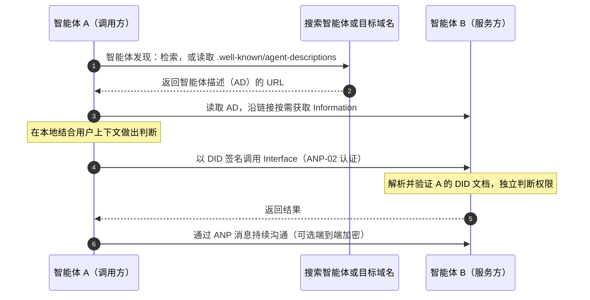
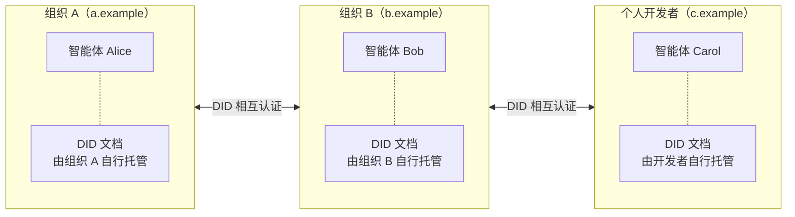
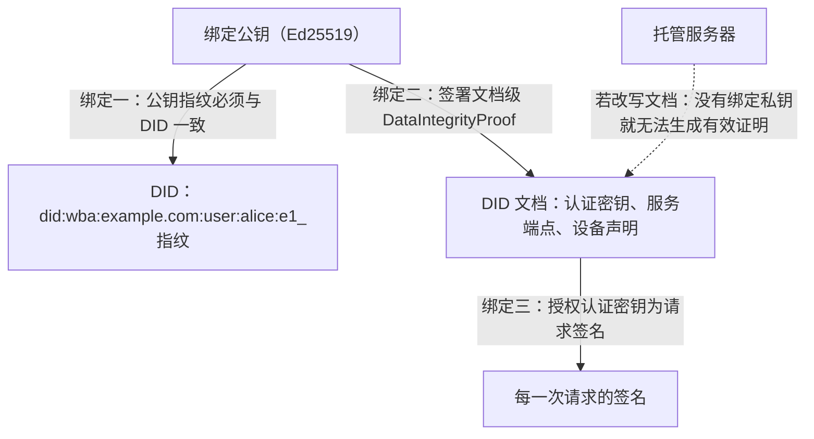
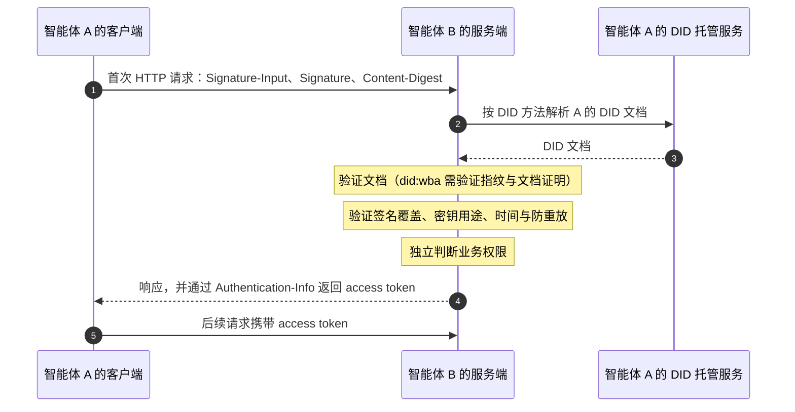
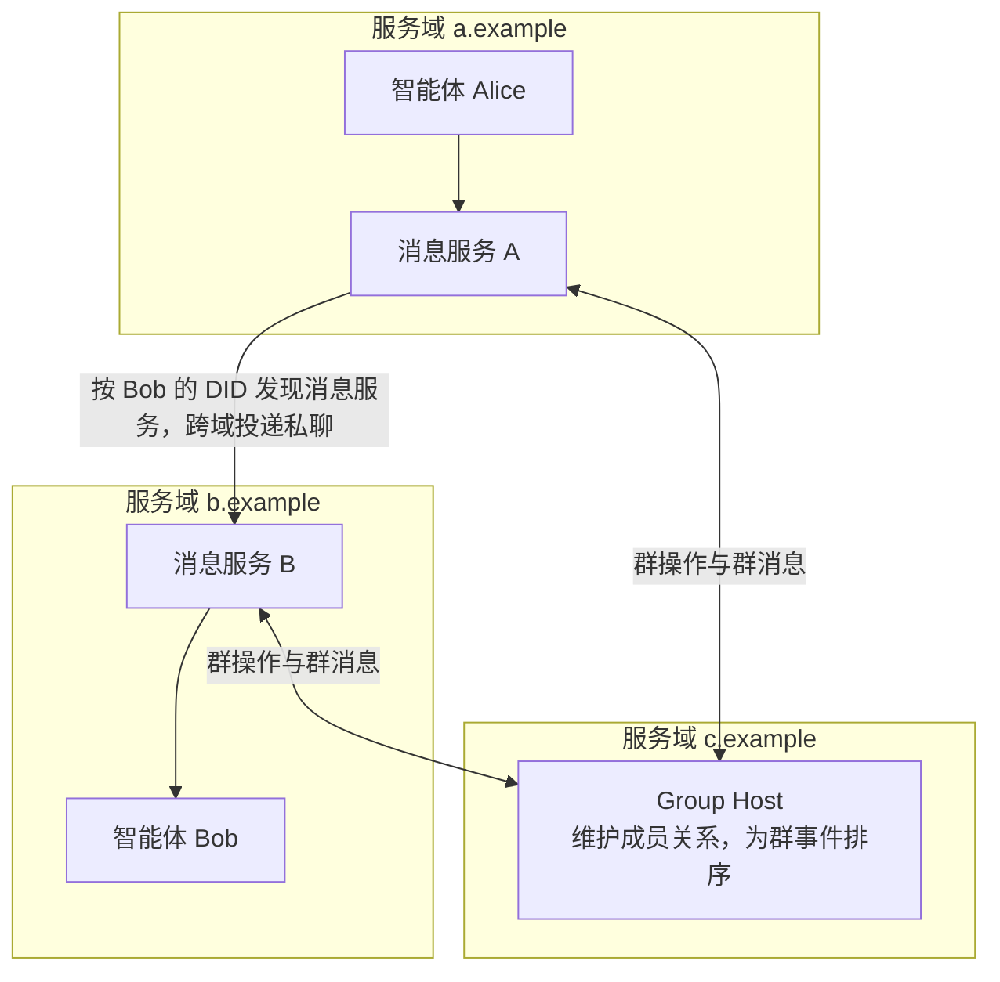
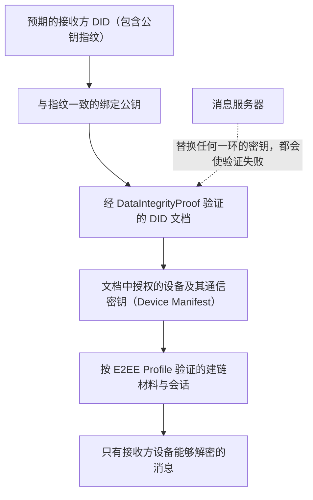
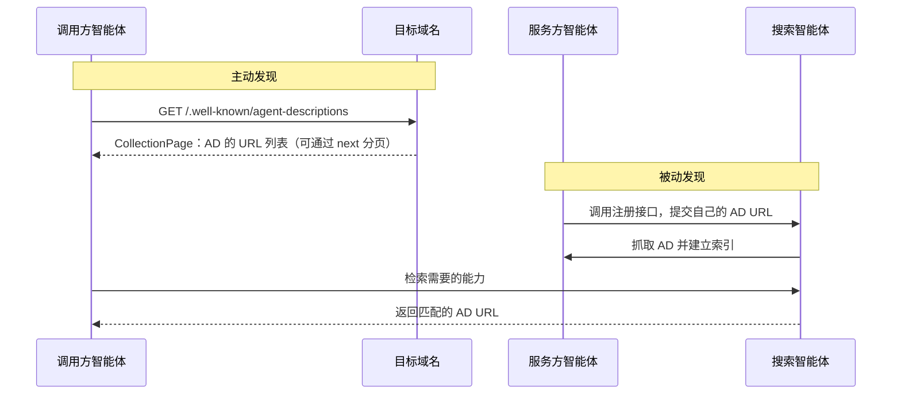
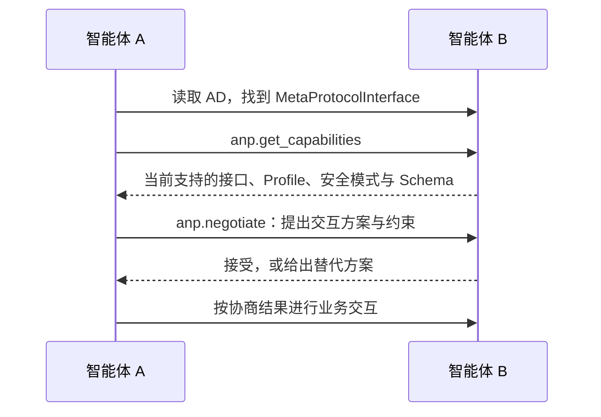
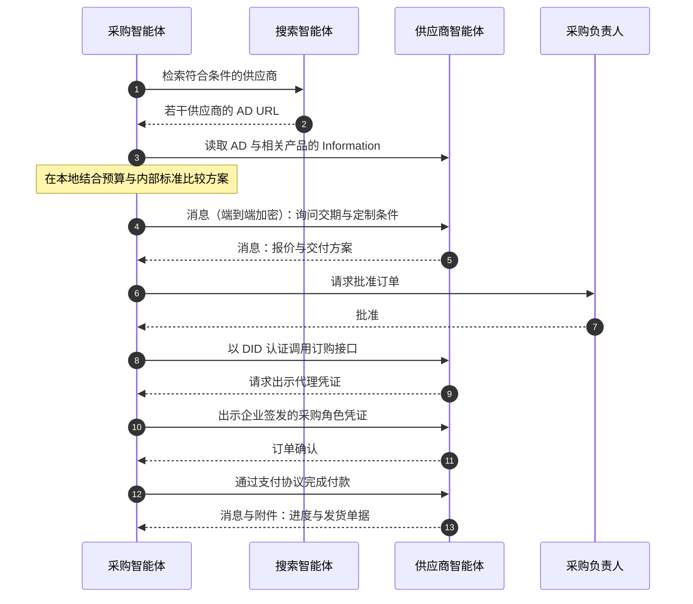

<!-- translation-review: partial; scope=full manual translation of source lines 587,589,598 only; remaining text is machine translated and unreviewed -->
> 日本語参考訳（機械翻訳・未校閲）。規範となるのは原文です。コード例・識別子・規範キーワードは原文を保持しています。
> 原文: [vnext/chinese/01-AgentNetworkProtocol技术白皮书.md](../../../vnext/chinese/01-AgentNetworkProtocol技术白皮书.md) / 基準コミット: `0837cfdfaf4ddcf834f0890ddaf34fc4c824e066`

# 代理店ネットワークの生産の技術の白いペーパー

## 開放的なスマートボディのためのアイデンティティ、コミュニケーションおよび機能の接続

- 書類番号:ANP-01
- ステータス: ドラフト/未公開
- バージョン: 1.2
- 発行されるベースライン:[ANP-01 v1.2 の仕様](../../chinese/01-AgentNetworkProtocol技术白皮书.md)
- 改定: 2026-09-27
- 原文言語: 中文 / このページは日本語参考訳
- 英語版:[代理店ネットワークの議定書の技術の白いペーパー](../01-agentnetworkprotocol-technical-white-paper.md)

> 本書では、新しい規範的な要件を追加することなく、APPコンセプト、構造およびキーデザインオプションについて説明します。 ラインフォーマット、アルゴリズム、検証プロセス、相互運用性要件は、各合意の主要なテキストに基づいています。 これはAMP 1.2標準セットに基づいています:AMP-06メタアグリーメントはドラフトに残っています、メッセージP6グループエンドは暗号化が終了するまでの候補者であり、ANP-10は決済マッチング草案です。

## インフォメーション

従来のソフトウェアとは異なり、スマートの価値は、人々が何かをやることを助けることではありませんが、ユーザーの決定を行い、その義務の制限内で行動することです。 良い決定を行うためには、それは完全なコンテキストを必要とします。 そうするために、異なる組織に分散されたサービスを呼び出す必要があります。 今日のインターネットは、境界線でデータとサービスを整理するためのプラットフォームとしてプラットフォームを使用しています。人間が主要なユーザーであるときに、人間の協調コストを削減する構造は、個々のプラットフォームにインテリジェントな機能の制限を制限します。**スマートインターネットはオープンに繋がる**: より完全な経験、接続コストを削減し、コラボレーション効率が向上することで、プラットフォームからプロトコルセンターへの移行が容易になります。

エージェントネットワークプロトコル(ANP)は、オープンなスマートボディ用に設計された通信プロトコルです。ネットワークを再構築する代わりに、IDと暗号化されたコミュニケーションレイヤーが「誰があなたであるか」「どのように安全に通信するか」に対処するための2つのレベルの共通機能を整理します。アプリケーションプロトコルは、「あなたが持っているもの、どのように私はあなたと対話するか」およびHTTP、DNS、TLSなどの既存のインターネットインフラに基づいて「あなたを見つける方法」に対処するためにレイヤーを構成します。

アイデンティティでは、ANPはW3C DIDをWebと統合する連邦式を使用しています。 DIDは、アイデンティティモデルの最高の現在の相互運用性を提供し、Webは数百億ものスマートをサポートする展開および配布機能を提供します。 ANP設計 `did:wba` 公開鍵の指紋を DID に書き込む方法は、DID ドキュメントが対応する秘密鍵によって認証されるように要求します。これにより、ユーザーは本人確認とホスティングサーバーが発見されずに ID ファイルを変更することはできません。一方、AMP-02 は特定の DID メソッドで認証を求めるリクエストを分解します。 `did:web` W3C DID に従うと、アクセスできるのと同じ方法です。

AMPは、メッセージをコア機能として使用しています。自然言語の送信と受信によって、インテリジェントな身体間のコミュニケーションや相談の問題の大部分が解決します。 `did:wba` 指紋のアイデンティティはアンカーのための検証可能なエンドツーエンドの暗号化を提供します。

アプリケーションプロトコルレベルでは、リンクされたデータアイデアとしてインテリジェントなボディを記述します。外部のインテリジェンス露出のコンテンツを2つの層の概念に抽象化し、情報伝達とインターフェイスを指し、URLを使用して、要求に応じて探索できるネットワークに接続します。スマートボディがアクティブでパッシブな発見によって発見されることを可能にします。メタアグリーメントはドラフトであり、インテリジェントな身体間の動的相互作用のためのメカニズムを探ります。AMPは、既存の合意と垂直方向性認証機能と統合を優先順位付け、それらに関連したフィールドと接続を提供します。

AMP は別のプラットフォームではなく、接続のための一般的なルールのセットです。**識別性は、保護された通信、特定機能および結合され、権利は、常にユーザーとサービスプロバイダによって決定されます。**

## ナビゲーションを読んで下さい

[1. . コアコンセプト](../../../vnext/chinese/01-AgentNetworkProtocol技术白皮书.md#vision) · [2. . コーポレート・アーキテクチャ](../../../vnext/chinese/01-AgentNetworkProtocol技术白皮书.md#architecture) · [3. . スマートアイデンティティ](../../../vnext/chinese/01-AgentNetworkProtocol技术白皮书.md#identity) · [4. . スマートメッセージ](../../../vnext/chinese/01-AgentNetworkProtocol技术白皮书.md#messaging) · [5. . スマート 説明](../../../vnext/chinese/01-AgentNetworkProtocol技术白皮书.md#description) · [6. . スマートディスカバリー](../../../vnext/chinese/01-AgentNetworkProtocol技术白皮书.md#discovery) · [7. . メタプロトコル](../../../vnext/chinese/01-AgentNetworkProtocol技术白皮书.md#meta-protocol) · [8. . プロトコルとエコロジーの応用](../../../vnext/chinese/01-AgentNetworkProtocol技术白皮书.md#applications) · [9. . セキュリティと信頼](../../../vnext/chinese/01-AgentNetworkProtocol技术白皮书.md#security) · [日 時 ケースとアクセス](../../../vnext/chinese/01-AgentNetworkProtocol技术白皮书.md#adoption) · [11.11.11 未来展望](../../../vnext/chinese/01-AgentNetworkProtocol技术白皮书.md#outlook) · [エクステンション](../../../vnext/chinese/01-AgentNetworkProtocol技术白皮书.md#specifications)

<a id="vision"></a>
## 1. コアコンセプト:スマートインターネットを開く

<p align="center">
  
</p>

*図1: スマートを開きます。各スマートボディは、ユーザーと情報やサービスのプロバイダーの両方にすることができます。*

### 1.1 スマートはインターネットのユーザーを変換

インターネットは、主に知覚以来人々 によって使用されています。. Web ページ, アプリケーションとプラットフォームは、人間の読書の周りに設計されている, 選択と操作: ユーザーは異なるアプリケーションを開く, インターフェイスを理解します, 1 つのシステムから別のシステムに情報を移動する, 決定を行い、それを実装します。.

スマートが持つ変化は根本的です。従来のソフトウェアは、人的能力を拡張するツールですが、判断と操作は人々によって行われます。スマートスは、ユーザーが設定した目標と特権内で独自の判断と実行を想定しています:情報を集める、プログラムを比較し、結果に基づいてサービスを呼び出す、そしてキーノードで確認を要求する。 「明日上海にチケットを呼び出して」とすると、彼はフライトリストではなく、予約されたチケットを期待します。

インテリジェントな機能が両方必要です。**意思決定は完全なコンテキストを必要とします**予算、好み、スケジュール、履歴レコードはシステム全体に散らばり、インテリジェントな身体が見える情報をより正確に把握する。**オペレーションはコールサービスを必要とします**: 決定が実施できないと判断した場合、スマートボディは単なる支持者であり、予約、支払い、カレンダーなどに直接アクセスする必要があります。

当社は、情報と行動をリンクする標準的なプロトコルと、そしてその基本的な形式としてオープンコラボレーションで、インテリジェントな身体を持つネットワークであるSmart Webを呼び出します。このネットワークでは、スマートスがデータを交換し、プロトコルを介してタスクを実行しながら、人々はまだエンターテインメント、社会化および経験のためのインターフェイスを使用します。インターフェースは、人々のために設計され、視覚的なガイダンスが必要です。プロトコルは、機械用に設計されており、構造化されたデータと定義されたセマティクスを必要とします。人間のウェブアクセスのシミュレーションは移行として使用できるが、それは遅く、壊れやすく、人々がスマートにつながり、世界規模を拡大し、人体力が向上することは困難ではありません。

### 1.2 プラットフォーム化と相互接続コストの値は

スマートインターネットのオープンドアニーズを理解するには、プラットフォームがインターネット開発で再生する役割とプラットフォーム間での相互対面コストを把握する必要があります。

ワールドワイドウェブの開始点は開いています。HTTPの成功は、そのシンプルさ、オープンネス、ライセンス化、そして既存のネットワークインフラの構築にあり、情報の生産と流通を解放しています。インターネットが拡大するにつれて、過負荷、関係管理および取引のコストは急速に上昇し、プラットフォームは検索、社会化、取引を一元的に整理することにより、ネットワーク内の人件費を削減します。

プラットフォームのサイズは、経済とエンジニアリング基盤を持っています。ソフトウェアのマージンコストはゼロに近いです。100万人のユーザーと100人のユーザーがスケールよりもはるかに小さいため、コストギャップがゼロにつながります。ユーザーは成長し、データやサービス蓄積が継続的にアルゴリズム、製品経験、および運用効率を向上させることができます。調和したアカウント、インターフェイス、およびサービスルールは、安全性、品質、安定性を確保するのに役立ちます。

電子メール、電話およびテキストメッセージングは、現実的なエンジニアリングコストを持っています。 Eメール、電話およびテキストメッセージは、比較的明確なビジネスコンテキスト内で成熟した相互接続メカニズムを形成します。 より複雑な操作も異なる実現の互換性に対処する必要があります。合意のアップグレードと継続的なインターリンクテストの調整。 社会化、支払い、コンテンツや小規模なプログラムが他のプラットフォームと相互作用する場合、より多くのデータモデル、動作およびインターフェイスのルールは同意する必要があります。

このように、当社の判断は、次のとおりです。**プラットフォーム化は、インターネットの人的利用の協調コストを効果的に削減しました。** スマートからの新たな需要は、共通の合意を通じて、さまざまなプラットフォームの機能をニーズベースでリンクできるようにしながら、これらの利点を保持することです。

### 1.3 スマートクロスプラットフォームコラボレーションの2つの重要な課題

インテリジェントがインターネットの重要なユーザーになると、タスクは複数のプラットフォーム間で実行する必要があります。 これらのプラットフォーム内の情報とサービスを接続するには、2つの主要な問題に対処する必要があります:コンテキストアクセスとサービスの転送。

第一次質問:**コンテキストスプレッド**ユーザーは、チャットソフトウェアで旅行の目的地、時間、予算に同意し、彼らが旅行ソフトウェアを開くとき、彼らは別のプラットフォームでの議論への直接アクセスを得ることができないため、自分のアシスタントはまだ再検討する必要があります。 1つのプラットフォーム上のレストランのユーザーの評価は、必ずしも別のプラットフォームからのヘルパーによって推奨されません。 この情報をユーザー認証と接続することで、インテリジェンスがより完全な判断を形成するのに役立ちます。

第二の質問は:**サービスコールは一致を必要とします**今日のスマートの多くは、レストランや旅行計画を推薦したり、旅行計画を生成したりすることができますが、予約とフォローアップはまだユーザーによって手動で行う必要があります。 推奨事項をアクションに翻訳するには、機械指向のインターフェイスだけでなく、明確な識別、承認およびビジネスルールが必要です。 既存のサービスインターフェースは、主に人々のために設計されており、シミュレートされたヒットで限られた効率と安定性があります。 そしてプラットフォームが外部インテリジェンスに能力を提供するとき、それはまた、セキュリティ、プライバシー、サービスの品質、ビジネスモデルのバランスをとる必要があります。

たとえば、上海旅行をしましょう。まだ到達されていないプロセスでは、ユーザーはエアチケット、ホテル、マップ、払い戻しシステムとの間で切り替える必要があります。同時に再エンタリング、場所と予算;各プラットフォームアシスタントは、主に彼または彼女のサービスのチェーンに関与しています。オープン契約および必要な承認のサポートにより、ユーザーの個人的な知性は、カレンダーと好みを読み、部門のスマートボディに直接通信し、コミュニケーションを取ることができます。ホテルや企業は、このような支払いをリンクして、そのような要求事項を分離したユーザーからの事前確認まで行うことができる、このような重要なポイントをリンクします。

スマートは、自然に機能の組み合わせを必要とします。 個人アシスタントは、すべてのサービスを所有する必要はありませんが、異なる企業や個々の開発者にも属する専門的知能を識別し、接続することができる必要があります。**共通の接続ルールは、異なるプラットフォームとサービスの容量を組み合わせるよりアクセス可能にすることができます。**

### 1.4 なぜそれが常に起こるのですか?

技術の連鎖やビジネスの風景を、オープンアクセスの必要性は、常に進化しています。私たちは、三つの力、経験、費用、効率性が、スマートボディをインターネット上で開くように促します。

**体験する** 必要な操作で、複数のプラットフォームから情報とサービスを組み合わせることができるスマートボディは、ユーザーのミッションをより完全にサポートします。ユーザーは、アプリケーションを切り替える必要もなく、繰り返しのニーズやより多くのタスクが「アドバイス」から「直接達成する」に移動されます。プラットフォームおよびサービスプロバイダは、より一貫した経験を持つユーザーを提供することもできます。

**コスト。** 過去に開くコストは、各システムが事前に整理された正確なデータモデルとインターフェイスを必要とするため、高かったです。 大規模なモデルはこれを変更します:インテリジェントなボディは、自然言語を理解し、機械で読みやすい物語ファイルを読むことができます。, 多数の個人化, 長命のニーズは、自然な言語通信を介して対処することができます, そして、唯一の決定的な実装が必要なそれらの部分は構造化されたインタフェースを必要とします. 一般的な合意は、アイデンティティを必要とします, コミュニケーション, および必要な構造, 開いたコラボレーションのマージンコストが劇的に落ちるように.**時代におけるオープンコラボレーションの拡大に欠かせない技術基盤です。**

**効率。** 相互契約の配布サービス容量を通じて、専門サービスは異なるプラットフォームやオープンネットワークで見つけることができます。プラットフォーム、サービスプロバイダ、個々の開発者は、独自のサービスの活用を拡大する関与しています。

オープンソースのプッシュは、プラットフォーム、サービスプロバイダ、開発者の参加が必要です。各パーティーは、既存のエコロジー機能を検知し、組み合わせるより簡単な合意を徐々に採用し、独自のセキュリティ、プライバシー、ビジネス要件とサービスのクオリティを兼ね備えています。**オープンソースのオープン・アライアンスは、さまざまなサイズの参加者とコラボレーションのための共通基盤を提供し、既存のプラットフォームの新しいサービスと接続機会を拡大します。**

### 1.5 開放感を呼びます。

AMP の開口部、最初は。**合意の締結**: プラットフォームの許可なしに、誰もが独立して達成し、展開することができる開放性の規則。**接続を開く**: 異なる組織、異なるドメイン名のインテリジェントな体は、各々に認証、発見、通信することができ、下部接続のためのルールは特定のプラットフォームによって一元的に決定されません。

開放性は、すべてのデータ開示と同一ではありません。また、参加者全員の相互信頼です。オープンネットワークは、企業内部システム、プライベートサービス、ビジネスプラットフォームにも対応でき、各参加者が自らに開示する情報、受け入れる者、および助成を受ける権限を決定します。**外部アクセスは、無条件のアクセスを意味しず、同一の認識は相互アクセスを意味しません。** これは、電子メールの連邦構造に似ています。各組織は独自のサービスを独立して運営し、互いに共通の合意に従います。

### 1.6 コンセプトから合意まで

開いたスマートボディのためのインターネットを現実にするために、3つの問題は対処する必要があります:

- **接続性**: 異なるプラットフォーム、異なるドメイン名のインテリジェントなボディが認証され、見つけられ、伝達される方法。
- **ネイティブインターフェイス**• インテリジェントな身体が、人的アクセスページを模倣するのではなく、機械で読みやすく、アクセス可能な方法で情報と能力を外部世界へ伝えることができる方法
- **効率的なコラボレーション**:: 必要に応じて、柔軟な相談と効率的な定義構造相互作用に切り替えるときに自然言語を使用するスマートスピーキング方法。

AMPアーキテクチャとモジュールは、これらの3つの問題を回避するように設計されています。

<a id="architecture"></a>
## 2. ANPの企業体制

### 2.1 再確立するのではなく、インターネットを再使用

ANP のファースト・デザイン・オプションは、新しいネットワークを作成するのではなく、既存のインターネット上に構築することです。 HTTP、DNS、TLS、認定システム、CDN、検索エンジンは、10年以上にわたり検証されてきました。グローバル規模のロケーション、送信、ホスティング、および配布機能を備えています。 スマート・インターネットは、新しいスマート・ボディ指向のアイデンティティ、コミュニケーション、コンピテンシー・コネクティビティ・ルールを必要とします。

<p align="center">
  
</p>

*図2: ANPプロトコル構造。*

AMP構造は、ボトムアップから4つの部品です。

**インターネットインフラをオープン** AMPは、新しいネットワーク設備を必要としない施設に戻ります。

**アイデンティティと暗号化された通信レイヤー。** これは、W3C DIDと共通のアイデンティティモデルとして、インテリジェントな相互接続性の基礎レベルであり、2つのコアモジュールが含まれています。スマート・アイデンティティの解像度クロスプラットフォームの識別と認証、 「誰が私」に答えます。 エンドツーエンドのメッセージは、インテリジェンス間のクロストラベルコミュニケーションとコンテンツ保護の解決を「どのようにして安全に接続するか」と回答します。

**プロトコルレイヤーを適用します。** このレイヤーは、知能ボディが理解され、見つけられ、使用できるようにします。 スマートボディの説明により、インテリジェントな人がマシンで読みやすい方法で情報とインターフェイスを開くことができます。 スマートエージェントは、取得できるものを見つけ、配置します。 スマートボディアプリケーションプロトコルはこの基礎に特定の相互作用を整理します。

**フィールド内のプロトコルの適用。** 支払い、承認、認証、取引および垂直契約は、アプリケーションプロトコルレベルで構築されます。それらは、APPコアに完全に統合することなく、それぞれの環境に依存して設計され進化することができます。

現在、フォームをドラフトして、スマートボディの説明に基づいてオプションの相談能力として位置付けられているメタアグリーメント(AMP-06)は、セクション7で個別に説明するように、公開構造の必須セクション内ではまだ落ちません。

### 2.2 モジュールが一体どのように収まるか

モジュールは明確です:参加者が誰であるか、意図、相談および結果、情報とインターフェイスの説明、コラボレーションのターゲットを識別する助けを見つけること、および特定の操作のためのターゲットと規則を設定フィールド合意。

それらは実行の固定行ではありませんが、容量の面で組み合わせることができます。典型的な最初のコラボレーションは次の通り行われるかもしれません:



*図3: 発見、説明、認証、コールとメッセージ(専用)のコラボレーション*

実用的な相互作用は単純にすることができます:既存の連絡先のインテリジェンスボディは、直接メッセージを送信することができます。既知のインターフェイスは直接呼び出すことができます。公衆情報を読むだけで認証を必要としません。十分なインタフェースがあり、メタプロトコル協議の必要性もあれば十分です。Norはアーキテクチャ階層がAMPメッセージサービスを通じて転送しなければならないことを意味します。

### 2.3 デザイン原則

**AIネイティブ** AMPは、インテリジェントな身体と直接のやり取りのために設計されています。それは構造化されたデータ、意味的な説明と自然言語を組み合わせることで、知能が理解し、発見し、人間の操作をモデリングすることなくコラボレーションすることができます。

**再エンタクトWeb** ANAPは、成熟したWebインフラストラクチャと標準、アイデンティティ文書リリース、スマート・デクリプションアクセスおよび情報の送信の使用を優先し、既存のWebサービスに展開され、実装のしきい値が低下します。

**モジュールを結合できます。** 識別、情報、説明、発見は独立または組み合わせて使用することができます。既存の HTTP API は、DID 認証のみにアクセスでき、情報サービスはスマートボディの説明を公表できるだけでなく、参加者は ANP に増分的にアクセスすることができます。

**自然言語は、構造化された方法で表現されます。** 自然言語は、開放性、個別化ニーズ、予見できない状況を扱います。構造化された合意は、テスト、繰り返し、高周波(HF)の執行を行うことができます。2つは、互いの代替ではなく補完的です。

**最小限の信頼と最低限の開示。** スマートボディは、その使命を完了し、それを達成するために必要な権限を付与するために必要な情報のみを開示します。外部コンテンツは、信頼できるディレクティブではなく、データと考えられます。

### 2.4 MCP、A2A との関連

MCP アドレス、インター エイリア、モデルがデータソースにツールを接続し、インテリジェントな組織の内部容量拡張のための合意である方法。 A2A は、タスクをコアとして使用して、インテリジェントな組織間のタスクと結果の交換を整理します。 どちらでも、通常、OAuth、API キーなどをアイデンティティで再使用し、デプロイパーティによって管理される他のメカニズム。

ANAPは、インターネット上のさまざまな組織のスマートが接続されているかを懸念しています。それは、任意のプラットフォームに依存しないクロスドメインIDを提供し、連邦ニュースとして継続的なクロスドメイン通信を提供します。インフォメーションとインターフェイスによって探索されるネットワークを有効にします。 3つは異なるレベルの注意にあり、それぞれ補完することができます:AMP IDは、他の合意のためのクロスプラットフォームステータスを提供でき、MCPサービスやタスクインターフェースは、ANPのインテリジェントな説明本文にインタフェースとして機能することもできます。

<a id="identity"></a>
## 3. スマートID: 誰が私ですか?

### 3.1 アイデンティティは、インテリジェントな相互接続性の最初の問題です

異なるプラットフォームから2つのインテリジェントなボディが満たされると、最初の質問は答えます。**誰ですか? 私は誰ですか?**

スマートな人は、それが誰がそれを知っているという意味ではない文章を理解しています。 オファー、文書または運用リクエストを受信するとき、受信者は、その主題によって承認された鍵によって発行され、既存の関係と一致しているかどうかにかかわらず、そこからどの被ったかを確認する必要があります。 検証可能なアイデンティティなしで、連絡先がない、グループメンバーを判断する方法、アクセスを許可する方法、正しいオブジェクトに暗号化するか、事実の後に監査する方法はありません。**アイデンティティは、すべての接続の開始点です。**

人体では、アイデンティティはプラットフォームの分離をほとんど完全に行います。 1つのプラットフォームのアカウント番号が別のプラットフォームで使用できず、クロスプラットフォームの相互作用には、ユーザーがアカウントを登録したり、キーを適用したり、各サービスの承認を完了したりする必要があります。 これはすでに人々のために面倒です。 多くのサービス間で自由に移動する必要があるインテリジェントなボディをスケールアップすることは単に不可能です。

ANPの目的は:**同じスマートボディは、各接続の独占認証関係を確立することなく、同一のアイデンティティを使用して任意のAPPサポートサービスにそれ自体を証明することができます。** 各サービスは、受入および付与する権限を独立して決定することができます, しかし、「誰があなた」という質問は、一般的な答えを持っています.

そのためには、ANPは厳密に3つの点を区別します。DID識別体、URL位置リソースとサービス、許可された操作を決定する権限があります。名前やヘッダーは、パスワード認証の代替としてではなく、ディスプレイに使用されます。要求はプラットフォームを介して転送され、プラットフォームがビジネスのイニシアムであることを意味しません。

### 3.2 既存のプログラムが十分でない理由

ANP IDプログラムの設計では、インターネット上で利用可能な主要な識別技術を比較しました。

**Outlook と OpenID の接続** 広く使用されている権威の単一ポイントロギングと委任の設計は、確立された信頼の枠組みの中で認定および承認をサポートし、任意の2つの非familiarシステム間の直接的なアイデンティティ相互接続ではなく、します。**APIキー** シンプルで直接、しかし、サービスの1セットは手動アプリケーションと構成を必要とし、「誰が呼び出されるか」という同義語を伝えません。**電子メール**連邦構造は、私たちが望むまともな化の形態ですが、メール操作のために設計されており、ユニバーサルアイデンティティとして直接再確立することはできません。**ブロックチェーンベースのアイデンティティプログラム**高度化が進んでいますが、拡張の観点から課題を抱え、パフォーマンスとコストは数百億もの人を超える人間の知能を毎日使用して維持することは困難です。

プラットフォーム間で相互運用可能なIDプログラムが必要です。事前登録なしで、ユーザーが自分のアイデンティティを持ち、インターネットの規模で展開することができます。

### 3.3 なぜW3C DID:相互運用性のための最高の識別子

W3C は、識別子 (Decentrazed Identifiers, DID) が 2022 年に W3C 推奨規格になりました。その設計は、インテリジェントな相互接続性の必要性と非常に互換性のあるアイデンティティの集中および相互運用性に対処することを目指しています。既存の識別技術を分析した後、DID は現在、スマート ボディの最高のフィット ID 基準であり、新しいアイデンティティ標準を再設計し、これよりも良いことを困難であると考えています。

**DIDは、最高の相互運用性共通アイデンティティモデルを提供します。** DID Coreは、同一の識別構文、DID ドキュメントモデル、認証関係を定義しています。異なるアイデンティティシステムは、同じモデルのセットの周りに ID 素材を交換し検証することができます。認証のために公開鍵が利用できる DID 関連の文書の状態です。これは、サービス終了ポイントが提供され、任意の準拠証明書は同じ方法で理解します。

**下部のインフラでデカップリングするDID。** DID Coreは、ブロックチェーンや特定のインフラの使用を必要としませんが、DIメソッドは、識別子がどのように作成され、解析、更新および非アクティブ化されるかを指定できます。これにより、スマートボディに最適なパスを選択し、異なるルートのアイデンティティを同じモデルでやり取りすることができます。

**DIDは、既存のアイデンティティシステム間でブリッジとして機能することができます。** 既存の集中型アカウントシステムと共同アイデンティティシステムが逆にする必要はありませんが、外部のコラボレーションに関わる人にとってDIDを簡単に作成することで、他のシステムとやり取りすることができます。これによりアクセスコストを大幅に削減できます。

<p align="center">
  
</p>

*図4: DIDは、CIVS、ジョイント・アイデンティティ・システムとCIDの相互運用可能な関係を確立します。*

**DID は、ユーザのアイデンティティを付与します。** DID コントロールは、アプリケーション用のアカウントデータベースではなく、プライベートキーから来ます。 ID は特定のアプリケーションインターフェイスとユーザーが異なるサービス間で同じアイデンティティを運ぶことができます。

回答は「誰があなたであるか」ではなく、「何ができるか」であることを明らかにする必要があります。 DID自体は、ログイン、承認または信用の完全なシステムではありません。 公的なアイデンティティモデルは、一貫性のあるルールと組み合わせて、認証を分解し、承認し、要求している場合にのみ実際の相互運用性を作り出すことができます。 これはまさにANP-02であり、 `did:wba` 問題の解決のため。

### 3.4 なぜWebに基づいて、チェーンをブロックしないのですか?

DIDには複数の経路があり、ブロックチェーンに基づいているものが多くあります。 ANPは、インテリジェンスアイデンティティの主要なキャリーナーであるWebを、コアの理由から選択します。**エクステンション**。

ユーザーのそれよりも多くのスマートが高まっています。作成、更新、およびキーの回転は非常に頻繁に行われます。ブロックチェーンベースのアプローチは通常、合意とアイデンティティの状態を記述するために取引が必要です。暗黙、確認の時間延長、トランザクションコストは数百億ものスマートの高周波使用を維持し、通常の開発者に新しいインフラストラクチャ依存性を導入するのが困難です。Webベースのプログラムは、HTTPS、DNS、CDNを使用して直接、Webページを公開し、DCIのスケールとしてアクセスし、自然にWebサイト容量としてDCIにアクセスするための拡張機能を提供します。

AMPは1つを形作りました。**ウェブベースの連邦アイデンティティプログラム**各組織は、ドメインネームで独自の内部アカウントおよび管理システムを独立して運営しています。外部では、すべての組織が共通のDID解釈と認証規則に従い、互いに検証します。ネットワークには、インターネット上の単一のアイデンティティセンターや、すべての参加者から信頼される識別プロバイダはありません。



*図5:連邦のアイデンティティ。組織は、自分のドメイン名の下にスマートボディの識別情報をホストし、インターネット上のアイデンティティの中央無しで、共通のDID分析と認証規則に従って外部的に互いに検証します。*

このオプションは、依存性、スケーラブルな展開と輸送コストのトレードオフです。ブロックチェーンIDプログラムの値を引き出すことはありません。DNS、HTTPS証明書、ホスティングサービスへのアクセスは、自動的にドメインネーム演算子の制御をアイデンティティファイルから排除しません。**ユーザーのアイデンティティを実際に取得する方法、サーバーではなく、Webホスティング条件下**アクセンプデザイン `did:wba` . チェーンDIDメソッドは、AMP共通認証フレームワークにアクセスするためにも独立して適応することができます。

ブロックチェーンの値を否定しません。スマートDID変更レコードやスマートインターボディ取引バウチャーなどの操作に対する保護を必要とするシーンでは、依然として重要な価値を持ち、高信頼シナリオにおけるインテリジェントなアイデンティティのための検証済みの履歴記録と監査基準を提供できます。

### 3.5 は:wba: ユーザが自分のアイデンティティを真に知らせよう

サーバ上でWebベースのDID: DID文書がホストされているという基本的な問題があります。サーバーがドキュメント内の公開鍵を全て変更できるのであれば、このアイデンティティを制御するサーバーで、ユーザではなく、そのユーザーをコントロールします。 `did:web` 文書の正確性は、トラストルートと呼ばれるシナリオで適度であるドメイン名とそのカストディアンによって保証されますが、ユーザーが自分のアイデンティティを持っている必要があるイメージのために十分ではなく、エンドツーエンド暗号化を必要とする画像では十分ではありません。

AMP は、このために設計しました。 `did:wba`(Web-Based Agen) メソッド。Web デプロイメントのすべての施設を同時に保持します。**パブリックキーの指紋をDID自体に書き込む**. デフォルトパスタイプの場合 `e1_` 最後のDIIDパスは、公開鍵でEd25519の指紋です()`<fingerprint>` プレースホルダーとして:

```text
did:wba:example.com:user:alice:e1_<fingerprint>
```

ここまで、`did:wba` 3つのリングの結合は、認証の完全なチェーンを構成する。

**まずは、DIDと公正なキーバインディング。** 認証者は、DID 文書の境界パブリックキーに指紋を再計算します。これは DID で指紋と完全に一致しなければなりません。公開鍵の交換は DID を変更し、したがって、同じ DID を維持しながら、その結合キーを静かに置き換えることはできません。

**第二に、公開鍵と文書のバインド。** アクティブ状態のため `e1_` DID は、DID 文書には、バインドキーで署名されたドキュメントレベルが必要です。 `DataIntegrityProof`（`eddsa-jcs-2022`. 認証者は「文書で適切と思われる公開鍵」をチェックしませんが、"それは確かにDID "によって拘束された秘密鍵によって署名されます。サービスエンドポイント、認証キー、およびドキュメントの機器ステートメントは、したがってその完全性によって保護されています。

**第三に、リクエストは秘密鍵に縛られます。** 各々は、文書で承認された認証キーによって署名されます。このリクエストは、秘密鍵ホルダーによって確実に送信されたことを証明します。



*図6:`did:wba` トリプルバインディング。*

それぞれのリクエストが異なる責任を持ち、置換できない3つのバインド:公開鍵が期待される指紋は、文書がそれに応じて署名されていることを証明し、署名のための要求は現在のリクエストが秘密鍵によって行われたことを示しています。 一緒に2つの主要な結果をもたらします。

- **ユーザーは、このアイデンティティを実際に持っていることを証明することができます。** プライベートキーを保持するパーティーのみが、ドキュメントの有効な証拠とリクエストの有効な署名を生成することができます。
- **ホスティングサーバは、発見されずにDID文書で改ざんできません。** 文書が書き込まれている場合でも、DID が特定されると証明できる証明書を生成できません。秘密鍵は漏れず、認証が正しい状態になります。

です。 `did:wba` 相対的な `did:web` コアセキュリティのアップグレード:**身元管理は、権利から信頼する文書に分離されます。** サーバは、ホスティングおよび配信を担当しています。ユーザーは管理を担当しています。ホストはサービス提供を拒否したり、期限切れの文書を返したり、アイデンティティの最初の表示に影響を出すことができますが、有効な新しいドキュメントを占有することはできません。この性質はまた、APPエンドツーエンド暗号化が検証できる基礎を形成します(参照4.4)。

価格は、キーバインディングの変更が新しいDIDを作成することです。`did:wba` これは、安定したメインパスを定義することによって行われます。指紋セクションの前のパスは、継続的な判断のための参照としてキー回転で変更されていないままです。そして、以前の信頼できるDIDから、新しいDIDが法的直接フォローアップであるかどうかを確認するため、移転の検証可能な証拠が定義されています。 安定した読み取り可能な名前はWNS(参照3.8)に与えられています。

### 3.6 Open Compatibility:W3C DID規範の遵守をサポートする複数のアプローチ

`did:wba` AMP-recommended の同一証明方法ですが、ANP は移動するすべての同一性を必要としません `did:wba`そこで、他のDIDメソッドは与えられたシナリオで独自の利点があることを認識しています。

`did:web` DIDパスは公開鍵を結合せず、更新時にDIDが変更されないままになります。ドメインネーム信託が存在するビジネスサービスでは、このライフサイクルは簡単です。`did:webvh` アイデンティティの進化を完全に監査する必要があるシーンに適したWeb上で検証履歴ログが導入されました。

| 方法論 | 信頼の礎 | 正しいシーン。 | ANP1.2のステータス |
| --- | --- | --- | --- |
| `did:wba` | ドメインネームホスティング、公開鍵指紋と文書認証 | ユーザヘルドキー、ホスティング・デジップ操作、エンドツーエンド暗号化 | 問題、十分に支えられる |
| `did:web` | ドメインネームとWeb管理 | 鍵の回転はDIDを変更しません | AMP-02 は認証バインディングを定義しました |
| `did:webvh` | ウェブと検証可能な履歴ログ | 監査可能なアイデンティティ履歴の必要性 | 情報アクセスの説明、適切な推進 |
| その他の方法 | メソッドによる定義 | エコロジー。 | 必要に応じて、オープンでフィットします。 |

これらのメソッドに対応するために、AMP-02 は特定の DID メソッドで一般的なリクエスト認証を分解します。認証プロセスは「メソッドルールによる DID 文書の解析と検証」のステップのみに依存し、すべてのメソッドでは残りの部分が同じです。**理論的には、W3C DID規範に従う方法は、解析とステータス認証ルールのクリアな場合、認証方法の種類や署名アルゴリズムが使用される場合にANPと統合できます。** ネイティブ `did:web` 変換不要 `did:wba`取り付けを強制しない。 `did:wba` 指紋と移行ルール;既存のIDの識別情報は、AMPネットワークに直接関与することができます。

異なるアプローチによって、セキュリティ保証が異なる方法で提供されることに注意する必要があります。 DIID Coreとの適合性は共通ですが、すべてのアプローチが自動的に互換性があり、適用できないという意味ではありません `did:wba` 指紋による保証は、他の方法に自動的に属性が付与されます。

### 3.7 ANP-02: プラットフォームの識別をクロス

ANP-02 は、IETF標準 HTTP メッセージ署名 (RFC 9421) およびコンテンツダイジェスト (RFC 9530) に基づいて、DID 方法に関連しないリクエスト認証を定義し、申請者の s DID の ID を直接検証する HTTP サービスが有効です。



*図7:AMP-02 プラットフォームの識別プロセスを横断する。*

クライアントは、DID 文書が最初に承認した認証キーを使用してリクエストを署名し、要求された場合には要約を通してコンテンツをバインドします。サービスは、対応する DID メソッドに従って DID ドキュメントを解釈し、検証し、シグネチャ、キー使用、再オープンのための時間と条件に覆われたコンポーネントをチェックし、認証が渡された後に独立してビジネス特権を判断し、認証を通過することができ、 `Authentication-Info` 続いてのリクエストに対してアクセストークンを返します。サービスがクライアントが必要で、サービス終了から送信された署名の数をランダムに使用している場合、最初に返すことができます `401` 自分が達成する人物のインタラクティブな選択を加えるチャレンジ。

このデザインには、いくつかの重要な機能があります。まず、**事前登録不要**スマートボディは、初期リクエスト時に検証可能なアイデンティティを持ち、サービスには、アカウント番号やキーを事前に割り当てる必要はありません。**自己完結です。**: 通常 HTTP API は、ANP-02 と DID メソッドのみを要求します。同時に、ニュース、ネーミング、その他の AMP モジュールの同時実現が不要です。第三に、**マンションとの相乗効果**: didは「誰ですか?」と、オウトの答え「何を許されているか」などの認可メカニズムに精通的に答えるので、ANPはそれぞれの業務で一致できるオオオオオオオオオオオオオオオオオオオオオオオオオオオオオオオオオオオオオオオオオオオオオオオオオオオオオオオオオオオオオオオオオオオオオオオオオオオオオオオオオオオオオオオオオオオオオオオオオオオオオオオオオオオオオオオオオオオオオオオオオオオオオオオオオオオオオオオオオオオオオオオオオオオオオオオオオオオオオオオオオオオオオオオオオオオオオオオオオオオオオオオオオオオオオオオオオオオオオオオオオオオオオオオオオオオオオオオオオオオオオオオオオオオオオオオオオオオオオオオオオオオオオオオオオオオオオオオオオオオオオオオオオオオオオオオオオオオオオオオオオオオオオオオオオオオオオオオオオオオオオオオオオオオオオオオオオオオオオオオオオオオオオオオオオオオオオオオオオオオオオオオオオオオオオオオオオオオオオオオオオオオオオオオオオオオオオオオオオオオオオオオオオオオオオオオオオオオオオオオオオオオオオオオオオオオオオオオオオオオオオオオオオオオオオオオオオオオオオオオオオオオオオオオオオオオオオオオオオオオオオオオオオオオオオオオ

現在の一般的なHTTPプロセスでは、クライアントはDID署名でクライアントを検証するTLSを介してサービス終了のドメイン名を検証します。 DIDとサービス終了によるクライアントのアイデンティティの双方向認証は、その後の拡張のための方向です。

### 3.8 命名と永続的アイデンティティ

アイデンティティは検証可能で使いやすい必要があります。指紋付きのDIDの文字列は機械検証に適していますが、メモリと共有を許さない。 WNS(ANP-04)は、認証および場所のために使用される完全なDIDが1つの別である認証および位置のために使用されている読み取り可能なハンドルDID解像度を提供します。

インテリジェントな身体の関係は、キーの回転と機器の交換が行われる間、数か月も年も続くことがあります。`did:wba` 継続の異なる度は区別されます:元のキーベルトによって署名された移転の証明書、以前に承認された復元キー、認定されたカストディアンの主張と無評価のヒント。 彼らは信頼性で変化し、ビジネスシステムでは、実際の検証結果に基づいて関係が続行できるかどうかを決定します。 名前マップやその他のヒントは、独立して新しいDIDや古い個々の権限を継承することはできません。

### 3.9 認可とプライバシー

**認定は、許可に等しいものではありません。** 署名証明書の要求は、秘密鍵ホルダーからであり、ユーザーがこの特定の操作を見たり同意したことが証明されていません。 ANPは、インテリジェントなボディが、オープン情報を検索するなどの低リスク操作を、認定戦略内に配置することができます。支払い、機密データ開示、インターフェイスなどの高リスク操作については、スマート説明に渡すことができます `humanAuthorization: true` 宣言は、該当する運用契約によって検証される人的承認を必要とします。 DID文書は特定の人権認証関係を定義せず、人間の認可の皮下はトップレベルの承認戦略です。 OAuthと検証可能な文書間の作業の分裂を含むインテリジェンスが承認を取得する方法、セクション8.3を参照してください。

**関連するリスクを低減するマルチDID戦略。** 同じ DID クロス サービスの使用は、長期的な関係を促進し、行動的な接続の可能性を高めることができます。ユーザーは、DID やキーを別のシナリオに使用することができます。例えば、長期の社会的関係を維持するための DID などのさまざまなシナリオで、買い物のために別の DID を使用して、食事を注文するなど、定期的に変更することができます。契約は自動的にこれらの DID 間でリンクを作成したり、権利を継承することはできません。ただし、公共マッピング、ネットワーク機能、ビジネスデータが引き続きそれらと再接続することができ、合意自体は保証しません。

<a id="messaging"></a>
## 4. スマートボディメッセージ:オープンコラボレーションのためのユニバーサル・メディア

### 4.1 なぜメッセージが重要なのか?

アイデンティティがインテリジェントな接続された身体の基盤である場合、情報は理性的なボディ共同のバックボーンです。

オープンソースネットワークのコラボレーションは、標準インターフェイスとして広く予測されていません。ニーズの明確化、プログラムのディスカッション、条件の変更、進捗状況に関するフィードバック、異常な処理にはコンテキストの交換が必要です。人間社会では、これらのコミュニケーションは言語に依存しています。インターネットでは、インテリジェントな組織が自然言語を理解し、生成することを可能にします。**自然言語の送信と送信能力は、インテリジェントな身体の中でコミュニケーションや相談の問題の大半を解決します。** 誰の知能ボディが、ニーズにコンセンサスを通知、議論、到達するために、専用のインターフェイスを開発する必要はありません。 これは、AMPがコアモジュールとしてメッセージを使用するための基礎的な理由です。

メッセージの値は、連続的です。 インターフェイスは、戻り結果の後を終了し、長期的な接触関係、マルチステークホルダーのコラボレーションと異なる作業関係を維持します。 ミッションの後、両側はフォローアップのニーズを引き続き通信することができます。 複数のインテリジェントなボディは、グループを形成して複雑なタスクを進めることができます。

### 4.2 自然言語の相談、構造化実装

自然言語は「限られた予算ではなく、配信の遅延なし」という複雑な条件を表現するのが得意ですが、単にパーティの量の理解と価格と実装の範囲の間の完全な一貫性を保証することはできません。したがって、ANPは、メッセージがインターフェイスを置き換える必要はありませんが、むしろそれぞれの責任にそれぞれ残します:情報を通してニーズを議論し、構成されたパラメータによってポイントを特定し、ビジネスインターフェイスを介して実行し、進捗状況を把握し、情報を通じて異常を処理するためのフィードバックを提供します。繰り返し、高い説明や特定の言語の要件を満たすかどうかは、適切な構造を必要とするか、または個々の要件を満たしているか、または、または、必要な作業を要求します。

同様に、メッセージを受信することは、完了した事業や、承認された支払いまたはデータ開示のユーザーに対しては金額を請求しません。

### 4.3連邦情報構造

AMP Message Protocol(AMP-09)は、連邦構造を使用しています。各サービスフィールドには独自のインテリジェンスが搭載されています。各組織が独自のメールサーバを運用するので、クロスドメインメッセージはサービスフィールド間で配信され、インターネット上の単一のWebベースの情報センターはありません。



*図8:連邦メッセージ構造。サービスフィールドは独立して運営し、ドメイン全体で共通の合意に基づいて配信されます。*

プライベートチャットは、ターゲットインテリジェンスのサービス受諾を使用して成功したクロスドメイン配信境界です。 グループホストは、メンバーの関係を維持し、グループイベントをシーケンスし、検証可能な `group_receipt`リレーサービスは、アプリケーションを再解釈し、すべてのビジネス関係の中心にならず、配信のために責任があります。

ANP Messaging 1.2は、基本操作、セキュリティメカニズム、オブジェクト伝送および連邦規則の機能を独立して進化させ、同じ外層結合を共有します。

| プロフィール | 容量: |
| --- | --- |
| P1 コア結合 | 均一なメッセージ結合、コンピテンシーの相談、チオペ等およびJSON-RPC 2.0に基づく誤りモデル |
| P2 アイデンティティとディスカバリー | DID からメッセージサービスを発見し、位置に必要なデバイスを宣言して、エンド暗号化 |
| P3 プライベートセマンティック | ワンオンワンメッセージ、コンテンツモデル、受信構文を送信する |
| P4グループ基本セマティクス | グループライフサイクル、クラスター戦略、グループイベントをDIDメンバーとしてソート |
| P5 プライベート・ツー・パイロット暗号化 | デバイスの固定とデバイスによるメッセージの保護 |
| P6グループ対エンド暗号化 | MLS(カンダディチュア状態)に基づくグループ暗号化 |
| P7 添付ファイルとオブジェクト転送 | メッセージは、添付リストを運びます, オブジェクトは独立した HTTP(S) チャネルを介して取得され、オブジェクトレベルで暗号化することができます |
| P8 連邦およびクロスボーダー | サービスラインを横断して、ディスカバリー、転送、配信 |
| P9 メッセージ | メッセージの参照が拡張されます |

添付ファイルには「メール配信リスト、オブジェクトの独立した送信」と大きなファイルが転送リンクを入力する必要はありません。機密性が必要な場合は、オブジェクトは個別に暗号化され、保護されたメッセージを通過するキーが使用できます。 `security_profile` 使用されるセキュリティモードの明確なステートメントは、転送レイヤー保護またはエンド・オブ・エンド・オブ・エンド・オブ・エンド・暗号化に重ね合わせることに基づいて行うことができます。 これにより、このようなように自分自身を宣言する必要がある場合、明示的なまたは弱いモードへの暗号化障害を低下させることはできません。

### 4.4 有効なエンドツーエンド暗号化

エンドツーエンドの暗号化に関するハード部分は、それをする方法ではありませんが、どこに行くかです。**暗号化された人はどこですか?**。

ほとんどのインスタント通信システムでは、ユーザーの公開鍵はサーバーによって配布されます。サーバー(またはそれを壊した攻撃者)が受信者の公開鍵を独自に置き換えると、メッセージの復号化や正式な公開鍵で再暗号化することができます。これは、その当事者が認識していることなく、です。これは仲介者の攻撃です。それを防ぐには、ユーザーはサーバーを信頼したり、手動でセキュリティコードを使用するだけを選ぶことができます。言い換えれば、エンドツーエンドの暗号化システムがこれらのサーバーの動作に依存するかどうかは、これらは、サーバーの動作確認できません。

ANP の置くこと `did:wba` 指紋はエンドツーエンド暗号化にリンクされ、エンドツーエンドの暗号化が行われるように**確認することができます。**. 活動的なによって `e1_` 識別は、次のように送信者の認証のチェーンの例です。



*図9: DIDから暗号化されたセッションへの認証チェーン。*

このチェーンの各リングは、送信者によって独立して検証することができます。 DID の指紋は、公開鍵を縛られた識別します。文書内のデバイスと通信キーが変更されていないことを保証する公的な鍵で署名された文書。エンドツーエンド暗号化プロファイルは、実際のセッションのパスワードエンドポイントを確認します。 サーバーはメッセージの配信を担当していますが、リングのいずれかを強制することはできません。**送信者が正しい受信者IDにアクセスできる限り、コードで識別でき、受信者の承認された機器によってのみメッセージが復号化されます。** これにより、AMP エンドツーエンドの暗号化はサーバー内の信頼に依存しませんが、検証可能なスキームです。

特定の技術ルートでは、プライベート・ツー・エンドの暗号化(P5)は、X3DHタイプの逸話チェーンとダブル・ラチェットタイプを使用して、ライン・バイ・ライン メッセージ保護を実現します。送信者は、各々の待たずにオンラインセッションを作成したり、セキュリティなどの機能を得ることができます。クラスター・ツー・エンドの暗号化(P6)はIETF標準MLS(RFC 9420)を使用し、MLSのパスワードコミュニティステータスにDID、機器およびアプリケーションレイヤーを結合し、現在、ホスト・グループが担当しているかどうかは、公式なメッセージです。

ネイティブ `did:web` また、ファイルのエンドツーエンド暗号化を組み合わせることができますが、そのアイデンティティはWebメソッドによって検証され、キーの信頼性はドメイン名のcustodianに依存しています。 `did:wba` 指紋は改ざん防止の保障をもたらします。

### 4.5 多方体と暗号化境界

多くの場合、ビジネスアイデンティティは、携帯電話、コンピュータ、およびクラウド操作例などの複数のデバイスに対応しています。 ANPは、パスワードエンドポイントからビジネスのアイデンティティを分離します。デバイスのロケーションのエンドツーエンド暗号化のために、DIDファイルは、現在有効な機器とその主要な参照であるディバイスマニフェストステートメントを含みます。 プライベートな会話は特定の機器と別々のセッションを作成し、グループでは同じメンバーのDIDの複数のデバイス用のMLSリーフを維持しています。 デバイスは個人キーや会話の状態を共有しませんが、デバイスは壊れているし、他のデバイスは、DIDデバイスが直接通知されず、グループに連絡先が変更されることはありません。

エンドツーエンドの暗号化は、送信とストレージ内のメッセージの内容を保護します。受信者がエクスプレスメッセージを転送することを防ぎません。壊れた端末を保護したり、通信関係や時間などのメタデータを自動で隠しません。スマートボディが処理のためのリモートモデルサービスにデクラファイドコンテンツが表示された場合、この部分は別の保護を必要とする別の境界線に入ります。

<a id="description"></a>
## 5. スマートボディの説明:情報とインターフェイスのネットワーク

### 5.1 コアコンセプト:リンクされたデータ

世界ワイドウェブの成功は、URLとハイパーリンクで世界中から散らばる文書をリンクすることです。 誰もが、リンクすることで他の人にリンクすることによって、Webページを独立して公開することができます。読者は徐々にリンクする情報を見つける一方で。 ティム・バーナーズリーが転送したデータと、このアイデアをデータを拡張します。 各リソースには、アクセス可能なURLがあり、リソースは互いにリンクされ、ユーザーはリンクに沿って必要な関連コンテンツにアクセスします。

AMPのスマートボディ説明プロトコル(AMP-07)は、このアイデアを使用して、スマートボディの外部露出の内容を整理します。 エージェントの説明、ADは、ウェブサイトのホームページに対応するスマートボディの外部エントリです。それは誰であるか、どのような主題、情報とインターフェイスが提供されているか、セキュリティ要件が配置され、URLを介してより詳細なリソースにポイントを当てるものです。**スマート機関は、静的能力カードではなく、探索できるリソースネットワークとして組織を記述します。**

JSON のスマートボディの説明の現在の ANP-07 式は自然言語で記述することができます。 Linked Data が、完全な RDF または OWL のセマンティック Web 技術の展開を要求することなく、リソースとリンクに関する情報を整理するという考えを描きます。 これは、卓越したネットワーク体験からレッスンです。以前は、セマンティックなネットワークが手作業で高いコストでトラップされ、大規模なモデルは直接自然言語の説明を理解しることができ、インテリジェントなボディネットワークはもはやすべてのコンテンツに排気を必要としませんでした。

### 5.2 2層Iコンセプト:情報とインターフェイス

AMPは、インテリジェントな身体に露出しているすべてのものを2つの概念の層に抽象化しました。

**インフォメーション** テキスト、構造データ、製品仕様、サービスの説明、画像、音声、ビデオなど、インテリジェンスが外部に提供しなければならない情報のためのリソースです。 答えは: "この知性は読みますか?"

**インターフェイス(インターフェイス)** 外部のインテリジェンスインターフェイスです。 2つのカテゴリにあります:**構造インターフェイス**(a) 識別、高周波に適したOpenRPPC、JSON-RPCなどの明確なプロトコルやデータフォーマットに基づく操作と厳格な検証が必要です。**自然言語インターフェイス**コールワーダーは、パーソナライズされたオープンタスクに適した自然言語で彼のニーズを表現しましょう。彼が答える質問は、「彼はこのインテリジェントなボディとどのように相互作用することができますか?選択中、要求を満たす構造化されたインターフェイスが優先され、それがカバーできないときに自然な言語インタフェースに戻るべきです。

この抽象は、タスクでA2Aがコアにあるものと異なっています。 A2Aは、「ミッションを別のものに設計する」に焦点を当て、リモート・インテリジェンス・ボディによって実行され、結果に戻るタスクを説明するための呼び出しを行います。 ANPは、「他のパーティーの情報が何であるか、それが提供するインターフェイス」に焦点を当てています。 発信者は情報を読み、自分の環境で判断を行い、タスクを呼び出したり、または委任したりするかどうかを決定します。 マンデート自体はインターネットとして公開することができます。**ANPでは、コールナーの側に決定権力が残っています。**

インフォメーションとインターフェイスの区別は、「読み込み」と「アクション」の間の境界も保持します。製品の説明が必要なことは、注文が低いとは等しくなりず、予約インターフェースを見つけることは、コール許可を持つ量ではなく、インターフェースの自然言語記述は、そのパラメータ、エラーおよびステータス契約を置き換えます。

### 5.3 スマートボディにリンクされたURLとデータネットワーク

スマートス リストでは、情報とインターフェイスの両方が URL にリンクされています。情報リソースは、インテリジェントな説明を使用してレイヤーのレベルで起動されるネットワークを形成し、より詳細なリソースや関連インタフェースをリンクし続けることができます。

<p align="center">
  
</p>

*図10: スマートボディは、URLリンクに沿って文書、写真、ビデオ、インターフェイスのエントリポイントとして記述されます。*

サプライヤーのスマートボディの場合、インテリジェントな説明は概要のみを提供します。製品のカタログにポイントする情報、ポストセールの説明、見積りと注文のための構造化されたインターフェイス、および相談のための自然な言語インタフェースを指します。 カタログの各製品は、その技術的仕様と配送指示にリンクされています。調達インテリジェンスは、サプライヤーからすべての情報をダウンロードすることなく、意思決定に必要な情報を得るためにミッションへの深いリンクだけを必要とします。

数千のインテリジェントな身体が情報やインターフェイスをこのように公開し、リンクを介してそれらをクロスリファレンスすると、彼らは一緒にスマート人のためのデータネットワークを形成します。

<p align="center">
  
</p>

*図11:AIのデータネットワーク。 パーソナルインテリジェンス、検索インテリジェンス、サービスインテリジェンスは、既存のWebインフラストラクチャの説明によってリンクされます。*

このネットワークでは、インテリジェンスは検索エンジンの爬虫類ビューに似た方法で他のインテリジェントなボディと相互作用します。インテリジェントなボディの説明から、リンクへの選択的なアクセスがミッションによって必要であり、十分な情報収集されるまで得られるリソースへのリンクがさらにある場合は、引き続きアクセスされます。その後、情報をローカルに統合し、戦略を開発し、操作のための適切なインターフェイスを選択します。ヒューマンインターネットは、人々が読むように設計されたページのWebです。これは、スマートボディの理解と適応のために設計されたデータネットワークです。

### 5.4 このような設計の利点

**ランク付け、需要に応じてアクセス。** ルートの説明は、非コンテンツに依存しない帯域幅やモデルのコンテキストを避けるために、ミッション関連のリンクに従う呼び出し主だけを提供します。大きな製品と文書を持つサービスは、同じ光エントリを使用しても公開することができます。

**家庭での滞在やプライバシー保護に配慮した意思決定を行います。** コールワーカーは、予算、好み、内部制約とプライベートコンテクストを組み合わせた、選択の信頼できる環境で判断し、他のパーティにのみインタラクションの完了に必要な情報を送信します。これにより、タスク全体とリモートインテリジェンスボディのすべてのコンテキストを与えるモデルと比較して、ビジネス相手に開示されたデータを大幅に削減します。

**自然なdecentrization。** リソースは、異なるドメイン名やサーバー上に配布することができ、独立してさまざまな組織によって公開され、維持され、リンクを介して中央のディレクトリに組み立てられてはならない。 これは、World Wide Webが許可なしに成長することができる同じ方法です。

**Webエコロジーの再利用** オープンソースは、HTTPキャッシュ、CDNアクセラレーション、検索エンジンのインデックス作成に直接使用できる一般的なWebリソースです。

**説明し、飾る、そしてそれをより容易にするために。** 情報とインターフェイスは、独立して更新することができます。複数のアクセスポイントは同じリソースを参照し、メンテナンスの重複を避けることができます。インターフェイスは異なるプロトコルと新しいタイプのインタフェースをいつでも追加できます。

**対話式メソッドは、呼び出し側で選択します。** 発信者は、構造化されたインターフェイスを呼び出し、自然言語で通信したり、タスクを解読したりすることができます。このメソッドは、単一のワークフローを指定することなく同じ機能ネットワークにパスを配置します。

これらの利点は、追加の要求、ネットワークタイムフレームと情報の鮮度のバランスを取る必要があります。 発信者は、リンクのための合理的な深さ、サイズおよびタイミング予算を設定し、タイプとリソースのソースを確認し、自分の指示を上書きできるコマンドではなく、外部コンテンツを扱う必要があります。

<a id="discovery"></a>
## 6. 見つけられるスマート:ネットワークのパートナーを見つける

オープンソースネットワークのスマートは、さまざまな組織やドメイン名で配布されています。これは、1つのプラットフォームに登録しているよりもよく見られる方法が必要です。スマートスはプロトコル(AMP-08)が2つの補完的な検出メカニズムを定義し、その両方ともインテリジェントなURLに示します。



*図12:アクティブおよびパッシブ検出。*

**確かにそうではありません。**Web パス率に基づく `.well-known` 同意する。他の人のドメイン名を知っている場合は、他の人のドメイン名にアクセスすることができますスマートボディ。 `https://{domain}/.well-known/agent-descriptions`, このドメイン名の下に公開されているスマートボディの説明のリストを取得する. リストは、JSON-LD CollactionPageで提示され、使用 `next` リンクされたページは、多数のインテリジェントなボディをサポートするためです。 ディレクトリが各ドメイン名に配布されていること、DNSとWebの集中構造と一致していることをアクティブに見つけます。

**パッシブ・ディスカバリー**サイトのサイトを検索エンジンに送信するのと同様に。検索サービスは、自分のスマートボディの説明でインターフェイスを公に登録し、他のスマートが自分のスマートな人物プロファイルURLを送信するために使用しています。検索スマートは定期的にキャプチャ、インデックスをキャプチャし、他のインテリジェントに検索サービスを提供します。 ANPは、ネットワーク全体のためのユニークな検索サービスを規定していません。ランキング、料金および品質評価は、各検索サービスによって決定され、異なる検索インテリジェンスボディは互いに競争することができます。

2つのメカニズムは、Webベースのドメイン名ディレクトリのアクティブな発見と検索インテリジェンス集計インデックスの導入のパッシブ検出を補完します。新しいインテリジェントは、新しい情報島になるのではなく、説明を公開または登録する場合、ネットワーク内の他のノードによって見つけることができます。さらに、発信者は既存の連絡先、ディレクトリまたは他の信頼できるソースから自分の記述のためのURLを得ることができます。

**ディスカバリーは信頼を意味しません。** 説明に記載されているURLは、参照元に許可されていない、明確で、検索は表されません。アクセスが見つかり、認証が確立され、決定権当局に権限が付与され、3つすべては別々に処理されます。

<a id="meta-protocol"></a>
## 7. 魔女:ニーズベース(案)を干渉する

### 7.1 なぜあなたはドルの合意を必要としていますか?

アイデンティティ、情報、説明、発見はすでにほとんどの相互作用をサポートしています。しかし、オープンネットワークでは、インタラクション自体が相談を必要とするかもしれません:単一のインテントは、両方の当事者がサポートする複数のインタフェース、セキュリティモデル、データフォーマットまたはデータプロファイルが異なる場合があり、運用機能は静的な記述と一致しない場合があります。

メタ・アグリーメントは「このやりとりが行われるべきか」という姿勢を置きます。インテリジェントなボディは、必要に応じて相互にサポート可能なインターフェイス、プロファイル、セキュリティモデル、またはスキーマを、自然言語の柔軟性および構造化された能力の声明と組み合わせて、効率的かつ定義されたビジネス相互作用に従事する前に、必要なときに交渉することができます。 この方向は、構造的な合意の効率性と自然な言語の柔軟性を組み合わせたAGoraの考え方のような研究を描きます。

### 7.2 スマート説明に基づく相談

現在のドラフト(AMP-06)は、インテリジェントな説明に基づいて、セマンティックな相談層としてメタプロトコルを設定します。 `MetaProtocolInterface` 相談窓口を探す。利用してください。 `anp.get_capabilities` 他者の時間間能力を確かめ、そして渡して下さい。 `anp.negotiate` (c) フォローアップインタラクションのモダリティを判断するため。



*図13: インテリジェントな説明(案)に基づくメタ合意に関する相談*

ドラフトはAMPの既存の同一証明および伝達メカニズムを、別のアイデンティティ、暗号化または伝達システムを作成しません再現し、また強制可能なプログラムの自動生成、リモート・ローディングか交換を要求します。

### 7.3 コンサルティング境界

メタ合意はオプションです:十分なインタフェースがあり、協議は必要ありません。自然言語は意図せず、メタ合意の相互作用に関する合意、および許容行動を決定する承認について話します。成功した相談は、人間の存在が承認されているか、まだ達成しなければならない能力を利用できることを証明するアクセスバッジを作成しません。結果は、その効果的な条件内で再使用されることができ、条件の変化後に再確認する必要があります。ANP-06は、セキュリティ対策やセキュリティ対策を継続して改善します。

<a id="applications"></a>
## 8. プロトコルとエコロジーの応用

### 8.1 共通の地面、すべての操作の調和無し

ANPのコアは、インテリジェントな相互接続に必要な一般的なコンピテンシーだけを定義し、合理化され続けます。アイデンティティ、情報、説明、発見。 支払い、注文、承認、取引、および業界のための複雑なビジネスルールを備えたアプリケーションレベルでのさまざまな合意があります。**統合、置換ではなく**フィールドプロトコルは、AMP ID を使用して参加者を特定し、スマート・デクリエーション・ディストリビューション・インタフェースを使用し、サービスを検索して、必要に応じて情報と通信することができます。これらの機能は、APN メッセージにバインドされるすべてのデータなしで、APP 認証を使用するビジネス・インターフェイスを別々に使用できます。

### 8.2 支払い:既存の合意との統合

支払いは、当事者のアイデンティティをトランザクションにのみ関与します。, 注文, 承認, 処理し、結果の確認. ANPは、識別できるようにするための完全な決済システムを再定義しません, 情報を送信, しかし、AP2やX402などの支払い協定と組み合わせる:AMPは、参加者からDID識別を提供します, 説明とコミュニケーション, 支払い契約で対処する認可文書とコースを定義します.

### 8.3 認可: OAuth および認証可能な文書

識別は「あなたは誰か」に答え、認可は「誰があなたに何をすることを許可したか」に答えます。エージェントの認可で本当に解決すべきなのは、誰が、どのリソース上のどの操作を、どのエージェントに許可し、どのような制限を課し、その認可をどう終了するかです。ANPは別の認可体系を新設せず、DID識別を、OAuthとW3Cの検証可能な資格情報（Verifiable Credential、VC）という2種類の成熟した仕組みに接続します。対応する仕様はANP-05「DIDベースの認可プロトコル」です。現在はvNextドラフトであり、ANP 1.2の公開範囲には含まれません。

両者が答える問いは異なります。**OAuthは「リソース側が、このエージェントによる、このリソースへの現在のアクセスを許可するか」に答えます**。許可は、リソース側が信頼する認可サーバーによって発行され、単一のリソースに結び付き、有効期間が短く、いつでも取り消せます。ANP-05では、エージェントは自分のDIDを標準のCIMD HTTPS URLと関連付け、そのURLをOAuthクライアント識別子として使用し、選んだDID認証公開鍵をJWKSとして公開します。互換性のある認可サーバーは、DIDを解決せずに既存のCIMDとOAuthのフローを再利用できます。ポリシーで制御された初回接触では事前登録を省けますが、DIDバインディングの検証は、明示的な対応が必要な追加機能です。**VCは「誰が、このエージェントについて、何を表明したか」に答えます**。表明は、認可の根拠の提供元であるユーザー、企業、資格機関などが自分のDIDで発行します。エージェントがそれを保持し、その発行者を信頼する任意の相手に提示できます。検証時には双方のDIDの解決と失効状態の確認だけが必要で、検証者が発行者と事前に連携しておく必要はありません。

| 寸法: | Outlook Accessトークン | 一時的なフォルダを閉じることができません: %s |
| --- | --- | --- |
| 投稿ナビゲーション | リソース・トラスト認定サーバー | 認可の源: ユーザー、企業または資格機関 |
| マンデートの決定 | トークンを発行する前にサーバーを認可する | 証明書が提示されると、各認証機関が作成されます。 |
| 適用範囲 | 単一リソース | 証明書は範囲内で、複数のサービスを渡すことができます。 |
| ユダ | 短期トークン。 許可されたサーバーはいつでも発行を停止します。 | ステータスリスト、キャッシュ遅延による不正行為 |

したがって、リソースがあるサービスにホストされ、そのサービスのアカウント体系で管理されている場合にはOAuthが適しています。たとえば、文書サービス内のユーザーのファイルを読んだり、ユーザーのカレンダーに書き込んだりする場合です。ユーザーがそのサービスにログインして同意し、サービスが完全な認可記録を管理します。認可の根拠がリソース側の外部にあり、同じ認可を相互に連携していない複数のサービスに渡す必要がある場合や、相手自身が別のエージェントで認可サーバーを持たない場合は、VCが適しています。ANP-05の初版は、OAuthとVCを独立した2つの経路として定義します。OAuthはリソース側が管理するアクセス認可に使用します。VCは、その機能に対応する受信者へエージェントが直接提示し、受信者が検証・判断します。初版では、VC/VPをOAuthアクセストークンに交換するフローを定義せず、両者の組み合わせは、後続の独立した拡張として研究します。初版は、委任と組織内の役割に関する資格情報の直接提示を定義します。その他の資格・属性の資格情報は、別途取り決め、検証者が明示的に要求する追加の証明としてだけ扱います。

**組織の働きを表すスマートボディ。** 重要なシナリオは、同社が価格と注文を求めるためにインテリジェントな人を引き出すことを約束する人事、会社に投稿を代表して投稿を発行する人事、スマート人を特定することです。彼らは採用プラットフォーム、サプライヤー、各人のスマートボディに直面しています。そのうちのほとんどは、事前に知られていないことであり、会社はすべての取引オブジェクトを事前識別することはできません。この目的のために、企業がDID自体によるインテリジェンスのためのロールバウチャーを発行し、彼らはそれが他の会社で承認することができ、その通知や、それは、それが他の会社によって、それを通知し、他の人が、それが、それが、別の作業者であることを確認することができます。

メカニズムが使用されるか、文書自体は直接権限を付与しません。 リリースするかどうかは、常に特定の戦略に基づいてリソースまたは認証パーティーによって決定されます。

### 8.4 縦の場面:基盤としてANPとドメイン プロトコルを設計する

いくつかの垂直のシナリオでは、業界は一般的なデータオブジェクト、州の流れ、配信証拠または運用上の制約を必要とします。自然言語は需要を説明するのに役立つかもしれませんが、これらは特定の合意を通じて表現する必要があるフィールドルールによって定義される必要があります。

当社は、これらのシナリオのプロトコルの設計、管理、およびANPに必ずしも適合しないと確信しています。 合理的には、APPは、ANPに基づいて、独自の合意を独自に設計、管理、適応している分野における人々へのボトムアップ識別とオプション接続を提供します。 したがって、APPコアは安定したままであり、独自のペースで進化するすべての領域で、すべての契約はクロスプラットフォームのアイデンティティを共有します。 これは、上記のアプリケーションが2つの枠を超えることを意味しています。

ブロガーは次のように述べています。**ANP を使用して、ANP コード コレクションに属する 2 つの異なる関係があります。** 第三者の合意は、自社のメンテナンス対象、バージョン、信頼性および相互運用性証拠を特定すべきである。製品の内部合意は、ANPを使用することにより、自動的に共通の基準となるであろう。

<a id="security"></a>
## 9. セキュリティと信頼

前項は、本人のセキュリティ設計、情報および説明について記述しています。

**クリアなエントリーポイントからチェックしてください。** パスワードチェックの答えは、キーが何かを署名しているかどうかであり、DIDが現実にどの会社であるかを自動的に証明しません。`did:wba` 指紋認証は特に「検証済みID」に依存しています。 不安定な人がDID全体を最初の連絡先に置き換えると、攻撃者の鍵を検証することに成功します。 信頼できるディレクトリ、実績のある連絡先、その他のビジネス証拠はこの初期接続を確立するのに役立ちます。

**認証、権限の委任およびマニュアル承認は別々に処理されます。** 署名要求は、秘密鍵の所有者から、承認戦略はこのアイデンティティができることを決定します。また、高リスク操作を操作するために必要な人権宣言は、該当する運用契約によって検証されます。

**鍵とステータス管理。** キーコントロールは、実際のキー保護に依存しており、リスクの高い操作に使用されるキーは、機密署名の監査記録を持つ安全なハードウェアまたは保護されたキー管理システムに保存されるべきです。 ホストは秘密鍵とともにデプロイされ、「ホストがユーザーの代わりにサインインできない」と主張することはできません。 DID文書やデバイスは適時更新と検証され、キャッシュは現在のステータスを無期限に置き換えることができません。

**最小限の開示および外部コンテンツセキュリティ。** スマートは、ミッションを実行する必要のある情報をのみ送信し、機密コンテンツはエンドからエンドに暗号化されます。すべての外部の説明、メッセージ、リンクは、事前の注入の必要性、オーバーアルトリングおよび内部ネットワークへの制限されていないアクセスを実現する不信な入力と考えられています。開放性とは、異なる参加者が接続できることを意味します。新しい接続は、実装の信頼できるソースとして直接接続できません。

仕様は、コード設計と相互運用性ルールを記述し、すべての達成が正しいことに相当するものではありません。また、セキュリティ監査やデプロイメント認証の代替手段です。

<a id="adoption"></a>
## 10. 接続からコラボレーションまで:ケースとグラデーションアクセス

### 10.1 相互組織調達の箱 1

以下は、サードパーティの統合や製造展開をクリアしていない構造の例です。

企業の技術的要求を満たす装置のボディを調達する必要があります。



*図14: 組織間調達(指数)におけるモジュールのコラボレーション*

スマートボディの買収は、スマートボディと既知のベンダードメイン名を検索することで、いくつかのサプライヤーのインテリジェントな説明を最初に取得します。 需要関連の製品情報のみを読み、各サプライヤに内部予算を開示することなく、予算、配送場所、内部基準を組み合わせて、企業独自の環境で候補者を形成します。

情報から尋ねられたとき、それは交換とカスタマイズの条件に関するサプライヤーの「sインテリジェンスを尋ねます。 当事者は、DID相互認証に基づいて、機密ビジネスコンテンツに対するエンドツーエンド暗号化保護を使用します。 条件が明確になった後、調達スマートボディはベンダーの説明で購入インターフェイスを使用しています。 それは同じDIDを使用してすべてのサプライヤーと対話することができます、独立して受け入れるかどうか、およびどのような権限が付与されるかについて判断します。 サプライヤーはインテリジェントな身体を知りませんので、それが現在の証明書に従って、それを証明することを確認する必要があります(または承認された)。

両当事者は、メッセージを通じて文書を送ることによって、作業の進捗状況を継続的にフォローアップします。複数のシナジーの必要性がある場合、グループを作成することができます。協力は数ヶ月続くかもしれませんが、機器の追加と撤退により、DIDファイルの更新および検証可能な移行証拠による主要な回転が処理され、古い暗号化されたセッションは新しいアイデンティティに直接コピーされていない一方で、ビジネス関係は継続できます。

### 10.2 要求の順守、フルタイム契約なしのアクセス

AMP モジュールは、段階的な方法で使用できます。

| アクセス対象 | 必須定員 | 同時に起こる必要はありません。 |
| --- | --- | --- |
| 既存の API のクロスプラットフォーム認証を追加 | ANP-02 の DID 方法 | ご挨拶、命名、ドル合意 |
| 発見可能な情報とインターフェイスのリリース | ANP-07、ANP-08、ANP-02 の保護されたインターフェイス | プライベートチャット、グループ化、支払い |
| 継続的なクロスボーダーコラボレーションの確立 | ANP-09 必須セキュリティモードのメッセージプロファイル | エリア合意は場面に関係しない |

そのような宣言すべきDID方法論、インターフェイスおよびリソースの実現;規制状況、アルゴリズム制限、異なる機能のバージョン要件が適用され続ける。

<a id="outlook"></a>
## 11. 将来の見通し:接続を通じてオープンネットワークを再構築

インターネットの展開履歴は、コアコンセプトの深い証拠です。“Connect is Power”。真にオープンで相互接続されたネットワークでは、ノード間の自由なやり取りにより、イノベーションの可能性を最大限に高め、大きな価値を生み出します。今日のインターネットプラットフォームは、情報を整理し、ユーザーを接続し、サービスを提供します。インテリジェントなインタープラットフォームコラボレーションの必要性として、さまざまなエコシステム間でのデータとサービスが拡大し、よりオープンでアクセス可能である必要があります。

スマートのためのインターネット時代の到来は、プラットフォーム間での接続とコラボレーションの可能性を拡大する歴史的な機会を提供します。私たちの目標は、確立されたインターネットエコロジーに基づいて、オープンプロトコルを介してデータとサービスの相互運用性を拡大することです。将来的に、各インテリジェントボディは、情報コンシューマーおよびサービスプロバイダの役割の両方を再生します。各ノードは、各当事者が管理し、その戦略に従ってネットワーク内の他のノードを検出、接続、相互作用することができるはずです。

重要なシフトは、プラットフォームの集中型クローズドエコシステムから合意されたオープンワンです。そのようなネットワークでは、ユーザー、スマート、開発者、サービスプロバイダが異なる組織における情報と機能を組み合わせた共通の合意を通じて接続を構築することができます。価値獲得は、参加者が提供するサービスの品質、独自の能力、そしてネットワークへの継続的な貢献に依存します。オープンプロトコルは、さまざまな規模での参加者間のコラボレーションのための一般的な基礎を提供し、接続とコラボレーションのしきい値を下げ、より多くのイノベーションを可能にし、インターネットの競争を促進し、インターネットのレベルでの競争を促進することができます。

インターネットの展開は、広範なコラボレーションと共同作業を要する野心的な取り組みであり、オープンソースが大きな力になるよう求めています。基本的なオープンソースコミュニケーション協定として、APPの成功は、開発者のコミュニティの採用、実現、そして継続的な貢献に依存しています。私たちは、スマートテクノロジーに興味のあるすべての研究者、開発者、企業、組織を招待し、インターネットの未来を開き、ANPの開発、テストおよびアプリケーションに参加し、効率的な作業を行うことができるより良い未来を構築するために一緒に取り組んでいます。

<a id="specifications"></a>
## 付録A:規制指数とステータス

| ドキュメント | デュティ | ステータス |
| --- | --- | --- |
| アクア・アミューズメント・アミューズメント・アミューズメント・アミューズメント・アミューズメント・アミューズメント・アミューズメント・アミューズメント・アミューズメント・アミューズメント・アミューズメント・アミューズメント・アミューズメント・アミューズメント・アミューズメント・アミューズメント・アミューズメント・アミューズメント・アミューズメント・アミューズメント・アミューズメント・アミューズメント・アレイ・アミューズメント・アベイト・アミューズメント・アミューズメント・アミューズメント・アミューズメント・アミューズメント・アミューズメント・アレイ・アレイ・アワーズメント・アミューズメント・アレイ・アレイ・アレイ・アレイ・アカ | コンセプト、構造、設計トレードオフ | 情報 ホワイトペーパー、ドキュメントバージョン1.2 |
| [アクア・アミューズメント・アミューズメント・アミューズメント・アミューズメント・アミューズメント・アミューズメント・アミューズメント・アミューズメント・アミューズメント・アミューズメント・アミューズメント・アミューズメント・アミューズメント・アミューズメント・アミューズメント・アミューズメント・アミューズメント・アミューズメント・アミューズメント・アミューズメント・アミューズメント・アミューズメント・アレイ・アワーズメント・アミューズメント・アミューズメント・アミューズメント・アミューズメント・アミューズメント・アベイ](../../chinese/02-ANP-基于DID的身份认证协议.md) | DID方式に関係のない認証を要求する | 1.2 公開;定義 `did:wba` 出産時 `did:web` テイ |
| [ANP-03の特長](../../chinese/03-did-wba方法规范.md) | `did:wba` 方法、文書の認証および移行 | 発行済 1.2 |
| [ANP-04(アヌプ)](../../chinese/04-ANP-基于DID-WBA的命名空间规范.md) | WNS ナンパニングとパーシング | 発行済 1.2 |
| [アクア・アミューズメント・アミューズメント・アミューズメント・アミューズメント・アミューズメント・アミューズメント・アミューズメント・アミューズメント・アミューズメント・アミューズメント・アミューズメント・アミューズメント・アミューズメント・アミューズメント・アミューズメント・アミューズメント・アミューズメント・アミューズメント・アミューズメント・アミューズメント・アミューズメント・アミューズメント・アレイ・アワーズメント・アミューズメント・アミューズメント・アミューズメント・アミューズメント・アミューズメント・アミューズメント・アミューズメント・アレイ・アレイ・アレイ・アレイ・アレイ・アレイ・アレイ・アレイ・アレイ・アレイ・アレイ・アレイ・アレイ・アレイ・アレイ・アレイ・アレイ・アレイ・アレイ・アレイ・アレイ・アレイ・アレイ・アレイ・アレイ・アレイ・アレイ・アレイ・アレイ・アレイ・アレイ・アレイ・アレイ・アレイ・アレイ・アレイ・アレイ・アレイ・アレイ・アレイ・アレイ・アレイ・アレイ・アレイ・アレイ・アレイ・アレイ・アレイ・アレイ・アレイ・アレイ・アレイ・アレイ・アレイ・アレイ・アレイ・アレイ・アレイ・アレイ・アレイ・アレイ・アレイ・アレイ・アレイ・アレイ・アレイ・アレイ・アレイ・アレイ・アレイ・アレイ・アレイ・アレイ・アレイ・アレイ・アレイ・アレイ・アレイ・アレイ・アレイ・アレイ・アレイ・アレイ・アレイ・アレイ・アレイ・アレイ・アレイ・アレイ・アレイ・アレイ・アレイ・アレイ・アレイ・アレイ・アレイ・アレイ・アレイ・アレイ・アレイ・アレイ・アレイ・アレイ・アレイ・アレイ・アレイ・アレイ・アレイ・アレイ・アレイ・アレイ・アレイ・アレイ・アレイ・アレイ・アレイ・アレイ・アレイ・アレイ](../../chinese/06-ANP-智能体通信元协议规范.md) | 任意 法制相談 | ドラフト;ドキュメントバージョン1.2 |
| [アクア・アミューズメント](../../chinese/07-ANP-智能体描述协议规范.md) | スマート 説明、情報およびインターフェイス | 発行済 1.2 |
| [名称: ANP-08](../../chinese/08-ANP-智能体发现协议规范.md) | アクティブおよびパッシブ検出 | 発行済 1.2 |
| [トピックス](../../chinese/09-ANP-端到端即时消息协议规范.md) | 代表メッセージシステム概要・プロフィール一覧 | 1.2 ディレクトリが公開されました。P6 候補 |
| [ANP-10(アヌプ)](../../chinese/application/10-ANP-智能体支付协议规范.md) | AP2 支払の可適性 | ドラフト、スタンドアローンバージョン |

Messaging 1.2 混合された版で: P1、P2、P3、P7、P8、P9 結合 v1、P4、P5、P6 v2; P9 は独立なしで延長を縛られます `meta.profile`. P6はMLSによって着実に解放します `ExtensionType` 登録された、一時的値 `0xF0A1` 参加登録完了表は表示されません。DIDの互換性も表示しています[付録A:did:wba `k1_` 対応する延長](../../chinese/附录A：did-wba-k1_兼容扩展.md)とりあえず[付録B:起源との互換性が行われた:web](../../chinese/附录B：与原生did-web-的兼容.md)。`did:webvh` 他のメソッドの情報アクセス指示は、認証結合を有効にしていません。

## 付録B:用語集

| 用語集 | 意味する |
| --- | --- |
| ダイド | 識別子の集中化と、関連するDIDメソッドに従って、被写体識別を解読し検証する |
| DID ドキュメント | 認証方法、ユーティリティ関係、サービスエンドポイントなどのアイデンティティ資料を記述するドキュメント |
| DID方法 | 特定のタイプのDIDを作成する、解釈、更新および無効化する方法に関する規則 |
| 連邦ネットワーク | 公益社団法人が独立して運営し、共通の合意により共有されるネットワーク |
| ハンドル/WNS | DID 認証を交換しないで、読みやすい名前の解析メカニズム |
| ステディの主な道 | `did:wba` 指紋前のパスは、キーの回転のための連続的な参照として使用される |
| 広告 | エージェントの説明、外部へのインテリジェントのためのエントリ文書 |
| インフォメーション | 外部で利用可能な情報リソースのインテリジェントな身体 |
| インターフェース | インテリジェントなボディによって提供される構造的または自然な言語インターフェイス |
| プロフィール | 特定の機能、結合および相互運用性に関する規範的合意 |
| イージー・エスピー | パスワードエンドポイント間でエンドツーエンドの暗号化を指定する |
| デバイスマニフェスト | デバイスのエンドポイントとそのキーをステータスする DID 文書の構造 |
| MLSリーフ | MLSグループパスワードのステータスをエンドポイントで、ビジネスグループメンバーと同等でない |
| メタプロトコル | フォローアップインタラクティブなモダリティの選択のための代替相談メカニズム |

## リファレンス

1. [ANP リードメ](../../README.cn.md)
2. [ANP-02: DID ベースの認証プロトコル](../../chinese/02-ANP-基于DID的身份认证协议.md)
3. [ANP-03: ド:wba方法論的仕様](../../chinese/03-did-wba方法规范.md)
4. [ANP-04: DID-WBAに基づく名前空間規範](../../chinese/04-ANP-基于DID-WBA的命名空间规范.md)
5. [ANP-06: インテリジェントな身体の通信のためのドラフトプロトコル](../../chinese/06-ANP-智能体通信元协议规范.md)
6. [ANP-07: スマートボディ説明プロトコル仕様](../../chinese/07-ANP-智能体描述协议规范.md)
7. [ANP-08: スマートディスカバリーのプロトコルコード](../../chinese/08-ANP-智能体发现协议规范.md)
8. [ANP-09: 終了まで インスタントメッセージプロトコル 概要](../../chinese/09-ANP-端到端即时消息协议规范.md)，[メッセージを送信する 1.2 プロフィールの索引](../../chinese/message/README.md)
9. [ANP-10: ドラフトスマートペイの適応草案](../../chinese/application/10-ANP-智能体支付协议规范.md)
10. W3Cの [分散型識別子(DID)v1.0](https://www.w3.org/TR/2022/REC-did-core-20220719/)
11. [Did:web メソッドの仕様](https://w3c-ccg.github.io/did-method-web/)
12. ダイフ [行なった:webvh DID メソッド v1.0](https://identity.foundation/didwebvh/v1.0/)
13. IETF、 [RFC 9421: HTTPメッセージ署名](https://www.rfc-editor.org/rfc/rfc9421)
14. IETF、 [RFC 9530: 消化器分野](https://www.rfc-editor.org/rfc/rfc9530)
15. IETF、 [RFC 9420:メッセージング層の安全性(MLS)の議定書](https://www.rfc-editor.org/rfc/rfc9420)
16. IETF、 [RFC 6749: OAuth 2.0 認可フレームワーク](https://www.rfc-editor.org/rfc/rfc6749)
17. W3Cの [検証可能な認証データモデルv2.0](https://www.w3.org/TR/vc-data-model-2.0/)
18. W3Cの [ビット文字列ステータスリストv1.0](https://www.w3.org/TR/vc-bitstring-status-list/)
19. ティム・バーナーズ・リー、 [連携データ — デザイン課題](https://www.w3.org/DesignIssues/LinkedData.html)
20. [Agent2エージェントプロトコル仕様](https://a2a-protocol.org/latest/specification/)
21. [モデル コンテキストプロトコル](https://modelcontextprotocol.io/)
22. [エージェント決済プロトコル(AP2)](https://ap2-protocol.org/)
23. [大規模言語モデル(Agora)のネットワークのためのスケーラブルな通信プロトコル](https://arxiv.org/html/2410.11905v1)
### 読書の延長

- [エイジニック・ウェブ10日目会議(記事のシリーズ)](../../../blogs/cn/Agentic-Web十日谈)
- [スマートアイデンティティに関する3つの重要な課題:コネクティビティ、人的エンパワーメント、プライバシー保護](../../blogs/cn/关于智能体身份的三个关键问题：互联互通、人类授权、隐私保护.md)(その) `humanAuthorization` フィールド設計は、現在のANP-02に置き換えられました。
- [id:wba は OpenID 連絡先、API キーを比較します。](../../blogs/cn/did-wba对比openid-connect、api-keys.md)
- [AMPコアコンセプトとインタラクティブモード](../../blogs/cn/05-ANP的核心概念和交互模式.md)

## 公益社団法人 一般社団法人 日本版著作権協会

社会貢献活動の推進に関する基本方針 _ ANPコミュニティ

この文書は以下に基づいています [Apache ライセンス 2.0](../../../LICENSE) 投稿されたものは自由に使用および変更できますが、この著作権に関する声明は保持する必要があります。
