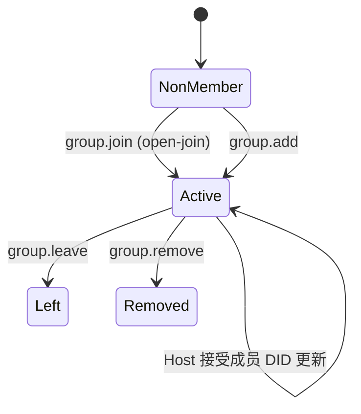
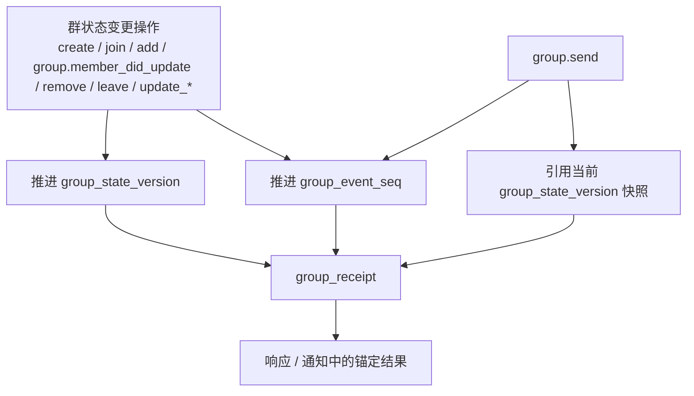
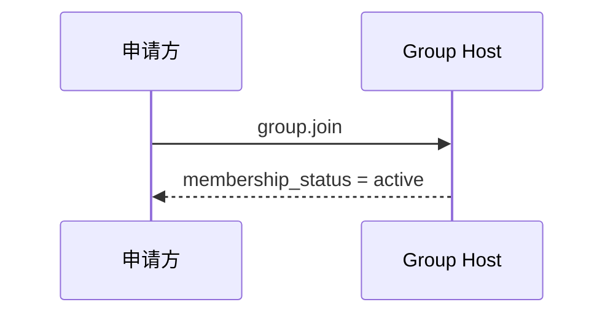
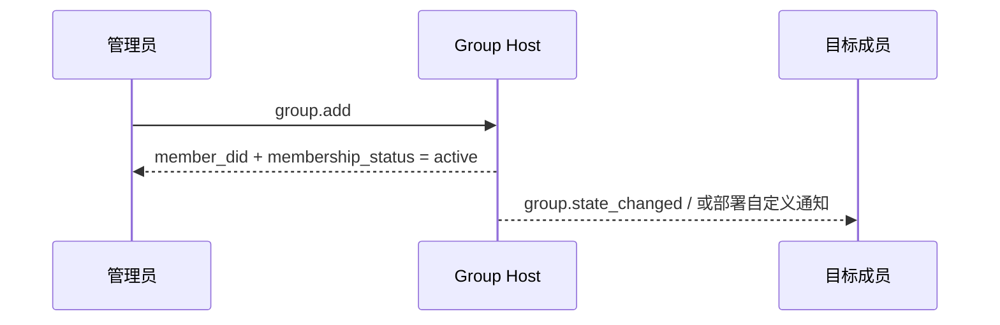
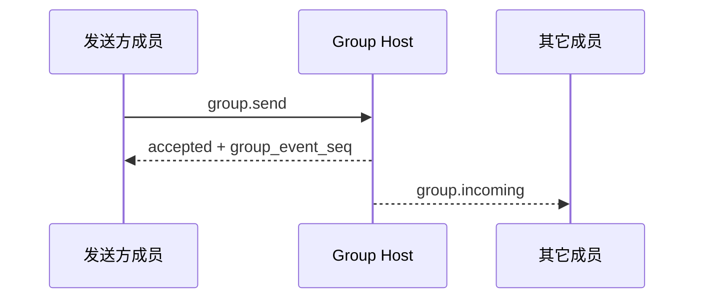
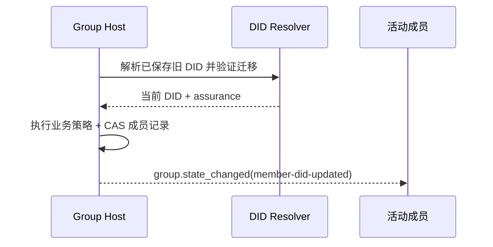

<!-- translation-review: partial; scope=full manual translation of source lines 64,1108 only; remaining text is machine translated and unreviewed -->
> 日本語参考訳（機械翻訳・未校閲）。規範となるのは原文です。コード例・識別子・規範キーワードは原文を保持しています。
> 原文: [vnext/chinese/P4-群组基础语义.md](../../../vnext/chinese/P4-群组基础语义.md) / 基準コミット: `0837cfdfaf4ddcf834f0890ddaf34fc4c824e066`

# ANP プロフィール 4: グループ基本的なセマンティック

- ドキュメント番号: ANP-P4-vNext
- タイトル:グループ基本セマンティックス
- ステータス: ドラフト/未公開
- ベースライン: ANPメッセージング1.2
- コードブックバージョン: ANPメッセージングvNext
- 原文言語: 中文 / このページは日本語参考訳
- プロフィール:`anp.group.base.v2`
- 依存症:`anp.core.binding.v1`、`anp.identity.discovery.v1`
- アプリケーションの範囲: このプロファイルは、グループ間対エンドの暗号化アルゴリズム自体なしで、グループDIDに基づいてグループライフサイクル、グループ管理およびグループメッセージ基本構文に適用されます。

---

> Note: この vNext ドラフトは、自己ヘルプアクセス、直接追加の 2 つのパスを保持します。
>
> 1. `group.invite`、`group.accept_invite` 規格と基準 `invitation` (a) コアの外にあるオブジェクトを維持すること。
> 2. `membership_request`、`membership_request_digest`、`group.approve_membership`、`group.reject_membership` (a) コアの外に滞在する。
> 3. `group_policy` 集中する `message_security_profile + bootstrap_security_profile + admission_mode + permissions`；
> 4. 非会員制ガバナンスの方向性円 `group.governance_notice` (a) コアの外に滞在する。
> 5. 宿泊予約 `group.state_changed` グループ内での業務を順調に定める状態として通知します。

---

## 1. 目的:

このProfile は、AMP のベースセマンティックレイヤーを定義します。

1. グループの適用のためのグローバルラベルとしてグループDID;
2. グループ作成、セルフヘルプ、直接追加、メンバーの削除、分離、グループ情報の更新、グループ戦略の更新などの基本的な行動;
3. グループメッセージ `group.send` (a) 基礎的意味;
4. グループホストサービスのソート機能;
5. グループE2EEは、このプロファイルアプリケーションのセマティクスを上回る方法を公開しています。
6. エージェント DID が置換されると、ホストが調整した DID のみのメンバーシップ関係と継続的な更新。

ベンジャー **なし、いいえ。**定義:

- 特定のグループ E2EE アルゴリズム;
- 歴史のアウトリーチ;
- オンラインで読むこと;
- (a) 装置または内部のコピーの概念;
- グループ外部ディレクトリの同期化。
- (b) 外部ソースとのプライベート招待リンク、トークンまたは他の特定の配信メカニズムの展開。
- エージェント内で動的グループの状態が保存される方法

---

## 2. 用語と規範的な関与

### 2.1 仮鍵

このテキスト **MUST**、**MUST NOT**、**REQUIRED**、**SHALL**、**SHALL NOT**、**SHOULD**、**SHOULD NOT**、**RECOMMENDED**、**NOT RECOMMENDED**、**MAY**、**OPTIONAL** 資本金を基準とする規範的な要件として解釈される。

### 2.2 用語集

- **グループ会社**: によって `group_did` グループプロトコルの対象をマークします。
- **グループホストサービス**: グループのニュースポータルの基本的なステータスシーケンシング、戦略的アプリケーション、サービスに対する責任。
- **グループ州**: 情報、戦略、会員関係など、特定の時点でのグループの適用の状態。
- **グループ州版**: グループホストサービスで与えられたロゴの現在のグループステータスバージョン。
- **グループイベント シーケンス**: グループホストサービスによるグループイベントの単一シリアル増分、圧倒的な制御操作とグループメッセージ。
- **会員名**: グループのメンバー
- **入学モード**: デフォルトは非メンバーで開きます。このファイルv2標準値が `admin-add`、`open-join`. 中国のAutoAccessingオンラインプロトコルが値の統一された書き込みを取る場所 `open-join`。
- **運営方針**: 送信できるメッセージのルールをアプリケーションレイヤーで定義し、直接ユーザーを追加したり、メンバーを削除したり、情報を更新したり、戦略を更新したりします。
- **Origin Proof（発信者証明）**: グループ操作またはグループメッセージを開始するAgentが、P1付録AのANP-02メッセージバインディングに従って生成する、アプリケーション層の発信者の証明です。
- **グループレシート**: グループホストが生成する検証可能な応答機で、グループ操作やグループメッセージの受け入れを証明し、配置されている。
- **論理的ターゲット URI**: 転送中のアプリケーションレイヤーのシグネチャを安定させるために、URIは特定のHTTP URLではなく、P1 Appendix Aによって定義される論理的ターゲットです。
- **グループ変更イベント**: グループホストはグループステートイベントオブジェクトの現在のアクティブメンバーとソートして同期します。
- **主パスを安定化(安定した被写体パス)**: 認証 `e1_` 行う: wba メソッド内部パスの制約は DID 移行に使用されます。メッセージング ID やワイヤフィールドではありません。
- **会員ID更新(会員ID更新)**: グループホスト原子交換メンバーは、現在の記録を記録します `agent_did` - 状態の変更。
- **ホストDIDアップデートアクション**: アクション識別子の保持 `group.member_did_update`クライアント対応のJSON-RPCメソッドではなく、ステータスイベントや返信のみ。
- **継続保証**:P2 移行検証結果、以下を含む `verified`、`recovery_verified`、`provider_asserted` または `unverified`。

---

## 3. デザイン原則

### 3.1 1グループ、グループ1グループDID

各グループ **MUST** いっしょに。 `group_did`。`group_did` アプリケーションレイヤーのグローバル識別です。

- (a) グループ発見;
- (a) グループ管理;
- グループメッセージアドレス;
- グループE2EEオーバーレイの固定に続いて。

### 3.2 グループホストはソートを担当しています

グループの状態を変更するすべての操作 **MUST** グループホストサービスが受入・ソート後

グループホストサービス **MUST** グループステータス変更のための決定可能な線形順を維持し、各々の承認された変化に新しいものを割り当てます `group_state_version`。

### 3.3 暗号からの構文の分離可能性

このプロファイルは、アプリケーションレイヤーのアクションとオブジェクトだけを定義します。グループキー構築、メンバー暗号化状態の進化、ウェルカムメッセージ、暗号化アプリケーションなどは、グループE2EEプロファイルによって定義されます。

### 3.4 合意の終了はエージェントを維持します

グループのメンバーはプロトコルレベルでエージェントを残しています。このプロファイルの構文に、任意の Agent の内部のコピー、ワーカー、デバイス、またはターミナルはありません。

そのため、事業のP4メンバーと彼の役割は、エージェントDIDドメインにあります。`group.send`、`group.incoming` とりあえず `group.state_changed` エージェントIDまたはグループIDでサイトの場所を検索し、決定します。

グループ E2EE プロジェクト(P6) は、複数のデバイスレベルの MLS リーフとして DID のメンバーを識別できます。 P6 リーフ自体の追加、削除、またはキャンセル **MUST NOT** P4メンバーの追加または削除、ロールの変更、メンバーやグループ戦略の数の影響、P4ステータス変更イベントの作成は行いません。

### 3.5 非ターゲット

ベンジャー **なし、いいえ。**提供:

- グローバル歴史再生;
- (b) 強い同期の皮下;
- (a) 設備レベルのメンバーシップ;
- (a)装置段階配達;
- 内部実行者レベルの権利制御;
- 標準化された承認の流れ。

### 3.6 グループ結果の著者認定および分離

通常、グループシーンには2つの異なる構文署名があります。

1. **スポンサーの署名**: 特定のものを作る `sender_did` グループが実際に起動したか、グループメッセージが送信されたか
2. **結果は目撃者です。**: グループで一定の操作やメッセージが受け入れられていることを証明し、確認される `group_state_version`、`group_event_seq` または同等のステータス位置。

プロフィールのリクエスト:

- グループステータスを変更し、 `group.send`，**MUST** スポンサーの募集 `auth.origin_proof`；
- グループDIDの署名 **SHOULD** グループホストに戻りましょう `group_receipt` 媒体;
- スタッフ **MUST NOT** スポンサーの署名をグループ署名に置き換える **MUST NOT** スポンサーの「署名」でグループ結果を置換します。

### 3.7 トロピックの制限

v2 コアでは、非メンバーは 2 つの標準アクションのみを保持します。

- `group.join`: ターゲットエージェントは、自らのアクセシビリティを約束し、成功直後に `active` (b) 会員
- `group.add`: 既存の有能なメンバーは、クラスターのターゲットエージェントに直接参加し、成功するとすぐに効果をとります。

ベンプロファイルv2 **なし、いいえ。**定義基準 `invitation` オブジェクト、`invitation_id`、`group.invite` または `group.accept_invite`. デプロイメントが招待リンクを必要とする場合, トークンまたは他の外部のドキュメントに参加して展開をサポート `group.join`♪ そして、これらの機能 **MUST** 展開の延長処理として、 **MUST NOT** あり。 `group.join` 成功前のスタンダードな会員資格をつくりました。

BenProfile v2 の特長 **なし、いいえ。**標準化された承認の流れを定義して下さい、また **なし、いいえ。**コアに。 `pending` (c) 中間ガバナンス。

### 3.8 DIDのみ会員のリレーションとDID継続

P4 v2 は、ワイヤメンバーとしてフルエイジ DID のみを使用します。

- `group_member.agent_did` 認証、認可、ルート、セキュリティのオーバーレイのための現在の DID です。
- 読み取り可能な名前、サービスレコード、メインパスとローカルアカウントIDを安定化 **MUST NOT** (a) P4 会員としてワイヤーに印を付けて下さい;
- グループホスト **MUST NOT** お名前のみで`alsoKnownAs` または同じ安定した主要なパスは継続を誘発します;
- P2 古いDIDから現在のDIDに同じ内部メンバーレコードを更新し、グループホストのビジネス戦略が承認された後、再認定する前にグループをバックアップする代わりに、同じ内部メンバーのレコードを更新します。
- `provider_asserted` (a) 合意を強制しないが、グループホストの事業戦略が承諾するかどうか、および、継承するメンバーは決定する。
- 歴史、返信、イベント、シグネチャ、ID **MUST NOT** - 書き換えです。

DIDの更新が受け付けられ、DD更新は受け付けられました。`role`、`status`、`joined_at`、`added_by` アクティブメンバーの数は変更されず、古いIDはすぐに新しい操作を開始するためにその義務を失いました。

---

## 4. グループガバナンスモデルの概要(非暫定的)

### 4.1 ルールのまとめ

| シーン | エントリーへのアプローチ | 結果の即時化 | 認可されたオブジェクト/ステータス | いつになるか `active` | 免責事項 |
|---|---|---|---|---|---|
| セルフヘルプ | `group.join` | コールアグループ | `group_member.status = active` | このアクセスですぐに有効 | 詳しくはこちら `open-join` |
| - 私は男を得るつもりです。 | `group.add` | ターゲットは直接関与しています。 | `group_member.status = active` | すぐに追加で有効 | 典型的なのための `admin-add` |
| 会員は積極的に失業 | `group.leave` | 会員はグループを終了します | `group_member.status = left` | 該当なし | 現行の専用 `active` 会員名簿 |
| 管理者はメンバーを削除 | `group.remove` | 会員はグループから削除されます。 | `group_member.status = removed` | 該当なし | 現行の専用 `active` 会員名簿 |
| 会員IDの更新 | ホストの調整 `group.member_did_update` アクション | 古いDIDは許可を失い、承認された後続のDIDは現在のDIDになりました | まつげ `group_member` ホールド `active` | グループホスト エイムがアップデートを受け入れるとき | クライアント対応方法ではない |

> Note: デプロイメントが外部の招待リンクから参加する際、標準の相互運用可能なレイヤーは、最終的には残されます。トークンまたはステーションベースのリマインダーに参加する **MUST** 一度にいた。 `group.join` または `group.add` 成功の成果。

### 4.2 ステータスオブジェクト比較表

| オブジェクト | 重要な状態 | 意味する |
|---|---|---|
| `group_member` | `active` | 応用レベル 会員資格 有効 |
| `group_member` | `left` / `removed` | 会員は定休日 |

### 4.3 ステータスマトリクス



---

## 5. プロフィールの印および依存性

### 5.1 プロフィール名

このProfile の標準的な名前は、次のとおりです。

`anp.group.base.v2`

### 5.2 依存症

ベンジャー **MUST** 次のデータに依存します。

- `anp.core.binding.v1`
- `anp.identity.discovery.v1`

### 5.3 セキュリティモード

このプロファイルは、独立して動作するベースグループであるとき:

- `meta.profile` **MUST** イーグル `anp.group.base.v2`
- `meta.security_profile` **MUST** イーグル `transport-protected`

グループE2EEオーバーレイでフォローすると、安全です。 **MUST** グループメッセージオブジェクトでこのプロファイルのグループステータスオブジェクトをエンコードする方法を定義します。

---

## 6. グループモデル

### 6.1 `group_did`

`group_did` グループ向けアプリケーション識別のグローバルレイヤーです。

`group_did`：

- **MUST** (a) グループ管理業務の対象識別子として機能するため
- **MUST** (a) グループメッセージ操作のターゲット識別子として;
- **MUST NOT** 与えられたパスワードの認識を自動で均等化します `group_id`。

### 6.2 `group_state_version`

`group_state_version` 現在のグループアプリケーションの状態のバージョンです。

その要件は次のとおりです。

- **MUST** グループホストサービスによる
- **MUST** (a) 未透明の文字列として処理する。
- 成功するグループ状態の変化 **MUST** 新規作成 `group_state_version`；
- グループメッセージ送信 **MUST NOT** 新着情報そのものが新しい動きをしています。 `group_state_version`；
- グループのメッセージの返しに成功しました `group_state_version` 受信したグループステータスのスナップショットです。

### 6.3 `group_event_seq`

`group_event_seq` グループイベントのシリアル番号です。

その要件は次のとおりです。

- **MUST** (a) 同じグループ内でのユニークな増分の増加;
- **MUST** グループ制御操作とグループメッセージのオーバーライド
- **MUST** (a) 決定書文字列で表現する。
- **MUST NOT** セキュリティのセマンティックスのための唯一の基礎として直接。

P4 これらは、グループステータスバージョンを先取りするアクションで、グループイベントシーケンスだけを進行させるアクションです。 `group_receipt` アンカーはどれですか?次の図は読者が共通の理解を造るのを助けるために一緒にこれら3を持って来ます。



*図 P4-1:`group_state_version`、`group_event_seq` とりあえず `group_receipt` 関係(非規範的)。*

フォローアップを読む `group.send`、`group.state_changed` とりあえず `group_receipt` 意味で使われると、このイメージに常に戻ってくるはずです。グループニュースはイベントの順番に関わっていますが、新しいニュースをプッシュしません。 `group_state_version`。
### 6.4 ロールモデル

ベンプロファイル最小相互運用 **MUST** 以下の役割をサポート:

- `owner`
- `admin`
- `member`

役割レベルは次のように固定されます。

`owner > admin > member`

通訳のルールは以下の通りです。

- アクションが最小文字を必要とする場合 `member` できるかどうかはわかりません。`admin` とりあえず `owner` (a) 自動満足;
- アクションが最小文字を必要とする場合 `admin` できるかどうかはわかりません。`owner` (a) 自動満足;
- v1 最小相互運用可能な範囲 **MUST NOT** カスタムロールを導入

このDIDのP4オペレーションメンバーにロールが割り当てられます。このDIDのデバイスまたはMLSリーフは独立したP4ロールを取得していません。

### 6.5 会員

ベンプロファイル最小相互運用 **MUST** 会員資格の認定申請を受け付けます。

- `active`
- `left`
- `removed`

---

## 7. 標準オブジェクト

### 7.1 `group_policy`

`group_policy` これは、グループの適用層の承認とエントリールールです。

推奨構造は以下の通りです。

```json
{
  "message_security_profile": "transport-protected",
  "bootstrap_security_profile": "transport-protected",
  "admission_mode": "open-join",
  "permissions": {
    "send": "member",
    "add": "admin",
    "remove": "admin",
    "update_profile": "admin",
    "update_policy": "owner"
  },
  "attachments_allowed": true,
  "max_members": "500"
}
```

フィールドの状態:

- `message_security_profile`文字列,**SHOULD**, 推奨値:`transport-protected`、`group-e2ee`
- `bootstrap_security_profile`文字列,**SHOULD**, 推奨値:`transport-protected`、`group-e2ee`
- `admission_mode`文字列,**MUST**
- `permissions`オブジェクト、**MUST**
- `attachments_allowed`ボオラン,**MAY**
- `max_members`: 文字列の決定**MAY**

通訳のルールは以下の通りです。

1. `message_security_profile` アプリケーションへの情報送信および配信の規制:
   - `group.send` P4 ノーマル `group.incoming`グループ E2EE オーバーレイの対応するアプリケーション メッセージメソッド
   - 会員関係、ガバナンス、グループ情報読み取り、クラスターステータス通知プロファイルおよびセキュリティパターンを変更しません。これらの操作は、それぞれの方法論的定義の結合を保持します。

2. `bootstrap_security_profile` 会員のセキュリティ要件を圧縮する:
   - プチ4 `group.create`、`group.join` とりあえず `group.add` プレス `admission_mode` とりあえず `permissions` (a) DIDレベルの運用メンバー関係を確立する。
   - リクエスト `group-e2ee` P4 対応するメンバー関係の P6 が `active` (a) 対象となる機器の独立系MLS会員
   - 本ポリシーは、国際アクセスの P4 リクエストを赤くせず、保持しないグループキーを使用して P4 エントリーリクエストを暗号化するためにまだ参加していない機器を必要としません。セクション 11.7 では、P4/P6 の組み合わせと読みやすさ境界を定義しています。

3. `admission_mode` **MUST** 以下のいずれかを服用してください。
   - `admin-add`
   - `open-join`

4. `permissions` **MUST** 下記の標準キーのみを含んだ。
   - `send`
   - `add`
   - `remove`
   - `update_profile`
   - `update_policy`

5. `permissions.*` 値の **MUST** は:
   - `owner`
   - `admin`
   - `member`

6. 通訳のデフォルトルールは以下の通りです。
   - いつ? `admission_mode = "admin-add"` できるかどうかはわかりません。`group.join` **MUST** 拒否;典型的なグループパスは `group.add`
   - いつ? `admission_mode = "open-join"` できるかどうかはわかりません。`group.join` **MUST** 許可される
   - `group.add` 、まだによる利用できる `permissions.add` デコレーション

7. 存在する場合 `max_members`、グループ ホスト **MUST** そのままに `active` 運営メンバー DID 天井。同一の DID の複数のデバイスまたは MLS リーフは 1 つのメンバーだけとしてカウントされます。

### 7.2 `group_member`

`group_member` 現在のグループメンバー関係オブジェクトです。最小限の推奨フィールド:

- `agent_did`文字列,**MUST**
- `role`文字列,**MUST**
- `status`文字列,**MUST**
- `joined_at`: RFC 3339 時間のひも、**MAY**
- `added_by`: DID 文字列,**MAY**

注意:

- `role` 不確実性の場合、受取人 **MUST** 説明 `member`；
- `status = active` (a) 申請レベル会員が強制的に入力したことを表明する。
- `status = left` または `removed` (a) 会員関係が終了したことを表明する。
- 現行の会員関係のみ `group.add` 設立時推奨 `added_by`；
- `agent_did` 常に認証、認可、情報、ルート、セキュリティオーバーレイのために現在のメンバーのDIDを必ず示します。
- 承認された DID の更新は流れだけ変更します `agent_did`メタデータが変更されていないメンバー

このプロファイルは、名前、安定したパスまたはローカルデータベースに基づいて、2番目のセットでメンバーシップを定義または送信しません。 **MAY** ローカルレコードは内部接続で安定していますが、APPロゴではありません。**MUST NOT** 相互ドメイン認証または承認のため。

`group_member` **MUST NOT** 機器識別子またはリスト、デバイスセルフポート、機器レベルのロールや状態、およびMLSリーフの識別が含まれています。

### 7.3 拡張グループ証拠の展開

BenProfile v2 の特長 **なし、いいえ。**定義基準 `invitation` オブジェクト、また **なし、いいえ。**定義 `invitation_id`。

デプロイメントが招待状リンクが必要な場合は、トークンまたは他の外部のドキュメントに結合してサポートします。 `group.join`, これらのオブジェクト **MAY** ありますが、それらは次のものがあります。

- **MUST NOT** 考慮されたv2中心の相互運用の目的;
- **MUST NOT** あり。 `group.join` (b) 成功前に、標準のメンバーシップステータスを作成します。
- **SHOULD** 制御されたチャネルによって伝達されます。

### 7.4 `group_profile`

`group_profile` これは、構造資源オブジェクトのグループです。

推奨分野:

- `display_name`文字列、グループを作成するとき **SHOULD** 提供:
- `description`文字列,**MAY**
- `avatar_uri`文字列,**MAY**
- `discoverability`文字列,**MAY**, 推奨値:`private`、`listed`、`public`
- `labels`オブジェクト、**MAY**

### 7.5 `group_state_ref`

`group_state_ref` グループステータス参照オブジェクトです。

最小限の推薦された分野:

- `group_did`文字列,**MUST**
- `group_state_version`文字列,**MUST**
- `policy_hash`文字列,**MAY**
- `roster_hash`文字列,**MAY**

### 7.6 グループメッセージの負荷

`group.send` ・・・ `meta.content_type` **MUST** そこ。

ベンプロファイル最小相互運用 **MUST** 下記サポート項目をご案内いたします。

- `text/plain`
- `application/json`
- `application/anp-attachment-manifest+json`

`group.send` ・・・ `body` 確かにそうではありません。`text`、`payload`、`payload_b64u` 3つの:

- **MUST** 事件が起きた。
- 以上あれば、受取人 **MUST** (a) リクエストを拒絶する。
- それらのどれも存在しなかった場合、受取人 **MUST** 拒否。要求

あり。 `payload_b64u`：

- **MUST** 埋め込まれていない base64url を使用してください。
- **SHOULD** バイナリまたはプライベートエクステンションオブジェクトのみ。

いつ? `meta.content_type = "application/json"` できるかどうかはわかりません。`body.payload` **MUST**
JSON オブジェクトを直接読み込みます。このファイルは、このオブジェクトの内フィールドのビジネスの意味を定義しません。グループアプリケーションまたは
ホストは説明する方法を決定します。

### 7.7 `auth` オブジェクト

ダイワディド `group.get_info` グループの状態を変更するすべてのリクエスト、 `group.send`詳しくはこちら `params` **MUST** 組織図 `auth` オブジェクト。

証拠の負荷規則、署名された共和国の目的および署名する部品図 **MUST** P1 再使用の付録は調和した定義を; P4 **もうありません。** スタンドアローンの証拠フィールド名、別の署名されたペイロード構造またはローカルを定義します `@target-uri` 地図を。

推奨構造は以下の通りです。

```json
{
  "auth": {
    "scheme": "anp-rfc9421-origin-proof-v1",
    "origin_proof": {
      "contentDigest": "sha-256=:BASE64_SHA256_DIGEST:",
      "signatureInput": "sig1=(\"@method\" \"@target-uri\" \"content-digest\");created=1733402096;expires=1733402156;nonce=\"abc123\";keyid=\"did:wba:example.com:user:alice:e1_<fingerprint>#key-1\"",
      "signature": "sig1=:BASE64_SIGNATURE:"
    }
  }
}
```

フィールドは、次のものが必要です。

- `auth.scheme` **MUST** イーグル `anp-rfc9421-origin-proof-v1`
- `auth.origin_proof` **MUST** あらゆるステート・チェンジのグループ操作を主張し、 `group.send`
- `auth` それだけで **MUST NOT** エントリー `contentDigest`

### 7.8 共有署名されたリクエストオブジェクトへの結合

`auth.origin_proof.contentDigest` **MUST** バイナリP1付録A定義共有 **署名された要求の目的**。

グループベースの場合:

- えー。 `group.send` 一方、ニュースは他の方法と同じです。`meta.message_id` とりあえず `meta.content_type` **MUST** プレゼンス
- えー。 `group.create`，`meta.target.kind` **MUST** あり あり `service`
- 政府は、既に既存のグループをターゲットとする他のグループとまた働いています。`meta.target.kind` **MUST** あり あり `group`

### 7.8.1 グローバルコンポーネントマッピングへの参照

リクエスト `auth.origin_proof` グループベースメソッド **MUST** P1 Appendix A で定義されているグローバルシグネチャコンポーネントをマップします。

したがって:

- えー。 `group.create`、証明の党基礎 `meta.target.kind = "service"` 再建 `@target-uri = anp://service/<pct-encoded meta.target.did>`
- 団体様向け、認定会は、 `meta.target.kind = "group"` 再建 `@target-uri = anp://group/<pct-encoded meta.target.did>`
- 結果はP1のグローバルルールから、 **ありません。** P4 自衛局地マップセット

### 7.9 `group_receipt`

`group_receipt` グループ・ホストがグループ・オペレーションやグループ・メッセージの受け入れをし、グループ・ステータス・マシンの検証可能な証人に書き込むことを意味する。

推奨分野:

- `receipt_type`文字列,**MUST**, 推奨値:`group-operation-accepted`、`group-message-accepted`
- `group_did`文字列,**MUST**
- `group_state_version`文字列,**MUST**
- `group_event_seq`: 文字列の決定**MUST**
- `subject_method`文字列,**MUST**
- `operation_id`文字列,**MUST**
- `message_id`文字列,**MAY**
- `actor_did`文字列,**MUST**
- `accepted_at`: RFC 3339 時間のひも、**MUST**
- `payload_digest`文字列,**MUST**
- `proof`オブジェクト、**SHOULD**;when の `group_receipt` グループホストドメインを離れ、他のドメインに依存している場合 **MUST**

`group_receipt.proof` **MUST** P1付録B定義の共有を適用する **オブジェクトの証拠のプロフィール**。

えー。 `group_receipt` のために:

- 発行者 DID **MUST** あり あり `group_did`
- 保護された文書 **MUST** 削除 `proof` あとで。 `group_receipt`
- `proof.verificationMethod` **MUST** スポット `group_did` ドキュメント by `assertionMethod` 認証方法
- `group_receipt` 署名の目的は、「リクエストを開始した」ではなく「この結果を受け入れている」ことを証明することです。

最初には、P1付録Bの共有ルールで、共有だけでなく、他の部分と共有される。`group_receipt` まさか **MUST** 少なくとも全体として含まれているし、苦しみます。 `proof` 次のセキュリティキーフィールドを保護する:

- `receipt_type`
- `group_did`
- `group_state_version`
- `group_event_seq`
- `subject_method`
- `operation_id`
- `actor_did`
- `accepted_at`
- `payload_digest`
- 存在する場合 `message_id`ですから。 **MUST** 含まれ、保護される

認証パーティーは `group_receipt.proof` 試験は進行中です。**MUST** 上記のフィールドを実際の応答、通知のコンテキスト、およびカウンターパートグループのポジションで確認し続けます。

### 7.10 グループステータス変更イベントオブジェクト

#### 7.10.1 共通フィールド

会員IDの更新イベント推奨構造:

```json
{
  "event_id": "evt-didupd-001",
  "event_type": "member-did-updated",
  "group_did": "did:wba:groups.example:team:e1_group",
  "group_state_version": "43",
  "group_event_seq": "129",
  "subject_method": "group.member_did_update",
  "changed_at": "2026-08-25T02:11:00Z",
  "actor_did": "did:wba:groups.example",
  "previous_subject_did": "did:wba:example.com:user:alice:e1_old",
  "subject_did": "did:wba:example.com:user:alice:e1_current",
  "membership_status": "active",
  "group_receipt": { "...": "..." }
}
```

共通の規則:

1. `group.state_changed.body` **MUST** (a) イベントのオブジェクトを直接ロードします。
2. (a) 外部のエントリ文書や非会員の ' リマインダーを配信するために使用されないシャール。
3. **SHOULD** とりあえず `group_event_seq` (a) 同じシラブルを維持するために。
4. `group.join` とりあえず `group.add` 地図へ `member-activated`；
5. ホストアクション `group.member_did_update` 地図へ `member-did-updated`；
6. `group.remove` 地図へ `member-removed`, 存在 `membership_status` 行く時間です。 `removed`；
7. `group.leave` 地図へ `member-left`, 存在 `membership_status` 行く時間です。 `left`。

#### 7.10.2 基準 `event_type`

P4 v2 推奨事項:

- `member-activated`
- `member-removed`
- `member-left`
- `member-did-updated`
- `group-profile-updated`
- `group-policy-updated`

`member-did-updated` **MUST** 組織図 `previous_subject_did`、`subject_did` とりあえず `membership_status = "active"`とりあえず **MUST NOT** 名前、安定した主パスまたは安定した主主題の識別子を含んで下さい。 `subject_method` **MUST** あり あり `group.member_did_update`，`actor_did` **MUST** グループホスト向け `ANPMessageService.serviceDid`，`operation_id` **MUST** #DirectSpectSteal、古いDIDと新しいDID。`payload_digest` **MUST** ステータスの変更をカバーします。返答は、グループが更新を受け入れ、シーケンスし、独立してDIDの継続性を証明するものではありません。

## 8. 標準方法論と通知

ダイワディド `group.get_info` 外部では、このセクションでステータスのアプローチを変更するすべてのリクエスト **MUST** 下記の一般規則が満たされています。

- `params.auth.scheme` **MUST** イーグル `anp-rfc9421-origin-proof-v1`
- `params.auth.origin_proof` **MUST** サインイン
- 境界線を横断したい場合は、それは生です。 `auth.origin_proof` **MUST** メッセージを転送し、 **MUST NOT** 中間サービスで書き換える

グループホストが認めた全てのステータス変更 `group.send`：

- ノンクロスでの成功応答 **SHOULD** バックナンバー `group_receipt`
- 応答結果がグループホストを離れ、他のドメインに依存している場合、成功します。 **MUST** バックナンバー `group_receipt`, および返し `group_receipt.proof` **MUST** プレゼンス

次の2つの非コンプライアンス/ステップメッセージメソッド:

- `group.incoming`
- `group.state_changed`

所属する **OPTIONAL プッシュ機能**. 彼らはこのプロファイルの最も一般的なオプションではありません。しかし、それが達成されると、送信者 **MUST** このプロファイル定義を使用するための標準 `body` 構造。

会員、役割、戦略、グループガバナンスの決定は、ドメインとしてDIDによって定義されます。 **MUST NOT** カリカリ `meta.sender_device_id`、`meta.recipient_device_id`、装置自体かリストは、装置の結果を運ぶために、または。

### 8.1 `group.create`

#### 8.1.1 統計学

グループホストサービスで新しいグループを作成して、新しいグループを配布 `group_did` 初期値 `group_state_version`。

#### 8.1.2 リクエスト

`group.create` リクエスト **MUST** 土産:

1. `method = "group.create"`
2. `meta.profile = "anp.group.base.v2"`
3. `meta.security_profile = "transport-protected"`
4. `meta.sender_did` **MUST** プレゼンス
5. `meta.target.kind = "service"`
6. `meta.target.did` **MUST** ターゲットです。 `ANPMessageService.serviceDid`
7. `meta.operation_id` **MUST** プレゼンス
8. `body.group_profile` **SHOULD** プレゼンス
9. `body.group_policy` **MUST** プレゼンス
10. `body.initial_members` **MAY** プレゼンス
11. `params.auth.origin_proof` **MUST** プレゼンス

作成者のみ `meta.sender_did` 識別し、活動的になる `owner`。

詳しくはこちら `initial_members` エントリーフォーム **MUST** 組織図 `member_did`とりあえず **MAY** 組織図 `role`;非 DID ターゲット違法。 グループホスト **MUST** DID が置換されると、新しい DID を取得するのは良いでしょう。**MUST** バックナンバー `anp.did_superseded`とりあえず **MUST NOT** 署名されたリクエストを書き換えます。

#### 8.1.3 成功の応答

成功の応答 **MUST** 組織図 `group_did`、`group_state_version`、`created_at` とりあえず `creator_did`とりあえず **MAY** 組織図 `group_event_seq`、`group_profile`、`group_policy` とりあえず `group_receipt`。

### 8.2 `group.get_info`

#### 8.2.1 科学

現在のグループの基本スナップショットを取得します。

#### 8.2.2 リクエスト

- `meta.target.kind` **MUST** あり あり `"group"`
- `meta.target.did` **MUST** おすすめ `group_did`

`body` **MAY** 含まれる:

- `include_policy`
- `include_member_list`

アイデンティティ要件は以下の通りです。

- グループとして `discoverability = "public"` または `"listed"` できるかどうかはわかりません。`group.get_info` **MAY** 匿名の読み取りコールとして; この時点で `meta.sender_did` **MAY** (a) 省略;
- グループとして `discoverability = "private"` , コール **MUST** (b) アイデンティティの提供
- リクエストされた投影が呼び出し者の可視性を超えている場合、受取人 **MUST** バックナンバー `group.policy_violation`。

#### 8.2.3 応答の成功

成功の応答 **MUST** 少なくとも含まれます:

- `group_did`
- `group_state_version`
- `group_profile`

成功の応答 **MAY** 含まれる:

- `group_policy`いつしか `include_policy = true` (電話機は参照する権利があります)
- `member_list`いつしか `include_member_list = true` および発信者は、その要素タイプを閲覧する権利を有します。 **MUST** あり あり `group_member`）
- `member_count`(決定文字列; 現時点では、**SHOULD** エクスプレス・カレント `active` 会員数

返された場合 `member_list`、その内容 **SHOULD** 現行のもののみが含まれている `active` 会員様

### 8.3 `group.join`

#### 8.3.1 統計学

`group.join` 会員以外の自己入場のために、成功する発信者が `active` 会員様

#### 8.3.2 リクエスト

`body` **MAY** 組織図 `reason_text`, しかし **MUST NOT** 名前、安定した主分野または他のメンバー識別子を含んで下さい;会員IDの正確な等しい `meta.sender_did`. 新DIDが旧DIDを置換した既存のアクティブメンバーに応答する場合のグループホスト **MUST** セクション 8.12 は、最初に実装され、現在使用しているように処理されます。 `open-join` 入会金・受取人 **MUST** 拒否、要求および **SHOULD** バックナンバー `group.policy_violation`。

#### 8.3.3 応答の成功

成功の応答 **MUST** 組織図 `group_did`電流を同等 `meta.sender_did` ・・・ `member_did`、`membership_status = "active"` とりあえず `group_state_version`とりあえず **MAY** 組織図 `group_receipt`。

### 8.4 `group.add`

#### 8.4.1 統計

エージェントID; 成功後、ターゲットが `active` 会員様

#### 8.4.2 情報へのリクエスト

`body` **MUST** 組織図 `member_did`とりあえず **MUST NOT** 名前、安定した主分野または他のメンバー識別子を含んで下さい;`body` **MAY** 組織図 `role` とりあえず `reason_text`,ブランク `role` 説明する時間です。 `member`。グループホスト **MUST** 確認します。 `member_did` 現在の活動。 置換された場合、ホスト **MUST** バックナンバー `anp.did_superseded`とりあえず **MUST NOT** 署名されたリクエストにDIDを置換し、移行の確認、リクエストの更新、再署名を呼び出します。

#### 8.4.3 成功の応答

成功の応答 **MUST** 組織図 `group_did`、`member_did`、`membership_status = "active"` とりあえず `group_state_version`とりあえず **MAY** 組織図 `group_receipt`。

### 8.5 `group.remove`

#### 8.5.1 統計学

特定の会員は、 `active` 会員はグループから退会しました。

#### 8.5.2 情報へのリクエスト

`body` **MUST** 含まれる:

- `member_did`

`body` **MAY** 含まれる:

- `reason_text`

#### 8.5.3 治療の規則

- 対象が現在ある場合 `active`, それから `group.remove` **MUST** それを作って下さい `group_member.status = "removed"`；
- 既に対象がすでにある場合、 `left`、`removed` または、受取人ではなく **MUST** (a) リクエストを拒絶する。
- 受諾後、グループホストはセクション 8.11 に従ってそれを送ります `member-removed`削除するを含む `member_did` セルフフィールドは、最終的にエンベロープを埋めます。

#### 8.5.4 応答の成功

成功の応答 **MUST** 少なくとも含まれます:

- `group_did`
- `member_did`
- `group_state_version`

成功の応答 **MAY** 含まれる:

- `membership_status`
- `group_receipt`

### 8.6 `group.leave`

#### 8.6.1 経済学

現行の送信者がグループから自発的に撤退したことを示します。

#### 8.6.2 リクエスト

- `meta.sender_did` **MUST** 現行のエンタアングルメントです。

#### 8.6.3 治療の規則

- 受付後、変異 `group_member.status` なると `left`；
- 受入後、グループホストはセクション 8.11 の下で送ります `member-left` 分離グループへの分布を含むインシデント `leaver_did` 最終自己ロール封筒。

#### 8.6.4 応答の成功

成功の応答 **MUST** 少なくとも含まれます:

- `group_did`
- `leaver_did`
- `group_state_version`

成功の応答 **MAY** 含まれる:

- `group_receipt`

### 8.7 `group.update_profile`

#### 8.7.1 統計学

オーディエンスのグループ表示を更新します。

#### 8.7.2 リクエスト

`body` **MUST** 含まれる:

- `group_profile_patch`

`group_profile_patch` **MUST** RFC 7386 JSON のマージパッチ構文を使用します。

#### 8.7.3 成功の応答

成功の応答 **MUST** 少なくとも含まれます:

- `group_did`
- `group_state_version`
- `group_profile`

成功の応答 **MAY** 含まれる:

- `group_receipt`

### 8.8 `group.update_policy`

#### 8.8.1 統計学

グループポリシーオブジェクトを更新します。

#### 8.82 リクエスト

`body` **MUST** 含まれる:

- `group_policy_patch`

`group_policy_patch` **MUST** RFC 7386 JSON のマージパッチ構文を使用します。

#### 8.3.3 成功の応答

成功の応答 **MUST** 少なくとも含まれます:

- `group_did`
- `group_state_version`
- `group_policy`

成功の応答 **MAY** 含まれる:

- `group_receipt`

### 8.9 `group.send`

#### 8.9.1 統計

アプリケーションのレイヤーメッセージをグループに送信します。

#### 8.9.2 リクエスト

普通のもの。 `group.send` リクエスト **MUST** 土産:

1. `method = "group.send"`
2. `meta.profile = "anp.group.base.v2"`
3. `meta.security_profile = "transport-protected"`
4. `meta.target.kind = "group"`
5. `meta.target.did` **MUST** ターゲットです。 `group_did`
6. `meta.sender_did` **MUST** 現在の送信者
7. `meta.message_id` **MUST** プレゼンス
8. `meta.operation_id` **MUST** プレゼンス
9. `meta.content_type` **MUST** プレゼンス
10. `body` **MUST** ロードオーバーオールを満たします
11. `params.auth.origin_proof` **MUST** 署名された署名された要求の目的
12. `meta.sender_device_id`、`meta.recipient_device_id` 他のデバイス、セクターまたはリストで **MUST NOT** プレゼンス

#### 8.9.3 `group.send` ・・・ `body`

`group.send` ・・・ `body` 含まれるもの:

- `thread_id`文字列,**MAY**
- `reply_to_message_id`文字列,**MAY**
- `annotations`オブジェクト、**MAY**
- `text` / `payload` / `payload_b64u`3 の **MUST** 一つは、その人で起きた。

#### 8.9.3 成功の応答

成功の応答 **MUST** 少なくとも含まれます:

- `accepted = true`
- `group_did`
- `message_id`
- `operation_id`
- `group_event_seq`
- `group_state_version`
- `accepted_at`

成功の応答 **MAY** 含まれる:

- `group_receipt`

回答は、グループイベントのみ受け付けられました。**MUST NOT** デバイス別設計、配信、返信、ファンアウト結果を含める。

### 8.10 `group.incoming`

`group.incoming` グループホストが認めたグループメッセージに、アクティブなメンバーエージェントをオフステップで送信する。 **MUST** 通知として使用される。

達成される場合 `group.incoming`通知の楽しみ **MUST** 土産:

- `meta.profile = "anp.group.base.v2"`
- `meta.security_profile` **MUST** メッセージのセキュリティモードは、受け入れられるときにグループに等しいです。
- `meta.target.kind = "agent"`
- `meta.target.did` **MUST** 現在の通知受信者を同等 DID
- `meta.sender_did` **MUST** 生グループメッセージのビジネス送信者と同じ DID
- `meta.operation_id` **MUST** オリジナルエクアドル `group.send.meta.operation_id`
- `meta.message_id` **MUST** オリジナルエクアドル `group.send.meta.message_id`
- `meta.content_type` **MUST** 元のメッセージと同じです。 `meta.content_type`

おすすめ商品 `body` 構造は次の通りです:

```json
{
  "group_did": "did:example:group-123",
  "group_state_version": "42",
  "group_event_seq": "128",
  "accepted_at": "2026-03-29T14:10:01Z",
  "group_receipt": { "...": "..." },
  "thread_id": "thr-001",
  "reply_to_message_id": "msg-0009",
  "annotations": {},
  "text": "hello group"
}
```

ルールは以下の通りです。

- `body` **MUST** 元のグループメッセージと一貫したビジネスロードの運送;
- 存在する場合 `params.auth`と:
  - `params.auth.scheme` **MUST** イーグル `anp-rfc9421-origin-proof-v1`
  - `params.auth.origin_proof` **MUST** オリジナル `origin_proof` ..and 未だコピーの
  - 中間サービス **MUST NOT** 新規事業の証拠を刷新。

`group.incoming` 受信者エージェントのIDにのみアドレスを送信します。 **MUST NOT** カリカリ `meta.sender_device_id`、`meta.recipient_device_id`受信フィールドは、内部的にローカルデバイスにファンアウトを通知することができますが、このファンアウトとその部分的な結果はエリア内で行われます。**MUST NOT** P4 ラインプロトコルに表示します。

### 8.11 `group.state_changed`

`group.state_changed` グループ変更の標準的なウォークイン通知です。これは、メンバーの状態のシーケンスされた変更を同期し、グループ情報の変更や、現在のアクティブメンバーとグループ戦略の変更に使用されます。 **MUST** 通知として使用される。

通知は含まれます **MUST** 土産:

- `meta.profile = "anp.group.base.v2"`
- `meta.security_profile = "transport-protected"`
- `meta.target.kind = "agent"`
- `meta.target.did` **MUST** 現在の通知受信者を同等 DID
- `meta.sender_did` **MUST** イーグル `body.group_did`
- `body` **MUST** 直接およびセクション 7.10 で定義される 1 つのオブジェクトだけ

`group.state_changed` **MUST NOT** 外部グループ文書、非会員からのリマインダーまたは任意の代替品を持参するために使用される `direct.send` ガバナンスの円を標的。

イベントの対象者自身に限って例外があります。 `member-removed` または `member-left` イベント、グループホスト **MUST** イベント情報 `subject_did` 最終コピーをお送りします。 `group.state_changed` そのため、自身の役割のフィールドのこの最終通知は、外部に放送したり文書に放送されていない非会員からのリマインダーではなく、他のすべての非メンバーの目的やその他のイベントに適用し続けています。

役割分野における最終的な価値 **MUST** イベント情報 `subject_did` 目的、他の非会員は対象外となる場合があります。 再試行と予約 **MUST** グループホストを超えて、見える展開天井の対象 **MAY** このDIDの残りの配信状況でそれを捨てる; グループホスト **MUST NOT** デリバリーの状態を無期限に削除または分離されたメンバーのために保持します。 デリバリーは、したがって「サービスを確実にしないで試行する」:会員が到着するか否かにかかわらず、除去または分解が効果が認められています。 **MUST NOT** 会員がまだ存在しているという証拠として受け取らず、フォローアップリクエストが受け取れる `group.not_member` 拒絶は、同じ権限の最終的な信号のままです。被験者は、ローカルビューを損なう目的でのみイベントを処理します。それは、任意の継続会員、既読またはガバナンスステータスを妨害しません。

`group.state_changed` グループIDから受信エージェントIDへ **MUST NOT** デバイス自家またはリストを運ぶ、またはデバイスの配信を露出すること。メンバーエリア内のファンアウトは内部です。

### 8.12 ホストの調整のメンバー DIDの更新

`group.member_did_update` イベントとホストアクション識別子を保持するために使用されるコールバックを返します。**ありません。** JSON-RPPC メソッド。クライアントはこのメソッドを呼び出します。 **MUST** バックナンバー `-32601 Method not found`。

DID キャッシュが期限切れになったら、DID の無効化、配信失敗、ピアレポート DID が置換されたり、可能なフォローオン DID 起動リクエストをキャンセル **MAY** トリガー更新。ホスト **MUST** 活動メンバーレコードから正確な保持 `agent_did` 移動、P2を押して現在のDIDマイグレーションを確認します。

更新を受け付ける前のホスト **MUST**：

1. 古い DID の唯一のアクティブなメンバーのための現在の DID を見つけます。
2. 古い DID を実際の P2 コンバージョン保証に取得します。
3. 参加申し込み `verified` または `recovery_verified`；`provider_asserted` (a) 独自の運用戦略により`unverified` **MUST NOT** (b) 継続性を確立する。
4. 新規の DID が他の活動のメンバーでないことを確認し、候補、フォークリフト、円形または信頼できる競合がないことを確認してください。
5. 最初のステップは、レコードが期待されている古いDIDで保存されていることを確認することです。

受け入れて下さいの後で、ホスト **MUST** 原子置換電流 `agent_did`, 他のメンバーのメタデータを維持し、活動員数を事前に維持する `group_state_version` とりあえず `group_event_seq`, 古い DID の承認を停止し、 1 つを追加 `member-did-updated` ご意見・ご要望等ございましたら、

`operation_id` **SHOULD** あり。 `group_did`、`previous_subject_did` とりあえず `subject_did` 歴史、返信、イベント、署名、ID **MUST NOT** - 書き換えです。

新規IDが会員の運営を開始またはロスターがリフレッシュする前にプライベート `group.get_info` 、ホストは更新を終え、最初にソートします `member-did-updated`、それからロール保持の承認要求を残して下さい。 配達の間に見つけられた経験の証明書が古いホストDIDに見つけられ、ビジネス戦略によって受け入れられるの後で、ホストは現在のDIDのための新しいものを発生する前にロスターを更新します `group.incoming`。

---

## 9. フローチャートの概要(非定)

### 9.1 セルフヘルプアクセスパス(AAD)`open-join`）



### 9.2 パス(ピログラム)を直接`admin-add`）



### 9.3 グループメッセージパス



### 9.4 ホストの調整メンバー DID の更新



ホストの更新は、順にグループ状態です。通知は徒歩で配信でき、配送結果はステータスが有効かどうかを判断しません。

---

## 10. ソート、マージ、クラッシュ

### 10.1 ランキングの責任

グループホストサービス **MUST** 同じのため `group_did` . 並び替え:

- `group.create`
- `group.join`
- `group.add`
- ホストアクション `group.member_did_update`
- `group.remove`
- `group.leave`
- `group.update_profile`
- `group.update_policy`
- `group.send`

### 10.2 グループメッセージとステータスバージョン

`group.send` 受入後:

- **MUST** 新規登録 `group_event_seq`；
- **MUST NOT** 新着情報そのものが新しい動きをしています。 `group_state_version`；
- 応答および `group_receipt` から返される `group_state_version` 「受理された際の情報のステータスをグループスナップショット」メッセージです。

### 10.3量子および重量

グループステータス変更とグループメッセージ、レシーバー **MUST** 基づいて:

- `sender_did`
- `group_did`
- `method`
- `operation_id`

ホールドを手に入れるつもりなら、私は確信していません。

あり。 `group.send`受取人。 **SHOULD** 更に基づいて:

- `sender_did`
- `group_did`
- `message_id`

繰り返し識別。

---

## 11. セキュリティと戦略

### 11.1 安全輸送機器

現状の非常に重要な例です。**MUST** 認定されたセキュリティ転送層への信頼性。

### 11.2 グループ オペレータの証明

あらゆるステート・チェンジのグループ操作のため `group.send`：

- グループホストサービス **MUST** 認証 `auth.origin_proof`；
- `auth.origin_proof` ・・・ `keyid` のIDの **MUST** とりあえず `meta.sender_did` (a) 関係;
- `keyid` 認証方法のポイント **MUST** DID ドキュメント `authentication` (a) 関係の承認;
- グループホストサービス **MUST** プレス [P2 方法検証](../../../chinese/message/02-身份与发现.md#method-validation)DID メソッドに必要なバインディングチェックを含むメインの対象 DID ドキュメントを確認します。
- 証拠の負荷規則 **MUST** また、P1付録Aの共有Origin Proof契約も紹介します。

### 11.3 スポンサーの「認定とクラスター戦略マンデートの関係

グループには「誰がメッセージを追加、キック、アップデート、更新戦略、送信」など、権利があります。**MUST** によって `group_policy` 決定。

具体的には、受取人 **MUST** 基づいて:

- `group_policy.permissions.send`
- `group_policy.permissions.add`
- `group_policy.permissions.remove`
- `group_policy.permissions.update_profile`
- `group_policy.permissions.update_policy`
- `group_policy.admission_mode`

現行の依頼は、認定資格として審査されます。

### 11.4 グループID 署名の場所

グループDIDの署名 **ありません。** クライアントエンドのエントリーリクエストは2つ目の署名です。その正しい使用は次のとおりです。

- 受入グループステータス変更の可否
- 受付のため `group.send` 結果は目撃者である。
- 「この操作/メッセージを受信したグループが、この作業を承諾した」というクロスドメインの呼び出し元にマイグレーション証明書を提供します。

えー。 `group_receipt.proof` 例えば、その証拠の構文、保護された文書および認証手順 **MUST** P1付録Bの株式を返済

### 11.5 十字方向の転送

グループ操作やグループメッセージが他のサービスを通じて送信される場合:

- オリジナル `auth.origin_proof` **MUST** (a) 変更されず、要求で送信されるようにする。
- ターゲットグループホスト **MUST** 独立した検証 `auth.origin_proof`；
- サービス間 **MUST** サービスのレベルの識別も行います。

### 11.6アクセストークンの最適化

ANP-02の任意のアクセストークンフローは、呼び出し元とGroup Host間、またはサービス間の繰り返し呼び出しを最適化するために使用してもかまいません（**MAY**）。ただし、次の条件があります。

- アクセストークン **MUST NOT** 代替品 `auth.origin_proof`；
- 送信者禁忌のアクセストークン **SHOULD** 通常のベアラートークンを優先します。

### 11.7 セキュリティモードの要件

グループ戦略は、事業のセキュリティ要件を設定します。**MUST NOT** 結合とは異なる方法を再解釈する `meta.profile` または `meta.security_profile`。

#### 11.7.1 メッセージの応募

場合 `message_security_profile` リクエスト `group-e2ee`：

- カレンダー **MUST** P6 パス `group.e2ee.send` 応用メッセージ、暗号化された配達を提出して下さい **MUST** P6 の使用 `group.incoming`；
- グループホスト **MUST** グループの通常のP4を注入します。 `group.send`とりあえず **SHOULD** バックナンバー `group.security_mode_required`；**MUST NOT** ノーマルP4 `group.incoming` アプリケーションの配布;
- ヒント、欠落した機能または失敗したE2EE操作を要求して下さい **MUST NOT** パワーベース戦略もカバー。 **MUST NOT** トリガーはメッセージバックを適用します `transport-protected`。

P4 会員またはガバナンス業務を P6 メソッドに変換する必要はありません。 `group.create`、`group.join`、`group.add`、`group.remove`、`group.leave`、`group.update_profile`、`group.update_policy`、`group.get_info` とりあえず `group.state_changed` P4 結合は暗号化グループに残ります。既存の DID 認証、Origin Proof、認可、検証、クロスドメイン サービス認証の要件はそれぞれ各設定で適用されます。 **MUST NOT** P6 装置をセルフ追加して下さい。

#### 11.7.2 会員およびパスワードの準備

場合 `bootstrap_security_profile` リクエスト `group-e2ee`, エントリーグループは、P4ビジネスメンバーの「関係とその後のP6パスワードステップで構成されます:

1. グループホストは、アクセスと認可の確立されたP4ルールに従って処理されます。 `group.create`、`group.join` または `group.add`;会員関係が正常に確立されると、対応するDIDは `active`；
2. P6 P4 が構築された後、または既に使用している所有者の MLS グループを初期化 `active` 会員が選択した対象となるデバイスにKeyPaackageを追加し、以下 [P6ステータスマッチルール](../../../chinese/message/06-群组端到端加密.md#10-状态耦合规则)；
3. 機器がグループE2EE機能を持っていることを決定する前に、参加者 **MUST** 現行を含む、該当するP2/P6検証を完了します。 `deviceManifest`、完全なプロフィールの依存、装置キー タイ、KeyPacageおよびMLSの状態;必須の歓迎およびCommitの処理はP6によって規定されます。

P4 成功の応答 **MUST NOT** P4 のメンバーは、各デバイスの P6 の信頼性に依存しています。組み合わせは P4 を追加しません `pending` ステータスまたはデバイスフィールド。 準備が整っていない **MUST NOT** リクエスト `group-e2ee` _その他組織

#### 11.7.3 方法論、プロフィールおよびセキュリティモードの結合

既存のP4結合を要約するテーブルと、 [P6グループE2EEプロフィールの同一証明](../../../chinese/message/06-群组端到端加密.md#41-profile-名称)とりあえず[セキュリティモード](../../../chinese/message/06-群组端到端加密.md#43-安全模式); 新しいデータやメソッドを定義しない。

| 方法か通知 | `meta.profile` | `meta.security_profile` | 目的: |
|---|---|---|---|
| `group.create`、`group.join`、`group.add`、`group.remove`、`group.leave`、`group.update_profile`、`group.update_policy`、`group.get_info` | `anp.group.base.v2` | `transport-protected` | DIDレベルの会員、ガバナンス、グループ情報、および暗号化 |
| `group.state_changed` | `anp.group.base.v2` | `transport-protected` | DIDへの向きのためのビジネスステータス通知 |
| `group.send`プチ4 `group.incoming` | `anp.group.base.v2` | `transport-protected` | グループメッセージ戦略が許すときにのみアプリケーションメッセージを送信 |
| `group.e2ee.publish_key_package`、`group.e2ee.get_key_package`、`group.e2ee.notice` | [P6グループE2EEプロフィール](../../../chinese/message/06-群组端到端加密.md#41-profile-名称) | `transport-protected` | デバイスとウェルカム/コジットの配信に拘束される主要素材 |
| `group.e2ee.create`、`group.e2ee.add`、`group.e2ee.remove` | [P6グループE2EEプロフィール](../../../chinese/message/06-群组端到端加密.md#41-profile-名称) | `group-e2ee` | MLS 制御アクションが P4 ステータスにバインド |
| `group.e2ee.send`、P6 `group.incoming` | [P6グループE2EEプロフィール](../../../chinese/message/06-群组端到端加密.md#41-profile-名称) | `group-e2ee` | デバイス結合のための暗号化メッセージ |

容量の点検 **MUST** プロファイル、完全依存性およびセキュリティモデルは、P1/P2の合意規則に従って対向方法論を検証します。 P6容量はP4ビジネス契約を置き換えません。 `transport-protected` P4 制御または P6 キー材料および通知は、メッセージのアプリケーションがバックアップを許可しません `transport-protected`. この表は、P4ロールアウト容量を必須のものに変更せず、P6候補リリース制限を変更しません。

受付中 `member-did-updated` P4. E2EE、P6 を使用する場合 **MUST** 独立してDIDマイグレーションとその保証を検証し、P4ホストが古いDIDを削除する前に選択した新しいDIDデバイス葉を追加するように新しいDIDを使用していることを確認します。 P4はMLS委員会が交換できないことを承諾します。

### 11.8 オーバーレイのタイポイント

フォローアップグループ E2EEオーバーレイ **SHOULD** (b) 少なくとも次のフィールドを結合します。

- `group_did`
- `sender_did`
- `group_state_version` または同等のステータスの参照
- `message_id`
- `content_type`
- `security_profile`
- `auth.origin_proof.contentDigest` または同等のもの

### 11.9 DIDマイグレーションセキュリティ

- グループホスト **MUST** (a) 独立して、DIDからP2マイグレーション認証をメンバーのレコードによって保持する。
- `alsoKnownAs`新規システムへの唯一の候補は、読みやすい名前と同じ安定したメインパスです。**MUST NOT** (a) 独立した日付が更新されます。
- ホスト **MUST** (a) 状況の真の性質を維持するため。`provider_asserted` (a) は、事業戦略の承諾または拒否されます。 **MUST NOT** より高い表現
- バック認証グループでは、他の認証パーティがDIDマイグレーション認証をスキップできるという意味ではなく、更新を受け入れ、シーケンスします。
- 受付完了、旧ID **MUST NOT** (a) P4 による新しい操作の承認;
- グループDIDマイグレーションは、プロジェクトの一部ではありません。`group_did` 無効化後の新規運用

---

## 12. プロファイル固有のエラー(推奨)

このページでは、AMP Core パブリックエラーモデルの次の操作を推奨しています。 `anp_code`：

| `code` | `anp_code` | 意味する |
|---|---|---|
| 3000 | `group.not_member` | コールワーズはグループのメンバーではありません。 |
| 3001 | `group.already_member` | 対象は既にグループメンバーです。 |
| 3002 | `group.admission_not_allowed` | 現在のグループ化パスは利用できません。またはグループ前の条件が満たされていない |
| 3003 | `group.policy_violation` | グループポリシーに対する運用 |
| 3005 | `group.member_conflict` | 会員の紛争 |
| 3006 | `group.security_mode_required` | グループはより安全なモードを要求します。 |
| 3007 | `group.host_unavailable` | ホストは時間内に利用できません |
| 3008 | `group.invalid_origin_proof` | 元の発信者 's 証明書無効、期限切れまたは欠落 |
| 3009 | `group.origin_did_mismatch` | `meta.sender_did` とりあえず `keyid` DIDは矛盾しています |
| 3010 | `group.invalid_group_receipt` | グループ内定の署名が無効または返された結果と一致しない |

---

## 13. プライバシーに関する懸念

### 13.1 会員リストの最小開示

支援している場合でも `include_member_list`グループホストも **SHOULD** 会員の最低限の必須メンバーに関する情報を返送する権利者のみ。 **SHOULD NOT** 会員の常時露出リスト

### 13.2 外部証拠による差別化

デプロイパーティーがプライベート招待リンクを使用していれば、トークンや他の外部文書にトリガーする `group.join`達成した者 **SHOULD** これらの運用文書を非相対的なパーティーに公開しないようにします。 **SHOULD** 優先順位は、管理されたチャネル、出口チャネルまたは保護された個人的な会話を通した伝達に与えられます。

### 13.3 公開ディスカバリーと匿名の読書

グループセットを `public` または `listed` 匿名で読む **SHOULD** 最小データスナップショットのみを返します。 呼び出し **SHOULD NOT** 社内の会員関係を推論し、ロールの配布や匿名読書による不必要な事務状態の整理を行います。

---

## 14. 最小相互運用可能な要件

製品を少なくともマッチする製品 **MUST** サポート:

1. `group.create`
2. `group.get_info`
3. `group.join`
4. `group.add`
5. `group.remove`
6. `group.leave`
7. `group.update_profile`
8. `group.update_policy`
9. `group.send`
10. `group_did`、`group_state_version` とりあえず `group_event_seq`
11. DID専用 `group_member`とりあえず `owner`、`admin`、`member` 役割・役割
12. `active`、`left`、`removed` 会員資格
13. 詳細はこちら `group.member_did_update` ホスト座標DIDは非包括行動マーカーとして更新
14. `member-did-updated` イベントと統一リポジトリ
15. 拒否される前に、古いIDの正確な再生結果を返します
16. デバイスセルフなしでDIDレベルのメンバーシップ、ガバナンス、情報および通知
17. P6機器MLSから分離したP4オペレーションメンバー
18. 再試行および予約制限内でのイベントの対象に最終配達 `member-removed` または `member-left` ・・・ `group.state_changed`

プッシュ容量を提供する達成すれば、 `group.incoming` とりあえず `group.state_changed` **MUST** このプロファイルの標準的な通知構文に従います。

---

## 15. 事例:

### 15.1 `group.create` 事例:

```json
{
  "jsonrpc": "2.0",
  "id": "req-30001",
  "method": "group.create",
  "params": {
    "meta": {
      "profile": "anp.group.base.v2",
      "security_profile": "transport-protected",
      "sender_did": "did:wba:a.example:agents:alice:e1_<fingerprint>",
      "target": {
        "kind": "service",
        "did": "did:wba:groups.example"
      },
      "operation_id": "op-30001",
      "created_at": "2026-03-29T12:30:00Z"
    },
    "auth": {
      "scheme": "anp-rfc9421-origin-proof-v1",
      "origin_proof": {
        "contentDigest": "sha-256=:BASE64_SHA256_OF_SIGNED_REQUEST_OBJECT:",
        "signatureInput": "sig1=(\"@method\" \"@target-uri\" \"content-digest\");created=1774787400;expires=1774787460;nonce=\"n-30001\";keyid=\"did:wba:a.example:agents:alice:e1_<fingerprint>#key-1\"",
        "signature": "sig1=:BASE64_SIGNATURE:"
      }
    },
    "body": {
      "group_profile": {
        "display_name": "Cross-Domain Agents",
        "description": "协作群",
        "discoverability": "private"
      },
      "group_policy": {
        "message_security_profile": "transport-protected",
        "bootstrap_security_profile": "transport-protected",
        "admission_mode": "admin-add",
        "permissions": {
          "send": "member",
          "add": "admin",
          "remove": "admin",
          "update_profile": "admin",
          "update_policy": "owner"
        },
        "attachments_allowed": true,
        "max_members": "500"
      },
      "initial_members": [
        {
          "agent_did": "did:wba:a.example:agents:alice:e1_<fingerprint>",
          "role": "owner"
        }
      ]
    }
  }
}
```

通常のJSONペイロード例:

```json
{
  "jsonrpc": "2.0",
  "id": "req-30005",
  "method": "group.send",
  "params": {
    "meta": {
      "profile": "anp.group.base.v2",
      "security_profile": "transport-protected",
      "sender_did": "did:wba:a.example:agents:alice:e1_<fingerprint>",
      "target": {
        "kind": "group",
        "did": "did:wba:groups.example:team:dev:e1_<fingerprint>"
      },
      "operation_id": "msg-30005",
      "message_id": "msg-30005",
      "created_at": "2026-03-29T12:51:00Z",
      "content_type": "application/json"
    },
    "body": {
      "thread_id": "thr-001",
      "payload": {
        "type": "example",
        "data": {
          "hello": "group"
        }
      }
    }
  }
}
```

`payload` フィールドはアプリケーションで定義され、AMP 規格のフィールドに所属しません。

成功する応答の例:

```json
{
  "jsonrpc": "2.0",
  "id": "req-30001",
  "result": {
    "group_did": "did:wba:groups.example:team:dev:e1_<fingerprint>",
    "group_state_version": "1",
    "group_event_seq": "1",
    "created_at": "2026-03-29T12:30:01Z",
    "creator_did": "did:wba:a.example:agents:alice:e1_<fingerprint>",
    "group_receipt": {
      "receipt_type": "group-operation-accepted",
      "group_did": "did:wba:groups.example:team:dev:e1_<fingerprint>",
      "group_state_version": "1",
      "group_event_seq": "1",
      "subject_method": "group.create",
      "operation_id": "op-30001",
      "actor_did": "did:wba:a.example:agents:alice:e1_<fingerprint>",
      "accepted_at": "2026-03-29T12:30:01Z",
      "payload_digest": "sha-256=:BASE64_SHA256_OF_SIGNED_REQUEST_OBJECT:",
      "proof": {
        "type": "DataIntegrityProof",
        "cryptosuite": "eddsa-jcs-2022",
        "verificationMethod": "did:wba:groups.example:team:dev:e1_<fingerprint>#assert-1",
        "proofPurpose": "assertionMethod",
        "created": "2026-03-29T12:30:01Z",
        "proofValue": "zBASE58MULTIBASE_PROOF"
      }
    }
  }
}
```

### 15.2 `group.add` 事例:

```json
{
  "jsonrpc": "2.0",
  "id": "req-30002",
  "method": "group.add",
  "params": {
    "meta": {
      "profile": "anp.group.base.v2",
      "security_profile": "transport-protected",
      "sender_did": "did:wba:a.example:agents:alice:e1_<fingerprint>",
      "target": { "kind": "group", "did": "did:wba:groups.example:team:dev:e1_<fingerprint>" },
      "operation_id": "op-30002",
      "created_at": "2026-03-29T12:40:00Z"
    },
    "auth": { "...": "..." },
    "body": {
      "member_did": "did:wba:b.example:agents:bob:e1_<fingerprint>",
      "role": "member",
      "reason_text": "加入协作群"
    }
  }
}
```

成功の応答:

```json
{
  "jsonrpc": "2.0",
  "id": "req-30002",
  "result": {
    "group_did": "did:wba:groups.example:team:dev:e1_<fingerprint>",
    "member_did": "did:wba:b.example:agents:bob:e1_<fingerprint>",
    "group_state_version": "2",
    "membership_status": "active",
    "group_receipt": { "...": "..." }
  }
}
```

### 15.3 `group.join` 例(参加開始)

```json
{
  "jsonrpc": "2.0",
  "id": "req-30003",
  "method": "group.join",
  "params": {
    "meta": {
      "profile": "anp.group.base.v2",
      "security_profile": "transport-protected",
      "sender_did": "did:wba:c.example:agents:carol:e1_<fingerprint>",
      "target": {
        "kind": "group",
        "did": "did:wba:groups.example:public:news:e1_<fingerprint>"
      },
      "operation_id": "op-30003",
      "created_at": "2026-03-29T12:45:00Z"
    },
    "auth": {
      "scheme": "anp-rfc9421-origin-proof-v1",
      "origin_proof": {
        "contentDigest": "sha-256=:BASE64_SHA256_OF_SIGNED_REQUEST_OBJECT:",
        "signatureInput": "sig1=(\"@method\" \"@target-uri\" \"content-digest\");created=1774788300;expires=1774788360;nonce=\"n-30003\";keyid=\"did:wba:c.example:agents:carol:e1_<fingerprint>#key-1\"",
        "signature": "sig1=:BASE64_SIGNATURE:"
      }
    },
    "body": {
      "reason_text": "订阅公开群"
    }
  }
}
```

成功する応答の例:

```json
{
  "jsonrpc": "2.0",
  "id": "req-30003",
  "result": {
    "group_did": "did:wba:groups.example:public:news:e1_<fingerprint>",
    "member_did": "did:wba:c.example:agents:carol:e1_<fingerprint>",
    "membership_status": "active",
    "group_state_version": "8",
    "group_receipt": {
      "receipt_type": "group-operation-accepted",
      "group_did": "did:wba:groups.example:public:news:e1_<fingerprint>",
      "group_state_version": "8",
      "group_event_seq": "41",
      "subject_method": "group.join",
      "operation_id": "op-30003",
      "actor_did": "did:wba:c.example:agents:carol:e1_<fingerprint>",
      "accepted_at": "2026-03-29T12:45:01Z",
      "payload_digest": "sha-256=:BASE64_SHA256_OF_SIGNED_REQUEST_OBJECT:",
      "proof": {
        "type": "DataIntegrityProof",
        "cryptosuite": "eddsa-jcs-2022",
        "verificationMethod": "did:wba:groups.example:public:news:e1_<fingerprint>#assert-1",
        "proofPurpose": "assertionMethod",
        "created": "2026-03-29T12:45:01Z",
        "proofValue": "zBASE58MULTIBASE_PROOF"
      }
    }
  }
}
```

### 15.4 `group.send` 事例:

```json
{
  "jsonrpc": "2.0",
  "id": "req-30004",
  "method": "group.send",
  "params": {
    "meta": {
      "profile": "anp.group.base.v2",
      "security_profile": "transport-protected",
      "sender_did": "did:wba:a.example:agents:alice:e1_<fingerprint>",
      "target": {
        "kind": "group",
        "did": "did:wba:groups.example:team:dev:e1_<fingerprint>"
      },
      "operation_id": "msg-30004",
      "message_id": "msg-30004",
      "created_at": "2026-03-29T12:50:00Z",
      "content_type": "text/plain"
    },
    "auth": {
      "scheme": "anp-rfc9421-origin-proof-v1",
      "origin_proof": {
        "contentDigest": "sha-256=:BASE64_SHA256_OF_SIGNED_REQUEST_OBJECT:",
        "signatureInput": "sig1=(\"@method\" \"@target-uri\" \"content-digest\");created=1774788600;expires=1774788660;nonce=\"n-30004\";keyid=\"did:wba:a.example:agents:alice:e1_<fingerprint>#key-1\"",
        "signature": "sig1=:BASE64_SIGNATURE:"
      }
    },
    "body": {
      "thread_id": "thr-001",
      "text": "大家好"
    }
  }
}
```

成功する応答の例:

```json
{
  "jsonrpc": "2.0",
  "id": "req-30004",
  "result": {
    "accepted": true,
    "group_did": "did:wba:groups.example:team:dev:e1_<fingerprint>",
    "message_id": "msg-30004",
    "operation_id": "msg-30004",
    "group_event_seq": "9",
    "group_state_version": "2",
    "accepted_at": "2026-03-29T12:50:01Z",
    "group_receipt": {
      "receipt_type": "group-message-accepted",
      "group_did": "did:wba:groups.example:team:dev:e1_<fingerprint>",
      "group_state_version": "2",
      "group_event_seq": "9",
      "subject_method": "group.send",
      "operation_id": "msg-30004",
      "message_id": "msg-30004",
      "actor_did": "did:wba:a.example:agents:alice:e1_<fingerprint>",
      "accepted_at": "2026-03-29T12:50:01Z",
      "payload_digest": "sha-256=:BASE64_SHA256_OF_SIGNED_REQUEST_OBJECT:",
      "proof": {
        "type": "DataIntegrityProof",
        "cryptosuite": "eddsa-jcs-2022",
        "verificationMethod": "did:wba:groups.example:team:dev:e1_<fingerprint>#assert-1",
        "proofPurpose": "assertionMethod",
        "created": "2026-03-29T12:50:01Z",
        "proofValue": "zBASE58MULTIBASE_PROOF"
      }
    }
  }
}
```

### 15.5 `member-did-updated` イベント例

```json
{
  "event_id": "evt-didupd-001",
  "event_type": "member-did-updated",
  "group_did": "did:wba:groups.example:team:dev:e1_<fingerprint>",
  "group_state_version": "3",
  "group_event_seq": "10",
  "subject_method": "group.member_did_update",
  "changed_at": "2026-08-25T02:11:00Z",
  "actor_did": "did:wba:groups.example",
  "previous_subject_did": "did:wba:b.example:agents:bob:e1_<old-fingerprint>",
  "subject_did": "did:wba:b.example:agents:bob:e1_<new-fingerprint>",
  "membership_status": "active",
  "group_receipt": {
    "receipt_type": "group-operation-accepted",
    "group_did": "did:wba:groups.example:team:dev:e1_<fingerprint>",
    "group_state_version": "3",
    "group_event_seq": "10",
    "subject_method": "group.member_did_update",
    "operation_id": "didupd_BASE64URL_SHA256",
    "actor_did": "did:wba:groups.example",
    "accepted_at": "2026-08-25T02:11:00Z",
    "payload_digest": "sha-256=:BASE64_DIGEST:",
    "proof": { "...": "..." }
  }
}
```

---

## 16. 参加登録フォームの設置場所

この標準のサブシーケントバージョン **SHOULD** 下記の登録フォームを作成します。

1. (a) グループの役割の登録フォーム;
2. (a) グループ会員資格登録フォーム;
3. `group_policy.admission_mode` (a) 参加登録フォーム
4. `group.state_changed.event_type` (a) 参加登録フォーム
5. グループエラー番号登録フォーム

---

## 17. 業績の参考書(非定性)

本サイトに着陸する際に、次の原則が実現する者にとって有用である場合があります。

- v2 コアのみ維持 `group_member` グループ結果オブジェクト、標準ではなく `invitation` または標準化された承認;
- `group_policy` 固定使用 `admission_mode + permissions` (a) 構造、より明確で、多数のブールンのスイッチよりもアクセス可能;
- `group.incoming` ブロガーは次のように述べています。`group.state_changed` グループ内の状態の順調な同期のために責任を負います。
- (a) 内部接続に安定したローカルレコードを使用できることを達成するが、P4 ワイヤーオブジェクトは現在のDIDのみを使用する。
- 会員DIDの継続は、P2マイグレーション検証とグループホストビジネス戦略判断の完了後のみ受け付けられます。
- 名称、パス、または `alsoKnownAs` (a) アイデンティティを注入するか、または結合して下さい;
- (a) 個別にリンクを招待し、トークンとオンサイトアラートを結合すると、v2コアの相互運用性要件ではなく展開の一部となります。
- `group.send` グループの状態バージョンとリリース制御がなければ、サービスエンドは「送信者は現在であるか」を検証する必要があります `active` 会員と利用状況 `send` 「パワー」。
