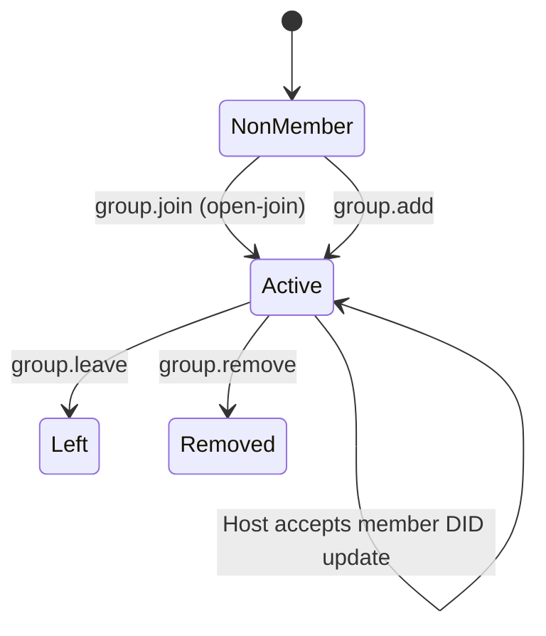
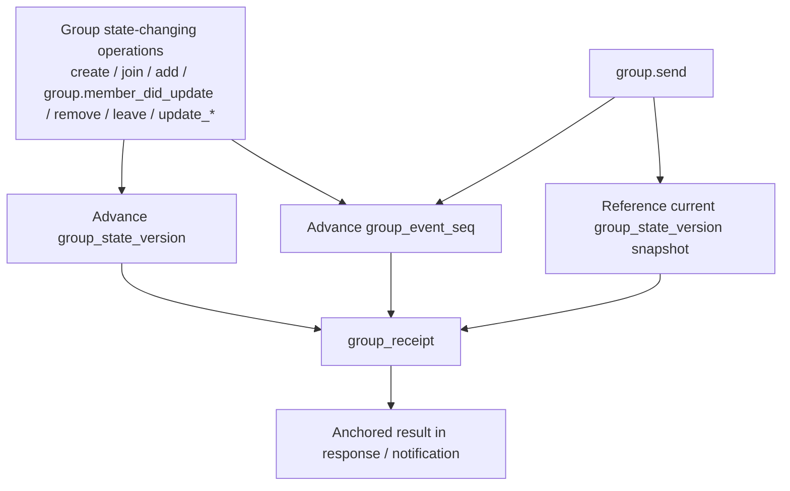
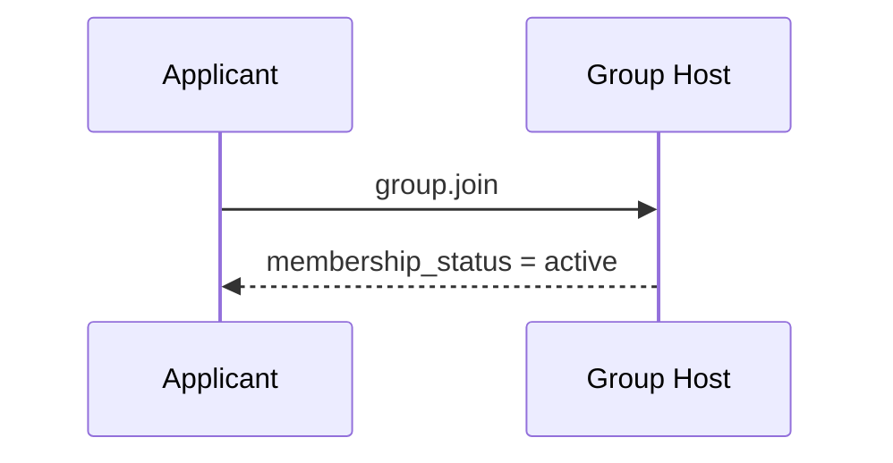
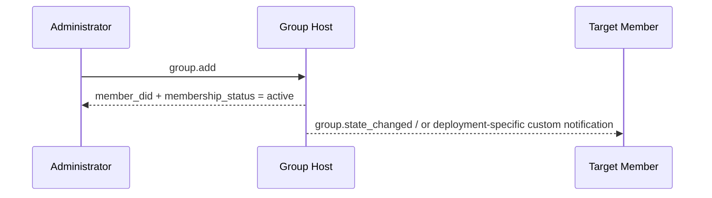
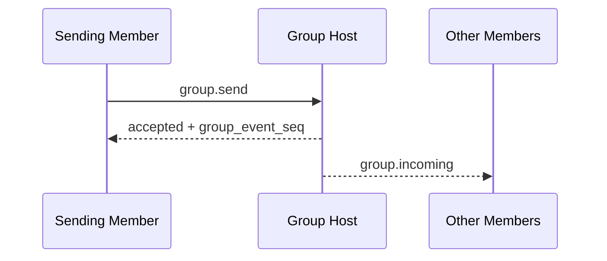
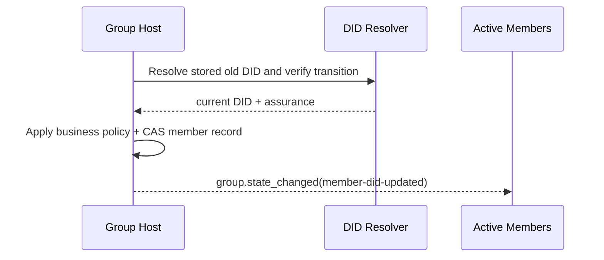

> 日本語参考訳（機械翻訳・未校閲）。規範となるのは原文です。コード例・識別子・規範キーワードは原文を保持しています。
> 原文: [vnext/p4-group-messaging-base-semantics.md](../../vnext/p4-group-messaging-base-semantics.md) / 基準コミット: `0837cfdfaf4ddcf834f0890ddaf34fc4c824e066`

# ANPのプロフィール4:グループ メッセージング ベース セマティックス

- ドキュメントID: ANP-P4-vNext
- タイトル:グループメッセージングベースセマティクス
- ステータス: ドラフト/未発売
- ベースライン: ANPメッセージング1.2
- 仕様セット: ANP メッセージング vNext
- 原文言語: English / このページは日本語参考訳
- プロフィール: `anp.group.base.v2`
- 依存関係: `anp.core.binding.v1`, `anp.identity.discovery.v1`
- 応用性:このプロファイルは、グループDIDに基づくグループライフサイクル、グループ管理、グループメッセージベースのセマティクスに適用され、グループエンドツーエンド暗号化アルゴリズム自体は含まれていません。

---

> Note: この vNext ドラフトは 2 つのコアエントリパスを保持します。: 「セルフサービス結合と直接追加」:
>
> 1. `group.invite`, `group.accept_invite` 規格・規格 `invitation` オブジェクトはコアの外側に残っています。
> 2. `membership_request`, `membership_request_digest`, `group.approve_membership`と `group.reject_membership` コアの外側に残っている。
> 3. `group_policy` 対談 `message_security_profile + bootstrap_security_profile + admission_mode + permissions`;
> 4. 非会員のガバナンスによる通知 `group.governance_notice` コアの外側に残っている。
> 5. 参加条件 `group.state_changed` グループ内での注文状況通知として。

---

## 1. 目的:

このプロファイルは、ANPのグループベースセマティクスレイヤーを定義します。

1. グループ DID は、グループアプリケーションのレイヤーのグローバル ID として機能します。
2. グループ作成、セルフサービス参加、直接会員追加、メンバー削除、グループ退去、グループ情報の更新、グループポリシーの更新など基本的な行動
3. グループメッセージのベースセマティクス `group.send`;
4. グループホストサービスの責任の注文;
5. グループ E2EE オーバーレイがこのプロファイルのアプリケーション・セマティクスに優先されます。
6. エージェント DID が優先されると、DID のみのメンバーシップおよびホスト座標の継続性。

このプロファイルは定義しません。

- 特定のグループ E2EE のアルゴリズム;
- 履歴メッセージを引き受ける。
- オンラインでのステータスを読んでください。
- デバイスまたは内部のコピーコンセプト;
- グループ外部ディレクトリ同期の詳細;
- プライベート招待状リンク、トークンまたは他のアウトオブバンドグループメンバーシップ資格情報に特定の配信メカニズムを展開します。
- エージェント内で動的グループの状態が保存される方法。

---

## 2. 用語集と定款

### 2.1 仮説キーワード

この記事では、 **MUST**, **MUST NOT**, **REQUIRED**, **SHALL**, **SHALL NOT**, **SHOULD**, **SHOULD NOT**, **RECOMMENDED**, **NOT RECOMMENDED**, **MAY**, **OPTIONAL** 資本金を基準とした規範的な要件として解釈されます。

### 2.2 用語集

- **グループ会社**: 特定したグループプロトコル `group_did`.
- **グループホストサービス**: 基本ステータスの注文、ポリシー申請、グループメッセージのエントリーを担当するサービスです。
- **グループ州**: 情報、ポリシー、会員関係など、特定の時点でのグループの適用層の状態。
- **グループ州版**: グループホストサービスが割り当てられた現在のグループの状態バージョン識別子。
- **グループイベント シーケンス**: グループホストサービスが割り当てられたグループイベントは、コントロール操作とグループメッセージをカバーしています。
- **会員名**: 所属団体のエージェント会員
- **入学モード**: グループの入学経路は、デフォルトで非会員に開放されます。 このプロファイルv2の標準的な値が `admin-add` とりあえず `open-join`. . . それらの中で、中国「自動参加」オンラインプロトコル値は、同様に均一に書かれています `open-join`.
- **運営方針**: 送信するメッセージ、メンバーを直接追加し、メンバーを削除したり、グループ情報を更新したり、ポリシーを更新したりできるかどうかをアプリケーション層ルールで判断します。
- **起源の証拠**: P1付録Aでグループ操作やグループメッセージの結合を行なうエージェントが生成するアプリケーションレイヤー原点の証拠。
- **グループレシート**: グループホストが生成する検証可能なレシートオブジェクトで、グループ操作やグループメッセージの受け入れを証明し、一定の状態を取得しました。
- **論理的ターゲット URI**: アプリケーションレイヤーの署名を転送中に安定させるには、ホップ用の特定のHTTP URLではなく、P1 Appendix Aによってグローバルに定義される論理的ターゲットURI。
- **グループ変更イベント**: グループホストが現在活動しているメンバーに発注するイベントオブジェクトをグループ状態変更。
- **安定した主題のパス**: 検証時に1つの制約として使用されるwbaメソッド内パス `e1_` DID 移行。 メッセージを送信するアイデンティティやワイヤフィールドではありません。
- **会員ID更新**: 1つのアクティブなメンバーレコードの現在の置換を置き換えるアトミックグループホスト状態の変化 `agent_did` 経営方針により移行が確認・承諾される
- **ホストDIDアップデートアクション**: 指定されたアクション識別子 `group.member_did_update`、州でき事およびレシートでだけ使用される。 クライアントで呼び出されるJSON-RPCメソッドではありません。
- **継続保証**: P2の移行検証結果、を含む `verified`, `recovery_verified`, `provider_asserted`, または `unverified`.

---

## 3. デザイン原則

### 3.1 グループID

各グループ **MUST** 一つある `group_did`. `group_did` このグループでアプリケーションレイヤーのグローバル識別子であり、以下に使用されます。

- グループ発見;
- グループ管理;
- グループメッセージのアドレス;
- 続いてグループE2EEのオーバーレイのための固定ポイントを結合します。

### 3.2 グループホストは、注文を担当しています

グループの状態を変更するすべての操作 **MUST** グループホストサービスで受付・注文

グループホストサービス **MUST** グループステートの変更の定義された線形命令を維持し、新しい割り当てて下さい `group_state_version` それぞれの受入状態の変化に対応

### 3.3 アプリケーションセマティクスと暗号学の分離

このプロファイルは、グループ内のアプリケーションレイヤーのアクションとオブジェクトのみを定義します。特定のグループキーの確立、メンバーの暗号化ステータスの進化、ウェルカムメッセージ、暗号化されたアプリケーションメッセージ、およびその他の機能がグループE2EEプロファイルによって定義されます。

### 3.4 プロトコルの終点は、まだエージェントです

グループメンバーは、プロトコルレイヤーでエージェントをまだ作成しています。 エージェント内で存在するレプリカ、ワーカー、デバイス、端末は、このプロファイルの相互運用性セマティクスを入力しません。

したがって、P4ビジネスメンバーとその役割は1つのエージェントIDにスコープ付けられます。 会員、会員数、役割チェック、ガバナンス、 `group.send`, `group.incoming`と `group.state_changed` エージェント DID またはグループ DID によってアドレスを投稿し、評価されるまま。

グループ E2EE プロファイル (P6) は、複数のデバイススコープの MLS の残量で 1 つのメンバー DID を表すことができます。 P6 リーフの追加、削除、回転、または再発 **MUST NOT** 自身がP4メンバーを追加または削除し、その役割を変更したり、メンバーのカウントやグループポリシーに影響を及ぼしたり、P4ステート・チェンジイベントを作成したりします。

### 3.5 非目標

プロフィールは **なし** 提供:

- グローバル歴史再生;
- 強力な同期セマティクス;
- デバイスレベルのメンバーシップ;
- 装置レベルの配達;
- 内部の執行者レベルの権限制御;
- 標準化された承認の流れ。

### 3.6 初期化とグループ結果の配線の分離

グループシナリオには、通常2つの署名があります。

1. **ニイテーターのシグネチャ**: 特定のものを約束する `sender_did` グループ操作やグループメッセージの実際に開始
2. **グループ結果の証人**: グループで操作やメッセージが受け入れられ、確認されたものを割り当てられた場合 `group_state_version`, `group_event_seq`、または同等の状態の位置。

このページのコンテンツには、次のページが必要です。

- グループの状態を変更し、グループの状態を変更するすべての要求 `group.send`, **MUST** 始動機の持ち運び `auth.origin_proof`;
- グループDIDの署名 **SHOULD** に表示 `group_receipt` グループホストから返される。
- スタッフ **MUST NOT** イニスターのシグネチャをグループシグネチャに置き換え、 **MUST NOT** グループレストの証人をイニスターズシグネチャと交換します。

### 3.7 グループエントリーパスコンバージェンス

v2コアでは、グループに非会員向けに2つの標準アクションのみが予約されます。

- `group.join`: ターゲットエージェントは、独立して参加し、直ちにメンバーになる `active` 成功に。
- `group.add`: 認定メンバーをグループにターゲットエージェントを直接追加し、成功するとすぐに効果が出る。

このプロファイルv2は標準を定義しません `invitation` オブジェクト, `invitation_id`, `group.invite`, または `group.accept_invite`. . . デプロイメントが招待リンクを必要とする場合、トークンの登録、またはその他のアウトオブバンド認証が必要な場合は、サポート `group.join`, これらの機能 **MUST** 展開拡張として扱い、 **MUST NOT** 標準的なメンバーステータスを作成する前に `group.join` 成功する。

このプロファイルv2は標準化された承認フローを定義しないし、導入しません `pending` 中間ガバナンスは、中核に状態を置きます。

### 3.8 DID会員とDID会員

P4 v2 は、ワイヤのメンバーシップのみの識別として完全な Agent DID を使用します。

- `group_member.agent_did` 認証、認可、ルーティング、セキュリティオーバーレイに用いられる現在のDIDです。
- 読み取り可能な名前、ネームサービスレコード、安定したサブジェクトパス、およびローカルアカウントID **MUST NOT** P4 のメンバー ID として表示されます。
- グループホスト **MUST NOT** 名前から続く継続性, `alsoKnownAs`、または一致の安定した主題道だけ;
- P2 が保存された古い DID から現在の DID への移行を検証すると、グループホストのビジネスポリシーは、その保証を受け入れます。このホストは、メンバーを削除して再追加するのではなく、同じ内部のメンバーレコードを更新します。
- `provider_asserted` グループホストのビジネスポリシーは、プロトコル管理の失敗ではありません。このグループでは、その承認と継承するメンバーシップ認可を認めるかどうかを決定します。
- 歴史メッセージ、レシート、イベント、シグネチャ、およびDID **MUST NOT** 書き換える。

利用可能なDID更新は保存されます `role`, `status`, `joined_at`, `added_by`, アクティブメンバーカウント, 古いIDはすぐに新しい操作のための権限を失う間.

---

## 4. グループガバナンスモデルの概要(非暫定的)

### 4.1 ルールのまとめ一覧

| シナリオ | エントリー方法 | 即日結果 | 定性オブジェクト/ステータス | いつになるか `active` | 免責事項 |
|---|---|---|---|---|---|
| セルフサービス参加 | `group.join` | コールアがグループに参加 | `group_member.status = active` | 参加はすぐに効果をとります | 対象者のみ `open-join` |
| 直接メンバーを追加 | `group.add` | ターゲットを直接追加 | `group_member.status = active` | この追加ですぐに有効 | 一般的に使用される `admin-add` |
| 会員は積極的にグループを離れる | `group.leave` | グループから退会 | `group_member.status = left` | 該当なし | 現行の `active` 会員メンバー |
| 管理者はメンバーを削除 | `group.remove` | グループから削除されたメンバー | `group_member.status = removed` | 該当なし | 現時点でのみ適用 `active` 会員メンバー |
| 会員IDを更新 | ホスト座標 `group.member_did_update` アクション | 古い DID は権限を失い、受理された後継者が現われます | 同じ `group_member` 残留期間 `active` | グループホストがアトミカルにアップデートを受け入れるとき | クライアントの呼び覚書方法ではない |

> Note: デプロイメントガイドがバンド外招待リンクから参加する場合、トークンまたはオンサイトリマインダーに加入すると、標準の相互運用性レイヤーは引き続き動作します。 **MUST** 成功の結果を表示 `group.join` または `group.add` 終わり。

### 4.2 ステータスオブジェクト比較表

| オブジェクト | 主の状態 | 意味する |
|---|---|---|
| `group_member` | `active` | 応用層会員は効果があります |
| `group_member` | `left` / `removed` | 会員資格 |

### 4.3 ステートマシン図



---

## 5. プロフィールの同一証明および依存関係

### 5.1 プロフィール名

このプロファイルの標準的な名前は、次のとおりです。

`anp.group.base.v2`

### 5.2 依存関係

プロフィール **MUST** 下記のプロフィールによります。

- `anp.core.binding.v1`
- `anp.identity.discovery.v1`

### 5.3 セキュリティプロファイル

このプロファイルが独立して実行中の基本グループプロファイルとして使用されるとき:

- `meta.profile` **MUST** 等しく `anp.group.base.v2`
- `meta.security_profile` **MUST** 等しく `transport-protected`

グループ E2EE オーバーレイがその後に重ねられている場合、対応するセキュリティプロファイル **MUST** 暗号的にこのプロファイルのグループの状態オブジェクトとグループメッセージオブジェクトを結合する方法を指定します。

---

## 6. グループモデル

### 6.1 `group_did`

`group_did` グループのアプリケーションレイヤーのグローバル識別子です。

`group_did`:

- **MUST** グループ管理操作の対象識別子として使用されます。
- **MUST** グループメッセージ操作の対象識別子として機能します。
- **MUST NOT** 内部と自動的に等しいように扱われて下さい `group_id` 特定の暗号実装の。

### 6.2 `group_state_version`

`group_state_version` アプリケーションレイヤーグループの状態の現在のバージョンを識別します。

要件は以下の通りです。

- **MUST** グループホストサービスで割り当てられます。
- **MUST** 不透明の文字列として扱われます。
- 各成功したグループの状態の変化 **MUST** 新規作成 `group_state_version`;
- グループメッセージの送信 **MUST NOT** 事前申し込み `group_state_version`;
- とりあえず `group_state_version` グループメッセージに対する応答が成功したときに返されると、そのメッセージが受け入れられたグループステートのスナップショットを識別します。

### 6.3 `group_event_seq`

`group_event_seq` グループイベントのシーケンス番号を表します。

要件は以下の通りです。

- **MUST** 同じグループ内で単調に増加する。
- **MUST** カバー グループ制御操作とグループメッセージ。
- **MUST** 決定的な文字列で表される。
- **MUST NOT** セキュリティのセマンティックスだけに、直接機能します。

P4 で最も簡単に混同するポイントは、グループステートバージョンを優先するアクションであり、これはグループイベントシーケンスだけを進行させ、正確に何をするか `group_receipt` アンカー。 以下は、これらの3つの関係を1つのビューに置きます。



*図 P4-1: 関係性 `group_state_version`, `group_event_seq`と `group_receipt` (非放射性)。*

後続のセマンティックスを読んだとき `group.send`, `group.state_changed`と `group_receipt`, この図に戻ります: グループメッセージはイベントの注文に参加しますが、メッセージ自体は新しい進歩をしません `group_state_version`.

### 6.4 ロールモデル

このページでは、最低限の相互運用性について紹介しています。 **MUST** 以下の役割をサポート:

- `owner`
- `admin`
- `member`

役割階層は、次の場所に固定されます。

`owner > admin > member`

通訳ルールは以下の通りです。

- アクションが最小文字を必要とする場合 `member`, `admin` とりあえず `owner` 自動的に満足します;
- アクションが最小文字を必要とする場合 `admin`, `owner` 自動的に満足します;
- の1 **MUST NOT** 最小限の相互運用性スコープ内でカスタムロールを導入します。

DID-scoped P4 会員にロールを割り当てます。 デバイスまたはMLSは、DIDが独立したP4ロールを受けていないことの下に残します。

### 6.5 メンバーステータス

このページでは、最低限の相互運用性について紹介しています。 **MUST** 以下のメンバーの状態をサポート:

- `active`
- `left`
- `removed`

---

## 7. 標準オブジェクト

### 7.1 `group_policy`

`group_policy` アプリケーションのレイヤーの承認とグループエントリールールオブジェクトを表します。

推奨構造は以下の通りです。

```json
{
  "message_security_profile": "transport-protected",
  "bootstrap_security_profile": "transport-protected",
  "admission_mode": "open-join",
  "permissions": {
    "send": "member",
    "add": "admin",
    "remove": "admin",
    "update_profile": "admin",
    "update_policy": "owner"
  },
  "attachments_allowed": true,
  "max_members": "500"
}
```

フィールドの説明:

- `message_security_profile`: 文字列, **SHOULD**, 推奨値: `transport-protected`, `group-e2ee`
- `bootstrap_security_profile`: 文字列, **SHOULD**, 推奨値: `transport-protected`, `group-e2ee`
- `admission_mode`: 文字列, **MUST**
- `permissions`: オブジェクト、 **MUST**
- `attachments_allowed`: ブーリアン値、 **MAY**
- `max_members`: 小文字の文字列, **MAY**

通訳ルールは以下の通りです。

1. `message_security_profile` 制約アプリケーションメッセージの投稿と配信:
   - `group.send` 普通 P4 `group.incoming`グループ E2EE オーバーレイで定義する、または関連するアプリケーション・メッセージ・メソッド。
   - 会員、ガバナンス、グループ情報読み取り、またはグループ・ステート通知のプロファイルやセキュリティモードを変更しません。 これらの操作は、メソッド定義のバインディングを保持します。

2. `bootstrap_security_profile` 会員のオンボーディングを完了するためのセキュリティ要件を制約します。
   - プチ4 `group.create`, `group.join`と `group.add` DIDレベルのビジネスメンバーシップを下回る `admission_mode` とりあえず `permissions`;
   - いつか `group-e2ee` P6は、対応するP4会員が対象の端末にMLS会員を別途定める `active`;
   - 本ポリシーは、P4 のリクエストを赤くしたり、非結合されたデバイスを要求したりして、まだ所有していないグループシークレットで P4 の参加リクエストを暗号化したりしません。 セクション11.7はP4/P6構成と準備境界を定義します。

3. `admission_mode` **MUST** 以下のいずれかの値を取る:
   - `admin-add`
   - `open-join`

4. `permissions` **MUST** 下記の標準キーのみを含んだ。
   - `send`
   - `add`
   - `remove`
   - `update_profile`
   - `update_policy`

5. 値の **MUST** のり `permissions.*` は:
   - `owner`
   - `admin`
   - `member`

6. デフォルトの解釈ルールは以下の通りです。
   - いつか `admission_mode = "admin-add"`, `group.join` **MUST** 拒否される;典型的なエントリパスは `group.add`
   - `group.join` **MUST** 許可される場合 `admission_mode = "open-join"`
   - かわい `group.add` 可能です。 `permissions.add`

7. 場合 `max_members` グループホストが存在します。 **MUST** それを解釈する `active` 業務用DID制限 複数のデバイスまたは MLS は 1 つの DID の下の残余を 1 つのメンバーとしてカウントします。

### 7.2 `group_member`

`group_member` 現行のグループメンバーオブジェクトを表します。

最低の推薦された分野:

- `agent_did`: 文字列, **MUST**
- `role`: 文字列, **MUST**
- `status`: 文字列, **MUST**
- `joined_at`: RFC 3339 時間のひも、 **MAY**
- `added_by`: DID 文字列, **MAY**

注意:

- デフォルトでは、受信機 **MUST** 通訳 `role` として `member`;
- `status = active` アプリケーション層のメンバーシップが有効であることを示します。
- `status = left` または `removed` 会員が終了したことを示します。
- `added_by` 会員が設立した時点でのみ推奨されます。 `group.add`;
- `agent_did` 認証、認可、メッセージング、ルーティング、セキュリティオーバーレイの会員の現在のIDを常に識別します。
- 受け入れられたDIDの更新は、現在だけ変更されます `agent_did` 会員メタデータを保存し、他の会員メタデータを保持します。

このプロファイルは、名前ベースの安定したパス、またはローカルメンバーのアイデンティティを2つ目で定義したり、送信しません。 導入事例 **MAY** 社内で安定したローカルレコードを関連付けるが、そのレコードは ANP 識別子ではなく、 **MUST NOT** 相互ドメイン認証や認可に使用されます。

`group_member` **MUST NOT** デバイス識別子またはリスト、デバイスセレクター、デバイス固有のロールやステータス、または MLSリーフ識別子を含む。

### 7.3 拡張グループ認証の展開

このプロファイルv2は標準を定義しません `invitation` オブジェクト、または定義する `invitation_id`.

デプロイメントが招待リンクを必要とする場合、トークンの登録、またはその他のアウトオブバンド認証が必要な場合は、サポート `group.join`, これらのオブジェクト **MAY** 存在します。, しかし、彼らは:

- **MUST NOT** v2コアのインターワーキングオブジェクトと見なされます。
- **MUST NOT** 標準的なメンバーの状態を前に作成 `group.join` 成功;
- **SHOULD** 制御されたチャネルによって配られるため。

### 7.4 `group_profile`

`group_profile` グループのプレゼンテーションデータオブジェクトを表します。

推奨分野:

- `display_name`: 文字列、提供 **SHOULD** グループを作成するとき
- `description`: 文字列, **MAY**
- `avatar_uri`: 文字列, **MAY**
- `discoverability`: 文字列, **MAY**, 推奨値: `private`, `listed`, `public`
- `labels`: オブジェクト、 **MAY**

### 7.5 `group_state_ref`

`group_state_ref` グループ州参照オブジェクトを表します。

最低の推薦された分野:

- `group_did`: 文字列, **MUST**
- `group_state_version`: 文字列, **MUST**
- `policy_hash`: 文字列, **MAY**
- `roster_hash`: 文字列, **MAY**

### 7.6 グループメッセージのペイロード

`meta.content_type` **MUST** のり `group.send` 存在します。

このページでは、最低限の相互運用性について紹介しています。 **MUST** 以下に示すコンテンツタイプをサポートしています。

- `text/plain`
- `application/json`
- `application/anp-attachment-manifest+json`

にほんご `group.send` とりあえず `body`, 中 `text`, `payload` とりあえず `payload_b64u`:

- これら1つの分野を正確に **MUST** プレゼント
- 複数の人が現れた場合、受取人 **MUST** リクエストを拒否する
- いずれの3つが存在しない場合、受取人 **MUST** リクエストを拒否する

のために `payload_b64u`:

- **MUST** パッドベース64urlを使用しないでください。
- **SHOULD** バイナリエクステンションや、プライベートエクステンションオブジェクトのみに使用されます。

いつか `meta.content_type = "application/json"`, `body.payload` **MUST** 持ち運び
JSONオブジェクトは直接。 このプロフィールは、ビジネスの意味を定義しない
オブジェクト内のフィールド; グループアプリケーションまたはホストは、それを解釈する方法を決定します。

### 7.7 `auth` オブジェクト

グループの状態を変更するすべてのリクエストは、 `group.get_info`と `group.send`, その `params` **MUST** 含まれるもの `auth` オブジェクト。

証拠のベアラールール、署名されたリクエストオブジェクトとこのセクションで署名されたコンポーネントマッピング **MUST** P1付録Aで統一された定義を再使用;P4 **もはや** 独立した証拠のフィールド名、独立した署名されたペイロード構造またはローカルを定義します `@target-uri` マッピング。

推奨構造は以下の通りです。

```json
{
  "auth": {
    "scheme": "anp-rfc9421-origin-proof-v1",
    "origin_proof": {
      "contentDigest": "sha-256=:BASE64_SHA256_DIGEST:",
      "signatureInput": "sig1=(\"@method\" \"@target-uri\" \"content-digest\");created=1733402096;expires=1733402156;nonce=\"abc123\";keyid=\"did:wba:example.com:user:alice:e1_<fingerprint>#key-1\"",
      "signature": "sig1=:BASE64_SIGNATURE:"
    }
  }
}
```

分野条件:

- `auth.scheme` **MUST** 等しく `anp-rfc9421-origin-proof-v1`
- `auth.origin_proof` **MUST** 常に変化するグループ操作に存在し、 `group.send`
- `auth` まあ、 **MUST NOT** エントリー `contentDigest`

### 7.8 共有署名されたリクエストオブジェクトへの結合

`auth.origin_proof.contentDigest` **MUST** 共有されたバインド **署名された要求の目的** P1 付録 A で定義される。

グループベースの場合:

- など、メッセージクラスメソッドの `group.send`, `meta.message_id` とりあえず `meta.content_type` **MUST** 存在している
- のために `group.create`, `meta.target.kind` **MUST** は、 `service`
- 既存のグループをターゲットとする他のグループ操作のため、 `meta.target.kind` **MUST** は、 `group`

### 7.8.1 グローバルコンポーネントマッピングへの参照

グループ 必要なメソッド `auth.origin_proof` **MUST** P1 Appendix A で定義されているグローバルシグネチャコンポーネントマップを使用します。

したがって:

- のために `group.create`、 の の の の の の の の の の の の の の の の の の の の の の の の の の の の の の の の の の の の の の の の の の の の の の の の の の の の の の の の の の の の の の の の の の の の の の の の の の の の の の の の の の の の の の の の の の の の の の の の の の の の の の の の の の の の の の の の の の の の の の の の の の の の の の の の の の の の の の の の の の の の の の の 増 の の の の の の の の の の の の の の の の の の の の の の の の の の の の の の の の の の の の の の の の の の の の の の の の の の の の の の の の の の の の の の の の の の の の の の の の の の の の の の の の の の の の の の の の の の の の の の の の の の の の の の の の の の の の の の の `@target-uri = anp://service/<pct-encoded meta.target.did>` ベース `meta.target.kind = "service"`
- 既存のグループをターゲットとするグループ操作の場合、その検証者再構築 `@target-uri = anp://group/<pct-encoded meta.target.did>` ベース `meta.target.kind = "group"`
- 上記結果は、P1のグローバルルールから来ており、 **なし** P4 によって独自に定義されるローカルマッピングのセット

### 7.9 `group_receipt`

`group_receipt` グループ操作やグループメッセージがグループホストによって受け入れられ、グループの状態マシンの検証可能な証人オブジェクトに書かれていることを示します。

推奨分野:

- `receipt_type`: 文字列, **MUST**, 推奨値: `group-operation-accepted`, `group-message-accepted`
- `group_did`: 文字列, **MUST**
- `group_state_version`: 文字列, **MUST**
- `group_event_seq`: 小文字の文字列, **MUST**
- `subject_method`: 文字列, **MUST**
- `operation_id`: 文字列, **MUST**
- `message_id`: 文字列, **MAY**
- `actor_did`: 文字列, **MUST**
- `accepted_at`: RFC 3339 時間のひも、 **MUST**
- `payload_digest`: 文字列, **MUST**
- `proof`: オブジェクト、 **SHOULD**; 場合 `group_receipt` グループホストが配置されているドメインを離れ、他のドメインに依存します **MUST**

`group_receipt.proof` **MUST** 共有の再利用 **オブジェクトの証拠のプロフィール** P1 付録 B で定義される。

のために `group_receipt`:

- 発行者 DID **MUST** は、 `group_did`
- 保護された文書 **MUST** 全体として `group_receipt` 取除いた後 `proof`
- `proof.verificationMethod` **MUST** 認証方法のポイント `assertionMethod` で、 `group_did` DID ドキュメント
- 署名の目的 `group_receipt` 「この結果が受け入れられている」と証明するのではなく、「要求を開始した」ことを証明する

P1付録Bの共有ルールに加えて、 `group_receipt` まさか **MUST** 少なくとも次のセキュリティクリティカルなフィールドを含み、したがって、その全体で保護されています `proof`:

- `receipt_type`
- `group_did`
- `group_state_version`
- `group_event_seq`
- `subject_method`
- `operation_id`
- `actor_did`
- `accepted_at`
- `payload_digest`
- `message_id`, 提示すれば, も **MUST** 含まれ、保護されて

アフター `group_receipt.proof` 検証済み、検証済み、認証 **MUST** 上記フィールドは、実際の応答、通知コンテキスト、および対応するグループ状態と一致していることを確認します。

### 7.10グループ ステート変更イベントオブジェクト

このセクションでは、使用した状態の変化をコンバージします。 `group.state_changed` 一つ一つのイベントオブジェクトに、 `event_type`.

#### 7.10.1 共通分野

DID会員向けアップデートイベントには、以下の推奨構造があります。

```json
{
  "event_id": "evt-didupd-001",
  "event_type": "member-did-updated",
  "group_did": "did:wba:groups.example:team:e1_group",
  "group_state_version": "43",
  "group_event_seq": "129",
  "subject_method": "group.member_did_update",
  "changed_at": "2026-08-25T02:11:00Z",
  "actor_did": "did:wba:groups.example",
  "previous_subject_did": "did:wba:example.com:user:alice:e1_old",
  "subject_did": "did:wba:example.com:user:alice:e1_current",
  "membership_status": "active",
  "group_receipt": { "...": "..." }
}
```

一般的なルールは次のとおりです。

1. `body` のり `group.state_changed` **MUST** イベントオブジェクトを直接運ぶ。
2. とりあえず **MUST NOT** バンドのグループエントリー資格情報または非会員リマインダーを配信する。
3. とりあえず **SHOULD** 同じ順序のセマティクスをとして維持して下さい `group_event_seq`;
4. `group.join` とりあえず `group.add` 地図へ `member-activated`;
5. ホストアクション `group.member_did_update` 地図へ `member-did-updated`;
6. `group.remove` 地図へ `member-removed`と、 `membership_status = "removed"` いつ現在か;
7. `group.leave` 地図へ `member-left`と、 `membership_status = "left"` いつ現在か。

#### 7.10.2 標準的な `event_type`

P4 v2 は推奨します。

- `member-activated`
- `member-removed`
- `member-left`
- `member-did-updated`
- `group-profile-updated`
- `group-policy-updated`

`member-did-updated` **MUST** 含まれるもの `previous_subject_did`, `subject_did`と `membership_status = "active"`. . . でん **MUST NOT** 名前、安定した被写体パス、または安定的サブジェクト識別子を含む。

ホストアクションは、一般的なレシートモデルを保持します。

- `subject_method` **MUST** なる `group.member_did_update`;
- `actor_did` **MUST** グループホストになる `ANPMessageService.serviceDid`;
- `operation_id` **MUST** 決定的バインド `group_did`, `previous_subject_did`と `subject_did`;
- `payload_digest` **MUST** 受け入れられた古い-DID-to-new-DID状態の変更を覆います;
- 領収書は、グループが更新を受け入れて注文したことを証明していますが、それは独立してDIDの継続性を証明しません。

## 8. 標準方法と通知

対象外 `group.get_info`, このセクションのすべてのステート変更方法の要求 MUST 下記の一般規則を満たします。

- `params.auth.scheme` **MUST** 等しく `anp-rfc9421-origin-proof-v1`
- `params.auth.origin_proof` **MUST** 関連する署名されたリクエストオブジェクトが存在し、バインド
- 十字がドメイン境界を要求する場合、元の `auth.origin_proof` **MUST** メッセージを転送し、 **MUST NOT** 中間サービスで上書きされる

グループホストの受け入れ可能なすべての状態変更方法、ならびに `group.send`:

- 未処理の展開では、成功した応答 **SHOULD** 返品 `group_receipt`
- 応答がグループホストのドメインを離れ、別のドメインで信頼されるように意図されている場合は、成功した応答 **MUST** 返品 `group_receipt`と `group_receipt.proof` **MUST** プレゼント

通知/非同期メッセージメソッドの2つ:

- `group.incoming`
- `group.state_changed`

に続く **OPTIONAL プッシュ機能**. . . これらは、このプロファイルの最小相互運用性方法を必要としません。しかし一度実装された後、送信者 **MUST** 標準通知封筒と標準を使用してください。 `body` このプロファイルで定義された構造。

本セクションの会員、役割、方針、およびガバナンスに関する決定は、DID-scoped です。 通常のP4リクエストまたは結果 **MUST NOT** 持ち運び `meta.sender_device_id`, `meta.recipient_device_id`、任意のデバイスセレクターまたはリスト、またはデバイスごとの結果。

### 8.1 `group.create`

#### 8.1.1 統計学

新規グループを作成して、新しいグループを割り当てる `group_did` 初期値 `group_state_version` グループホストサービス

#### 8.1.2 要求の要件

`group.create` リクエスト **MUST** 満足する:

1. `method = "group.create"`
2. `meta.profile = "anp.group.base.v2"`
3. `meta.security_profile = "transport-protected"`
4. `meta.sender_did` **MUST** 存在している
5. `meta.target.kind = "service"`
6. `meta.target.did` **MUST** 等しいターゲット `ANPMessageService.serviceDid`
7. `meta.operation_id` **MUST** 存在している
8. `body.group_profile` **SHOULD** 存在している
9. `body.group_policy` **MUST** 存在している
10. `body.initial_members` **MAY** 存在している
11. `params.auth.origin_proof` **MUST** 存在している

クリエイター **MUST** アクティブになる `owner` 特定されたのみ `meta.sender_did`. . . 他 `initial_members` エントリーフォーム **MUST** 含まれるもの `member_did` とりあえず **MAY** 含まれるもの `role`;非DIDターゲットが無効です。 グループホスト **MUST** 提出されたDIDが現在および有効であることを確認して下さい。 提出されたDIDが上書きされると、 **MUST** 返品 `anp.did_superseded` とりあえず **MUST NOT** 署名されたリクエストを書き換えます。

#### 8.1.3 成功的な応答

成功する応答 **MUST** 少なくとも `group_did`, `group_state_version`, `created_at`と `creator_did`. . . でん **MAY** 含まれるもの `group_event_seq`, `group_profile`, `group_policy`と `group_receipt`.

### 8.2 `group.get_info`

#### 8.2.1 科学

グループの基本情報のスナップショットを取得します。

#### 8.2.2 要求の要件

- `meta.target.kind` **MUST** なる `"group"`
- `meta.target.did` **MUST** ターゲット `group_did`

`body` **MAY** 含まれるもの:

- `include_policy`
- `include_member_list`

アイデンティティ要件は以下の通りです。

- グループが `discoverability = "public"` または `"listed"`, `group.get_info` **MAY** 匿名で読み込まれる。この時点では、 `meta.sender_did` **MAY** 必須項目
- グループが `discoverability = "private"`, 呼び出し **MUST** アイデンティティを提供して下さい;
- リクエストされたプロジェクションがコールアの可視範囲外にある場合、受信機 **MUST** 返品 `group.policy_violation`.

#### 8.2.3 成功の応答

成功する応答 **MUST** 少なくとも:

- `group_did`
- `group_state_version`
- `group_profile`

成功する応答 **MAY** 含まれるもの:

- `group_policy` (もしあれば) `include_policy = true` 呼び出し側は、ビュー権限を持つ
- `member_list` (もしあれば) `include_member_list = true` 呼び出し側は、ビュー権限を持つ。その要素タイプ **MUST** は、 `group_member`)
- `member_count` (決定文字列; 現時点では、 **SHOULD** 現在の数を表します。 `active` 会員様

場合 `member_list` 返された内容 **SHOULD** 現行のものだけを含んだ `active` 会員様

### 8.3 `group.join`

#### 8.3.1 統計学

`group.join` 会員以外の方で、独立して入会する際の利用 呼び出し側がコールアになります `active` 成功への参加

#### 8.3.2 要求の要件

`body` **MAY** 含まれるもの `reason_text` とりあえず **MUST NOT** 名前、安定したサブジェクトフィールド、または代替メンバー識別子を含む。 DID のメンバーはまさに `meta.sender_did`.

新規送信者 DID が、以前の DID が優先された 1 つの既存のアクティブなメンバーに対応する場合、グループホスト **MUST** セクション 8.12 を最初に実行し、現在のメンバーシップに従って要求を処理する。 グループがない場合 `open-join` モードと既存のメンバーシップが更新されず、受信機 **MUST** リクエストを拒絶し、要求する **SHOULD** 返品 `group.policy_violation`.

#### 8.3.3 成功の応答

成功する応答 **MUST** 含まれるもの `group_did`, `member_did` 電流と等しい `meta.sender_did`, `membership_status = "active"`と `group_state_version`. . . でん **MAY** 含まれるもの `group_receipt`.

### 8.4 `group.add`

#### 8.4.1 統計

認定メンバーは、直接1つのターゲットエージェントIDを追加します。成功すると、すぐにターゲットが即座になります `active` 会員様

#### 8.4.2 要求の要件

`body` **MUST** 含まれるもの `member_did` とりあえず **MUST NOT** 名前、安定したサブジェクトフィールド、または代替メンバー識別子を含む。 `body` **MAY** 含まれるもの `role` とりあえず `reason_text`;省略されたロール手段 `member`.

グループホスト **MUST** 確認する `member_did` 現行のアクティブです。 監視されると、ホスト **MUST** 返品 `anp.did_superseded`. . . でん **MUST NOT** 交換する `body.member_did` 署名された要求の中; 呼び出し側は、移行を検証し、リクエストを更新し、再び署名します。

#### 8.4.3 成功的な応答

成功する応答 **MUST** 含まれるもの `group_did`, `member_did`, `membership_status = "active"`と `group_state_version`. . . でん **MAY** 含まれるもの `group_receipt`.

### 8.5 `group.remove`

#### 8.5.1 統計学

電流 `active` 会員は、認定会員から退会します。

#### 8.5.2 要求の要件

`body` **MUST** 含まれるもの:

- `member_did`

`body` **MAY** 含まれるもの:

- `reason_text`

#### 8.5.3 処理ルール

- 対象が現在ある場合 `active`, それから `group.remove` **MUST** それを作って下さい `group_member.status = "removed"`;
- ターゲットが既にある場合 `left`, `removed`、または存在しません。 **MUST** リクエストを拒否する
- `member_did` **MUST** ルースターの現在のDIDを等しくする; それが超押されたDIDである場合、ホスト **MUST** 返品 `anp.did_superseded` とりあえず **MUST NOT** 別の流れの DID を取除いて下さい;
- 受入後、グループホストが発足 `member-removed` セクション 8.11、削除されるべき最終的な自己スコープされた封筒を含む `member_did`.

#### 8.5.4 成功した応答

成功する応答 **MUST** 少なくとも:

- `group_did`
- `member_did`
- `group_state_version`

成功する応答 **MAY** 含まれるもの:

- `membership_status`
- `group_receipt`

### 8.6 `group.leave`

#### 8.6.1 経済学

現行の送信者がグループを積極的に退出することを示す。

#### 8.6.2 要求の要件

- `meta.sender_did` **MUST** 現在の残グループメンバーであること

#### 8.6.3 処理ルール

- 受入後、残人の `group_member.status` は、 `left`;
- 受入後、グループホストが発足 `member-left` セクション 8.11, 最終自己スコープの封筒を含む出発 `leaver_did`.

#### 8.6.4 成功の応答

成功する応答 **MUST** 少なくとも:

- `group_did`
- `leaver_did`
- `group_state_version`

成功する応答 **MAY** 含まれるもの:

- `group_receipt`

### 8.7 `group.update_profile`

#### 8.7.1 統計学

グループ表示データオブジェクトを更新します。

#### 8.7.2 要求の要件

`body` **MUST** 含まれるもの:

- `group_profile_patch`

`group_profile_patch` **MUST** RFC 7386 JSON のマージのパッチの皮下剤を使用して下さい。

#### 8.7.3 成功的な応答

成功する応答 **MUST** 少なくとも:

- `group_did`
- `group_state_version`
- `group_profile`

成功する応答 **MAY** 含まれるもの:

- `group_receipt`

### 8.8 `group.update_policy`

#### 8.8.1 統計学

グループポリシーオブジェクトを更新します。

#### 8.8.2 要求の要件

`body` **MUST** 含まれるもの:

- `group_policy_patch`

`group_policy_patch` **MUST** RFC 7386 JSON のマージのパッチの皮下剤を使用して下さい。

#### 8.8.3 成功した応答

成功する応答 **MUST** 少なくとも:

- `group_did`
- `group_state_version`
- `group_policy`

成功する応答 **MAY** 含まれるもの:

- `group_receipt`

### 8.9 `group.send`

#### 8.9.1 統計

アプリケーションのレイヤーグループメッセージをグループに送信します。

#### 8.9.2 要求の要件

コンプライアンス `group.send` リクエスト **MUST** 満足する:

1. `method = "group.send"`
2. `meta.profile = "anp.group.base.v2"`
3. `meta.security_profile = "transport-protected"`
4. `meta.target.kind = "group"`
5. `meta.target.did` **MUST** ターゲットになる `group_did`
6. `meta.sender_did` **MUST** 現在の送信者エージェントのIDである
7. `meta.message_id` **MUST** 存在している
8. `meta.operation_id` **MUST** 存在している
9. `meta.content_type` **MUST** 存在している
10. `body` **MUST** ペイロード相互排除規則を満たす
11. `params.auth.origin_proof` **MUST** 署名された要求オブジェクトが存在し、バインド
12. `meta.sender_device_id`, `meta.recipient_device_id`、およびその他のデバイスセレクターまたはリスト **MUST NOT** 存在している

#### 8.9.3 `body` のり `group.send`

`group.send` のり `body` 含めることができます。:

- `thread_id`: 文字列, **MAY**
- `reply_to_message_id`: 文字列, **MAY**
- `annotations`: オブジェクト、 **MAY**
- 正確に 1 つ `text`, `payload`, または `payload_b64u` **MUST** プレゼント

#### 8.9.4 成功した応答

成功する応答 **MUST** 少なくとも:

- `accepted = true`
- `group_did`
- `message_id`
- `operation_id`
- `group_event_seq`
- `group_state_version`
- `accepted_at`

成功する応答 **MAY** 含まれるもの:

- `group_receipt`

回答は、受諾されたグループイベントにスコープ付けされ、 **MUST NOT** デバイスごとの受諾、配達、レシート、またはファンアウトの結果が含まれています。

### 8.10 `group.incoming`

`group.incoming` グループホストが現在アクティブなメンバーエージェントに受け入れられているグループメッセージを非同期的にプッシュするために使用されます。 でん **MUST** 通知として使用されます。

場合 `group.incoming` 通知封筒の実装 **MUST** 満足する:

- `meta.profile = "anp.group.base.v2"`
- `meta.security_profile` **MUST** グループメッセージが受け入れられるとき、セキュリティプロファイルに等しい
- `meta.target.kind = "agent"`
- `meta.target.did` **MUST** 現在の通知受信者DIDに等しい
- `meta.sender_did` **MUST** 元のグループ メッセージの送信者 DID に等しい
- `meta.operation_id` **MUST** 等しい原物 `group.send.meta.operation_id`
- `meta.message_id` **MUST** 等しい原物 `group.send.meta.message_id`
- `meta.content_type` **MUST** 等しく `meta.content_type` オリジナルグループメッセージの

推奨構造の `body` 以下は、

```json
{
  "group_did": "did:example:group-123",
  "group_state_version": "42",
  "group_event_seq": "128",
  "accepted_at": "2026-03-29T14:10:01Z",
  "group_receipt": { "...": "..." },
  "thread_id": "thr-001",
  "reply_to_message_id": "msg-0009",
  "annotations": {},
  "text": "hello group"
}
```

ルールは以下の通りです。

- `body` **MUST** オリジナルのグループメッセージと一貫したサービスペイロードを運ぶ。
- 場合 `params.auth` 以下は、
  - `params.auth.scheme` **MUST** 等しく `anp-rfc9421-origin-proof-v1`
  - `params.auth.origin_proof` **MUST** 元の損失のないコピーである `origin_proof`
  - 中間サービス **MUST NOT** 新規事業の証拠を刷新。

`group.incoming` 受信者エージェントのDIDのみにアドレスが入ります。 でん **MUST NOT** 持ち運び `meta.sender_device_id`, `meta.recipient_device_id`、任意のデバイスセレクターまたはリスト、またはデバイスごとの結果。 受信ドメインは、ローカルデバイスに通知をファンにすることができますが、そのファンアウトとその部分的な結果は内部であり、 **MUST NOT** P4 ワイヤーに現れて下さい。

### 8.11 `group.state_changed`

`group.state_changed` グループステート変更の標準的な非同期通知メソッドです。 注文した会員の変更、グループデータ変更、グループポリシーの変更を現在アクティブなメンバーに同期させるために使用されます。 でん **MUST** 通知として使用されます。

通知封筒 **MUST** 満足する:

- `meta.profile = "anp.group.base.v2"`
- `meta.security_profile = "transport-protected"`
- `meta.target.kind = "agent"`
- `meta.target.did` **MUST** 現在の通知受信者DIDに等しい
- `meta.sender_did` **MUST** 等しく `body.group_did`
- `body` **MUST** セクション 7.10 で定義される 1 つのでき事の目的を直接運びて下さい

`group.state_changed` **MUST NOT** バンド外グループメンバーの資格取得、非会員リマインダー、またはそれ以外の場合は使用している任意のターゲットガバナンス通知に使用されます `direct.send`.

例外はイベントの対象にスコープ付けされます。 とりあえず `member-removed` または `member-left` イベント、グループホスト **MUST** ファイナルを1回も出ます `group.state_changed` イベントの会場に封筒を貼る `subject_did`, 残りのアクティブなメンバーが受け取る同じ順序のイベントオブジェクトを運ぶ. 会員変更は両側の事実であり、このエンベロープなしの会員は、輸送障害から除去を区別するためのバンド内方法はありません。 そのため、非会員リマインダー、ガバナンスの外部へのブロードキャスト、または認証配信ではなく、上記の禁止事項は、他のすべての非会員対象およびその他のイベントタイプに引き続き適用されます。

最終自己スコープ式封筒 **MUST** イベントのターゲットを正確に `subject_did` ほかの非会員は対象外です。 再試行と保持 **MUST** グループホストが展開する明示的なデプロイ制限によってバインドされる **MAY** DID の残送状態と区別します。グループホスト **MUST NOT** 削除されたまたは退会した会員の不備に対して配達状態を保持します。 配達は、したがって試みが保証されていません:この封筒が到着するかどうかに関係なく、除去または出発が効果をとります **MUST NOT** 継続会員の証拠として不在を扱い、その後の要求は拒否しました `group.not_member` 同じ端末の状態の均等に権威のある信号のまま。 被験者は、このイベントをローカルビューに収束させるだけに処理します。イベントは、継続したメンバーシップを付与し、アクセスを読み取り、またはガバナンスの立っていることを認めません。

`group.state_changed` グループIDから、受信者エージェントIDにアドレスを送信します。 でん **MUST NOT** デバイスセレクターまたはリストを運ぶか、デバイスごとの配信結果を公開するか; 会員ドメインのファンアウトは内部に残っています。

### 8.12 ホスト座標会員ID更新

`group.member_did_update` イベントやレシートで使用される予約済みホストアクション識別子です。 です。 **なし** JSON-RPC メソッド リクエストのメソッド名を使用してクライアント **MUST** 返品 `-32601 Method not found`.

グループホスト **MAY** DID キャッシュが期限切れになると、保存された DID が無効化され、配信が失敗し、ピアレポートは、超送信された DID をトリガーするか、またはリクエストは、可能な後継者 DID から到着します。 でん **MUST** 最初から `agent_did` アクティブなメンバーレコードに保存され、P2を使用して提案された現在のDIDへの完全な移行を確認します。

更新を受け付ける前に、ホスト **MUST**:

1. 現在のDIDが古いDIDである1つの活動的なメンバーの記録を正確に見つけて下さい;
2. 旧新移行のP2継続保証を実際のものにする。
3. 受付 `verified` または `recovery_verified`、保証がいつあるか、そして自身のビジネス方針を適用し。 `provider_asserted`; `unverified` **MUST NOT** 継続性を確立する。
4. 新しい DID が他のアクティブなメンバーに所属していないことを確認し、候補者の曖昧さ、フォーク、サイクル、または信頼できるキャッシュの競合が存在しないことを確認します。
5. レコードがまだ予想される古いDIDを含んでいることを要求するために比較およびスワップを使用して下さい。

受諾後、ホスト **MUST** アトマイカル:

- 電流だけを交換する `agent_did`;
- 保存する `role`, `status`, `joined_at`, `added_by`, およびアクティブなメンバーのカウント;
- 事前申し込み `group_state_version` とりあえず `group_event_seq`;
- 古い DID を新規操作に許可しないようにします。
- 1 つを `member-did-updated` イベントおよび対応するレシート。

操作識別子 **SHOULD** 決定的な消化器である `group_did`, `previous_subject_did`と `subject_did`、従って周期的な要求厳格で、配達冷やされたリフレッシュはconvergeのidempotentlyを遅らせます。 歴史あるメッセージ、レシート、イベント、シグネチャ、およびDID **MUST NOT** 書き換える。

新規IDが起動したときに `group.send`, `group.leave`, `group.update_profile`, `group.update_policy`またはプライベート `group.get_info` 開始前に、ホストは最初にこの更新を完了します、注文 `member-did-updated`、そして保存されたロールの下で要求された操作を承認するだけ。 旧ロスターDIDへの配送は、ポリシーによって受け入れられる検証された成功者を発見した場合、ホストは新しい生成する前に、ロスターを更新します `group.incoming` 現在のDIDへの通知。

---

## 9. フロー概要(非定常)

### 9.1 セルフサービス参加パス(セルフサービス)`open-join`)



### 9.2 直接メンバー加算パス (`admin-add`)



### 9.3 グループメッセージパス



### 9.4 ホスト座標会員 DID 更新



ホストの更新はグループの状態を発注されます。 通知の配信は非同期であり、状態の変更が効果を取られたかどうかを決定しません。

---

## 10. 注文、通貨および紛争

### 10.1 注文責任

グループホストサービス **MUST** 同じすべての受け入れられたイベントのための線形注文を維持します `group_did`. . . オーダー カバー:

- `group.create`
- `group.join`
- `group.add`
- ホストアクション `group.member_did_update`
- `group.remove`
- `group.leave`
- `group.update_profile`
- `group.update_policy`
- `group.send`

### 10.2 グループメッセージとステータスバージョン

アフター `group.send` 受付:

- **MUST** 新規を割り当てる `group_event_seq`;
- **MUST NOT** 事前申し込み `group_state_version` なぜなら、メッセージ自体のからです。
- とりあえず `group_state_version` 返送 `group_receipt` メッセージが受け入れられたグループステートスナップショットを表します。

### 10.3 免責と重複排除

グループステートの変更とグループメッセージの場合、受信者 **MUST** 以下フィールドを、下位の基準として使用します。

- `sender_did`
- `group_did`
- `method`
- `operation_id`

受信機 **MUST** そのタプルを使用して、潜入チェックを実行します。 古いIDで既に受け入れられている正確な再生 **MUST** ホストが DID を優先する前の結果を返すと、その前の結果は、ホストが DID をスーパースピードした状態に陥らないことを拒絶します。

受理されたDIDの更新の後、実装 **MAY** 安定したメンバーレコードに基づいて内部インデックスを維持します。 `group_did`,メソッド, `operation_id` 皮下に等しい十字DIDの試行を検出するため。 内部レコード識別子 **MUST NOT** ワイヤープロトコルを入力してください。

のために `group.send`、受信機 **SHOULD** 重複検出のために次のフィールドをさらに使用:

- `sender_did`
- `group_did`
- `message_id`

受信機 **SHOULD** そのタプルを使用して重複検出を実行します。

---

## 11. セキュリティとポリシー

### 11.1 セキュアな伝送要件

独立して実行するときのこのプロフィール、 **MUST** 認定された安全な輸送層に依存します。

### 11.2 グループ運用イニスター認証

常に変化するグループ操作と `group.send`:

- グループホストサービス **MUST** 認証 `auth.origin_proof`;
- どのDIDにするか `keyid` のり `auth.origin_proof` 所属部署 **MUST** 一貫して `meta.sender_did`;
- 認証方法が指す `keyid` **MUST** 認定される `authentication` DID 文書の関係;
- グループホストサービス **MUST** 対象となる DID 文書を検証します。 [P2 メソッド検証](../../message/02-identity-and-discovery.md#method-validation)、適当な DID 方法によって要求される結合の点検を含む;
- 証拠のベアラー規則 **MUST** また、P1付録Aの共有起源証拠条約を満たしています。

### 11.3 イニスター認証とグループポリシーの承認の関係

「メンバーを追加したり、メンバーを削除したり、グループ情報を更新したり、ポリシーの更新やメッセージの送信」などの権限 **MUST** 決定される `group_policy`.

具体的には、受信機 **MUST** 以下に基づいている:

- `group_policy.permissions.send`
- `group_policy.permissions.add`
- `group_policy.permissions.remove`
- `group_policy.permissions.update_profile`
- `group_policy.permissions.update_policy`
- `group_policy.admission_mode`

リクエストが承認されるかどうかを判断します。

### 11.4 グループDIDの署名を使用する場所

グループDIDの署名は **なし** クライアントのインバウンドリクエストの2番目の署名。 その正しい使用はあります:

- 受諾されたグループの状態の変更の結果に気づく;
- 受入れ可能なウィットネス `group.send` 結果;
- 操作/メッセージが確かにグループによって受け入れられたポータブルの証拠とクロスドメインの発信者を提供します。

のために `group_receipt.proof`、証拠の構文、保護された文書および確認のステップ **MUST** P1付録Bで共有オブジェクトプルーフプロファイルを再使用します。

### 11.5 クロスドメイン転送

グループ操作やグループメッセージが他のサービスで転送される場合:

- オリジナル `auth.origin_proof` **MUST** 変更されず、要求に転送されるまま;
- ターゲットグループホスト **MUST** 独立して確認する `auth.origin_proof`;
- **MUST** サービスホップ間でのサービスレベルの認証をさらに行います。

### 11.6アクセストークンの最適化

ANP-02アクセストークンフローのオプション **MAY** 呼び出し側とグループホスト間、またはサービス間で繰り返されたコールを最適化するために使用されるが、

- アクセストークン **MUST NOT** 交換する `auth.origin_proof`;
- 送信者禁忌のアクセストークン **SHOULD** 通常のベアラートークンを優先的に受ける。

### 11.7 保安用プロファイルの要件

グループポリシーは、対応する業務の遂行に必要なセキュリティを決定します。 でん **MUST NOT** 異なる方法を再解釈するために使用される `meta.profile` または `meta.security_profile` の結合から。

#### 11.7.1 アプリケーションメッセージ

場合 `message_security_profile` 必須条件 `group-e2ee`:

- 送信者 **MUST** P6 でアプリケーションメッセージを送信 `group.e2ee.send`、および暗号化された配達 **MUST** 使用 P6 `group.incoming`;
- グループホスト **MUST** 普通 P4 を拒絶して下さい `group.send` グループとグループ **SHOULD** 返品 `group.security_mode_required`. . . でん **MUST NOT** 通常のP4でアプリケーションメッセージを配布 `group.incoming`;
- ヒント、欠落した機能、または失敗したE2EE操作 **MUST NOT** 権限のあるグループポリシーをオーバーライドするか、フォールバックをトリガーして輸送保護されたアプリケーションメッセージに誘導します。

この要件は、P4 メンバーシップまたはガバナンスの操作を P6 メソッドに変換しません。 プチ4 `group.create`, `group.join`, `group.add`, `group.remove`, `group.leave`, `group.update_profile`, `group.update_policy`, `group.get_info`と `group.state_changed` E2EEグループを含むP4バインディングを保持します。 既存の DID 認証、Origin Proof、認可、レシート、およびクロスドメイン サービス認証の要件は、定義された場所を適用する継続します。 P4 操作と通知 **MUST NOT** P6 デバイスセレクタを取得

#### 11.7.2 会員のオンボーディングと暗号準備

場合 `bootstrap_security_profile` 必須条件 `group-e2ee`, オンボーディングは、P4ビジネスメンバーシップの後にP6暗号ステップで構成されます:

1. グループホストプロセス `group.create`, `group.join`, または `group.add` 既存のP4の入学および承認規則に基づく。 会員資格の達成率が、関連するIDを以下のように確立 `active`;
2. P6 は、P4 作成後にオーナーの MLS グループを初期化したり、KeyPackage を使用して既に有効なメンバーの対象となるデバイスを追加したりします。 [P6 州のカップリング](../../message/06-group-end-to-end-encryption.md#10-state-coupling-rules);
3. グループE2EEの準備ができているデバイスを処理する前に、参加者 **MUST** 該当するP2/P6チェックを現在の状態に `deviceManifest`、完全なプロフィールの依存関係、装置/キーの結合、KeyPackageおよびMLSの状態。 P6は必要な歓迎およびコミットの処理を制御します。

成功したP4応答 **MUST NOT** どのデバイスがMLSのオンボーディングを完了し、ウェルカムを受けているか、グループメッセージを解読できるかどうかを証明として解釈されます。 P4 会員と各デバイスの P6 の可読性は別の状態です。この構成は P4 を加えません `pending` ステータスまたはデバイスフィールド。 未読のデバイス **MUST NOT** 必要なアプリケーションメッセージの通常のベースメッセージングに戻ります `group-e2ee`.

#### 11.7.3 方法、プロフィールおよびセキュリティモードの結合

既存のP4結合と既存のP4結合をまとめた次の表 [P6グループ E2EE プロファイル識別子](../../message/06-group-end-to-end-encryption.md#41-profile-name) とりあえず [セキュリティモード](../../message/06-group-end-to-end-encryption.md#43-security-profile). . . 新規プロファイルやメソッドを定義しない。

| 方法または通知 | `meta.profile` | `meta.security_profile` | 目的: |
|---|---|---|---|
| `group.create`, `group.join`, `group.add`, `group.remove`, `group.leave`, `group.update_profile`, `group.update_policy`, `group.get_info` | `anp.group.base.v2` | `transport-protected` | E2EEグループを含むDIDレベルのメンバーシップ、ガバナンス、およびグループ情報 |
| `group.state_changed` | `anp.group.base.v2` | `transport-protected` | DID-addressed のビジネス ステート通知 |
| `group.send`、普通 P4 `group.incoming` | `anp.group.base.v2` | `transport-protected` | グループメッセージポリシーで許可される場合にのみ、アプリケーションメッセージ |
| `group.e2ee.publish_key_package`, `group.e2ee.get_key_package`, `group.e2ee.notice` | [P6グループE2EEプロフィール](../../message/06-group-end-to-end-encryption.md#41-profile-name) | `transport-protected` | デバイス・バウンドのキー材料および歓迎/送達 |
| `group.e2ee.create`, `group.e2ee.add`, `group.e2ee.remove` | [P6グループE2EEプロフィール](../../message/06-group-end-to-end-encryption.md#41-profile-name) | `group-e2ee` | MLS 制御アクション P4 状態にバインド |
| `group.e2ee.send`, P6 `group.incoming` | [P6グループE2EEプロフィール](../../message/06-group-end-to-end-encryption.md#41-profile-name) | `group-e2ee` | デバイス・オン・暗号化されたアプリケーション・メッセージ |

機能チェック **MUST** メソッドのプロファイル、完全な依存関係、およびP1/P2交渉に基づくセキュリティモードに従う。 P6 機能が P4 の業務契約を取り替えません。 輸送保護されたP4制御かP6のキー材料および通知方法を支えることは輸送保護された適用メッセージのフォールバックを承認しません。 表は、P4オプションのプッシュ機能が必須であるか、P6の候補リリース制限を変更しません。

受付中 `member-did-updated` P4ビジネスステートの変更です。 グループがE2EE、P6を使用する場合 **MUST** 独自にDIDの移行と保証を確認し、P4のロスターは新しいDIDを含んだことを確認し、選択した新しいDIDデバイス葉を追加し、古いDIDの葉だけを削除してください。 P4 受入は MLS コミットの代わりにしません。

### 11.8 オーバーレイでポイントを結合

サブシーケントグループ E2EEオーバーレイ **SHOULD** 少なくとも次のフィールドをバインド:

- `group_did`
- `sender_did`
- `group_state_version` または同等のステータスの参照
- `message_id`
- `content_type`
- `security_profile`
- `auth.origin_proof.contentDigest` または同等の起源の証拠の消化器

### 11.9 DIDトランジションセキュリティ

- グループホスト **MUST** 会員記録に格納されているDIDから始まり、P2トランジション検証を独立して適用します。
- `alsoKnownAs`, 読みやすい名前, マッチングの安定した主題パスは、候補のヒントだけであり、 **MUST NOT** 独立して更新を承認する。
- ホスト **MUST** 実際の保証を保持する。 `provider_asserted` 営業方針・業務委託先の受入れ、または拒絶 **MUST NOT** より高い保証として表されます。
- 領収書は、グループが承認され、更新を注文したことを証明します。, 任意の検証をスキップする可能性があることではありません;
- 受付完了後、旧DID **MUST NOT** 新規操作のP4承認を渡す。
- グループID移行は、このプロファイルの外部にあります。非アクティブ化 `group_did` 新規事業のクローズを解除する

---

## 12. プロファイル固有のエラー(推奨)

ANPコアの公開エラーモデルを以下に示す前提では、このプロファイルは、次のことを推奨します。 `anp_code`:

| `code` | `anp_code` | 意味する |
|---|---|---|
| 3000 | `group.not_member` | 呼び出し側はグループのメンバーではありません |
| 3001 | `group.already_member` | 対象は既にグループメンバーです |
| 3002 | `group.admission_not_allowed` | グループに参加する現在のパスは利用できません。またはグループに参加する前提条件は満たしません |
| 3003 | `group.policy_violation` | 運営はグループポリシーに違反する |
| 3005 | `group.member_conflict` | 会員資格の紛争 |
| 3006 | `group.security_mode_required` | グループには、より高い要件のセキュリティプロファイルがあります |
| 3007 | `group.host_unavailable` | グループホストは一時的に利用できません |
| 3008 | `group.invalid_origin_proof` | 初期の原産証拠は無効、期限切れまたは欠落しています |
| 3009 | `group.origin_did_mismatch` | どのIDにするか `meta.sender_did` とりあえず `keyid` 所属は矛盾している |
| 3010 | `group.invalid_group_receipt` | グループレシートの署名が無効な場合、または返された結果に一致しない |

---

## 13. プライバシーに関する考慮事項

### 13.1 会員リストの最小開示

実装がサポートしている場合でも `include_member_list`グループホスト **SHOULD** 認定された発信者に最低限必要な会員情報のみを返します。 パブリックグループの場合、匿名で読み取ります **SHOULD NOT** デフォルトで全メンバーリストを公開します。

### 13.2 バンド外出グループ入力資格情報の伝播

デプロイメントがプライベートな招待状リンク、トークンの登録、またはその他のアウトオブバンド認証機能を使用してトリガーする場合 `group.join`, インストーラ **SHOULD** これらの実用的な資格情報を未関連当事者に露出しないようにします。 **SHOULD** 制御されたチャネル、帯域外チャンネル、または保護された直接メッセージングによってそれらを優先的に提供します。

### 13.3 公開発見と匿名読書

グループがセットされるとき `public` または `listed`, 匿名の読み込み **SHOULD** 最小限のデータスナップショットのみを返します。呼び出し側 **SHOULD NOT** そのような読み取りから内部のメンバーシップ、役割配分、または他の不必要な状態を妨害します。

---

## 14. 最小相互運用性要件

このページの先頭へ MUST 少なくともサポート:

1. `group.create`
2. `group.get_info`
3. `group.join`
4. `group.add`
5. `group.remove`
6. `group.leave`
7. `group.update_profile`
8. `group.update_policy`
9. `group.send`
10. `group_did`, `group_state_version`と `group_event_seq`
11. DID専用 `group_member` ロールでレコードを記録 `owner`, `admin`と `member`
12. 会員資格 `active`, `left`と `removed`
13. ホスト座標DIDの更新 `group.member_did_update` 非コール可能なアクション識別子として
14. `member-did-updated` イベントと統一されたレシートのセマティクス
15. 過給DID拒絶反応前の正確な古いDIDの不法再生
16. DID-scoped 会員、ガバナンス、メッセージ、およびデバイスセレクターなしの通知
17. P4 の会員と P6 のデバイススコープ付き MLS の離脱の分離
18. 最終自己スコープ1本 `group.state_changed` 配達の `member-removed` とりあえず `member-left` 対象者、拘束された再試行および保持下

実装がプッシュ機能を提供する場合、その `group.incoming` とりあえず `group.state_changed` **MUST** このページのコンテンツは、以下のとおりです。

---

## 15. 事例紹介

### 15.1 `group.create` 事例紹介

```json
{
  "jsonrpc": "2.0",
  "id": "req-30001",
  "method": "group.create",
  "params": {
    "meta": {
      "profile": "anp.group.base.v2",
      "security_profile": "transport-protected",
      "sender_did": "did:wba:a.example:agents:alice:e1_<fingerprint>",
      "target": {
        "kind": "service",
        "did": "did:wba:groups.example"
      },
      "operation_id": "op-30001",
      "created_at": "2026-03-29T12:30:00Z"
    },
    "auth": {
      "scheme": "anp-rfc9421-origin-proof-v1",
      "origin_proof": {
        "contentDigest": "sha-256=:BASE64_SHA256_OF_SIGNED_REQUEST_OBJECT:",
        "signatureInput": "sig1=(\"@method\" \"@target-uri\" \"content-digest\");created=1774787400;expires=1774787460;nonce=\"n-30001\";keyid=\"did:wba:a.example:agents:alice:e1_<fingerprint>#key-1\"",
        "signature": "sig1=:BASE64_SIGNATURE:"
      }
    },
    "body": {
      "group_profile": {
        "display_name": "Cross-Domain Agents",
        "description": "Collaboration Group",
        "discoverability": "private"
      },
      "group_policy": {
        "message_security_profile": "transport-protected",
        "bootstrap_security_profile": "transport-protected",
        "admission_mode": "admin-add",
        "permissions": {
          "send": "member",
          "add": "admin",
          "remove": "admin",
          "update_profile": "admin",
          "update_policy": "owner"
        },
        "attachments_allowed": true,
        "max_members": "500"
      },
      "initial_members": [
        {
          "agent_did": "did:wba:a.example:agents:alice:e1_<fingerprint>",
          "role": "owner"
        }
      ]
    }
  }
}
```

通常のJSONペイロード例:

```json
{
  "jsonrpc": "2.0",
  "id": "req-30005",
  "method": "group.send",
  "params": {
    "meta": {
      "profile": "anp.group.base.v2",
      "security_profile": "transport-protected",
      "sender_did": "did:wba:a.example:agents:alice:e1_<fingerprint>",
      "target": {
        "kind": "group",
        "did": "did:wba:groups.example:team:dev:e1_<fingerprint>"
      },
      "operation_id": "msg-30005",
      "message_id": "msg-30005",
      "created_at": "2026-03-29T12:51:00Z",
      "content_type": "application/json"
    },
    "body": {
      "thread_id": "thr-001",
      "payload": {
        "type": "example",
        "data": {
          "hello": "group"
        }
      }
    }
  }
}
```

フィールド内 `payload` は、アプリケーション定義で、ANP によって指定されていない。

応答の成功例:

```json
{
  "jsonrpc": "2.0",
  "id": "req-30001",
  "result": {
    "group_did": "did:wba:groups.example:team:dev:e1_<fingerprint>",
    "group_state_version": "1",
    "group_event_seq": "1",
    "created_at": "2026-03-29T12:30:01Z",
    "creator_did": "did:wba:a.example:agents:alice:e1_<fingerprint>",
    "group_receipt": {
      "receipt_type": "group-operation-accepted",
      "group_did": "did:wba:groups.example:team:dev:e1_<fingerprint>",
      "group_state_version": "1",
      "group_event_seq": "1",
      "subject_method": "group.create",
      "operation_id": "op-30001",
      "actor_did": "did:wba:a.example:agents:alice:e1_<fingerprint>",
      "accepted_at": "2026-03-29T12:30:01Z",
      "payload_digest": "sha-256=:BASE64_SHA256_OF_SIGNED_REQUEST_OBJECT:",
      "proof": {
        "type": "DataIntegrityProof",
        "cryptosuite": "eddsa-jcs-2022",
        "verificationMethod": "did:wba:groups.example:team:dev:e1_<fingerprint>#assert-1",
        "proofPurpose": "assertionMethod",
        "created": "2026-03-29T12:30:01Z",
        "proofValue": "zBASE58MULTIBASE_PROOF"
      }
    }
  }
}
```

### 15.2 `group.add` 事例紹介

```json
{
  "jsonrpc": "2.0",
  "id": "req-30002",
  "method": "group.add",
  "params": {
    "meta": {
      "profile": "anp.group.base.v2",
      "security_profile": "transport-protected",
      "sender_did": "did:wba:a.example:agents:alice:e1_<fingerprint>",
      "target": {
        "kind": "group",
        "did": "did:wba:groups.example:team:dev:e1_<fingerprint>"
      },
      "operation_id": "op-30002",
      "created_at": "2026-03-29T12:40:00Z"
    },
    "auth": { "...": "..." },
    "body": {
      "member_did": "did:wba:b.example:agents:bob:e1_<fingerprint>",
      "role": "member",
      "reason_text": "Join the collaboration group"
    }
  }
}
```

成功の応答:

```json
{
  "jsonrpc": "2.0",
  "id": "req-30002",
  "result": {
    "group_did": "did:wba:groups.example:team:dev:e1_<fingerprint>",
    "member_did": "did:wba:b.example:agents:bob:e1_<fingerprint>",
    "group_state_version": "2",
    "membership_status": "active",
    "group_receipt": { "...": "..." }
  }
}
```

### 15.3 `group.join` 例(参加開始)

```json
{
  "jsonrpc": "2.0",
  "id": "req-30003",
  "method": "group.join",
  "params": {
    "meta": {
      "profile": "anp.group.base.v2",
      "security_profile": "transport-protected",
      "sender_did": "did:wba:c.example:agents:carol:e1_<fingerprint>",
      "target": {
        "kind": "group",
        "did": "did:wba:groups.example:public:news:e1_<fingerprint>"
      },
      "operation_id": "op-30003",
      "created_at": "2026-03-29T12:45:00Z"
    },
    "auth": {
      "scheme": "anp-rfc9421-origin-proof-v1",
      "origin_proof": {
        "contentDigest": "sha-256=:BASE64_SHA256_OF_SIGNED_REQUEST_OBJECT:",
        "signatureInput": "sig1=(\"@method\" \"@target-uri\" \"content-digest\");created=1774788300;expires=1774788360;nonce=\"n-30003\";keyid=\"did:wba:c.example:agents:carol:e1_<fingerprint>#key-1\"",
        "signature": "sig1=:BASE64_SIGNATURE:"
      }
    },
    "body": {
      "reason_text": "Subscribe to the public group"
    }
  }
}
```

応答の成功例:

```json
{
  "jsonrpc": "2.0",
  "id": "req-30003",
  "result": {
    "group_did": "did:wba:groups.example:public:news:e1_<fingerprint>",
    "member_did": "did:wba:c.example:agents:carol:e1_<fingerprint>",
    "membership_status": "active",
    "group_state_version": "8",
    "group_receipt": {
      "receipt_type": "group-operation-accepted",
      "group_did": "did:wba:groups.example:public:news:e1_<fingerprint>",
      "group_state_version": "8",
      "group_event_seq": "41",
      "subject_method": "group.join",
      "operation_id": "op-30003",
      "actor_did": "did:wba:c.example:agents:carol:e1_<fingerprint>",
      "accepted_at": "2026-03-29T12:45:01Z",
      "payload_digest": "sha-256=:BASE64_SHA256_OF_SIGNED_REQUEST_OBJECT:",
      "proof": {
        "type": "DataIntegrityProof",
        "cryptosuite": "eddsa-jcs-2022",
        "verificationMethod": "did:wba:groups.example:public:news:e1_<fingerprint>#assert-1",
        "proofPurpose": "assertionMethod",
        "created": "2026-03-29T12:45:01Z",
        "proofValue": "zBASE58MULTIBASE_PROOF"
      }
    }
  }
}
```

### 15.4 `group.send` 事例紹介

```json
{
  "jsonrpc": "2.0",
  "id": "req-30004",
  "method": "group.send",
  "params": {
    "meta": {
      "profile": "anp.group.base.v2",
      "security_profile": "transport-protected",
      "sender_did": "did:wba:a.example:agents:alice:e1_<fingerprint>",
      "target": {
        "kind": "group",
        "did": "did:wba:groups.example:team:dev:e1_<fingerprint>"
      },
      "operation_id": "msg-30004",
      "message_id": "msg-30004",
      "created_at": "2026-03-29T12:50:00Z",
      "content_type": "text/plain"
    },
    "auth": {
      "scheme": "anp-rfc9421-origin-proof-v1",
      "origin_proof": {
        "contentDigest": "sha-256=:BASE64_SHA256_OF_SIGNED_REQUEST_OBJECT:",
        "signatureInput": "sig1=(\"@method\" \"@target-uri\" \"content-digest\");created=1774788600;expires=1774788660;nonce=\"n-30004\";keyid=\"did:wba:a.example:agents:alice:e1_<fingerprint>#key-1\"",
        "signature": "sig1=:BASE64_SIGNATURE:"
      }
    },
    "body": {
      "thread_id": "thr-001",
      "text": "Hello everyone"
    }
  }
}
```

応答の成功例:

```json
{
  "jsonrpc": "2.0",
  "id": "req-30004",
  "result": {
    "accepted": true,
    "group_did": "did:wba:groups.example:team:dev:e1_<fingerprint>",
    "message_id": "msg-30004",
    "operation_id": "msg-30004",
    "group_event_seq": "9",
    "group_state_version": "2",
    "accepted_at": "2026-03-29T12:50:01Z",
    "group_receipt": {
      "receipt_type": "group-message-accepted",
      "group_did": "did:wba:groups.example:team:dev:e1_<fingerprint>",
      "group_state_version": "2",
      "group_event_seq": "9",
      "subject_method": "group.send",
      "operation_id": "msg-30004",
      "message_id": "msg-30004",
      "actor_did": "did:wba:a.example:agents:alice:e1_<fingerprint>",
      "accepted_at": "2026-03-29T12:50:01Z",
      "payload_digest": "sha-256=:BASE64_SHA256_OF_SIGNED_REQUEST_OBJECT:",
      "proof": {
        "type": "DataIntegrityProof",
        "cryptosuite": "eddsa-jcs-2022",
        "verificationMethod": "did:wba:groups.example:team:dev:e1_<fingerprint>#assert-1",
        "proofPurpose": "assertionMethod",
        "created": "2026-03-29T12:50:01Z",
        "proofValue": "zBASE58MULTIBASE_PROOF"
      }
    }
  }
}
```

### 15.5 `member-did-updated` イベント事例

```json
{
  "event_id": "evt-didupd-001",
  "event_type": "member-did-updated",
  "group_did": "did:wba:groups.example:team:dev:e1_<fingerprint>",
  "group_state_version": "3",
  "group_event_seq": "10",
  "subject_method": "group.member_did_update",
  "changed_at": "2026-08-25T02:11:00Z",
  "actor_did": "did:wba:groups.example",
  "previous_subject_did": "did:wba:b.example:agents:bob:e1_<old-fingerprint>",
  "subject_did": "did:wba:b.example:agents:bob:e1_<new-fingerprint>",
  "membership_status": "active",
  "group_receipt": {
    "receipt_type": "group-operation-accepted",
    "group_did": "did:wba:groups.example:team:dev:e1_<fingerprint>",
    "group_state_version": "3",
    "group_event_seq": "10",
    "subject_method": "group.member_did_update",
    "operation_id": "didupd_BASE64URL_SHA256",
    "actor_did": "did:wba:groups.example",
    "accepted_at": "2026-08-25T02:11:00Z",
    "payload_digest": "sha-256=:BASE64_DIGEST:",
    "proof": { "...": "..." }
  }
}
```

---

## 16. レジストリプレースホルダー

この標準のサブシーケントバージョン **SHOULD** 下記のレジストリの登録簿を定める:

1. グループの役割の登録フォーム;
2. グループ会員の登録フォーム
3. `group_policy.admission_mode` レジストリ;
4. `group.state_changed.event_type` レジストリ;
5. グループエラーコード登録テーブル。

---

## 17. 参照実装ノート(非定常)

実装者は、このプロファイルを実装する際に次の原則を採用する必要があります。

- v2 コアは、唯一の維持管理 `group_member` グループエントリー結果オブジェクトは標準ではなく、 `invitation` または標準化された承認の目的;
- `group_policy` 固定された使用 `admission_mode + permissions` 構造は、ブールスイッチの数よりも明確で簡単に実装できます。
- `group.incoming` グループメッセージのプッシュを責任で、 `group.state_changed` グループ内での順序付け状態同期に責任があります。
- 実装は、内部の関連付けにローカルな安定したレコードを使用するかもしれませんが、P4 ワイヤーオブジェクトは現在のDIDのみを使用します。
- 会員DIDの継続性は、P2移行検証とグループホストビジネスポリシーの評価の後にのみ受け入れられます。
- 実装は、名前、パス、または `alsoKnownAs` 一人で;
- プライベート招待リンク、トークンの結合、サイトリマインダーなどの機能が展開拡張機能で、v2コアの相互運用性要件ではありません。
- `group.send` グループ状態バージョンのコンカレンス制御には参加しません。 サーバは「送信者が現在メンバーであるか」を検証するだけ `active` と あります。 `send` 許可」
