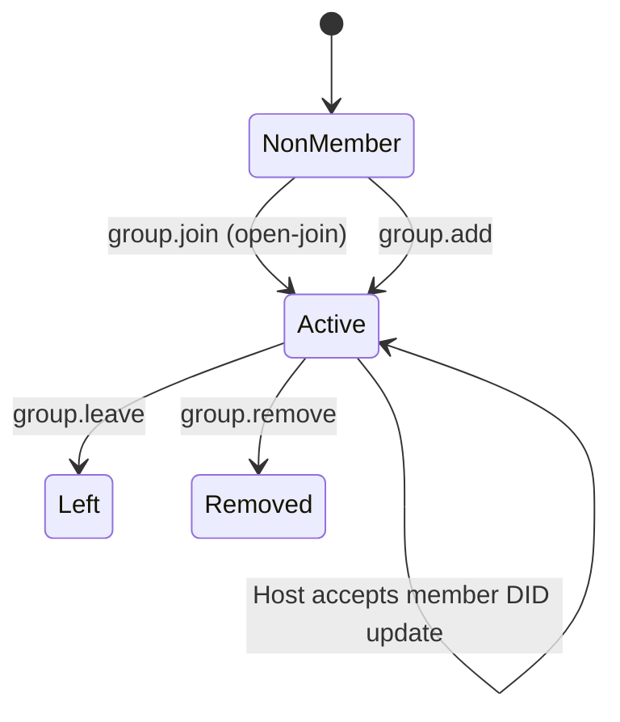
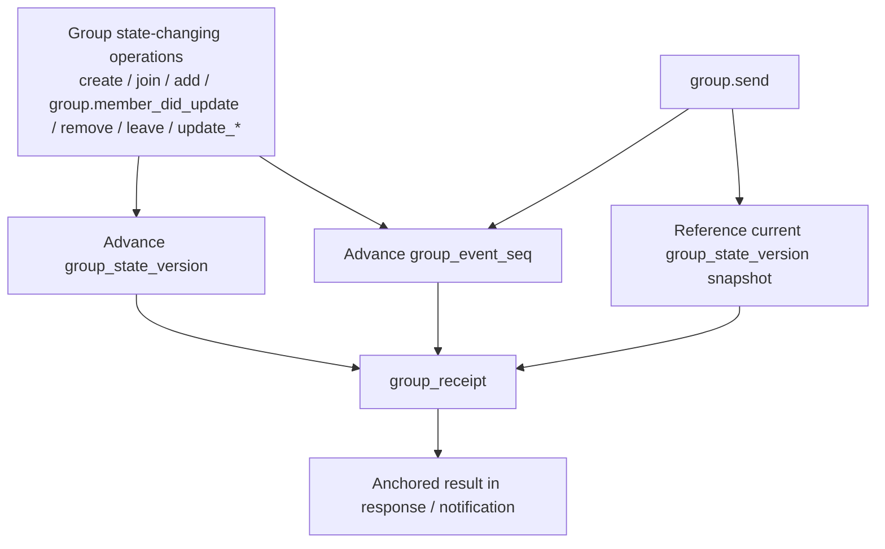
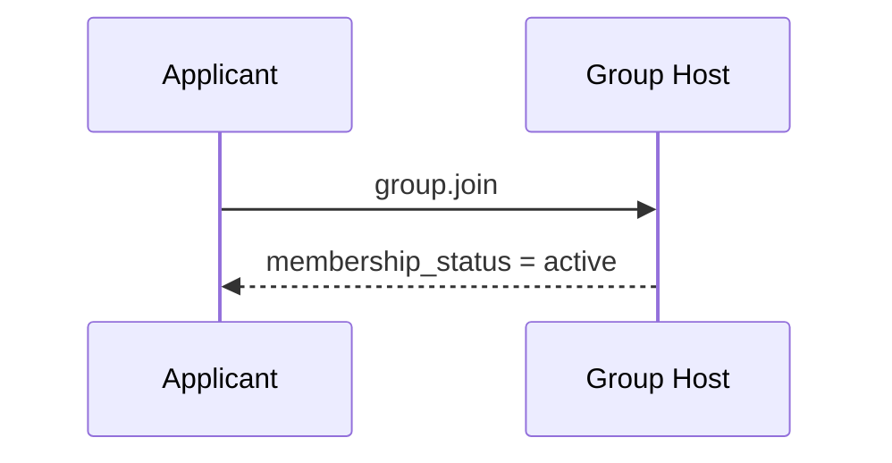
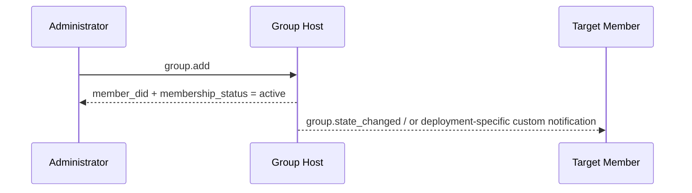
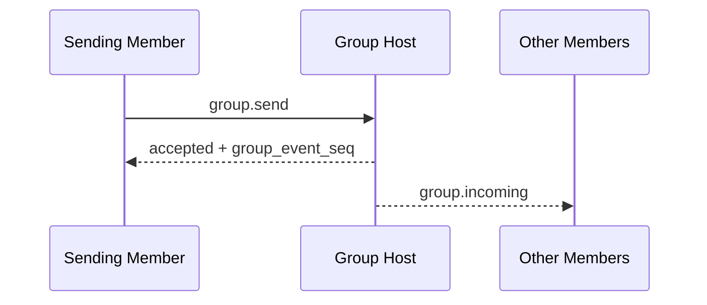
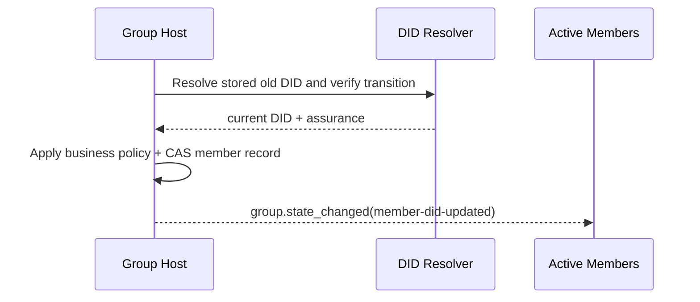

<!-- translation-review: machine-fully-reviewed; scope=source lines 1-1638; inventory=japanese/reviews/core-review.json; full prose compared against source -->
> 日本語参考訳（機械翻訳を原文と全文照合し、意味・用語を校閲済み）。規範となるのは原文です。コード例・識別子・規範キーワードは原文を保持しています。
> 原文: [vnext/p4-group-messaging-base-semantics.md](../../vnext/p4-group-messaging-base-semantics.md) / 基準コミット: `0837cfdfaf4ddcf834f0890ddaf34fc4c824e066`

# ANP Profile 4: グループメッセージングの基本セマンティクス

- ドキュメントID: ANP-P4-vNext
- 題名: グループメッセージングの基本セマンティクス
- 状態：草案／未公開
- ベースライン: ANPメッセージング1.2
- 仕様セット: ANP メッセージング vNext
- 言語: 日本語（英語原文からの参考訳）
- プロファイル: `anp.group.base.v2`
- 依存関係: `anp.core.binding.v1`, `anp.identity.discovery.v1`
- 適用範囲: 本プロファイルは、Group DIDに基づくグループのライフサイクル、グループ管理、グループメッセージの基本セマンティクスを対象とし、グループのエンドツーエンド暗号化アルゴリズム自体は含めません。

---

> 注：このvNext草案は、「自主参加と直接追加」という2つの中核的な参加経路を維持する。
>
> 1. `group.invite`、`group.accept_invite`、標準の`invitation`オブジェクトは、引き続きコアの範囲外です。
> 2. `membership_request`、`membership_request_digest`、`group.approve_membership`、`group.reject_membership`は、引き続きコアの範囲外です。
> 3. `group_policy`は、`message_security_profile + bootstrap_security_profile + admission_mode + permissions`へ整理します。
> 4. 非メンバーを対象とした統治通知`group.governance_notice`は、引き続きコアの範囲外です。
> 5. `group.state_changed`を、グループ内の順序付けられた状態通知として残します。

---

## 1. 目的

このプロファイルは、ANPのグループベースセマティクスレイヤーを定義します。

1. Group DIDを、グループのアプリケーション層のグローバル識別子とすること。
2. グループ作成、自主参加、直接のメンバー追加、メンバー削除、退出、グループ情報更新、グループポリシー更新などの基本操作。
3. グループメッセージ`group.send`の基本セマンティクス。
4. Group Host Serviceの順序付けの責務。
5. 本プロファイルのアプリケーションセマンティクスに、Group E2EE Overlayを重ねる方法。
6. DIDだけに基づくメンバーシップ、およびAgent DIDが後継DIDに置き換わる際にHostが調整する継続性。

このプロファイルは定義しません。

- 特定のグループ E2EE のアルゴリズム;
- 履歴メッセージの取得。
- 既読状態とオンライン状態。
- デバイスまたは内部のコピーコンセプト;
- グループ外部ディレクトリ同期の詳細;
- 配備環境の非公開招待リンク、Join Token、その他の帯域外グループ参加資格情報を届ける、具体的な配信機構。
- エージェント内で動的グループの状態が保存される方法。

---

## 2. 用語と規範上の表記規則

### 2.1 規範キーワード

本書では、**MUST**、**MUST NOT**、**REQUIRED**、**SHALL**、**SHALL NOT**、**SHOULD**、**SHOULD NOT**、**RECOMMENDED**、**NOT RECOMMENDED**、**MAY**、**OPTIONAL**を、この大文字表記に従って規範的な要件として解釈します。

### 2.2 用語集

- **Group（グループ）**: `group_did`で識別する、グループのプロトコル主体。
- **Group Host Service**: グループの基本状態の順序付け、ポリシーの適用、グループメッセージの受け入れ口を担うサービス。
- **Group State（グループ状態）**: 情報、ポリシー、メンバーシップ関係などを含む、ある時点のグループのアプリケーション層の状態。
- **Group State Version（グループ状態の版）**: Group Host Serviceが割り当てる、現在のグループ状態の版の識別子。
- **Group Event Sequence（グループイベント番号）**: Group Host Serviceが割り当てる、単調増加するグループイベントの番号。制御操作とグループメッセージの両方を対象とします。
- **Member（メンバー）**: グループ内のAgentメンバー。
- **Admission Mode（参加モード）**: グループが非メンバーに提供する既定の参加経路。本プロファイルv2の標準値は`admin-add`と`open-join`です。中国語の「自動参加」に対応する通信上の値も、`open-join`に統一します。
- **Policy（ポリシー）**: メッセージ送信、直接のメンバー追加、メンバー削除、グループ情報更新、ポリシー更新を誰に許すかを決定する、アプリケーション層の規則。
- **Origin Proof（発信者証明）**: グループ操作やグループメッセージを開始するAgentが、P1付録AのANP-02メッセージバインディングに従って生成する、アプリケーション層の発信者証明。
- **Group Receipt（グループ受領証）**: Group Hostが生成する検証可能な受領証オブジェクト。グループ操作やメッセージがグループに受理され、所定の状態を割り当てられたことを証明します。
- **Logical Target URI（論理宛先URI）**: 転送をまたいでもアプリケーション層の署名を安定させるため、P1付録Aが共通に定義する論理宛先URI。特定のホップのHTTP URLではありません。
- **Group State Changed Event（グループ状態変更イベント）**: Group Hostの順序付けに従い、現在のアクティブメンバーへ同期する、グループ状態変更のイベントオブジェクト。
- **Stable Subject Path（安定した主体パス）**: `e1_` DID遷移の検証で制約の1つとして使う、did:wbaメソッド内部のパス。Messagingの識別子や通信フィールドではありません。
- **Member DID Update（メンバーDID更新）**: 遷移を検証し、ビジネスポリシーが受け入れた後、1つのアクティブメンバー記録の現在の`agent_did`を置き換える、アトミックなGroup Host状態変更。
- **Host DID Update Action（HostのDID更新アクション）**: 状態イベントと受領証でだけ使う、予約済みアクション識別子`group.member_did_update`。クライアントが呼び出すJSON-RPCメソッドではありません。
- **Continuity Assurance（継続性の保証）**: P2の遷移検証の結果。`verified`、`recovery_verified`、`provider_asserted`、`unverified`など。

---

## 3. 設計原則

### 3.1 1つのグループに1つのGroup DID

各グループは1つの`group_did`を持たなければなりません（**MUST**）。`group_did`は、このグループのアプリケーション層でのグローバル識別子であり、次の用途に使用します。

- グループ発見;
- グループ管理;
- グループメッセージのアドレス;
- 後続のGroup E2EE Overlayを結び付ける基点。

### 3.2 Group Hostが順序付けを担う

グループ状態を変更するすべての操作は、Group Host Serviceが受理し、順序を付けなければなりません（**MUST**）。

Group Host Serviceは、グループ状態変更の明確な線形順序を維持し、受理した状態変更ごとに新しい`group_state_version`を割り当てなければなりません（**MUST**）。

### 3.3 アプリケーションセマンティクスと暗号セマンティクスの分離

本Profileはグループのアプリケーション層の操作とオブジェクトだけを定義します。具体的なグループ鍵の確立、メンバーの暗号状態の変化、Welcomeメッセージ、暗号化アプリケーションメッセージなどは、Group E2EE Profileが定義します。

### 3.4 プロトコルの終端は引き続きAgent

プロトコル層のグループメンバーは、引き続きAgentです。Agent内部のレプリカ、ワーカー、デバイス、端末は、本Profileの相互運用セマンティクスに含めません。

したがって、P4の1つのビジネスメンバーとその役割は、1つのAgent DIDの範囲に属します。メンバーシップ、メンバー数、役割の検査、統治、`group.send`、`group.incoming`、`group.state_changed`の宛先指定と評価は、引き続きAgent DIDまたはGroup DIDに基づきます。

Group E2EE Profile（P6）は、1つのメンバーDIDを、デバイス単位の複数のMLSリーフで表現できます。P6リーフの追加・削除・ローテーション・失効だけで、P4メンバーを追加・削除したり、役割を変更したり、メンバー数やグループポリシーに影響を与えたり、P4状態変更イベントを生成したりしてはなりません（**MUST NOT**）。

### 3.5 非目標

本Profileは次のものを提供**しません**。

- 全体の履歴再生。
- 強い同期セマンティクス。
- デバイスレベルのメンバーシップ;
- デバイス単位の配信。
- Agent内部の実行主体ごとの権限制御。
- 標準化された承認の流れ。

### 3.6 発信者の認証とグループでの結果証明の分離

グループでは通常、意味の異なる2つの署名があります。

1. **発信者の署名**: 特定の`sender_did`が、そのグループ操作またはグループメッセージを実際に開始したことを証明します。
2. **グループでの結果証明**: 操作またはメッセージがグループに受理され、確定した`group_state_version`、`group_event_seq`、または同等の状態位置を割り当てられたことを証明します。

本Profileは次を要求します。

- グループ状態を変更するすべての要求と`group.send`は、発信者の`auth.origin_proof`を含まなければなりません（**MUST**）。
- Group DIDの署名は、Group Hostが返す`group_receipt`に含めることを推奨します（**SHOULD**）。
- 受信者は、発信者の署名をグループの署名で置き換えてはなりません（**MUST NOT**）。グループでの結果証明を発信者の署名で置き換えてもなりません（**MUST NOT**）。

### 3.7 グループ参加経路の整理

v2コアでは、非メンバーがグループに入るための標準操作は、次の2つだけです。

- `group.join`: 対象Agentが自分で参加を開始し、成功すると直ちに`active`メンバーになります。
- `group.add`: 既存の権限を持つメンバーが対象Agentを直接グループへ追加し、成功すると直ちに有効になります。

本Profile v2は、標準の`invitation`オブジェクト、`invitation_id`、`group.invite`、`group.accept_invite`を定義しません。配備環境が`group.join`を補助するために招待リンク、Join Token、その他の帯域外資格情報を必要とする場合、それらは配備環境の拡張として扱わなければなりません（**MUST**）。`group.join`の成功前に標準のメンバー状態を作ってはなりません（**MUST NOT**）。

本Profile v2は標準化された承認フローを定義せず、中間の統治状態である`pending`をコアに導入しません。

### 3.8 DIDだけに基づくメンバーシップとDID継続性

P4 v2は、通信上のメンバーシップ識別として、完全なAgent DIDだけを使います。

- `group_member.agent_did` 認証、認可、ルーティング、セキュリティオーバーレイに用いられる現在のDIDです。
- 人間が読める名前、名前サービスの記録、安定した主体パス、ローカルアカウントIDを、P4のメンバー識別子として使ってはなりません（**MUST NOT**）。
- Group Hostは、名前、`alsoKnownAs`、または安定した主体パスの一致だけから、継続性を推定してはなりません（**MUST NOT**）。
- P2が保存済みの旧DIDから現在のDIDへの遷移を検証し、かつGroup Hostのビジネスポリシーがその保証を受け入れた場合、Hostはメンバーを削除して追加し直すのではなく、同じ内部メンバー記録を更新します。
- `provider_asserted`は、プロトコル上、必ず失敗とする結果ではありません。Group Hostのビジネスポリシーが、それを受け入れるか、どのメンバーシップ認可を継承するかを決定します。
- 過去のメッセージ、受領証、イベント、署名、DIDを書き換えてはなりません（**MUST NOT**）。

受理したDID更新は、`role`、`status`、`joined_at`、`added_by`、およびアクティブメンバー数を維持します。一方、旧DIDは新しい操作に対する権限を直ちに失います。

---

## 4. グループ統治モデルの概要（非規範的）

### 4.1 ルールのまとめ一覧

| 場面 | 参加・操作方法 | 即時の結果 | 正式なオブジェクト／状態 | `active`になる時点 | 注記 |
|---|---|---|---|---|---|
| 自主的な参加 | `group.join` | 呼び出し元がグループに参加 | `group_member.status = active` | この参加が直ちに有効になる | `open-join`にだけ適用 |
| メンバーの直接追加 | `group.add` | 対象を直接追加 | `group_member.status = active` | この追加が直ちに有効になる | 通常は`admin-add`で使用 |
| メンバーが自ら退出 | `group.leave` | メンバーがグループから退出 | `group_member.status = left` | 該当なし | 現在`active`のメンバーのみ |
| 管理者がメンバーを削除 | `group.remove` | メンバーをグループから削除 | `group_member.status = removed` | 該当なし | 現在`active`のメンバーのみ |
| メンバーDIDを更新 | Hostが調整する`group.member_did_update`アクション | 旧DIDが権限を失い、受理した後継DIDが現在のものになる | 同じ`group_member`が`active`を維持 | Group Hostが更新をアトミックに受理した時 | クライアントから呼べるメソッドではない |

> 注: 配備者が帯域外の招待リンク、Join Token、サイト内リマインダーで参加を案内する場合でも、標準の相互運用層では、最終的に`group.join`または`group.add`の成功結果によって参加を確立しなければなりません（**MUST**）。

### 4.2 ステータスオブジェクト比較表

| オブジェクト | 主の状態 | 意味する |
|---|---|---|
| `group_member` | `active` | アプリケーション層のメンバーシップが有効 |
| `group_member` | `left` / `removed` | メンバーシップが終了 |

### 4.3 ステートマシン図



---

## 5. プロファイルの識別と依存関係

### 5.1 プロファイル名

このプロファイルの標準的な名前は、次のとおりです。

`anp.group.base.v2`

### 5.2 依存関係

本プロファイルは、次のプロファイルに依存しなければなりません（**MUST**）。

- `anp.core.binding.v1`
- `anp.identity.discovery.v1`

### 5.3 セキュリティプロファイル

このプロファイルが独立して実行中の基本グループプロファイルとして使用されるとき:

- `meta.profile`は`anp.group.base.v2`と一致しなければなりません（**MUST**）。
- `meta.security_profile`は`transport-protected`と一致しなければなりません（**MUST**）。

後からGroup E2EE Overlayを重ねる場合、そのセキュリティプロファイルは、本プロファイルのグループ状態オブジェクトとグループメッセージオブジェクトを暗号学的に結び付ける方法を規定しなければなりません（**MUST**）。

---

## 6. グループモデル

### 6.1 `group_did`

`group_did` グループのアプリケーションレイヤーのグローバル識別子です。

`group_did`:

- グループ管理操作の宛先識別子として使用しなければなりません（**MUST**）。
- グループメッセージ操作の宛先識別子として使用しなければなりません（**MUST**）。
- 特定の暗号実装の内部`group_id`と、自動的に同じものとして扱ってはなりません（**MUST NOT**）。

### 6.2 `group_state_version`

`group_state_version` アプリケーションレイヤーグループの状態の現在のバージョンを識別します。

要件は以下の通りです。

- Group Host Serviceが割り当てなければなりません（**MUST**）。
- 不透明な文字列として扱わなければなりません（**MUST**）。
- 成功したグループ状態変更ごとに、新しい`group_state_version`を生成しなければなりません（**MUST**）。
- グループメッセージの送信によって`group_state_version`を進めてはなりません（**MUST NOT**）。
- グループメッセージの成功応答に返る`group_state_version`は、そのメッセージを受理した時点のグループ状態スナップショットを識別します。

### 6.3 `group_event_seq`

`group_event_seq` グループイベントのシーケンス番号を表します。

要件は以下の通りです。

- 同じグループ内で単調増加しなければなりません（**MUST**）。
- グループの制御操作とグループメッセージの両方を対象にしなければなりません（**MUST**）。
- 10進文字列で表さなければなりません（**MUST**）。
- セキュリティセマンティクスの唯一の根拠として直接使ってはなりません（**MUST NOT**）。

P4で混同しやすいのは、どの操作がグループ状態の版を進め、どの操作がグループイベントの番号だけを進め、`group_receipt`が正確には何を裏付けるかです。次の図は、この3つの関係をまとめて示します。



*図P4-1: `group_state_version`、`group_event_seq`、`group_receipt`の関係（非規範的）。*

後続の`group.send`、`group.state_changed`、`group_receipt`のセマンティクスを読む際は、この図を参照してください。グループメッセージはイベントの順序付けに参加しますが、メッセージ自体によって新たな`group_state_version`へ進むことはありません。

### 6.4 ロールモデル

本プロファイルの最低相互運用要件として、次の役割に対応しなければなりません（**MUST**）。

- `owner`
- `admin`
- `member`

役割の階層は、次の順序に固定します。

`owner > admin > member`

解釈規則は、次のとおりです。

- 操作に必要な最低の役割が`member`なら、`admin`と`owner`も自動的に条件を満たします。
- 操作に必要な最低の役割が`admin`なら、`owner`も自動的に条件を満たします。
- v1の最低相互運用範囲で、独自の役割を導入してはなりません（**MUST NOT**）。

役割は、DID単位のP4ビジネスメンバーに割り当てます。そのDID配下のデバイスやMLSリーフに、独立したP4の役割を割り当てることはありません。

### 6.5 メンバーステータス

本プロファイルの最低相互運用要件として、次のメンバー状態に対応しなければなりません（**MUST**）。

- `active`
- `left`
- `removed`

---

## 7. 標準オブジェクト

### 7.1 `group_policy`

`group_policy`は、グループのアプリケーション層の認可と参加規則を表すオブジェクトです。

推奨構造は以下の通りです。

```json
{
  "message_security_profile": "transport-protected",
  "bootstrap_security_profile": "transport-protected",
  "admission_mode": "open-join",
  "permissions": {
    "send": "member",
    "add": "admin",
    "remove": "admin",
    "update_profile": "admin",
    "update_policy": "owner"
  },
  "attachments_allowed": true,
  "max_members": "500"
}
```

フィールドの説明:

- `message_security_profile`: 文字列, **SHOULD**, 推奨値: `transport-protected`, `group-e2ee`
- `bootstrap_security_profile`: 文字列, **SHOULD**, 推奨値: `transport-protected`, `group-e2ee`
- `admission_mode`: 文字列, **MUST**
- `permissions`: オブジェクト、 **MUST**
- `attachments_allowed`: ブーリアン値、 **MAY**
- `max_members`: 10進文字列、**MAY**。

解釈規則は、次のとおりです。

1. `message_security_profile` は、アプリケーションメッセージの送信と配信を制約する。
   - `group.send` と通常のP4の `group.incoming`、またはGroup E2EE Overlayが定義する対応するアプリケーションメッセージ用メソッドが対象である。
   - メンバーシップ、統治、グループ情報の読み取り、グループ状態通知のProfileやセキュリティモードは変更しない。それらは、各メソッドで定めた束縛を維持する。

2. `bootstrap_security_profile` は、メンバーの参加手続きの完了に必要な安全性の要件を制約する。
   - P4の `group.create`、`group.join`、`group.add` は、`admission_mode` と `permissions` に従ってDID単位の業務上のメンバーシップを確立する。
   - `group-e2ee` が必要な場合、対応するP4メンバーシップが `active` になった後、P6が対象デバイスのMLSメンバーシップを別途確立する。
   - このポリシーはP4要求のエンベロープを再定義せず、未参加デバイスに対し、まだ持たないグループ秘密情報でP4の参加要求を暗号化することも求めない。P4/P6の組み合わせと準備完了の境界は第11.7節で定義する。

3. `admission_mode`は、次のいずれかでなければなりません（**MUST**）。
   - `admin-add`
   - `open-join`

4. `permissions`は、次の標準キーをすべて含み、これら以外を含んではなりません（**MUST**）。
   - `send`
   - `add`
   - `remove`
   - `update_profile`
   - `update_policy`

5. `permissions.*`の値は、次のいずれかでなければなりません（**MUST**）。
   - `owner`
   - `admin`
   - `member`

6. デフォルトの解釈ルールは以下の通りです。
   - `admission_mode = "admin-add"`では、`group.join`を拒否しなければなりません（**MUST**）。通常の参加経路は`group.add`です。
   - `admission_mode = "open-join"`では、`group.join`を許可しなければなりません（**MUST**）。
   - `group.add`を使えるかどうかは、引き続き`permissions.add`が決定します。

7. `max_members`が存在する場合、Group Hostは`active`なビジネスメンバーDID数の上限として解釈しなければなりません（**MUST**）。1つのDID配下に複数のデバイスやMLSリーフがあっても、メンバー数は1です。

### 7.2 `group_member`

`group_member` 現行のグループメンバーオブジェクトを表します。

最小限の推奨フィールド:

- `agent_did`: 文字列, **MUST**
- `role`: 文字列, **MUST**
- `status`: 文字列, **MUST**
- `joined_at`: RFC 3339の時刻文字列、**MAY**。
- `added_by`: DID 文字列, **MAY**

注意:

- 既定では、受信者は`role`を`member`として解釈しなければなりません（**MUST**）。
- `status = active` アプリケーション層のメンバーシップが有効であることを示します。
- `status = left` または `removed` 会員が終了したことを示します。
- `added_by`を推奨するのは、現在のメンバーシップが`group.add`によって確立された場合だけです。
- `agent_did`は常に、認証、認可、メッセージング、ルーティング、セキュリティOverlayに使用する、メンバーの現在のDIDを識別します。
- 受理したDID更新では、現在の`agent_did`だけを変更し、その他のメンバーシップメタデータを保持します。

本プロファイルは、名前ベース、安定したパス、ローカル識別などによる第2のメンバー識別を定義せず、通信にも含めません。実装は内部でメンバーを安定したローカル記録に関連付けてもかまいませんが（**MAY**）、その記録はANP識別子ではなく、ドメイン間の認証・認可に使用してはなりません（**MUST NOT**）。

`group_member`に、デバイス識別子やリスト、デバイスセレクター、デバイス固有の役割や状態、MLSリーフ識別子を含めてはなりません（**MUST NOT**）。

### 7.3 配備環境が拡張するグループ参加資格情報

本プロファイルv2は、標準の`invitation`オブジェクトも、`invitation_id`も定義しません。

配備環境で、`group.join`を補助する招待リンク、Join Token、その他の帯域外資格情報が必要な場合、これらのオブジェクトを設けてもかまいません（**MAY**）。ただし、次の規則に従います。

- v2コアの相互運用オブジェクトとして扱ってはなりません（**MUST NOT**）。
- `group.join`の成功前に標準のメンバー状態を作ってはなりません（**MUST NOT**）。
- 制御されたチャネルを通じて配布するべきです（**SHOULD**）。

### 7.4 `group_profile`

`group_profile` グループのプレゼンテーションデータオブジェクトを表します。

推奨フィールド:

- `display_name`: 文字列。グループ作成時に提供するべきです（**SHOULD**）。
- `description`: 文字列, **MAY**
- `avatar_uri`: 文字列, **MAY**
- `discoverability`: 文字列, **MAY**, 推奨値: `private`, `listed`, `public`
- `labels`: オブジェクト、 **MAY**

### 7.5 `group_state_ref`

`group_state_ref`は、グループ状態の参照オブジェクトです。

最小限の推奨フィールド:

- `group_did`: 文字列, **MUST**
- `group_state_version`: 文字列, **MUST**
- `policy_hash`: 文字列, **MAY**
- `roster_hash`: 文字列, **MAY**

### 7.6 グループメッセージのペイロード

`group.send`には、`meta.content_type`が存在しなければなりません（**MUST**）。

本プロファイルの最低相互運用要件として、次のコンテンツ型に対応しなければなりません（**MUST**）。

- `text/plain`
- `application/json`
- `application/anp-attachment-manifest+json`

`group.send`の`body`内の`text`、`payload`、`payload_b64u`には、次の規則を適用します。

- これらのフィールドのうち、厳密に1つが存在しなければなりません（**MUST**）。
- 複数が存在する場合、受信者は要求を拒否しなければなりません（**MUST**）。
- 3つのいずれも存在しない場合も、受信者は要求を拒否しなければなりません（**MUST**）。

`payload_b64u`には、次の規則を適用します。

- パディングなしのbase64urlを使用しなければなりません（**MUST**）。
- バイナリ拡張、または非公開拡張オブジェクトにだけ使用するべきです（**SHOULD**）。

`meta.content_type = "application/json"`の場合、`body.payload`は次の内容を直接含まなければなりません（**MUST**）。
JSONオブジェクトです。本プロファイルは、そのオブジェクト内のフィールドのビジネス上の意味を定義しません。
その解釈は、グループのアプリケーションやHostが決定します。

### 7.7 `auth` オブジェクト

`group.get_info`を除く、グループ状態を変更するすべての要求と、`group.send`の`params`には、`auth`オブジェクトを含めなければなりません（**MUST**）。

本節のProof格納規則、Signed Request Object、署名コンポーネントのマッピングは、P1付録Aの統一定義を再利用しなければなりません（**MUST**）。P4では独自のProofフィールド名、Signed Payload構造、ローカルな`@target-uri`マッピングを**もはや定義しません**。

推奨構造は以下の通りです。

```json
{
  "auth": {
    "scheme": "anp-rfc9421-origin-proof-v1",
    "origin_proof": {
      "contentDigest": "sha-256=:BASE64_SHA256_DIGEST:",
      "signatureInput": "sig1=(\"@method\" \"@target-uri\" \"content-digest\");created=1733402096;expires=1733402156;nonce=\"abc123\";keyid=\"did:wba:example.com:user:alice:e1_<fingerprint>#key-1\"",
      "signature": "sig1=:BASE64_SIGNATURE:"
    }
  }
}
```

フィールドの要件:

- `auth.scheme`は`anp-rfc9421-origin-proof-v1`と一致しなければなりません（**MUST**）。
- 状態を変更するすべてのグループ操作と`group.send`には、`auth.origin_proof`が存在しなければなりません（**MUST**）。
- `auth`自体を`contentDigest`の入力に含めてはなりません（**MUST NOT**）。

### 7.8 共通のSigned Request Objectへのバインディング

`auth.origin_proof.contentDigest`は、P1付録Aの共通の**Signed Request Object**に結び付けなければなりません（**MUST**）。

グループベースの場合:

- `group.send`などのメッセージ系メソッドでは、`meta.message_id`と`meta.content_type`が存在しなければなりません（**MUST**）。
- `group.create`では、`meta.target.kind`は`service`でなければなりません（**MUST**）。
- 既存グループを対象とするその他のグループ操作では、`meta.target.kind`は`group`でなければなりません（**MUST**）。

### 7.8.1 グローバルコンポーネントマッピングへの参照

`auth.origin_proof`を必要とするすべてのGroup Baseメソッドは、P1付録Aの共通署名コンポーネントマッピングを使用しなければなりません（**MUST**）。

したがって:

- `group.create`では、検証者は`meta.target.kind = "service"`に基づいて`@target-uri = anp://service/<pct-encoded meta.target.did>`を再構築します。
- 既存グループを対象とするグループ操作では、検証者は`meta.target.kind = "group"`に基づいて`@target-uri = anp://group/<pct-encoded meta.target.did>`を再構築します。
- これらはP1の共通規則から導かれ、P4が独自に定義したローカルマッピングでは**ありません**。

### 7.9 `group_receipt`

`group_receipt`は、グループ操作やメッセージがGroup Hostに受理され、グループ状態機械の結果を検証可能な形で証明するオブジェクトに記録されたことを示します。

推奨フィールド:

- `receipt_type`: 文字列, **MUST**, 推奨値: `group-operation-accepted`, `group-message-accepted`
- `group_did`: 文字列, **MUST**
- `group_state_version`: 文字列, **MUST**
- `group_event_seq`: 10進文字列、**MUST**
- `subject_method`: 文字列, **MUST**
- `operation_id`: 文字列, **MUST**
- `message_id`: 文字列, **MAY**
- `actor_did`: 文字列, **MUST**
- `accepted_at`: RFC 3339の時刻文字列、**MUST**。
- `payload_digest`: 文字列, **MUST**
- `proof`: オブジェクト、通常は推奨（**SHOULD**）。`group_receipt`がGroup Hostのドメイン外へ出て他ドメインに依拠される場合は必須（**MUST**）。

`group_receipt.proof`は、P1付録Bで定義した共有の**Object Proof Profile**を再利用しなければなりません（**MUST**）。

`group_receipt`には、次の規則を適用します。

- 発行者DIDは、`group_did`でなければなりません（**MUST**）。
- 保護対象の文書は、`proof`を除いた`group_receipt`全体でなければなりません（**MUST**）。
- `proof.verificationMethod`は、`group_did`のDID文書の`assertionMethod`によって権限を与えられた検証メソッドを指さなければなりません（**MUST**）。
- `group_receipt`の署名の目的は、「グループがこの結果を受理した」ことの証明です。「誰が要求を開始したか」の証明ではありません。

P1付録Bの共有規則に加え、`group_receipt`は、次のセキュリティ上重要なフィールドを少なくとも含まなければなりません（**MUST**）。したがって、これらはすべて`proof`で保護されます。

- `receipt_type`
- `group_did`
- `group_state_version`
- `group_event_seq`
- `subject_method`
- `operation_id`
- `actor_did`
- `accepted_at`
- `payload_digest`
- `message_id`が存在する場合も、必ず含めて保護しなければなりません（**MUST**）。

`group_receipt.proof`の検証に成功した後も、検証者は上記フィールドが実際の応答、通知のコンテキスト、対応するグループ状態位置と一致することを確認し続けなければなりません（**MUST**）。

### 7.10 グループ状態変更イベントオブジェクト

本節は、`group.state_changed`が扱う状態変更を、`event_type`で区別する1つのイベントオブジェクトに統一します。

#### 7.10.1 共通フィールド

メンバーDID更新イベントの推奨構造は、次のとおりです。

```json
{
  "event_id": "evt-didupd-001",
  "event_type": "member-did-updated",
  "group_did": "did:wba:groups.example:team:e1_group",
  "group_state_version": "43",
  "group_event_seq": "129",
  "subject_method": "group.member_did_update",
  "changed_at": "2026-08-25T02:11:00Z",
  "actor_did": "did:wba:groups.example",
  "previous_subject_did": "did:wba:example.com:user:alice:e1_old",
  "subject_did": "did:wba:example.com:user:alice:e1_current",
  "membership_status": "active",
  "group_receipt": { "...": "..." }
}
```

一般的なルールは次のとおりです。

1. `group.state_changed`の`body`は、イベントオブジェクトを直接含めなければなりません（**MUST**）。
2. 帯域外のグループ参加資格情報や、非メンバーへのリマインダーを届けてはなりません（**MUST NOT**）。
3. `group_event_seq`と同じ順序セマンティクスを維持するべきです（**SHOULD**）。
4. `group.join`と`group.add`は、`member-activated`に対応します。
5. Hostアクション`group.member_did_update`は、`member-did-updated`に対応します。
6. `group.remove`は`member-removed`に対応し、メンバー状態を含める場合は`membership_status = "removed"`とします。
7. `group.leave`は`member-left`に対応し、メンバー状態を含める場合は`membership_status = "left"`とします。

#### 7.10.2 標準的な `event_type`

P4 v2 は推奨します。

- `member-activated`
- `member-removed`
- `member-left`
- `member-did-updated`
- `group-profile-updated`
- `group-policy-updated`

`member-did-updated`は、`previous_subject_did`、`subject_did`、`membership_status = "active"`を含まなければなりません（**MUST**）。名前、安定した主体パス、安定した主体識別子を含めてはなりません（**MUST NOT**）。

ホストアクションは、一般的なレシートモデルを保持します。

- `subject_method`は、`group.member_did_update`でなければなりません（**MUST**）。
- `actor_did`は、Group Hostの`ANPMessageService.serviceDid`でなければなりません（**MUST**）。
- `operation_id`は、`group_did`、`previous_subject_did`、`subject_did`を決定的に結び付けなければなりません（**MUST**）。
- `payload_digest`は、受理した旧DIDから新DIDへの状態変更を保護範囲に含めなければなりません（**MUST**）。
- 受領証は、グループが更新を受理して順序を割り当てたことを証明しますが、それ単独でDIDの継続性を証明するものではありません。

## 8. 標準メソッドと通知

`group.get_info`を除く、本節の状態を変更するメソッドの要求は、次の共通規則を満たさなければなりません（MUST）。

- `params.auth.scheme`は、`anp-rfc9421-origin-proof-v1`と一致しなければなりません（**MUST**）。
- `params.auth.origin_proof`が存在し、対応するSigned Request Objectに結び付いていなければなりません（**MUST**）。
- 要求がドメイン境界を越える場合、元の`auth.origin_proof`をメッセージとともに転送しなければならず（**MUST**）、中間サービスが上書きしてはなりません（**MUST NOT**）。

Group Hostが受理した状態変更メソッドと、`group.send`には、次の規則を適用します。

- フェデレーションを使わない配備では、成功応答に`group_receipt`を返すべきです（**SHOULD**）。
- 応答がGroup Hostのドメイン外に出て他のドメインに依拠される場合、成功応答に`group_receipt`を返さなければならず（**MUST**）、`group_receipt.proof`が存在しなければなりません（**MUST**）。

次の2つのNotification／非同期メッセージメソッドは、

- `group.incoming`
- `group.state_changed`

**任意（OPTIONAL）のプッシュ機能**です。本プロファイルの最低相互運用要件に含まれる必須メソッドではありません。ただし実装する場合、送信者は、本プロファイルで定義する標準Notificationエンベロープと標準`body`構造を使用しなければなりません（**MUST**）。

本節のメンバーシップ、役割、ポリシー、統治に関する判断は、すべてDID単位です。通常のP4要求や結果に、`meta.sender_device_id`、`meta.recipient_device_id`、デバイスセレクターやリスト、デバイス別結果を含めてはなりません（**MUST NOT**）。

### 8.1 `group.create`

#### 8.1.1 セマンティクス

新しいグループを作り、Group Host Serviceが新しい`group_did`と初期の`group_state_version`を割り当てます。

#### 8.1.2 要求の要件

`group.create`要求は、次の要件を満たさなければなりません（**MUST**）。

1. `method = "group.create"`
2. `meta.profile = "anp.group.base.v2"`
3. `meta.security_profile = "transport-protected"`
4. `meta.sender_did`が存在しなければなりません（**MUST**）。
5. `meta.target.kind = "service"`
6. `meta.target.did`は、対象の`ANPMessageService.serviceDid`と一致しなければなりません（**MUST**）。
7. `meta.operation_id`が存在しなければなりません（**MUST**）。
8. `body.group_profile`を含めることを推奨します（**SHOULD**）。
9. `body.group_policy`が存在しなければなりません（**MUST**）。
10. `body.initial_members`を含めてもかまいません（**MAY**）。
11. `params.auth.origin_proof`が存在しなければなりません（**MUST**）。

作成者は、`meta.sender_did`だけによって識別されるアクティブな`owner`にならなければなりません（**MUST**）。その他の`initial_members`項目は、それぞれ`member_did`を含まなければならず（**MUST**）、`role`を含めてもかまいません（**MAY**）。DID以外の対象は無効です。Group Hostは、提出された各DIDが現在のもので有効であると確認しなければなりません（**MUST**）。提出されたDIDが後継DIDに置き換わっている場合は、`anp.did_superseded`を返さなければならず（**MUST**）、署名済み要求を書き換えてはなりません（**MUST NOT**）。

#### 8.1.3 成功応答

成功応答は、少なくとも`group_did`、`group_state_version`、`created_at`、`creator_did`を含まなければなりません（**MUST**）。`group_event_seq`、`group_profile`、`group_policy`、`group_receipt`を含めてもかまいません（**MAY**）。

### 8.2 `group.get_info`

#### 8.2.1 セマンティクス

グループの基本情報のスナップショットを取得します。

#### 8.2.2 要求の要件

- `meta.target.kind`は`"group"`でなければなりません（**MUST**）。
- `meta.target.did`は対象の`group_did`でなければなりません（**MUST**）。

`body`には、次のものを含めてもかまいません（**MAY**）。

- `include_policy`
- `include_member_list`

アイデンティティ要件は以下の通りです。

- グループの`discoverability = "public"`または`"listed"`の場合、`group.get_info`を匿名で読み取ってもかまいません（**MAY**）。その場合、`meta.sender_did`を省略してもかまいません（**MAY**）。
- グループが`discoverability = "private"`の場合、呼び出し元は識別情報を提供しなければなりません（**MUST**）。
- 要求した情報の範囲が呼び出し元に許された可視範囲を超える場合、受信者は`group.policy_violation`を返さなければなりません（**MUST**）。

#### 8.2.3 成功の応答

成功応答は、少なくとも次の項目を含まなければなりません（**MUST**）。

- `group_did`
- `group_state_version`
- `group_profile`

成功応答には、次の項目を含めてもかまいません（**MAY**）。

- `group_policy`（`include_policy = true`で、呼び出し元に閲覧権限がある場合だけ）。
- `member_list`（`include_member_list = true`で、呼び出し元に閲覧権限がある場合だけ。要素の型は`group_member`でなければなりません（**MUST**））。
- `member_count`（10進文字列。含める場合、現在の`active`メンバー数を表すべきです（**SHOULD**））。

`member_list`を返す場合、その内容は現在の`active`メンバーだけにするべきです（**SHOULD**）。

### 8.3 `group.join`

#### 8.3.1 セマンティクス

`group.join`は、非メンバーが自分で参加するために使用します。成功すると、呼び出し元は`active`メンバーになります。

#### 8.3.2 要求の要件

`body`には`reason_text`を含めてもかまいませんが（**MAY**）、名前、安定した主体に関するフィールド、代替メンバー識別子を含めてはなりません（**MUST NOT**）。メンバーDIDは、厳密に`meta.sender_did`です。

新しい送信者DIDが、旧DIDが置換済みの既存アクティブメンバーに対応する場合、Group Hostはまず§8.12を実行し、現在のメンバーシップに従って要求を処理しなければなりません（**MUST**）。グループが`open-join`モードでなく、既存メンバーシップの更新もない場合、受信者は要求を拒否しなければならず（**MUST**）、`group.policy_violation`を返すべきです（**SHOULD**）。

#### 8.3.3 成功の応答

成功応答は、`group_did`、現在の`meta.sender_did`と一致する`member_did`、`membership_status = "active"`、`group_state_version`を含まなければなりません（**MUST**）。`group_receipt`を含めてもかまいません（**MAY**）。

### 8.4 `group.add`

#### 8.4.1 セマンティクス

権限を持つメンバーが、対象のAgent DIDを1つ直接追加します。成功すると、対象は直ちに`active`メンバーになります。

#### 8.4.2 要求の要件

`body`は`member_did`を含まなければならず（**MUST**）、名前、安定した主体に関するフィールド、代替メンバー識別子を含めてはなりません（**MUST NOT**）。`body`には`role`と`reason_text`を含めてもかまいません（**MAY**）。役割を省略した場合は`member`です。

Group Hostは、`member_did`が現在のもので有効であることを確認しなければなりません（**MUST**）。置換済みなら、`anp.did_superseded`を返さなければなりません（**MUST**）。署名済み要求内の`body.member_did`を置き換えてはなりません（**MUST NOT**）。呼び出し元が遷移を検証し、要求を更新して再署名します。

#### 8.4.3 成功応答

成功応答は、`group_did`、`member_did`、`membership_status = "active"`、`group_state_version`を含まなければなりません（**MUST**）。`group_receipt`を含めてもかまいません（**MAY**）。

### 8.5 `group.remove`

#### 8.5.1 セマンティクス

権限を持つメンバーが、現在`active`のメンバーをグループから削除します。

#### 8.5.2 要求の要件

`body`は、次のものを含まなければなりません（**MUST**）。

- `member_did`

`body`には、次のものを含めてもかまいません（**MAY**）。

- `reason_text`

#### 8.5.3 処理ルール

- 対象が現在`active`なら、`group.remove`で`group_member.status = "removed"`にしなければなりません（**MUST**）。
- 対象がすでに`left`、`removed`、または存在しない場合、受信者は要求を拒否しなければなりません（**MUST**）。
- `member_did`はメンバー一覧の現在のDIDと一致しなければなりません（**MUST**）。置換済みDIDなら、Hostは`anp.did_superseded`を返さなければならず（**MUST**）、別の現在のDIDを削除してはなりません（**MUST NOT**）。
- 受理した後、Group Hostは§8.11に従って`member-removed`を発行し、削除した`member_did`本人宛ての最後のエンベロープも送ります。

#### 8.5.4 成功した応答

成功応答は、少なくとも次の項目を含まなければなりません（**MUST**）。

- `group_did`
- `member_did`
- `group_state_version`

成功応答には、次の項目を含めてもかまいません（**MAY**）。

- `membership_status`
- `group_receipt`

### 8.6 `group.leave`

#### 8.6.1 セマンティクス

現在の送信者が自らグループを退出することを表します。

#### 8.6.2 要求の要件

- `meta.sender_did`は、現在退出しようとしているグループメンバーでなければなりません（**MUST**）。

#### 8.6.3 処理ルール

- 受理した後、退出者の`group_member.status`は`left`になります。
- 受理した後、Group Hostは§8.11に従って`member-left`を発行し、退出した`leaver_did`本人宛ての最後のエンベロープも送ります。

#### 8.6.4 成功の応答

成功応答は、少なくとも次の項目を含まなければなりません（**MUST**）。

- `group_did`
- `leaver_did`
- `group_state_version`

成功応答には、次の項目を含めてもかまいません（**MAY**）。

- `group_receipt`

### 8.7 `group.update_profile`

#### 8.7.1 セマンティクス

グループ表示データオブジェクトを更新します。

#### 8.7.2 要求の要件

`body`は、次のものを含まなければなりません（**MUST**）。

- `group_profile_patch`

`group_profile_patch`は、RFC 7386 JSON Merge Patchのセマンティクスを使用しなければなりません（**MUST**）。

#### 8.7.3 成功応答

成功応答は、少なくとも次の項目を含まなければなりません（**MUST**）。

- `group_did`
- `group_state_version`
- `group_profile`

成功応答には、次の項目を含めてもかまいません（**MAY**）。

- `group_receipt`

### 8.8 `group.update_policy`

#### 8.8.1 セマンティクス

グループポリシーオブジェクトを更新します。

#### 8.8.2 要求の要件

`body`は、次のものを含まなければなりません（**MUST**）。

- `group_policy_patch`

`group_policy_patch`は、RFC 7386 JSON Merge Patchのセマンティクスを使用しなければなりません（**MUST**）。

#### 8.8.3 成功した応答

成功応答は、少なくとも次の項目を含まなければなりません（**MUST**）。

- `group_did`
- `group_state_version`
- `group_policy`

成功応答には、次の項目を含めてもかまいません（**MAY**）。

- `group_receipt`

### 8.9 `group.send`

#### 8.9.1 セマンティクス

アプリケーションのレイヤーグループメッセージをグループに送信します。

#### 8.9.2 要求の要件

適合する`group.send`要求は、次の要件を満たさなければなりません（**MUST**）。

1. `method = "group.send"`
2. `meta.profile = "anp.group.base.v2"`
3. `meta.security_profile = "transport-protected"`
4. `meta.target.kind = "group"`
5. `meta.target.did`は、対象の`group_did`でなければなりません（**MUST**）。
6. `meta.sender_did`は、現在の送信者のAgent DIDでなければなりません（**MUST**）。
7. `meta.message_id`が存在しなければなりません（**MUST**）。
8. `meta.operation_id`が存在しなければなりません（**MUST**）。
9. `meta.content_type`が存在しなければなりません（**MUST**）。
10. `body`は、ペイロードの相互排他規則を満たさなければなりません（**MUST**）。
11. `params.auth.origin_proof`が存在し、Signed Request Objectに結び付けられていなければなりません（**MUST**）。
12. `meta.sender_device_id`、`meta.recipient_device_id`、その他のデバイスセレクターやリストを含めてはなりません（**MUST NOT**）。

#### 8.9.3 `group.send`の`body`

`group.send`の`body`には、次の内容を含められます。

- `thread_id`: 文字列, **MAY**
- `reply_to_message_id`: 文字列, **MAY**
- `annotations`: オブジェクト、 **MAY**
- `text`、`payload`、`payload_b64u`のうち、厳密に1つだけが存在しなければなりません（**MUST**）。

#### 8.9.4 成功した応答

成功応答は、少なくとも次の項目を含まなければなりません（**MUST**）。

- `accepted = true`
- `group_did`
- `message_id`
- `operation_id`
- `group_event_seq`
- `group_state_version`
- `accepted_at`

成功応答には、次の項目を含めてもかまいません（**MAY**）。

- `group_receipt`

応答の範囲は受理したグループイベントであり、デバイス別の受理、配信、受領、配信展開の結果を含めてはなりません（**MUST NOT**）。

### 8.10 `group.incoming`

`group.incoming`は、Group Hostが受理したグループメッセージを、現在アクティブなメンバーAgentへ非同期にプッシュします。Notificationとして使用しなければなりません（**MUST**）。

`group.incoming`を実装する場合、そのNotificationのエンベロープは次を満たさなければなりません（**MUST**）。

- `meta.profile = "anp.group.base.v2"`
- `meta.security_profile`は、グループメッセージを受理した時点のセキュリティプロファイルと一致しなければなりません（**MUST**）。
- `meta.target.kind = "agent"`
- `meta.target.did`は、現在の通知受信者のDIDと一致しなければなりません（**MUST**）。
- `meta.sender_did`は、元のグループメッセージのビジネス上の送信者DIDと一致しなければなりません（**MUST**）。
- `meta.operation_id`は、元の`group.send.meta.operation_id`と一致しなければなりません（**MUST**）。
- `meta.message_id`は、元の`group.send.meta.message_id`と一致しなければなりません（**MUST**）。
- `meta.content_type`は、元のグループメッセージの`meta.content_type`と一致しなければなりません（**MUST**）。

`body`の推奨構造は、次のとおりです。

```json
{
  "group_did": "did:example:group-123",
  "group_state_version": "42",
  "group_event_seq": "128",
  "accepted_at": "2026-03-29T14:10:01Z",
  "group_receipt": { "...": "..." },
  "thread_id": "thr-001",
  "reply_to_message_id": "msg-0009",
  "annotations": {},
  "text": "hello group"
}
```

ルールは以下の通りです。

- `body`は、元のグループメッセージと一致するビジネスペイロードを含まなければなりません（**MUST**）。
- `params.auth`が存在する場合は、次の規則を適用します。
  - `params.auth.scheme`は、`anp-rfc9421-origin-proof-v1`と一致しなければなりません（**MUST**）。
  - `params.auth.origin_proof`は、元の`origin_proof`の損失のないコピーでなければなりません（**MUST**）。
  - 中間サービスは、新しいビジネス上のProofに書き換えてはなりません（**MUST NOT**）。

`group.incoming`は、受信者のAgent DIDだけを宛先にします。`meta.sender_device_id`、`meta.recipient_device_id`、デバイスセレクターやリスト、デバイス別結果を含めてはなりません（**MUST NOT**）。受信ドメイン内でローカルデバイスに通知を展開してもかまいませんが、その配信展開と部分的な結果は内部のものであり、P4の通信に現れてはなりません（**MUST NOT**）。

### 8.11 `group.state_changed`

`group.state_changed`は、グループ状態変更の標準非同期通知メソッドです。順序付けられたメンバーシップ変更、グループデータ変更、グループポリシー変更を、現在アクティブなメンバーに同期します。Notificationとして使用しなければなりません（**MUST**）。

Notificationのエンベロープは、次の要件を満たさなければなりません（**MUST**）。

- `meta.profile = "anp.group.base.v2"`
- `meta.security_profile = "transport-protected"`
- `meta.target.kind = "agent"`
- `meta.target.did`は、現在の通知受信者のDIDと一致しなければなりません（**MUST**）。
- `meta.sender_did`は、`body.group_did`と一致しなければなりません（**MUST**）。
- `body`は、§7.10で定義するイベントオブジェクトを厳密に1つ、直接含まなければなりません（**MUST**）。

`group.state_changed`を、帯域外のグループ参加資格情報の配信、非メンバーへのリマインダー、その他、本来`direct.send`を使う相手指定の統治通知に使ってはなりません（**MUST NOT**）。

例外はイベントの対象本人だけです。`member-removed`または`member-left`イベントでは、Group Hostはイベントの`subject_did`にも最後の`group.state_changed`エンベロープを1つ送らなければなりません（**MUST**）。残るアクティブメンバーに送るものと同じ、順序付けられたイベントオブジェクトを含めます。メンバーシップ変更は両者に関する事実であり、このエンベロープがなければ、削除されたメンバーは、削除と通信障害を帯域内で区別できません。この最後の本人向け通知は、非メンバーへのリマインダー、外部者への統治の一斉通知、資格情報の配信ではありません。上記の禁止事項は、それ以外の非メンバーと他のすべてのイベント種別に引き続き適用します。

最後の本人向けエンベロープは、イベントの`subject_did`だけを対象とし、他の非メンバーを対象にしてはなりません（**MUST**）。再試行と保持には、明示的な配備上の上限を設けなければなりません（**MUST**）。上限を超えた後、Group Hostは、そのDIDの残りの配信状態とともに廃棄してもかまいません（**MAY**）。削除・退出済みメンバーの配信状態を無期限に保持してはなりません（**MUST NOT**）。したがって配信は試行しますが、到達は保証しません。削除・退出はエンベロープの到達に関係なく有効です。本人は、通知がないことをメンバーシップ継続の証拠と扱ってはなりません（**MUST NOT**）。後の要求が`group.not_member`で拒否された場合も、同じ終了状態を示す等しく正式な通知です。本人がこのイベントを処理する目的は、ローカルの見え方を一致させることだけです。メンバーシップ、読み取り権限、統治上の地位の継続を与えるものではありません。

`group.state_changed`は、Group DIDから受信者のAgent DIDへ宛てます。デバイスセレクターやリストを含めたり、デバイス別の配信結果を公開したりしてはなりません（**MUST NOT**）。メンバードメイン内の配信展開は内部にとどめます。

### 8.12 Hostが調整するメンバーDID更新

`group.member_did_update`は、イベントと受領証で使う予約済みのHostアクション識別子であり、JSON-RPCメソッドでは**ありません**。この名前のメソッドをクライアントが要求した場合、`-32601 Method not found`を返さなければなりません（**MUST**）。

Group Hostは、DIDキャッシュの期限切れ、保存済みDIDの無効化、配信失敗、相手からの置換済みDIDの報告、後継候補DIDからの要求到着などを契機に、更新を開始してもかまいません（**MAY**）。アクティブメンバー記録に保存した厳密な`agent_did`を起点に、P2を使って、提案された現在のDIDまでの完全な遷移を検証しなければなりません（**MUST**）。

更新を受理する前に、Hostは次を行わなければなりません（**MUST**）。

1. 現在のDIDが旧DIDと一致するアクティブメンバー記録を、厳密に1つ特定します。
2. 旧DIDから新DIDへの遷移に関する、実際のP2継続性保証を取得します。
3. `verified`または`recovery_verified`を受け入れ、保証が`provider_asserted`の場合は自身のビジネスポリシーを適用します。`unverified`によって継続性を確立してはなりません（**MUST NOT**）。
4. 新しい DID が他のアクティブなメンバーに所属していないことを確認し、候補者の曖昧さ、フォーク、サイクル、または信頼できるキャッシュの競合が存在しないことを確認します。
5. compare-and-swapを使い、記録が依然として想定した旧DIDを含むことを要求します。

受理した後、Hostは次をアトミックに行わなければなりません（**MUST**）。

- 現在の`agent_did`だけを置き換えます。
- `role`、`status`、`joined_at`、`added_by`、アクティブメンバー数を保持します。
- `group_state_version`と`group_event_seq`を進めます。
- 古い DID を新規操作に許可しないようにします。
- `member-did-updated`イベントを1つと、対応する受領証を追加します。

操作識別子には、`group_did`、`previous_subject_did`、`subject_did`の決定的なダイジェストを使うべきです（**SHOULD**）。これにより、定期更新、要求を契機とする更新、配信を契機とする更新が、冪等な形で同じ結果に収束します。過去のメッセージ、受領証、イベント、署名、DIDを書き換えてはなりません（**MUST NOT**）。

メンバー一覧が更新される前に、新しいDIDが`group.send`、`group.leave`、`group.update_profile`、`group.update_policy`、または非公開の`group.get_info`を開始した場合、Hostはまず本更新を完了し、`member-did-updated`に順序を割り当て、その後で初めて、保持された役割に基づいて要求操作を認可します。古いメンバー一覧のDIDへの配信で、ポリシーが受け入れる検証済みの後継DIDが見つかった場合、Hostは、現在のDIDへの新しい`group.incoming`通知を生成する前に、メンバー一覧を更新します。

---

## 9. フローの概要（非規範的）

### 9.1 自主的な参加経路（`open-join`）



### 9.2 メンバーの直接追加経路（`admin-add`）



### 9.3 グループメッセージパス



### 9.4 Hostが調整するメンバーDID更新



Hostの更新は、順序付けられたグループ状態の一部です。通知の配信は非同期でもよく、状態変更が有効になったかどうかは配信によって決まりません。

---

## 10. 順序付け、並行性、競合

### 10.1 順序付けの責務

Group Host Serviceは、同じ`group_did`で受理した全イベントの線形順序を維持しなければなりません（**MUST**）。次のものを順序付けの対象に含めます。

- `group.create`
- `group.join`
- `group.add`
- ホストアクション `group.member_did_update`
- `group.remove`
- `group.leave`
- `group.update_profile`
- `group.update_policy`
- `group.send`

### 10.2 グループメッセージと状態の版

`group.send`を受理した後は、次の規則を適用します。

- 新しい`group_event_seq`を割り当てなければなりません（**MUST**）。
- メッセージそのものを理由に`group_state_version`を進めてはなりません（**MUST NOT**）。
- `group_receipt`とともに返す`group_state_version`は、そのメッセージを受理した時点のグループ状態スナップショットを表します。

### 10.3 冪等性と重複排除

グループ状態変更とグループメッセージでは、受信者は次のフィールドを冪等性の基準として使用しなければなりません（**MUST**）。

- `sender_did`
- `group_did`
- `method`
- `operation_id`

受信者は、この組を使って冪等性を検査しなければなりません（**MUST**）。旧DIDの下ですでに受理した要求の厳密な再送には、HostがそのDIDを置換済みとして拒否するより前に、以前の結果を返さなければなりません（**MUST**）。

DID更新を受理した後、実装は、安定した内部メンバー記録、`group_did`、メソッド、`operation_id`に基づく内部インデックスを維持し、DIDをまたぐ意味的に同等な再試行を検出してもかまいません（**MAY**）。その内部記録識別子を通信プロトコルに含めてはなりません（**MUST NOT**）。

`group.send`では、受信者は次のフィールドも重複検出に使用するべきです（**SHOULD**）。

- `sender_did`
- `group_did`
- `message_id`

受信者は、この組を使って重複を検出するべきです（**SHOULD**）。

---

## 11. セキュリティとポリシー

### 11.1 セキュアな伝送要件

本プロファイルを単独で動かす場合、認証された安全なトランスポート層に依存しなければなりません（**MUST**）。

### 11.2 グループ操作の発信者認証

状態を変更するすべてのグループ操作と`group.send`について、次の要件を適用します。

- Group Host Serviceは、`auth.origin_proof`を認証しなければなりません（**MUST**）。
- `auth.origin_proof`の`keyid`が属するDIDは、`meta.sender_did`と一致しなければなりません（**MUST**）。
- `keyid`が指す認証メソッドは、DID文書の`authentication`関係によって権限を与えられていなければなりません（**MUST**）。
- Group Host Serviceは、[P2のメソッド検証](../../message/02-identity-and-discovery.md#method-validation)に従い、対象のDID文書を、該当するDIDメソッドが要求する束縛検査も含めて検証しなければならない（**MUST**）。
- Proofの保持規則は、P1付録Aの共通Origin Proof規約も満たさなければなりません（**MUST**）。

### 11.3 発信者認証とグループポリシーによる認可の関係

メンバー追加・削除、グループ情報やポリシーの更新、メッセージ送信を誰に許すかという権限は、`group_policy`によって決定しなければなりません（**MUST**）。

具体的には、受信者は次の項目に基づいて、現在の要求を認可するか決定しなければなりません（**MUST**）。

- `group_policy.permissions.send`
- `group_policy.permissions.add`
- `group_policy.permissions.remove`
- `group_policy.permissions.update_profile`
- `group_policy.permissions.update_policy`
- `group_policy.admission_mode`

リクエストが承認されるかどうかを判断します。

### 11.4 グループDIDの署名を使用する場所

Group DIDの署名は、クライアントから入る要求に付ける2つ目の署名では**ありません**。正しい用途は次のとおりです。

- 受理したグループ状態変更の結果を証明する。
- 受理した`group.send`の結果を証明する。
- 操作やメッセージが実際にグループに受理されたことを、ドメイン間の呼び出し元に対して持ち運べる形で証明する。

`group_receipt.proof`の構文、保護対象文書、検証手順は、P1付録Bの共通Object Proof Profileを再利用しなければなりません（**MUST**）。

### 11.5 クロスドメイン転送

グループ操作やグループメッセージが他のサービスで転送される場合:

- 元の`auth.origin_proof`を変更せず、要求とともに転送しなければなりません（**MUST**）。
- 対象のGroup Hostは、`auth.origin_proof`を独立して検証しなければなりません（**MUST**）。
- サービスの各ホップ間でも、追加でサービスレベルの認証を行わなければなりません（**MUST**）。

### 11.6アクセストークンの最適化

ANP-02の任意のアクセストークンフローを、呼び出し元とGroup Host間、またはサービス間の繰り返し呼び出しの最適化に使用してもかまいません（**MAY**）。ただし、次の規則に従います。

- アクセストークンで`auth.origin_proof`を置き換えてはなりません（**MUST NOT**）。
- 通常のBearerトークンより、送信者に結び付けたアクセストークンを優先するべきです（**SHOULD**）。

### 11.7 セキュリティProfileの要件

グループポリシーは、対応する業務操作に必要な安全性を決める。メソッドを、その束縛で定めたものと異なる `meta.profile` や `meta.security_profile` として再解釈するために使ってはならない（**MUST NOT**）。

#### 11.7.1 アプリケーションメッセージ

`message_security_profile` が `group-e2ee` を要求する場合：

- 送信者は、P6の `group.e2ee.send` でアプリケーションメッセージを送信しなければならず（**MUST**）、暗号化された配信には、P6の `group.incoming` を使わなければならない（**MUST**）。
- Group Hostは、そのグループへの通常のP4の `group.send` を拒否しなければならず（**MUST**）、`group.security_mode_required` を返すことが望ましい（**SHOULD**）。通常のP4の `group.incoming` でアプリケーションメッセージを配信してはならない（**MUST NOT**）。
- 要求のヒント、機能の不足、E2EE操作の失敗によって、正式なグループポリシーを上書きしたり、トランスポート保護のみのアプリケーションメッセージへのフォールバックを起こしたりしてはならない（**MUST NOT**）。

この要件は、P4のメンバーシップ操作や統治操作をP6のメソッドに変換しない。P4の `group.create`、`group.join`、`group.add`、`group.remove`、`group.leave`、`group.update_profile`、`group.update_policy`、`group.get_info`、`group.state_changed` は、E2EEグループでもP4の束縛を維持する。既存のDID認証、Origin Proof、認可、受領証、ドメイン間サービス認証の要件は、定義された箇所で引き続き適用される。P4の操作や通知に、P6のデバイス選択子を追加してはならない（**MUST NOT**）。

#### 11.7.2 メンバーの参加手続きと暗号学的な準備完了

`bootstrap_security_profile` が `group-e2ee` を要求する場合、参加手続きは、P4の業務上のメンバーシップを確立した後、P6の暗号学的な手順を行う構成となる。

1. Group Hostは、既存のP4の参加・認可規則に従って `group.create`、`group.join`、`group.add` を処理する。メンバーシップの成功結果により、該当DIDが `active` になる。
2. [P6の状態結合](../../message/06-group-end-to-end-encryption.md#10-state-coupling-rules)で定めるとおり、P6は、P4の作成後に所有者のMLSグループを初期化するか、すでにアクティブなメンバーの適格なデバイスを選び、そのKeyPackageを使って追加する。
3. デバイスをグループE2EEの準備完了とみなす前に、参加者は、現在の `deviceManifest`、Profileの全依存関係、デバイスと鍵の束縛、KeyPackage、MLS状態について、該当するP2/P6の検査を完了しなければならない（**MUST**）。必要なWelcomeとCommitの処理はP6が制御する。

P4の成功応答を、いずれかのデバイスがMLSの参加手続きを完了し、Welcomeを受信し、グループメッセージを復号できることの証明と解釈してはならない（**MUST NOT**）。P4のメンバーシップと各デバイスのP6準備状態は別の状態であり、この組み合わせはP4の `pending` 状態やデバイスフィールドを追加しない。準備ができていないデバイスは、`group-e2ee` を要するアプリケーションメッセージについて、通常のBaseメッセージングにフォールバックしてはならない（**MUST NOT**）。

#### 11.7.3 メソッド、Profile、セキュリティモードの束縛

次の表は、既存のP4の束縛、[P6 Group E2EEのProfile識別子](../../message/06-group-end-to-end-encryption.md#41-profile-name)、[セキュリティモード](../../message/06-group-end-to-end-encryption.md#43-security-profile)をまとめる。新しいProfileやメソッドは定義しない。

| メソッドまたは通知 | `meta.profile` | `meta.security_profile` | 目的 |
|---|---|---|---|
| `group.create`, `group.join`, `group.add`, `group.remove`, `group.leave`, `group.update_profile`, `group.update_policy`, `group.get_info` | `anp.group.base.v2` | `transport-protected` | E2EEグループを含むDIDレベルのメンバーシップ、ガバナンス、およびグループ情報 |
| `group.state_changed` | `anp.group.base.v2` | `transport-protected` | DIDを宛先とする業務状態通知 |
| `group.send`、通常のP4の `group.incoming` | `anp.group.base.v2` | `transport-protected` | グループのメッセージポリシーが許す場合に限るアプリケーションメッセージ |
| `group.e2ee.publish_key_package`、`group.e2ee.get_key_package`、`group.e2ee.notice` | [P6 Group E2EE Profile](../../message/06-group-end-to-end-encryption.md#41-profile-name) | `transport-protected` | デバイスに束縛した鍵情報とWelcome／Commitの配信 |
| `group.e2ee.create`、`group.e2ee.add`、`group.e2ee.remove` | [P6 Group E2EE Profile](../../message/06-group-end-to-end-encryption.md#41-profile-name) | `group-e2ee` | P4状態に束縛したMLS制御操作 |
| `group.e2ee.send`、P6の `group.incoming` | [P6 Group E2EE Profile](../../message/06-group-end-to-end-encryption.md#41-profile-name) | `group-e2ee` | デバイスに束縛した暗号化アプリケーションメッセージ |

機能の検査は、P1/P2のネゴシエーションに従い、メソッドのProfile、その全依存関係、セキュリティモードに従わなければならない（**MUST**）。P6の機能はP4の業務契約を置き換えない。トランスポート保護によるP4の制御や、P6の鍵情報・通知用メソッドに対応していても、アプリケーションメッセージをトランスポート保護だけにフォールバックする権限にはならない。この表は、P4の任意のプッシュ機能を必須化せず、P6の候補仕様としての公開上の制約も変更しない。

受理した`member-did-updated`イベントは、P4のビジネス状態変更です。グループがE2EEを使う場合、P6は、DID遷移とその保証を独立して検証し、P4のメンバー一覧に新DIDがあることを確認し、選択した新DIDのデバイスリーフを追加し、その後で初めて旧DIDのリーフを削除しなければなりません（**MUST**）。P4の受理は、MLS Commitの代わりにはなりません。

### 11.8 Overlayとのバインディング箇所

後続のGroup E2EE Overlayは、少なくとも次のフィールドを結び付けるべきです（**SHOULD**）。

- `group_did`
- `sender_did`
- `group_state_version` または同等のステータスの参照
- `message_id`
- `content_type`
- `security_profile`
- `auth.origin_proof.contentDigest`、または同等の発信者証明のダイジェスト。

### 11.9 DIDトランジションセキュリティ

- Group Hostは、メンバー記録内のDIDを起点とし、P2の遷移検証を独立して適用しなければなりません（**MUST**）。
- `alsoKnownAs`、人間が読める名前、安定した主体パスの一致は候補のヒントにすぎず、それだけで更新を認可してはなりません（**MUST NOT**）。
- Hostは実際の保証水準を保持しなければなりません（**MUST**）。`provider_asserted`の受け入れ・拒否はビジネスポリシーが決め、より高い保証として表してはなりません（**MUST NOT**）。
- 受領証は、グループが更新を受理して順序を割り当てたことを証明します。検証者がDID遷移の検証を省略してよいことを示すものではありません。
- 更新を受理した後、旧DIDが新しい操作に対するP4認可を通過してはなりません（**MUST NOT**）。
- Group DIDの遷移は本プロファイルの範囲外です。無効化された`group_did`では、新しい操作を拒否する側に倒します。

---

## 12. プロファイル固有のエラー(推奨)

ANP Coreの共通エラーモデルに従うことを前提に、本プロファイルでは次の`anp_code`を推奨します。

| `code` | `anp_code` | 意味する |
|---|---|---|
| 3000 | `group.not_member` | 呼び出し側はグループのメンバーではありません |
| 3001 | `group.already_member` | 対象は既にグループメンバーです |
| 3002 | `group.admission_not_allowed` | グループに参加する現在のパスは利用できません。またはグループに参加する前提条件は満たしません |
| 3003 | `group.policy_violation` | 操作がグループポリシーに違反する |
| 3005 | `group.member_conflict` | メンバー状態の競合 |
| 3006 | `group.security_mode_required` | グループには、より高い要件のセキュリティプロファイルがあります |
| 3007 | `group.host_unavailable` | グループホストは一時的に利用できません |
| 3008 | `group.invalid_origin_proof` | 発信者のOrigin Proofが無効、期限切れ、または欠落している |
| 3009 | `group.origin_did_mismatch` | `meta.sender_did`と`keyid`が属するDIDが一致しない |
| 3010 | `group.invalid_group_receipt` | グループレシートの署名が無効な場合、または返された結果に一致しない |

---

## 13. プライバシーに関する考慮事項

### 13.1 会員リストの最小開示

実装が`include_member_list`に対応していても、Group Hostは、認可済みの呼び出し元に必要最小限のメンバーシップ情報だけを返すべきです（**SHOULD**）。公開グループでも、匿名の読み取りで、既定で全メンバー一覧を公開するべきではありません（**SHOULD NOT**）。

### 13.2 帯域外のグループ参加資格情報の配布

配備者が、非公開招待リンク、Join Token、その他の帯域外資格情報を使って`group.join`を開始させる場合、実装者は、実際に操作へ利用できるこれらの資格情報を無関係な相手に公開しないようにするべきです（**SHOULD**）。制御されたチャネル、帯域外チャネル、保護されたダイレクトメッセージングを優先して届けるべきです（**SHOULD**）。

### 13.3 公開の発見と匿名の読み取り

グループが`public`または`listed`の場合、匿名の読み取りでは最小限のデータスナップショットだけを返すべきです（**SHOULD**）。呼び出し元は、その読み取りから内部のメンバーシップ、役割の分布、その他の不必要な状態を推定するべきではありません（**SHOULD NOT**）。

---

## 14. 最小相互運用性要件

本プロファイルに適合する実装は、少なくとも次の項目に対応しなければなりません（MUST）。

1. `group.create`
2. `group.get_info`
3. `group.join`
4. `group.add`
5. `group.remove`
6. `group.leave`
7. `group.update_profile`
8. `group.update_policy`
9. `group.send`
10. `group_did`, `group_state_version`と `group_event_seq`
11. DIDだけを識別に使う`group_member`記録と、`owner`、`admin`、`member`の役割。
12. `active`、`left`、`removed`のメンバー状態。
13. 呼び出せないアクション識別子として`group.member_did_update`を使い、Hostが調整するDID更新。
14. `member-did-updated` イベントと統一されたレシートのセマティクス
15. DIDを置換済みとして拒否する前に、旧DIDで受理済みの厳密な再送に対する冪等な結果を返すこと。
16. デバイスセレクターを持たない、DID単位のメンバーシップ、統治、メッセージ、通知。
17. P4ビジネスメンバーと、P6のデバイス単位のMLSリーフの分離。
18. `member-removed`と`member-left`について、イベント対象本人へ最後の`group.state_changed`を1件、上限のある再試行・保持の下で配信すること。

実装がプッシュ機能を提供する場合、`group.incoming`と`group.state_changed`は、本プロファイルの標準Notificationセマンティクスに従わなければなりません（**MUST**）。

---

## 15. 例

### 15.1 `group.create`の例

```json
{
  "jsonrpc": "2.0",
  "id": "req-30001",
  "method": "group.create",
  "params": {
    "meta": {
      "profile": "anp.group.base.v2",
      "security_profile": "transport-protected",
      "sender_did": "did:wba:a.example:agents:alice:e1_<fingerprint>",
      "target": {
        "kind": "service",
        "did": "did:wba:groups.example"
      },
      "operation_id": "op-30001",
      "created_at": "2026-03-29T12:30:00Z"
    },
    "auth": {
      "scheme": "anp-rfc9421-origin-proof-v1",
      "origin_proof": {
        "contentDigest": "sha-256=:BASE64_SHA256_OF_SIGNED_REQUEST_OBJECT:",
        "signatureInput": "sig1=(\"@method\" \"@target-uri\" \"content-digest\");created=1774787400;expires=1774787460;nonce=\"n-30001\";keyid=\"did:wba:a.example:agents:alice:e1_<fingerprint>#key-1\"",
        "signature": "sig1=:BASE64_SIGNATURE:"
      }
    },
    "body": {
      "group_profile": {
        "display_name": "Cross-Domain Agents",
        "description": "Collaboration Group",
        "discoverability": "private"
      },
      "group_policy": {
        "message_security_profile": "transport-protected",
        "bootstrap_security_profile": "transport-protected",
        "admission_mode": "admin-add",
        "permissions": {
          "send": "member",
          "add": "admin",
          "remove": "admin",
          "update_profile": "admin",
          "update_policy": "owner"
        },
        "attachments_allowed": true,
        "max_members": "500"
      },
      "initial_members": [
        {
          "agent_did": "did:wba:a.example:agents:alice:e1_<fingerprint>",
          "role": "owner"
        }
      ]
    }
  }
}
```

通常のJSONペイロード例:

```json
{
  "jsonrpc": "2.0",
  "id": "req-30005",
  "method": "group.send",
  "params": {
    "meta": {
      "profile": "anp.group.base.v2",
      "security_profile": "transport-protected",
      "sender_did": "did:wba:a.example:agents:alice:e1_<fingerprint>",
      "target": {
        "kind": "group",
        "did": "did:wba:groups.example:team:dev:e1_<fingerprint>"
      },
      "operation_id": "msg-30005",
      "message_id": "msg-30005",
      "created_at": "2026-03-29T12:51:00Z",
      "content_type": "application/json"
    },
    "body": {
      "thread_id": "thr-001",
      "payload": {
        "type": "example",
        "data": {
          "hello": "group"
        }
      }
    }
  }
}
```

`payload`内のフィールドはアプリケーションが定義するものであり、ANPは規定しません。

応答の成功例:

```json
{
  "jsonrpc": "2.0",
  "id": "req-30001",
  "result": {
    "group_did": "did:wba:groups.example:team:dev:e1_<fingerprint>",
    "group_state_version": "1",
    "group_event_seq": "1",
    "created_at": "2026-03-29T12:30:01Z",
    "creator_did": "did:wba:a.example:agents:alice:e1_<fingerprint>",
    "group_receipt": {
      "receipt_type": "group-operation-accepted",
      "group_did": "did:wba:groups.example:team:dev:e1_<fingerprint>",
      "group_state_version": "1",
      "group_event_seq": "1",
      "subject_method": "group.create",
      "operation_id": "op-30001",
      "actor_did": "did:wba:a.example:agents:alice:e1_<fingerprint>",
      "accepted_at": "2026-03-29T12:30:01Z",
      "payload_digest": "sha-256=:BASE64_SHA256_OF_SIGNED_REQUEST_OBJECT:",
      "proof": {
        "type": "DataIntegrityProof",
        "cryptosuite": "eddsa-jcs-2022",
        "verificationMethod": "did:wba:groups.example:team:dev:e1_<fingerprint>#assert-1",
        "proofPurpose": "assertionMethod",
        "created": "2026-03-29T12:30:01Z",
        "proofValue": "zBASE58MULTIBASE_PROOF"
      }
    }
  }
}
```

### 15.2 `group.add`の例

```json
{
  "jsonrpc": "2.0",
  "id": "req-30002",
  "method": "group.add",
  "params": {
    "meta": {
      "profile": "anp.group.base.v2",
      "security_profile": "transport-protected",
      "sender_did": "did:wba:a.example:agents:alice:e1_<fingerprint>",
      "target": {
        "kind": "group",
        "did": "did:wba:groups.example:team:dev:e1_<fingerprint>"
      },
      "operation_id": "op-30002",
      "created_at": "2026-03-29T12:40:00Z"
    },
    "auth": { "...": "..." },
    "body": {
      "member_did": "did:wba:b.example:agents:bob:e1_<fingerprint>",
      "role": "member",
      "reason_text": "Join the collaboration group"
    }
  }
}
```

成功の応答:

```json
{
  "jsonrpc": "2.0",
  "id": "req-30002",
  "result": {
    "group_did": "did:wba:groups.example:team:dev:e1_<fingerprint>",
    "member_did": "did:wba:b.example:agents:bob:e1_<fingerprint>",
    "group_state_version": "2",
    "membership_status": "active",
    "group_receipt": { "...": "..." }
  }
}
```

### 15.3 `group.join`の例（参加を開放）

```json
{
  "jsonrpc": "2.0",
  "id": "req-30003",
  "method": "group.join",
  "params": {
    "meta": {
      "profile": "anp.group.base.v2",
      "security_profile": "transport-protected",
      "sender_did": "did:wba:c.example:agents:carol:e1_<fingerprint>",
      "target": {
        "kind": "group",
        "did": "did:wba:groups.example:public:news:e1_<fingerprint>"
      },
      "operation_id": "op-30003",
      "created_at": "2026-03-29T12:45:00Z"
    },
    "auth": {
      "scheme": "anp-rfc9421-origin-proof-v1",
      "origin_proof": {
        "contentDigest": "sha-256=:BASE64_SHA256_OF_SIGNED_REQUEST_OBJECT:",
        "signatureInput": "sig1=(\"@method\" \"@target-uri\" \"content-digest\");created=1774788300;expires=1774788360;nonce=\"n-30003\";keyid=\"did:wba:c.example:agents:carol:e1_<fingerprint>#key-1\"",
        "signature": "sig1=:BASE64_SIGNATURE:"
      }
    },
    "body": {
      "reason_text": "Subscribe to the public group"
    }
  }
}
```

応答の成功例:

```json
{
  "jsonrpc": "2.0",
  "id": "req-30003",
  "result": {
    "group_did": "did:wba:groups.example:public:news:e1_<fingerprint>",
    "member_did": "did:wba:c.example:agents:carol:e1_<fingerprint>",
    "membership_status": "active",
    "group_state_version": "8",
    "group_receipt": {
      "receipt_type": "group-operation-accepted",
      "group_did": "did:wba:groups.example:public:news:e1_<fingerprint>",
      "group_state_version": "8",
      "group_event_seq": "41",
      "subject_method": "group.join",
      "operation_id": "op-30003",
      "actor_did": "did:wba:c.example:agents:carol:e1_<fingerprint>",
      "accepted_at": "2026-03-29T12:45:01Z",
      "payload_digest": "sha-256=:BASE64_SHA256_OF_SIGNED_REQUEST_OBJECT:",
      "proof": {
        "type": "DataIntegrityProof",
        "cryptosuite": "eddsa-jcs-2022",
        "verificationMethod": "did:wba:groups.example:public:news:e1_<fingerprint>#assert-1",
        "proofPurpose": "assertionMethod",
        "created": "2026-03-29T12:45:01Z",
        "proofValue": "zBASE58MULTIBASE_PROOF"
      }
    }
  }
}
```

### 15.4 `group.send`の例

```json
{
  "jsonrpc": "2.0",
  "id": "req-30004",
  "method": "group.send",
  "params": {
    "meta": {
      "profile": "anp.group.base.v2",
      "security_profile": "transport-protected",
      "sender_did": "did:wba:a.example:agents:alice:e1_<fingerprint>",
      "target": {
        "kind": "group",
        "did": "did:wba:groups.example:team:dev:e1_<fingerprint>"
      },
      "operation_id": "msg-30004",
      "message_id": "msg-30004",
      "created_at": "2026-03-29T12:50:00Z",
      "content_type": "text/plain"
    },
    "auth": {
      "scheme": "anp-rfc9421-origin-proof-v1",
      "origin_proof": {
        "contentDigest": "sha-256=:BASE64_SHA256_OF_SIGNED_REQUEST_OBJECT:",
        "signatureInput": "sig1=(\"@method\" \"@target-uri\" \"content-digest\");created=1774788600;expires=1774788660;nonce=\"n-30004\";keyid=\"did:wba:a.example:agents:alice:e1_<fingerprint>#key-1\"",
        "signature": "sig1=:BASE64_SIGNATURE:"
      }
    },
    "body": {
      "thread_id": "thr-001",
      "text": "Hello everyone"
    }
  }
}
```

応答の成功例:

```json
{
  "jsonrpc": "2.0",
  "id": "req-30004",
  "result": {
    "accepted": true,
    "group_did": "did:wba:groups.example:team:dev:e1_<fingerprint>",
    "message_id": "msg-30004",
    "operation_id": "msg-30004",
    "group_event_seq": "9",
    "group_state_version": "2",
    "accepted_at": "2026-03-29T12:50:01Z",
    "group_receipt": {
      "receipt_type": "group-message-accepted",
      "group_did": "did:wba:groups.example:team:dev:e1_<fingerprint>",
      "group_state_version": "2",
      "group_event_seq": "9",
      "subject_method": "group.send",
      "operation_id": "msg-30004",
      "message_id": "msg-30004",
      "actor_did": "did:wba:a.example:agents:alice:e1_<fingerprint>",
      "accepted_at": "2026-03-29T12:50:01Z",
      "payload_digest": "sha-256=:BASE64_SHA256_OF_SIGNED_REQUEST_OBJECT:",
      "proof": {
        "type": "DataIntegrityProof",
        "cryptosuite": "eddsa-jcs-2022",
        "verificationMethod": "did:wba:groups.example:team:dev:e1_<fingerprint>#assert-1",
        "proofPurpose": "assertionMethod",
        "created": "2026-03-29T12:50:01Z",
        "proofValue": "zBASE58MULTIBASE_PROOF"
      }
    }
  }
}
```

### 15.5 `member-did-updated`イベントの例

```json
{
  "event_id": "evt-didupd-001",
  "event_type": "member-did-updated",
  "group_did": "did:wba:groups.example:team:dev:e1_<fingerprint>",
  "group_state_version": "3",
  "group_event_seq": "10",
  "subject_method": "group.member_did_update",
  "changed_at": "2026-08-25T02:11:00Z",
  "actor_did": "did:wba:groups.example",
  "previous_subject_did": "did:wba:b.example:agents:bob:e1_<old-fingerprint>",
  "subject_did": "did:wba:b.example:agents:bob:e1_<new-fingerprint>",
  "membership_status": "active",
  "group_receipt": {
    "receipt_type": "group-operation-accepted",
    "group_did": "did:wba:groups.example:team:dev:e1_<fingerprint>",
    "group_state_version": "3",
    "group_event_seq": "10",
    "subject_method": "group.member_did_update",
    "operation_id": "didupd_BASE64URL_SHA256",
    "actor_did": "did:wba:groups.example",
    "accepted_at": "2026-08-25T02:11:00Z",
    "payload_digest": "sha-256=:BASE64_DIGEST:",
    "proof": { "...": "..." }
  }
}
```

---

## 16. レジストリプレースホルダー

本標準の将来のバージョンでは、次のレジストリーを整備するべきです（**SHOULD**）。

1. グループの役割のレジストリー。
2. グループのメンバー状態のレジストリー。
3. `group_policy.admission_mode` レジストリ;
4. `group.state_changed.event_type` レジストリ;
5. グループのエラーコードのレジストリー。

---

## 17. 参照実装の注意事項（非規範的）

実装者は、このプロファイルを実装する際に次の原則を採用する必要があります。

- v2コアは、グループ参加の結果オブジェクトである`group_member`だけを保持し、標準の`invitation`や標準化された承認オブジェクトを導入しません。
- `group_policy`は、固定の`admission_mode + permissions`構造を使用します。これは、多数の真偽値の切り替えより明確で、実装しやすい構造です。
- `group.incoming`はグループメッセージのプッシュを、`group.state_changed`はグループ内の順序付けられた状態同期を担います。
- 実装は、内部の関連付けにローカルな安定したレコードを使用するかもしれませんが、P4 ワイヤーオブジェクトは現在のDIDのみを使用します。
- 会員DIDの継続性は、P2移行検証とグループホストビジネスポリシーの評価の後にのみ受け入れられます。
- 実装は、名前、パス、`alsoKnownAs`だけから、識別を推測したり統合したりしてはなりません。
- 非公開招待リンク、Join Token、サイト内リマインダーなどは配備環境の拡張であり、v2コアの相互運用要件ではありません。
- `group.send`は、グループ状態の版による並行性制御には参加しません。サーバーが確認するのは、送信者が現在`active`メンバーで、`send`権限を持つかどうかです。
